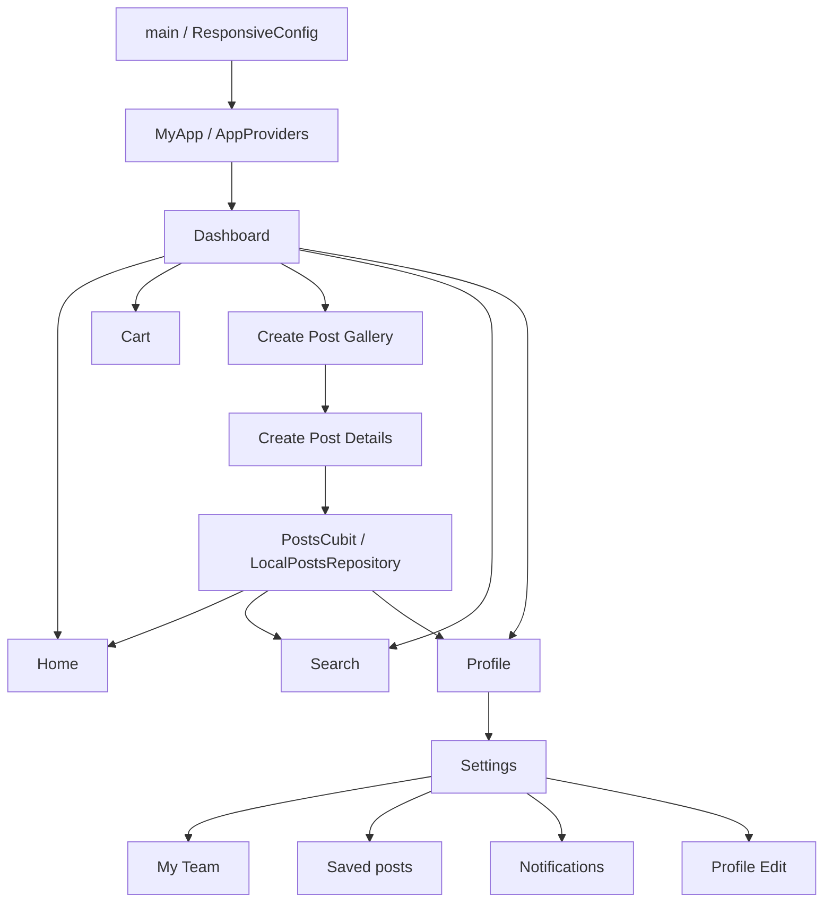
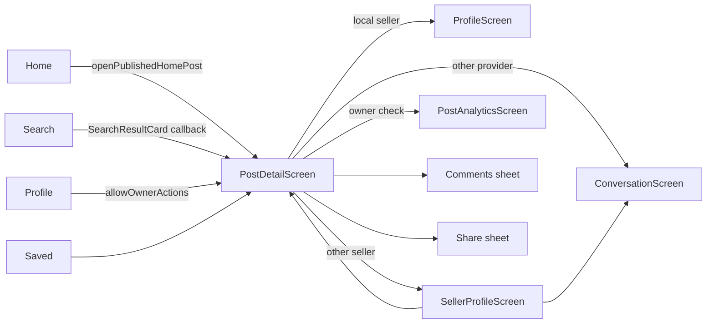
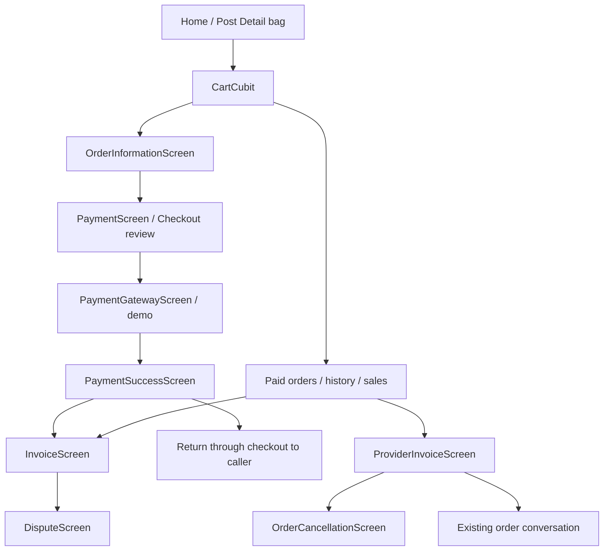
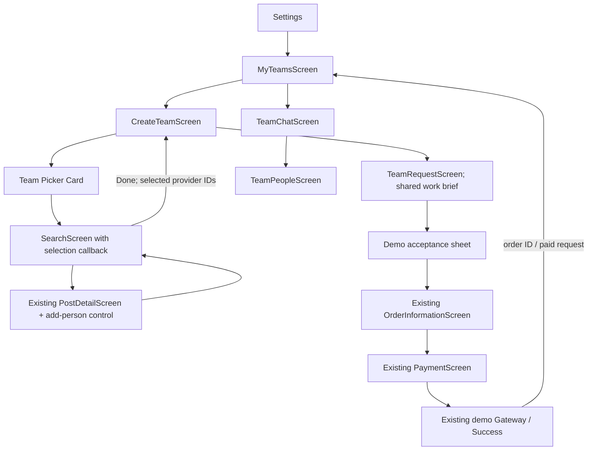
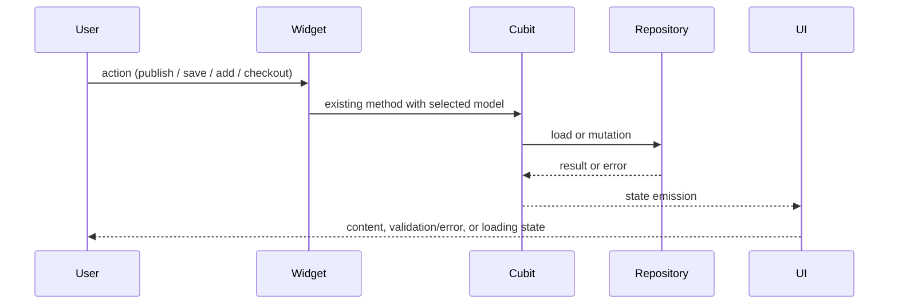

# HYWORK

HYWORK is a Flutter marketplace frontend for product posts, service discovery, provider profiles, local cart/order workflows, messaging, and team collaboration previews. The Dart package name remains **`nini`**; the application display name is **HYWORK**.

This README documents the **current working tree**, including uncommitted work, rather than a proposed architecture or a list of completed backend features. It is intended as a handover for a developer or an assistant continuing the project.

**Source snapshot:** 2026-11-12 (Asia/Karachi). Git HEAD: `5a9d48789037487ba871f872e8511dba442fbc0d`. The working tree contains pre-existing uncommitted source/native/asset changes; this README includes those changes. Inventory: **498 lib Dart files / 42,975 Dart lines / 23 feature directories**. Counts exclude ignored SDK/build/cache files.


## Contents

1. [Current implementation and boundaries](#current-implementation-and-boundaries)
2. [Running the project](#running-the-project)
3. [Architecture and startup](#architecture-and-startup)
4. [Navigation and connected workflows](#navigation-and-connected-workflows)
5. [Models and data contracts](#models-and-data-contracts)
6. [State management](#state-management)
7. [Storage and persistence](#storage-and-persistence)
8. [Media preparation, compression, and cropping](#media-preparation-compression-and-cropping)
9. [Design system, language, and responsiveness](#design-system-language-and-responsiveness)
10. [Loading states and skeletons](#loading-states-and-skeletons)
11. [Feature-by-feature source guide](#feature-by-feature-source-guide)
12. [Native platforms, assets, dependencies, and tools](#native-platforms-assets-dependencies-and-tools)
13. [Verification and limitations](#verification-and-limitations)
14. [Complete source tree](#complete-source-tree)
15. [Cross-file dependency index](#cross-file-dependency-index)
16. [Supporting-file and asset inventory](#supporting-file-and-asset-inventory)

## Current implementation and boundaries

| Area | What the source currently implements |
|---|---|
| Startup | Directly opens Dashboard → Home. Splash/Login/OTP exist as a separate, currently disconnected entry chain. |
| Products and services | Local publishing/editing/deletion, media copies, metadata, categories, rich captions, addresses, schedules, prices and inventory. Home includes published products **and services**. |
| Search | Published local services plus bundled service examples; query suggestions, city selection and an All services control. Local service matching deliberately does not enforce the demo catalogue's city filter. |
| Profile | Editable local identity/photo/business type and local post grid. Public seller profile receives seller/posts through constructors. Profile statistics retain fixed default display values. |
| Cart/orders | Local JSON cart and order history, quantity rules, paid demo receipts, buyer/provider access policies, invoice, cancellation and dispute flows. A fresh Cart is seeded from `demoCartItems`. |
| Payment | Explicit **demo** gateway completion, selected bank logos/method and local receipt creation. No bank API, verified payment callback, actual charge or escrow service. |
| Chat | Session-only repositories, seller conversations, sample inbox data, local text/media/location/voice interactions, selection/delete/block UI. No remote delivery or synchronization. |
| Calls | `PreviewCallService` simulates call state/control/timing. It does not establish calls, capture call media or contact other users. |
| Teams | Multi-provider selection, common work brief, acceptance/decline preview states, reused demo checkout, session-only paid-team workspaces and group-chat UI. No server invitations or persistent team repository. |
| Likes / follow | Likes shared during the app session; seller follow is a local screen-level toggle. Neither is backed by a server or persistent social graph. |
| Saved posts | Persistent local snapshots of post/seller data; saved local posts synchronize with local edits/deletion. |
| Comments / sharing | Comments sheet contains sample comments and sheet-local additions. Share sheet shares/copies text and optionally a supplied URL; it has sample contact UI, not an implemented in-app recipient delivery system. |
| Notifications | Derived from local order timelines and buyer/provider identity; read times are stored with orders. No push-notification service. |
| Wallet / locations | Wallet uses sample balance/transactions and local form UI. Location labels are screen-local, not a persisted address book. |
| Settings | Working routes for My Team, Profile settings, Locations, Wallet, Saved, Notifications and Accessibility; several remaining list items have null actions. |

No authenticated account system, backend database client, REST order service, cross-device synchronization or deployed public post-link handler is configured by the inspected application wiring. The current local identity must not be confused with authentication.

## Running the project

The manifest declares version **`1.0.0+1`**, Dart **`^3.13.3`**, and `publish_to: none`. The locally installed toolchain inspected for this README is Flutter **3.47.4 stable**, Dart **3.13.3**.

```bash
flutter pub get
flutter devices
flutter run
```

Static analysis:

```bash
flutter analyze --no-pub
```

Optional build commands for development, not claims that these builds were run during this documentation update:

```bash
flutter build apk --debug --no-pub
flutter build ios --simulator --debug --no-pub
```

Use a full stop/start after changing native plugins, permissions, native PDF channels or cropper configuration; hot restart does not rebuild platform code. Flutter plugins and SDK artifacts are resolved locally from `pubspec.lock` and the platform build tooling.

Android uses Java 17, AGP 9.1.0, Gradle 9.3.1 and the project's built-in Kotlin adapters. The checked-in iOS project sets deployment target **26.0**. These are current configuration values, not general minimum requirements for the dependencies. Android release configuration currently uses debug signing. Production signing, backend integration and store release setup are separate work.

Mobile behavior is the primary implementation target. Desktop/web runner directories exist, but extensive `dart:io`, native media and permission paths mean their existence alone does not establish feature compatibility on those platforms.

## Architecture and startup

The source is feature-oriented. `data/` contains adapters, local repositories and fixtures; `domain/` contains contracts, records, rules and services; `presentation/` contains Cubits, pages, helpers and widgets. Widget subdirectories group related responsibilities. Some small domains are intentionally flat. Do not reorganize folders or copy old paths from previous conversations without checking this working tree.

```text
lib/main.dart
  → ResponsiveConfig
    → MyApp
      → AppProviders
        → _ThemedApp
          → MaterialApp
            → DashboardScreen(initialTab: home)
```

- [main.dart](lib/main.dart) initializes Flutter bindings and wraps `MyApp` in `ResponsiveConfig`.
- [app.dart](lib/app/app.dart) accepts injectable post/analytics/cart/category/saved/profile repositories, configures locale/theme/route observer, and chooses Dashboard as `home`.
- [app_providers.dart](lib/app/app_providers.dart) owns nine app-wide Cubits. Providers are lazy by default except `UserProfileCubit`, which is explicitly eager. Calls such as `..load()` run when their provider is created, not necessarily simultaneously at `runApp`.
- `BlocProvider(create:)` owns and closes its Cubit. Widgets that manually instantiate controllers/Cubits close them in `dispose`; `BlocProvider.value` shares an existing instance and does not transfer ownership.
- Dashboard owns its navigation Cubit and PageController. Its five tab indexes remain Home, Cart, Create, Search, Profile. Create opens a separate route; its tab page is a placeholder preserving indexes.
- `MaterialPageRoute` and `Navigator.push/pop` are the main routing mechanism; there is no centralized named-route table.



### Identity and ownership

[local_identity.dart](lib/shared/models/local_identity.dart) defines `localProfileId = 'local-profile'`. `UserProfile.seller` supplies that stable ID with the edited display name/avatar/bio. The current account dataset in `PostsCubit` determines post management rights; publication time, seller name and image are not identity checks.

`PostsState.canManage()` requires a loaded, readable local dataset containing the ID. `canViewAnalytics()` additionally requires a published record. Post Detail only enables owner menus when `allowOwnerActions` is supplied by the account Profile and management checks pass. Buyer and provider permissions are evaluated per order by `OrderAccess`; one local profile can occupy different roles on different orders. Remote adapters would need to enforce real ownership and authentication independently.

## Navigation and connected workflows

### Feed, Search, profiles and Post Detail



- [home_post_navigation.dart](lib/features/home/presentation/helpers/home_post_navigation.dart) opens the existing detail screen with the selected `PostItem` and `PostSeller`. Seller navigation returns to/open the account Profile for local identity/dataset membership, otherwise opens public seller Profile with the supplied post list.
- [published_home_navigation.dart](lib/features/home/presentation/helpers/published_home_navigation.dart) resolves edited local profile information for locally published posts.
- [search_content.dart](lib/features/search/presentation/widgets/common/search_content.dart) switches among suggestions, cities and results. The callback chain is `SearchResultCard → SearchResultsGrid → SearchContent`. Normal browsing opens the same detail screen. An optional `onPostSelected(post, seller)` activates contextual Team selection without replacing normal Search behavior.
- Search cards reuse `ProfilePostCard`, measured card heights and grid scaling. They override the type label to **Services**, hide product stock and retain pre-order status in the reserved status row. They pass actual unit/post data and `impressionSource: 'search'`.
- Account Profile posts open detail with owner actions. Public seller Profile receives seller/posts and a post callback; its list is not fetched from a server. The public Follow button only toggles local state.
- Post Detail receives a `PostItem` immediately. If a matching local post changes, its `BlocBuilder` uses the current record. There is no async fetch-by-ID detail endpoint or separate Service Detail screen.
- Detail media uses `PostImageCarousel`; Home uses `HomePostMediaSlider` around the same media presentation. `HomePostMediaIndicator` controls theme-aware dots and the active indicator.
- Normal pushed routes pop to their caller. Returning to the local author from an owner-detail entry can pop the detail route rather than stacking another account profile.

### Create, edit and delete a post

1. Dashboard's Create action pushes `CreatePostGalleryScreen`.
2. `GalleryCubit` loads permission-aware Photo/Video assets in pages, or FilePicker documents, retaining multiple `GalleryAttachment` selections. Library observers, load-version checks, retry and limited-access handling live in the gallery feature.
3. Next prepares app-owned compressed copies with `GalleryMediaPreparer`. A custom `onNext` returns attachments to a caller such as Chat or Team; normal creation pushes `CreatePostDetailsScreen` while sharing the existing `CreatePostCubit`.
4. The form records product/service type, title, Quill caption/plain text and delta, category, price/discount/stock, unit, preparation/inventory options, features, tags, address, alt text and schedule.
5. `PostDraftValidator`, editor validation and repository validation guard submission. `PostsCubit.publish` passes the draft and attachments to `LocalPostsRepository`, which copies media and commits the index.
6. A successful `PostItem` is returned through Details → Gallery → Dashboard. Dashboard selects the post's profile category and switches to Search for services or Home for products. Both categories also appear in Home's published feed.
7. Edit uses `manage_post_actions.dart → EditPostScreen`, maps the stored post to a draft, tracks retained/new media, and updates the same ID. Cancel/Back can ask to discard dirty changes.
8. Delete uses the owner/delete sheets and `PostsCubit.delete`. It commits metadata before cleaning only repository-owned media that no other stored post references. Deleting a profile category removes the category tab, not its posts or files.

Schedules are stored metadata and validated locally. There is no background publishing scheduler. Do not infer a timed server publish from the presence of a schedule field.

### Cart, quantity and checkout



- Home's bag calls `CartCubit.toggleItem` with one unit. Tapping a bag for an item already in Cart removes it, as the current requested behavior specifies. The new item is inserted at the front.
- Post Detail has a pinned `PostDetailBottomBar` for both products and services. It displays **unit price**, not quantity-multiplied total. The engagement-row bag adds/removes the post using the selected quantity. Changing quantity updates Cart when that post is already in it; before adding, it updates detail selection only.
- `postCartItem()` validates/parses the post price, derives base price and discount, preserves provider identity and chooses quantity limits. Services without warehouse inventory use the normal cart cap rather than being treated as out of stock.
- `CartItem.quantity` uses **hundredths**: `100 = 1`, `250 = 2.5`. Unit prices are whole Tomans; calculated totals are hundredths of a Toman. `parseCartAmount`, `cartMoney`, `cartQuantity` handle this conversion. Do not substitute floating-point quantity arithmetic or treat `100` as one hundred displayed pieces.
- Piece/item/session/project/set quantities require whole units; kilogram/hour/meter/centimeter/day allow fractions. `accepts()` rejects zero, negatives, incompatible fractions and values above the cap. Remove is a separate operation.
- Cart uses different product/service item card layouts, stock/quantity validation, delete actions, tabs and status filtering. A genuine empty cart stays empty UI; restoration uses list skeletons.
- `openCartCheckout` sets the selected checkout IDs and pushes the shared customer-information screen. It restores the cart stage when the route returns.
- Customer-information validates its form, snapshots items/totals/customer details, then pushes Checkout review. It checks snapshot identity/totals again before opening Gateway to avoid paying for a changed cart.
- Bank selection uses `PaymentSelectionCubit`; method changes return to the same CartCubit. The banks are Melli, Mellat and Saman.
- Gateway's explicit demo action calls `completeDemoPayment`. Receipt creation is idempotent by checkout ID, groups items by `(seller ID, service/product type)`, apportions charges and saves before accepting the completion. Selected items leave Cart only as part of the committed order snapshot.
- Success can open the invoice and then return. The order ID propagates Gateway → Payment → OrderInformation → caller. This is not a real bank result.

### Buyer/provider order work and notifications

`OrderAccess` uses stable IDs and order status, not display names. A provider can accept an eligible paid or pending-approval order. For paid receipts the normal provider progress is:

```text
Product: paid → accepted → preparing → shipped → buyer confirms completed
Service: paid → accepted → scheduled → inProgress → buyer confirms completed
```

Cancellation/dispute permissions depend on role and active status. Provider cancellation requires a reason and may attach files; buyer disputes use the same reusable problem form with different submission behavior. Changes go through the shared CartCubit and persist locally. Legacy product-request transitions also exist in CartCubit; they are not a connected real payment API.

`NotificationsCubit` subscribes to CartCubit and derives entries from paid time plus the order timeline. Paid, accepted, canceled, completed and disputed events remain distinguishable. Read timestamps are role-specific. Notifications opens buyer Invoice or Provider Invoice according to `asProvider`. Entry is available in Profile's bell and **Settings → Notifications**; Home's feed header has messages, not a notification bell. This is local activity, not device push delivery.

### Chat, voice and calls

`openSellerConversation` uses `seller-${seller.id}` with `InMemoryChatRepository.instance.openConversation`, so repeated entry for the same provider reuses its session. A new seller conversation is explicitly empty. The demo repository can seed sample messages for demo conversations; the Team repository uses a separate empty chat repository.

`ConversationScreen` provides `ConversationCubit`, `VoiceRecordingCubit` and `VoicePlaybackCubit`. Text/location additions are synchronous repository operations; attachments/voice copy app-owned files asynchronously, preserve sending/error flags, and discard failed or abandoned copies. The conversation supports emoji, message selection/deletion, clear/block actions and photo/video/file/camera/location attachments. Media files open with existing OS/file-launch integrations; video attachment display uses previews/opening rather than implying a new streaming backend.

`DeviceVoiceRecorder` uses `record`; `JustAudioChatPlayer` uses `just_audio`. Recording/playback Cubits handle intent/version checks and disposal; conversation lifecycle handling pauses playback and stops/cancels recording as appropriate when inactive. Calls open the existing `CallScreen`, whose default `PreviewCallService` only simulates controls and call state. No WebRTC, signaling server, live group call or remote recipient exists in these implementations.

### Team creation, provider requests and workspace



- `TeamFormState.members` contains `PostSeller` values; `memberServices` stores the chosen post and quantity per stable provider ID. Toggle operations deduplicate by provider ID. The Team Picker Card displays count and selected avatars.
- Form widgets keep team name, description, multiple project locations, time frame and media/files separate. Search may select multiple providers before one shared work title/description/start date and per-provider quantities are submitted.
- `TeamRequest` has draft, awaiting, accepted, declined, cancelled and paid states. The current Request action calls `previewResponse(accepted: true)` immediately after submit, so the client demo shows the accepted sheet. Waiting/decline UI remains available in the status implementation for future provider response wiring; it is not driven by a backend today.
- `openTeamCheckout` reuses **existing payment pages** with a separate `CartCubit(MemoryCartRepository(...))` and nested Navigator. It does not add team items to the normal persisted Cart. A returned demo order ID changes the Team request to paid.
- `CreateTeamScreen` creates a `TeamWorkspace` only for a paid request. `InMemoryTeamsRepository` exposes session changes, stores paid workspaces, supports edit/delete and owns a separate empty chat repository. It is not disk-persisted.
- My Team lists session workspaces; no teams shows the illustration/empty state. Team cards expose edit/delete/chat. Tapping a team opens its existing `ConversationScreen` wrapper with `team-${id}` conversation identity and members bar; People lists members and can add providers through the same contextual Search selection.
- Group chat is an in-memory UI/session preview. Member invitation delivery, role permissions, remote acceptance and restart-safe team/payment history are not implemented for this isolated preview cart.

### Remaining entry flows

- `SplashScreen → LoginScreen → OtpVerificationScreen → LocationPermissionGate → DashboardScreen` exists in source, but current `MyApp.home` bypasses it. Login does not send SMS; OTP accepts a four-character UI code, not a verified token.
- Profile menu → Profile Settings → Profile Edit persists name/details/business type and cropped photo, updating Profile, local post author headers and Dashboard's profile icon through UserProfileCubit. Missing photo uses an icon.
- Profile Categories opens from category controls and uses the shared categories Cubit for CRUD/select.
- Saved opens from Settings; selecting a snapshot opens existing detail with its seller. Local snapshots synchronize with post edits/deletion. No remote saved collection exists.
- Wallet → Top Up / Withdraw → Withdraw Summary is sample/form navigation, not money movement. Locations adds/selects in-screen labels and provides map/address UI; those labels disappear with that screen's Cubit.
- Accessibility exposes existing theme options; ThemeCubit follows system/light/dark for this session. Settings labels such as Trending, Insights, Scheduled content, Blocked, Comments, Language, Device permissions, Posts, My Media, Tags and Archive have null actions in the current list. The old Shimmer Preview route/file is absent from this working tree.

## Models and data contracts

| Model / source | Important fields and relationships |
|---|---|
| [PostItem](lib/shared/models/post/post_item.dart) | Stable `id`, image fallback, title/category, integer stock, string current/original prices, media, typed details/legacy metadata, publication date and optional profile-category ID. `isService` uses stored post type or recognized legacy service category. `isPublished` means non-null publication date, not ownership. |
| [PostDetails](lib/shared/models/post/post_details.dart) | Caption/plain text + Quill delta, tags, address, schedule, features, warehouse-stock text, discount, unit and alt texts. `fromJson` retains the original metadata map, including unknown keys. |
| [PostAddress / PostSchedule / PostFeature](lib/shared/models/post/post_attributes.dart) | Nullable coordinates with manual city/province/address/building/unit/postal fields; start/end timestamps; feature name/value. |
| [PostMedia](lib/shared/models/post/post_media.dart) | Path, display name, media type, asset/file source, optional thumbnail and alt text. Post storage converts owned paths between relative JSON and runtime absolute paths. |
| [PostSeller](lib/shared/models/post/post_seller.dart) | Stable provider ID, name, avatar asset/file path, location and bio; passed independently of a post's typed details. JSON round trips support stored seller snapshots. |
| [PostUnit](lib/shared/models/post/post_unit.dart) | Stable enum names with labels; older unknown names remain null rather than guessing a unit. |
| [PostDraft](lib/features/create_post/domain/models/post_draft.dart) | Editable creation/editing fields; CreatePostCubit state is the draft itself. Gallery attachments are passed separately. |
| [GalleryAttachment](lib/features/create_post/domain/models/gallery_attachment.dart) | Stable selection ID, AssetEntity or PlatformFile, optional prepared file. Prepared copy does not replace original picker identity/preview. |
| [CartItem](lib/features/cart/domain/models/cart_item.dart) | Seller, post ID, type, unit, whole-Toman unit price/discount, hundredth quantity and cap, image and status. Computed subtotal/discount/total remain integer. |
| [CartOrder](lib/features/cart/domain/models/cart_order.dart) | Items, customer/provider identities, method/charges, checkout/invoice/transaction IDs, paid/demo flags, customer details, status timeline, read times, dispute and cancellation data. |
| [CartSnapshot](lib/features/cart/domain/models/cart_snapshot.dart) | Versioned items/orders persistence boundary. Checkout stage/filter/method selection are runtime CartState fields. |
| [OrderCustomerDetails](lib/features/payment/domain/models/order_customer_details.dart) | Name, surname, mobile, city, province, address and postal code supplied by the form; passed in PaymentDetails and receipt. |
| [PaymentDetails](lib/features/payment/domain/models/payment_details.dart) | Total, summary rows, items, customer/address/phone and checkout ID carried between review/gateway. |
| [OrderDispute](lib/features/payment/domain/models/order_dispute.dart) / [OrderCancellation](lib/features/order_cancellation/domain/order_cancellation.dart) | Reason/description, timestamp, attachment snapshots; cancellation records provider identity. |
| [SavedPost](lib/features/saved_posts/domain/saved_post.dart) | Post snapshot, optional seller snapshot and saved timestamp. |
| [UserProfile](lib/features/profile_settings/domain/user_profile.dart) | Names, nationality, username, email, birth date, gender, bio, business type and avatar path; projects into the stable local `PostSeller`. |
| [ChatConversation](lib/features/chat/domain/models/chat_conversation.dart) / [ChatMessage](lib/features/chat/domain/models/chat_message.dart) | Session ID/name/avatar/preview/unread data; message text/time/direction/delivery/location/attachment. No durable message JSON repository is wired. |
| [ChatAttachment](lib/features/chat/domain/models/chat_attachment.dart) / [ChatLocation](lib/features/chat/domain/models/chat_location.dart) | Owned path/name/type/thumbnail/voice duration; location coordinates/address. |
| [CallSession](lib/features/calls/domain/call_session.dart) | Phase/type/control flags, connection time and failure state for the call service contract. |
| [PostAnalyticsEvent / Report](lib/features/post_analytics/domain/post_analytics.dart) | Event ID/post/type/time/value/source; period-based aggregates of views, impressions, interactions, watch sessions and orders. |
| [TeamProviderSelection](lib/features/team/domain/team_provider_selection.dart) / [TeamRequest](lib/features/team/domain/team_request.dart) / [TeamWorkspace](lib/features/team/domain/team_workspace.dart) | Provider + selected post/quantity; shared brief/schedule/attachments/status/payment ID; session workspace/owner/members/locations and stable team conversation ID. |
| [AppNotification](lib/features/notifications/domain/app_notification.dart) | Order ID, provider/buyer route flag, event text/time/read count; derived rather than independently stored. |
| [WalletTransaction](lib/features/wallet/domain/wallet_transaction.dart) | Display transaction/type data supplied by WalletSampleData. |

Serialization methods and additional declarations are indexed per file below. Constructor references/imports are static dependencies, not proof of a reachable runtime route.

## State management

### App-wide Cubits

| Cubit | Source and state | Startup / consumers / operations |
|---|---|---|
| UserProfileCubit | `profile_settings/presentation/cubit/user_profile_cubit.dart` → UserProfileState | Eager load of repository; save serialization, error flags and safe close. Profile, edit form, Dashboard icon, local author projection and Team owner consume it. |
| PostLikesCubit | `posts/presentation/cubit/post_likes_cubit.dart` → `Set<String>` | Session post-ID likes; shared Home/detail controllers subscribe and toggle the same ID. |
| ProfileCategoriesCubit | `posts/presentation/cubit/profile_categories_cubit.dart` → ProfileCategoriesState | Load/select/create/rename/delete, validation, mutation errors. Profile chips/grid and creation/edit forms consume it. |
| CartCubit | `cart/presentation/cubit/cart_cubit.dart` → CartState | Load and serialize JSON writes; item toggle/add/remove/quantity, checkout, receipts, role-controlled statuses, disputes/cancellation. Cart, post bags/selectors, checkout, invoices and notifications consume it. |
| NotificationsCubit | `notifications/presentation/cubit/notifications_cubit.dart` → NotificationsState | Subscribes to Cart; derives timeline notifications, search/read state; closes subscription. |
| PostAnalyticsCubit | `post_analytics/presentation/cubit/post_analytics_cubit.dart` → PostAnalyticsState | Loads lazily on tracking/view usage; queues local event writes, exposes storage errors. Activity trackers and owner analytics consume it. |
| ThemeCubit | `core/theme/theme_cubit.dart` → ThemeMode | Session preference; system/light/dark and toggle. MaterialApp rebuilds theme; Accessibility options change it. |
| PostsCubit | `posts/presentation/cubit/posts_cubit.dart` → PostsState | Load/publish/update/delete and failure/busy fields; Home, Search, Profile, Saved sync, edit/detail/ownership checks consume it. |
| SavedPostsCubit | `saved_posts/presentation/cubit/saved_posts_cubit.dart` → SavedPostsState | Persistent toggles/removal and local-post synchronization; serial queue, load/save/storage errors, subscription cleanup. |

### Screen and operation scope

Dashboard navigation, Search query/panel, Gallery loading/selection/preparation, creation draft, address geocoding, schedule, features and save/dirty state have separate existing Cubits. Detail and sample Home cards own interaction controllers sharing app likes/saves; media index and selected quantity are route/card state. Edit adds separate media/field Cubits. Seller Follow is local. Cart's payment review method Cubit is owned/disposed by the review screen. Conversation/voice/call state is owned by their route/providers. Team forms/requests are local; TeamsCubit subscribes to its session repository. Locations labels/permission UI, wallet amount, countdown timers and map-tile failure/retry state are local utilities. The [Cubit index](#cubit-index) lists every concrete Cubit and its source methods.



This sequence applies to repository-backed flows. Search catalogue filtering, likes, follow and many form fields are synchronous local operations; they do not perform an async repository call simply because they use a Cubit.

## Storage and persistence

`path_provider` supplies documents/temporary locations on supported platforms. Several iOS repositories derive `Documents` from `Directory.systemTemp.parent` to keep durable paths available in the running app. Relative paths below are within the app sandbox, not repository directories.

| Data | Location / implementation | Restart behavior |
|---|---|---|
| Published posts | `Documents/nini_posts/posts.json`; LocalPostsRepository | Persistent; schema version 2; accepts v1/v2 and migrates. No missing-index demo post seeding. |
| Post media | `Documents/nini_posts/<media-folder>/...`; LocalPostMediaStore | Persistent copies, thumbnails and alt text; temporary `.pending-<id>` directory is committed before index references. |
| Profile categories | `Documents/nini_profile_categories/categories.json` | Persistent version 1; absent index returns Web Development, Electrical Wiring, Products, Photography defaults. |
| Cart + orders | `Documents/cart.json`; LocalCartRepository / CartSnapshot | Persistent version 1. Missing file seeds demoCartItems; malformed data surfaces storage error and guards edits. |
| Saved snapshots | `Documents/nini_saved_posts/<encoded-profile-id>.json` | Persistent version 1 and profile-ID boundary; contains post/seller snapshots, not independent copies of every media file. |
| User profile/photo | `Documents/nini_profile/<encoded-profile-id>/profile.json` + unique `avatar_...jpg/png` | Persistent version 1/profile ID; previous image removed after successful replacement commit. |
| Analytics | `Documents/post_analytics.json` | Persistent version 1 event list, local to the device. |
| Dispute/cancellation files | `Documents/nini_dispute_attachments/...` | Persistent owned copies; linked by order attachment metadata. |
| Prepared Gallery files | Temporary `hywork_upload_...` folders | Staging only; OS may purge temporary data. |
| Chat attachment/voice files | Temporary `nini_chat_media` folders | OS may purge; message repository itself is session-only. |
| Chat messages/block state | InMemoryChatRepository | Lost on process restart. |
| Teams and group chats | InMemoryTeamsRepository / separate empty chat repository | Lost on process restart; isolated MemoryCartRepository checkout is also session-only. |
| Likes / follow / theme | Cubit memory | Session/screen scope; not persisted by these implementations. |
| Location labels / unsaved forms | Local Cubits/controllers | Not saved as a durable account address book/draft store. |
| Wallet | Bundled sample data and local amount fields | No financial transaction persistence. |

Principal JSON envelopes, shown as schema summaries rather than populated records:

```text
posts.json           {version: 2, posts: [PostItem.toJson(), ...]}
categories.json      {version: 1, categories: [ProfileCategory.toJson(), ...]}
cart.json            {version: 1, items: [CartItem.toJson(), ...], orders: [CartOrder.toJson(), ...]}
<profile-id>.json    {version: 1, profileId: ..., posts: [SavedPost.toJson(), ...]}
profile.json         {version: 1, profileId: ..., profile: UserProfile.toJson()}
post_analytics.json  {version: 1, events: [PostAnalyticsEvent.toJson(), ...]}
```

Writes generally use a `.tmp` file, flush, then rename; queues serialize mutations where implemented. Post v2 indexes store owned media paths relative to the post root and reject absolute/traversal paths on load. Migration removes only exact historical demo records; edited examples/user-created records are retained. Media cleanup checks repository ownership before deleting files, and cleanup failures do not invalidate already committed post/profile saves.

Loading failures are represented by the owning Cubit's existing flags/errors. Cart deliberately prevents editing after an unreadable restore until retry; saved/profile/post operations expose failure state rather than pretending a durable write succeeded. `shared_preferences` is declared under **dev_dependencies**, but the inspected app's persistence uses the file repositories above; there is no SharedPreferences-backed app service wired here.

## Media preparation, compression, and cropping

The implementation optimizes **app-owned copies**; picker originals are not edited. Compression is best effort: supported output is accepted only if nonempty and smaller. Errors, unsupported formats, already-efficient output and preserved animation can retain the original copy. Do not promise that every file becomes smaller.

- [media_compressor.dart](lib/core/media/media_compressor.dart): image quality 82, 1920 requested width/height settings, EXIF removal/orientation correction; PNG/WebP preserve transparency through PNG, animated formats are retained. Video compressions are serialized with 720 short/1280 long side options and audio retained; output dimensions/audio availability are checked.
- [document_compressor.dart](lib/core/media/document_compressor.dart): PDFs use `hywork/document_compression → compressPdf`. Office `.docx/.xlsx/.pptx` contents are re-deflated in an isolate while retaining the document format, with entry/size bounds, signature checks and CRC/content validation. Documents are **not wrapped into ZIP uploads**. Unsupported document types stay unchanged.
- Android's `PdfDocumentCompressor.kt` uses PDFBox to deflate uncompressed streams and validates page count. iOS's `PdfDocumentCompressor.swift` uses PDFKit with screen-image optimization where available and validates page count. Encrypted/signed/invalid PDFs are skipped. The native method channel is registered by Android MainActivity and iOS AppDelegate/plugin code.
- `GalleryMediaPreparer` copies selected assets/files into temporary owned files on Next/Add. `PreparedGalleryFile` preserves FilePicker compatibility. `GalleryAttachment.preparedFile` allows subsequent Post/Chat stores to reuse the prepared copy rather than compressing it twice.
- Post/Chat/Dispute stores cover their direct incoming copy paths as well as Gallery selections. Team attachments reuse Gallery preparation and display the prepared file size.
- Profile Edit uses `ProfilePhotoCubit → cropProfilePhoto`: native square-aspect crop with circular editor styling, themed controls and 1024 output request. Cancel returns null and preserves the previous selection. Final profile photo compression occurs in LocalUserProfileRepository before the durable image/profile commit. Profile/avatar widgets clip the image as a circle and use an icon if no image exists.

These operations are local preparation/storage, not network uploads. Physical camera/gallery/microphone permissions and cropper behavior still require device verification for a given deployment.

## Design system, language, and responsiveness

### Appearance ownership

| File | Controls |
|---|---|
| [app_colors.dart](lib/core/theme/app_colors.dart) | Central fixed palette: black/white, surface/outline variants, status/badge colors, chart series, call colors and skeleton base/highlight pairs. |
| [app_theme.dart](lib/core/theme/app_theme.dart) | Light/dark ColorScheme, background/foreground, Material text theme, inputs, buttons, icon/popup/tooltip/app-bar styles and system overlays. |
| [app_text_styles.dart](lib/core/theme/app_text_styles.dart) | Semantic typography, font families and weights. Main body 16, supporting roles commonly 14, screenTitle 24, sectionTitle 18 bold. Compact badges/grid roles are explicitly smaller and are not globally enlarged. |
| [app_icons.dart](lib/core/icons/app_icons.dart) / [app_icon.dart](lib/shared/widgets/app_icons/app_icon.dart) | Semantic asset registry and theme-tinted SVG/PNG renderer, dimensions, optional selection background and semantics. `cart` / `shoppingBag` use the shared bag asset. |
| [app_assets.dart](lib/core/assets/app_assets.dart) | Shared brand/login/OTP/location illustrations. |
| [profile_image_provider.dart](lib/shared/widgets/app_images/profile_image_provider.dart) | Shared asset/file provider resolution for profile imagery. |

`pubspec.yaml` registers YekanBakh Regular (400) and ProfileCard's bundled Roboto Regular (400), Bold (700), Black (900). Text roles request w400–w900; not every requested Yekan weight has a separate font file. Profile/Home reference card roles use ProfileCard with Yekan fallback. `numberFontFamily = 'Roboto'` is a style constant; the explicitly registered Roboto faces are under the **ProfileCard** family.

Profile/Search reference cards use two title lines, measured metadata/status/price lines, square `BoxFit.cover` media, red top-right discount chip, original price above bold current price/unit on the left, and a star on the right. Original-price color/strike uses onSurface opacity .65. Search overrides category to Services and hides stock. Profile defaults retain their original rendering. Card scale is based on width / 200 reference units; these are reference sizes, not guaranteed final device-pixel sizes.

Home uses larger bundled title/price faces, a price/stock row, and only title/type/price information below engagements; captions/specifications remain in detail. Post Detail's pinned bar uses current unit price, original-price styling where applicable, quantity selector and contextual Team action. Engagement icon assets use the current shared post-heart/comment/share shapes with red selected likes. Dashboard navigation is black with white icons and rounded dark selected/hover background; photo/icon fallback comes from UserProfileCubit.

### Language and alignment

`MyApp` currently fixes locale to English, supports English/Persian localization delegates and wraps content in **LTR Directionality with right-aligned default text**. `PersianFeature` also currently uses English/LTR/right-aligned presentation; its name does not mean the entire app is globally RTL. Individual grids/rows and Persian selectors set their own explicit direction where needed. Price placement intentionally remains left-oriented inside some right-aligned cards.

String groups live in `lib/core/localization/`; Search preserves stable canonical catalogue keys and uses English display mappings. Iranian address catalogues store Persian keys while presenting English city/province labels. Do not rename stored keys to match translated UI copy. `AppStrings.persianDigits` currently normalizes Persian/Arabic digits into Latin digits for English development copy; engagement counters have a separate Persian-digit helper. Currency and quantity controls contain intentionally Persian labels in selected places. This is mixed current behavior, not a completed automatic app-wide localization system.

### Responsive utilities

[AppResponsive](lib/core/responsiveness/app_responsiveness/app_responsiveness.dart) uses the available bounded layout width:

| Screen type | Width | Horizontal padding / vertical spacing | General grid columns / gap |
|---|---|---|---|
| Compact | `< 600` | 16 / 16 | 3 / 4 |
| Medium | `600–<840` | 24 / 24 | 4 / 8 |
| Expanded | `>=840` | 32 / 32 | 5 / 12 |

Global maximum content width constant is 1120; individual screens choose narrower constraints: Home 600, Search 720, account/public Profile up to 720, checkout generally 600, dialogs typically 560/720. `AppResponsiveBuilder` uses LayoutBuilder with MediaQuery fallback for unbounded width.

`ResponsiveConfig` sets ScreenUtil design size 390×844, `minTextAdapt: true`, split-screen mode, FoldableProvider and matching ResponsiveFramework breakpoints. `DashboardFoldLayout` contains fold-aware bottom-bar layout behavior. This supports adapting to constraints; it is not evidence that every physical foldable was tested.

Profile/Search card grids additionally cap at three columns and reduce column count for larger system text: floor(width / (110 × textScale)), constrained to 1..min(general columns, 3). Their 2-unit cross-axis spacing and `ProfilePostCard.detailsHeightFor` / rounded TextPainter line measurements keep price baselines and content slots consistent. FittedBox, Wrap, Flexible and screen-specific scrolling handle constrained layouts. Do not replace these calculations with fixed heights without checking text scaling.

Motion helpers are ScreenEntrance, StaggeredEntrance and optional RiveAssetAnimation. They share the route observer and respect reduced-motion settings where implemented. Rive helper presence does not imply every screen uses a Rive asset.

## Loading states and skeletons

Actual directory: **`lib/shared/widgets/skeleton/`** (singular). `DetailsSkeleton` is defined in **`detail_skeleton.dart`**. These paths differ from some older task descriptions.

| Existing component | Current usage |
|---|---|
| AppShimmer / AppSkeletonBox | Base animation/shape used by skeleton layouts; theme constants in AppColors. Controller repeats at 1400 ms, stops for disabled animations/TickerMode and disposes correctly. |
| PostCardSkeleton | Home initial local-post loading when no posts are available. |
| ProductCardSkeleton | Search initial post restore, Profile post grid and Saved grid initial loading. |
| ProfileSkeleton | Profile's UserProfileCubit loading phase. |
| ListTileSkeleton | Cart restore; Notifications while orders restore; owner analytics loading; profile categories load; Profile Edit restore. |
| MessageSkeleton | Available reusable widget; not currently referenced by a conversation page. |
| DetailsSkeleton | Available reusable widget; not currently referenced by Post Detail. |

Seller Profile, Search catalogue filtering, Chat's synchronous in-memory history, Wallet, Locations and static forms do not invent delays to show shimmer. Existing empty/error/content states remain distinct. Profile post grid shows current content with a refresh indicator where its existing state branch calls for it. Gallery permission/library loading and media preparation keep their dedicated status/error/progress UI rather than a forced detail skeleton. No Shimmer Preview screen/menu entry exists in this snapshot.

## Feature-by-feature source guide

Every Dart file is listed below with exact path, physical line count, responsibility label and declarations. Responsibility labels for small widgets describe their source/file role; declarations and dependency maps are extracted statically. Private State/painter classes are included, not counted as extra screens. Import dependencies must not be mistaken for runtime navigation.

### Feature inventory

| Feature | Dart files | Dart lines | Purpose |
|---|---:|---:|---|
| [calls](#feature-calls) | 9 | 992 | Call UI and preview service |
| [cart](#feature-cart) | 35 | 2,560 | Cart, checkout selection and order state |
| [chat](#feature-chat) | 38 | 3,895 | Inbox, conversations, attachments and voice |
| [create_post](#feature-create-post) | 47 | 6,656 | Gallery, draft form, address and publishing inputs |
| [dashboard](#feature-dashboard) | 6 | 654 | Application shell and bottom navigation |
| [home](#feature-home) | 20 | 1,418 | Published local feed |
| [locations](#feature-locations) | 10 | 585 | Location labels, map preview and permission prompt |
| [login](#feature-login) | 3 | 223 | Phone entry UI |
| [notifications](#feature-notifications) | 13 | 638 | Local buyer/provider order event inbox |
| [order_cancellation](#feature-order-cancellation) | 2 | 97 | Provider cancellation reason and attachments |
| [otp_verification](#feature-otp-verification) | 4 | 196 | OTP UI and transition |
| [payment](#feature-payment) | 31 | 2,567 | Customer details, checkout review, demo gateway and buyer invoice |
| [post_analytics](#feature-post-analytics) | 18 | 2,547 | Owner-only local activity analytics |
| [post_detail](#feature-post-detail) | 15 | 1,606 | One existing detail screen for products and services |
| [posts](#feature-posts) | 52 | 4,695 | Local post/category persistence, editing and shared post content |
| [profile](#feature-profile) | 21 | 1,603 | Account Profile, public seller Profile and Settings menu |
| [profile_settings](#feature-profile-settings) | 16 | 1,083 | Editable durable user identity/photo and theme options |
| [provider_invoice](#feature-provider-invoice) | 3 | 219 | Provider order review and actions |
| [saved_posts](#feature-saved-posts) | 7 | 560 | Persistent saved post collection |
| [search](#feature-search) | 16 | 1,236 | Service catalogue and provider discovery |
| [splash](#feature-splash) | 3 | 149 | Disconnected introductory entry screen |
| [team](#feature-team) | 42 | 3,196 | Multi-provider work requests and session workspaces |
| [wallet](#feature-wallet) | 26 | 1,213 | Wallet preview, top-up/withdraw forms and summary |

<a id="feature-calls"></a>

### Feature: calls

Conversation voice/video actions open CallScreen. CallCubit coordinates the CallService contract, session stream, timers, microphone/speaker/camera flags and shutdown. PreviewCallService changes state only; no real call transport is configured.

**Direct cross-feature imports:** `chat`. **Imported by features:** `chat`. These lists describe source dependencies, including fixtures and optional paths.

<details>
<summary>All 9 Dart files in calls</summary>

Paths in this table are relative to `lib/features/calls/`; links target the exact repository file.

| File | Lines | Responsibility and declarations |
|---|---:|---|
| [data/preview_call_service.dart](<lib/features/calls/data/preview_call_service.dart>) | 64 | State/control-only voice/video call simulation implementing CallService.<br>`PreviewCallService` |
| [domain/call_service.dart](<lib/features/calls/domain/call_service.dart>) | 18 | Defines the call service record, enum, contract or rule shown in its declarations.<br>`CallService` |
| [domain/call_session.dart](<lib/features/calls/domain/call_session.dart>) | 47 | Defines the call session record, enum, contract or rule shown in its declarations.<br>`CallType`, `CallPhase`, `CallFailure`, `CallSession` |
| [presentation/cubit/call_cubit.dart](<lib/features/calls/presentation/cubit/call_cubit.dart>) | 185 | Coordinates call state and exposes the source mutation/lifecycle methods.<br>`CallState`, `CallCubit` |
| [presentation/pages/call_screen.dart](<lib/features/calls/presentation/pages/call_screen.dart>) | 278 | Composes the call page UI and its existing state/navigation callbacks.<br>`CallScreen`, `_CallView`, `_CallViewState` |
| [presentation/widgets/controls/call_action_button.dart](<lib/features/calls/presentation/widgets/controls/call_action_button.dart>) | 52 | Renders call action button UI; its declarations/imports identify the existing composition and callbacks.<br>`CallActionButton` |
| [presentation/widgets/controls/call_controls.dart](<lib/features/calls/presentation/widgets/controls/call_controls.dart>) | 124 | Renders call controls UI; its declarations/imports identify the existing composition and callbacks.<br>`CallControls` |
| [presentation/widgets/display/call_avatar.dart](<lib/features/calls/presentation/widgets/display/call_avatar.dart>) | 82 | Renders call avatar UI; its declarations/imports identify the existing composition and callbacks.<br>`CallAvatar` |
| [presentation/widgets/display/call_video_stage.dart](<lib/features/calls/presentation/widgets/display/call_video_stage.dart>) | 142 | Renders call video stage UI; its declarations/imports identify the existing composition and callbacks.<br>`CallVideoStage`, `CallVideoHeader` |

</details>

<a id="feature-cart"></a>

### Feature: cart

CartCubit owns restored items, selected checkout IDs, totals, purchase/sales partitions and receipt/order mutations. Cart widgets choose product/service layouts, quantity dialog, delete actions and history/status filters. The common checkout opens payment pages; provider access is enforced by OrderAccess.

**Direct cross-feature imports:** `create_post`, `home`, `order_cancellation`, `payment`, `provider_invoice`. **Imported by features:** `chat`, `dashboard`, `home`, `notifications`, `order_cancellation`, `payment`, `post_detail`, `provider_invoice`, `team`. These lists describe source dependencies, including fixtures and optional paths.

<details>
<summary>All 35 Dart files in cart</summary>

Paths in this table are relative to `lib/features/cart/`; links target the exact repository file.

| File | Lines | Responsibility and declarations |
|---|---:|---|
| [data/demo_cart_items.dart](<lib/features/cart/data/demo_cart_items.dart>) | 58 | Fresh-install Cart item fixtures and demo seller identity.<br>Top-level functions/constants or exports |
| [data/local_cart_repository.dart](<lib/features/cart/data/local_cart_repository.dart>) | 38 | Reads/writes versioned CartSnapshot in the documents sandbox.<br>`LocalCartRepository` |
| [domain/models/cart_item.dart](<lib/features/cart/domain/models/cart_item.dart>) | 114 | Defines the cart item record, enum, contract or rule shown in its declarations.<br>`CartItem` |
| [domain/models/cart_order.dart](<lib/features/cart/domain/models/cart_order.dart>) | 194 | Defines the cart order record, enum, contract or rule shown in its declarations.<br>`CartOrder` |
| [domain/models/cart_order_status.dart](<lib/features/cart/domain/models/cart_order_status.dart>) | 30 | Defines the cart order status record, enum, contract or rule shown in its declarations.<br>`CartOrderStatus` |
| [domain/models/cart_snapshot.dart](<lib/features/cart/domain/models/cart_snapshot.dart>) | 31 | Defines the cart snapshot record, enum, contract or rule shown in its declarations.<br>`CartSnapshot` |
| [domain/policies/order_access.dart](<lib/features/cart/domain/policies/order_access.dart>) | 71 | Role/status policy for buyer/provider accept, progress, cancel, complete and dispute.<br>`OrderAccess` |
| [domain/repositories/cart_repository.dart](<lib/features/cart/domain/repositories/cart_repository.dart>) | 17 | Defines the cart repository record, enum, contract or rule shown in its declarations.<br>`CartRepository`, `MemoryCartRepository` |
| [domain/services/checkout_order_builder.dart](<lib/features/cart/domain/services/checkout_order_builder.dart>) | 59 | Builds provider/type-grouped demo receipts and apportions charges.<br>Top-level functions/constants or exports |
| [presentation/cubit/cart_cubit.dart](<lib/features/cart/presentation/cubit/cart_cubit.dart>) | 423 | Coordinates cart state and exposes the source mutation/lifecycle methods.<br>`CartCubit` |
| [presentation/cubit/cart_state.dart](<lib/features/cart/presentation/cubit/cart_state.dart>) | 83 | Defines cart state fields and copy/derived values.<br>`CartStage`, `CartTab`, `CartState` |
| [presentation/helpers/cart_checkout_navigation.dart](<lib/features/cart/presentation/helpers/cart_checkout_navigation.dart>) | 22 | Existing cart checkout navigation helper for feature callbacks/navigation/formatting.<br>Top-level functions/constants or exports |
| [presentation/helpers/cart_format.dart](<lib/features/cart/presentation/helpers/cart_format.dart>) | 32 | Existing cart format helper for feature callbacks/navigation/formatting.<br>Top-level functions/constants or exports |
| [presentation/helpers/cart_labels.dart](<lib/features/cart/presentation/helpers/cart_labels.dart>) | 34 | Existing cart labels helper for feature callbacks/navigation/formatting.<br>Top-level functions/constants or exports |
| [presentation/pages/cart_screen.dart](<lib/features/cart/presentation/pages/cart_screen.dart>) | 103 | Composes the cart page UI and its existing state/navigation callbacks.<br>`CartScreen` |
| [presentation/widgets/checkout/cart_checkout.dart](<lib/features/cart/presentation/widgets/checkout/cart_checkout.dart>) | 77 | Renders cart checkout UI; its declarations/imports identify the existing composition and callbacks.<br>`CartCheckout` |
| [presentation/widgets/checkout/cart_payment_summary.dart](<lib/features/cart/presentation/widgets/checkout/cart_payment_summary.dart>) | 58 | Renders cart payment summary UI; its declarations/imports identify the existing composition and callbacks.<br>`CartPaymentSummary` |
| [presentation/widgets/common/cart_empty_state.dart](<lib/features/cart/presentation/widgets/common/cart_empty_state.dart>) | 34 | Defines cart empty state fields and copy/derived values.<br>`CartEmptyState` |
| [presentation/widgets/common/cart_header.dart](<lib/features/cart/presentation/widgets/common/cart_header.dart>) | 39 | Renders cart header UI; its declarations/imports identify the existing composition and callbacks.<br>`CartHeader` |
| [presentation/widgets/common/cart_section.dart](<lib/features/cart/presentation/widgets/common/cart_section.dart>) | 28 | Renders cart section UI; its declarations/imports identify the existing composition and callbacks.<br>`CartSection` |
| [presentation/widgets/common/cart_storage_notice.dart](<lib/features/cart/presentation/widgets/common/cart_storage_notice.dart>) | 27 | Renders cart storage notice UI; its declarations/imports identify the existing composition and callbacks.<br>`CartStorageNotice` |
| [presentation/widgets/common/cart_tabs.dart](<lib/features/cart/presentation/widgets/common/cart_tabs.dart>) | 65 | Renders cart tabs UI; its declarations/imports identify the existing composition and callbacks.<br>`CartTabs` |
| [presentation/widgets/dialogs/cart_amount_dialog.dart](<lib/features/cart/presentation/widgets/dialogs/cart_amount_dialog.dart>) | 135 | Renders cart amount dialog UI; its declarations/imports identify the existing composition and callbacks.<br>`CartAmountDialog`, `_CartAmountDialogState` |
| [presentation/widgets/dialogs/cart_dialog_actions.dart](<lib/features/cart/presentation/widgets/dialogs/cart_dialog_actions.dart>) | 31 | Renders cart dialog actions UI; its declarations/imports identify the existing composition and callbacks.<br>`CartDialogActions` |
| [presentation/widgets/items/cart_delete_background.dart](<lib/features/cart/presentation/widgets/items/cart_delete_background.dart>) | 21 | Renders cart delete background UI; its declarations/imports identify the existing composition and callbacks.<br>`CartDeleteBackground` |
| [presentation/widgets/items/cart_item_badge.dart](<lib/features/cart/presentation/widgets/items/cart_item_badge.dart>) | 23 | Renders cart item badge UI; its declarations/imports identify the existing composition and callbacks.<br>`CartItemBadge` |
| [presentation/widgets/items/cart_item_card.dart](<lib/features/cart/presentation/widgets/items/cart_item_card.dart>) | 121 | Renders cart item card UI; its declarations/imports identify the existing composition and callbacks.<br>`CartItemCard` |
| [presentation/widgets/items/cart_item_image.dart](<lib/features/cart/presentation/widgets/items/cart_item_image.dart>) | 42 | Renders cart item image UI; its declarations/imports identify the existing composition and callbacks.<br>`CartItemImage` |
| [presentation/widgets/items/cart_items_list.dart](<lib/features/cart/presentation/widgets/items/cart_items_list.dart>) | 82 | Renders cart items list UI; its declarations/imports identify the existing composition and callbacks.<br>`CartItemsList` |
| [presentation/widgets/items/cart_quantity_button.dart](<lib/features/cart/presentation/widgets/items/cart_quantity_button.dart>) | 58 | Renders cart quantity button UI; its declarations/imports identify the existing composition and callbacks.<br>`CartQuantityButton` |
| [presentation/widgets/items/cart_service_item_card.dart](<lib/features/cart/presentation/widgets/items/cart_service_item_card.dart>) | 90 | Renders cart service item card UI; its declarations/imports identify the existing composition and callbacks.<br>`CartServiceItemCard` |
| [presentation/widgets/orders/cart_order_history.dart](<lib/features/cart/presentation/widgets/orders/cart_order_history.dart>) | 104 | Renders cart order history UI; its declarations/imports identify the existing composition and callbacks.<br>`CartOrderHistory` |
| [presentation/widgets/orders/cart_paid_order_card.dart](<lib/features/cart/presentation/widgets/orders/cart_paid_order_card.dart>) | 122 | Renders cart paid order card UI; its declarations/imports identify the existing composition and callbacks.<br>`CartPaidOrderCard` |
| [presentation/widgets/orders/cart_status_filter.dart](<lib/features/cart/presentation/widgets/orders/cart_status_filter.dart>) | 27 | Renders cart status filter UI; its declarations/imports identify the existing composition and callbacks.<br>`CartStatusFilter` |
| [presentation/widgets/orders/cart_status_menu.dart](<lib/features/cart/presentation/widgets/orders/cart_status_menu.dart>) | 67 | Renders cart status menu UI; its declarations/imports identify the existing composition and callbacks.<br>`CartStatusMenu` |

</details>

<a id="feature-chat"></a>

### Feature: chat

Shared seller navigation creates/reopens stable session IDs. Inbox combines demo conversations with repository-created sessions and unread/preview updates. Conversation providers own message, recording and playback state; widgets separate inbox, composer/header/body, messages and media controls.

**Direct cross-feature imports:** `calls`, `cart`, `create_post`. **Imported by features:** `calls`, `payment`, `post_detail`, `profile`, `provider_invoice`, `team`. These lists describe source dependencies, including fixtures and optional paths.

<details>
<summary>All 38 Dart files in chat</summary>

Paths in this table are relative to `lib/features/chat/`; links target the exact repository file.

| File | Lines | Responsibility and declarations |
|---|---:|---|
| [data/demo_chats.dart](<lib/features/chat/data/demo_chats.dart>) | 59 | Bundled inbox/contact fixtures.<br>Top-level functions/constants or exports |
| [data/device_chat_camera.dart](<lib/features/chat/data/device_chat_camera.dart>) | 42 | Camera image picker adapter and file representation.<br>`DeviceChatCamera`, `CameraPhotoFile` |
| [data/device_voice_recorder.dart](<lib/features/chat/data/device_voice_recorder.dart>) | 53 | record package adapter for microphone recording and temporary audio lifecycle.<br>`DeviceVoiceRecorder` |
| [data/in_memory_chat_repository.dart](<lib/features/chat/data/in_memory_chat_repository.dart>) | 116 | Session conversation/message/block storage with explicit empty and demo modes.<br>`InMemoryChatRepository` |
| [data/just_audio_chat_player.dart](<lib/features/chat/data/just_audio_chat_player.dart>) | 91 | just_audio adapter exposing playback state, position, seek and disposal.<br>`JustAudioChatPlayer` |
| [data/local_chat_media_store.dart](<lib/features/chat/data/local_chat_media_store.dart>) | 197 | Copies/compresses owned chat attachments/voice and discards abandoned copies.<br>`LocalChatMediaStore` |
| [domain/models/chat_attachment.dart](<lib/features/chat/domain/models/chat_attachment.dart>) | 17 | Defines the chat attachment record, enum, contract or rule shown in its declarations.<br>`ChatAttachmentType`, `ChatAttachment` |
| [domain/models/chat_conversation.dart](<lib/features/chat/domain/models/chat_conversation.dart>) | 39 | Defines the chat conversation record, enum, contract or rule shown in its declarations.<br>`ChatConversation` |
| [domain/models/chat_location.dart](<lib/features/chat/domain/models/chat_location.dart>) | 21 | Defines the chat location record, enum, contract or rule shown in its declarations.<br>`ChatLocation` |
| [domain/models/chat_message.dart](<lib/features/chat/domain/models/chat_message.dart>) | 29 | Defines the chat message record, enum, contract or rule shown in its declarations.<br>`ChatDeliveryStatus`, `ChatMessage` |
| [domain/repositories/chat_messages_repository.dart](<lib/features/chat/domain/repositories/chat_messages_repository.dart>) | 15 | Defines the chat messages repository record, enum, contract or rule shown in its declarations.<br>`ChatMessagesRepository` |
| [domain/services/chat_audio_player.dart](<lib/features/chat/domain/services/chat_audio_player.dart>) | 20 | Defines the chat audio player record, enum, contract or rule shown in its declarations.<br>`ChatPlayback`, `ChatAudioPlayer` |
| [domain/services/chat_media_store.dart](<lib/features/chat/domain/services/chat_media_store.dart>) | 8 | Defines the chat media store record, enum, contract or rule shown in its declarations.<br>`ChatMediaStore` |
| [domain/services/voice_recorder.dart](<lib/features/chat/domain/services/voice_recorder.dart>) | 8 | Defines the voice recorder record, enum, contract or rule shown in its declarations.<br>`VoiceRecorder` |
| [presentation/cubit/chat_inbox_cubit.dart](<lib/features/chat/presentation/cubit/chat_inbox_cubit.dart>) | 143 | Coordinates chat inbox state and exposes the source mutation/lifecycle methods.<br>`ChatInboxState`, `ChatInboxCubit` |
| [presentation/cubit/conversation_cubit.dart](<lib/features/chat/presentation/cubit/conversation_cubit.dart>) | 233 | Coordinates conversation state and exposes the source mutation/lifecycle methods.<br>`ConversationState`, `ConversationCubit` |
| [presentation/cubit/voice_playback_cubit.dart](<lib/features/chat/presentation/cubit/voice_playback_cubit.dart>) | 104 | Coordinates voice playback state and exposes the source mutation/lifecycle methods.<br>`VoicePlaybackState`, `VoicePlaybackCubit` |
| [presentation/cubit/voice_recording_cubit.dart](<lib/features/chat/presentation/cubit/voice_recording_cubit.dart>) | 152 | Coordinates voice recording state and exposes the source mutation/lifecycle methods.<br>`VoiceRecordingPhase`, `VoiceRecordingState`, `VoiceRecordingCubit` |
| [presentation/helpers/chat_attachment_flow.dart](<lib/features/chat/presentation/helpers/chat_attachment_flow.dart>) | 97 | Existing chat attachment flow helper for feature callbacks/navigation/formatting.<br>`ChatAttachmentSelection` |
| [presentation/helpers/chat_message_labels.dart](<lib/features/chat/presentation/helpers/chat_message_labels.dart>) | 15 | Existing chat message labels helper for feature callbacks/navigation/formatting.<br>Top-level functions/constants or exports |
| [presentation/helpers/open_order_conversation.dart](<lib/features/chat/presentation/helpers/open_order_conversation.dart>) | 48 | Existing open order conversation helper for feature callbacks/navigation/formatting.<br>Top-level functions/constants or exports |
| [presentation/helpers/open_seller_conversation.dart](<lib/features/chat/presentation/helpers/open_seller_conversation.dart>) | 26 | Existing open seller conversation helper for feature callbacks/navigation/formatting.<br>Top-level functions/constants or exports |
| [presentation/pages/chat_inbox_screen.dart](<lib/features/chat/presentation/pages/chat_inbox_screen.dart>) | 253 | Composes the chat inbox page UI and its existing state/navigation callbacks.<br>`_InboxMenuAction`, `ChatInboxScreen`, `_ChatInboxView`, `_ChatInboxViewState` |
| [presentation/pages/conversation_screen.dart](<lib/features/chat/presentation/pages/conversation_screen.dart>) | 473 | Composes the conversation page UI and its existing state/navigation callbacks.<br>`ConversationScreen`, `_ConversationView`, `_ConversationViewState` |
| [presentation/widgets/conversation/chat_action_dialog.dart](<lib/features/chat/presentation/widgets/conversation/chat_action_dialog.dart>) | 47 | Renders chat action dialog UI; its declarations/imports identify the existing composition and callbacks.<br>Top-level functions/constants or exports |
| [presentation/widgets/conversation/chat_emoji_panel.dart](<lib/features/chat/presentation/widgets/conversation/chat_emoji_panel.dart>) | 52 | Renders chat emoji panel UI; its declarations/imports identify the existing composition and callbacks.<br>`ChatEmojiPanel` |
| [presentation/widgets/conversation/chat_message_composer.dart](<lib/features/chat/presentation/widgets/conversation/chat_message_composer.dart>) | 180 | Renders chat message composer UI; its declarations/imports identify the existing composition and callbacks.<br>`ChatMessageComposer` |
| [presentation/widgets/conversation/conversation_body.dart](<lib/features/chat/presentation/widgets/conversation/conversation_body.dart>) | 169 | Renders conversation body UI; its declarations/imports identify the existing composition and callbacks.<br>`ConversationBody` |
| [presentation/widgets/conversation/conversation_empty_state.dart](<lib/features/chat/presentation/widgets/conversation/conversation_empty_state.dart>) | 28 | Defines conversation empty state fields and copy/derived values.<br>`ConversationEmptyState` |
| [presentation/widgets/conversation/conversation_header.dart](<lib/features/chat/presentation/widgets/conversation/conversation_header.dart>) | 192 | Renders conversation header UI; its declarations/imports identify the existing composition and callbacks.<br>`ConversationAction`, `ConversationHeader` |
| [presentation/widgets/inbox/chat_conversation_tile.dart](<lib/features/chat/presentation/widgets/inbox/chat_conversation_tile.dart>) | 151 | Renders chat conversation tile UI; its declarations/imports identify the existing composition and callbacks.<br>`ChatConversationTile`, `_ChatAvatar` |
| [presentation/widgets/inbox/chat_inbox_button.dart](<lib/features/chat/presentation/widgets/inbox/chat_inbox_button.dart>) | 59 | Renders chat inbox button UI; its declarations/imports identify the existing composition and callbacks.<br>`ChatInboxButton` |
| [presentation/widgets/media/chat_attachment_sheet.dart](<lib/features/chat/presentation/widgets/media/chat_attachment_sheet.dart>) | 175 | Renders chat attachment sheet UI; its declarations/imports identify the existing composition and callbacks.<br>`ChatAttachmentAction`, `ChatAttachmentSheetResult`, `ChatAttachmentSheet`, `_AttachmentOption` |
| [presentation/widgets/media/chat_voice_player.dart](<lib/features/chat/presentation/widgets/media/chat_voice_player.dart>) | 117 | Renders chat voice player UI; its declarations/imports identify the existing composition and callbacks.<br>`ChatVoicePlayer` |
| [presentation/widgets/media/voice_recording_panel.dart](<lib/features/chat/presentation/widgets/media/voice_recording_panel.dart>) | 100 | Renders voice recording panel UI; its declarations/imports identify the existing composition and callbacks.<br>`VoiceRecordingPanel` |
| [presentation/widgets/messages/chat_attachment_view.dart](<lib/features/chat/presentation/widgets/messages/chat_attachment_view.dart>) | 153 | Renders chat attachment view UI; its declarations/imports identify the existing composition and callbacks.<br>`ChatAttachmentView` |
| [presentation/widgets/messages/chat_location_view.dart](<lib/features/chat/presentation/widgets/messages/chat_location_view.dart>) | 87 | Renders chat location view UI; its declarations/imports identify the existing composition and callbacks.<br>`ChatLocationView` |
| [presentation/widgets/messages/chat_message_bubble.dart](<lib/features/chat/presentation/widgets/messages/chat_message_bubble.dart>) | 126 | Renders chat message bubble UI; its declarations/imports identify the existing composition and callbacks.<br>`ChatMessageBubble` |

</details>

<a id="feature-create-post"></a>

### Feature: create_post

GalleryCubit coordinates photo_manager/FilePicker access, pagination, limited access, selection and prepared copies. CreatePostCubit stores PostDraft. Dialog Cubits isolate address/geocoding, schedule and features; operation state handles dirty/save/error decisions. Pages publish through the shared PostsCubit.

**Direct cross-feature imports:** `posts`. **Imported by features:** `cart`, `chat`, `dashboard`, `payment`, `posts`, `team`. These lists describe source dependencies, including fixtures and optional paths.

<details>
<summary>All 47 Dart files in create_post</summary>

Paths in this table are relative to `lib/features/create_post/`; links target the exact repository file.

| File | Lines | Responsibility and declarations |
|---|---:|---|
| [data/device_address_geocoder.dart](<lib/features/create_post/data/device_address_geocoder.dart>) | 37 | Platform placemark lookup mapped to display address text.<br>`DeviceAddressGeocoder` |
| [data/gallery_library_changes.dart](<lib/features/create_post/data/gallery_library_changes.dart>) | 37 | Subscribes/unsubscribes photo library change notifications.<br>`GalleryLibraryChanges` |
| [data/gallery_media_preparer.dart](<lib/features/create_post/data/gallery_media_preparer.dart>) | 91 | Prepares selected app-owned compressed copies without changing selection identity.<br>`GalleryMediaPreparer` |
| [data/iran_address_catalog.dart](<lib/features/create_post/data/iran_address_catalog.dart>) | 1484 | Iran province/city key and English-label catalogue with lookup normalization.<br>`IranAddressCatalog` |
| [data/prepared_gallery_file.dart](<lib/features/create_post/data/prepared_gallery_file.dart>) | 35 | PlatformFile adapter carrying prepared path/size and stream access.<br>`PreparedGalleryFile` |
| [domain/models/gallery_attachment.dart](<lib/features/create_post/domain/models/gallery_attachment.dart>) | 33 | Defines the gallery attachment record, enum, contract or rule shown in its declarations.<br>`GalleryAttachment` |
| [domain/models/post_draft.dart](<lib/features/create_post/domain/models/post_draft.dart>) | 114 | Defines the post draft record, enum, contract or rule shown in its declarations.<br>`CreatePostType`, `PostDraft` |
| [domain/models/post_options.dart](<lib/features/create_post/domain/models/post_options.dart>) | 43 | Defines the post options record, enum, contract or rule shown in its declarations.<br>`PreparationTime`, `InventoryStatus`, `AddressSelection`, `ScheduleSelection` |
| [domain/services/address_geocoder.dart](<lib/features/create_post/domain/services/address_geocoder.dart>) | 8 | Defines the address geocoder record, enum, contract or rule shown in its declarations.<br>`AddressGeocoder` |
| [domain/validation/post_draft_validator.dart](<lib/features/create_post/domain/validation/post_draft_validator.dart>) | 36 | Validates post draft input without changing stored models.<br>`PostDraftIssue`, `PostDraftValidator` |
| [presentation/cubit/create_post_cubit.dart](<lib/features/create_post/presentation/cubit/create_post_cubit.dart>) | 55 | Coordinates create post state and exposes the source mutation/lifecycle methods.<br>`CreatePostCubit` |
| [presentation/cubit/gallery_cubit.dart](<lib/features/create_post/presentation/cubit/gallery_cubit.dart>) | 385 | Coordinates gallery state and exposes the source mutation/lifecycle methods.<br>`GalleryTab`, `GalleryStatus`, `GalleryState`, `GalleryCubit` |
| [presentation/cubit/post_address_cubit.dart](<lib/features/create_post/presentation/cubit/post_address_cubit.dart>) | 180 | Coordinates post address state and exposes the source mutation/lifecycle methods.<br>`PostAddressState`, `PostAddressCubit` |
| [presentation/cubit/post_features_cubit.dart](<lib/features/create_post/presentation/cubit/post_features_cubit.dart>) | 54 | Coordinates post features state and exposes the source mutation/lifecycle methods.<br>`PostFeaturesState`, `PostFeaturesCubit` |
| [presentation/cubit/post_operation_cubit.dart](<lib/features/create_post/presentation/cubit/post_operation_cubit.dart>) | 61 | Coordinates post operation state and exposes the source mutation/lifecycle methods.<br>`PostOperationState`, `PostOperationCubit` |
| [presentation/cubit/post_schedule_cubit.dart](<lib/features/create_post/presentation/cubit/post_schedule_cubit.dart>) | 108 | Coordinates post schedule state and exposes the source mutation/lifecycle methods.<br>`PostScheduleState`, `PostScheduleCubit` |
| [presentation/helpers/post_caption_synchronizer.dart](<lib/features/create_post/presentation/helpers/post_caption_synchronizer.dart>) | 28 | Synchronizes Quill plain text and delta with the draft Cubit.<br>`PostCaptionSynchronizer` |
| [presentation/helpers/post_option_selection.dart](<lib/features/create_post/presentation/helpers/post_option_selection.dart>) | 12 | Dispatches existing draft-option selection callbacks.<br>Top-level functions/constants or exports |
| [presentation/pages/create_post_details_screen.dart](<lib/features/create_post/presentation/pages/create_post_details_screen.dart>) | 226 | Composes the create post details page UI and its existing state/navigation callbacks.<br>`CreatePostDetailsScreen`, `_CreatePostDetailsScreenState` |
| [presentation/pages/create_post_gallery_screen.dart](<lib/features/create_post/presentation/pages/create_post_gallery_screen.dart>) | 220 | Composes the create post gallery page UI and its existing state/navigation callbacks.<br>`CreatePostGalleryScreen`, `_CreatePostGalleryView` |
| [presentation/widgets/dialogs/address_dialog.dart](<lib/features/create_post/presentation/widgets/dialogs/address_dialog.dart>) | 281 | Renders address dialog UI; its declarations/imports identify the existing composition and callbacks.<br>`AddressDialog`, `_AddressDialogState` |
| [presentation/widgets/dialogs/alt_text_dialog.dart](<lib/features/create_post/presentation/widgets/dialogs/alt_text_dialog.dart>) | 101 | Renders alt text dialog UI; its declarations/imports identify the existing composition and callbacks.<br>`AltTextDialog`, `_AltTextDialogState` |
| [presentation/widgets/dialogs/features_dialog.dart](<lib/features/create_post/presentation/widgets/dialogs/features_dialog.dart>) | 169 | Renders features dialog UI; its declarations/imports identify the existing composition and callbacks.<br>`FeaturesDialog`, `_FeaturesDialogState` |
| [presentation/widgets/dialogs/iran_location_picker.dart](<lib/features/create_post/presentation/widgets/dialogs/iran_location_picker.dart>) | 144 | Renders iran location picker UI; its declarations/imports identify the existing composition and callbacks.<br>`IranLocationPicker`, `_IranLocationPickerState` |
| [presentation/widgets/dialogs/location_map.dart](<lib/features/create_post/presentation/widgets/dialogs/location_map.dart>) | 187 | Renders location map UI; its declarations/imports identify the existing composition and callbacks.<br>`LocationMap`, `_LocationMapState` |
| [presentation/widgets/dialogs/manual_address_dialog.dart](<lib/features/create_post/presentation/widgets/dialogs/manual_address_dialog.dart>) | 255 | Renders manual address dialog UI; its declarations/imports identify the existing composition and callbacks.<br>`ManualAddressDialog`, `_ManualAddressDialogState` |
| [presentation/widgets/dialogs/post_dialog.dart](<lib/features/create_post/presentation/widgets/dialogs/post_dialog.dart>) | 234 | Renders post dialog UI; its declarations/imports identify the existing composition and callbacks.<br>`_PostDialogSurface`, `PostDialog`, `PostDialogActions`, `PostChoiceTile`, `PostChoiceDialog` |
| [presentation/widgets/dialogs/post_type_dialog.dart](<lib/features/create_post/presentation/widgets/dialogs/post_type_dialog.dart>) | 19 | Renders post type dialog UI; its declarations/imports identify the existing composition and callbacks.<br>`TypePostDialog` |
| [presentation/widgets/dialogs/preparation_time_dialog.dart](<lib/features/create_post/presentation/widgets/dialogs/preparation_time_dialog.dart>) | 18 | Renders preparation time dialog UI; its declarations/imports identify the existing composition and callbacks.<br>`PreparationTimeDialog` |
| [presentation/widgets/dialogs/schedule_post_dialog.dart](<lib/features/create_post/presentation/widgets/dialogs/schedule_post_dialog.dart>) | 206 | Renders schedule post dialog UI; its declarations/imports identify the existing composition and callbacks.<br>`SchedulePostDialog`, `_SchedulePostDialogState` |
| [presentation/widgets/dialogs/tags_dialog.dart](<lib/features/create_post/presentation/widgets/dialogs/tags_dialog.dart>) | 82 | Renders tags dialog UI; its declarations/imports identify the existing composition and callbacks.<br>`TagsDialog`, `_TagsDialogState` |
| [presentation/widgets/dialogs/unit_dialog.dart](<lib/features/create_post/presentation/widgets/dialogs/unit_dialog.dart>) | 20 | Renders unit dialog UI; its declarations/imports identify the existing composition and callbacks.<br>`UnitDialog` |
| [presentation/widgets/form/caption_editor.dart](<lib/features/create_post/presentation/widgets/form/caption_editor.dart>) | 86 | Renders caption editor UI; its declarations/imports identify the existing composition and callbacks.<br>`CaptionEditor`, `_CaptionEditorState` |
| [presentation/widgets/form/client_caption_toolbar.dart](<lib/features/create_post/presentation/widgets/form/client_caption_toolbar.dart>) | 108 | Renders client caption toolbar UI; its declarations/imports identify the existing composition and callbacks.<br>`_CaptionIconButton` |
| [presentation/widgets/form/post_basic_details_section.dart](<lib/features/create_post/presentation/widgets/form/post_basic_details_section.dart>) | 90 | Renders post basic details section UI; its declarations/imports identify the existing composition and callbacks.<br>`PostBasicDetailsSection` |
| [presentation/widgets/form/post_form_option_tile.dart](<lib/features/create_post/presentation/widgets/form/post_form_option_tile.dart>) | 72 | Renders post form option tile UI; its declarations/imports identify the existing composition and callbacks.<br>`PostFormOptionTile` |
| [presentation/widgets/form/post_options_section.dart](<lib/features/create_post/presentation/widgets/form/post_options_section.dart>) | 123 | Renders post options section UI; its declarations/imports identify the existing composition and callbacks.<br>`PostOptionsSection` |
| [presentation/widgets/form/post_pricing_inventory_section.dart](<lib/features/create_post/presentation/widgets/form/post_pricing_inventory_section.dart>) | 83 | Renders post pricing inventory section UI; its declarations/imports identify the existing composition and callbacks.<br>`PostPricingInventorySection` |
| [presentation/widgets/form/post_publish_actions.dart](<lib/features/create_post/presentation/widgets/form/post_publish_actions.dart>) | 56 | Renders post publish actions UI; its declarations/imports identify the existing composition and callbacks.<br>`PostPublishActions` |
| [presentation/widgets/form/selected_media_grid.dart](<lib/features/create_post/presentation/widgets/form/selected_media_grid.dart>) | 103 | Renders selected media grid UI; its declarations/imports identify the existing composition and callbacks.<br>`SelectedMediaGrid`, `_EmptyMediaTile`, `_MediaTile` |
| [presentation/widgets/gallery/gallery_access_notice.dart](<lib/features/create_post/presentation/widgets/gallery/gallery_access_notice.dart>) | 53 | Renders gallery access notice UI; its declarations/imports identify the existing composition and callbacks.<br>`GalleryAccessNotice` |
| [presentation/widgets/gallery/gallery_body.dart](<lib/features/create_post/presentation/widgets/gallery/gallery_body.dart>) | 270 | Renders gallery body UI; its declarations/imports identify the existing composition and callbacks.<br>`GalleryBody`, `_GalleryTile`, `_GalleryMessage` |
| [presentation/widgets/gallery/gallery_content.dart](<lib/features/create_post/presentation/widgets/gallery/gallery_content.dart>) | 40 | Renders gallery content UI; its declarations/imports identify the existing composition and callbacks.<br>`GalleryContent` |
| [presentation/widgets/gallery/gallery_files_grid.dart](<lib/features/create_post/presentation/widgets/gallery/gallery_files_grid.dart>) | 116 | Renders gallery files grid UI; its declarations/imports identify the existing composition and callbacks.<br>`GalleryFilesGrid` |
| [presentation/widgets/gallery/gallery_grid.dart](<lib/features/create_post/presentation/widgets/gallery/gallery_grid.dart>) | 147 | Renders gallery grid UI; its declarations/imports identify the existing composition and callbacks.<br>`GalleryGrid`, `_GalleryGridState` |
| [presentation/widgets/gallery/gallery_preview.dart](<lib/features/create_post/presentation/widgets/gallery/gallery_preview.dart>) | 268 | Renders gallery preview UI; its declarations/imports identify the existing composition and callbacks.<br>`GalleryPreview`, `_SelectedMediaGrid`, `_EmptyMediaTile`, `_SelectedMediaTile`, `GalleryFileTile` |
| [presentation/widgets/gallery/gallery_tab_selector.dart](<lib/features/create_post/presentation/widgets/gallery/gallery_tab_selector.dart>) | 78 | Renders gallery tab selector UI; its declarations/imports identify the existing composition and callbacks.<br>`GalleryTabSelector` |

</details>

<a id="feature-dashboard"></a>

### Feature: dashboard

DashboardNavigationCubit controls five PageView indexes. Create opens Gallery as a route; publish results return to Home/Search. Bottom navigation uses the profile photo/icon, shared cart badge, hover/selected treatment and fold-aware layout. The shell itself has no skeleton loading phase.

**Direct cross-feature imports:** `cart`, `create_post`, `home`, `posts`, `profile`, `profile_settings`, `search`. **Imported by features:** `otp_verification`. These lists describe source dependencies, including fixtures and optional paths.

<details>
<summary>All 6 Dart files in dashboard</summary>

Paths in this table are relative to `lib/features/dashboard/`; links target the exact repository file.

| File | Lines | Responsibility and declarations |
|---|---:|---|
| [presentation/cubit/dashboard_navigation_cubit.dart](<lib/features/dashboard/presentation/cubit/dashboard_navigation_cubit.dart>) | 21 | Coordinates dashboard navigation state and exposes the source mutation/lifecycle methods.<br>`DashboardTab`, `DashboardNavigationCubit` |
| [presentation/pages/dashboard_screen.dart](<lib/features/dashboard/presentation/pages/dashboard_screen.dart>) | 210 | Composes the dashboard page UI and its existing state/navigation callbacks.<br>`DashboardScreen`, `_DashboardScreenState` |
| [presentation/widgets/bottom_navbar/dashboard_bottom_nav.dart](<lib/features/dashboard/presentation/widgets/bottom_navbar/dashboard_bottom_nav.dart>) | 89 | Renders dashboard bottom nav UI; its declarations/imports identify the existing composition and callbacks.<br>`DashboardBottomNav` |
| [presentation/widgets/bottom_navbar/dashboard_cart_icon.dart](<lib/features/dashboard/presentation/widgets/bottom_navbar/dashboard_cart_icon.dart>) | 70 | Renders dashboard cart icon UI; its declarations/imports identify the existing composition and callbacks.<br>`DashboardCartIcon` |
| [presentation/widgets/bottom_navbar/dashboard_fold_layout.dart](<lib/features/dashboard/presentation/widgets/bottom_navbar/dashboard_fold_layout.dart>) | 133 | Renders dashboard fold layout UI; its declarations/imports identify the existing composition and callbacks.<br>`DashboardFoldLayout` |
| [presentation/widgets/bottom_navbar/dashboard_nav_item.dart](<lib/features/dashboard/presentation/widgets/bottom_navbar/dashboard_nav_item.dart>) | 131 | Renders dashboard nav item UI; its declarations/imports identify the existing composition and callbacks.<br>`DashboardNavItem` |

</details>

<a id="feature-home"></a>

### Feature: home

HomeScreen reads published posts from PostsCubit, including services, with a constrained feed and initial skeletons. HomePublishedPostCard renders current local seller, media, engagements, title/type and prices/stock. Sample-product widgets/data remain in source but HomeScreen no longer appends sample cards.

**Direct cross-feature imports:** `cart`, `notifications`, `post_detail`, `posts`, `profile`, `profile_settings`, `saved_posts`. **Imported by features:** `cart`, `dashboard`, `post_detail`, `saved_posts`, `search`, `team`. These lists describe source dependencies, including fixtures and optional paths.

<details>
<summary>All 20 Dart files in home</summary>

Paths in this table are relative to `lib/features/home/`; links target the exact repository file.

| File | Lines | Responsibility and declarations |
|---|---:|---|
| [data/home_post_data.dart](<lib/features/home/data/home_post_data.dart>) | 32 | Local/sample seller identity constants and retained sample post input.<br>Top-level functions/constants or exports |
| [presentation/cubit/home_card_cubit.dart](<lib/features/home/presentation/cubit/home_card_cubit.dart>) | 112 | Coordinates home card state and exposes the source mutation/lifecycle methods.<br>`HomeCardState`, `HomeCardCubit` |
| [presentation/helpers/home_post_navigation.dart](<lib/features/home/presentation/helpers/home_post_navigation.dart>) | 38 | Existing home post navigation helper for feature callbacks/navigation/formatting.<br>Top-level functions/constants or exports |
| [presentation/helpers/published_home_navigation.dart](<lib/features/home/presentation/helpers/published_home_navigation.dart>) | 20 | Existing published home navigation helper for feature callbacks/navigation/formatting.<br>Top-level functions/constants or exports |
| [presentation/pages/home_screen.dart](<lib/features/home/presentation/pages/home_screen.dart>) | 74 | Composes the home page UI and its existing state/navigation callbacks.<br>`HomeScreen` |
| [presentation/widgets/common/home_badge.dart](<lib/features/home/presentation/widgets/common/home_badge.dart>) | 33 | Renders home badge UI; its declarations/imports identify the existing composition and callbacks.<br>`HomeBadge` |
| [presentation/widgets/common/home_engagement_bar.dart](<lib/features/home/presentation/widgets/common/home_engagement_bar.dart>) | 102 | Renders home engagement bar UI; its declarations/imports identify the existing composition and callbacks.<br>`HomeEngagementBar` |
| [presentation/widgets/common/home_engagement_layout.dart](<lib/features/home/presentation/widgets/common/home_engagement_layout.dart>) | 32 | Renders home engagement layout UI; its declarations/imports identify the existing composition and callbacks.<br>`HomeEngagementLayout` |
| [presentation/widgets/common/home_feed_header.dart](<lib/features/home/presentation/widgets/common/home_feed_header.dart>) | 28 | Renders home feed header UI; its declarations/imports identify the existing composition and callbacks.<br>`HomeFeedHeader` |
| [presentation/widgets/common/home_metric.dart](<lib/features/home/presentation/widgets/common/home_metric.dart>) | 66 | Renders home metric UI; its declarations/imports identify the existing composition and callbacks.<br>`HomeMetric` |
| [presentation/widgets/common/home_notification_button.dart](<lib/features/home/presentation/widgets/common/home_notification_button.dart>) | 15 | Renders home notification button UI; its declarations/imports identify the existing composition and callbacks.<br>`HomeNotificationButton` |
| [presentation/widgets/common/home_post_pricing.dart](<lib/features/home/presentation/widgets/common/home_post_pricing.dart>) | 142 | Renders home post pricing UI; its declarations/imports identify the existing composition and callbacks.<br>`HomePostPricing` |
| [presentation/widgets/common/home_seller_header.dart](<lib/features/home/presentation/widgets/common/home_seller_header.dart>) | 64 | Renders home seller header UI; its declarations/imports identify the existing composition and callbacks.<br>`HomeSellerHeader` |
| [presentation/widgets/published/home_post_media_indicator.dart](<lib/features/home/presentation/widgets/published/home_post_media_indicator.dart>) | 128 | Renders home post media indicator UI; its declarations/imports identify the existing composition and callbacks.<br>`HomePostMediaIndicator` |
| [presentation/widgets/published/home_post_media_slider.dart](<lib/features/home/presentation/widgets/published/home_post_media_slider.dart>) | 24 | Renders home post media slider UI; its declarations/imports identify the existing composition and callbacks.<br>`HomePostMediaSlider` |
| [presentation/widgets/published/home_published_post_card.dart](<lib/features/home/presentation/widgets/published/home_published_post_card.dart>) | 161 | Renders home published post card UI; its declarations/imports identify the existing composition and callbacks.<br>`HomePublishedPostCard` |
| [presentation/widgets/sample_product/home_product_card.dart](<lib/features/home/presentation/widgets/sample_product/home_product_card.dart>) | 192 | Renders home product card UI; its declarations/imports identify the existing composition and callbacks.<br>`HomeProductCard`, `_HomeProductCardState` |
| [presentation/widgets/sample_product/home_product_details.dart](<lib/features/home/presentation/widgets/sample_product/home_product_details.dart>) | 38 | Renders home product details UI; its declarations/imports identify the existing composition and callbacks.<br>`HomeProductDetails` |
| [presentation/widgets/sample_product/home_product_image.dart](<lib/features/home/presentation/widgets/sample_product/home_product_image.dart>) | 99 | Renders home product image UI; its declarations/imports identify the existing composition and callbacks.<br>`HomeProductImage` |
| [presentation/widgets/sample_product/home_product_price.dart](<lib/features/home/presentation/widgets/sample_product/home_product_price.dart>) | 18 | Renders home product price UI; its declarations/imports identify the existing composition and callbacks.<br>`HomeProductPrice` |

</details>

<a id="feature-locations"></a>

### Feature: locations

Settings opens the map/label screen. LocationsCubit stores screen-local labels only. Permission service/prompt/gate handle explicit access choice; map failures use MapTilesCubit. The gate is connected to the separate OTP entry chain, which current startup bypasses.

**Direct cross-feature imports:** `profile_settings`. **Imported by features:** `otp_verification`, `profile`. These lists describe source dependencies, including fixtures and optional paths.

<details>
<summary>All 10 Dart files in locations</summary>

Paths in this table are relative to `lib/features/locations/`; links target the exact repository file.

| File | Lines | Responsibility and declarations |
|---|---:|---|
| [presentation/cubit/location_permission_cubit.dart](<lib/features/locations/presentation/cubit/location_permission_cubit.dart>) | 33 | Coordinates location permission state and exposes the source mutation/lifecycle methods.<br>`LocationPermissionState`, `LocationPermissionCubit` |
| [presentation/cubit/locations_cubit.dart](<lib/features/locations/presentation/cubit/locations_cubit.dart>) | 25 | Coordinates locations state and exposes the source mutation/lifecycle methods.<br>`LocationsState`, `LocationsCubit` |
| [presentation/helpers/show_location_permission_prompt.dart](<lib/features/locations/presentation/helpers/show_location_permission_prompt.dart>) | 30 | Existing show location permission prompt helper for feature callbacks/navigation/formatting.<br>Top-level functions/constants or exports |
| [presentation/pages/locations_screen.dart](<lib/features/locations/presentation/pages/locations_screen.dart>) | 76 | Composes the locations page UI and its existing state/navigation callbacks.<br>`LocationsScreen`, `_LocationsScreenState` |
| [presentation/widgets/common/location_label_card.dart](<lib/features/locations/presentation/widgets/common/location_label_card.dart>) | 75 | Renders location label card UI; its declarations/imports identify the existing composition and callbacks.<br>`LocationLabelCard` |
| [presentation/widgets/common/location_map_preview.dart](<lib/features/locations/presentation/widgets/common/location_map_preview.dart>) | 106 | Renders location map preview UI; its declarations/imports identify the existing composition and callbacks.<br>`LocationMapPreview`, `_LocationMapPreviewState` |
| [presentation/widgets/common/saved_location_list.dart](<lib/features/locations/presentation/widgets/common/saved_location_list.dart>) | 46 | Renders saved location list UI; its declarations/imports identify the existing composition and callbacks.<br>`SavedLocationList` |
| [presentation/widgets/permissions/location_permission_actions.dart](<lib/features/locations/presentation/widgets/permissions/location_permission_actions.dart>) | 43 | Renders location permission actions UI; its declarations/imports identify the existing composition and callbacks.<br>`LocationPermissionActions` |
| [presentation/widgets/permissions/location_permission_dialog.dart](<lib/features/locations/presentation/widgets/permissions/location_permission_dialog.dart>) | 125 | Renders location permission dialog UI; its declarations/imports identify the existing composition and callbacks.<br>`LocationPermissionDialog`, `_LocationPermissionDialogState` |
| [presentation/widgets/permissions/location_permission_gate.dart](<lib/features/locations/presentation/widgets/permissions/location_permission_gate.dart>) | 26 | Renders location permission gate UI; its declarations/imports identify the existing composition and callbacks.<br>`LocationPermissionGate`, `_LocationPermissionGateState` |

</details>

<a id="feature-login"></a>

### Feature: login

LoginScreen validates entry and pushes OTP with +98-prefixed text. AuthScreenLayout and LoginPhoneField provide the reusable themed/auth arrangement. No SMS/login API or persisted authenticated session is implemented.

**Direct cross-feature imports:** `otp_verification`. **Imported by features:** `otp_verification`, `splash`. These lists describe source dependencies, including fixtures and optional paths.

<details>
<summary>All 3 Dart files in login</summary>

Paths in this table are relative to `lib/features/login/`; links target the exact repository file.

| File | Lines | Responsibility and declarations |
|---|---:|---|
| [presentation/pages/login_screen.dart](<lib/features/login/presentation/pages/login_screen.dart>) | 52 | Composes the login page UI and its existing state/navigation callbacks.<br>`LoginScreen`, `_LoginScreenState` |
| [presentation/widgets/common/auth_screen_layout.dart](<lib/features/login/presentation/widgets/common/auth_screen_layout.dart>) | 122 | Renders auth screen layout UI; its declarations/imports identify the existing composition and callbacks.<br>`AuthScreenLayout` |
| [presentation/widgets/common/login_phone_field.dart](<lib/features/login/presentation/widgets/common/login_phone_field.dart>) | 49 | Renders login phone field UI; its declarations/imports identify the existing composition and callbacks.<br>`LoginPhoneField` |

</details>

<a id="feature-notifications"></a>

### Feature: notifications

NotificationsCubit derives activity from CartCubit orders and timelines, search text and read timestamps. Tapping an entry marks it read and opens the appropriate buyer/provider invoice. sample_notifications.dart remains a fixture, not proof of push notifications.

**Direct cross-feature imports:** `cart`, `payment`, `provider_invoice`. **Imported by features:** `home`, `profile`. These lists describe source dependencies, including fixtures and optional paths.

<details>
<summary>All 13 Dart files in notifications</summary>

Paths in this table are relative to `lib/features/notifications/`; links target the exact repository file.

| File | Lines | Responsibility and declarations |
|---|---:|---|
| [data/sample_notifications.dart](<lib/features/notifications/data/sample_notifications.dart>) | 23 | Notification fixture records retained in source.<br>Top-level functions/constants or exports |
| [domain/app_notification.dart](<lib/features/notifications/domain/app_notification.dart>) | 31 | Defines the app notification record, enum, contract or rule shown in its declarations.<br>`AppNotification` |
| [domain/order_notifications.dart](<lib/features/notifications/domain/order_notifications.dart>) | 67 | Derives separate order-timeline notifications and relative time labels.<br>Top-level functions/constants or exports |
| [presentation/cubit/notifications_cubit.dart](<lib/features/notifications/presentation/cubit/notifications_cubit.dart>) | 47 | Coordinates notifications state and exposes the source mutation/lifecycle methods.<br>`NotificationsCubit` |
| [presentation/cubit/notifications_state.dart](<lib/features/notifications/presentation/cubit/notifications_state.dart>) | 18 | Defines notifications state fields and copy/derived values.<br>`NotificationsState` |
| [presentation/helpers/open_notifications.dart](<lib/features/notifications/presentation/helpers/open_notifications.dart>) | 12 | Existing open notifications helper for feature callbacks/navigation/formatting.<br>Top-level functions/constants or exports |
| [presentation/pages/notifications_screen.dart](<lib/features/notifications/presentation/pages/notifications_screen.dart>) | 78 | Composes the notifications page UI and its existing state/navigation callbacks.<br>`NotificationsScreen` |
| [presentation/widgets/common/notification_avatar.dart](<lib/features/notifications/presentation/widgets/common/notification_avatar.dart>) | 83 | Renders notification avatar UI; its declarations/imports identify the existing composition and callbacks.<br>`NotificationAvatar` |
| [presentation/widgets/common/notification_header.dart](<lib/features/notifications/presentation/widgets/common/notification_header.dart>) | 32 | Renders notification header UI; its declarations/imports identify the existing composition and callbacks.<br>`NotificationHeader` |
| [presentation/widgets/common/notification_list.dart](<lib/features/notifications/presentation/widgets/common/notification_list.dart>) | 53 | Renders notification list UI; its declarations/imports identify the existing composition and callbacks.<br>`NotificationList` |
| [presentation/widgets/common/notification_search_field.dart](<lib/features/notifications/presentation/widgets/common/notification_search_field.dart>) | 77 | Renders notification search field UI; its declarations/imports identify the existing composition and callbacks.<br>`NotificationSearchField`, `_NotificationSearchFieldState` |
| [presentation/widgets/common/notification_tile.dart](<lib/features/notifications/presentation/widgets/common/notification_tile.dart>) | 62 | Renders notification tile UI; its declarations/imports identify the existing composition and callbacks.<br>`NotificationTile` |
| [presentation/widgets/common/notifications_button.dart](<lib/features/notifications/presentation/widgets/common/notifications_button.dart>) | 55 | Renders notifications button UI; its declarations/imports identify the existing composition and callbacks.<br>`NotificationsButton` |

</details>

<a id="feature-order-cancellation"></a>

### Feature: order_cancellation

Provider Invoice opens OrderCancellationScreen. It reuses the payment feature problem form and attachment model/store, then calls CartCubit.cancelProviderOrder under OrderAccess policy. Cancellation remains local order state.

**Direct cross-feature imports:** `cart`, `payment`. **Imported by features:** `cart`, `provider_invoice`. These lists describe source dependencies, including fixtures and optional paths.

<details>
<summary>All 2 Dart files in order_cancellation</summary>

Paths in this table are relative to `lib/features/order_cancellation/`; links target the exact repository file.

| File | Lines | Responsibility and declarations |
|---|---:|---|
| [domain/order_cancellation.dart](<lib/features/order_cancellation/domain/order_cancellation.dart>) | 33 | Defines the order cancellation record, enum, contract or rule shown in its declarations.<br>`OrderCancellation` |
| [presentation/pages/order_cancellation_screen.dart](<lib/features/order_cancellation/presentation/pages/order_cancellation_screen.dart>) | 64 | Composes the order cancellation page UI and its existing state/navigation callbacks.<br>`OrderCancellationScreen` |

</details>

<a id="feature-otp-verification"></a>

### Feature: otp_verification

OtpVerificationCubit stores code text and prevents duplicate completion. Four characters complete the UI step; countdown/input widgets are present. Completion replaces the route stack with LocationPermissionGate/Dashboard. Current startup does not enter this chain.

**Direct cross-feature imports:** `dashboard`, `locations`, `login`. **Imported by features:** `login`. These lists describe source dependencies, including fixtures and optional paths.

<details>
<summary>All 4 Dart files in otp_verification</summary>

Paths in this table are relative to `lib/features/otp_verification/`; links target the exact repository file.

| File | Lines | Responsibility and declarations |
|---|---:|---|
| [presentation/cubit/otp_verification_cubit.dart](<lib/features/otp_verification/presentation/cubit/otp_verification_cubit.dart>) | 12 | Coordinates otp verification state and exposes the source mutation/lifecycle methods.<br>`OtpVerificationCubit` |
| [presentation/pages/otp_verification_screen.dart](<lib/features/otp_verification/presentation/pages/otp_verification_screen.dart>) | 72 | Composes the otp verification page UI and its existing state/navigation callbacks.<br>`OtpVerificationScreen`, `_OtpVerificationScreenState` |
| [presentation/widgets/common/otp_code_input.dart](<lib/features/otp_verification/presentation/widgets/common/otp_code_input.dart>) | 54 | Renders otp code input UI; its declarations/imports identify the existing composition and callbacks.<br>`OtpCodeInput` |
| [presentation/widgets/common/otp_countdown.dart](<lib/features/otp_verification/presentation/widgets/common/otp_countdown.dart>) | 58 | Renders otp countdown UI; its declarations/imports identify the existing composition and callbacks.<br>`OtpCountdown`, `_OtpCountdownState` |

</details>

<a id="feature-payment"></a>

### Feature: payment

Shared payment pages accept Cart snapshots and customer details; method selection feeds the same CartCubit. Gateway explicitly completes a local demo receipt. Invoice supports confirmation and disputes with reusable metadata/order/buyer/summary components and a shared attachment/problem form.

**Direct cross-feature imports:** `cart`, `chat`, `create_post`, `posts`, `provider_invoice`. **Imported by features:** `cart`, `notifications`, `order_cancellation`, `provider_invoice`, `team`, `wallet`. These lists describe source dependencies, including fixtures and optional paths.

<details>
<summary>All 31 Dart files in payment</summary>

Paths in this table are relative to `lib/features/payment/`; links target the exact repository file.

| File | Lines | Responsibility and declarations |
|---|---:|---|
| [data/local_dispute_attachment_store.dart](<lib/features/payment/data/local_dispute_attachment_store.dart>) | 65 | Copies/compresses persistent local order problem files and bounds cleanup to owned paths.<br>`LocalDisputeAttachmentStore` |
| [domain/models/dispute_attachment.dart](<lib/features/payment/domain/models/dispute_attachment.dart>) | 20 | Defines the dispute attachment record, enum, contract or rule shown in its declarations.<br>`DisputeAttachment` |
| [domain/models/order_customer_details.dart](<lib/features/payment/domain/models/order_customer_details.dart>) | 68 | Defines the order customer details record, enum, contract or rule shown in its declarations.<br>`OrderCustomerField`, `OrderCustomerDetails` |
| [domain/models/order_dispute.dart](<lib/features/payment/domain/models/order_dispute.dart>) | 31 | Defines the order dispute record, enum, contract or rule shown in its declarations.<br>`OrderDispute` |
| [domain/models/payment_details.dart](<lib/features/payment/domain/models/payment_details.dart>) | 24 | Defines the payment details record, enum, contract or rule shown in its declarations.<br>`PaymentDetails` |
| [domain/models/payment_method.dart](<lib/features/payment/domain/models/payment_method.dart>) | 11 | Defines the payment method record, enum, contract or rule shown in its declarations.<br>`PaymentMethod` |
| [presentation/cubit/payment_selection_cubit.dart](<lib/features/payment/presentation/cubit/payment_selection_cubit.dart>) | 8 | Coordinates payment selection state and exposes the source mutation/lifecycle methods.<br>`PaymentSelectionCubit` |
| [presentation/helpers/payment_money.dart](<lib/features/payment/presentation/helpers/payment_money.dart>) | 11 | Existing payment money helper for feature callbacks/navigation/formatting.<br>Top-level functions/constants or exports |
| [presentation/helpers/receipt_details.dart](<lib/features/payment/presentation/helpers/receipt_details.dart>) | 18 | Existing receipt details helper for feature callbacks/navigation/formatting.<br>Top-level functions/constants or exports |
| [presentation/helpers/receipt_navigation.dart](<lib/features/payment/presentation/helpers/receipt_navigation.dart>) | 16 | Existing receipt navigation helper for feature callbacks/navigation/formatting.<br>Top-level functions/constants or exports |
| [presentation/pages/dispute_screen.dart](<lib/features/payment/presentation/pages/dispute_screen.dart>) | 64 | Composes the dispute page UI and its existing state/navigation callbacks.<br>`DisputeScreen` |
| [presentation/pages/invoice_screen.dart](<lib/features/payment/presentation/pages/invoice_screen.dart>) | 203 | Composes the invoice page UI and its existing state/navigation callbacks.<br>`InvoiceScreen`, `_InvoiceScreenState` |
| [presentation/pages/order_information_screen.dart](<lib/features/payment/presentation/pages/order_information_screen.dart>) | 215 | Composes the order information page UI and its existing state/navigation callbacks.<br>`OrderInformationScreen`, `_OrderInformationScreenState` |
| [presentation/pages/payment_gateway_screen.dart](<lib/features/payment/presentation/pages/payment_gateway_screen.dart>) | 174 | Composes the payment gateway page UI and its existing state/navigation callbacks.<br>`PaymentGatewayScreen`, `_PaymentGatewayScreenState` |
| [presentation/pages/payment_screen.dart](<lib/features/payment/presentation/pages/payment_screen.dart>) | 161 | Composes the payment page UI and its existing state/navigation callbacks.<br>`PaymentScreen`, `_PaymentScreenState` |
| [presentation/pages/payment_success_screen.dart](<lib/features/payment/presentation/pages/payment_success_screen.dart>) | 94 | Composes the payment success page UI and its existing state/navigation callbacks.<br>`PaymentSuccessScreen` |
| [presentation/widgets/checkout/payment_actions.dart](<lib/features/payment/presentation/widgets/checkout/payment_actions.dart>) | 45 | Renders payment actions UI; its declarations/imports identify the existing composition and callbacks.<br>`PaymentActions` |
| [presentation/widgets/checkout/payment_delivery.dart](<lib/features/payment/presentation/widgets/checkout/payment_delivery.dart>) | 86 | Renders payment delivery UI; its declarations/imports identify the existing composition and callbacks.<br>`PaymentDelivery` |
| [presentation/widgets/checkout/payment_escrow.dart](<lib/features/payment/presentation/widgets/checkout/payment_escrow.dart>) | 29 | Renders payment escrow UI; its declarations/imports identify the existing composition and callbacks.<br>`PaymentEscrow` |
| [presentation/widgets/checkout/payment_methods.dart](<lib/features/payment/presentation/widgets/checkout/payment_methods.dart>) | 75 | Renders payment methods UI; its declarations/imports identify the existing composition and callbacks.<br>`PaymentMethods` |
| [presentation/widgets/checkout/payment_order_details.dart](<lib/features/payment/presentation/widgets/checkout/payment_order_details.dart>) | 32 | Renders payment order details UI; its declarations/imports identify the existing composition and callbacks.<br>`PaymentOrderDetails` |
| [presentation/widgets/checkout/payment_summary.dart](<lib/features/payment/presentation/widgets/checkout/payment_summary.dart>) | 88 | Renders payment summary UI; its declarations/imports identify the existing composition and callbacks.<br>`PaymentSummary` |
| [presentation/widgets/dispute/dispute_attachment_tile.dart](<lib/features/payment/presentation/widgets/dispute/dispute_attachment_tile.dart>) | 65 | Renders dispute attachment tile UI; its declarations/imports identify the existing composition and callbacks.<br>`DisputeAttachmentTile` |
| [presentation/widgets/dispute/order_problem_form.dart](<lib/features/payment/presentation/widgets/dispute/order_problem_form.dart>) | 271 | Renders order problem form UI; its declarations/imports identify the existing composition and callbacks.<br>`OrderProblemForm`, `_OrderProblemFormState` |
| [presentation/widgets/invoice/invoice_metadata.dart](<lib/features/payment/presentation/widgets/invoice/invoice_metadata.dart>) | 125 | Renders invoice metadata UI; its declarations/imports identify the existing composition and callbacks.<br>`InvoiceMetadata` |
| [presentation/widgets/invoice/order_invoice_content.dart](<lib/features/payment/presentation/widgets/invoice/order_invoice_content.dart>) | 94 | Renders order invoice content UI; its declarations/imports identify the existing composition and callbacks.<br>`OrderInvoiceContent` |
| [presentation/widgets/order_information/order_information_actions.dart](<lib/features/payment/presentation/widgets/order_information/order_information_actions.dart>) | 46 | Renders order information actions UI; its declarations/imports identify the existing composition and callbacks.<br>`OrderInformationActions` |
| [presentation/widgets/order_information/order_information_fields.dart](<lib/features/payment/presentation/widgets/order_information/order_information_fields.dart>) | 112 | Renders order information fields UI; its declarations/imports identify the existing composition and callbacks.<br>`OrderInformationFields` |
| [presentation/widgets/order_information/order_information_header.dart](<lib/features/payment/presentation/widgets/order_information/order_information_header.dart>) | 90 | Renders order information header UI; its declarations/imports identify the existing composition and callbacks.<br>`OrderInformationHeader` |
| [presentation/widgets/order_information/order_information_item.dart](<lib/features/payment/presentation/widgets/order_information/order_information_item.dart>) | 143 | Renders order information item UI; its declarations/imports identify the existing composition and callbacks.<br>`OrderInformationItem` |
| [presentation/widgets/success/payment_success_card.dart](<lib/features/payment/presentation/widgets/success/payment_success_card.dart>) | 83 | Renders payment success card UI; its declarations/imports identify the existing composition and callbacks.<br>`PaymentSuccessCard` |

</details>

<a id="feature-post-analytics"></a>

### Feature: post_analytics

Events are persisted through LocalPostAnalyticsRepository. Trackers record published-post detail views/watch segments and visible impressions, plus interactions at existing UI call sites. Order aggregation exists in the report model, but no active AnalyticsEventType.order emission call was found. PostAnalyticsScreen rechecks ownership and renders period controls and chart sections; it is not remote marketplace analytics.

**Direct cross-feature imports:** `post_detail`, `posts`, `profile_settings`. **Imported by features:** `post_detail`, `profile`. These lists describe source dependencies, including fixtures and optional paths.

<details>
<summary>All 18 Dart files in post_analytics</summary>

Paths in this table are relative to `lib/features/post_analytics/`; links target the exact repository file.

| File | Lines | Responsibility and declarations |
|---|---:|---|
| [data/post_analytics_repository.dart](<lib/features/post_analytics/data/post_analytics_repository.dart>) | 69 | Data adapter/fixtures for post analytics repository.<br>`PostAnalyticsRepository`, `LocalPostAnalyticsRepository`, `MemoryPostAnalyticsRepository` |
| [domain/post_analytics.dart](<lib/features/post_analytics/domain/post_analytics.dart>) | 350 | Defines the post analytics record, enum, contract or rule shown in its declarations.<br>`AnalyticsPeriod`, `AnalyticsEventType`, `PostAnalyticsEvent`, `PostAnalyticsReport` |
| [presentation/cubit/analytics_controls_cubit.dart](<lib/features/post_analytics/presentation/cubit/analytics_controls_cubit.dart>) | 50 | Coordinates analytics controls state and exposes the source mutation/lifecycle methods.<br>`AnalyticsControlsState`, `AnalyticsControlsCubit` |
| [presentation/cubit/post_analytics_cubit.dart](<lib/features/post_analytics/presentation/cubit/post_analytics_cubit.dart>) | 91 | Coordinates post analytics state and exposes the source mutation/lifecycle methods.<br>`PostAnalyticsState`, `PostAnalyticsCubit` |
| [presentation/pages/post_analytics_screen.dart](<lib/features/post_analytics/presentation/pages/post_analytics_screen.dart>) | 163 | Composes the post analytics page UI and its existing state/navigation callbacks.<br>`PostAnalyticsScreen`, `_AnalyticsAccessNotice`, `_PostAnalyticsView` |
| [presentation/widgets/analytics_chart/analytics_charts.dart](<lib/features/post_analytics/presentation/widgets/analytics_chart/analytics_charts.dart>) | 4 | Barrel exporting existing analytics chart widgets.<br>Top-level functions/constants or exports |
| [presentation/widgets/analytics_chart/analytics_line_chart.dart](<lib/features/post_analytics/presentation/widgets/analytics_chart/analytics_line_chart.dart>) | 303 | Renders analytics line chart UI; its declarations/imports identify the existing composition and callbacks.<br>`AnalyticsLineChart`, `_AnalyticsLineChartState`, `_LinePainter` |
| [presentation/widgets/analytics_chart/analytics_orders_chart.dart](<lib/features/post_analytics/presentation/widgets/analytics_chart/analytics_orders_chart.dart>) | 77 | Renders analytics orders chart UI; its declarations/imports identify the existing composition and callbacks.<br>`AnalyticsOrdersChart`, `_OrdersPainter` |
| [presentation/widgets/analytics_chart/analytics_polar_chart.dart](<lib/features/post_analytics/presentation/widgets/analytics_chart/analytics_polar_chart.dart>) | 69 | Renders analytics polar chart UI; its declarations/imports identify the existing composition and callbacks.<br>`AnalyticsPolarChart`, `_PolarPainter` |
| [presentation/widgets/analytics_chart/analytics_radar_chart.dart](<lib/features/post_analytics/presentation/widgets/analytics_chart/analytics_radar_chart.dart>) | 123 | Renders analytics radar chart UI; its declarations/imports identify the existing composition and callbacks.<br>`AnalyticsRadarChart`, `_RadarPainter` |
| [presentation/widgets/common/analytics_controls.dart](<lib/features/post_analytics/presentation/widgets/common/analytics_controls.dart>) | 311 | Renders analytics controls UI; its declarations/imports identify the existing composition and callbacks.<br>`AnalyticsSectionHeading`, `AnalyticsTooltip`, `AnalyticsLegend`, `AnalyticsSummary` |
| [presentation/widgets/common/analytics_header.dart](<lib/features/post_analytics/presentation/widgets/common/analytics_header.dart>) | 115 | Renders analytics header UI; its declarations/imports identify the existing composition and callbacks.<br>`AnalyticsPostHeader` |
| [presentation/widgets/metrics/average_time_viewed.dart](<lib/features/post_analytics/presentation/widgets/metrics/average_time_viewed.dart>) | 165 | Renders average time viewed UI; its declarations/imports identify the existing composition and callbacks.<br>`AverageTimeViewedSection`, `_AverageTimeViewedSectionState` |
| [presentation/widgets/metrics/clicks_interactions.dart](<lib/features/post_analytics/presentation/widgets/metrics/clicks_interactions.dart>) | 109 | Renders clicks interactions UI; its declarations/imports identify the existing composition and callbacks.<br>`ClicksInteractionsSection`, `_ClicksInteractionsSectionState` |
| [presentation/widgets/metrics/impressions.dart](<lib/features/post_analytics/presentation/widgets/metrics/impressions.dart>) | 145 | Renders impressions UI; its declarations/imports identify the existing composition and callbacks.<br>`ImpressionsSection`, `_ImpressionsSectionState` |
| [presentation/widgets/metrics/orders_bookings.dart](<lib/features/post_analytics/presentation/widgets/metrics/orders_bookings.dart>) | 134 | Renders orders bookings UI; its declarations/imports identify the existing composition and callbacks.<br>`OrdersBookingsSection`, `_OrdersBookingsSectionState` |
| [presentation/widgets/metrics/post_activity_tracking.dart](<lib/features/post_analytics/presentation/widgets/metrics/post_activity_tracking.dart>) | 186 | Detail watch/view/interactions and visible card impression lifecycle tracking.<br>`PostDetailActivityTracker`, `_PostDetailActivityTrackerState`, `PostImpressionTracker`, `_PostImpressionTrackerState` |
| [presentation/widgets/metrics/total_views.dart](<lib/features/post_analytics/presentation/widgets/metrics/total_views.dart>) | 83 | Renders total views UI; its declarations/imports identify the existing composition and callbacks.<br>`TotalViewsSection`, `_TotalViewsSectionState` |

</details>

<a id="feature-post-detail"></a>

### Feature: post_detail

PostDetailScreen takes selected post/seller, follows live local edits and gates owner analytics/actions. Body renders author, carousel, engagements, rich content and specifications. A compact pinned price/quantity bar branches by product/service, retaining unit price while Cart handles quantity totals.

**Direct cross-feature imports:** `cart`, `chat`, `home`, `post_analytics`, `posts`, `profile`, `profile_settings`, `saved_posts`. **Imported by features:** `home`, `post_analytics`, `profile`, `saved_posts`, `team`. These lists describe source dependencies, including fixtures and optional paths.

<details>
<summary>All 15 Dart files in post_detail</summary>

Paths in this table are relative to `lib/features/post_detail/`; links target the exact repository file.

| File | Lines | Responsibility and declarations |
|---|---:|---|
| [presentation/cubit/post_detail_cubit.dart](<lib/features/post_detail/presentation/cubit/post_detail_cubit.dart>) | 127 | Coordinates post detail state and exposes the source mutation/lifecycle methods.<br>`PostDetailState`, `PostDetailCubit` |
| [presentation/helpers/post_cart_item.dart](<lib/features/post_detail/presentation/helpers/post_cart_item.dart>) | 40 | Maps post/seller to valid integer-priced CartItem with inventory/unit rules.<br>Top-level functions/constants or exports |
| [presentation/pages/post_detail_screen.dart](<lib/features/post_detail/presentation/pages/post_detail_screen.dart>) | 183 | Composes the post detail page UI and its existing state/navigation callbacks.<br>`PostDetailScreen` |
| [presentation/widgets/common/post_author_header.dart](<lib/features/post_detail/presentation/widgets/common/post_author_header.dart>) | 99 | Renders post author header UI; its declarations/imports identify the existing composition and callbacks.<br>`PostAuthorHeader` |
| [presentation/widgets/common/post_detail_bottom_bar.dart](<lib/features/post_detail/presentation/widgets/common/post_detail_bottom_bar.dart>) | 133 | Renders post detail bottom bar UI; its declarations/imports identify the existing composition and callbacks.<br>`PostDetailBottomBar` |
| [presentation/widgets/common/post_engagement_bar.dart](<lib/features/post_detail/presentation/widgets/common/post_engagement_bar.dart>) | 133 | Renders post engagement bar UI; its declarations/imports identify the existing composition and callbacks.<br>`PostEngagementBar` |
| [presentation/widgets/common/post_features_table.dart](<lib/features/post_detail/presentation/widgets/common/post_features_table.dart>) | 76 | Renders post features table UI; its declarations/imports identify the existing composition and callbacks.<br>`PostFeaturesTable`, `_FeatureRow` |
| [presentation/widgets/common/post_pricing.dart](<lib/features/post_detail/presentation/widgets/common/post_pricing.dart>) | 87 | Renders post pricing UI; its declarations/imports identify the existing composition and callbacks.<br>`PostPricing` |
| [presentation/widgets/common/post_quantity_selector.dart](<lib/features/post_detail/presentation/widgets/common/post_quantity_selector.dart>) | 87 | Renders post quantity selector UI; its declarations/imports identify the existing composition and callbacks.<br>`PostQuantitySelector` |
| [presentation/widgets/content/post_content.dart](<lib/features/post_detail/presentation/widgets/content/post_content.dart>) | 89 | Renders post content UI; its declarations/imports identify the existing composition and callbacks.<br>`PostContent` |
| [presentation/widgets/content/post_detail_body.dart](<lib/features/post_detail/presentation/widgets/content/post_detail_body.dart>) | 243 | Renders post detail body UI; its declarations/imports identify the existing composition and callbacks.<br>`PostDetailBody`, `_PostDetailBodyState` |
| [presentation/widgets/post_image_carousel/post_carousel_image.dart](<lib/features/post_detail/presentation/widgets/post_image_carousel/post_carousel_image.dart>) | 31 | Renders post carousel image UI; its declarations/imports identify the existing composition and callbacks.<br>`PostCarouselImage` |
| [presentation/widgets/post_image_carousel/post_image_carousel.dart](<lib/features/post_detail/presentation/widgets/post_image_carousel/post_image_carousel.dart>) | 87 | Renders post image carousel UI; its declarations/imports identify the existing composition and callbacks.<br>`PostImageCarousel`, `_PostImageCarouselState` |
| [presentation/widgets/purchase_actions/post_purchase_actions.dart](<lib/features/post_detail/presentation/widgets/purchase_actions/post_purchase_actions.dart>) | 60 | Renders post purchase actions UI; its declarations/imports identify the existing composition and callbacks.<br>`PostPurchaseActions` |
| [presentation/widgets/purchase_actions/post_service_purchase_actions.dart](<lib/features/post_detail/presentation/widgets/purchase_actions/post_service_purchase_actions.dart>) | 131 | Renders post service purchase actions UI; its declarations/imports identify the existing composition and callbacks.<br>`PostServicePurchaseActions` |

</details>

<a id="feature-posts"></a>

### Feature: posts

Repositories own versioned post/category indexes and media lifecycle. PostsCubit handles load/publish/edit/delete; categories and likes have dedicated Cubits. Editor widgets preserve media changes and draft fields. Shared owner sheets, media rendering, comments and sharing are reused from other features.

**Direct cross-feature imports:** `create_post`. **Imported by features:** `create_post`, `dashboard`, `home`, `payment`, `post_analytics`, `post_detail`, `profile`, `saved_posts`, `search`, `team`. These lists describe source dependencies, including fixtures and optional paths.

<details>
<summary>All 52 Dart files in posts</summary>

Paths in this table are relative to `lib/features/posts/`; links target the exact repository file.

| File | Lines | Responsibility and declarations |
|---|---:|---|
| [data/demo_posts.dart](<lib/features/posts/data/demo_posts.dart>) | 95 | Historical/example post fixtures; referenced by local migration logic.<br>Top-level functions/constants or exports |
| [data/local_post_media_store.dart](<lib/features/posts/data/local_post_media_store.dart>) | 191 | Copies post media/thumbnails, commits pending folders and cleans unreferenced owned files.<br>`StoredPostMedia`, `LocalPostMediaStore` |
| [data/local_posts_repository.dart](<lib/features/posts/data/local_posts_repository.dart>) | 324 | Versioned local post CRUD, validation, migration and media/index commit coordination.<br>`LocalPostsRepository` |
| [data/local_profile_categories_repository.dart](<lib/features/posts/data/local_profile_categories_repository.dart>) | 124 | Category CRUD, default categories, validation and versioned local file writes.<br>`LocalProfileCategoriesRepository` |
| [data/profile_sample_posts.dart](<lib/features/posts/data/profile_sample_posts.dart>) | 52 | Historical profile sample construction used for migration comparisons.<br>Top-level functions/constants or exports |
| [domain/models/post_media_changes.dart](<lib/features/posts/domain/models/post_media_changes.dart>) | 15 | Defines the post media changes record, enum, contract or rule shown in its declarations.<br>`PostMediaChanges` |
| [domain/models/profile_category.dart](<lib/features/posts/domain/models/profile_category.dart>) | 11 | Defines the profile category record, enum, contract or rule shown in its declarations.<br>`ProfileCategory` |
| [domain/posts_repository.dart](<lib/features/posts/domain/posts_repository.dart>) | 32 | Defines the posts repository record, enum, contract or rule shown in its declarations.<br>`PostsRepository`, `PostPublishException` |
| [domain/profile_categories_repository.dart](<lib/features/posts/domain/profile_categories_repository.dart>) | 16 | Defines the profile categories repository record, enum, contract or rule shown in its declarations.<br>`ProfileCategoriesRepository`, `ProfileCategoryException` |
| [domain/validation/profile_category_validator.dart](<lib/features/posts/domain/validation/profile_category_validator.dart>) | 31 | Validates profile category input without changing stored models.<br>`ProfileCategoryValidator` |
| [presentation/cubit/post_editor_fields_cubit.dart](<lib/features/posts/presentation/cubit/post_editor_fields_cubit.dart>) | 63 | Coordinates post editor fields state and exposes the source mutation/lifecycle methods.<br>`PostEditorFieldsState`, `PostEditorFieldsCubit` |
| [presentation/cubit/post_editor_media_cubit.dart](<lib/features/posts/presentation/cubit/post_editor_media_cubit.dart>) | 40 | Coordinates post editor media state and exposes the source mutation/lifecycle methods.<br>`PostEditorMediaCubit` |
| [presentation/cubit/post_editor_media_state.dart](<lib/features/posts/presentation/cubit/post_editor_media_state.dart>) | 19 | Defines post editor media state fields and copy/derived values.<br>`PostEditorMediaState` |
| [presentation/cubit/post_likes_cubit.dart](<lib/features/posts/presentation/cubit/post_likes_cubit.dart>) | 15 | Coordinates post likes state and exposes the source mutation/lifecycle methods.<br>`PostLikesCubit` |
| [presentation/cubit/posts_cubit.dart](<lib/features/posts/presentation/cubit/posts_cubit.dart>) | 151 | Coordinates posts state and exposes the source mutation/lifecycle methods.<br>`PostsCubit` |
| [presentation/cubit/posts_state.dart](<lib/features/posts/presentation/cubit/posts_state.dart>) | 59 | Defines posts state fields and copy/derived values.<br>`PostsState` |
| [presentation/cubit/profile_categories_cubit.dart](<lib/features/posts/presentation/cubit/profile_categories_cubit.dart>) | 139 | Coordinates profile categories state and exposes the source mutation/lifecycle methods.<br>`ProfileCategoriesCubit` |
| [presentation/cubit/profile_categories_state.dart](<lib/features/posts/presentation/cubit/profile_categories_state.dart>) | 22 | Defines profile categories state fields and copy/derived values.<br>`ProfileCategoriesState` |
| [presentation/helpers/confirm_discard_post_changes.dart](<lib/features/posts/presentation/helpers/confirm_discard_post_changes.dart>) | 41 | Existing confirm discard post changes helper for feature callbacks/navigation/formatting.<br>Top-level functions/constants or exports |
| [presentation/helpers/manage_post_actions.dart](<lib/features/posts/presentation/helpers/manage_post_actions.dart>) | 46 | Existing manage post actions helper for feature callbacks/navigation/formatting.<br>Top-level functions/constants or exports |
| [presentation/helpers/post_draft_mapper.dart](<lib/features/posts/presentation/helpers/post_draft_mapper.dart>) | 38 | Converts stored post data into an editable PostDraft.<br>Top-level functions/constants or exports |
| [presentation/helpers/post_editor_validation.dart](<lib/features/posts/presentation/helpers/post_editor_validation.dart>) | 45 | Maps editor/draft validation into existing UI errors.<br>`PostEditorValidation` |
| [presentation/pages/edit_post_screen.dart](<lib/features/posts/presentation/pages/edit_post_screen.dart>) | 202 | Composes the edit post page UI and its existing state/navigation callbacks.<br>`EditPostScreen`, `_EditPostView`, `_EditPostViewState` |
| [presentation/pages/profile_categories_screen.dart](<lib/features/posts/presentation/pages/profile_categories_screen.dart>) | 62 | Composes the profile categories page UI and its existing state/navigation callbacks.<br>`ProfileCategoriesScreen` |
| [presentation/widgets/actions/post_delete_actions.dart](<lib/features/posts/presentation/widgets/actions/post_delete_actions.dart>) | 44 | Renders post delete actions UI; its declarations/imports identify the existing composition and callbacks.<br>`PostDeleteActions` |
| [presentation/widgets/actions/post_delete_sheet.dart](<lib/features/posts/presentation/widgets/actions/post_delete_sheet.dart>) | 84 | Renders post delete sheet UI; its declarations/imports identify the existing composition and callbacks.<br>`PostDeleteSheet` |
| [presentation/widgets/actions/post_owner_action_tile.dart](<lib/features/posts/presentation/widgets/actions/post_owner_action_tile.dart>) | 30 | Renders post owner action tile UI; its declarations/imports identify the existing composition and callbacks.<br>`PostOwnerActionTile` |
| [presentation/widgets/actions/post_owner_actions_sheet.dart](<lib/features/posts/presentation/widgets/actions/post_owner_actions_sheet.dart>) | 42 | Renders post owner actions sheet UI; its declarations/imports identify the existing composition and callbacks.<br>`PostOwnerAction`, `PostOwnerActionsSheet` |
| [presentation/widgets/categories/category_delete_sheet.dart](<lib/features/posts/presentation/widgets/categories/category_delete_sheet.dart>) | 90 | Renders category delete sheet UI; its declarations/imports identify the existing composition and callbacks.<br>`_CategoryDeleteSheet` |
| [presentation/widgets/categories/category_editor_sheet.dart](<lib/features/posts/presentation/widgets/categories/category_editor_sheet.dart>) | 127 | Renders category editor sheet UI; its declarations/imports identify the existing composition and callbacks.<br>`_CategoryEditorSheet`, `_CategoryEditorSheetState` |
| [presentation/widgets/categories/category_sheet_actions.dart](<lib/features/posts/presentation/widgets/categories/category_sheet_actions.dart>) | 52 | Renders category sheet actions UI; its declarations/imports identify the existing composition and callbacks.<br>`CategorySheetActions` |
| [presentation/widgets/categories/post_category_selector.dart](<lib/features/posts/presentation/widgets/categories/post_category_selector.dart>) | 125 | Renders post category selector UI; its declarations/imports identify the existing composition and callbacks.<br>`PostCategorySelector` |
| [presentation/widgets/categories/profile_categories_body.dart](<lib/features/posts/presentation/widgets/categories/profile_categories_body.dart>) | 77 | Renders profile categories body UI; its declarations/imports identify the existing composition and callbacks.<br>`ProfileCategoriesBody` |
| [presentation/widgets/categories/profile_category_row.dart](<lib/features/posts/presentation/widgets/categories/profile_category_row.dart>) | 63 | Renders profile category row UI; its declarations/imports identify the existing composition and callbacks.<br>`ProfileCategoryRow` |
| [presentation/widgets/common/published_post_content.dart](<lib/features/posts/presentation/widgets/common/published_post_content.dart>) | 130 | Renders published post content UI; its declarations/imports identify the existing composition and callbacks.<br>`PublishedPostContent`, `_PublishedPostContentState` |
| [presentation/widgets/common/seller_avatar.dart](<lib/features/posts/presentation/widgets/common/seller_avatar.dart>) | 49 | Renders seller avatar UI; its declarations/imports identify the existing composition and callbacks.<br>`SellerAvatar` |
| [presentation/widgets/editor/edit_post_form.dart](<lib/features/posts/presentation/widgets/editor/edit_post_form.dart>) | 54 | Renders edit post form UI; its declarations/imports identify the existing composition and callbacks.<br>`EditPostForm` |
| [presentation/widgets/editor/post_editor_actions.dart](<lib/features/posts/presentation/widgets/editor/post_editor_actions.dart>) | 53 | Renders post editor actions UI; its declarations/imports identify the existing composition and callbacks.<br>`PostEditorActions` |
| [presentation/widgets/editor/post_editor_alt_text_fields.dart](<lib/features/posts/presentation/widgets/editor/post_editor_alt_text_fields.dart>) | 53 | Renders post editor alt text fields UI; its declarations/imports identify the existing composition and callbacks.<br>`PostEditorAltTextFields` |
| [presentation/widgets/editor/post_editor_basic_fields.dart](<lib/features/posts/presentation/widgets/editor/post_editor_basic_fields.dart>) | 99 | Renders post editor basic fields UI; its declarations/imports identify the existing composition and callbacks.<br>`PostEditorBasicFields` |
| [presentation/widgets/editor/post_editor_features_field.dart](<lib/features/posts/presentation/widgets/editor/post_editor_features_field.dart>) | 86 | Renders post editor features field UI; its declarations/imports identify the existing composition and callbacks.<br>`PostEditorFeaturesField` |
| [presentation/widgets/editor/post_editor_location_fields.dart](<lib/features/posts/presentation/widgets/editor/post_editor_location_fields.dart>) | 134 | Renders post editor location fields UI; its declarations/imports identify the existing composition and callbacks.<br>`PostEditorLocationFields`, `_PostEditorLocationFieldsState` |
| [presentation/widgets/editor/post_editor_media_section.dart](<lib/features/posts/presentation/widgets/editor/post_editor_media_section.dart>) | 92 | Renders post editor media section UI; its declarations/imports identify the existing composition and callbacks.<br>`PostEditorMediaSection` |
| [presentation/widgets/editor/post_editor_options_fields.dart](<lib/features/posts/presentation/widgets/editor/post_editor_options_fields.dart>) | 108 | Renders post editor options fields UI; its declarations/imports identify the existing composition and callbacks.<br>`PostEditorOptionsFields` |
| [presentation/widgets/editor/post_editor_pricing_fields.dart](<lib/features/posts/presentation/widgets/editor/post_editor_pricing_fields.dart>) | 91 | Renders post editor pricing fields UI; its declarations/imports identify the existing composition and callbacks.<br>`PostEditorPricingFields` |
| [presentation/widgets/editor/post_editor_schedule_field.dart](<lib/features/posts/presentation/widgets/editor/post_editor_schedule_field.dart>) | 144 | Renders post editor schedule field UI; its declarations/imports identify the existing composition and callbacks.<br>`PostEditorScheduleField`, `_PostEditorScheduleFieldState` |
| [presentation/widgets/editor/post_feature_editor_row.dart](<lib/features/posts/presentation/widgets/editor/post_feature_editor_row.dart>) | 60 | Renders post feature editor row UI; its declarations/imports identify the existing composition and callbacks.<br>`PostFeatureEditorRow` |
| [presentation/widgets/interactions/comments_sheet.dart](<lib/features/posts/presentation/widgets/interactions/comments_sheet.dart>) | 302 | Sample/sheet-local comments UI with local additions; no comment repository.<br>`CommentsSheet`, `_CommentsSheetState` |
| [presentation/widgets/interactions/share_sheet.dart](<lib/features/posts/presentation/widgets/interactions/share_sheet.dart>) | 466 | Optional URL/text sharing, native share/link shortcuts, clipboard and sample-contact UI.<br>`ShareSheet`, `_ShareSheetState` |
| [presentation/widgets/media/post_editor_media_grid.dart](<lib/features/posts/presentation/widgets/media/post_editor_media_grid.dart>) | 39 | Renders post editor media grid UI; its declarations/imports identify the existing composition and callbacks.<br>`PostEditorMediaGrid` |
| [presentation/widgets/media/post_editor_media_tile.dart](<lib/features/posts/presentation/widgets/media/post_editor_media_tile.dart>) | 76 | Renders post editor media tile UI; its declarations/imports identify the existing composition and callbacks.<br>`PostEditorMediaTile` |
| [presentation/widgets/media/post_media_view.dart](<lib/features/posts/presentation/widgets/media/post_media_view.dart>) | 92 | Renders post media view UI; its declarations/imports identify the existing composition and callbacks.<br>`PostMediaView` |

</details>

<a id="feature-profile"></a>

### Feature: profile

ProfileScreen reads live local profile and category-filtered local posts. SellerProfileScreen receives seller/posts and local follow state. ProfilePostCard provides the common Profile/Search/Saved card renderer; settings widgets route only implemented entries and leave other labels inactive.

**Direct cross-feature imports:** `chat`, `locations`, `notifications`, `post_analytics`, `post_detail`, `posts`, `profile_settings`, `saved_posts`, `team`, `wallet`. **Imported by features:** `dashboard`, `home`, `post_detail`, `saved_posts`, `search`. These lists describe source dependencies, including fixtures and optional paths.

<details>
<summary>All 21 Dart files in profile</summary>

Paths in this table are relative to `lib/features/profile/`; links target the exact repository file.

| File | Lines | Responsibility and declarations |
|---|---:|---|
| [presentation/cubit/seller_profile_cubit.dart](<lib/features/profile/presentation/cubit/seller_profile_cubit.dart>) | 8 | Coordinates seller profile state and exposes the source mutation/lifecycle methods.<br>`SellerProfileCubit` |
| [presentation/helpers/open_account_profile.dart](<lib/features/profile/presentation/helpers/open_account_profile.dart>) | 23 | Existing open account profile helper for feature callbacks/navigation/formatting.<br>Top-level functions/constants or exports |
| [presentation/pages/profile_screen.dart](<lib/features/profile/presentation/pages/profile_screen.dart>) | 149 | Composes the profile page UI and its existing state/navigation callbacks.<br>`ProfileScreen` |
| [presentation/pages/profile_settings_screen.dart](<lib/features/profile/presentation/pages/profile_settings_screen.dart>) | 24 | Composes the profile settings page UI and its existing state/navigation callbacks.<br>`ProfileSettingsScreen` |
| [presentation/pages/seller_profile_screen.dart](<lib/features/profile/presentation/pages/seller_profile_screen.dart>) | 59 | Composes the seller profile page UI and its existing state/navigation callbacks.<br>`SellerProfileScreen` |
| [presentation/widgets/account/profile_avatar.dart](<lib/features/profile/presentation/widgets/account/profile_avatar.dart>) | 43 | Renders profile avatar UI; its declarations/imports identify the existing composition and callbacks.<br>`ProfileAvatar` |
| [presentation/widgets/account/profile_header_actions.dart](<lib/features/profile/presentation/widgets/account/profile_header_actions.dart>) | 61 | Renders profile header actions UI; its declarations/imports identify the existing composition and callbacks.<br>`ProfileHeaderActions` |
| [presentation/widgets/account/profile_identity.dart](<lib/features/profile/presentation/widgets/account/profile_identity.dart>) | 65 | Renders profile identity UI; its declarations/imports identify the existing composition and callbacks.<br>`ProfileIdentity` |
| [presentation/widgets/account/profile_stats.dart](<lib/features/profile/presentation/widgets/account/profile_stats.dart>) | 78 | Renders profile stats UI; its declarations/imports identify the existing composition and callbacks.<br>`ProfileStats`, `_StatisticItem` |
| [presentation/widgets/categories/category_chips.dart](<lib/features/profile/presentation/widgets/categories/category_chips.dart>) | 70 | Renders category chips UI; its declarations/imports identify the existing composition and callbacks.<br>`ProfileCategoryChips` |
| [presentation/widgets/categories/profile_category_chip.dart](<lib/features/profile/presentation/widgets/categories/profile_category_chip.dart>) | 55 | Renders profile category chip UI; its declarations/imports identify the existing composition and callbacks.<br>`ProfileCategoryChip` |
| [presentation/widgets/posts/profile_post_card.dart](<lib/features/profile/presentation/widgets/posts/profile_post_card.dart>) | 335 | Common measured reference card: covered media, title/type/status, discount/prices and rating.<br>`ProfilePostCard` |
| [presentation/widgets/posts/profile_post_grid.dart](<lib/features/profile/presentation/widgets/posts/profile_post_grid.dart>) | 161 | Renders profile post grid UI; its declarations/imports identify the existing composition and callbacks.<br>`ProfilePostGrid`, `_ProfilePostGridState` |
| [presentation/widgets/seller/seller_message_button.dart](<lib/features/profile/presentation/widgets/seller/seller_message_button.dart>) | 48 | Renders seller message button UI; its declarations/imports identify the existing composition and callbacks.<br>`SellerMessageButton` |
| [presentation/widgets/seller/seller_post_grid.dart](<lib/features/profile/presentation/widgets/seller/seller_post_grid.dart>) | 91 | Renders seller post grid UI; its declarations/imports identify the existing composition and callbacks.<br>`SellerPostGrid` |
| [presentation/widgets/seller/seller_profile_actions.dart](<lib/features/profile/presentation/widgets/seller/seller_profile_actions.dart>) | 63 | Renders seller profile actions UI; its declarations/imports identify the existing composition and callbacks.<br>`SellerProfileActions` |
| [presentation/widgets/seller/seller_profile_content.dart](<lib/features/profile/presentation/widgets/seller/seller_profile_content.dart>) | 71 | Renders seller profile content UI; its declarations/imports identify the existing composition and callbacks.<br>`SellerProfileContent` |
| [presentation/widgets/seller/seller_profile_header.dart](<lib/features/profile/presentation/widgets/seller/seller_profile_header.dart>) | 51 | Renders seller profile header UI; its declarations/imports identify the existing composition and callbacks.<br>`SellerProfileHeader` |
| [presentation/widgets/settings/profile_settings_header.dart](<lib/features/profile/presentation/widgets/settings/profile_settings_header.dart>) | 38 | Renders profile settings header UI; its declarations/imports identify the existing composition and callbacks.<br>`ProfileSettingsHeader` |
| [presentation/widgets/settings/profile_settings_list.dart](<lib/features/profile/presentation/widgets/settings/profile_settings_list.dart>) | 77 | Renders profile settings list UI; its declarations/imports identify the existing composition and callbacks.<br>`ProfileSettingsList` |
| [presentation/widgets/settings/profile_settings_tile.dart](<lib/features/profile/presentation/widgets/settings/profile_settings_tile.dart>) | 33 | Renders profile settings tile UI; its declarations/imports identify the existing composition and callbacks.<br>`ProfileSettingsTile` |

</details>

<a id="feature-profile-settings"></a>

### Feature: profile_settings

UserProfileCubit loads/saves the local profile with failure/busy state. ProfilePhotoCubit and crop helper manage photo picking/cancelled crop; the repository compresses before committing. UserProfile.seller projects display edits into local author identities. Accessibility exposes ThemeCubit options.

**Direct cross-feature imports:** None. **Imported by features:** `dashboard`, `home`, `locations`, `post_analytics`, `post_detail`, `profile`, `search`, `team`. These lists describe source dependencies, including fixtures and optional paths.

<details>
<summary>All 16 Dart files in profile_settings</summary>

Paths in this table are relative to `lib/features/profile_settings/`; links target the exact repository file.

| File | Lines | Responsibility and declarations |
|---|---:|---|
| [data/local_user_profile_repository.dart](<lib/features/profile_settings/data/local_user_profile_repository.dart>) | 112 | Profile-scoped local identity and compressed photo commits/cleanup.<br>`LocalUserProfileRepository` |
| [domain/profile_limits.dart](<lib/features/profile_settings/domain/profile_limits.dart>) | 6 | Defines the profile limits record, enum, contract or rule shown in its declarations.<br>`ProfileLimits` |
| [domain/user_profile.dart](<lib/features/profile_settings/domain/user_profile.dart>) | 85 | Defines the user profile record, enum, contract or rule shown in its declarations.<br>`UserProfile` |
| [domain/user_profile_repository.dart](<lib/features/profile_settings/domain/user_profile_repository.dart>) | 8 | Defines the user profile repository record, enum, contract or rule shown in its declarations.<br>`UserProfileRepository` |
| [presentation/cubit/profile_photo_cubit.dart](<lib/features/profile_settings/presentation/cubit/profile_photo_cubit.dart>) | 36 | Coordinates profile photo state and exposes the source mutation/lifecycle methods.<br>`ProfilePhotoCubit` |
| [presentation/cubit/user_profile_cubit.dart](<lib/features/profile_settings/presentation/cubit/user_profile_cubit.dart>) | 74 | Coordinates user profile state and exposes the source mutation/lifecycle methods.<br>`UserProfileCubit` |
| [presentation/cubit/user_profile_state.dart](<lib/features/profile_settings/presentation/cubit/user_profile_state.dart>) | 14 | Defines user profile state fields and copy/derived values.<br>`UserProfileState` |
| [presentation/helpers/crop_profile_photo.dart](<lib/features/profile_settings/presentation/helpers/crop_profile_photo.dart>) | 57 | Themed native profile crop; returns bytes or null and removes cropped temporary output.<br>Top-level functions/constants or exports |
| [presentation/pages/accessibility_screen.dart](<lib/features/profile_settings/presentation/pages/accessibility_screen.dart>) | 28 | Composes the accessibility page UI and its existing state/navigation callbacks.<br>`AccessibilityScreen` |
| [presentation/pages/profile_edit_screen.dart](<lib/features/profile_settings/presentation/pages/profile_edit_screen.dart>) | 179 | Composes the profile edit page UI and its existing state/navigation callbacks.<br>`ProfileEditScreen`, `_ProfileEditScreenState` |
| [presentation/widgets/common/settings_detail_header.dart](<lib/features/profile_settings/presentation/widgets/common/settings_detail_header.dart>) | 63 | Renders settings detail header UI; its declarations/imports identify the existing composition and callbacks.<br>`SettingsDetailHeader` |
| [presentation/widgets/common/theme_options.dart](<lib/features/profile_settings/presentation/widgets/common/theme_options.dart>) | 43 | Renders theme options UI; its declarations/imports identify the existing composition and callbacks.<br>`ThemeOptions` |
| [presentation/widgets/form/profile_birth_field.dart](<lib/features/profile_settings/presentation/widgets/form/profile_birth_field.dart>) | 97 | Renders profile birth field UI; its declarations/imports identify the existing composition and callbacks.<br>`ProfileBirthField`, `_ProfileBirthFieldState` |
| [presentation/widgets/form/profile_edit_field.dart](<lib/features/profile_settings/presentation/widgets/form/profile_edit_field.dart>) | 61 | Renders profile edit field UI; its declarations/imports identify the existing composition and callbacks.<br>`ProfileEditField` |
| [presentation/widgets/form/profile_edit_fields.dart](<lib/features/profile_settings/presentation/widgets/form/profile_edit_fields.dart>) | 87 | Renders profile edit fields UI; its declarations/imports identify the existing composition and callbacks.<br>`ProfileEditFields` |
| [presentation/widgets/form/profile_photo_picker.dart](<lib/features/profile_settings/presentation/widgets/form/profile_photo_picker.dart>) | 133 | Renders profile photo picker UI; its declarations/imports identify the existing composition and callbacks.<br>`ProfilePhotoPicker`, `_ProfilePhotoPickerState` |

</details>

<a id="feature-provider-invoice"></a>

### Feature: provider_invoice

Notifications/Sales open ProviderInvoiceScreen by order ID. It selects provider-visible order data, reuses invoice content, accepts/progresses eligible orders, opens cancellation and messages the buyer using the existing chat helper.

**Direct cross-feature imports:** `cart`, `chat`, `order_cancellation`, `payment`. **Imported by features:** `cart`, `notifications`, `payment`. These lists describe source dependencies, including fixtures and optional paths.

<details>
<summary>All 3 Dart files in provider_invoice</summary>

Paths in this table are relative to `lib/features/provider_invoice/`; links target the exact repository file.

| File | Lines | Responsibility and declarations |
|---|---:|---|
| [presentation/helpers/open_provider_invoice.dart](<lib/features/provider_invoice/presentation/helpers/open_provider_invoice.dart>) | 19 | Existing open provider invoice helper for feature callbacks/navigation/formatting.<br>Top-level functions/constants or exports |
| [presentation/pages/provider_invoice_screen.dart](<lib/features/provider_invoice/presentation/pages/provider_invoice_screen.dart>) | 124 | Composes the provider invoice page UI and its existing state/navigation callbacks.<br>`ProviderInvoiceScreen`, `_ProviderInvoiceScreenState` |
| [presentation/widgets/common/provider_invoice_actions.dart](<lib/features/provider_invoice/presentation/widgets/common/provider_invoice_actions.dart>) | 76 | Renders provider invoice actions UI; its declarations/imports identify the existing composition and callbacks.<br>`ProviderInvoiceActions` |

</details>

<a id="feature-saved-posts"></a>

### Feature: saved_posts

SavedPostsCubit serializes toggles/removal and observes local posts to update/delete stale local snapshots. The Saved screen has empty/error/retry/loading branches and uses the same Profile card grid, opening existing detail with the stored seller.

**Direct cross-feature imports:** `home`, `post_detail`, `posts`, `profile`. **Imported by features:** `home`, `post_detail`, `profile`. These lists describe source dependencies, including fixtures and optional paths.

<details>
<summary>All 7 Dart files in saved_posts</summary>

Paths in this table are relative to `lib/features/saved_posts/`; links target the exact repository file.

| File | Lines | Responsibility and declarations |
|---|---:|---|
| [data/local_saved_posts_repository.dart](<lib/features/saved_posts/data/local_saved_posts_repository.dart>) | 77 | Profile-scoped versioned saved snapshots with serialized atomic file writes.<br>`LocalSavedPostsRepository` |
| [domain/saved_post.dart](<lib/features/saved_posts/domain/saved_post.dart>) | 41 | Defines the saved post record, enum, contract or rule shown in its declarations.<br>`SavedPost` |
| [domain/saved_posts_repository.dart](<lib/features/saved_posts/domain/saved_posts_repository.dart>) | 6 | Defines the saved posts repository record, enum, contract or rule shown in its declarations.<br>`SavedPostsRepository` |
| [presentation/cubit/saved_posts_cubit.dart](<lib/features/saved_posts/presentation/cubit/saved_posts_cubit.dart>) | 178 | Coordinates saved posts state and exposes the source mutation/lifecycle methods.<br>`SavedPostsCubit` |
| [presentation/cubit/saved_posts_state.dart](<lib/features/saved_posts/presentation/cubit/saved_posts_state.dart>) | 22 | Defines saved posts state fields and copy/derived values.<br>`SavedPostsState` |
| [presentation/pages/saved_posts_screen.dart](<lib/features/saved_posts/presentation/pages/saved_posts_screen.dart>) | 145 | Composes the saved posts page UI and its existing state/navigation callbacks.<br>`SavedPostsScreen` |
| [presentation/widgets/common/saved_posts_grid.dart](<lib/features/saved_posts/presentation/widgets/common/saved_posts_grid.dart>) | 91 | Renders saved posts grid UI; its declarations/imports identify the existing composition and callbacks.<br>`SavedPostsGrid` |

</details>

<a id="feature-search"></a>

### Feature: search

SearchCubit owns query/submitted query/city/panel. SearchCatalog normalizes English/Persian input and combines local published services with city-scoped demo services. Header/content/grid callbacks preserve selection and navigation. SearchResultCard reuses ProfilePostCard with Services label and no product stock.

**Direct cross-feature imports:** `home`, `posts`, `profile`, `profile_settings`. **Imported by features:** `dashboard`, `team`. These lists describe source dependencies, including fixtures and optional paths.

<details>
<summary>All 16 Dart files in search</summary>

Paths in this table are relative to `lib/features/search/`; links target the exact repository file.

| File | Lines | Responsibility and declarations |
|---|---:|---|
| [data/demo_search_posts.dart](<lib/features/search/data/demo_search_posts.dart>) | 183 | Bundled service catalogue fixtures with seller/city/price data.<br>`DemoSearchPost` |
| [data/search_catalog.dart](<lib/features/search/data/search_catalog.dart>) | 125 | Data adapter/fixtures for search catalog.<br>`SearchCatalog` |
| [presentation/cubit/search_cubit.dart](<lib/features/search/presentation/cubit/search_cubit.dart>) | 53 | Coordinates search state and exposes the source mutation/lifecycle methods.<br>`SearchCubit` |
| [presentation/cubit/search_state.dart](<lib/features/search/presentation/cubit/search_state.dart>) | 31 | Defines search state fields and copy/derived values.<br>`SearchPanel`, `SearchState` |
| [presentation/pages/search_screen.dart](<lib/features/search/presentation/pages/search_screen.dart>) | 43 | Composes the search page UI and its existing state/navigation callbacks.<br>`SearchScreen`, `_SearchScreenState` |
| [presentation/pages/search_view.dart](<lib/features/search/presentation/pages/search_view.dart>) | 162 | Composes the search view UI and its existing state/navigation callbacks.<br>`SearchView`, `_SearchViewState` |
| [presentation/widgets/common/search_city_list.dart](<lib/features/search/presentation/widgets/common/search_city_list.dart>) | 67 | Renders search city list UI; its declarations/imports identify the existing composition and callbacks.<br>`SearchCityList` |
| [presentation/widgets/common/search_content.dart](<lib/features/search/presentation/widgets/common/search_content.dart>) | 105 | Renders search content UI; its declarations/imports identify the existing composition and callbacks.<br>`SearchContent` |
| [presentation/widgets/common/search_suggestions.dart](<lib/features/search/presentation/widgets/common/search_suggestions.dart>) | 62 | Renders search suggestions UI; its declarations/imports identify the existing composition and callbacks.<br>`SearchSuggestions` |
| [presentation/widgets/header/search_city_button.dart](<lib/features/search/presentation/widgets/header/search_city_button.dart>) | 47 | Renders search city button UI; its declarations/imports identify the existing composition and callbacks.<br>`SearchCityButton` |
| [presentation/widgets/header/search_header.dart](<lib/features/search/presentation/widgets/header/search_header.dart>) | 65 | Renders search header UI; its declarations/imports identify the existing composition and callbacks.<br>`SearchHeader` |
| [presentation/widgets/header/search_query_field.dart](<lib/features/search/presentation/widgets/header/search_query_field.dart>) | 71 | Renders search query field UI; its declarations/imports identify the existing composition and callbacks.<br>`SearchQueryField` |
| [presentation/widgets/results/search_all_services_filter.dart](<lib/features/search/presentation/widgets/results/search_all_services_filter.dart>) | 31 | Renders search all services filter UI; its declarations/imports identify the existing composition and callbacks.<br>`SearchAllServicesFilter` |
| [presentation/widgets/results/search_empty_state.dart](<lib/features/search/presentation/widgets/results/search_empty_state.dart>) | 50 | Defines search empty state fields and copy/derived values.<br>`SearchEmptyState` |
| [presentation/widgets/results/search_result_card.dart](<lib/features/search/presentation/widgets/results/search_result_card.dart>) | 58 | Reuses ProfilePostCard with service-only label, hidden stock and Search tracking.<br>`SearchResultCard` |
| [presentation/widgets/results/search_results_grid.dart](<lib/features/search/presentation/widgets/results/search_results_grid.dart>) | 83 | Constraint/text-scale-aware service grid, initial placeholders and selected-post callback.<br>`SearchResultsGrid`, `_SearchResultsGridState` |

</details>

<a id="feature-splash"></a>

### Feature: splash

SplashScreen contains the branded entrance/timing and replacement navigation to Login. It is imported but not selected as MyApp.home. Its presence does not mean a normal app launch currently displays it.

**Direct cross-feature imports:** `login`. **Imported by features:** None. These lists describe source dependencies, including fixtures and optional paths.

<details>
<summary>All 3 Dart files in splash</summary>

Paths in this table are relative to `lib/features/splash/`; links target the exact repository file.

| File | Lines | Responsibility and declarations |
|---|---:|---|
| [presentation/pages/splash_screen.dart](<lib/features/splash/presentation/pages/splash_screen.dart>) | 57 | Composes the splash page UI and its existing state/navigation callbacks.<br>`SplashScreen`, `_SplashScreenState` |
| [presentation/widgets/common/splash_brand.dart](<lib/features/splash/presentation/widgets/common/splash_brand.dart>) | 36 | Renders splash brand UI; its declarations/imports identify the existing composition and callbacks.<br>`SplashBrand` |
| [presentation/widgets/common/splash_content.dart](<lib/features/splash/presentation/widgets/common/splash_content.dart>) | 56 | Renders splash content UI; its declarations/imports identify the existing composition and callbacks.<br>`SplashContent` |

</details>

<a id="feature-team"></a>

### Feature: team

MyTeamsScreen opens CreateTeamScreen and lists only session paid workspaces. Form/provider selection, request brief/status and group chat/people widgets are separate groups. Contextual Search selection stays isolated from normal browsing. Checkout reuses payment pages with a memory cart, then returns to My Team.

**Direct cross-feature imports:** `cart`, `chat`, `create_post`, `home`, `payment`, `post_detail`, `posts`, `profile_settings`, `search`. **Imported by features:** `profile`. These lists describe source dependencies, including fixtures and optional paths.

<details>
<summary>All 42 Dart files in team</summary>

Paths in this table are relative to `lib/features/team/`; links target the exact repository file.

| File | Lines | Responsibility and declarations |
|---|---:|---|
| [data/in_memory_teams_repository.dart](<lib/features/team/data/in_memory_teams_repository.dart>) | 44 | Session paid-team workspaces, change stream and separate empty group-chat repository.<br>`InMemoryTeamsRepository` |
| [domain/team_provider_selection.dart](<lib/features/team/domain/team_provider_selection.dart>) | 18 | Defines the team provider selection record, enum, contract or rule shown in its declarations.<br>`TeamProviderSelection` |
| [domain/team_request.dart](<lib/features/team/domain/team_request.dart>) | 52 | Defines the team request record, enum, contract or rule shown in its declarations.<br>`TeamRequestStatus`, `TeamRequest` |
| [domain/team_workspace.dart](<lib/features/team/domain/team_workspace.dart>) | 51 | Defines the team workspace record, enum, contract or rule shown in its declarations.<br>`TeamWorkspace` |
| [presentation/cubit/team_form_cubit.dart](<lib/features/team/presentation/cubit/team_form_cubit.dart>) | 153 | Coordinates team form state and exposes the source mutation/lifecycle methods.<br>`TeamFormState`, `TeamFormCubit` |
| [presentation/cubit/team_request_cubit.dart](<lib/features/team/presentation/cubit/team_request_cubit.dart>) | 95 | Coordinates team request state and exposes the source mutation/lifecycle methods.<br>`TeamRequestCubit` |
| [presentation/cubit/teams_cubit.dart](<lib/features/team/presentation/cubit/teams_cubit.dart>) | 38 | Coordinates teams state and exposes the source mutation/lifecycle methods.<br>`TeamsState`, `TeamsCubit` |
| [presentation/helpers/add_team_people.dart](<lib/features/team/presentation/helpers/add_team_people.dart>) | 27 | Reuses Team selection to update workspace providers.<br>Top-level functions/constants or exports |
| [presentation/helpers/manage_team.dart](<lib/features/team/presentation/helpers/manage_team.dart>) | 53 | Routes team edit/delete/chat choices and confirms deletion.<br>Top-level functions/constants or exports |
| [presentation/helpers/open_team_checkout.dart](<lib/features/team/presentation/helpers/open_team_checkout.dart>) | 94 | Isolated memory cart/nested Navigator adapter reusing existing payment pages.<br>`_TeamCheckoutEntryRoute` |
| [presentation/helpers/select_team_members.dart](<lib/features/team/presentation/helpers/select_team_members.dart>) | 60 | Contextual Search/detail flow sharing selected provider state with the Team form.<br>Top-level functions/constants or exports |
| [presentation/pages/create_team.dart](<lib/features/team/presentation/pages/create_team.dart>) | 253 | Composes the create team UI and its existing state/navigation callbacks.<br>`CreateTeamScreen`, `_CreateTeamScreenState` |
| [presentation/pages/my_team.dart](<lib/features/team/presentation/pages/my_team.dart>) | 127 | Composes the my team UI and its existing state/navigation callbacks.<br>`MyTeamsScreen` |
| [presentation/pages/team_chat_screen.dart](<lib/features/team/presentation/pages/team_chat_screen.dart>) | 61 | Composes the team chat page UI and its existing state/navigation callbacks.<br>`TeamChatScreen` |
| [presentation/pages/team_people_screen.dart](<lib/features/team/presentation/pages/team_people_screen.dart>) | 138 | Composes the team people page UI and its existing state/navigation callbacks.<br>`TeamPeopleScreen` |
| [presentation/pages/team_request_screen.dart](<lib/features/team/presentation/pages/team_request_screen.dart>) | 192 | Composes the team request page UI and its existing state/navigation callbacks.<br>`TeamRequestScreen` |
| [presentation/widgets/common/attachment_section.dart](<lib/features/team/presentation/widgets/common/attachment_section.dart>) | 83 | Renders attachment section UI; its declarations/imports identify the existing composition and callbacks.<br>`TeamAttachmentsSection` |
| [presentation/widgets/common/file_list.dart](<lib/features/team/presentation/widgets/common/file_list.dart>) | 95 | Renders file list UI; its declarations/imports identify the existing composition and callbacks.<br>`TeamFileList` |
| [presentation/widgets/common/general_section.dart](<lib/features/team/presentation/widgets/common/general_section.dart>) | 50 | Renders general section UI; its declarations/imports identify the existing composition and callbacks.<br>`TeamGeneralSection` |
| [presentation/widgets/common/header.dart](<lib/features/team/presentation/widgets/common/header.dart>) | 48 | Renders header UI; its declarations/imports identify the existing composition and callbacks.<br>`TeamHeader` |
| [presentation/widgets/common/location_field.dart](<lib/features/team/presentation/widgets/common/location_field.dart>) | 102 | Renders location field UI; its declarations/imports identify the existing composition and callbacks.<br>`TeamLocationField` |
| [presentation/widgets/common/team_member_avatars.dart](<lib/features/team/presentation/widgets/common/team_member_avatars.dart>) | 55 | Renders team member avatars UI; its declarations/imports identify the existing composition and callbacks.<br>`TeamMemberAvatars` |
| [presentation/widgets/common/team_picker_card.dart](<lib/features/team/presentation/widgets/common/team_picker_card.dart>) | 120 | Renders team picker card UI; its declarations/imports identify the existing composition and callbacks.<br>`TeamPickerCard` |
| [presentation/widgets/common/team_search_field.dart](<lib/features/team/presentation/widgets/common/team_search_field.dart>) | 19 | Renders team search field UI; its declarations/imports identify the existing composition and callbacks.<br>`TeamSearchField` |
| [presentation/widgets/common/timer_frame.dart](<lib/features/team/presentation/widgets/common/timer_frame.dart>) | 49 | Renders timer frame UI; its declarations/imports identify the existing composition and callbacks.<br>`TeamTimeFrameField` |
| [presentation/widgets/conversation/team_chat_members_bar.dart](<lib/features/team/presentation/widgets/conversation/team_chat_members_bar.dart>) | 43 | Renders team chat members bar UI; its declarations/imports identify the existing composition and callbacks.<br>`TeamChatMembersBar` |
| [presentation/widgets/conversation/team_chat_title.dart](<lib/features/team/presentation/widgets/conversation/team_chat_title.dart>) | 19 | Renders team chat title UI; its declarations/imports identify the existing composition and callbacks.<br>`TeamChatTitle` |
| [presentation/widgets/member_request/team_provider_selection_button.dart](<lib/features/team/presentation/widgets/member_request/team_provider_selection_button.dart>) | 55 | Renders team provider selection button UI; its declarations/imports identify the existing composition and callbacks.<br>`TeamProviderSelectionButton` |
| [presentation/widgets/member_request/team_request_actions.dart](<lib/features/team/presentation/widgets/member_request/team_request_actions.dart>) | 30 | Renders team request actions UI; its declarations/imports identify the existing composition and callbacks.<br>`TeamRequestActions` |
| [presentation/widgets/member_request/team_request_fields.dart](<lib/features/team/presentation/widgets/member_request/team_request_fields.dart>) | 86 | Renders team request fields UI; its declarations/imports identify the existing composition and callbacks.<br>`TeamRequestFields`, `_TeamRequestFieldsState` |
| [presentation/widgets/member_request/team_request_provider_card.dart](<lib/features/team/presentation/widgets/member_request/team_request_provider_card.dart>) | 97 | Renders team request provider card UI; its declarations/imports identify the existing composition and callbacks.<br>`TeamRequestProviderCard` |
| [presentation/widgets/member_request/team_request_provider_list.dart](<lib/features/team/presentation/widgets/member_request/team_request_provider_list.dart>) | 46 | Renders team request provider list UI; its declarations/imports identify the existing composition and callbacks.<br>`TeamRequestProviderList` |
| [presentation/widgets/member_request/team_request_quantity.dart](<lib/features/team/presentation/widgets/member_request/team_request_quantity.dart>) | 60 | Renders team request quantity UI; its declarations/imports identify the existing composition and callbacks.<br>`TeamRequestQuantity` |
| [presentation/widgets/member_request/team_request_review_actions.dart](<lib/features/team/presentation/widgets/member_request/team_request_review_actions.dart>) | 40 | Renders team request review actions UI; its declarations/imports identify the existing composition and callbacks.<br>`TeamRequestReviewActions` |
| [presentation/widgets/member_request/team_request_status_sheet.dart](<lib/features/team/presentation/widgets/member_request/team_request_status_sheet.dart>) | 169 | Renders team request status sheet UI; its declarations/imports identify the existing composition and callbacks.<br>`TeamRequestStatusSheet` |
| [presentation/widgets/member_request/team_request_summary.dart](<lib/features/team/presentation/widgets/member_request/team_request_summary.dart>) | 118 | Renders team request summary UI; its declarations/imports identify the existing composition and callbacks.<br>`TeamRequestSummary` |
| [presentation/widgets/my_teams/my_teams_header.dart](<lib/features/team/presentation/widgets/my_teams/my_teams_header.dart>) | 37 | Renders my teams header UI; its declarations/imports identify the existing composition and callbacks.<br>`MyTeamsHeader` |
| [presentation/widgets/my_teams/team_card.dart](<lib/features/team/presentation/widgets/my_teams/team_card.dart>) | 119 | Renders team card UI; its declarations/imports identify the existing composition and callbacks.<br>`TeamCard` |
| [presentation/widgets/my_teams/team_edit_sheet.dart](<lib/features/team/presentation/widgets/my_teams/team_edit_sheet.dart>) | 61 | Renders team edit sheet UI; its declarations/imports identify the existing composition and callbacks.<br>`TeamEditSheet`, `_TeamEditSheetState` |
| [presentation/widgets/my_teams/team_empty_state.dart](<lib/features/team/presentation/widgets/my_teams/team_empty_state.dart>) | 32 | Defines team empty state fields and copy/derived values.<br>`TeamEmptyState` |
| [presentation/widgets/my_teams/team_options_sheet.dart](<lib/features/team/presentation/widgets/my_teams/team_options_sheet.dart>) | 33 | Renders team options sheet UI; its declarations/imports identify the existing composition and callbacks.<br>`TeamOption`, `TeamOptionsSheet` |
| [presentation/widgets/people/team_person_card.dart](<lib/features/team/presentation/widgets/people/team_person_card.dart>) | 74 | Renders team person card UI; its declarations/imports identify the existing composition and callbacks.<br>`TeamPersonCard` |

</details>

<a id="feature-wallet"></a>

### Feature: wallet

WalletSampleData supplies fixed preview data. WalletScreen routes to TopUp and Withdraw; Withdraw opens a summary and returns a boolean. WalletAmountCubit stores form amount selection. No actual transfer, withdrawal service or persisted balance update is connected.

**Direct cross-feature imports:** `payment`. **Imported by features:** `profile`. These lists describe source dependencies, including fixtures and optional paths.

<details>
<summary>All 26 Dart files in wallet</summary>

Paths in this table are relative to `lib/features/wallet/`; links target the exact repository file.

| File | Lines | Responsibility and declarations |
|---|---:|---|
| [data/wallet_sample_data.dart](<lib/features/wallet/data/wallet_sample_data.dart>) | 22 | Fixed wallet balance/presets and transaction preview data.<br>`WalletSampleData` |
| [domain/wallet_transaction.dart](<lib/features/wallet/domain/wallet_transaction.dart>) | 13 | Defines the wallet transaction record, enum, contract or rule shown in its declarations.<br>`WalletTransactionType`, `WalletTransaction` |
| [presentation/cubit/wallet_amount_cubit.dart](<lib/features/wallet/presentation/cubit/wallet_amount_cubit.dart>) | 17 | Coordinates wallet amount state and exposes the source mutation/lifecycle methods.<br>`WalletAmountCubit` |
| [presentation/pages/top_up_screen.dart](<lib/features/wallet/presentation/pages/top_up_screen.dart>) | 49 | Composes the top up page UI and its existing state/navigation callbacks.<br>`TopUpScreen` |
| [presentation/pages/wallet_screen.dart](<lib/features/wallet/presentation/pages/wallet_screen.dart>) | 51 | Composes the wallet page UI and its existing state/navigation callbacks.<br>`WalletScreen` |
| [presentation/pages/withdraw_screen.dart](<lib/features/wallet/presentation/pages/withdraw_screen.dart>) | 57 | Composes the withdraw page UI and its existing state/navigation callbacks.<br>`WithdrawScreen` |
| [presentation/pages/withdraw_summary_screen.dart](<lib/features/wallet/presentation/pages/withdraw_summary_screen.dart>) | 41 | Composes the withdraw summary page UI and its existing state/navigation callbacks.<br>`WithdrawSummaryScreen` |
| [presentation/widgets/overview/wallet_action_tile.dart](<lib/features/wallet/presentation/widgets/overview/wallet_action_tile.dart>) | 38 | Renders wallet action tile UI; its declarations/imports identify the existing composition and callbacks.<br>`WalletActionTile` |
| [presentation/widgets/overview/wallet_actions_row.dart](<lib/features/wallet/presentation/widgets/overview/wallet_actions_row.dart>) | 55 | Renders wallet actions row UI; its declarations/imports identify the existing composition and callbacks.<br>`WalletActionsRow` |
| [presentation/widgets/overview/wallet_balance_card.dart](<lib/features/wallet/presentation/widgets/overview/wallet_balance_card.dart>) | 85 | Renders wallet balance card UI; its declarations/imports identify the existing composition and callbacks.<br>`WalletBalanceCard` |
| [presentation/widgets/overview/wallet_bottom_button.dart](<lib/features/wallet/presentation/widgets/overview/wallet_bottom_button.dart>) | 39 | Renders wallet bottom button UI; its declarations/imports identify the existing composition and callbacks.<br>`WalletBottomButton` |
| [presentation/widgets/overview/wallet_card_footer.dart](<lib/features/wallet/presentation/widgets/overview/wallet_card_footer.dart>) | 61 | Renders wallet card footer UI; its declarations/imports identify the existing composition and callbacks.<br>`WalletCardFooter` |
| [presentation/widgets/overview/wallet_header.dart](<lib/features/wallet/presentation/widgets/overview/wallet_header.dart>) | 31 | Renders wallet header UI; its declarations/imports identify the existing composition and callbacks.<br>`WalletHeader` |
| [presentation/widgets/overview/wallet_transaction_tile.dart](<lib/features/wallet/presentation/widgets/overview/wallet_transaction_tile.dart>) | 71 | Renders wallet transaction tile UI; its declarations/imports identify the existing composition and callbacks.<br>`WalletTransactionTile` |
| [presentation/widgets/overview/wallet_transactions.dart](<lib/features/wallet/presentation/widgets/overview/wallet_transactions.dart>) | 42 | Renders wallet transactions UI; its declarations/imports identify the existing composition and callbacks.<br>`WalletTransactions` |
| [presentation/widgets/summary/withdraw_illustration.dart](<lib/features/wallet/presentation/widgets/summary/withdraw_illustration.dart>) | 16 | Renders withdraw illustration UI; its declarations/imports identify the existing composition and callbacks.<br>`WithdrawIllustration` |
| [presentation/widgets/summary/withdraw_summary_details.dart](<lib/features/wallet/presentation/widgets/summary/withdraw_summary_details.dart>) | 31 | Renders withdraw summary details UI; its declarations/imports identify the existing composition and callbacks.<br>`WithdrawSummaryDetails` |
| [presentation/widgets/summary/withdraw_summary_row.dart](<lib/features/wallet/presentation/widgets/summary/withdraw_summary_row.dart>) | 46 | Renders withdraw summary row UI; its declarations/imports identify the existing composition and callbacks.<br>`WithdrawSummaryRow` |
| [presentation/widgets/top_up/wallet_bank_logo.dart](<lib/features/wallet/presentation/widgets/top_up/wallet_bank_logo.dart>) | 18 | Renders wallet bank logo UI; its declarations/imports identify the existing composition and callbacks.<br>`WalletBankLogo` |
| [presentation/widgets/top_up/wallet_bank_tile.dart](<lib/features/wallet/presentation/widgets/top_up/wallet_bank_tile.dart>) | 52 | Renders wallet bank tile UI; its declarations/imports identify the existing composition and callbacks.<br>`WalletBankTile` |
| [presentation/widgets/top_up/wallet_payment_methods.dart](<lib/features/wallet/presentation/widgets/top_up/wallet_payment_methods.dart>) | 47 | Renders wallet payment methods UI; its declarations/imports identify the existing composition and callbacks.<br>`WalletPaymentMethods`, `_WalletPaymentMethodsState` |
| [presentation/widgets/withdraw/wallet_amount_presets.dart](<lib/features/wallet/presentation/widgets/withdraw/wallet_amount_presets.dart>) | 50 | Renders wallet amount presets UI; its declarations/imports identify the existing composition and callbacks.<br>`WalletAmountPresets` |
| [presentation/widgets/withdraw/wallet_amount_section.dart](<lib/features/wallet/presentation/widgets/withdraw/wallet_amount_section.dart>) | 68 | Renders wallet amount section UI; its declarations/imports identify the existing composition and callbacks.<br>`WalletAmountSection`, `_WalletAmountSectionState` |
| [presentation/widgets/withdraw/wallet_text_field.dart](<lib/features/wallet/presentation/widgets/withdraw/wallet_text_field.dart>) | 65 | Renders wallet text field UI; its declarations/imports identify the existing composition and callbacks.<br>`WalletTextField` |
| [presentation/widgets/withdraw/withdraw_account_section.dart](<lib/features/wallet/presentation/widgets/withdraw/withdraw_account_section.dart>) | 36 | Renders withdraw account section UI; its declarations/imports identify the existing composition and callbacks.<br>`WithdrawAccountSection` |
| [presentation/widgets/withdraw/withdraw_otp_fields.dart](<lib/features/wallet/presentation/widgets/withdraw/withdraw_otp_fields.dart>) | 112 | Renders withdraw otp fields UI; its declarations/imports identify the existing composition and callbacks.<br>`WithdrawOtpFields`, `_WithdrawOtpFieldsState` |

</details>

### Application, core and shared files

<details>
<summary>lib/main.dart — 1 Dart files</summary>

| File | Lines | Responsibility and declarations |
|---|---:|---|
| [lib/main.dart](<lib/main.dart>) | 10 | Initializes Flutter bindings and mounts ResponsiveConfig/MyApp.<br>Top-level functions/constants or exports |

</details>

<details>
<summary>lib/app/ — 2 Dart files</summary>

| File | Lines | Responsibility and declarations |
|---|---:|---|
| [lib/app/app.dart](<lib/app/app.dart>) | 93 | Injectable app root, themes/locales, route observer and Dashboard startup.<br>`MyApp`, `_ThemedApp` |
| [lib/app/app_providers.dart](<lib/app/app_providers.dart>) | 90 | Creates/owns app-wide Cubits and supplies default local repositories.<br>`AppProviders` |

</details>

<details>
<summary>lib/core/ — 37 Dart files</summary>

| File | Lines | Responsibility and declarations |
|---|---:|---|
| [lib/core/animation/animation.dart](<lib/core/animation/animation.dart>) | 3 | Barrel exporting shared animation helpers.<br>Top-level functions/constants or exports |
| [lib/core/animation/rive_asset_animation.dart](<lib/core/animation/rive_asset_animation.dart>) | 69 | Shared rive asset animation motion/lifecycle helper.<br>`RiveAssetAnimation`, `_RiveAssetAnimationState` |
| [lib/core/animation/screen_entrance.dart](<lib/core/animation/screen_entrance.dart>) | 106 | Shared screen entrance motion/lifecycle helper.<br>`ScreenEntrance`, `_ScreenEntranceState`, `ScreenEntranceScope` |
| [lib/core/animation/staggered_entrance.dart](<lib/core/animation/staggered_entrance.dart>) | 59 | Shared staggered entrance motion/lifecycle helper.<br>`StaggeredEntrance` |
| [lib/core/assets/app_assets.dart](<lib/core/assets/app_assets.dart>) | 7 | Shared brand and auth illustration asset paths.<br>`AppAssets` |
| [lib/core/icons/app_icons.dart](<lib/core/icons/app_icons.dart>) | 96 | Semantic icon-to-asset registry.<br>`AppIcons` |
| [lib/core/localization/app_strings.dart](<lib/core/localization/app_strings.dart>) | 471 | Display strings/formatting for app; preserve stored keys separately.<br>`AppStrings` |
| [lib/core/localization/auth_strings.dart](<lib/core/localization/auth_strings.dart>) | 18 | Display strings/formatting for auth; preserve stored keys separately.<br>`AuthStrings` |
| [lib/core/localization/cart_strings.dart](<lib/core/localization/cart_strings.dart>) | 74 | Display strings/formatting for cart; preserve stored keys separately.<br>`CartStrings` |
| [lib/core/localization/category_strings.dart](<lib/core/localization/category_strings.dart>) | 46 | Display strings/formatting for category; preserve stored keys separately.<br>`CategoryStrings` |
| [lib/core/localization/create_post_strings.dart](<lib/core/localization/create_post_strings.dart>) | 200 | Display strings/formatting for create post; preserve stored keys separately.<br>`CreatePostStrings` |
| [lib/core/localization/location_strings.dart](<lib/core/localization/location_strings.dart>) | 25 | Display strings/formatting for location; preserve stored keys separately.<br>`LocationStrings` |
| [lib/core/localization/notification_strings.dart](<lib/core/localization/notification_strings.dart>) | 15 | Display strings/formatting for notification; preserve stored keys separately.<br>`NotificationStrings` |
| [lib/core/localization/order_information_strings.dart](<lib/core/localization/order_information_strings.dart>) | 19 | Display strings/formatting for order information; preserve stored keys separately.<br>`OrderInformationStrings` |
| [lib/core/localization/payment_strings.dart](<lib/core/localization/payment_strings.dart>) | 14 | Display strings/formatting for payment; preserve stored keys separately.<br>`PaymentStrings` |
| [lib/core/localization/persian_feature.dart](<lib/core/localization/persian_feature.dart>) | 17 | English/LTR wrapper retaining right-aligned text in the current development UI.<br>`PersianFeature` |
| [lib/core/localization/post_detail_strings.dart](<lib/core/localization/post_detail_strings.dart>) | 26 | Display strings/formatting for post detail; preserve stored keys separately.<br>`PostDetailStrings` |
| [lib/core/localization/profile_edit_strings.dart](<lib/core/localization/profile_edit_strings.dart>) | 20 | Display strings/formatting for profile edit; preserve stored keys separately.<br>`ProfileEditStrings` |
| [lib/core/localization/profile_post_strings.dart](<lib/core/localization/profile_post_strings.dart>) | 122 | Display strings/formatting for profile post; preserve stored keys separately.<br>`ProfilePostStrings` |
| [lib/core/localization/profile_settings_strings.dart](<lib/core/localization/profile_settings_strings.dart>) | 26 | Display strings/formatting for profile settings; preserve stored keys separately.<br>`ProfileSettingsStrings` |
| [lib/core/localization/provider_order_strings.dart](<lib/core/localization/provider_order_strings.dart>) | 36 | Display strings/formatting for provider order; preserve stored keys separately.<br>`ProviderOrderStrings` |
| [lib/core/localization/receipt_strings.dart](<lib/core/localization/receipt_strings.dart>) | 43 | Display strings/formatting for receipt; preserve stored keys separately.<br>`ReceiptStrings` |
| [lib/core/localization/saved_posts_strings.dart](<lib/core/localization/saved_posts_strings.dart>) | 11 | Display strings/formatting for saved posts; preserve stored keys separately.<br>`SavedPostsStrings` |
| [lib/core/localization/search_strings.dart](<lib/core/localization/search_strings.dart>) | 145 | Display strings/formatting for search; preserve stored keys separately.<br>`SearchStrings` |
| [lib/core/localization/team_strings.dart](<lib/core/localization/team_strings.dart>) | 9 | Display strings/formatting for team; preserve stored keys separately.<br>`TeamStrings` |
| [lib/core/localization/wallet_strings.dart](<lib/core/localization/wallet_strings.dart>) | 38 | Display strings/formatting for wallet; preserve stored keys separately.<br>`WalletStrings` |
| [lib/core/media/document_compressor.dart](<lib/core/media/document_compressor.dart>) | 88 | PDF method channel and bounded in-format Office compression/validation.<br>`DocumentCompressor` |
| [lib/core/media/media_compressor.dart](<lib/core/media/media_compressor.dart>) | 172 | Best-effort image/video/document policy for owned copies; final profile byte compression.<br>`MediaCompressionKind`, `MediaCompressor` |
| [lib/core/permissions/location_permission_service.dart](<lib/core/permissions/location_permission_service.dart>) | 45 | Shared location permission service utility or component.<br>`LocationAccessChoice`, `LocationPermissionService` |
| [lib/core/responsiveness/app_responsiveness/app_responsiveness.dart](<lib/core/responsiveness/app_responsiveness/app_responsiveness.dart>) | 98 | Width breakpoints, spacing/grid values and existing LayoutBuilder responsive wrapper.<br>`AppScreenType`, `AppResponsive`, `AppResponsiveBuilder` |
| [lib/core/responsiveness/responsive_config/config.dart](<lib/core/responsiveness/responsive_config/config.dart>) | 46 | ScreenUtil, foldable provider and ResponsiveFramework breakpoint integration.<br>`ResponsiveConfig` |
| [lib/core/state/countdown_cubit.dart](<lib/core/state/countdown_cubit.dart>) | 33 | Coordinates countdown state and exposes the source mutation/lifecycle methods.<br>`CountdownState`, `CountdownCubit` |
| [lib/core/state/map_tiles_cubit.dart](<lib/core/state/map_tiles_cubit.dart>) | 18 | Coordinates map tiles state and exposes the source mutation/lifecycle methods.<br>`MapTilesState`, `MapTilesCubit` |
| [lib/core/theme/app_colors.dart](<lib/core/theme/app_colors.dart>) | 61 | Central fixed light/dark, status, chart, media and shimmer palette.<br>`AppColors` |
| [lib/core/theme/app_text_styles.dart](<lib/core/theme/app_text_styles.dart>) | 225 | Central semantic typography, bundled-family roles, sizes and weights.<br>`AppTextStyles` |
| [lib/core/theme/app_theme.dart](<lib/core/theme/app_theme.dart>) | 165 | Builds theme-aware Material surfaces, typography, controls and system overlays.<br>`AppTheme` |
| [lib/core/theme/theme_cubit.dart](<lib/core/theme/theme_cubit.dart>) | 16 | Coordinates theme state and exposes the source mutation/lifecycle methods.<br>`ThemeCubit` |

</details>

<details>
<summary>lib/shared/ — 21 Dart files</summary>

| File | Lines | Responsibility and declarations |
|---|---:|---|
| [lib/shared/models/local_identity.dart](<lib/shared/models/local_identity.dart>) | 2 | Stable local account identifier shared by profile, cart and order access.<br>Top-level functions/constants or exports |
| [lib/shared/models/post/post_attributes.dart](<lib/shared/models/post/post_attributes.dart>) | 60 | Defines the post attributes record, enum, contract or rule shown in its declarations.<br>`PostFeature`, `PostSchedule`, `PostAddress` |
| [lib/shared/models/post/post_details.dart](<lib/shared/models/post/post_details.dart>) | 98 | Defines the post details record, enum, contract or rule shown in its declarations.<br>`PostDetails` |
| [lib/shared/models/post/post_item.dart](<lib/shared/models/post/post_item.dart>) | 83 | Defines the post item record, enum, contract or rule shown in its declarations.<br>`PostItem` |
| [lib/shared/models/post/post_media.dart](<lib/shared/models/post/post_media.dart>) | 40 | Defines the post media record, enum, contract or rule shown in its declarations.<br>`PostMediaType`, `PostMediaSource`, `PostMedia` |
| [lib/shared/models/post/post_seller.dart](<lib/shared/models/post/post_seller.dart>) | 28 | Defines the post seller record, enum, contract or rule shown in its declarations.<br>`PostSeller` |
| [lib/shared/models/post/post_unit.dart](<lib/shared/models/post/post_unit.dart>) | 25 | Defines the post unit record, enum, contract or rule shown in its declarations.<br>`PostUnit` |
| [lib/shared/widgets/app_button/app_button.dart](<lib/shared/widgets/app_button/app_button.dart>) | 78 | Renders app button UI; its declarations/imports identify the existing composition and callbacks.<br>`AppButtonVariant`, `AppButton` |
| [lib/shared/widgets/app_icons/app_icon.dart](<lib/shared/widgets/app_icons/app_icon.dart>) | 65 | Renders app icon UI; its declarations/imports identify the existing composition and callbacks.<br>`AppIcon` |
| [lib/shared/widgets/app_images/profile_image_provider.dart](<lib/shared/widgets/app_images/profile_image_provider.dart>) | 12 | Resolves shared profile image provider from an asset/file path.<br>Top-level functions/constants or exports |
| [lib/shared/widgets/app_loader/app_loader.dart](<lib/shared/widgets/app_loader/app_loader.dart>) | 44 | Renders app loader UI; its declarations/imports identify the existing composition and callbacks.<br>`AppLoader` |
| [lib/shared/widgets/app_logo/app_logo.dart](<lib/shared/widgets/app_logo/app_logo.dart>) | 20 | Renders app logo UI; its declarations/imports identify the existing composition and callbacks.<br>`AppLogo` |
| [lib/shared/widgets/app_textfield/app_text_field.dart](<lib/shared/widgets/app_textfield/app_text_field.dart>) | 106 | Renders app text field UI; its declarations/imports identify the existing composition and callbacks.<br>`AppTextField` |
| [lib/shared/widgets/app_toast/app_toast.dart](<lib/shared/widgets/app_toast/app_toast.dart>) | 132 | Renders app toast UI; its declarations/imports identify the existing composition and callbacks.<br>`AppToastType`, `AppToast` |
| [lib/shared/widgets/skeleton/app_shimmer.dart](<lib/shared/widgets/skeleton/app_shimmer.dart>) | 99 | Reusable app shimmer using the existing shimmer/theme/constraints.<br>`AppShimmer`, `_AppShimmerState`, `AppSkeletonBox` |
| [lib/shared/widgets/skeleton/detail_skeleton.dart](<lib/shared/widgets/skeleton/detail_skeleton.dart>) | 133 | Reusable detail loading placeholders using the existing shimmer/theme/constraints.<br>`DetailsSkeleton` |
| [lib/shared/widgets/skeleton/list_tile_skeleton.dart](<lib/shared/widgets/skeleton/list_tile_skeleton.dart>) | 76 | Reusable list tile loading placeholders using the existing shimmer/theme/constraints.<br>`ListTileSkeleton` |
| [lib/shared/widgets/skeleton/message_skeleton.dart](<lib/shared/widgets/skeleton/message_skeleton.dart>) | 84 | Reusable message loading placeholders using the existing shimmer/theme/constraints.<br>`MessageSkeleton` |
| [lib/shared/widgets/skeleton/post_card_skeleton.dart](<lib/shared/widgets/skeleton/post_card_skeleton.dart>) | 118 | Reusable post card loading placeholders using the existing shimmer/theme/constraints.<br>`PostCardSkeleton` |
| [lib/shared/widgets/skeleton/product_card_skeleton.dart](<lib/shared/widgets/skeleton/product_card_skeleton.dart>) | 66 | Reusable product card loading placeholders using the existing shimmer/theme/constraints.<br>`ProductCardSkeleton` |
| [lib/shared/widgets/skeleton/profile_skeleton.dart](<lib/shared/widgets/skeleton/profile_skeleton.dart>) | 143 | Reusable profile loading placeholders using the existing shimmer/theme/constraints.<br>`ProfileSkeleton`, `_ProfileStatSkeleton` |

</details>

### Screen index

Public widget classes ending in `Screen` declared inside `presentation/pages/`. `SearchView`, private implementation views and dialog widgets are not extra screens. Entry references below are actual constructor occurrences outside the defining file; they are static call sites, not a guarantee that the route is currently reachable.

| Screen | Definition | Constructor call sites |
|---|---|---|
| `AccessibilityScreen` | [lib/features/profile_settings/presentation/pages/accessibility_screen.dart](<lib/features/profile_settings/presentation/pages/accessibility_screen.dart>) | [lib/features/profile/presentation/widgets/settings/profile_settings_list.dart:70](<lib/features/profile/presentation/widgets/settings/profile_settings_list.dart>) |
| `CallScreen` | [lib/features/calls/presentation/pages/call_screen.dart](<lib/features/calls/presentation/pages/call_screen.dart>) | [lib/features/chat/presentation/pages/conversation_screen.dart:282](<lib/features/chat/presentation/pages/conversation_screen.dart>) |
| `CartScreen` | [lib/features/cart/presentation/pages/cart_screen.dart](<lib/features/cart/presentation/pages/cart_screen.dart>) | [lib/features/dashboard/presentation/pages/dashboard_screen.dart:134](<lib/features/dashboard/presentation/pages/dashboard_screen.dart>) |
| `ChatInboxScreen` | [lib/features/chat/presentation/pages/chat_inbox_screen.dart](<lib/features/chat/presentation/pages/chat_inbox_screen.dart>) | [lib/features/chat/presentation/widgets/inbox/chat_inbox_button.dart:28](<lib/features/chat/presentation/widgets/inbox/chat_inbox_button.dart>) |
| `ConversationScreen` | [lib/features/chat/presentation/pages/conversation_screen.dart](<lib/features/chat/presentation/pages/conversation_screen.dart>) | [lib/features/chat/presentation/helpers/open_seller_conversation.dart:20](<lib/features/chat/presentation/helpers/open_seller_conversation.dart>)<br>[lib/features/chat/presentation/pages/chat_inbox_screen.dart:62](<lib/features/chat/presentation/pages/chat_inbox_screen.dart>)<br>[lib/features/team/presentation/pages/team_chat_screen.dart:38](<lib/features/team/presentation/pages/team_chat_screen.dart>) |
| `CreatePostDetailsScreen` | [lib/features/create_post/presentation/pages/create_post_details_screen.dart](<lib/features/create_post/presentation/pages/create_post_details_screen.dart>) | [lib/features/create_post/presentation/pages/create_post_gallery_screen.dart:98](<lib/features/create_post/presentation/pages/create_post_gallery_screen.dart>) |
| `CreatePostGalleryScreen` | [lib/features/create_post/presentation/pages/create_post_gallery_screen.dart](<lib/features/create_post/presentation/pages/create_post_gallery_screen.dart>) | [lib/features/chat/presentation/helpers/chat_attachment_flow.dart:30](<lib/features/chat/presentation/helpers/chat_attachment_flow.dart>)<br>[lib/features/dashboard/presentation/pages/dashboard_screen.dart:71](<lib/features/dashboard/presentation/pages/dashboard_screen.dart>)<br>[lib/features/posts/presentation/widgets/editor/post_editor_media_section.dart:17](<lib/features/posts/presentation/widgets/editor/post_editor_media_section.dart>)<br>[lib/features/team/presentation/widgets/common/attachment_section.dart:31](<lib/features/team/presentation/widgets/common/attachment_section.dart>) |
| `CreateTeamScreen` | [lib/features/team/presentation/pages/create_team.dart](<lib/features/team/presentation/pages/create_team.dart>) | [lib/features/team/presentation/pages/my_team.dart:38](<lib/features/team/presentation/pages/my_team.dart>) |
| `DashboardScreen` | [lib/features/dashboard/presentation/pages/dashboard_screen.dart](<lib/features/dashboard/presentation/pages/dashboard_screen.dart>) | [lib/app/app.dart:89](<lib/app/app.dart>)<br>[lib/features/otp_verification/presentation/pages/otp_verification_screen.dart:33](<lib/features/otp_verification/presentation/pages/otp_verification_screen.dart>) |
| `DisputeScreen` | [lib/features/payment/presentation/pages/dispute_screen.dart](<lib/features/payment/presentation/pages/dispute_screen.dart>) | [lib/features/payment/presentation/pages/invoice_screen.dart:69](<lib/features/payment/presentation/pages/invoice_screen.dart>) |
| `EditPostScreen` | [lib/features/posts/presentation/pages/edit_post_screen.dart](<lib/features/posts/presentation/pages/edit_post_screen.dart>) | [lib/features/posts/presentation/helpers/manage_post_actions.dart:39](<lib/features/posts/presentation/helpers/manage_post_actions.dart>) |
| `HomeScreen` | [lib/features/home/presentation/pages/home_screen.dart](<lib/features/home/presentation/pages/home_screen.dart>) | [lib/features/dashboard/presentation/pages/dashboard_screen.dart:133](<lib/features/dashboard/presentation/pages/dashboard_screen.dart>) |
| `InvoiceScreen` | [lib/features/payment/presentation/pages/invoice_screen.dart](<lib/features/payment/presentation/pages/invoice_screen.dart>) | [lib/features/payment/presentation/helpers/receipt_navigation.dart:14](<lib/features/payment/presentation/helpers/receipt_navigation.dart>) |
| `LocationsScreen` | [lib/features/locations/presentation/pages/locations_screen.dart](<lib/features/locations/presentation/pages/locations_screen.dart>) | [lib/features/profile/presentation/widgets/settings/profile_settings_list.dart:51](<lib/features/profile/presentation/widgets/settings/profile_settings_list.dart>) |
| `LoginScreen` | [lib/features/login/presentation/pages/login_screen.dart](<lib/features/login/presentation/pages/login_screen.dart>) | [lib/features/splash/presentation/pages/splash_screen.dart:33](<lib/features/splash/presentation/pages/splash_screen.dart>) |
| `MyTeamsScreen` | [lib/features/team/presentation/pages/my_team.dart](<lib/features/team/presentation/pages/my_team.dart>) | [lib/features/profile/presentation/widgets/settings/profile_settings_list.dart:43](<lib/features/profile/presentation/widgets/settings/profile_settings_list.dart>) |
| `NotificationsScreen` | [lib/features/notifications/presentation/pages/notifications_screen.dart](<lib/features/notifications/presentation/pages/notifications_screen.dart>) | [lib/features/notifications/presentation/helpers/open_notifications.dart:11](<lib/features/notifications/presentation/helpers/open_notifications.dart>) |
| `OrderCancellationScreen` | [lib/features/order_cancellation/presentation/pages/order_cancellation_screen.dart](<lib/features/order_cancellation/presentation/pages/order_cancellation_screen.dart>) | [lib/features/provider_invoice/presentation/pages/provider_invoice_screen.dart:117](<lib/features/provider_invoice/presentation/pages/provider_invoice_screen.dart>) |
| `OrderInformationScreen` | [lib/features/payment/presentation/pages/order_information_screen.dart](<lib/features/payment/presentation/pages/order_information_screen.dart>) | [lib/features/cart/presentation/helpers/cart_checkout_navigation.dart:17](<lib/features/cart/presentation/helpers/cart_checkout_navigation.dart>)<br>[lib/features/team/presentation/helpers/open_team_checkout.dart:74](<lib/features/team/presentation/helpers/open_team_checkout.dart>) |
| `OtpVerificationScreen` | [lib/features/otp_verification/presentation/pages/otp_verification_screen.dart](<lib/features/otp_verification/presentation/pages/otp_verification_screen.dart>) | [lib/features/login/presentation/pages/login_screen.dart:35](<lib/features/login/presentation/pages/login_screen.dart>) |
| `PaymentGatewayScreen` | [lib/features/payment/presentation/pages/payment_gateway_screen.dart](<lib/features/payment/presentation/pages/payment_gateway_screen.dart>) | [lib/features/payment/presentation/pages/order_information_screen.dart:109](<lib/features/payment/presentation/pages/order_information_screen.dart>) |
| `PaymentScreen` | [lib/features/payment/presentation/pages/payment_screen.dart](<lib/features/payment/presentation/pages/payment_screen.dart>) | [lib/features/payment/presentation/pages/order_information_screen.dart:150](<lib/features/payment/presentation/pages/order_information_screen.dart>) |
| `PaymentSuccessScreen` | [lib/features/payment/presentation/pages/payment_success_screen.dart](<lib/features/payment/presentation/pages/payment_success_screen.dart>) | [lib/features/payment/presentation/pages/payment_gateway_screen.dart:54](<lib/features/payment/presentation/pages/payment_gateway_screen.dart>) |
| `PostAnalyticsScreen` | [lib/features/post_analytics/presentation/pages/post_analytics_screen.dart](<lib/features/post_analytics/presentation/pages/post_analytics_screen.dart>) | [lib/features/post_detail/presentation/pages/post_detail_screen.dart:124](<lib/features/post_detail/presentation/pages/post_detail_screen.dart>) |
| `PostDetailScreen` | [lib/features/post_detail/presentation/pages/post_detail_screen.dart](<lib/features/post_detail/presentation/pages/post_detail_screen.dart>) | [lib/features/home/presentation/helpers/home_post_navigation.dart:14](<lib/features/home/presentation/helpers/home_post_navigation.dart>)<br>[lib/features/profile/presentation/pages/profile_screen.dart:26](<lib/features/profile/presentation/pages/profile_screen.dart>)<br>[lib/features/saved_posts/presentation/pages/saved_posts_screen.dart:128](<lib/features/saved_posts/presentation/pages/saved_posts_screen.dart>)<br>[lib/features/team/presentation/helpers/select_team_members.dart:43](<lib/features/team/presentation/helpers/select_team_members.dart>) |
| `ProfileCategoriesScreen` | [lib/features/posts/presentation/pages/profile_categories_screen.dart](<lib/features/posts/presentation/pages/profile_categories_screen.dart>) | [lib/features/posts/presentation/widgets/categories/post_category_selector.dart:105](<lib/features/posts/presentation/widgets/categories/post_category_selector.dart>)<br>[lib/features/profile/presentation/widgets/categories/category_chips.dart:44](<lib/features/profile/presentation/widgets/categories/category_chips.dart>) |
| `ProfileEditScreen` | [lib/features/profile_settings/presentation/pages/profile_edit_screen.dart](<lib/features/profile_settings/presentation/pages/profile_edit_screen.dart>) | [lib/features/profile/presentation/widgets/settings/profile_settings_list.dart:47](<lib/features/profile/presentation/widgets/settings/profile_settings_list.dart>) |
| `ProfileScreen` | [lib/features/profile/presentation/pages/profile_screen.dart](<lib/features/profile/presentation/pages/profile_screen.dart>) | [lib/features/dashboard/presentation/pages/dashboard_screen.dart:154](<lib/features/dashboard/presentation/pages/dashboard_screen.dart>)<br>[lib/features/profile/presentation/helpers/open_account_profile.dart:19](<lib/features/profile/presentation/helpers/open_account_profile.dart>) |
| `ProfileSettingsScreen` | [lib/features/profile/presentation/pages/profile_settings_screen.dart](<lib/features/profile/presentation/pages/profile_settings_screen.dart>) | [lib/features/profile/presentation/widgets/account/profile_header_actions.dart:27](<lib/features/profile/presentation/widgets/account/profile_header_actions.dart>) |
| `ProviderInvoiceScreen` | [lib/features/provider_invoice/presentation/pages/provider_invoice_screen.dart](<lib/features/provider_invoice/presentation/pages/provider_invoice_screen.dart>) | [lib/features/provider_invoice/presentation/helpers/open_provider_invoice.dart:17](<lib/features/provider_invoice/presentation/helpers/open_provider_invoice.dart>) |
| `SavedPostsScreen` | [lib/features/saved_posts/presentation/pages/saved_posts_screen.dart](<lib/features/saved_posts/presentation/pages/saved_posts_screen.dart>) | [lib/features/profile/presentation/widgets/settings/profile_settings_list.dart:66](<lib/features/profile/presentation/widgets/settings/profile_settings_list.dart>) |
| `SearchScreen` | [lib/features/search/presentation/pages/search_screen.dart](<lib/features/search/presentation/pages/search_screen.dart>) | [lib/features/dashboard/presentation/pages/dashboard_screen.dart:150](<lib/features/dashboard/presentation/pages/dashboard_screen.dart>)<br>[lib/features/team/presentation/helpers/select_team_members.dart:39](<lib/features/team/presentation/helpers/select_team_members.dart>) |
| `SellerProfileScreen` | [lib/features/profile/presentation/pages/seller_profile_screen.dart](<lib/features/profile/presentation/pages/seller_profile_screen.dart>) | [lib/features/home/presentation/helpers/home_post_navigation.dart:31](<lib/features/home/presentation/helpers/home_post_navigation.dart>) |
| `SplashScreen` | [lib/features/splash/presentation/pages/splash_screen.dart](<lib/features/splash/presentation/pages/splash_screen.dart>) | Disconnected from selected app home; imported but not instantiated there |
| `TeamChatScreen` | [lib/features/team/presentation/pages/team_chat_screen.dart](<lib/features/team/presentation/pages/team_chat_screen.dart>) | [lib/features/team/presentation/pages/my_team.dart:94](<lib/features/team/presentation/pages/my_team.dart>)<br>[lib/features/team/presentation/pages/my_team.dart:107](<lib/features/team/presentation/pages/my_team.dart>) |
| `TeamPeopleScreen` | [lib/features/team/presentation/pages/team_people_screen.dart](<lib/features/team/presentation/pages/team_people_screen.dart>) | [lib/features/team/presentation/pages/team_chat_screen.dart:22](<lib/features/team/presentation/pages/team_chat_screen.dart>) |
| `TeamRequestScreen` | [lib/features/team/presentation/pages/team_request_screen.dart](<lib/features/team/presentation/pages/team_request_screen.dart>) | [lib/features/team/presentation/pages/create_team.dart:101](<lib/features/team/presentation/pages/create_team.dart>) |
| `TopUpScreen` | [lib/features/wallet/presentation/pages/top_up_screen.dart](<lib/features/wallet/presentation/pages/top_up_screen.dart>) | [lib/features/wallet/presentation/pages/wallet_screen.dart:32](<lib/features/wallet/presentation/pages/wallet_screen.dart>) |
| `WalletScreen` | [lib/features/wallet/presentation/pages/wallet_screen.dart](<lib/features/wallet/presentation/pages/wallet_screen.dart>) | [lib/features/profile/presentation/widgets/settings/profile_settings_list.dart:55](<lib/features/profile/presentation/widgets/settings/profile_settings_list.dart>) |
| `WithdrawScreen` | [lib/features/wallet/presentation/pages/withdraw_screen.dart](<lib/features/wallet/presentation/pages/withdraw_screen.dart>) | [lib/features/wallet/presentation/pages/wallet_screen.dart:37](<lib/features/wallet/presentation/pages/wallet_screen.dart>) |
| `WithdrawSummaryScreen` | [lib/features/wallet/presentation/pages/withdraw_summary_screen.dart](<lib/features/wallet/presentation/pages/withdraw_summary_screen.dart>) | [lib/features/wallet/presentation/pages/withdraw_screen.dart:19](<lib/features/wallet/presentation/pages/withdraw_screen.dart>) |

### Cubit index

All public classes directly extending `Cubit<T>` under lib, including `ThemeCubit` in core. Listed method heads are extracted from the actual source, not invented APIs; ordinary `build`/constructors and private helpers are omitted here. See each source for full signatures and guards.

| Cubit | File | Source methods / getters |
|---|---|---|
| `AnalyticsControlsCubit` | [lib/features/post_analytics/presentation/cubit/analytics_controls_cubit.dart](<lib/features/post_analytics/presentation/cubit/analytics_controls_cubit.dart>) | `changePeriod` (L36), `select` (L44), `next` (L46), `toggleFirst` (L47), `toggleSecond` (L48), `toggleTooltip` (L49) |
| `CallCubit` | [lib/features/calls/presentation/cubit/call_cubit.dart](<lib/features/calls/presentation/cubit/call_cubit.dart>) | `toggleOptions` (L93), `start` (L100), `accept` (L114), `toggleMicrophone` (L115), `toggleSpeaker` (L118), `toggleCamera` (L120), `switchCamera` (L122), `Function` (L123), `end` (L154), `close` (L175) |
| `CartCubit` | [lib/features/cart/presentation/cubit/cart_cubit.dart](<lib/features/cart/presentation/cubit/cart_cubit.dart>) | `load` (L35), `retryStorage` (L58), `completeDemoPayment` (L102), `confirmPaidOrder` (L139), `submitOrderDispute` (L154), `acceptProviderOrder` (L182), `advanceProviderOrder` (L189), `cancelProviderOrder` (L197), `markOrderRead` (L215), `toggleItem` (L249), `add` (L256), `updateQuantity` (L278), `remove` (L289), `clear` (L295), `filterByStatus` (L301), `selectTab` (L304), `checkout` (L305), `setMethod` (L316), `setCharges` (L317), `back` (L323), `findOrder` (L325), `requestProducts` (L332), `respondToProductRequest` (L385), `cancelProductOrder` (L391), `confirmProductPayment` (L400), `prepareProductOrder` (L402), `shipProductOrder` (L404), `receiveProductOrder` (L406) |
| `ChatInboxCubit` | [lib/features/chat/presentation/cubit/chat_inbox_cubit.dart](<lib/features/chat/presentation/cubit/chat_inbox_cubit.dart>) | `hasUnread` (L38), `refresh` (L66), `search` (L91), `updateConversationPreview` (L95), `toggleUnreadFilter` (L118), `markAsRead` (L122), `markAllAsRead` (L136) |
| `ConversationCubit` | [lib/features/chat/presentation/cubit/conversation_cubit.dart](<lib/features/chat/presentation/cubit/conversation_cubit.dart>) | `canSend` (L62), `latestMessage` (L67), `showEmoji` (L70), `pickingAttachment` (L72), `sendMessage` (L92), `sendLocation` (L100), `sendAttachments` (L108), `sendVoice` (L113), `startSelection` (L169), `toggleSelection` (L174), `selectAll` (L183), `cancelSelection` (L189), `deleteSelected` (L191), `clearMessages` (L213), `setBlocked` (L228) |
| `CountdownCubit` | [lib/core/state/countdown_cubit.dart](<lib/core/state/countdown_cubit.dart>) | `start` (L18), `close` (L29) |
| `CreatePostCubit` | [lib/features/create_post/presentation/cubit/create_post_cubit.dart](<lib/features/create_post/presentation/cubit/create_post_cubit.dart>) | `selectProfileCategory` (L7), `selectPostType` (L10), `updateTitle` (L12), `updateCaption` (L13), `updateRichCaption` (L15), `updatePrice` (L17), `updateDiscount` (L18), `updateWarehouseStock` (L19), `selectPreparationTime` (L21), `selectUnit` (L23), `selectInventoryStatus` (L24), `setSchedule` (L26), `updateAddress` (L28), `setAddress` (L30), `setFeatures` (L33), `setTags` (L35), `addTags` (L36), `removeTag` (L48), `setAltTexts` (L53) |
| `DashboardNavigationCubit` | [lib/features/dashboard/presentation/cubit/dashboard_navigation_cubit.dart](<lib/features/dashboard/presentation/cubit/dashboard_navigation_cubit.dart>) | `selectTab` (L9), `selectPage` (L14) |
| `GalleryCubit` | [lib/features/create_post/presentation/cubit/gallery_cubit.dart](<lib/features/create_post/presentation/cubit/gallery_cubit.dart>) | `limitedAccess` (L40), `prepareSelection` (L84), `refresh` (L133), `manageAccess` (L144), `load` (L165), `changeTab` (L167), `loadMore` (L285), `toggleSelection` (L323), `removeAttachment` (L340), `pickFiles` (L349) |
| `HomeCardCubit` | [lib/features/home/presentation/cubit/home_card_cubit.dart](<lib/features/home/presentation/cubit/home_card_cubit.dart>) | `toggleLike` (L69), `toggleBookmark` (L83), `retryImage` (L98), `close` (L107) |
| `LocationPermissionCubit` | [lib/features/locations/presentation/cubit/location_permission_cubit.dart](<lib/features/locations/presentation/cubit/location_permission_cubit.dart>) | `request` (L13) |
| `LocationsCubit` | [lib/features/locations/presentation/cubit/locations_cubit.dart](<lib/features/locations/presentation/cubit/locations_cubit.dart>) | `add` (L15), `select` (L23) |
| `MapTilesCubit` | [lib/core/state/map_tiles_cubit.dart](<lib/core/state/map_tiles_cubit.dart>) | `fail` (L11), `retry` (L17) |
| `NotificationsCubit` | [lib/features/notifications/presentation/cubit/notifications_cubit.dart](<lib/features/notifications/presentation/cubit/notifications_cubit.dart>) | `search` (L24), `markRead` (L30), `close` (L43) |
| `OtpVerificationCubit` | [lib/features/otp_verification/presentation/cubit/otp_verification_cubit.dart](<lib/features/otp_verification/presentation/cubit/otp_verification_cubit.dart>) | `changeCode` (L6), `complete` (L7) |
| `PaymentSelectionCubit` | [lib/features/payment/presentation/cubit/payment_selection_cubit.dart](<lib/features/payment/presentation/cubit/payment_selection_cubit.dart>) | `select` (L7) |
| `PostAddressCubit` | [lib/features/create_post/presentation/cubit/post_address_cubit.dart](<lib/features/create_post/presentation/cubit/post_address_cubit.dart>) | `pin` (L41), `resolvePin` (L52), `select` (L101), `clearError` (L114), `save` (L127) |
| `PostAnalyticsCubit` | [lib/features/post_analytics/presentation/cubit/post_analytics_cubit.dart](<lib/features/post_analytics/presentation/cubit/post_analytics_cubit.dart>) | `load` (L27), `record` (L47), `eventsFor` (L88), `pendingWrites` (L90) |
| `PostDetailCubit` | [lib/features/post_detail/presentation/cubit/post_detail_cubit.dart](<lib/features/post_detail/presentation/cubit/post_detail_cubit.dart>) | `selectQuantity` (L88), `changeImage` (L93), `toggleLike` (L99), `toggleBookmark` (L107), `close` (L122) |
| `PostEditorFieldsCubit` | [lib/features/posts/presentation/cubit/post_editor_fields_cubit.dart](<lib/features/posts/presentation/cubit/post_editor_fields_cubit.dart>) | `addFeature` (L37), `removeFeature` (L39), `changeFeature` (L41), `start` (L48), `end` (L55), `clearSchedule` (L62) |
| `PostEditorMediaCubit` | [lib/features/posts/presentation/cubit/post_editor_media_cubit.dart](<lib/features/posts/presentation/cubit/post_editor_media_cubit.dart>) | `add` (L13), `replace` (L26), `removeExisting` (L28), `removeAddition` (L34) |
| `PostFeaturesCubit` | [lib/features/create_post/presentation/cubit/post_features_cubit.dart](<lib/features/create_post/presentation/cubit/post_features_cubit.dart>) | `save` (L16), `remove` (L46), `edit` (L51) |
| `PostLikesCubit` | [lib/features/posts/presentation/cubit/post_likes_cubit.dart](<lib/features/posts/presentation/cubit/post_likes_cubit.dart>) | `isLiked` (L7), `toggleLike` (L9) |
| `PostOperationCubit` | [lib/features/create_post/presentation/cubit/post_operation_cubit.dart](<lib/features/create_post/presentation/cubit/post_operation_cubit.dart>) | `markDirty` (L16), `beginSave` (L29), `fail` (L36), `showError` (L43), `allowPop` (L51), `retry` (L59) |
| `PostScheduleCubit` | [lib/features/create_post/presentation/cubit/post_schedule_cubit.dart](<lib/features/create_post/presentation/cubit/post_schedule_cubit.dart>) | `changeTab` (L63), `editFrom` (L67), `changeDate` (L68), `changeTime` (L70), `save` (L81) |
| `PostsCubit` | [lib/features/posts/presentation/cubit/posts_cubit.dart](<lib/features/posts/presentation/cubit/posts_cubit.dart>) | `load` (L20), `publish` (L41), `update` (L48), `clearDeleteError` (L108), `delete` (L112) |
| `ProfileCategoriesCubit` | [lib/features/posts/presentation/cubit/profile_categories_cubit.dart](<lib/features/posts/presentation/cubit/profile_categories_cubit.dart>) | `load` (L17), `clearError` (L21), `select` (L68), `create` (L82), `rename` (L86), `delete` (L93) |
| `ProfilePhotoCubit` | [lib/features/profile_settings/presentation/cubit/profile_photo_cubit.dart](<lib/features/profile_settings/presentation/cubit/profile_photo_cubit.dart>) | `pick` (L16) |
| `SavedPostsCubit` | [lib/features/saved_posts/presentation/cubit/saved_posts_cubit.dart](<lib/features/saved_posts/presentation/cubit/saved_posts_cubit.dart>) | `isSaved` (L33), `Function` (L35), `load` (L64), `toggle` (L86), `remove` (L110), `close` (L172) |
| `SearchCubit` | [lib/features/search/presentation/cubit/search_cubit.dart](<lib/features/search/presentation/cubit/search_cubit.dart>) | `editQuery` (L11), `showSuggestions` (L15), `toggleCities` (L19), `selectCity` (L27), `submit` (L37), `closePanel` (L48) |
| `SellerProfileCubit` | [lib/features/profile/presentation/cubit/seller_profile_cubit.dart](<lib/features/profile/presentation/cubit/seller_profile_cubit.dart>) | `toggleFollow` (L7) |
| `TeamFormCubit` | [lib/features/team/presentation/cubit/team_form_cubit.dart](<lib/features/team/presentation/cubit/team_form_cubit.dart>) | `hasMember` (L30), `canSubmit` (L33), `updateRequestDraft` (L64), `toggleProvider` (L74), `toggleMember` (L99), `updateName` (L117), `updateDescription` (L121), `updateLocations` (L125), `updateTimeFrame` (L129), `addAttachments` (L135), `removeAttachment` (L144) |
| `TeamRequestCubit` | [lib/features/team/presentation/cubit/team_request_cubit.dart](<lib/features/team/presentation/cubit/team_request_cubit.dart>) | `checkout` (L10), `updateTitle` (L21), `updateDescription` (L22), `updateSchedule` (L24), `updateQuantity` (L27), `addAttachments` (L42), `removeAttachment` (L50), `submit` (L56), `previewResponse` (L70), `cancelRequest` (L81), `edit` (L86), `completePreviewPayment` (L91) |
| `TeamsCubit` | [lib/features/team/presentation/cubit/teams_cubit.dart](<lib/features/team/presentation/cubit/teams_cubit.dart>) | `visibleTeams` (L12), `search` (L30), `close` (L34) |
| `ThemeCubit` | [lib/core/theme/theme_cubit.dart](<lib/core/theme/theme_cubit.dart>) | `setThemeMode` (L8), `useSystemTheme` (L10), `toggleTheme` (L13) |
| `UserProfileCubit` | [lib/features/profile_settings/presentation/cubit/user_profile_cubit.dart](<lib/features/profile_settings/presentation/cubit/user_profile_cubit.dart>) | `load` (L22), `save` (L45), `close` (L68) |
| `VoicePlaybackCubit` | [lib/features/chat/presentation/cubit/voice_playback_cubit.dart](<lib/features/chat/presentation/cubit/voice_playback_cubit.dart>) | `toggle` (L40), `pause` (L69), `seek` (L80), `close` (L97) |
| `VoiceRecordingCubit` | [lib/features/chat/presentation/cubit/voice_recording_cubit.dart](<lib/features/chat/presentation/cubit/voice_recording_cubit.dart>) | `active` (L32), `start` (L35), `stop` (L81), `cancel` (L124), `close` (L139) |
| `WalletAmountCubit` | [lib/features/wallet/presentation/cubit/wallet_amount_cubit.dart](<lib/features/wallet/presentation/cubit/wallet_amount_cubit.dart>) | `select` (L8), `edit` (L9) |

## Native platforms, assets, dependencies, and tools

### Native configuration

| Area | Current files and responsibilities |
|---|---|
| Android | `android/app/build.gradle.kts`: app ID/namespace `com.nini.nini`, Flutter SDK-controlled compile/min/target values, Java 17, PDFBox dependency and debug release signing. `android/settings.gradle.kts`: AGP/Kotlin/plugin loader, version-guarded Kotlin/Rive adapters. `android/gradle/`: adapter scripts and Gradle wrapper. |
| Android permissions | Main manifest declares Internet, coarse/fine/background location, pre-33 external read, 33+ media and Android 14 selected-media access, audio recording and optional microphone hardware. UCropActivity is registered. Debug/profile manifests and resource themes remain separate. Camera/plugin behavior must be validated on device; do not infer permission handling only from a single manifest file. |
| Android PDF | MainActivity configures/disposes DocumentCompressionChannel. Channel executes PDFBox operations on a worker and returns results on main thread. |
| iOS | Runner Info.plist declares HYWORK names, gallery/camera/microphone/location explanations, supported orientations and scenes. AppDelegate registers plugins/PDF channel via implicit engine delegate. SceneDelegate/storyboards/native asset catalogs are runner setup. PBX project includes PDF Swift sources and Swift Package Manager configuration. |
| iOS PDF | DocumentCompressionPlugin dispatches PDFKit work off the UI thread. Signed/encrypted/invalid inputs are skipped; outer Dart policy accepts only smaller valid output. |
| macOS | Runner config/entitlements, Flutter xcconfigs and generated plugin registrant are present; network client entitlement is set. Desktop media/crop/permission support is not established by file presence. |
| Windows / Linux | Standard CMake/runner files and generated plugin registration are present. No claim of full marketplace feature support is made without a platform run. |
| Web | `web/index.html`, favicon/icons and manifest exist. Manifest identifies HYWORK with `lang: fa-IR`, `dir: ltr`; current Flutter locale is separately configured in app.dart. Native IO paths are not a web persistence implementation. |
| Native test targets | iOS/macOS RunnerTests source files are present; no Dart `test/` directory currently exists. No native tests were run for this documentation update. |

### Direct dependencies

The table records the manifest's constraints, not a recommendation to upgrade them. Resolved transitive versions are in [pubspec.lock](pubspec.lock).

| Dependency | Declared constraint | Existing responsibility |
|---|---|---|
| `flutter` | `SDK` | Flutter SDK widgets/runtime |
| `flutter_localizations` | `SDK` | Material/Cupertino localization delegates |
| `cupertino_icons` | `^1.0.8` | Cupertino icon font |
| `flutter_screenutil` | `^5.9.3` | ScreenUtil design-size integration |
| `responsive_framework` | `^1.5.1` | Named width breakpoints |
| `foldable` | `^1.0.5` | Fold/display-feature layout integration |
| `flutter_bloc` | `^9.1.1` | Cubit/Bloc providers/builders/listeners |
| `rive` | `^0.14.11` | Existing optional Rive animation helper |
| `photo_manager` | `^3.12.0` | Gallery permissions, assets, albums and paging |
| `photo_manager_image_provider` | `^2.2.0` | Gallery thumbnail/image providers |
| `file_picker` | `^13.3.1` | Documents/files selection and streams |
| `flutter_quill` | `^11.6.0` | Rich caption editing and read-only content |
| `flutter_map` | `^8.3.2` | Map tiles, gestures and pin UI |
| `geocoding` | `^5.0.1` | Native address lookup |
| `url_launcher` | `^6.3.3` | Map/share external intents |
| `path_provider` | `^2.1.6` | Application documents/temporary paths |
| `path` | `^1.9.1` | Safe file path manipulation |
| `visibility_detector` | `^0.4.0+2` | Post impression tracking |
| `record` | `^7.1.2` | Voice recording adapter |
| `just_audio` | `^0.10.6` | Voice playback adapter |
| `emoji_picker_flutter` | `^4.5.4` | Conversation emoji UI |
| `open_filex` | `^5.0.0` | Open local attachments externally |
| `image_picker` | `^1.2.4` | Camera/profile/dispute image picking |
| `flutter_svg` | `^2.3.2` | Vector icons and logos |
| `pinput` | `^6.0.2` | OTP entry widget |
| `permission_handler` | `^12.0.3` | Explicit permission requests/settings |
| `share_plus` | `^13.3.1` | Native system sharing |
| `flutter_image_compress` | `^2.5.1` | Owned image/profile compression |
| `image_cropper` | `^13.0.0` | Native profile crop UI |
| `archive` | `^4.0.9` | Office-container recompression and validation |
| `video_compress_next` | `0.1.1` | Native video preparation |
| `flutter_test` | `SDK` (dev) | SDK testing tools; dev dependency |
| `flutter_lints` | `^6.0.0` (dev) | Analyzer rules; dev dependency |
| `shared_preferences` | `^2.5.6` (dev) | Declared dev dependency; no app storage adapter wired |

### Assets and icon tooling

The complete asset inventory is below. Top-level images include the demo images/team illustration; `auth/`, `branding/`, `banks/`, `orders/`, `booking/`, `wallet/` contain screen illustrations/logos. `fonts/` holds the four registered font binaries and Roboto license. Legacy PNG icons, source sheets, supplemental crops and runtime vector categories are separate collections. Presence on disk does not mean an asset is referenced by a live screen or bundled recursively: Flutter uses the directories listed in pubspec.yaml.

- `assets/icons/vectors/NOTICE.md` records Coolicons v4.1 attribution, pinned upstream commit and selected-state additions. Preserve notices and licensing when redistributing assets. Later post-heart/comment/share vectors are app additions visible in the inventory.
- `assets/banks/NOTICE.md` and `LICENSE` describe bank-logo origin/licensing; the logos do not establish a bank integration.
- `tool/extract_client_icons.py` uses Pillow + `client_icons.json` to reproduce exact client PNG crops. Its `--check` mode verifies without rewriting.
- `tool/extract_supplemental_icons.py` retains source screenshots, recovers native-grid transparent crops and writes `supplemental_icons.json`. This script writes assets when run.
- `tool/import_supplemental_vectors.py` requires a separately supplied Coolicons checkout at its pinned commit, validates SVGs and writes assets plus `supplemental_vectors.json`. Its script header documents the checkout/import command. Do not run extraction/import tools during routine app startup.

### Network and external integration points

Maps use `https://tile.openstreetmap.org/{z}/{x}/{y}.png`, attribution and app user-agent configuration; the tile provider can be injected in the shared map widget. Map warnings concern provider policy, not a replacement for address-field focus or validation. Address resolution uses the platform geocoder and can fail independently of map tiles. Share shortcuts use external app URLs/native share and clipboard. No base URL for a HYWORK backend/public post service is configured in these paths.

## Verification and limitations

This is a documentation-only update. It did not change Dart logic/UI/navigation, dependencies, media files, native configuration or existing uncommitted work. A byte-hash inventory was captured before editing and compared afterward; every original lib file is represented in the file guide, and all lib import/export/part targets identified as project files were checked against the filesystem.

`flutter analyze --no-pub` on 2026-11-12 completed with **no analyzer errors**, but exited with diagnostics: **2 existing warnings and 1 info**:

| Severity | File / line | Diagnostic |
|---|---|---|
| Warning | `lib/app/app.dart:19` | Unused SplashScreen import. Startup is Dashboard. |
| Info | `lib/features/posts/presentation/widgets/interactions/comments_sheet.dart:187` | Unnecessary multiple underscores. |
| Warning | `lib/features/profile/presentation/widgets/settings/profile_settings_list.dart:1` | Unused foundation import. |

No bug fixes, automatic fixes, formatting, Flutter tests, native builds or device/visual tests were run as part of this README update. No Dart test directory is present. Source connectivity is statically verified; gallery/camera/microphone/native cropping, real-device performance, system permission differences and every reachable layout have not been dynamically revalidated here. Existing native RunnerTests are inventory entries, not successful test results.

Some static source references point to helpers/fixtures/exports that are not live runtime routes. Auth startup is bypassed, unused reusable skeletons remain available, and inactive Settings labels are listed above. Public URLs, real authentication, push notifications, financial settlement, remote messages and backend provider invitations must not be described as implemented based on this frontend.

### Inventory definitions and totals

- **Repository files (existing tracked + nonignored untracked): 2,200**.
- **UTF-8 text files: 1,044**.
- **Binary files (metadata/hash inventory, not visually audited): 1,156**.
- **Physical lines across inventoried UTF-8 text before this README rewrite: 73,615**.
- **Dart files under lib: 498**.
- **Physical Dart lines under lib: 42,975**.
- **Immediate feature directories under lib/features: 23**.
- **Screen classes (public *Screen widgets in presentation/pages): 41**.
- **Cubit classes (public direct extends Cubit<T>): 39**.
- **State classes (public names ending State; enums/Flutter State implementations excluded): 33**.
- **Public reusable/widget classes (direct StatelessWidget/StatefulWidget subclasses; includes screens): 315**.
- **Asset files (every regular file under assets, including notices/source sheets): 1,556**.

Line counts use UTF-8 `splitlines()` and include blank/comment lines. Counts are a working-tree snapshot, not Git HEAD-only counts. The text-line total predates the generated README itself to avoid a self-changing metric. The widget count is a reproducible declaration count, not a claim that every component is reused. Model and repository files are identified individually in the source guide/dependency index instead of guessing a total from filenames alone.

## Complete source tree

Exact lib directories and files; no ellipses. Supporting/platform files and every asset appear in the next inventories.

<details>
<summary>Expand complete lib tree</summary>

```text
└── lib/
    ├── app/
    │   ├── app.dart
    │   └── app_providers.dart
    ├── core/
    │   ├── animation/
    │   │   ├── animation.dart
    │   │   ├── rive_asset_animation.dart
    │   │   ├── screen_entrance.dart
    │   │   └── staggered_entrance.dart
    │   ├── assets/
    │   │   └── app_assets.dart
    │   ├── icons/
    │   │   └── app_icons.dart
    │   ├── localization/
    │   │   ├── app_strings.dart
    │   │   ├── auth_strings.dart
    │   │   ├── cart_strings.dart
    │   │   ├── category_strings.dart
    │   │   ├── create_post_strings.dart
    │   │   ├── location_strings.dart
    │   │   ├── notification_strings.dart
    │   │   ├── order_information_strings.dart
    │   │   ├── payment_strings.dart
    │   │   ├── persian_feature.dart
    │   │   ├── post_detail_strings.dart
    │   │   ├── profile_edit_strings.dart
    │   │   ├── profile_post_strings.dart
    │   │   ├── profile_settings_strings.dart
    │   │   ├── provider_order_strings.dart
    │   │   ├── receipt_strings.dart
    │   │   ├── saved_posts_strings.dart
    │   │   ├── search_strings.dart
    │   │   ├── team_strings.dart
    │   │   └── wallet_strings.dart
    │   ├── media/
    │   │   ├── document_compressor.dart
    │   │   └── media_compressor.dart
    │   ├── permissions/
    │   │   └── location_permission_service.dart
    │   ├── responsiveness/
    │   │   ├── app_responsiveness/
    │   │   │   └── app_responsiveness.dart
    │   │   └── responsive_config/
    │   │       └── config.dart
    │   ├── state/
    │   │   ├── countdown_cubit.dart
    │   │   └── map_tiles_cubit.dart
    │   └── theme/
    │       ├── app_colors.dart
    │       ├── app_text_styles.dart
    │       ├── app_theme.dart
    │       └── theme_cubit.dart
    ├── features/
    │   ├── calls/
    │   │   ├── data/
    │   │   │   └── preview_call_service.dart
    │   │   ├── domain/
    │   │   │   ├── call_service.dart
    │   │   │   └── call_session.dart
    │   │   └── presentation/
    │   │       ├── cubit/
    │   │       │   └── call_cubit.dart
    │   │       ├── pages/
    │   │       │   └── call_screen.dart
    │   │       └── widgets/
    │   │           ├── controls/
    │   │           │   ├── call_action_button.dart
    │   │           │   └── call_controls.dart
    │   │           └── display/
    │   │               ├── call_avatar.dart
    │   │               └── call_video_stage.dart
    │   ├── cart/
    │   │   ├── data/
    │   │   │   ├── demo_cart_items.dart
    │   │   │   └── local_cart_repository.dart
    │   │   ├── domain/
    │   │   │   ├── models/
    │   │   │   │   ├── cart_item.dart
    │   │   │   │   ├── cart_order.dart
    │   │   │   │   ├── cart_order_status.dart
    │   │   │   │   └── cart_snapshot.dart
    │   │   │   ├── policies/
    │   │   │   │   └── order_access.dart
    │   │   │   ├── repositories/
    │   │   │   │   └── cart_repository.dart
    │   │   │   └── services/
    │   │   │       └── checkout_order_builder.dart
    │   │   └── presentation/
    │   │       ├── cubit/
    │   │       │   ├── cart_cubit.dart
    │   │       │   └── cart_state.dart
    │   │       ├── helpers/
    │   │       │   ├── cart_checkout_navigation.dart
    │   │       │   ├── cart_format.dart
    │   │       │   └── cart_labels.dart
    │   │       ├── pages/
    │   │       │   └── cart_screen.dart
    │   │       └── widgets/
    │   │           ├── checkout/
    │   │           │   ├── cart_checkout.dart
    │   │           │   └── cart_payment_summary.dart
    │   │           ├── common/
    │   │           │   ├── cart_empty_state.dart
    │   │           │   ├── cart_header.dart
    │   │           │   ├── cart_section.dart
    │   │           │   ├── cart_storage_notice.dart
    │   │           │   └── cart_tabs.dart
    │   │           ├── dialogs/
    │   │           │   ├── cart_amount_dialog.dart
    │   │           │   └── cart_dialog_actions.dart
    │   │           ├── items/
    │   │           │   ├── cart_delete_background.dart
    │   │           │   ├── cart_item_badge.dart
    │   │           │   ├── cart_item_card.dart
    │   │           │   ├── cart_item_image.dart
    │   │           │   ├── cart_items_list.dart
    │   │           │   ├── cart_quantity_button.dart
    │   │           │   └── cart_service_item_card.dart
    │   │           └── orders/
    │   │               ├── cart_order_history.dart
    │   │               ├── cart_paid_order_card.dart
    │   │               ├── cart_status_filter.dart
    │   │               └── cart_status_menu.dart
    │   ├── chat/
    │   │   ├── data/
    │   │   │   ├── demo_chats.dart
    │   │   │   ├── device_chat_camera.dart
    │   │   │   ├── device_voice_recorder.dart
    │   │   │   ├── in_memory_chat_repository.dart
    │   │   │   ├── just_audio_chat_player.dart
    │   │   │   └── local_chat_media_store.dart
    │   │   ├── domain/
    │   │   │   ├── models/
    │   │   │   │   ├── chat_attachment.dart
    │   │   │   │   ├── chat_conversation.dart
    │   │   │   │   ├── chat_location.dart
    │   │   │   │   └── chat_message.dart
    │   │   │   ├── repositories/
    │   │   │   │   └── chat_messages_repository.dart
    │   │   │   └── services/
    │   │   │       ├── chat_audio_player.dart
    │   │   │       ├── chat_media_store.dart
    │   │   │       └── voice_recorder.dart
    │   │   └── presentation/
    │   │       ├── cubit/
    │   │       │   ├── chat_inbox_cubit.dart
    │   │       │   ├── conversation_cubit.dart
    │   │       │   ├── voice_playback_cubit.dart
    │   │       │   └── voice_recording_cubit.dart
    │   │       ├── helpers/
    │   │       │   ├── chat_attachment_flow.dart
    │   │       │   ├── chat_message_labels.dart
    │   │       │   ├── open_order_conversation.dart
    │   │       │   └── open_seller_conversation.dart
    │   │       ├── pages/
    │   │       │   ├── chat_inbox_screen.dart
    │   │       │   └── conversation_screen.dart
    │   │       └── widgets/
    │   │           ├── conversation/
    │   │           │   ├── chat_action_dialog.dart
    │   │           │   ├── chat_emoji_panel.dart
    │   │           │   ├── chat_message_composer.dart
    │   │           │   ├── conversation_body.dart
    │   │           │   ├── conversation_empty_state.dart
    │   │           │   └── conversation_header.dart
    │   │           ├── inbox/
    │   │           │   ├── chat_conversation_tile.dart
    │   │           │   └── chat_inbox_button.dart
    │   │           ├── media/
    │   │           │   ├── chat_attachment_sheet.dart
    │   │           │   ├── chat_voice_player.dart
    │   │           │   └── voice_recording_panel.dart
    │   │           └── messages/
    │   │               ├── chat_attachment_view.dart
    │   │               ├── chat_location_view.dart
    │   │               └── chat_message_bubble.dart
    │   ├── create_post/
    │   │   ├── data/
    │   │   │   ├── device_address_geocoder.dart
    │   │   │   ├── gallery_library_changes.dart
    │   │   │   ├── gallery_media_preparer.dart
    │   │   │   ├── iran_address_catalog.dart
    │   │   │   └── prepared_gallery_file.dart
    │   │   ├── domain/
    │   │   │   ├── models/
    │   │   │   │   ├── gallery_attachment.dart
    │   │   │   │   ├── post_draft.dart
    │   │   │   │   └── post_options.dart
    │   │   │   ├── services/
    │   │   │   │   └── address_geocoder.dart
    │   │   │   └── validation/
    │   │   │       └── post_draft_validator.dart
    │   │   └── presentation/
    │   │       ├── cubit/
    │   │       │   ├── create_post_cubit.dart
    │   │       │   ├── gallery_cubit.dart
    │   │       │   ├── post_address_cubit.dart
    │   │       │   ├── post_features_cubit.dart
    │   │       │   ├── post_operation_cubit.dart
    │   │       │   └── post_schedule_cubit.dart
    │   │       ├── helpers/
    │   │       │   ├── post_caption_synchronizer.dart
    │   │       │   └── post_option_selection.dart
    │   │       ├── pages/
    │   │       │   ├── create_post_details_screen.dart
    │   │       │   └── create_post_gallery_screen.dart
    │   │       └── widgets/
    │   │           ├── dialogs/
    │   │           │   ├── address_dialog.dart
    │   │           │   ├── alt_text_dialog.dart
    │   │           │   ├── features_dialog.dart
    │   │           │   ├── iran_location_picker.dart
    │   │           │   ├── location_map.dart
    │   │           │   ├── manual_address_dialog.dart
    │   │           │   ├── post_dialog.dart
    │   │           │   ├── post_type_dialog.dart
    │   │           │   ├── preparation_time_dialog.dart
    │   │           │   ├── schedule_post_dialog.dart
    │   │           │   ├── tags_dialog.dart
    │   │           │   └── unit_dialog.dart
    │   │           ├── form/
    │   │           │   ├── caption_editor.dart
    │   │           │   ├── client_caption_toolbar.dart
    │   │           │   ├── post_basic_details_section.dart
    │   │           │   ├── post_form_option_tile.dart
    │   │           │   ├── post_options_section.dart
    │   │           │   ├── post_pricing_inventory_section.dart
    │   │           │   ├── post_publish_actions.dart
    │   │           │   └── selected_media_grid.dart
    │   │           └── gallery/
    │   │               ├── gallery_access_notice.dart
    │   │               ├── gallery_body.dart
    │   │               ├── gallery_content.dart
    │   │               ├── gallery_files_grid.dart
    │   │               ├── gallery_grid.dart
    │   │               ├── gallery_preview.dart
    │   │               └── gallery_tab_selector.dart
    │   ├── dashboard/
    │   │   └── presentation/
    │   │       ├── cubit/
    │   │       │   └── dashboard_navigation_cubit.dart
    │   │       ├── pages/
    │   │       │   └── dashboard_screen.dart
    │   │       └── widgets/
    │   │           └── bottom_navbar/
    │   │               ├── dashboard_bottom_nav.dart
    │   │               ├── dashboard_cart_icon.dart
    │   │               ├── dashboard_fold_layout.dart
    │   │               └── dashboard_nav_item.dart
    │   ├── home/
    │   │   ├── data/
    │   │   │   └── home_post_data.dart
    │   │   └── presentation/
    │   │       ├── cubit/
    │   │       │   └── home_card_cubit.dart
    │   │       ├── helpers/
    │   │       │   ├── home_post_navigation.dart
    │   │       │   └── published_home_navigation.dart
    │   │       ├── pages/
    │   │       │   └── home_screen.dart
    │   │       └── widgets/
    │   │           ├── common/
    │   │           │   ├── home_badge.dart
    │   │           │   ├── home_engagement_bar.dart
    │   │           │   ├── home_engagement_layout.dart
    │   │           │   ├── home_feed_header.dart
    │   │           │   ├── home_metric.dart
    │   │           │   ├── home_notification_button.dart
    │   │           │   ├── home_post_pricing.dart
    │   │           │   └── home_seller_header.dart
    │   │           ├── published/
    │   │           │   ├── home_post_media_indicator.dart
    │   │           │   ├── home_post_media_slider.dart
    │   │           │   └── home_published_post_card.dart
    │   │           └── sample_product/
    │   │               ├── home_product_card.dart
    │   │               ├── home_product_details.dart
    │   │               ├── home_product_image.dart
    │   │               └── home_product_price.dart
    │   ├── locations/
    │   │   └── presentation/
    │   │       ├── cubit/
    │   │       │   ├── location_permission_cubit.dart
    │   │       │   └── locations_cubit.dart
    │   │       ├── helpers/
    │   │       │   └── show_location_permission_prompt.dart
    │   │       ├── pages/
    │   │       │   └── locations_screen.dart
    │   │       └── widgets/
    │   │           ├── common/
    │   │           │   ├── location_label_card.dart
    │   │           │   ├── location_map_preview.dart
    │   │           │   └── saved_location_list.dart
    │   │           └── permissions/
    │   │               ├── location_permission_actions.dart
    │   │               ├── location_permission_dialog.dart
    │   │               └── location_permission_gate.dart
    │   ├── login/
    │   │   └── presentation/
    │   │       ├── pages/
    │   │       │   └── login_screen.dart
    │   │       └── widgets/
    │   │           └── common/
    │   │               ├── auth_screen_layout.dart
    │   │               └── login_phone_field.dart
    │   ├── notifications/
    │   │   ├── data/
    │   │   │   └── sample_notifications.dart
    │   │   ├── domain/
    │   │   │   ├── app_notification.dart
    │   │   │   └── order_notifications.dart
    │   │   └── presentation/
    │   │       ├── cubit/
    │   │       │   ├── notifications_cubit.dart
    │   │       │   └── notifications_state.dart
    │   │       ├── helpers/
    │   │       │   └── open_notifications.dart
    │   │       ├── pages/
    │   │       │   └── notifications_screen.dart
    │   │       └── widgets/
    │   │           └── common/
    │   │               ├── notification_avatar.dart
    │   │               ├── notification_header.dart
    │   │               ├── notification_list.dart
    │   │               ├── notification_search_field.dart
    │   │               ├── notification_tile.dart
    │   │               └── notifications_button.dart
    │   ├── order_cancellation/
    │   │   ├── domain/
    │   │   │   └── order_cancellation.dart
    │   │   └── presentation/
    │   │       └── pages/
    │   │           └── order_cancellation_screen.dart
    │   ├── otp_verification/
    │   │   └── presentation/
    │   │       ├── cubit/
    │   │       │   └── otp_verification_cubit.dart
    │   │       ├── pages/
    │   │       │   └── otp_verification_screen.dart
    │   │       └── widgets/
    │   │           └── common/
    │   │               ├── otp_code_input.dart
    │   │               └── otp_countdown.dart
    │   ├── payment/
    │   │   ├── data/
    │   │   │   └── local_dispute_attachment_store.dart
    │   │   ├── domain/
    │   │   │   └── models/
    │   │   │       ├── dispute_attachment.dart
    │   │   │       ├── order_customer_details.dart
    │   │   │       ├── order_dispute.dart
    │   │   │       ├── payment_details.dart
    │   │   │       └── payment_method.dart
    │   │   └── presentation/
    │   │       ├── cubit/
    │   │       │   └── payment_selection_cubit.dart
    │   │       ├── helpers/
    │   │       │   ├── payment_money.dart
    │   │       │   ├── receipt_details.dart
    │   │       │   └── receipt_navigation.dart
    │   │       ├── pages/
    │   │       │   ├── dispute_screen.dart
    │   │       │   ├── invoice_screen.dart
    │   │       │   ├── order_information_screen.dart
    │   │       │   ├── payment_gateway_screen.dart
    │   │       │   ├── payment_screen.dart
    │   │       │   └── payment_success_screen.dart
    │   │       └── widgets/
    │   │           ├── checkout/
    │   │           │   ├── payment_actions.dart
    │   │           │   ├── payment_delivery.dart
    │   │           │   ├── payment_escrow.dart
    │   │           │   ├── payment_methods.dart
    │   │           │   ├── payment_order_details.dart
    │   │           │   └── payment_summary.dart
    │   │           ├── dispute/
    │   │           │   ├── dispute_attachment_tile.dart
    │   │           │   └── order_problem_form.dart
    │   │           ├── invoice/
    │   │           │   ├── invoice_metadata.dart
    │   │           │   └── order_invoice_content.dart
    │   │           ├── order_information/
    │   │           │   ├── order_information_actions.dart
    │   │           │   ├── order_information_fields.dart
    │   │           │   ├── order_information_header.dart
    │   │           │   └── order_information_item.dart
    │   │           └── success/
    │   │               └── payment_success_card.dart
    │   ├── post_analytics/
    │   │   ├── data/
    │   │   │   └── post_analytics_repository.dart
    │   │   ├── domain/
    │   │   │   └── post_analytics.dart
    │   │   └── presentation/
    │   │       ├── cubit/
    │   │       │   ├── analytics_controls_cubit.dart
    │   │       │   └── post_analytics_cubit.dart
    │   │       ├── pages/
    │   │       │   └── post_analytics_screen.dart
    │   │       └── widgets/
    │   │           ├── analytics_chart/
    │   │           │   ├── analytics_charts.dart
    │   │           │   ├── analytics_line_chart.dart
    │   │           │   ├── analytics_orders_chart.dart
    │   │           │   ├── analytics_polar_chart.dart
    │   │           │   └── analytics_radar_chart.dart
    │   │           ├── common/
    │   │           │   ├── analytics_controls.dart
    │   │           │   └── analytics_header.dart
    │   │           └── metrics/
    │   │               ├── average_time_viewed.dart
    │   │               ├── clicks_interactions.dart
    │   │               ├── impressions.dart
    │   │               ├── orders_bookings.dart
    │   │               ├── post_activity_tracking.dart
    │   │               └── total_views.dart
    │   ├── post_detail/
    │   │   └── presentation/
    │   │       ├── cubit/
    │   │       │   └── post_detail_cubit.dart
    │   │       ├── helpers/
    │   │       │   └── post_cart_item.dart
    │   │       ├── pages/
    │   │       │   └── post_detail_screen.dart
    │   │       └── widgets/
    │   │           ├── common/
    │   │           │   ├── post_author_header.dart
    │   │           │   ├── post_detail_bottom_bar.dart
    │   │           │   ├── post_engagement_bar.dart
    │   │           │   ├── post_features_table.dart
    │   │           │   ├── post_pricing.dart
    │   │           │   └── post_quantity_selector.dart
    │   │           ├── content/
    │   │           │   ├── post_content.dart
    │   │           │   └── post_detail_body.dart
    │   │           ├── post_image_carousel/
    │   │           │   ├── post_carousel_image.dart
    │   │           │   └── post_image_carousel.dart
    │   │           └── purchase_actions/
    │   │               ├── post_purchase_actions.dart
    │   │               └── post_service_purchase_actions.dart
    │   ├── posts/
    │   │   ├── data/
    │   │   │   ├── demo_posts.dart
    │   │   │   ├── local_post_media_store.dart
    │   │   │   ├── local_posts_repository.dart
    │   │   │   ├── local_profile_categories_repository.dart
    │   │   │   └── profile_sample_posts.dart
    │   │   ├── domain/
    │   │   │   ├── models/
    │   │   │   │   ├── post_media_changes.dart
    │   │   │   │   └── profile_category.dart
    │   │   │   ├── posts_repository.dart
    │   │   │   ├── profile_categories_repository.dart
    │   │   │   └── validation/
    │   │   │       └── profile_category_validator.dart
    │   │   └── presentation/
    │   │       ├── cubit/
    │   │       │   ├── post_editor_fields_cubit.dart
    │   │       │   ├── post_editor_media_cubit.dart
    │   │       │   ├── post_editor_media_state.dart
    │   │       │   ├── post_likes_cubit.dart
    │   │       │   ├── posts_cubit.dart
    │   │       │   ├── posts_state.dart
    │   │       │   ├── profile_categories_cubit.dart
    │   │       │   └── profile_categories_state.dart
    │   │       ├── helpers/
    │   │       │   ├── confirm_discard_post_changes.dart
    │   │       │   ├── manage_post_actions.dart
    │   │       │   ├── post_draft_mapper.dart
    │   │       │   └── post_editor_validation.dart
    │   │       ├── pages/
    │   │       │   ├── edit_post_screen.dart
    │   │       │   └── profile_categories_screen.dart
    │   │       └── widgets/
    │   │           ├── actions/
    │   │           │   ├── post_delete_actions.dart
    │   │           │   ├── post_delete_sheet.dart
    │   │           │   ├── post_owner_action_tile.dart
    │   │           │   └── post_owner_actions_sheet.dart
    │   │           ├── categories/
    │   │           │   ├── category_delete_sheet.dart
    │   │           │   ├── category_editor_sheet.dart
    │   │           │   ├── category_sheet_actions.dart
    │   │           │   ├── post_category_selector.dart
    │   │           │   ├── profile_categories_body.dart
    │   │           │   └── profile_category_row.dart
    │   │           ├── common/
    │   │           │   ├── published_post_content.dart
    │   │           │   └── seller_avatar.dart
    │   │           ├── editor/
    │   │           │   ├── edit_post_form.dart
    │   │           │   ├── post_editor_actions.dart
    │   │           │   ├── post_editor_alt_text_fields.dart
    │   │           │   ├── post_editor_basic_fields.dart
    │   │           │   ├── post_editor_features_field.dart
    │   │           │   ├── post_editor_location_fields.dart
    │   │           │   ├── post_editor_media_section.dart
    │   │           │   ├── post_editor_options_fields.dart
    │   │           │   ├── post_editor_pricing_fields.dart
    │   │           │   ├── post_editor_schedule_field.dart
    │   │           │   └── post_feature_editor_row.dart
    │   │           ├── interactions/
    │   │           │   ├── comments_sheet.dart
    │   │           │   └── share_sheet.dart
    │   │           └── media/
    │   │               ├── post_editor_media_grid.dart
    │   │               ├── post_editor_media_tile.dart
    │   │               └── post_media_view.dart
    │   ├── profile/
    │   │   └── presentation/
    │   │       ├── cubit/
    │   │       │   └── seller_profile_cubit.dart
    │   │       ├── helpers/
    │   │       │   └── open_account_profile.dart
    │   │       ├── pages/
    │   │       │   ├── profile_screen.dart
    │   │       │   ├── profile_settings_screen.dart
    │   │       │   └── seller_profile_screen.dart
    │   │       └── widgets/
    │   │           ├── account/
    │   │           │   ├── profile_avatar.dart
    │   │           │   ├── profile_header_actions.dart
    │   │           │   ├── profile_identity.dart
    │   │           │   └── profile_stats.dart
    │   │           ├── categories/
    │   │           │   ├── category_chips.dart
    │   │           │   └── profile_category_chip.dart
    │   │           ├── posts/
    │   │           │   ├── profile_post_card.dart
    │   │           │   └── profile_post_grid.dart
    │   │           ├── seller/
    │   │           │   ├── seller_message_button.dart
    │   │           │   ├── seller_post_grid.dart
    │   │           │   ├── seller_profile_actions.dart
    │   │           │   ├── seller_profile_content.dart
    │   │           │   └── seller_profile_header.dart
    │   │           └── settings/
    │   │               ├── profile_settings_header.dart
    │   │               ├── profile_settings_list.dart
    │   │               └── profile_settings_tile.dart
    │   ├── profile_settings/
    │   │   ├── data/
    │   │   │   └── local_user_profile_repository.dart
    │   │   ├── domain/
    │   │   │   ├── profile_limits.dart
    │   │   │   ├── user_profile.dart
    │   │   │   └── user_profile_repository.dart
    │   │   └── presentation/
    │   │       ├── cubit/
    │   │       │   ├── profile_photo_cubit.dart
    │   │       │   ├── user_profile_cubit.dart
    │   │       │   └── user_profile_state.dart
    │   │       ├── helpers/
    │   │       │   └── crop_profile_photo.dart
    │   │       ├── pages/
    │   │       │   ├── accessibility_screen.dart
    │   │       │   └── profile_edit_screen.dart
    │   │       └── widgets/
    │   │           ├── common/
    │   │           │   ├── settings_detail_header.dart
    │   │           │   └── theme_options.dart
    │   │           └── form/
    │   │               ├── profile_birth_field.dart
    │   │               ├── profile_edit_field.dart
    │   │               ├── profile_edit_fields.dart
    │   │               └── profile_photo_picker.dart
    │   ├── provider_invoice/
    │   │   └── presentation/
    │   │       ├── helpers/
    │   │       │   └── open_provider_invoice.dart
    │   │       ├── pages/
    │   │       │   └── provider_invoice_screen.dart
    │   │       └── widgets/
    │   │           └── common/
    │   │               └── provider_invoice_actions.dart
    │   ├── saved_posts/
    │   │   ├── data/
    │   │   │   └── local_saved_posts_repository.dart
    │   │   ├── domain/
    │   │   │   ├── saved_post.dart
    │   │   │   └── saved_posts_repository.dart
    │   │   └── presentation/
    │   │       ├── cubit/
    │   │       │   ├── saved_posts_cubit.dart
    │   │       │   └── saved_posts_state.dart
    │   │       ├── pages/
    │   │       │   └── saved_posts_screen.dart
    │   │       └── widgets/
    │   │           └── common/
    │   │               └── saved_posts_grid.dart
    │   ├── search/
    │   │   ├── data/
    │   │   │   ├── demo_search_posts.dart
    │   │   │   └── search_catalog.dart
    │   │   └── presentation/
    │   │       ├── cubit/
    │   │       │   ├── search_cubit.dart
    │   │       │   └── search_state.dart
    │   │       ├── pages/
    │   │       │   ├── search_screen.dart
    │   │       │   └── search_view.dart
    │   │       └── widgets/
    │   │           ├── common/
    │   │           │   ├── search_city_list.dart
    │   │           │   ├── search_content.dart
    │   │           │   └── search_suggestions.dart
    │   │           ├── header/
    │   │           │   ├── search_city_button.dart
    │   │           │   ├── search_header.dart
    │   │           │   └── search_query_field.dart
    │   │           └── results/
    │   │               ├── search_all_services_filter.dart
    │   │               ├── search_empty_state.dart
    │   │               ├── search_result_card.dart
    │   │               └── search_results_grid.dart
    │   ├── splash/
    │   │   └── presentation/
    │   │       ├── pages/
    │   │       │   └── splash_screen.dart
    │   │       └── widgets/
    │   │           └── common/
    │   │               ├── splash_brand.dart
    │   │               └── splash_content.dart
    │   ├── team/
    │   │   ├── data/
    │   │   │   └── in_memory_teams_repository.dart
    │   │   ├── domain/
    │   │   │   ├── team_provider_selection.dart
    │   │   │   ├── team_request.dart
    │   │   │   └── team_workspace.dart
    │   │   └── presentation/
    │   │       ├── cubit/
    │   │       │   ├── team_form_cubit.dart
    │   │       │   ├── team_request_cubit.dart
    │   │       │   └── teams_cubit.dart
    │   │       ├── helpers/
    │   │       │   ├── add_team_people.dart
    │   │       │   ├── manage_team.dart
    │   │       │   ├── open_team_checkout.dart
    │   │       │   └── select_team_members.dart
    │   │       ├── pages/
    │   │       │   ├── create_team.dart
    │   │       │   ├── my_team.dart
    │   │       │   ├── team_chat_screen.dart
    │   │       │   ├── team_people_screen.dart
    │   │       │   └── team_request_screen.dart
    │   │       └── widgets/
    │   │           ├── common/
    │   │           │   ├── attachment_section.dart
    │   │           │   ├── file_list.dart
    │   │           │   ├── general_section.dart
    │   │           │   ├── header.dart
    │   │           │   ├── location_field.dart
    │   │           │   ├── team_member_avatars.dart
    │   │           │   ├── team_picker_card.dart
    │   │           │   ├── team_search_field.dart
    │   │           │   └── timer_frame.dart
    │   │           ├── conversation/
    │   │           │   ├── team_chat_members_bar.dart
    │   │           │   └── team_chat_title.dart
    │   │           ├── member_request/
    │   │           │   ├── team_provider_selection_button.dart
    │   │           │   ├── team_request_actions.dart
    │   │           │   ├── team_request_fields.dart
    │   │           │   ├── team_request_provider_card.dart
    │   │           │   ├── team_request_provider_list.dart
    │   │           │   ├── team_request_quantity.dart
    │   │           │   ├── team_request_review_actions.dart
    │   │           │   ├── team_request_status_sheet.dart
    │   │           │   └── team_request_summary.dart
    │   │           ├── my_teams/
    │   │           │   ├── my_teams_header.dart
    │   │           │   ├── team_card.dart
    │   │           │   ├── team_edit_sheet.dart
    │   │           │   ├── team_empty_state.dart
    │   │           │   └── team_options_sheet.dart
    │   │           └── people/
    │   │               └── team_person_card.dart
    │   └── wallet/
    │       ├── data/
    │       │   └── wallet_sample_data.dart
    │       ├── domain/
    │       │   └── wallet_transaction.dart
    │       └── presentation/
    │           ├── cubit/
    │           │   └── wallet_amount_cubit.dart
    │           ├── pages/
    │           │   ├── top_up_screen.dart
    │           │   ├── wallet_screen.dart
    │           │   ├── withdraw_screen.dart
    │           │   └── withdraw_summary_screen.dart
    │           └── widgets/
    │               ├── overview/
    │               │   ├── wallet_action_tile.dart
    │               │   ├── wallet_actions_row.dart
    │               │   ├── wallet_balance_card.dart
    │               │   ├── wallet_bottom_button.dart
    │               │   ├── wallet_card_footer.dart
    │               │   ├── wallet_header.dart
    │               │   ├── wallet_transaction_tile.dart
    │               │   └── wallet_transactions.dart
    │               ├── summary/
    │               │   ├── withdraw_illustration.dart
    │               │   ├── withdraw_summary_details.dart
    │               │   └── withdraw_summary_row.dart
    │               ├── top_up/
    │               │   ├── wallet_bank_logo.dart
    │               │   ├── wallet_bank_tile.dart
    │               │   └── wallet_payment_methods.dart
    │               └── withdraw/
    │                   ├── wallet_amount_presets.dart
    │                   ├── wallet_amount_section.dart
    │                   ├── wallet_text_field.dart
    │                   ├── withdraw_account_section.dart
    │                   └── withdraw_otp_fields.dart
    ├── main.dart
    └── shared/
        ├── models/
        │   ├── local_identity.dart
        │   └── post/
        │       ├── post_attributes.dart
        │       ├── post_details.dart
        │       ├── post_item.dart
        │       ├── post_media.dart
        │       ├── post_seller.dart
        │       └── post_unit.dart
        └── widgets/
            ├── app_button/
            │   └── app_button.dart
            ├── app_icons/
            │   └── app_icon.dart
            ├── app_images/
            │   └── profile_image_provider.dart
            ├── app_loader/
            │   └── app_loader.dart
            ├── app_logo/
            │   └── app_logo.dart
            ├── app_textfield/
            │   └── app_text_field.dart
            ├── app_toast/
            │   └── app_toast.dart
            └── skeleton/
                ├── app_shimmer.dart
                ├── detail_skeleton.dart
                ├── list_tile_skeleton.dart
                ├── message_skeleton.dart
                ├── post_card_skeleton.dart
                ├── product_card_skeleton.dart
                └── profile_skeleton.dart
```

</details>

## Cross-file dependency index

Direct Dart import/export/part URIs were resolved using package name `nini` and relative file locations. External SDK/package imports are summarized separately. Reverse dependencies are direct source directives only; callbacks, global repository singletons and constructor parameter data flow are explained in the workflow sections. This index does not claim that an import executes its target or that a constructor mention proves reachability.

<details>
<summary>App / core / shared dependency map</summary>

| File | Direct project imports / exports / parts | Direct reverse dependencies | External package imports |
|---|---|---|---|
| [lib/app/app.dart](<lib/app/app.dart>) | [lib/app/app_providers.dart](<lib/app/app_providers.dart>)<br>[lib/core/animation/screen_entrance.dart](<lib/core/animation/screen_entrance.dart>)<br>[lib/core/localization/app_strings.dart](<lib/core/localization/app_strings.dart>)<br>[lib/core/responsiveness/responsive_config/config.dart](<lib/core/responsiveness/responsive_config/config.dart>)<br>[lib/core/theme/app_theme.dart](<lib/core/theme/app_theme.dart>)<br>[lib/core/theme/theme_cubit.dart](<lib/core/theme/theme_cubit.dart>)<br>[lib/features/cart/domain/repositories/cart_repository.dart](<lib/features/cart/domain/repositories/cart_repository.dart>)<br>[lib/features/dashboard/presentation/cubit/dashboard_navigation_cubit.dart](<lib/features/dashboard/presentation/cubit/dashboard_navigation_cubit.dart>)<br>[lib/features/dashboard/presentation/pages/dashboard_screen.dart](<lib/features/dashboard/presentation/pages/dashboard_screen.dart>)<br>[lib/features/post_analytics/data/post_analytics_repository.dart](<lib/features/post_analytics/data/post_analytics_repository.dart>)<br>[lib/features/posts/domain/posts_repository.dart](<lib/features/posts/domain/posts_repository.dart>)<br>[lib/features/posts/domain/profile_categories_repository.dart](<lib/features/posts/domain/profile_categories_repository.dart>)<br>[lib/features/profile_settings/domain/user_profile_repository.dart](<lib/features/profile_settings/domain/user_profile_repository.dart>)<br>[lib/features/saved_posts/domain/saved_posts_repository.dart](<lib/features/saved_posts/domain/saved_posts_repository.dart>)<br>[lib/features/splash/presentation/pages/splash_screen.dart](<lib/features/splash/presentation/pages/splash_screen.dart>) | [lib/main.dart](<lib/main.dart>) | `flutter`, `flutter_bloc`, `flutter_localizations`, `flutter_quill` |
| [lib/app/app_providers.dart](<lib/app/app_providers.dart>) | [lib/core/theme/theme_cubit.dart](<lib/core/theme/theme_cubit.dart>)<br>[lib/features/cart/data/local_cart_repository.dart](<lib/features/cart/data/local_cart_repository.dart>)<br>[lib/features/cart/domain/repositories/cart_repository.dart](<lib/features/cart/domain/repositories/cart_repository.dart>)<br>[lib/features/cart/presentation/cubit/cart_cubit.dart](<lib/features/cart/presentation/cubit/cart_cubit.dart>)<br>[lib/features/notifications/presentation/cubit/notifications_cubit.dart](<lib/features/notifications/presentation/cubit/notifications_cubit.dart>)<br>[lib/features/post_analytics/data/post_analytics_repository.dart](<lib/features/post_analytics/data/post_analytics_repository.dart>)<br>[lib/features/post_analytics/presentation/cubit/post_analytics_cubit.dart](<lib/features/post_analytics/presentation/cubit/post_analytics_cubit.dart>)<br>[lib/features/posts/data/local_posts_repository.dart](<lib/features/posts/data/local_posts_repository.dart>)<br>[lib/features/posts/data/local_profile_categories_repository.dart](<lib/features/posts/data/local_profile_categories_repository.dart>)<br>[lib/features/posts/domain/posts_repository.dart](<lib/features/posts/domain/posts_repository.dart>)<br>[lib/features/posts/domain/profile_categories_repository.dart](<lib/features/posts/domain/profile_categories_repository.dart>)<br>[lib/features/posts/presentation/cubit/post_likes_cubit.dart](<lib/features/posts/presentation/cubit/post_likes_cubit.dart>)<br>[lib/features/posts/presentation/cubit/posts_cubit.dart](<lib/features/posts/presentation/cubit/posts_cubit.dart>)<br>[lib/features/posts/presentation/cubit/profile_categories_cubit.dart](<lib/features/posts/presentation/cubit/profile_categories_cubit.dart>)<br>[lib/features/profile_settings/data/local_user_profile_repository.dart](<lib/features/profile_settings/data/local_user_profile_repository.dart>)<br>[lib/features/profile_settings/domain/user_profile_repository.dart](<lib/features/profile_settings/domain/user_profile_repository.dart>)<br>[lib/features/profile_settings/presentation/cubit/user_profile_cubit.dart](<lib/features/profile_settings/presentation/cubit/user_profile_cubit.dart>)<br>[lib/features/saved_posts/data/local_saved_posts_repository.dart](<lib/features/saved_posts/data/local_saved_posts_repository.dart>)<br>[lib/features/saved_posts/domain/saved_posts_repository.dart](<lib/features/saved_posts/domain/saved_posts_repository.dart>)<br>[lib/features/saved_posts/presentation/cubit/saved_posts_cubit.dart](<lib/features/saved_posts/presentation/cubit/saved_posts_cubit.dart>) | [lib/app/app.dart](<lib/app/app.dart>) | `flutter`, `flutter_bloc` |
| [lib/core/animation/animation.dart](<lib/core/animation/animation.dart>) | [lib/core/animation/rive_asset_animation.dart](<lib/core/animation/rive_asset_animation.dart>)<br>[lib/core/animation/screen_entrance.dart](<lib/core/animation/screen_entrance.dart>)<br>[lib/core/animation/staggered_entrance.dart](<lib/core/animation/staggered_entrance.dart>) | No direct importing file found | SDK only / none |
| [lib/core/animation/rive_asset_animation.dart](<lib/core/animation/rive_asset_animation.dart>) | — | [lib/core/animation/animation.dart](<lib/core/animation/animation.dart>) | `flutter`, `rive` |
| [lib/core/animation/screen_entrance.dart](<lib/core/animation/screen_entrance.dart>) | — | [lib/app/app.dart](<lib/app/app.dart>)<br>[lib/core/animation/animation.dart](<lib/core/animation/animation.dart>)<br>[lib/core/animation/staggered_entrance.dart](<lib/core/animation/staggered_entrance.dart>)<br>[lib/features/chat/presentation/pages/conversation_screen.dart](<lib/features/chat/presentation/pages/conversation_screen.dart>)<br>[lib/features/dashboard/presentation/pages/dashboard_screen.dart](<lib/features/dashboard/presentation/pages/dashboard_screen.dart>)<br>[lib/features/login/presentation/widgets/common/auth_screen_layout.dart](<lib/features/login/presentation/widgets/common/auth_screen_layout.dart>)<br>[lib/features/notifications/presentation/pages/notifications_screen.dart](<lib/features/notifications/presentation/pages/notifications_screen.dart>)<br>[lib/features/payment/presentation/pages/payment_screen.dart](<lib/features/payment/presentation/pages/payment_screen.dart>)<br>[lib/features/post_analytics/presentation/widgets/metrics/post_activity_tracking.dart](<lib/features/post_analytics/presentation/widgets/metrics/post_activity_tracking.dart>)<br>[lib/features/post_detail/presentation/pages/post_detail_screen.dart](<lib/features/post_detail/presentation/pages/post_detail_screen.dart>)<br>[lib/features/profile/presentation/pages/profile_settings_screen.dart](<lib/features/profile/presentation/pages/profile_settings_screen.dart>)<br>[lib/features/profile/presentation/pages/seller_profile_screen.dart](<lib/features/profile/presentation/pages/seller_profile_screen.dart>)<br>[lib/features/saved_posts/presentation/pages/saved_posts_screen.dart](<lib/features/saved_posts/presentation/pages/saved_posts_screen.dart>)<br>[lib/features/splash/presentation/pages/splash_screen.dart](<lib/features/splash/presentation/pages/splash_screen.dart>) | `flutter` |
| [lib/core/animation/staggered_entrance.dart](<lib/core/animation/staggered_entrance.dart>) | [lib/core/animation/screen_entrance.dart](<lib/core/animation/screen_entrance.dart>) | [lib/core/animation/animation.dart](<lib/core/animation/animation.dart>)<br>[lib/features/dashboard/presentation/pages/dashboard_screen.dart](<lib/features/dashboard/presentation/pages/dashboard_screen.dart>)<br>[lib/features/login/presentation/widgets/common/auth_screen_layout.dart](<lib/features/login/presentation/widgets/common/auth_screen_layout.dart>)<br>[lib/features/post_detail/presentation/pages/post_detail_screen.dart](<lib/features/post_detail/presentation/pages/post_detail_screen.dart>)<br>[lib/features/post_detail/presentation/widgets/content/post_detail_body.dart](<lib/features/post_detail/presentation/widgets/content/post_detail_body.dart>)<br>[lib/features/profile/presentation/pages/profile_screen.dart](<lib/features/profile/presentation/pages/profile_screen.dart>)<br>[lib/features/profile/presentation/widgets/posts/profile_post_grid.dart](<lib/features/profile/presentation/widgets/posts/profile_post_grid.dart>)<br>[lib/features/splash/presentation/widgets/common/splash_brand.dart](<lib/features/splash/presentation/widgets/common/splash_brand.dart>)<br>[lib/features/splash/presentation/widgets/common/splash_content.dart](<lib/features/splash/presentation/widgets/common/splash_content.dart>) | `flutter` |
| [lib/core/assets/app_assets.dart](<lib/core/assets/app_assets.dart>) | — | [lib/features/locations/presentation/widgets/permissions/location_permission_dialog.dart](<lib/features/locations/presentation/widgets/permissions/location_permission_dialog.dart>)<br>[lib/features/login/presentation/pages/login_screen.dart](<lib/features/login/presentation/pages/login_screen.dart>)<br>[lib/features/notifications/presentation/widgets/common/notification_avatar.dart](<lib/features/notifications/presentation/widgets/common/notification_avatar.dart>)<br>[lib/features/otp_verification/presentation/pages/otp_verification_screen.dart](<lib/features/otp_verification/presentation/pages/otp_verification_screen.dart>)<br>[lib/shared/widgets/app_logo/app_logo.dart](<lib/shared/widgets/app_logo/app_logo.dart>) | SDK only / none |
| [lib/core/icons/app_icons.dart](<lib/core/icons/app_icons.dart>) | — | [lib/features/calls/presentation/pages/call_screen.dart](<lib/features/calls/presentation/pages/call_screen.dart>)<br>[lib/features/calls/presentation/widgets/controls/call_controls.dart](<lib/features/calls/presentation/widgets/controls/call_controls.dart>)<br>[lib/features/calls/presentation/widgets/display/call_video_stage.dart](<lib/features/calls/presentation/widgets/display/call_video_stage.dart>)<br>[lib/features/cart/presentation/widgets/common/cart_empty_state.dart](<lib/features/cart/presentation/widgets/common/cart_empty_state.dart>)<br>[lib/features/cart/presentation/widgets/common/cart_header.dart](<lib/features/cart/presentation/widgets/common/cart_header.dart>)<br>[lib/features/cart/presentation/widgets/dialogs/cart_amount_dialog.dart](<lib/features/cart/presentation/widgets/dialogs/cart_amount_dialog.dart>)<br>[lib/features/cart/presentation/widgets/items/cart_delete_background.dart](<lib/features/cart/presentation/widgets/items/cart_delete_background.dart>)<br>[lib/features/cart/presentation/widgets/items/cart_item_image.dart](<lib/features/cart/presentation/widgets/items/cart_item_image.dart>)<br>[lib/features/cart/presentation/widgets/items/cart_quantity_button.dart](<lib/features/cart/presentation/widgets/items/cart_quantity_button.dart>)<br>[lib/features/cart/presentation/widgets/orders/cart_status_filter.dart](<lib/features/cart/presentation/widgets/orders/cart_status_filter.dart>)<br>[lib/features/cart/presentation/widgets/orders/cart_status_menu.dart](<lib/features/cart/presentation/widgets/orders/cart_status_menu.dart>)<br>[lib/features/chat/presentation/pages/chat_inbox_screen.dart](<lib/features/chat/presentation/pages/chat_inbox_screen.dart>)<br>[lib/features/chat/presentation/widgets/conversation/chat_message_composer.dart](<lib/features/chat/presentation/widgets/conversation/chat_message_composer.dart>)<br>[lib/features/chat/presentation/widgets/conversation/conversation_header.dart](<lib/features/chat/presentation/widgets/conversation/conversation_header.dart>)<br>[lib/features/chat/presentation/widgets/inbox/chat_conversation_tile.dart](<lib/features/chat/presentation/widgets/inbox/chat_conversation_tile.dart>)<br>[lib/features/chat/presentation/widgets/inbox/chat_inbox_button.dart](<lib/features/chat/presentation/widgets/inbox/chat_inbox_button.dart>)<br>[lib/features/chat/presentation/widgets/media/chat_attachment_sheet.dart](<lib/features/chat/presentation/widgets/media/chat_attachment_sheet.dart>)<br>[lib/features/chat/presentation/widgets/media/chat_voice_player.dart](<lib/features/chat/presentation/widgets/media/chat_voice_player.dart>)<br>[lib/features/chat/presentation/widgets/media/voice_recording_panel.dart](<lib/features/chat/presentation/widgets/media/voice_recording_panel.dart>)<br>[lib/features/chat/presentation/widgets/messages/chat_attachment_view.dart](<lib/features/chat/presentation/widgets/messages/chat_attachment_view.dart>)<br>[lib/features/chat/presentation/widgets/messages/chat_location_view.dart](<lib/features/chat/presentation/widgets/messages/chat_location_view.dart>)<br>[lib/features/chat/presentation/widgets/messages/chat_message_bubble.dart](<lib/features/chat/presentation/widgets/messages/chat_message_bubble.dart>)<br>[lib/features/create_post/presentation/pages/create_post_details_screen.dart](<lib/features/create_post/presentation/pages/create_post_details_screen.dart>)<br>[lib/features/create_post/presentation/pages/create_post_gallery_screen.dart](<lib/features/create_post/presentation/pages/create_post_gallery_screen.dart>)<br>[lib/features/create_post/presentation/widgets/dialogs/address_dialog.dart](<lib/features/create_post/presentation/widgets/dialogs/address_dialog.dart>)<br>[lib/features/create_post/presentation/widgets/dialogs/alt_text_dialog.dart](<lib/features/create_post/presentation/widgets/dialogs/alt_text_dialog.dart>)<br>[lib/features/create_post/presentation/widgets/dialogs/features_dialog.dart](<lib/features/create_post/presentation/widgets/dialogs/features_dialog.dart>)<br>[lib/features/create_post/presentation/widgets/dialogs/iran_location_picker.dart](<lib/features/create_post/presentation/widgets/dialogs/iran_location_picker.dart>)<br>[lib/features/create_post/presentation/widgets/dialogs/location_map.dart](<lib/features/create_post/presentation/widgets/dialogs/location_map.dart>)<br>[lib/features/create_post/presentation/widgets/dialogs/manual_address_dialog.dart](<lib/features/create_post/presentation/widgets/dialogs/manual_address_dialog.dart>)<br>[lib/features/create_post/presentation/widgets/dialogs/post_dialog.dart](<lib/features/create_post/presentation/widgets/dialogs/post_dialog.dart>)<br>[lib/features/create_post/presentation/widgets/dialogs/schedule_post_dialog.dart](<lib/features/create_post/presentation/widgets/dialogs/schedule_post_dialog.dart>)<br>[lib/features/create_post/presentation/widgets/dialogs/tags_dialog.dart](<lib/features/create_post/presentation/widgets/dialogs/tags_dialog.dart>)<br>[lib/features/create_post/presentation/widgets/dialogs/unit_dialog.dart](<lib/features/create_post/presentation/widgets/dialogs/unit_dialog.dart>)<br>[lib/features/create_post/presentation/widgets/form/client_caption_toolbar.dart](<lib/features/create_post/presentation/widgets/form/client_caption_toolbar.dart>)<br>[lib/features/create_post/presentation/widgets/form/post_form_option_tile.dart](<lib/features/create_post/presentation/widgets/form/post_form_option_tile.dart>)<br>[lib/features/create_post/presentation/widgets/form/post_options_section.dart](<lib/features/create_post/presentation/widgets/form/post_options_section.dart>)<br>[lib/features/create_post/presentation/widgets/form/selected_media_grid.dart](<lib/features/create_post/presentation/widgets/form/selected_media_grid.dart>)<br>[lib/features/create_post/presentation/widgets/gallery/gallery_body.dart](<lib/features/create_post/presentation/widgets/gallery/gallery_body.dart>)<br>[lib/features/create_post/presentation/widgets/gallery/gallery_files_grid.dart](<lib/features/create_post/presentation/widgets/gallery/gallery_files_grid.dart>)<br>[lib/features/create_post/presentation/widgets/gallery/gallery_grid.dart](<lib/features/create_post/presentation/widgets/gallery/gallery_grid.dart>)<br>[lib/features/create_post/presentation/widgets/gallery/gallery_preview.dart](<lib/features/create_post/presentation/widgets/gallery/gallery_preview.dart>)<br>[lib/features/dashboard/presentation/widgets/bottom_navbar/dashboard_cart_icon.dart](<lib/features/dashboard/presentation/widgets/bottom_navbar/dashboard_cart_icon.dart>)<br>[lib/features/dashboard/presentation/widgets/bottom_navbar/dashboard_nav_item.dart](<lib/features/dashboard/presentation/widgets/bottom_navbar/dashboard_nav_item.dart>)<br>[lib/features/home/presentation/widgets/common/home_engagement_bar.dart](<lib/features/home/presentation/widgets/common/home_engagement_bar.dart>)<br>[lib/features/home/presentation/widgets/sample_product/home_product_image.dart](<lib/features/home/presentation/widgets/sample_product/home_product_image.dart>)<br>[lib/features/locations/presentation/widgets/common/location_label_card.dart](<lib/features/locations/presentation/widgets/common/location_label_card.dart>)<br>[lib/features/notifications/presentation/widgets/common/notification_header.dart](<lib/features/notifications/presentation/widgets/common/notification_header.dart>)<br>[lib/features/notifications/presentation/widgets/common/notification_search_field.dart](<lib/features/notifications/presentation/widgets/common/notification_search_field.dart>)<br>[lib/features/notifications/presentation/widgets/common/notifications_button.dart](<lib/features/notifications/presentation/widgets/common/notifications_button.dart>)<br>[lib/features/order_cancellation/presentation/pages/order_cancellation_screen.dart](<lib/features/order_cancellation/presentation/pages/order_cancellation_screen.dart>)<br>[lib/features/payment/presentation/pages/dispute_screen.dart](<lib/features/payment/presentation/pages/dispute_screen.dart>)<br>[lib/features/payment/presentation/pages/invoice_screen.dart](<lib/features/payment/presentation/pages/invoice_screen.dart>)<br>[lib/features/payment/presentation/pages/payment_gateway_screen.dart](<lib/features/payment/presentation/pages/payment_gateway_screen.dart>)<br>[lib/features/payment/presentation/pages/payment_screen.dart](<lib/features/payment/presentation/pages/payment_screen.dart>)<br>[lib/features/payment/presentation/widgets/dispute/dispute_attachment_tile.dart](<lib/features/payment/presentation/widgets/dispute/dispute_attachment_tile.dart>)<br>[lib/features/payment/presentation/widgets/dispute/order_problem_form.dart](<lib/features/payment/presentation/widgets/dispute/order_problem_form.dart>)<br>[lib/features/payment/presentation/widgets/invoice/invoice_metadata.dart](<lib/features/payment/presentation/widgets/invoice/invoice_metadata.dart>)<br>[lib/features/payment/presentation/widgets/order_information/order_information_fields.dart](<lib/features/payment/presentation/widgets/order_information/order_information_fields.dart>)<br>[lib/features/payment/presentation/widgets/order_information/order_information_header.dart](<lib/features/payment/presentation/widgets/order_information/order_information_header.dart>)<br>[lib/features/payment/presentation/widgets/order_information/order_information_item.dart](<lib/features/payment/presentation/widgets/order_information/order_information_item.dart>)<br>[lib/features/payment/presentation/widgets/success/payment_success_card.dart](<lib/features/payment/presentation/widgets/success/payment_success_card.dart>)<br>[lib/features/post_analytics/presentation/pages/post_analytics_screen.dart](<lib/features/post_analytics/presentation/pages/post_analytics_screen.dart>)<br>[lib/features/post_analytics/presentation/widgets/common/analytics_controls.dart](<lib/features/post_analytics/presentation/widgets/common/analytics_controls.dart>)<br>[lib/features/post_analytics/presentation/widgets/common/analytics_header.dart](<lib/features/post_analytics/presentation/widgets/common/analytics_header.dart>)<br>[lib/features/post_analytics/presentation/widgets/metrics/orders_bookings.dart](<lib/features/post_analytics/presentation/widgets/metrics/orders_bookings.dart>)<br>[lib/features/post_detail/presentation/pages/post_detail_screen.dart](<lib/features/post_detail/presentation/pages/post_detail_screen.dart>)<br>[lib/features/post_detail/presentation/widgets/common/post_author_header.dart](<lib/features/post_detail/presentation/widgets/common/post_author_header.dart>)<br>[lib/features/post_detail/presentation/widgets/common/post_engagement_bar.dart](<lib/features/post_detail/presentation/widgets/common/post_engagement_bar.dart>)<br>[lib/features/post_detail/presentation/widgets/common/post_quantity_selector.dart](<lib/features/post_detail/presentation/widgets/common/post_quantity_selector.dart>)<br>[lib/features/post_detail/presentation/widgets/post_image_carousel/post_carousel_image.dart](<lib/features/post_detail/presentation/widgets/post_image_carousel/post_carousel_image.dart>)<br>[lib/features/posts/presentation/widgets/common/seller_avatar.dart](<lib/features/posts/presentation/widgets/common/seller_avatar.dart>)<br>[lib/features/posts/presentation/widgets/media/post_media_view.dart](<lib/features/posts/presentation/widgets/media/post_media_view.dart>)<br>[lib/features/profile/presentation/helpers/open_account_profile.dart](<lib/features/profile/presentation/helpers/open_account_profile.dart>)<br>[lib/features/profile/presentation/pages/seller_profile_screen.dart](<lib/features/profile/presentation/pages/seller_profile_screen.dart>)<br>[lib/features/profile/presentation/widgets/account/profile_avatar.dart](<lib/features/profile/presentation/widgets/account/profile_avatar.dart>)<br>[lib/features/profile/presentation/widgets/account/profile_header_actions.dart](<lib/features/profile/presentation/widgets/account/profile_header_actions.dart>)<br>[lib/features/profile/presentation/widgets/posts/profile_post_card.dart](<lib/features/profile/presentation/widgets/posts/profile_post_card.dart>)<br>[lib/features/profile/presentation/widgets/seller/seller_post_grid.dart](<lib/features/profile/presentation/widgets/seller/seller_post_grid.dart>)<br>[lib/features/profile/presentation/widgets/settings/profile_settings_header.dart](<lib/features/profile/presentation/widgets/settings/profile_settings_header.dart>)<br>[lib/features/profile/presentation/widgets/settings/profile_settings_list.dart](<lib/features/profile/presentation/widgets/settings/profile_settings_list.dart>)<br>[lib/features/profile/presentation/widgets/settings/profile_settings_tile.dart](<lib/features/profile/presentation/widgets/settings/profile_settings_tile.dart>)<br>[lib/features/profile_settings/presentation/widgets/common/settings_detail_header.dart](<lib/features/profile_settings/presentation/widgets/common/settings_detail_header.dart>)<br>[lib/features/profile_settings/presentation/widgets/form/profile_birth_field.dart](<lib/features/profile_settings/presentation/widgets/form/profile_birth_field.dart>)<br>[lib/features/profile_settings/presentation/widgets/form/profile_photo_picker.dart](<lib/features/profile_settings/presentation/widgets/form/profile_photo_picker.dart>)<br>[lib/features/provider_invoice/presentation/pages/provider_invoice_screen.dart](<lib/features/provider_invoice/presentation/pages/provider_invoice_screen.dart>)<br>[lib/features/saved_posts/presentation/pages/saved_posts_screen.dart](<lib/features/saved_posts/presentation/pages/saved_posts_screen.dart>)<br>[lib/features/saved_posts/presentation/widgets/common/saved_posts_grid.dart](<lib/features/saved_posts/presentation/widgets/common/saved_posts_grid.dart>)<br>[lib/features/search/presentation/widgets/common/search_suggestions.dart](<lib/features/search/presentation/widgets/common/search_suggestions.dart>)<br>[lib/features/search/presentation/widgets/header/search_city_button.dart](<lib/features/search/presentation/widgets/header/search_city_button.dart>)<br>[lib/features/search/presentation/widgets/header/search_header.dart](<lib/features/search/presentation/widgets/header/search_header.dart>)<br>[lib/features/search/presentation/widgets/header/search_query_field.dart](<lib/features/search/presentation/widgets/header/search_query_field.dart>)<br>[lib/features/search/presentation/widgets/results/search_empty_state.dart](<lib/features/search/presentation/widgets/results/search_empty_state.dart>)<br>[lib/features/team/presentation/pages/team_people_screen.dart](<lib/features/team/presentation/pages/team_people_screen.dart>)<br>[lib/features/team/presentation/pages/team_request_screen.dart](<lib/features/team/presentation/pages/team_request_screen.dart>)<br>[lib/features/team/presentation/widgets/common/team_search_field.dart](<lib/features/team/presentation/widgets/common/team_search_field.dart>)<br>[lib/features/team/presentation/widgets/member_request/team_provider_selection_button.dart](<lib/features/team/presentation/widgets/member_request/team_provider_selection_button.dart>)<br>[lib/features/team/presentation/widgets/member_request/team_request_fields.dart](<lib/features/team/presentation/widgets/member_request/team_request_fields.dart>)<br>[lib/features/team/presentation/widgets/member_request/team_request_provider_card.dart](<lib/features/team/presentation/widgets/member_request/team_request_provider_card.dart>)<br>[lib/features/team/presentation/widgets/member_request/team_request_quantity.dart](<lib/features/team/presentation/widgets/member_request/team_request_quantity.dart>)<br>[lib/features/team/presentation/widgets/member_request/team_request_review_actions.dart](<lib/features/team/presentation/widgets/member_request/team_request_review_actions.dart>)<br>[lib/features/team/presentation/widgets/member_request/team_request_status_sheet.dart](<lib/features/team/presentation/widgets/member_request/team_request_status_sheet.dart>)<br>[lib/features/team/presentation/widgets/member_request/team_request_summary.dart](<lib/features/team/presentation/widgets/member_request/team_request_summary.dart>)<br>[lib/features/team/presentation/widgets/my_teams/my_teams_header.dart](<lib/features/team/presentation/widgets/my_teams/my_teams_header.dart>)<br>[lib/features/team/presentation/widgets/my_teams/team_card.dart](<lib/features/team/presentation/widgets/my_teams/team_card.dart>)<br>[lib/features/team/presentation/widgets/my_teams/team_options_sheet.dart](<lib/features/team/presentation/widgets/my_teams/team_options_sheet.dart>)<br>[lib/features/wallet/presentation/widgets/overview/wallet_actions_row.dart](<lib/features/wallet/presentation/widgets/overview/wallet_actions_row.dart>)<br>[lib/features/wallet/presentation/widgets/overview/wallet_card_footer.dart](<lib/features/wallet/presentation/widgets/overview/wallet_card_footer.dart>)<br>[lib/features/wallet/presentation/widgets/overview/wallet_header.dart](<lib/features/wallet/presentation/widgets/overview/wallet_header.dart>)<br>[lib/features/wallet/presentation/widgets/overview/wallet_transaction_tile.dart](<lib/features/wallet/presentation/widgets/overview/wallet_transaction_tile.dart>)<br>[lib/features/wallet/presentation/widgets/withdraw/wallet_amount_section.dart](<lib/features/wallet/presentation/widgets/withdraw/wallet_amount_section.dart>)<br>[lib/features/wallet/presentation/widgets/withdraw/withdraw_account_section.dart](<lib/features/wallet/presentation/widgets/withdraw/withdraw_account_section.dart>) | SDK only / none |
| [lib/core/localization/app_strings.dart](<lib/core/localization/app_strings.dart>) | — | [lib/app/app.dart](<lib/app/app.dart>)<br>[lib/core/localization/cart_strings.dart](<lib/core/localization/cart_strings.dart>)<br>[lib/core/localization/create_post_strings.dart](<lib/core/localization/create_post_strings.dart>)<br>[lib/core/localization/location_strings.dart](<lib/core/localization/location_strings.dart>)<br>[lib/core/localization/profile_post_strings.dart](<lib/core/localization/profile_post_strings.dart>)<br>[lib/core/localization/profile_settings_strings.dart](<lib/core/localization/profile_settings_strings.dart>)<br>[lib/core/localization/team_strings.dart](<lib/core/localization/team_strings.dart>)<br>[lib/features/calls/presentation/cubit/call_cubit.dart](<lib/features/calls/presentation/cubit/call_cubit.dart>)<br>[lib/features/calls/presentation/pages/call_screen.dart](<lib/features/calls/presentation/pages/call_screen.dart>)<br>[lib/features/calls/presentation/widgets/controls/call_controls.dart](<lib/features/calls/presentation/widgets/controls/call_controls.dart>)<br>[lib/features/calls/presentation/widgets/display/call_video_stage.dart](<lib/features/calls/presentation/widgets/display/call_video_stage.dart>)<br>[lib/features/cart/presentation/helpers/cart_format.dart](<lib/features/cart/presentation/helpers/cart_format.dart>)<br>[lib/features/cart/presentation/helpers/cart_labels.dart](<lib/features/cart/presentation/helpers/cart_labels.dart>)<br>[lib/features/cart/presentation/widgets/orders/cart_order_history.dart](<lib/features/cart/presentation/widgets/orders/cart_order_history.dart>)<br>[lib/features/chat/data/demo_chats.dart](<lib/features/chat/data/demo_chats.dart>)<br>[lib/features/chat/data/in_memory_chat_repository.dart](<lib/features/chat/data/in_memory_chat_repository.dart>)<br>[lib/features/chat/presentation/cubit/conversation_cubit.dart](<lib/features/chat/presentation/cubit/conversation_cubit.dart>)<br>[lib/features/chat/presentation/cubit/voice_playback_cubit.dart](<lib/features/chat/presentation/cubit/voice_playback_cubit.dart>)<br>[lib/features/chat/presentation/cubit/voice_recording_cubit.dart](<lib/features/chat/presentation/cubit/voice_recording_cubit.dart>)<br>[lib/features/chat/presentation/helpers/chat_attachment_flow.dart](<lib/features/chat/presentation/helpers/chat_attachment_flow.dart>)<br>[lib/features/chat/presentation/helpers/chat_message_labels.dart](<lib/features/chat/presentation/helpers/chat_message_labels.dart>)<br>[lib/features/chat/presentation/pages/chat_inbox_screen.dart](<lib/features/chat/presentation/pages/chat_inbox_screen.dart>)<br>[lib/features/chat/presentation/pages/conversation_screen.dart](<lib/features/chat/presentation/pages/conversation_screen.dart>)<br>[lib/features/chat/presentation/widgets/conversation/chat_action_dialog.dart](<lib/features/chat/presentation/widgets/conversation/chat_action_dialog.dart>)<br>[lib/features/chat/presentation/widgets/conversation/chat_emoji_panel.dart](<lib/features/chat/presentation/widgets/conversation/chat_emoji_panel.dart>)<br>[lib/features/chat/presentation/widgets/conversation/chat_message_composer.dart](<lib/features/chat/presentation/widgets/conversation/chat_message_composer.dart>)<br>[lib/features/chat/presentation/widgets/conversation/conversation_body.dart](<lib/features/chat/presentation/widgets/conversation/conversation_body.dart>)<br>[lib/features/chat/presentation/widgets/conversation/conversation_empty_state.dart](<lib/features/chat/presentation/widgets/conversation/conversation_empty_state.dart>)<br>[lib/features/chat/presentation/widgets/conversation/conversation_header.dart](<lib/features/chat/presentation/widgets/conversation/conversation_header.dart>)<br>[lib/features/chat/presentation/widgets/inbox/chat_conversation_tile.dart](<lib/features/chat/presentation/widgets/inbox/chat_conversation_tile.dart>)<br>[lib/features/chat/presentation/widgets/inbox/chat_inbox_button.dart](<lib/features/chat/presentation/widgets/inbox/chat_inbox_button.dart>)<br>[lib/features/chat/presentation/widgets/media/chat_attachment_sheet.dart](<lib/features/chat/presentation/widgets/media/chat_attachment_sheet.dart>)<br>[lib/features/chat/presentation/widgets/media/chat_voice_player.dart](<lib/features/chat/presentation/widgets/media/chat_voice_player.dart>)<br>[lib/features/chat/presentation/widgets/media/voice_recording_panel.dart](<lib/features/chat/presentation/widgets/media/voice_recording_panel.dart>)<br>[lib/features/chat/presentation/widgets/messages/chat_attachment_view.dart](<lib/features/chat/presentation/widgets/messages/chat_attachment_view.dart>)<br>[lib/features/chat/presentation/widgets/messages/chat_location_view.dart](<lib/features/chat/presentation/widgets/messages/chat_location_view.dart>)<br>[lib/features/chat/presentation/widgets/messages/chat_message_bubble.dart](<lib/features/chat/presentation/widgets/messages/chat_message_bubble.dart>)<br>[lib/features/create_post/domain/models/post_options.dart](<lib/features/create_post/domain/models/post_options.dart>)<br>[lib/features/create_post/presentation/cubit/gallery_cubit.dart](<lib/features/create_post/presentation/cubit/gallery_cubit.dart>)<br>[lib/features/dashboard/presentation/pages/dashboard_screen.dart](<lib/features/dashboard/presentation/pages/dashboard_screen.dart>)<br>[lib/features/dashboard/presentation/widgets/bottom_navbar/dashboard_cart_icon.dart](<lib/features/dashboard/presentation/widgets/bottom_navbar/dashboard_cart_icon.dart>)<br>[lib/features/dashboard/presentation/widgets/bottom_navbar/dashboard_nav_item.dart](<lib/features/dashboard/presentation/widgets/bottom_navbar/dashboard_nav_item.dart>)<br>[lib/features/home/data/home_post_data.dart](<lib/features/home/data/home_post_data.dart>)<br>[lib/features/home/presentation/widgets/common/home_engagement_bar.dart](<lib/features/home/presentation/widgets/common/home_engagement_bar.dart>)<br>[lib/features/home/presentation/widgets/common/home_metric.dart](<lib/features/home/presentation/widgets/common/home_metric.dart>)<br>[lib/features/home/presentation/widgets/common/home_post_pricing.dart](<lib/features/home/presentation/widgets/common/home_post_pricing.dart>)<br>[lib/features/home/presentation/widgets/published/home_published_post_card.dart](<lib/features/home/presentation/widgets/published/home_published_post_card.dart>)<br>[lib/features/home/presentation/widgets/sample_product/home_product_card.dart](<lib/features/home/presentation/widgets/sample_product/home_product_card.dart>)<br>[lib/features/home/presentation/widgets/sample_product/home_product_details.dart](<lib/features/home/presentation/widgets/sample_product/home_product_details.dart>)<br>[lib/features/home/presentation/widgets/sample_product/home_product_image.dart](<lib/features/home/presentation/widgets/sample_product/home_product_image.dart>)<br>[lib/features/locations/presentation/widgets/common/location_map_preview.dart](<lib/features/locations/presentation/widgets/common/location_map_preview.dart>)<br>[lib/features/notifications/presentation/widgets/common/notification_avatar.dart](<lib/features/notifications/presentation/widgets/common/notification_avatar.dart>)<br>[lib/features/notifications/presentation/widgets/common/notification_header.dart](<lib/features/notifications/presentation/widgets/common/notification_header.dart>)<br>[lib/features/notifications/presentation/widgets/common/notifications_button.dart](<lib/features/notifications/presentation/widgets/common/notifications_button.dart>)<br>[lib/features/order_cancellation/presentation/pages/order_cancellation_screen.dart](<lib/features/order_cancellation/presentation/pages/order_cancellation_screen.dart>)<br>[lib/features/otp_verification/presentation/widgets/common/otp_countdown.dart](<lib/features/otp_verification/presentation/widgets/common/otp_countdown.dart>)<br>[lib/features/payment/domain/models/order_customer_details.dart](<lib/features/payment/domain/models/order_customer_details.dart>)<br>[lib/features/payment/presentation/pages/dispute_screen.dart](<lib/features/payment/presentation/pages/dispute_screen.dart>)<br>[lib/features/payment/presentation/pages/invoice_screen.dart](<lib/features/payment/presentation/pages/invoice_screen.dart>)<br>[lib/features/payment/presentation/pages/payment_gateway_screen.dart](<lib/features/payment/presentation/pages/payment_gateway_screen.dart>)<br>[lib/features/payment/presentation/pages/payment_screen.dart](<lib/features/payment/presentation/pages/payment_screen.dart>)<br>[lib/features/payment/presentation/widgets/checkout/payment_summary.dart](<lib/features/payment/presentation/widgets/checkout/payment_summary.dart>)<br>[lib/features/payment/presentation/widgets/dispute/dispute_attachment_tile.dart](<lib/features/payment/presentation/widgets/dispute/dispute_attachment_tile.dart>)<br>[lib/features/payment/presentation/widgets/invoice/invoice_metadata.dart](<lib/features/payment/presentation/widgets/invoice/invoice_metadata.dart>)<br>[lib/features/payment/presentation/widgets/order_information/order_information_actions.dart](<lib/features/payment/presentation/widgets/order_information/order_information_actions.dart>)<br>[lib/features/payment/presentation/widgets/order_information/order_information_fields.dart](<lib/features/payment/presentation/widgets/order_information/order_information_fields.dart>)<br>[lib/features/payment/presentation/widgets/order_information/order_information_header.dart](<lib/features/payment/presentation/widgets/order_information/order_information_header.dart>)<br>[lib/features/post_analytics/domain/post_analytics.dart](<lib/features/post_analytics/domain/post_analytics.dart>)<br>[lib/features/post_analytics/presentation/pages/post_analytics_screen.dart](<lib/features/post_analytics/presentation/pages/post_analytics_screen.dart>)<br>[lib/features/post_analytics/presentation/widgets/analytics_chart/analytics_line_chart.dart](<lib/features/post_analytics/presentation/widgets/analytics_chart/analytics_line_chart.dart>)<br>[lib/features/post_analytics/presentation/widgets/common/analytics_controls.dart](<lib/features/post_analytics/presentation/widgets/common/analytics_controls.dart>)<br>[lib/features/post_analytics/presentation/widgets/common/analytics_header.dart](<lib/features/post_analytics/presentation/widgets/common/analytics_header.dart>)<br>[lib/features/post_analytics/presentation/widgets/metrics/average_time_viewed.dart](<lib/features/post_analytics/presentation/widgets/metrics/average_time_viewed.dart>)<br>[lib/features/post_analytics/presentation/widgets/metrics/clicks_interactions.dart](<lib/features/post_analytics/presentation/widgets/metrics/clicks_interactions.dart>)<br>[lib/features/post_analytics/presentation/widgets/metrics/impressions.dart](<lib/features/post_analytics/presentation/widgets/metrics/impressions.dart>)<br>[lib/features/post_analytics/presentation/widgets/metrics/orders_bookings.dart](<lib/features/post_analytics/presentation/widgets/metrics/orders_bookings.dart>)<br>[lib/features/post_analytics/presentation/widgets/metrics/total_views.dart](<lib/features/post_analytics/presentation/widgets/metrics/total_views.dart>)<br>[lib/features/post_detail/presentation/pages/post_detail_screen.dart](<lib/features/post_detail/presentation/pages/post_detail_screen.dart>)<br>[lib/features/post_detail/presentation/widgets/common/post_author_header.dart](<lib/features/post_detail/presentation/widgets/common/post_author_header.dart>)<br>[lib/features/post_detail/presentation/widgets/common/post_detail_bottom_bar.dart](<lib/features/post_detail/presentation/widgets/common/post_detail_bottom_bar.dart>)<br>[lib/features/post_detail/presentation/widgets/common/post_engagement_bar.dart](<lib/features/post_detail/presentation/widgets/common/post_engagement_bar.dart>)<br>[lib/features/post_detail/presentation/widgets/common/post_features_table.dart](<lib/features/post_detail/presentation/widgets/common/post_features_table.dart>)<br>[lib/features/post_detail/presentation/widgets/common/post_pricing.dart](<lib/features/post_detail/presentation/widgets/common/post_pricing.dart>)<br>[lib/features/post_detail/presentation/widgets/content/post_content.dart](<lib/features/post_detail/presentation/widgets/content/post_content.dart>)<br>[lib/features/post_detail/presentation/widgets/content/post_detail_body.dart](<lib/features/post_detail/presentation/widgets/content/post_detail_body.dart>)<br>[lib/features/post_detail/presentation/widgets/purchase_actions/post_service_purchase_actions.dart](<lib/features/post_detail/presentation/widgets/purchase_actions/post_service_purchase_actions.dart>)<br>[lib/features/posts/data/demo_posts.dart](<lib/features/posts/data/demo_posts.dart>)<br>[lib/features/posts/data/local_post_media_store.dart](<lib/features/posts/data/local_post_media_store.dart>)<br>[lib/features/posts/data/local_posts_repository.dart](<lib/features/posts/data/local_posts_repository.dart>)<br>[lib/features/posts/data/profile_sample_posts.dart](<lib/features/posts/data/profile_sample_posts.dart>)<br>[lib/features/posts/presentation/cubit/posts_cubit.dart](<lib/features/posts/presentation/cubit/posts_cubit.dart>)<br>[lib/features/posts/presentation/widgets/common/published_post_content.dart](<lib/features/posts/presentation/widgets/common/published_post_content.dart>)<br>[lib/features/posts/presentation/widgets/common/seller_avatar.dart](<lib/features/posts/presentation/widgets/common/seller_avatar.dart>)<br>[lib/features/posts/presentation/widgets/editor/post_editor_location_fields.dart](<lib/features/posts/presentation/widgets/editor/post_editor_location_fields.dart>)<br>[lib/features/posts/presentation/widgets/editor/post_editor_pricing_fields.dart](<lib/features/posts/presentation/widgets/editor/post_editor_pricing_fields.dart>)<br>[lib/features/posts/presentation/widgets/editor/post_editor_schedule_field.dart](<lib/features/posts/presentation/widgets/editor/post_editor_schedule_field.dart>)<br>[lib/features/profile/presentation/helpers/open_account_profile.dart](<lib/features/profile/presentation/helpers/open_account_profile.dart>)<br>[lib/features/profile/presentation/pages/seller_profile_screen.dart](<lib/features/profile/presentation/pages/seller_profile_screen.dart>)<br>[lib/features/profile/presentation/widgets/account/profile_avatar.dart](<lib/features/profile/presentation/widgets/account/profile_avatar.dart>)<br>[lib/features/profile/presentation/widgets/account/profile_header_actions.dart](<lib/features/profile/presentation/widgets/account/profile_header_actions.dart>)<br>[lib/features/profile/presentation/widgets/account/profile_identity.dart](<lib/features/profile/presentation/widgets/account/profile_identity.dart>)<br>[lib/features/profile/presentation/widgets/account/profile_stats.dart](<lib/features/profile/presentation/widgets/account/profile_stats.dart>)<br>[lib/features/profile/presentation/widgets/posts/profile_post_card.dart](<lib/features/profile/presentation/widgets/posts/profile_post_card.dart>)<br>[lib/features/profile/presentation/widgets/posts/profile_post_grid.dart](<lib/features/profile/presentation/widgets/posts/profile_post_grid.dart>)<br>[lib/features/profile/presentation/widgets/seller/seller_message_button.dart](<lib/features/profile/presentation/widgets/seller/seller_message_button.dart>)<br>[lib/features/profile/presentation/widgets/seller/seller_post_grid.dart](<lib/features/profile/presentation/widgets/seller/seller_post_grid.dart>)<br>[lib/features/profile/presentation/widgets/seller/seller_profile_actions.dart](<lib/features/profile/presentation/widgets/seller/seller_profile_actions.dart>)<br>[lib/features/profile/presentation/widgets/seller/seller_profile_content.dart](<lib/features/profile/presentation/widgets/seller/seller_profile_content.dart>)<br>[lib/features/profile/presentation/widgets/seller/seller_profile_header.dart](<lib/features/profile/presentation/widgets/seller/seller_profile_header.dart>)<br>[lib/features/profile/presentation/widgets/settings/profile_settings_header.dart](<lib/features/profile/presentation/widgets/settings/profile_settings_header.dart>)<br>[lib/features/profile_settings/domain/user_profile.dart](<lib/features/profile_settings/domain/user_profile.dart>)<br>[lib/features/profile_settings/presentation/helpers/crop_profile_photo.dart](<lib/features/profile_settings/presentation/helpers/crop_profile_photo.dart>)<br>[lib/features/profile_settings/presentation/pages/profile_edit_screen.dart](<lib/features/profile_settings/presentation/pages/profile_edit_screen.dart>)<br>[lib/features/profile_settings/presentation/widgets/common/settings_detail_header.dart](<lib/features/profile_settings/presentation/widgets/common/settings_detail_header.dart>)<br>[lib/features/profile_settings/presentation/widgets/common/theme_options.dart](<lib/features/profile_settings/presentation/widgets/common/theme_options.dart>)<br>[lib/features/profile_settings/presentation/widgets/form/profile_birth_field.dart](<lib/features/profile_settings/presentation/widgets/form/profile_birth_field.dart>)<br>[lib/features/provider_invoice/presentation/pages/provider_invoice_screen.dart](<lib/features/provider_invoice/presentation/pages/provider_invoice_screen.dart>)<br>[lib/features/provider_invoice/presentation/widgets/common/provider_invoice_actions.dart](<lib/features/provider_invoice/presentation/widgets/common/provider_invoice_actions.dart>)<br>[lib/features/saved_posts/presentation/pages/saved_posts_screen.dart](<lib/features/saved_posts/presentation/pages/saved_posts_screen.dart>)<br>[lib/features/search/data/search_catalog.dart](<lib/features/search/data/search_catalog.dart>)<br>[lib/features/search/presentation/widgets/header/search_query_field.dart](<lib/features/search/presentation/widgets/header/search_query_field.dart>)<br>[lib/features/search/presentation/widgets/results/search_result_card.dart](<lib/features/search/presentation/widgets/results/search_result_card.dart>)<br>[lib/features/wallet/presentation/cubit/wallet_amount_cubit.dart](<lib/features/wallet/presentation/cubit/wallet_amount_cubit.dart>)<br>[lib/features/wallet/presentation/widgets/overview/wallet_balance_card.dart](<lib/features/wallet/presentation/widgets/overview/wallet_balance_card.dart>)<br>[lib/features/wallet/presentation/widgets/overview/wallet_card_footer.dart](<lib/features/wallet/presentation/widgets/overview/wallet_card_footer.dart>)<br>[lib/features/wallet/presentation/widgets/overview/wallet_header.dart](<lib/features/wallet/presentation/widgets/overview/wallet_header.dart>)<br>[lib/features/wallet/presentation/widgets/overview/wallet_transaction_tile.dart](<lib/features/wallet/presentation/widgets/overview/wallet_transaction_tile.dart>)<br>[lib/features/wallet/presentation/widgets/summary/withdraw_summary_row.dart](<lib/features/wallet/presentation/widgets/summary/withdraw_summary_row.dart>)<br>[lib/features/wallet/presentation/widgets/withdraw/wallet_amount_presets.dart](<lib/features/wallet/presentation/widgets/withdraw/wallet_amount_presets.dart>)<br>[lib/features/wallet/presentation/widgets/withdraw/wallet_amount_section.dart](<lib/features/wallet/presentation/widgets/withdraw/wallet_amount_section.dart>)<br>[lib/features/wallet/presentation/widgets/withdraw/wallet_text_field.dart](<lib/features/wallet/presentation/widgets/withdraw/wallet_text_field.dart>)<br>[lib/features/wallet/presentation/widgets/withdraw/withdraw_otp_fields.dart](<lib/features/wallet/presentation/widgets/withdraw/withdraw_otp_fields.dart>)<br>[lib/shared/models/post/post_unit.dart](<lib/shared/models/post/post_unit.dart>) | SDK only / none |
| [lib/core/localization/auth_strings.dart](<lib/core/localization/auth_strings.dart>) | — | [lib/features/login/presentation/pages/login_screen.dart](<lib/features/login/presentation/pages/login_screen.dart>)<br>[lib/features/login/presentation/widgets/common/login_phone_field.dart](<lib/features/login/presentation/widgets/common/login_phone_field.dart>)<br>[lib/features/otp_verification/presentation/pages/otp_verification_screen.dart](<lib/features/otp_verification/presentation/pages/otp_verification_screen.dart>)<br>[lib/features/otp_verification/presentation/widgets/common/otp_code_input.dart](<lib/features/otp_verification/presentation/widgets/common/otp_code_input.dart>)<br>[lib/features/otp_verification/presentation/widgets/common/otp_countdown.dart](<lib/features/otp_verification/presentation/widgets/common/otp_countdown.dart>)<br>[lib/features/splash/presentation/widgets/common/splash_brand.dart](<lib/features/splash/presentation/widgets/common/splash_brand.dart>)<br>[lib/features/splash/presentation/widgets/common/splash_content.dart](<lib/features/splash/presentation/widgets/common/splash_content.dart>)<br>[lib/shared/widgets/app_logo/app_logo.dart](<lib/shared/widgets/app_logo/app_logo.dart>) | SDK only / none |
| [lib/core/localization/cart_strings.dart](<lib/core/localization/cart_strings.dart>) | [lib/core/localization/app_strings.dart](<lib/core/localization/app_strings.dart>) | [lib/features/cart/data/demo_cart_items.dart](<lib/features/cart/data/demo_cart_items.dart>)<br>[lib/features/cart/domain/models/cart_order_status.dart](<lib/features/cart/domain/models/cart_order_status.dart>)<br>[lib/features/cart/presentation/helpers/cart_labels.dart](<lib/features/cart/presentation/helpers/cart_labels.dart>)<br>[lib/features/cart/presentation/pages/cart_screen.dart](<lib/features/cart/presentation/pages/cart_screen.dart>)<br>[lib/features/cart/presentation/widgets/checkout/cart_checkout.dart](<lib/features/cart/presentation/widgets/checkout/cart_checkout.dart>)<br>[lib/features/cart/presentation/widgets/checkout/cart_payment_summary.dart](<lib/features/cart/presentation/widgets/checkout/cart_payment_summary.dart>)<br>[lib/features/cart/presentation/widgets/common/cart_header.dart](<lib/features/cart/presentation/widgets/common/cart_header.dart>)<br>[lib/features/cart/presentation/widgets/common/cart_storage_notice.dart](<lib/features/cart/presentation/widgets/common/cart_storage_notice.dart>)<br>[lib/features/cart/presentation/widgets/common/cart_tabs.dart](<lib/features/cart/presentation/widgets/common/cart_tabs.dart>)<br>[lib/features/cart/presentation/widgets/dialogs/cart_amount_dialog.dart](<lib/features/cart/presentation/widgets/dialogs/cart_amount_dialog.dart>)<br>[lib/features/cart/presentation/widgets/dialogs/cart_dialog_actions.dart](<lib/features/cart/presentation/widgets/dialogs/cart_dialog_actions.dart>)<br>[lib/features/cart/presentation/widgets/items/cart_items_list.dart](<lib/features/cart/presentation/widgets/items/cart_items_list.dart>)<br>[lib/features/cart/presentation/widgets/items/cart_quantity_button.dart](<lib/features/cart/presentation/widgets/items/cart_quantity_button.dart>)<br>[lib/features/cart/presentation/widgets/orders/cart_order_history.dart](<lib/features/cart/presentation/widgets/orders/cart_order_history.dart>)<br>[lib/features/cart/presentation/widgets/orders/cart_status_filter.dart](<lib/features/cart/presentation/widgets/orders/cart_status_filter.dart>)<br>[lib/features/cart/presentation/widgets/orders/cart_status_menu.dart](<lib/features/cart/presentation/widgets/orders/cart_status_menu.dart>)<br>[lib/features/dashboard/presentation/widgets/bottom_navbar/dashboard_nav_item.dart](<lib/features/dashboard/presentation/widgets/bottom_navbar/dashboard_nav_item.dart>)<br>[lib/features/home/presentation/widgets/common/home_engagement_bar.dart](<lib/features/home/presentation/widgets/common/home_engagement_bar.dart>)<br>[lib/features/payment/presentation/helpers/receipt_details.dart](<lib/features/payment/presentation/helpers/receipt_details.dart>)<br>[lib/features/payment/presentation/pages/order_information_screen.dart](<lib/features/payment/presentation/pages/order_information_screen.dart>)<br>[lib/features/payment/presentation/pages/payment_gateway_screen.dart](<lib/features/payment/presentation/pages/payment_gateway_screen.dart>)<br>[lib/features/payment/presentation/widgets/checkout/payment_escrow.dart](<lib/features/payment/presentation/widgets/checkout/payment_escrow.dart>)<br>[lib/features/payment/presentation/widgets/checkout/payment_summary.dart](<lib/features/payment/presentation/widgets/checkout/payment_summary.dart>)<br>[lib/features/payment/presentation/widgets/order_information/order_information_actions.dart](<lib/features/payment/presentation/widgets/order_information/order_information_actions.dart>)<br>[lib/features/payment/presentation/widgets/order_information/order_information_header.dart](<lib/features/payment/presentation/widgets/order_information/order_information_header.dart>)<br>[lib/features/payment/presentation/widgets/order_information/order_information_item.dart](<lib/features/payment/presentation/widgets/order_information/order_information_item.dart>)<br>[lib/features/post_detail/presentation/widgets/common/post_engagement_bar.dart](<lib/features/post_detail/presentation/widgets/common/post_engagement_bar.dart>) | SDK only / none |
| [lib/core/localization/category_strings.dart](<lib/core/localization/category_strings.dart>) | [lib/core/localization/profile_post_strings.dart](<lib/core/localization/profile_post_strings.dart>) | [lib/features/posts/presentation/pages/profile_categories_screen.dart](<lib/features/posts/presentation/pages/profile_categories_screen.dart>)<br>[lib/features/posts/presentation/widgets/categories/category_delete_sheet.dart](<lib/features/posts/presentation/widgets/categories/category_delete_sheet.dart>)<br>[lib/features/posts/presentation/widgets/categories/category_editor_sheet.dart](<lib/features/posts/presentation/widgets/categories/category_editor_sheet.dart>)<br>[lib/features/posts/presentation/widgets/categories/category_sheet_actions.dart](<lib/features/posts/presentation/widgets/categories/category_sheet_actions.dart>)<br>[lib/features/posts/presentation/widgets/categories/profile_categories_body.dart](<lib/features/posts/presentation/widgets/categories/profile_categories_body.dart>)<br>[lib/features/posts/presentation/widgets/categories/profile_category_row.dart](<lib/features/posts/presentation/widgets/categories/profile_category_row.dart>) | `flutter` |
| [lib/core/localization/create_post_strings.dart](<lib/core/localization/create_post_strings.dart>) | [lib/core/localization/app_strings.dart](<lib/core/localization/app_strings.dart>) | [lib/features/create_post/presentation/cubit/post_address_cubit.dart](<lib/features/create_post/presentation/cubit/post_address_cubit.dart>)<br>[lib/features/create_post/presentation/cubit/post_features_cubit.dart](<lib/features/create_post/presentation/cubit/post_features_cubit.dart>)<br>[lib/features/create_post/presentation/cubit/post_schedule_cubit.dart](<lib/features/create_post/presentation/cubit/post_schedule_cubit.dart>)<br>[lib/features/create_post/presentation/pages/create_post_details_screen.dart](<lib/features/create_post/presentation/pages/create_post_details_screen.dart>)<br>[lib/features/create_post/presentation/pages/create_post_gallery_screen.dart](<lib/features/create_post/presentation/pages/create_post_gallery_screen.dart>)<br>[lib/features/create_post/presentation/widgets/dialogs/address_dialog.dart](<lib/features/create_post/presentation/widgets/dialogs/address_dialog.dart>)<br>[lib/features/create_post/presentation/widgets/dialogs/alt_text_dialog.dart](<lib/features/create_post/presentation/widgets/dialogs/alt_text_dialog.dart>)<br>[lib/features/create_post/presentation/widgets/dialogs/features_dialog.dart](<lib/features/create_post/presentation/widgets/dialogs/features_dialog.dart>)<br>[lib/features/create_post/presentation/widgets/dialogs/iran_location_picker.dart](<lib/features/create_post/presentation/widgets/dialogs/iran_location_picker.dart>)<br>[lib/features/create_post/presentation/widgets/dialogs/location_map.dart](<lib/features/create_post/presentation/widgets/dialogs/location_map.dart>)<br>[lib/features/create_post/presentation/widgets/dialogs/manual_address_dialog.dart](<lib/features/create_post/presentation/widgets/dialogs/manual_address_dialog.dart>)<br>[lib/features/create_post/presentation/widgets/dialogs/post_dialog.dart](<lib/features/create_post/presentation/widgets/dialogs/post_dialog.dart>)<br>[lib/features/create_post/presentation/widgets/dialogs/post_type_dialog.dart](<lib/features/create_post/presentation/widgets/dialogs/post_type_dialog.dart>)<br>[lib/features/create_post/presentation/widgets/dialogs/preparation_time_dialog.dart](<lib/features/create_post/presentation/widgets/dialogs/preparation_time_dialog.dart>)<br>[lib/features/create_post/presentation/widgets/dialogs/schedule_post_dialog.dart](<lib/features/create_post/presentation/widgets/dialogs/schedule_post_dialog.dart>)<br>[lib/features/create_post/presentation/widgets/dialogs/tags_dialog.dart](<lib/features/create_post/presentation/widgets/dialogs/tags_dialog.dart>)<br>[lib/features/create_post/presentation/widgets/dialogs/unit_dialog.dart](<lib/features/create_post/presentation/widgets/dialogs/unit_dialog.dart>)<br>[lib/features/create_post/presentation/widgets/form/caption_editor.dart](<lib/features/create_post/presentation/widgets/form/caption_editor.dart>)<br>[lib/features/create_post/presentation/widgets/form/client_caption_toolbar.dart](<lib/features/create_post/presentation/widgets/form/client_caption_toolbar.dart>)<br>[lib/features/create_post/presentation/widgets/form/post_basic_details_section.dart](<lib/features/create_post/presentation/widgets/form/post_basic_details_section.dart>)<br>[lib/features/create_post/presentation/widgets/form/post_options_section.dart](<lib/features/create_post/presentation/widgets/form/post_options_section.dart>)<br>[lib/features/create_post/presentation/widgets/form/post_pricing_inventory_section.dart](<lib/features/create_post/presentation/widgets/form/post_pricing_inventory_section.dart>)<br>[lib/features/create_post/presentation/widgets/form/post_publish_actions.dart](<lib/features/create_post/presentation/widgets/form/post_publish_actions.dart>)<br>[lib/features/create_post/presentation/widgets/gallery/gallery_access_notice.dart](<lib/features/create_post/presentation/widgets/gallery/gallery_access_notice.dart>)<br>[lib/features/create_post/presentation/widgets/gallery/gallery_body.dart](<lib/features/create_post/presentation/widgets/gallery/gallery_body.dart>)<br>[lib/features/create_post/presentation/widgets/gallery/gallery_files_grid.dart](<lib/features/create_post/presentation/widgets/gallery/gallery_files_grid.dart>)<br>[lib/features/create_post/presentation/widgets/gallery/gallery_grid.dart](<lib/features/create_post/presentation/widgets/gallery/gallery_grid.dart>)<br>[lib/features/create_post/presentation/widgets/gallery/gallery_preview.dart](<lib/features/create_post/presentation/widgets/gallery/gallery_preview.dart>)<br>[lib/features/create_post/presentation/widgets/gallery/gallery_tab_selector.dart](<lib/features/create_post/presentation/widgets/gallery/gallery_tab_selector.dart>) | SDK only / none |
| [lib/core/localization/location_strings.dart](<lib/core/localization/location_strings.dart>) | [lib/core/localization/app_strings.dart](<lib/core/localization/app_strings.dart>) | [lib/features/locations/presentation/cubit/location_permission_cubit.dart](<lib/features/locations/presentation/cubit/location_permission_cubit.dart>)<br>[lib/features/locations/presentation/cubit/locations_cubit.dart](<lib/features/locations/presentation/cubit/locations_cubit.dart>)<br>[lib/features/locations/presentation/helpers/show_location_permission_prompt.dart](<lib/features/locations/presentation/helpers/show_location_permission_prompt.dart>)<br>[lib/features/locations/presentation/pages/locations_screen.dart](<lib/features/locations/presentation/pages/locations_screen.dart>)<br>[lib/features/locations/presentation/widgets/common/location_label_card.dart](<lib/features/locations/presentation/widgets/common/location_label_card.dart>)<br>[lib/features/locations/presentation/widgets/common/location_map_preview.dart](<lib/features/locations/presentation/widgets/common/location_map_preview.dart>)<br>[lib/features/locations/presentation/widgets/permissions/location_permission_actions.dart](<lib/features/locations/presentation/widgets/permissions/location_permission_actions.dart>)<br>[lib/features/locations/presentation/widgets/permissions/location_permission_dialog.dart](<lib/features/locations/presentation/widgets/permissions/location_permission_dialog.dart>) | SDK only / none |
| [lib/core/localization/notification_strings.dart](<lib/core/localization/notification_strings.dart>) | — | [lib/core/localization/profile_settings_strings.dart](<lib/core/localization/profile_settings_strings.dart>)<br>[lib/features/notifications/data/sample_notifications.dart](<lib/features/notifications/data/sample_notifications.dart>)<br>[lib/features/notifications/domain/order_notifications.dart](<lib/features/notifications/domain/order_notifications.dart>)<br>[lib/features/notifications/presentation/widgets/common/notification_header.dart](<lib/features/notifications/presentation/widgets/common/notification_header.dart>)<br>[lib/features/notifications/presentation/widgets/common/notification_list.dart](<lib/features/notifications/presentation/widgets/common/notification_list.dart>)<br>[lib/features/notifications/presentation/widgets/common/notification_search_field.dart](<lib/features/notifications/presentation/widgets/common/notification_search_field.dart>)<br>[lib/features/notifications/presentation/widgets/common/notifications_button.dart](<lib/features/notifications/presentation/widgets/common/notifications_button.dart>) | SDK only / none |
| [lib/core/localization/order_information_strings.dart](<lib/core/localization/order_information_strings.dart>) | — | [lib/features/payment/presentation/pages/order_information_screen.dart](<lib/features/payment/presentation/pages/order_information_screen.dart>)<br>[lib/features/payment/presentation/widgets/checkout/payment_delivery.dart](<lib/features/payment/presentation/widgets/checkout/payment_delivery.dart>)<br>[lib/features/payment/presentation/widgets/order_information/order_information_fields.dart](<lib/features/payment/presentation/widgets/order_information/order_information_fields.dart>)<br>[lib/features/payment/presentation/widgets/order_information/order_information_header.dart](<lib/features/payment/presentation/widgets/order_information/order_information_header.dart>) | SDK only / none |
| [lib/core/localization/payment_strings.dart](<lib/core/localization/payment_strings.dart>) | — | [lib/features/payment/presentation/pages/payment_gateway_screen.dart](<lib/features/payment/presentation/pages/payment_gateway_screen.dart>)<br>[lib/features/payment/presentation/pages/payment_screen.dart](<lib/features/payment/presentation/pages/payment_screen.dart>)<br>[lib/features/payment/presentation/widgets/checkout/payment_actions.dart](<lib/features/payment/presentation/widgets/checkout/payment_actions.dart>)<br>[lib/features/payment/presentation/widgets/checkout/payment_delivery.dart](<lib/features/payment/presentation/widgets/checkout/payment_delivery.dart>)<br>[lib/features/payment/presentation/widgets/checkout/payment_escrow.dart](<lib/features/payment/presentation/widgets/checkout/payment_escrow.dart>)<br>[lib/features/payment/presentation/widgets/checkout/payment_order_details.dart](<lib/features/payment/presentation/widgets/checkout/payment_order_details.dart>)<br>[lib/features/payment/presentation/widgets/checkout/payment_summary.dart](<lib/features/payment/presentation/widgets/checkout/payment_summary.dart>) | SDK only / none |
| [lib/core/localization/persian_feature.dart](<lib/core/localization/persian_feature.dart>) | — | [lib/features/locations/presentation/pages/locations_screen.dart](<lib/features/locations/presentation/pages/locations_screen.dart>)<br>[lib/features/login/presentation/widgets/common/auth_screen_layout.dart](<lib/features/login/presentation/widgets/common/auth_screen_layout.dart>)<br>[lib/features/posts/presentation/helpers/confirm_discard_post_changes.dart](<lib/features/posts/presentation/helpers/confirm_discard_post_changes.dart>)<br>[lib/features/posts/presentation/pages/edit_post_screen.dart](<lib/features/posts/presentation/pages/edit_post_screen.dart>)<br>[lib/features/posts/presentation/pages/profile_categories_screen.dart](<lib/features/posts/presentation/pages/profile_categories_screen.dart>)<br>[lib/features/posts/presentation/widgets/actions/post_delete_sheet.dart](<lib/features/posts/presentation/widgets/actions/post_delete_sheet.dart>)<br>[lib/features/posts/presentation/widgets/actions/post_owner_actions_sheet.dart](<lib/features/posts/presentation/widgets/actions/post_owner_actions_sheet.dart>)<br>[lib/features/posts/presentation/widgets/categories/category_delete_sheet.dart](<lib/features/posts/presentation/widgets/categories/category_delete_sheet.dart>)<br>[lib/features/posts/presentation/widgets/categories/category_editor_sheet.dart](<lib/features/posts/presentation/widgets/categories/category_editor_sheet.dart>)<br>[lib/features/posts/presentation/widgets/categories/post_category_selector.dart](<lib/features/posts/presentation/widgets/categories/post_category_selector.dart>)<br>[lib/features/profile_settings/presentation/pages/profile_edit_screen.dart](<lib/features/profile_settings/presentation/pages/profile_edit_screen.dart>)<br>[lib/features/wallet/presentation/pages/top_up_screen.dart](<lib/features/wallet/presentation/pages/top_up_screen.dart>)<br>[lib/features/wallet/presentation/pages/wallet_screen.dart](<lib/features/wallet/presentation/pages/wallet_screen.dart>)<br>[lib/features/wallet/presentation/pages/withdraw_screen.dart](<lib/features/wallet/presentation/pages/withdraw_screen.dart>)<br>[lib/features/wallet/presentation/pages/withdraw_summary_screen.dart](<lib/features/wallet/presentation/pages/withdraw_summary_screen.dart>) | `flutter` |
| [lib/core/localization/post_detail_strings.dart](<lib/core/localization/post_detail_strings.dart>) | [lib/shared/models/post/post_unit.dart](<lib/shared/models/post/post_unit.dart>) | [lib/features/home/presentation/widgets/common/home_metric.dart](<lib/features/home/presentation/widgets/common/home_metric.dart>)<br>[lib/features/home/presentation/widgets/common/home_post_pricing.dart](<lib/features/home/presentation/widgets/common/home_post_pricing.dart>)<br>[lib/features/post_detail/presentation/widgets/common/post_detail_bottom_bar.dart](<lib/features/post_detail/presentation/widgets/common/post_detail_bottom_bar.dart>)<br>[lib/features/post_detail/presentation/widgets/common/post_quantity_selector.dart](<lib/features/post_detail/presentation/widgets/common/post_quantity_selector.dart>)<br>[lib/features/post_detail/presentation/widgets/purchase_actions/post_purchase_actions.dart](<lib/features/post_detail/presentation/widgets/purchase_actions/post_purchase_actions.dart>)<br>[lib/features/post_detail/presentation/widgets/purchase_actions/post_service_purchase_actions.dart](<lib/features/post_detail/presentation/widgets/purchase_actions/post_service_purchase_actions.dart>) | SDK only / none |
| [lib/core/localization/profile_edit_strings.dart](<lib/core/localization/profile_edit_strings.dart>) | — | [lib/features/profile_settings/presentation/helpers/crop_profile_photo.dart](<lib/features/profile_settings/presentation/helpers/crop_profile_photo.dart>)<br>[lib/features/profile_settings/presentation/pages/profile_edit_screen.dart](<lib/features/profile_settings/presentation/pages/profile_edit_screen.dart>)<br>[lib/features/profile_settings/presentation/widgets/form/profile_birth_field.dart](<lib/features/profile_settings/presentation/widgets/form/profile_birth_field.dart>)<br>[lib/features/profile_settings/presentation/widgets/form/profile_edit_fields.dart](<lib/features/profile_settings/presentation/widgets/form/profile_edit_fields.dart>)<br>[lib/features/profile_settings/presentation/widgets/form/profile_photo_picker.dart](<lib/features/profile_settings/presentation/widgets/form/profile_photo_picker.dart>) | SDK only / none |
| [lib/core/localization/profile_post_strings.dart](<lib/core/localization/profile_post_strings.dart>) | [lib/core/localization/app_strings.dart](<lib/core/localization/app_strings.dart>) | [lib/core/localization/category_strings.dart](<lib/core/localization/category_strings.dart>)<br>[lib/features/posts/data/local_posts_repository.dart](<lib/features/posts/data/local_posts_repository.dart>)<br>[lib/features/posts/data/local_profile_categories_repository.dart](<lib/features/posts/data/local_profile_categories_repository.dart>)<br>[lib/features/posts/domain/validation/profile_category_validator.dart](<lib/features/posts/domain/validation/profile_category_validator.dart>)<br>[lib/features/posts/presentation/cubit/posts_cubit.dart](<lib/features/posts/presentation/cubit/posts_cubit.dart>)<br>[lib/features/posts/presentation/cubit/profile_categories_cubit.dart](<lib/features/posts/presentation/cubit/profile_categories_cubit.dart>)<br>[lib/features/posts/presentation/helpers/confirm_discard_post_changes.dart](<lib/features/posts/presentation/helpers/confirm_discard_post_changes.dart>)<br>[lib/features/posts/presentation/helpers/post_editor_validation.dart](<lib/features/posts/presentation/helpers/post_editor_validation.dart>)<br>[lib/features/posts/presentation/pages/edit_post_screen.dart](<lib/features/posts/presentation/pages/edit_post_screen.dart>)<br>[lib/features/posts/presentation/pages/profile_categories_screen.dart](<lib/features/posts/presentation/pages/profile_categories_screen.dart>)<br>[lib/features/posts/presentation/widgets/actions/post_delete_actions.dart](<lib/features/posts/presentation/widgets/actions/post_delete_actions.dart>)<br>[lib/features/posts/presentation/widgets/actions/post_delete_sheet.dart](<lib/features/posts/presentation/widgets/actions/post_delete_sheet.dart>)<br>[lib/features/posts/presentation/widgets/actions/post_owner_actions_sheet.dart](<lib/features/posts/presentation/widgets/actions/post_owner_actions_sheet.dart>)<br>[lib/features/posts/presentation/widgets/categories/category_delete_sheet.dart](<lib/features/posts/presentation/widgets/categories/category_delete_sheet.dart>)<br>[lib/features/posts/presentation/widgets/categories/category_editor_sheet.dart](<lib/features/posts/presentation/widgets/categories/category_editor_sheet.dart>)<br>[lib/features/posts/presentation/widgets/categories/category_sheet_actions.dart](<lib/features/posts/presentation/widgets/categories/category_sheet_actions.dart>)<br>[lib/features/posts/presentation/widgets/categories/post_category_selector.dart](<lib/features/posts/presentation/widgets/categories/post_category_selector.dart>)<br>[lib/features/posts/presentation/widgets/categories/profile_categories_body.dart](<lib/features/posts/presentation/widgets/categories/profile_categories_body.dart>)<br>[lib/features/posts/presentation/widgets/categories/profile_category_row.dart](<lib/features/posts/presentation/widgets/categories/profile_category_row.dart>)<br>[lib/features/posts/presentation/widgets/editor/post_editor_actions.dart](<lib/features/posts/presentation/widgets/editor/post_editor_actions.dart>)<br>[lib/features/posts/presentation/widgets/editor/post_editor_alt_text_fields.dart](<lib/features/posts/presentation/widgets/editor/post_editor_alt_text_fields.dart>)<br>[lib/features/posts/presentation/widgets/editor/post_editor_basic_fields.dart](<lib/features/posts/presentation/widgets/editor/post_editor_basic_fields.dart>)<br>[lib/features/posts/presentation/widgets/editor/post_editor_features_field.dart](<lib/features/posts/presentation/widgets/editor/post_editor_features_field.dart>)<br>[lib/features/posts/presentation/widgets/editor/post_editor_location_fields.dart](<lib/features/posts/presentation/widgets/editor/post_editor_location_fields.dart>)<br>[lib/features/posts/presentation/widgets/editor/post_editor_media_section.dart](<lib/features/posts/presentation/widgets/editor/post_editor_media_section.dart>)<br>[lib/features/posts/presentation/widgets/editor/post_editor_options_fields.dart](<lib/features/posts/presentation/widgets/editor/post_editor_options_fields.dart>)<br>[lib/features/posts/presentation/widgets/editor/post_editor_pricing_fields.dart](<lib/features/posts/presentation/widgets/editor/post_editor_pricing_fields.dart>)<br>[lib/features/posts/presentation/widgets/editor/post_editor_schedule_field.dart](<lib/features/posts/presentation/widgets/editor/post_editor_schedule_field.dart>)<br>[lib/features/posts/presentation/widgets/editor/post_feature_editor_row.dart](<lib/features/posts/presentation/widgets/editor/post_feature_editor_row.dart>)<br>[lib/features/posts/presentation/widgets/media/post_editor_media_tile.dart](<lib/features/posts/presentation/widgets/media/post_editor_media_tile.dart>)<br>[lib/features/profile/presentation/widgets/categories/category_chips.dart](<lib/features/profile/presentation/widgets/categories/category_chips.dart>)<br>[lib/features/profile/presentation/widgets/posts/profile_post_grid.dart](<lib/features/profile/presentation/widgets/posts/profile_post_grid.dart>) | SDK only / none |
| [lib/core/localization/profile_settings_strings.dart](<lib/core/localization/profile_settings_strings.dart>) | [lib/core/localization/app_strings.dart](<lib/core/localization/app_strings.dart>)<br>[lib/core/localization/notification_strings.dart](<lib/core/localization/notification_strings.dart>) | [lib/core/localization/saved_posts_strings.dart](<lib/core/localization/saved_posts_strings.dart>)<br>[lib/features/profile/presentation/widgets/settings/profile_settings_header.dart](<lib/features/profile/presentation/widgets/settings/profile_settings_header.dart>)<br>[lib/features/profile/presentation/widgets/settings/profile_settings_list.dart](<lib/features/profile/presentation/widgets/settings/profile_settings_list.dart>)<br>[lib/features/profile_settings/presentation/pages/accessibility_screen.dart](<lib/features/profile_settings/presentation/pages/accessibility_screen.dart>) | SDK only / none |
| [lib/core/localization/provider_order_strings.dart](<lib/core/localization/provider_order_strings.dart>) | — | [lib/features/notifications/domain/order_notifications.dart](<lib/features/notifications/domain/order_notifications.dart>)<br>[lib/features/order_cancellation/presentation/pages/order_cancellation_screen.dart](<lib/features/order_cancellation/presentation/pages/order_cancellation_screen.dart>)<br>[lib/features/payment/presentation/pages/invoice_screen.dart](<lib/features/payment/presentation/pages/invoice_screen.dart>)<br>[lib/features/payment/presentation/widgets/invoice/order_invoice_content.dart](<lib/features/payment/presentation/widgets/invoice/order_invoice_content.dart>)<br>[lib/features/provider_invoice/presentation/pages/provider_invoice_screen.dart](<lib/features/provider_invoice/presentation/pages/provider_invoice_screen.dart>)<br>[lib/features/provider_invoice/presentation/widgets/common/provider_invoice_actions.dart](<lib/features/provider_invoice/presentation/widgets/common/provider_invoice_actions.dart>) | SDK only / none |
| [lib/core/localization/receipt_strings.dart](<lib/core/localization/receipt_strings.dart>) | — | [lib/features/cart/presentation/widgets/orders/cart_paid_order_card.dart](<lib/features/cart/presentation/widgets/orders/cart_paid_order_card.dart>)<br>[lib/features/payment/presentation/pages/dispute_screen.dart](<lib/features/payment/presentation/pages/dispute_screen.dart>)<br>[lib/features/payment/presentation/pages/invoice_screen.dart](<lib/features/payment/presentation/pages/invoice_screen.dart>)<br>[lib/features/payment/presentation/pages/payment_gateway_screen.dart](<lib/features/payment/presentation/pages/payment_gateway_screen.dart>)<br>[lib/features/payment/presentation/pages/payment_success_screen.dart](<lib/features/payment/presentation/pages/payment_success_screen.dart>)<br>[lib/features/payment/presentation/widgets/dispute/dispute_attachment_tile.dart](<lib/features/payment/presentation/widgets/dispute/dispute_attachment_tile.dart>)<br>[lib/features/payment/presentation/widgets/dispute/order_problem_form.dart](<lib/features/payment/presentation/widgets/dispute/order_problem_form.dart>)<br>[lib/features/payment/presentation/widgets/invoice/invoice_metadata.dart](<lib/features/payment/presentation/widgets/invoice/invoice_metadata.dart>)<br>[lib/features/payment/presentation/widgets/invoice/order_invoice_content.dart](<lib/features/payment/presentation/widgets/invoice/order_invoice_content.dart>)<br>[lib/features/payment/presentation/widgets/success/payment_success_card.dart](<lib/features/payment/presentation/widgets/success/payment_success_card.dart>)<br>[lib/features/provider_invoice/presentation/pages/provider_invoice_screen.dart](<lib/features/provider_invoice/presentation/pages/provider_invoice_screen.dart>)<br>[lib/features/team/presentation/helpers/open_team_checkout.dart](<lib/features/team/presentation/helpers/open_team_checkout.dart>) | SDK only / none |
| [lib/core/localization/saved_posts_strings.dart](<lib/core/localization/saved_posts_strings.dart>) | [lib/core/localization/profile_settings_strings.dart](<lib/core/localization/profile_settings_strings.dart>) | [lib/features/home/presentation/widgets/published/home_published_post_card.dart](<lib/features/home/presentation/widgets/published/home_published_post_card.dart>)<br>[lib/features/home/presentation/widgets/sample_product/home_product_card.dart](<lib/features/home/presentation/widgets/sample_product/home_product_card.dart>)<br>[lib/features/post_detail/presentation/widgets/common/post_engagement_bar.dart](<lib/features/post_detail/presentation/widgets/common/post_engagement_bar.dart>)<br>[lib/features/saved_posts/presentation/pages/saved_posts_screen.dart](<lib/features/saved_posts/presentation/pages/saved_posts_screen.dart>)<br>[lib/features/saved_posts/presentation/widgets/common/saved_posts_grid.dart](<lib/features/saved_posts/presentation/widgets/common/saved_posts_grid.dart>) | SDK only / none |
| [lib/core/localization/search_strings.dart](<lib/core/localization/search_strings.dart>) | — | [lib/features/search/data/demo_search_posts.dart](<lib/features/search/data/demo_search_posts.dart>)<br>[lib/features/search/data/search_catalog.dart](<lib/features/search/data/search_catalog.dart>)<br>[lib/features/search/presentation/cubit/search_state.dart](<lib/features/search/presentation/cubit/search_state.dart>)<br>[lib/features/search/presentation/pages/search_view.dart](<lib/features/search/presentation/pages/search_view.dart>)<br>[lib/features/search/presentation/widgets/common/search_city_list.dart](<lib/features/search/presentation/widgets/common/search_city_list.dart>)<br>[lib/features/search/presentation/widgets/common/search_content.dart](<lib/features/search/presentation/widgets/common/search_content.dart>)<br>[lib/features/search/presentation/widgets/common/search_suggestions.dart](<lib/features/search/presentation/widgets/common/search_suggestions.dart>)<br>[lib/features/search/presentation/widgets/header/search_city_button.dart](<lib/features/search/presentation/widgets/header/search_city_button.dart>)<br>[lib/features/search/presentation/widgets/header/search_header.dart](<lib/features/search/presentation/widgets/header/search_header.dart>)<br>[lib/features/search/presentation/widgets/header/search_query_field.dart](<lib/features/search/presentation/widgets/header/search_query_field.dart>)<br>[lib/features/search/presentation/widgets/results/search_all_services_filter.dart](<lib/features/search/presentation/widgets/results/search_all_services_filter.dart>)<br>[lib/features/search/presentation/widgets/results/search_empty_state.dart](<lib/features/search/presentation/widgets/results/search_empty_state.dart>)<br>[lib/features/search/presentation/widgets/results/search_result_card.dart](<lib/features/search/presentation/widgets/results/search_result_card.dart>) | SDK only / none |
| [lib/core/localization/team_strings.dart](<lib/core/localization/team_strings.dart>) | [lib/core/localization/app_strings.dart](<lib/core/localization/app_strings.dart>) | [lib/features/team/presentation/helpers/select_team_members.dart](<lib/features/team/presentation/helpers/select_team_members.dart>)<br>[lib/features/team/presentation/widgets/member_request/team_provider_selection_button.dart](<lib/features/team/presentation/widgets/member_request/team_provider_selection_button.dart>) | SDK only / none |
| [lib/core/localization/wallet_strings.dart](<lib/core/localization/wallet_strings.dart>) | — | [lib/features/wallet/presentation/pages/top_up_screen.dart](<lib/features/wallet/presentation/pages/top_up_screen.dart>)<br>[lib/features/wallet/presentation/pages/wallet_screen.dart](<lib/features/wallet/presentation/pages/wallet_screen.dart>)<br>[lib/features/wallet/presentation/pages/withdraw_screen.dart](<lib/features/wallet/presentation/pages/withdraw_screen.dart>)<br>[lib/features/wallet/presentation/pages/withdraw_summary_screen.dart](<lib/features/wallet/presentation/pages/withdraw_summary_screen.dart>)<br>[lib/features/wallet/presentation/widgets/overview/wallet_actions_row.dart](<lib/features/wallet/presentation/widgets/overview/wallet_actions_row.dart>)<br>[lib/features/wallet/presentation/widgets/overview/wallet_balance_card.dart](<lib/features/wallet/presentation/widgets/overview/wallet_balance_card.dart>)<br>[lib/features/wallet/presentation/widgets/overview/wallet_bottom_button.dart](<lib/features/wallet/presentation/widgets/overview/wallet_bottom_button.dart>)<br>[lib/features/wallet/presentation/widgets/overview/wallet_card_footer.dart](<lib/features/wallet/presentation/widgets/overview/wallet_card_footer.dart>)<br>[lib/features/wallet/presentation/widgets/overview/wallet_transaction_tile.dart](<lib/features/wallet/presentation/widgets/overview/wallet_transaction_tile.dart>)<br>[lib/features/wallet/presentation/widgets/overview/wallet_transactions.dart](<lib/features/wallet/presentation/widgets/overview/wallet_transactions.dart>)<br>[lib/features/wallet/presentation/widgets/summary/withdraw_illustration.dart](<lib/features/wallet/presentation/widgets/summary/withdraw_illustration.dart>)<br>[lib/features/wallet/presentation/widgets/summary/withdraw_summary_details.dart](<lib/features/wallet/presentation/widgets/summary/withdraw_summary_details.dart>)<br>[lib/features/wallet/presentation/widgets/top_up/wallet_bank_logo.dart](<lib/features/wallet/presentation/widgets/top_up/wallet_bank_logo.dart>)<br>[lib/features/wallet/presentation/widgets/top_up/wallet_bank_tile.dart](<lib/features/wallet/presentation/widgets/top_up/wallet_bank_tile.dart>)<br>[lib/features/wallet/presentation/widgets/top_up/wallet_payment_methods.dart](<lib/features/wallet/presentation/widgets/top_up/wallet_payment_methods.dart>)<br>[lib/features/wallet/presentation/widgets/withdraw/wallet_amount_section.dart](<lib/features/wallet/presentation/widgets/withdraw/wallet_amount_section.dart>)<br>[lib/features/wallet/presentation/widgets/withdraw/withdraw_account_section.dart](<lib/features/wallet/presentation/widgets/withdraw/withdraw_account_section.dart>)<br>[lib/features/wallet/presentation/widgets/withdraw/withdraw_otp_fields.dart](<lib/features/wallet/presentation/widgets/withdraw/withdraw_otp_fields.dart>) | SDK only / none |
| [lib/core/media/document_compressor.dart](<lib/core/media/document_compressor.dart>) | — | [lib/core/media/media_compressor.dart](<lib/core/media/media_compressor.dart>) | `archive`, `flutter`, `path` |
| [lib/core/media/media_compressor.dart](<lib/core/media/media_compressor.dart>) | [lib/core/media/document_compressor.dart](<lib/core/media/document_compressor.dart>) | [lib/features/chat/data/local_chat_media_store.dart](<lib/features/chat/data/local_chat_media_store.dart>)<br>[lib/features/create_post/data/gallery_media_preparer.dart](<lib/features/create_post/data/gallery_media_preparer.dart>)<br>[lib/features/payment/data/local_dispute_attachment_store.dart](<lib/features/payment/data/local_dispute_attachment_store.dart>)<br>[lib/features/posts/data/local_post_media_store.dart](<lib/features/posts/data/local_post_media_store.dart>)<br>[lib/features/profile_settings/data/local_user_profile_repository.dart](<lib/features/profile_settings/data/local_user_profile_repository.dart>) | `flutter`, `flutter_image_compress`, `path`, `video_compress_next` |
| [lib/core/permissions/location_permission_service.dart](<lib/core/permissions/location_permission_service.dart>) | — | [lib/features/locations/presentation/cubit/location_permission_cubit.dart](<lib/features/locations/presentation/cubit/location_permission_cubit.dart>)<br>[lib/features/locations/presentation/helpers/show_location_permission_prompt.dart](<lib/features/locations/presentation/helpers/show_location_permission_prompt.dart>)<br>[lib/features/locations/presentation/widgets/permissions/location_permission_actions.dart](<lib/features/locations/presentation/widgets/permissions/location_permission_actions.dart>)<br>[lib/features/locations/presentation/widgets/permissions/location_permission_dialog.dart](<lib/features/locations/presentation/widgets/permissions/location_permission_dialog.dart>) | `flutter`, `permission_handler` |
| [lib/core/responsiveness/app_responsiveness/app_responsiveness.dart](<lib/core/responsiveness/app_responsiveness/app_responsiveness.dart>) | — | [lib/core/responsiveness/responsive_config/config.dart](<lib/core/responsiveness/responsive_config/config.dart>)<br>[lib/features/chat/presentation/widgets/conversation/conversation_empty_state.dart](<lib/features/chat/presentation/widgets/conversation/conversation_empty_state.dart>)<br>[lib/features/create_post/presentation/widgets/dialogs/manual_address_dialog.dart](<lib/features/create_post/presentation/widgets/dialogs/manual_address_dialog.dart>)<br>[lib/features/dashboard/presentation/pages/dashboard_screen.dart](<lib/features/dashboard/presentation/pages/dashboard_screen.dart>)<br>[lib/features/post_detail/presentation/widgets/content/post_detail_body.dart](<lib/features/post_detail/presentation/widgets/content/post_detail_body.dart>)<br>[lib/features/profile/presentation/pages/profile_screen.dart](<lib/features/profile/presentation/pages/profile_screen.dart>)<br>[lib/features/profile/presentation/widgets/posts/profile_post_grid.dart](<lib/features/profile/presentation/widgets/posts/profile_post_grid.dart>)<br>[lib/features/profile/presentation/widgets/seller/seller_profile_content.dart](<lib/features/profile/presentation/widgets/seller/seller_profile_content.dart>)<br>[lib/features/saved_posts/presentation/pages/saved_posts_screen.dart](<lib/features/saved_posts/presentation/pages/saved_posts_screen.dart>)<br>[lib/features/saved_posts/presentation/widgets/common/saved_posts_grid.dart](<lib/features/saved_posts/presentation/widgets/common/saved_posts_grid.dart>)<br>[lib/features/search/presentation/widgets/results/search_results_grid.dart](<lib/features/search/presentation/widgets/results/search_results_grid.dart>)<br>[lib/features/team/presentation/pages/create_team.dart](<lib/features/team/presentation/pages/create_team.dart>)<br>[lib/features/team/presentation/pages/my_team.dart](<lib/features/team/presentation/pages/my_team.dart>)<br>[lib/features/team/presentation/pages/team_people_screen.dart](<lib/features/team/presentation/pages/team_people_screen.dart>)<br>[lib/features/team/presentation/pages/team_request_screen.dart](<lib/features/team/presentation/pages/team_request_screen.dart>)<br>[lib/shared/widgets/skeleton/detail_skeleton.dart](<lib/shared/widgets/skeleton/detail_skeleton.dart>)<br>[lib/shared/widgets/skeleton/list_tile_skeleton.dart](<lib/shared/widgets/skeleton/list_tile_skeleton.dart>)<br>[lib/shared/widgets/skeleton/message_skeleton.dart](<lib/shared/widgets/skeleton/message_skeleton.dart>)<br>[lib/shared/widgets/skeleton/post_card_skeleton.dart](<lib/shared/widgets/skeleton/post_card_skeleton.dart>)<br>[lib/shared/widgets/skeleton/product_card_skeleton.dart](<lib/shared/widgets/skeleton/product_card_skeleton.dart>)<br>[lib/shared/widgets/skeleton/profile_skeleton.dart](<lib/shared/widgets/skeleton/profile_skeleton.dart>) | `flutter` |
| [lib/core/responsiveness/responsive_config/config.dart](<lib/core/responsiveness/responsive_config/config.dart>) | [lib/core/responsiveness/app_responsiveness/app_responsiveness.dart](<lib/core/responsiveness/app_responsiveness/app_responsiveness.dart>) | [lib/app/app.dart](<lib/app/app.dart>)<br>[lib/main.dart](<lib/main.dart>) | `flutter`, `flutter_screenutil`, `foldable`, `responsive_framework` |
| [lib/core/state/countdown_cubit.dart](<lib/core/state/countdown_cubit.dart>) | — | [lib/features/otp_verification/presentation/widgets/common/otp_countdown.dart](<lib/features/otp_verification/presentation/widgets/common/otp_countdown.dart>)<br>[lib/features/wallet/presentation/widgets/withdraw/withdraw_otp_fields.dart](<lib/features/wallet/presentation/widgets/withdraw/withdraw_otp_fields.dart>) | `flutter_bloc` |
| [lib/core/state/map_tiles_cubit.dart](<lib/core/state/map_tiles_cubit.dart>) | — | [lib/features/create_post/presentation/widgets/dialogs/location_map.dart](<lib/features/create_post/presentation/widgets/dialogs/location_map.dart>)<br>[lib/features/locations/presentation/widgets/common/location_map_preview.dart](<lib/features/locations/presentation/widgets/common/location_map_preview.dart>) | `flutter_bloc` |
| [lib/core/theme/app_colors.dart](<lib/core/theme/app_colors.dart>) | — | [lib/core/theme/app_theme.dart](<lib/core/theme/app_theme.dart>)<br>[lib/features/calls/presentation/pages/call_screen.dart](<lib/features/calls/presentation/pages/call_screen.dart>)<br>[lib/features/calls/presentation/widgets/controls/call_controls.dart](<lib/features/calls/presentation/widgets/controls/call_controls.dart>)<br>[lib/features/calls/presentation/widgets/display/call_video_stage.dart](<lib/features/calls/presentation/widgets/display/call_video_stage.dart>)<br>[lib/features/cart/presentation/widgets/items/cart_item_image.dart](<lib/features/cart/presentation/widgets/items/cart_item_image.dart>)<br>[lib/features/cart/presentation/widgets/orders/cart_paid_order_card.dart](<lib/features/cart/presentation/widgets/orders/cart_paid_order_card.dart>)<br>[lib/features/cart/presentation/widgets/orders/cart_status_menu.dart](<lib/features/cart/presentation/widgets/orders/cart_status_menu.dart>)<br>[lib/features/chat/presentation/widgets/inbox/chat_inbox_button.dart](<lib/features/chat/presentation/widgets/inbox/chat_inbox_button.dart>)<br>[lib/features/chat/presentation/widgets/messages/chat_message_bubble.dart](<lib/features/chat/presentation/widgets/messages/chat_message_bubble.dart>)<br>[lib/features/create_post/presentation/widgets/dialogs/post_dialog.dart](<lib/features/create_post/presentation/widgets/dialogs/post_dialog.dart>)<br>[lib/features/create_post/presentation/widgets/form/client_caption_toolbar.dart](<lib/features/create_post/presentation/widgets/form/client_caption_toolbar.dart>)<br>[lib/features/create_post/presentation/widgets/form/selected_media_grid.dart](<lib/features/create_post/presentation/widgets/form/selected_media_grid.dart>)<br>[lib/features/create_post/presentation/widgets/gallery/gallery_preview.dart](<lib/features/create_post/presentation/widgets/gallery/gallery_preview.dart>)<br>[lib/features/dashboard/presentation/widgets/bottom_navbar/dashboard_bottom_nav.dart](<lib/features/dashboard/presentation/widgets/bottom_navbar/dashboard_bottom_nav.dart>)<br>[lib/features/dashboard/presentation/widgets/bottom_navbar/dashboard_cart_icon.dart](<lib/features/dashboard/presentation/widgets/bottom_navbar/dashboard_cart_icon.dart>)<br>[lib/features/dashboard/presentation/widgets/bottom_navbar/dashboard_nav_item.dart](<lib/features/dashboard/presentation/widgets/bottom_navbar/dashboard_nav_item.dart>)<br>[lib/features/home/presentation/widgets/common/home_engagement_bar.dart](<lib/features/home/presentation/widgets/common/home_engagement_bar.dart>)<br>[lib/features/home/presentation/widgets/common/home_post_pricing.dart](<lib/features/home/presentation/widgets/common/home_post_pricing.dart>)<br>[lib/features/home/presentation/widgets/published/home_post_media_indicator.dart](<lib/features/home/presentation/widgets/published/home_post_media_indicator.dart>)<br>[lib/features/home/presentation/widgets/sample_product/home_product_image.dart](<lib/features/home/presentation/widgets/sample_product/home_product_image.dart>)<br>[lib/features/locations/presentation/helpers/show_location_permission_prompt.dart](<lib/features/locations/presentation/helpers/show_location_permission_prompt.dart>)<br>[lib/features/notifications/presentation/widgets/common/notification_avatar.dart](<lib/features/notifications/presentation/widgets/common/notification_avatar.dart>)<br>[lib/features/notifications/presentation/widgets/common/notifications_button.dart](<lib/features/notifications/presentation/widgets/common/notifications_button.dart>)<br>[lib/features/payment/presentation/widgets/invoice/invoice_metadata.dart](<lib/features/payment/presentation/widgets/invoice/invoice_metadata.dart>)<br>[lib/features/payment/presentation/widgets/order_information/order_information_header.dart](<lib/features/payment/presentation/widgets/order_information/order_information_header.dart>)<br>[lib/features/payment/presentation/widgets/success/payment_success_card.dart](<lib/features/payment/presentation/widgets/success/payment_success_card.dart>)<br>[lib/features/post_analytics/presentation/widgets/analytics_chart/analytics_line_chart.dart](<lib/features/post_analytics/presentation/widgets/analytics_chart/analytics_line_chart.dart>)<br>[lib/features/post_analytics/presentation/widgets/analytics_chart/analytics_orders_chart.dart](<lib/features/post_analytics/presentation/widgets/analytics_chart/analytics_orders_chart.dart>)<br>[lib/features/post_analytics/presentation/widgets/analytics_chart/analytics_polar_chart.dart](<lib/features/post_analytics/presentation/widgets/analytics_chart/analytics_polar_chart.dart>)<br>[lib/features/post_analytics/presentation/widgets/analytics_chart/analytics_radar_chart.dart](<lib/features/post_analytics/presentation/widgets/analytics_chart/analytics_radar_chart.dart>)<br>[lib/features/post_analytics/presentation/widgets/common/analytics_controls.dart](<lib/features/post_analytics/presentation/widgets/common/analytics_controls.dart>)<br>[lib/features/post_analytics/presentation/widgets/common/analytics_header.dart](<lib/features/post_analytics/presentation/widgets/common/analytics_header.dart>)<br>[lib/features/post_analytics/presentation/widgets/metrics/average_time_viewed.dart](<lib/features/post_analytics/presentation/widgets/metrics/average_time_viewed.dart>)<br>[lib/features/post_analytics/presentation/widgets/metrics/clicks_interactions.dart](<lib/features/post_analytics/presentation/widgets/metrics/clicks_interactions.dart>)<br>[lib/features/post_analytics/presentation/widgets/metrics/impressions.dart](<lib/features/post_analytics/presentation/widgets/metrics/impressions.dart>)<br>[lib/features/post_analytics/presentation/widgets/metrics/orders_bookings.dart](<lib/features/post_analytics/presentation/widgets/metrics/orders_bookings.dart>)<br>[lib/features/post_detail/presentation/widgets/common/post_author_header.dart](<lib/features/post_detail/presentation/widgets/common/post_author_header.dart>)<br>[lib/features/post_detail/presentation/widgets/common/post_engagement_bar.dart](<lib/features/post_detail/presentation/widgets/common/post_engagement_bar.dart>)<br>[lib/features/post_detail/presentation/widgets/content/post_detail_body.dart](<lib/features/post_detail/presentation/widgets/content/post_detail_body.dart>)<br>[lib/features/posts/presentation/widgets/actions/post_delete_actions.dart](<lib/features/posts/presentation/widgets/actions/post_delete_actions.dart>)<br>[lib/features/posts/presentation/widgets/actions/post_owner_action_tile.dart](<lib/features/posts/presentation/widgets/actions/post_owner_action_tile.dart>)<br>[lib/features/posts/presentation/widgets/categories/category_sheet_actions.dart](<lib/features/posts/presentation/widgets/categories/category_sheet_actions.dart>)<br>[lib/features/posts/presentation/widgets/interactions/comments_sheet.dart](<lib/features/posts/presentation/widgets/interactions/comments_sheet.dart>)<br>[lib/features/posts/presentation/widgets/interactions/share_sheet.dart](<lib/features/posts/presentation/widgets/interactions/share_sheet.dart>)<br>[lib/features/posts/presentation/widgets/media/post_editor_media_tile.dart](<lib/features/posts/presentation/widgets/media/post_editor_media_tile.dart>)<br>[lib/features/profile/presentation/widgets/categories/profile_category_chip.dart](<lib/features/profile/presentation/widgets/categories/profile_category_chip.dart>)<br>[lib/features/profile/presentation/widgets/posts/profile_post_card.dart](<lib/features/profile/presentation/widgets/posts/profile_post_card.dart>)<br>[lib/features/profile/presentation/widgets/seller/seller_message_button.dart](<lib/features/profile/presentation/widgets/seller/seller_message_button.dart>)<br>[lib/features/splash/presentation/pages/splash_screen.dart](<lib/features/splash/presentation/pages/splash_screen.dart>)<br>[lib/features/splash/presentation/widgets/common/splash_brand.dart](<lib/features/splash/presentation/widgets/common/splash_brand.dart>)<br>[lib/features/splash/presentation/widgets/common/splash_content.dart](<lib/features/splash/presentation/widgets/common/splash_content.dart>)<br>[lib/features/team/presentation/widgets/common/file_list.dart](<lib/features/team/presentation/widgets/common/file_list.dart>)<br>[lib/features/team/presentation/widgets/member_request/team_request_status_sheet.dart](<lib/features/team/presentation/widgets/member_request/team_request_status_sheet.dart>)<br>[lib/features/wallet/presentation/widgets/overview/wallet_transaction_tile.dart](<lib/features/wallet/presentation/widgets/overview/wallet_transaction_tile.dart>)<br>[lib/shared/widgets/app_icons/app_icon.dart](<lib/shared/widgets/app_icons/app_icon.dart>)<br>[lib/shared/widgets/skeleton/app_shimmer.dart](<lib/shared/widgets/skeleton/app_shimmer.dart>) | SDK only / none |
| [lib/core/theme/app_text_styles.dart](<lib/core/theme/app_text_styles.dart>) | — | [lib/core/theme/app_theme.dart](<lib/core/theme/app_theme.dart>)<br>[lib/features/calls/presentation/pages/call_screen.dart](<lib/features/calls/presentation/pages/call_screen.dart>)<br>[lib/features/calls/presentation/widgets/display/call_avatar.dart](<lib/features/calls/presentation/widgets/display/call_avatar.dart>)<br>[lib/features/calls/presentation/widgets/display/call_video_stage.dart](<lib/features/calls/presentation/widgets/display/call_video_stage.dart>)<br>[lib/features/cart/presentation/widgets/checkout/cart_checkout.dart](<lib/features/cart/presentation/widgets/checkout/cart_checkout.dart>)<br>[lib/features/cart/presentation/widgets/checkout/cart_payment_summary.dart](<lib/features/cart/presentation/widgets/checkout/cart_payment_summary.dart>)<br>[lib/features/cart/presentation/widgets/common/cart_header.dart](<lib/features/cart/presentation/widgets/common/cart_header.dart>)<br>[lib/features/cart/presentation/widgets/common/cart_section.dart](<lib/features/cart/presentation/widgets/common/cart_section.dart>)<br>[lib/features/cart/presentation/widgets/common/cart_storage_notice.dart](<lib/features/cart/presentation/widgets/common/cart_storage_notice.dart>)<br>[lib/features/cart/presentation/widgets/common/cart_tabs.dart](<lib/features/cart/presentation/widgets/common/cart_tabs.dart>)<br>[lib/features/cart/presentation/widgets/dialogs/cart_amount_dialog.dart](<lib/features/cart/presentation/widgets/dialogs/cart_amount_dialog.dart>)<br>[lib/features/cart/presentation/widgets/items/cart_item_badge.dart](<lib/features/cart/presentation/widgets/items/cart_item_badge.dart>)<br>[lib/features/cart/presentation/widgets/items/cart_item_card.dart](<lib/features/cart/presentation/widgets/items/cart_item_card.dart>)<br>[lib/features/cart/presentation/widgets/items/cart_quantity_button.dart](<lib/features/cart/presentation/widgets/items/cart_quantity_button.dart>)<br>[lib/features/cart/presentation/widgets/items/cart_service_item_card.dart](<lib/features/cart/presentation/widgets/items/cart_service_item_card.dart>)<br>[lib/features/cart/presentation/widgets/orders/cart_order_history.dart](<lib/features/cart/presentation/widgets/orders/cart_order_history.dart>)<br>[lib/features/cart/presentation/widgets/orders/cart_paid_order_card.dart](<lib/features/cart/presentation/widgets/orders/cart_paid_order_card.dart>)<br>[lib/features/cart/presentation/widgets/orders/cart_status_menu.dart](<lib/features/cart/presentation/widgets/orders/cart_status_menu.dart>)<br>[lib/features/chat/presentation/pages/chat_inbox_screen.dart](<lib/features/chat/presentation/pages/chat_inbox_screen.dart>)<br>[lib/features/chat/presentation/widgets/conversation/chat_emoji_panel.dart](<lib/features/chat/presentation/widgets/conversation/chat_emoji_panel.dart>)<br>[lib/features/chat/presentation/widgets/conversation/chat_message_composer.dart](<lib/features/chat/presentation/widgets/conversation/chat_message_composer.dart>)<br>[lib/features/chat/presentation/widgets/conversation/conversation_body.dart](<lib/features/chat/presentation/widgets/conversation/conversation_body.dart>)<br>[lib/features/chat/presentation/widgets/conversation/conversation_empty_state.dart](<lib/features/chat/presentation/widgets/conversation/conversation_empty_state.dart>)<br>[lib/features/chat/presentation/widgets/conversation/conversation_header.dart](<lib/features/chat/presentation/widgets/conversation/conversation_header.dart>)<br>[lib/features/chat/presentation/widgets/inbox/chat_conversation_tile.dart](<lib/features/chat/presentation/widgets/inbox/chat_conversation_tile.dart>)<br>[lib/features/chat/presentation/widgets/inbox/chat_inbox_button.dart](<lib/features/chat/presentation/widgets/inbox/chat_inbox_button.dart>)<br>[lib/features/chat/presentation/widgets/media/chat_attachment_sheet.dart](<lib/features/chat/presentation/widgets/media/chat_attachment_sheet.dart>)<br>[lib/features/chat/presentation/widgets/media/chat_voice_player.dart](<lib/features/chat/presentation/widgets/media/chat_voice_player.dart>)<br>[lib/features/chat/presentation/widgets/messages/chat_attachment_view.dart](<lib/features/chat/presentation/widgets/messages/chat_attachment_view.dart>)<br>[lib/features/chat/presentation/widgets/messages/chat_location_view.dart](<lib/features/chat/presentation/widgets/messages/chat_location_view.dart>)<br>[lib/features/chat/presentation/widgets/messages/chat_message_bubble.dart](<lib/features/chat/presentation/widgets/messages/chat_message_bubble.dart>)<br>[lib/features/create_post/presentation/pages/create_post_gallery_screen.dart](<lib/features/create_post/presentation/pages/create_post_gallery_screen.dart>)<br>[lib/features/create_post/presentation/widgets/dialogs/address_dialog.dart](<lib/features/create_post/presentation/widgets/dialogs/address_dialog.dart>)<br>[lib/features/create_post/presentation/widgets/dialogs/alt_text_dialog.dart](<lib/features/create_post/presentation/widgets/dialogs/alt_text_dialog.dart>)<br>[lib/features/create_post/presentation/widgets/dialogs/features_dialog.dart](<lib/features/create_post/presentation/widgets/dialogs/features_dialog.dart>)<br>[lib/features/create_post/presentation/widgets/dialogs/iran_location_picker.dart](<lib/features/create_post/presentation/widgets/dialogs/iran_location_picker.dart>)<br>[lib/features/create_post/presentation/widgets/dialogs/location_map.dart](<lib/features/create_post/presentation/widgets/dialogs/location_map.dart>)<br>[lib/features/create_post/presentation/widgets/dialogs/manual_address_dialog.dart](<lib/features/create_post/presentation/widgets/dialogs/manual_address_dialog.dart>)<br>[lib/features/create_post/presentation/widgets/dialogs/post_dialog.dart](<lib/features/create_post/presentation/widgets/dialogs/post_dialog.dart>)<br>[lib/features/create_post/presentation/widgets/dialogs/schedule_post_dialog.dart](<lib/features/create_post/presentation/widgets/dialogs/schedule_post_dialog.dart>)<br>[lib/features/create_post/presentation/widgets/gallery/gallery_access_notice.dart](<lib/features/create_post/presentation/widgets/gallery/gallery_access_notice.dart>)<br>[lib/features/create_post/presentation/widgets/gallery/gallery_body.dart](<lib/features/create_post/presentation/widgets/gallery/gallery_body.dart>)<br>[lib/features/create_post/presentation/widgets/gallery/gallery_files_grid.dart](<lib/features/create_post/presentation/widgets/gallery/gallery_files_grid.dart>)<br>[lib/features/create_post/presentation/widgets/gallery/gallery_preview.dart](<lib/features/create_post/presentation/widgets/gallery/gallery_preview.dart>)<br>[lib/features/create_post/presentation/widgets/gallery/gallery_tab_selector.dart](<lib/features/create_post/presentation/widgets/gallery/gallery_tab_selector.dart>)<br>[lib/features/dashboard/presentation/pages/dashboard_screen.dart](<lib/features/dashboard/presentation/pages/dashboard_screen.dart>)<br>[lib/features/dashboard/presentation/widgets/bottom_navbar/dashboard_cart_icon.dart](<lib/features/dashboard/presentation/widgets/bottom_navbar/dashboard_cart_icon.dart>)<br>[lib/features/home/presentation/widgets/common/home_badge.dart](<lib/features/home/presentation/widgets/common/home_badge.dart>)<br>[lib/features/home/presentation/widgets/common/home_feed_header.dart](<lib/features/home/presentation/widgets/common/home_feed_header.dart>)<br>[lib/features/home/presentation/widgets/common/home_metric.dart](<lib/features/home/presentation/widgets/common/home_metric.dart>)<br>[lib/features/home/presentation/widgets/common/home_post_pricing.dart](<lib/features/home/presentation/widgets/common/home_post_pricing.dart>)<br>[lib/features/home/presentation/widgets/common/home_seller_header.dart](<lib/features/home/presentation/widgets/common/home_seller_header.dart>)<br>[lib/features/home/presentation/widgets/published/home_published_post_card.dart](<lib/features/home/presentation/widgets/published/home_published_post_card.dart>)<br>[lib/features/home/presentation/widgets/sample_product/home_product_details.dart](<lib/features/home/presentation/widgets/sample_product/home_product_details.dart>)<br>[lib/features/locations/presentation/widgets/common/location_label_card.dart](<lib/features/locations/presentation/widgets/common/location_label_card.dart>)<br>[lib/features/locations/presentation/widgets/common/location_map_preview.dart](<lib/features/locations/presentation/widgets/common/location_map_preview.dart>)<br>[lib/features/locations/presentation/widgets/common/saved_location_list.dart](<lib/features/locations/presentation/widgets/common/saved_location_list.dart>)<br>[lib/features/locations/presentation/widgets/permissions/location_permission_dialog.dart](<lib/features/locations/presentation/widgets/permissions/location_permission_dialog.dart>)<br>[lib/features/login/presentation/widgets/common/auth_screen_layout.dart](<lib/features/login/presentation/widgets/common/auth_screen_layout.dart>)<br>[lib/features/notifications/presentation/widgets/common/notification_avatar.dart](<lib/features/notifications/presentation/widgets/common/notification_avatar.dart>)<br>[lib/features/notifications/presentation/widgets/common/notification_header.dart](<lib/features/notifications/presentation/widgets/common/notification_header.dart>)<br>[lib/features/notifications/presentation/widgets/common/notification_search_field.dart](<lib/features/notifications/presentation/widgets/common/notification_search_field.dart>)<br>[lib/features/notifications/presentation/widgets/common/notification_tile.dart](<lib/features/notifications/presentation/widgets/common/notification_tile.dart>)<br>[lib/features/notifications/presentation/widgets/common/notifications_button.dart](<lib/features/notifications/presentation/widgets/common/notifications_button.dart>)<br>[lib/features/order_cancellation/presentation/pages/order_cancellation_screen.dart](<lib/features/order_cancellation/presentation/pages/order_cancellation_screen.dart>)<br>[lib/features/otp_verification/presentation/widgets/common/otp_code_input.dart](<lib/features/otp_verification/presentation/widgets/common/otp_code_input.dart>)<br>[lib/features/otp_verification/presentation/widgets/common/otp_countdown.dart](<lib/features/otp_verification/presentation/widgets/common/otp_countdown.dart>)<br>[lib/features/payment/presentation/pages/dispute_screen.dart](<lib/features/payment/presentation/pages/dispute_screen.dart>)<br>[lib/features/payment/presentation/pages/invoice_screen.dart](<lib/features/payment/presentation/pages/invoice_screen.dart>)<br>[lib/features/payment/presentation/pages/payment_gateway_screen.dart](<lib/features/payment/presentation/pages/payment_gateway_screen.dart>)<br>[lib/features/payment/presentation/pages/payment_screen.dart](<lib/features/payment/presentation/pages/payment_screen.dart>)<br>[lib/features/payment/presentation/widgets/checkout/payment_delivery.dart](<lib/features/payment/presentation/widgets/checkout/payment_delivery.dart>)<br>[lib/features/payment/presentation/widgets/checkout/payment_escrow.dart](<lib/features/payment/presentation/widgets/checkout/payment_escrow.dart>)<br>[lib/features/payment/presentation/widgets/checkout/payment_order_details.dart](<lib/features/payment/presentation/widgets/checkout/payment_order_details.dart>)<br>[lib/features/payment/presentation/widgets/checkout/payment_summary.dart](<lib/features/payment/presentation/widgets/checkout/payment_summary.dart>)<br>[lib/features/payment/presentation/widgets/dispute/dispute_attachment_tile.dart](<lib/features/payment/presentation/widgets/dispute/dispute_attachment_tile.dart>)<br>[lib/features/payment/presentation/widgets/dispute/order_problem_form.dart](<lib/features/payment/presentation/widgets/dispute/order_problem_form.dart>)<br>[lib/features/payment/presentation/widgets/invoice/invoice_metadata.dart](<lib/features/payment/presentation/widgets/invoice/invoice_metadata.dart>)<br>[lib/features/payment/presentation/widgets/invoice/order_invoice_content.dart](<lib/features/payment/presentation/widgets/invoice/order_invoice_content.dart>)<br>[lib/features/payment/presentation/widgets/order_information/order_information_fields.dart](<lib/features/payment/presentation/widgets/order_information/order_information_fields.dart>)<br>[lib/features/payment/presentation/widgets/order_information/order_information_header.dart](<lib/features/payment/presentation/widgets/order_information/order_information_header.dart>)<br>[lib/features/payment/presentation/widgets/order_information/order_information_item.dart](<lib/features/payment/presentation/widgets/order_information/order_information_item.dart>)<br>[lib/features/payment/presentation/widgets/success/payment_success_card.dart](<lib/features/payment/presentation/widgets/success/payment_success_card.dart>)<br>[lib/features/post_analytics/presentation/pages/post_analytics_screen.dart](<lib/features/post_analytics/presentation/pages/post_analytics_screen.dart>)<br>[lib/features/post_analytics/presentation/widgets/analytics_chart/analytics_line_chart.dart](<lib/features/post_analytics/presentation/widgets/analytics_chart/analytics_line_chart.dart>)<br>[lib/features/post_analytics/presentation/widgets/analytics_chart/analytics_orders_chart.dart](<lib/features/post_analytics/presentation/widgets/analytics_chart/analytics_orders_chart.dart>)<br>[lib/features/post_analytics/presentation/widgets/analytics_chart/analytics_radar_chart.dart](<lib/features/post_analytics/presentation/widgets/analytics_chart/analytics_radar_chart.dart>)<br>[lib/features/post_analytics/presentation/widgets/common/analytics_controls.dart](<lib/features/post_analytics/presentation/widgets/common/analytics_controls.dart>)<br>[lib/features/post_analytics/presentation/widgets/common/analytics_header.dart](<lib/features/post_analytics/presentation/widgets/common/analytics_header.dart>)<br>[lib/features/post_analytics/presentation/widgets/metrics/impressions.dart](<lib/features/post_analytics/presentation/widgets/metrics/impressions.dart>)<br>[lib/features/post_analytics/presentation/widgets/metrics/orders_bookings.dart](<lib/features/post_analytics/presentation/widgets/metrics/orders_bookings.dart>)<br>[lib/features/post_analytics/presentation/widgets/metrics/total_views.dart](<lib/features/post_analytics/presentation/widgets/metrics/total_views.dart>)<br>[lib/features/post_detail/presentation/pages/post_detail_screen.dart](<lib/features/post_detail/presentation/pages/post_detail_screen.dart>)<br>[lib/features/post_detail/presentation/widgets/common/post_author_header.dart](<lib/features/post_detail/presentation/widgets/common/post_author_header.dart>)<br>[lib/features/post_detail/presentation/widgets/common/post_features_table.dart](<lib/features/post_detail/presentation/widgets/common/post_features_table.dart>)<br>[lib/features/post_detail/presentation/widgets/common/post_pricing.dart](<lib/features/post_detail/presentation/widgets/common/post_pricing.dart>)<br>[lib/features/post_detail/presentation/widgets/common/post_quantity_selector.dart](<lib/features/post_detail/presentation/widgets/common/post_quantity_selector.dart>)<br>[lib/features/post_detail/presentation/widgets/content/post_content.dart](<lib/features/post_detail/presentation/widgets/content/post_content.dart>)<br>[lib/features/post_detail/presentation/widgets/purchase_actions/post_service_purchase_actions.dart](<lib/features/post_detail/presentation/widgets/purchase_actions/post_service_purchase_actions.dart>)<br>[lib/features/posts/presentation/pages/edit_post_screen.dart](<lib/features/posts/presentation/pages/edit_post_screen.dart>)<br>[lib/features/posts/presentation/widgets/actions/post_delete_sheet.dart](<lib/features/posts/presentation/widgets/actions/post_delete_sheet.dart>)<br>[lib/features/posts/presentation/widgets/actions/post_owner_action_tile.dart](<lib/features/posts/presentation/widgets/actions/post_owner_action_tile.dart>)<br>[lib/features/posts/presentation/widgets/categories/category_delete_sheet.dart](<lib/features/posts/presentation/widgets/categories/category_delete_sheet.dart>)<br>[lib/features/posts/presentation/widgets/categories/category_editor_sheet.dart](<lib/features/posts/presentation/widgets/categories/category_editor_sheet.dart>)<br>[lib/features/posts/presentation/widgets/common/published_post_content.dart](<lib/features/posts/presentation/widgets/common/published_post_content.dart>)<br>[lib/features/posts/presentation/widgets/editor/post_editor_basic_fields.dart](<lib/features/posts/presentation/widgets/editor/post_editor_basic_fields.dart>)<br>[lib/features/posts/presentation/widgets/editor/post_editor_features_field.dart](<lib/features/posts/presentation/widgets/editor/post_editor_features_field.dart>)<br>[lib/features/posts/presentation/widgets/editor/post_editor_media_section.dart](<lib/features/posts/presentation/widgets/editor/post_editor_media_section.dart>)<br>[lib/features/posts/presentation/widgets/editor/post_editor_schedule_field.dart](<lib/features/posts/presentation/widgets/editor/post_editor_schedule_field.dart>)<br>[lib/features/posts/presentation/widgets/interactions/comments_sheet.dart](<lib/features/posts/presentation/widgets/interactions/comments_sheet.dart>)<br>[lib/features/posts/presentation/widgets/interactions/share_sheet.dart](<lib/features/posts/presentation/widgets/interactions/share_sheet.dart>)<br>[lib/features/profile/presentation/widgets/account/profile_identity.dart](<lib/features/profile/presentation/widgets/account/profile_identity.dart>)<br>[lib/features/profile/presentation/widgets/account/profile_stats.dart](<lib/features/profile/presentation/widgets/account/profile_stats.dart>)<br>[lib/features/profile/presentation/widgets/categories/profile_category_chip.dart](<lib/features/profile/presentation/widgets/categories/profile_category_chip.dart>)<br>[lib/features/profile/presentation/widgets/posts/profile_post_card.dart](<lib/features/profile/presentation/widgets/posts/profile_post_card.dart>)<br>[lib/features/profile/presentation/widgets/seller/seller_message_button.dart](<lib/features/profile/presentation/widgets/seller/seller_message_button.dart>)<br>[lib/features/profile/presentation/widgets/seller/seller_post_grid.dart](<lib/features/profile/presentation/widgets/seller/seller_post_grid.dart>)<br>[lib/features/profile/presentation/widgets/settings/profile_settings_header.dart](<lib/features/profile/presentation/widgets/settings/profile_settings_header.dart>)<br>[lib/features/profile/presentation/widgets/settings/profile_settings_tile.dart](<lib/features/profile/presentation/widgets/settings/profile_settings_tile.dart>)<br>[lib/features/profile_settings/presentation/widgets/common/settings_detail_header.dart](<lib/features/profile_settings/presentation/widgets/common/settings_detail_header.dart>)<br>[lib/features/profile_settings/presentation/widgets/form/profile_birth_field.dart](<lib/features/profile_settings/presentation/widgets/form/profile_birth_field.dart>)<br>[lib/features/profile_settings/presentation/widgets/form/profile_edit_field.dart](<lib/features/profile_settings/presentation/widgets/form/profile_edit_field.dart>)<br>[lib/features/profile_settings/presentation/widgets/form/profile_edit_fields.dart](<lib/features/profile_settings/presentation/widgets/form/profile_edit_fields.dart>)<br>[lib/features/provider_invoice/presentation/pages/provider_invoice_screen.dart](<lib/features/provider_invoice/presentation/pages/provider_invoice_screen.dart>)<br>[lib/features/saved_posts/presentation/pages/saved_posts_screen.dart](<lib/features/saved_posts/presentation/pages/saved_posts_screen.dart>)<br>[lib/features/search/presentation/widgets/header/search_city_button.dart](<lib/features/search/presentation/widgets/header/search_city_button.dart>)<br>[lib/features/search/presentation/widgets/results/search_all_services_filter.dart](<lib/features/search/presentation/widgets/results/search_all_services_filter.dart>)<br>[lib/features/search/presentation/widgets/results/search_result_card.dart](<lib/features/search/presentation/widgets/results/search_result_card.dart>)<br>[lib/features/splash/presentation/widgets/common/splash_brand.dart](<lib/features/splash/presentation/widgets/common/splash_brand.dart>)<br>[lib/features/team/presentation/pages/team_people_screen.dart](<lib/features/team/presentation/pages/team_people_screen.dart>)<br>[lib/features/team/presentation/pages/team_request_screen.dart](<lib/features/team/presentation/pages/team_request_screen.dart>)<br>[lib/features/team/presentation/widgets/common/file_list.dart](<lib/features/team/presentation/widgets/common/file_list.dart>)<br>[lib/features/team/presentation/widgets/common/general_section.dart](<lib/features/team/presentation/widgets/common/general_section.dart>)<br>[lib/features/team/presentation/widgets/common/header.dart](<lib/features/team/presentation/widgets/common/header.dart>)<br>[lib/features/team/presentation/widgets/common/team_member_avatars.dart](<lib/features/team/presentation/widgets/common/team_member_avatars.dart>)<br>[lib/features/team/presentation/widgets/common/team_picker_card.dart](<lib/features/team/presentation/widgets/common/team_picker_card.dart>)<br>[lib/features/team/presentation/widgets/conversation/team_chat_members_bar.dart](<lib/features/team/presentation/widgets/conversation/team_chat_members_bar.dart>)<br>[lib/features/team/presentation/widgets/conversation/team_chat_title.dart](<lib/features/team/presentation/widgets/conversation/team_chat_title.dart>)<br>[lib/features/team/presentation/widgets/member_request/team_request_fields.dart](<lib/features/team/presentation/widgets/member_request/team_request_fields.dart>)<br>[lib/features/team/presentation/widgets/member_request/team_request_provider_card.dart](<lib/features/team/presentation/widgets/member_request/team_request_provider_card.dart>)<br>[lib/features/team/presentation/widgets/member_request/team_request_provider_list.dart](<lib/features/team/presentation/widgets/member_request/team_request_provider_list.dart>)<br>[lib/features/team/presentation/widgets/member_request/team_request_quantity.dart](<lib/features/team/presentation/widgets/member_request/team_request_quantity.dart>)<br>[lib/features/team/presentation/widgets/member_request/team_request_status_sheet.dart](<lib/features/team/presentation/widgets/member_request/team_request_status_sheet.dart>)<br>[lib/features/team/presentation/widgets/member_request/team_request_summary.dart](<lib/features/team/presentation/widgets/member_request/team_request_summary.dart>)<br>[lib/features/team/presentation/widgets/my_teams/my_teams_header.dart](<lib/features/team/presentation/widgets/my_teams/my_teams_header.dart>)<br>[lib/features/team/presentation/widgets/my_teams/team_card.dart](<lib/features/team/presentation/widgets/my_teams/team_card.dart>)<br>[lib/features/team/presentation/widgets/my_teams/team_empty_state.dart](<lib/features/team/presentation/widgets/my_teams/team_empty_state.dart>)<br>[lib/features/team/presentation/widgets/people/team_person_card.dart](<lib/features/team/presentation/widgets/people/team_person_card.dart>)<br>[lib/features/wallet/presentation/widgets/overview/wallet_action_tile.dart](<lib/features/wallet/presentation/widgets/overview/wallet_action_tile.dart>)<br>[lib/features/wallet/presentation/widgets/overview/wallet_balance_card.dart](<lib/features/wallet/presentation/widgets/overview/wallet_balance_card.dart>)<br>[lib/features/wallet/presentation/widgets/overview/wallet_bottom_button.dart](<lib/features/wallet/presentation/widgets/overview/wallet_bottom_button.dart>)<br>[lib/features/wallet/presentation/widgets/overview/wallet_card_footer.dart](<lib/features/wallet/presentation/widgets/overview/wallet_card_footer.dart>)<br>[lib/features/wallet/presentation/widgets/overview/wallet_header.dart](<lib/features/wallet/presentation/widgets/overview/wallet_header.dart>)<br>[lib/features/wallet/presentation/widgets/overview/wallet_transaction_tile.dart](<lib/features/wallet/presentation/widgets/overview/wallet_transaction_tile.dart>)<br>[lib/features/wallet/presentation/widgets/overview/wallet_transactions.dart](<lib/features/wallet/presentation/widgets/overview/wallet_transactions.dart>)<br>[lib/features/wallet/presentation/widgets/summary/withdraw_summary_row.dart](<lib/features/wallet/presentation/widgets/summary/withdraw_summary_row.dart>)<br>[lib/features/wallet/presentation/widgets/top_up/wallet_payment_methods.dart](<lib/features/wallet/presentation/widgets/top_up/wallet_payment_methods.dart>)<br>[lib/features/wallet/presentation/widgets/withdraw/wallet_amount_presets.dart](<lib/features/wallet/presentation/widgets/withdraw/wallet_amount_presets.dart>)<br>[lib/features/wallet/presentation/widgets/withdraw/wallet_amount_section.dart](<lib/features/wallet/presentation/widgets/withdraw/wallet_amount_section.dart>)<br>[lib/features/wallet/presentation/widgets/withdraw/wallet_text_field.dart](<lib/features/wallet/presentation/widgets/withdraw/wallet_text_field.dart>)<br>[lib/features/wallet/presentation/widgets/withdraw/withdraw_account_section.dart](<lib/features/wallet/presentation/widgets/withdraw/withdraw_account_section.dart>)<br>[lib/features/wallet/presentation/widgets/withdraw/withdraw_otp_fields.dart](<lib/features/wallet/presentation/widgets/withdraw/withdraw_otp_fields.dart>)<br>[lib/shared/widgets/app_toast/app_toast.dart](<lib/shared/widgets/app_toast/app_toast.dart>) | `flutter` |
| [lib/core/theme/app_theme.dart](<lib/core/theme/app_theme.dart>) | [lib/core/theme/app_colors.dart](<lib/core/theme/app_colors.dart>)<br>[lib/core/theme/app_text_styles.dart](<lib/core/theme/app_text_styles.dart>) | [lib/app/app.dart](<lib/app/app.dart>)<br>[lib/features/calls/presentation/pages/call_screen.dart](<lib/features/calls/presentation/pages/call_screen.dart>)<br>[lib/features/create_post/presentation/widgets/dialogs/post_dialog.dart](<lib/features/create_post/presentation/widgets/dialogs/post_dialog.dart>)<br>[lib/features/locations/presentation/helpers/show_location_permission_prompt.dart](<lib/features/locations/presentation/helpers/show_location_permission_prompt.dart>)<br>[lib/features/login/presentation/widgets/common/auth_screen_layout.dart](<lib/features/login/presentation/widgets/common/auth_screen_layout.dart>)<br>[lib/features/post_detail/presentation/widgets/common/post_detail_bottom_bar.dart](<lib/features/post_detail/presentation/widgets/common/post_detail_bottom_bar.dart>)<br>[lib/features/team/presentation/widgets/member_request/team_request_status_sheet.dart](<lib/features/team/presentation/widgets/member_request/team_request_status_sheet.dart>) | `flutter` |
| [lib/core/theme/theme_cubit.dart](<lib/core/theme/theme_cubit.dart>) | — | [lib/app/app.dart](<lib/app/app.dart>)<br>[lib/app/app_providers.dart](<lib/app/app_providers.dart>)<br>[lib/features/profile_settings/presentation/widgets/common/theme_options.dart](<lib/features/profile_settings/presentation/widgets/common/theme_options.dart>) | `flutter`, `flutter_bloc` |
| [lib/main.dart](<lib/main.dart>) | [lib/app/app.dart](<lib/app/app.dart>)<br>[lib/core/responsiveness/responsive_config/config.dart](<lib/core/responsiveness/responsive_config/config.dart>) | No direct importing file found | `flutter` |
| [lib/shared/models/local_identity.dart](<lib/shared/models/local_identity.dart>) | — | [lib/features/cart/domain/policies/order_access.dart](<lib/features/cart/domain/policies/order_access.dart>)<br>[lib/features/cart/presentation/cubit/cart_state.dart](<lib/features/cart/presentation/cubit/cart_state.dart>)<br>[lib/features/home/data/home_post_data.dart](<lib/features/home/data/home_post_data.dart>)<br>[lib/features/profile_settings/data/local_user_profile_repository.dart](<lib/features/profile_settings/data/local_user_profile_repository.dart>)<br>[lib/features/profile_settings/domain/user_profile.dart](<lib/features/profile_settings/domain/user_profile.dart>)<br>[lib/features/saved_posts/data/local_saved_posts_repository.dart](<lib/features/saved_posts/data/local_saved_posts_repository.dart>) | SDK only / none |
| [lib/shared/models/post/post_attributes.dart](<lib/shared/models/post/post_attributes.dart>) | — | [lib/features/create_post/domain/models/post_options.dart](<lib/features/create_post/domain/models/post_options.dart>)<br>[lib/features/create_post/presentation/widgets/dialogs/manual_address_dialog.dart](<lib/features/create_post/presentation/widgets/dialogs/manual_address_dialog.dart>)<br>[lib/features/posts/presentation/widgets/editor/post_editor_features_field.dart](<lib/features/posts/presentation/widgets/editor/post_editor_features_field.dart>)<br>[lib/features/posts/presentation/widgets/editor/post_editor_location_fields.dart](<lib/features/posts/presentation/widgets/editor/post_editor_location_fields.dart>)<br>[lib/features/posts/presentation/widgets/editor/post_editor_schedule_field.dart](<lib/features/posts/presentation/widgets/editor/post_editor_schedule_field.dart>)<br>[lib/features/team/domain/team_request.dart](<lib/features/team/domain/team_request.dart>)<br>[lib/features/team/domain/team_workspace.dart](<lib/features/team/domain/team_workspace.dart>)<br>[lib/features/team/presentation/cubit/team_form_cubit.dart](<lib/features/team/presentation/cubit/team_form_cubit.dart>)<br>[lib/features/team/presentation/cubit/team_request_cubit.dart](<lib/features/team/presentation/cubit/team_request_cubit.dart>)<br>[lib/shared/models/post/post_details.dart](<lib/shared/models/post/post_details.dart>) | SDK only / none |
| [lib/shared/models/post/post_details.dart](<lib/shared/models/post/post_details.dart>) | [lib/shared/models/post/post_attributes.dart](<lib/shared/models/post/post_attributes.dart>)<br>[lib/shared/models/post/post_unit.dart](<lib/shared/models/post/post_unit.dart>) | [lib/shared/models/post/post_item.dart](<lib/shared/models/post/post_item.dart>) | SDK only / none |
| [lib/shared/models/post/post_item.dart](<lib/shared/models/post/post_item.dart>) | [lib/shared/models/post/post_details.dart](<lib/shared/models/post/post_details.dart>)<br>[lib/shared/models/post/post_media.dart](<lib/shared/models/post/post_media.dart>) | [lib/features/create_post/presentation/pages/create_post_details_screen.dart](<lib/features/create_post/presentation/pages/create_post_details_screen.dart>)<br>[lib/features/create_post/presentation/pages/create_post_gallery_screen.dart](<lib/features/create_post/presentation/pages/create_post_gallery_screen.dart>)<br>[lib/features/dashboard/presentation/pages/dashboard_screen.dart](<lib/features/dashboard/presentation/pages/dashboard_screen.dart>)<br>[lib/features/home/data/home_post_data.dart](<lib/features/home/data/home_post_data.dart>)<br>[lib/features/home/presentation/cubit/home_card_cubit.dart](<lib/features/home/presentation/cubit/home_card_cubit.dart>)<br>[lib/features/home/presentation/helpers/home_post_navigation.dart](<lib/features/home/presentation/helpers/home_post_navigation.dart>)<br>[lib/features/home/presentation/helpers/published_home_navigation.dart](<lib/features/home/presentation/helpers/published_home_navigation.dart>)<br>[lib/features/home/presentation/pages/home_screen.dart](<lib/features/home/presentation/pages/home_screen.dart>)<br>[lib/features/home/presentation/widgets/common/home_post_pricing.dart](<lib/features/home/presentation/widgets/common/home_post_pricing.dart>)<br>[lib/features/home/presentation/widgets/published/home_post_media_slider.dart](<lib/features/home/presentation/widgets/published/home_post_media_slider.dart>)<br>[lib/features/home/presentation/widgets/published/home_published_post_card.dart](<lib/features/home/presentation/widgets/published/home_published_post_card.dart>)<br>[lib/features/home/presentation/widgets/sample_product/home_product_price.dart](<lib/features/home/presentation/widgets/sample_product/home_product_price.dart>)<br>[lib/features/post_analytics/presentation/pages/post_analytics_screen.dart](<lib/features/post_analytics/presentation/pages/post_analytics_screen.dart>)<br>[lib/features/post_analytics/presentation/widgets/common/analytics_header.dart](<lib/features/post_analytics/presentation/widgets/common/analytics_header.dart>)<br>[lib/features/post_analytics/presentation/widgets/metrics/post_activity_tracking.dart](<lib/features/post_analytics/presentation/widgets/metrics/post_activity_tracking.dart>)<br>[lib/features/post_detail/presentation/cubit/post_detail_cubit.dart](<lib/features/post_detail/presentation/cubit/post_detail_cubit.dart>)<br>[lib/features/post_detail/presentation/helpers/post_cart_item.dart](<lib/features/post_detail/presentation/helpers/post_cart_item.dart>)<br>[lib/features/post_detail/presentation/pages/post_detail_screen.dart](<lib/features/post_detail/presentation/pages/post_detail_screen.dart>)<br>[lib/features/post_detail/presentation/widgets/common/post_detail_bottom_bar.dart](<lib/features/post_detail/presentation/widgets/common/post_detail_bottom_bar.dart>)<br>[lib/features/post_detail/presentation/widgets/common/post_engagement_bar.dart](<lib/features/post_detail/presentation/widgets/common/post_engagement_bar.dart>)<br>[lib/features/post_detail/presentation/widgets/common/post_pricing.dart](<lib/features/post_detail/presentation/widgets/common/post_pricing.dart>)<br>[lib/features/post_detail/presentation/widgets/content/post_detail_body.dart](<lib/features/post_detail/presentation/widgets/content/post_detail_body.dart>)<br>[lib/features/post_detail/presentation/widgets/purchase_actions/post_purchase_actions.dart](<lib/features/post_detail/presentation/widgets/purchase_actions/post_purchase_actions.dart>)<br>[lib/features/post_detail/presentation/widgets/purchase_actions/post_service_purchase_actions.dart](<lib/features/post_detail/presentation/widgets/purchase_actions/post_service_purchase_actions.dart>)<br>[lib/features/posts/data/demo_posts.dart](<lib/features/posts/data/demo_posts.dart>)<br>[lib/features/posts/data/local_posts_repository.dart](<lib/features/posts/data/local_posts_repository.dart>)<br>[lib/features/posts/data/profile_sample_posts.dart](<lib/features/posts/data/profile_sample_posts.dart>)<br>[lib/features/posts/domain/posts_repository.dart](<lib/features/posts/domain/posts_repository.dart>)<br>[lib/features/posts/presentation/cubit/posts_cubit.dart](<lib/features/posts/presentation/cubit/posts_cubit.dart>)<br>[lib/features/posts/presentation/cubit/posts_state.dart](<lib/features/posts/presentation/cubit/posts_state.dart>)<br>[lib/features/posts/presentation/helpers/manage_post_actions.dart](<lib/features/posts/presentation/helpers/manage_post_actions.dart>)<br>[lib/features/posts/presentation/helpers/post_draft_mapper.dart](<lib/features/posts/presentation/helpers/post_draft_mapper.dart>)<br>[lib/features/posts/presentation/pages/edit_post_screen.dart](<lib/features/posts/presentation/pages/edit_post_screen.dart>)<br>[lib/features/posts/presentation/widgets/actions/post_delete_sheet.dart](<lib/features/posts/presentation/widgets/actions/post_delete_sheet.dart>)<br>[lib/features/posts/presentation/widgets/common/published_post_content.dart](<lib/features/posts/presentation/widgets/common/published_post_content.dart>)<br>[lib/features/profile/presentation/pages/profile_screen.dart](<lib/features/profile/presentation/pages/profile_screen.dart>)<br>[lib/features/profile/presentation/pages/seller_profile_screen.dart](<lib/features/profile/presentation/pages/seller_profile_screen.dart>)<br>[lib/features/profile/presentation/widgets/posts/profile_post_card.dart](<lib/features/profile/presentation/widgets/posts/profile_post_card.dart>)<br>[lib/features/profile/presentation/widgets/posts/profile_post_grid.dart](<lib/features/profile/presentation/widgets/posts/profile_post_grid.dart>)<br>[lib/features/profile/presentation/widgets/seller/seller_post_grid.dart](<lib/features/profile/presentation/widgets/seller/seller_post_grid.dart>)<br>[lib/features/profile/presentation/widgets/seller/seller_profile_content.dart](<lib/features/profile/presentation/widgets/seller/seller_profile_content.dart>)<br>[lib/features/saved_posts/domain/saved_post.dart](<lib/features/saved_posts/domain/saved_post.dart>)<br>[lib/features/saved_posts/presentation/cubit/saved_posts_cubit.dart](<lib/features/saved_posts/presentation/cubit/saved_posts_cubit.dart>)<br>[lib/features/search/data/search_catalog.dart](<lib/features/search/data/search_catalog.dart>)<br>[lib/features/search/presentation/pages/search_screen.dart](<lib/features/search/presentation/pages/search_screen.dart>)<br>[lib/features/search/presentation/pages/search_view.dart](<lib/features/search/presentation/pages/search_view.dart>)<br>[lib/features/search/presentation/widgets/common/search_content.dart](<lib/features/search/presentation/widgets/common/search_content.dart>)<br>[lib/features/search/presentation/widgets/results/search_result_card.dart](<lib/features/search/presentation/widgets/results/search_result_card.dart>)<br>[lib/features/search/presentation/widgets/results/search_results_grid.dart](<lib/features/search/presentation/widgets/results/search_results_grid.dart>)<br>[lib/features/team/domain/team_provider_selection.dart](<lib/features/team/domain/team_provider_selection.dart>)<br>[lib/features/team/presentation/widgets/member_request/team_provider_selection_button.dart](<lib/features/team/presentation/widgets/member_request/team_provider_selection_button.dart>) | `flutter` |
| [lib/shared/models/post/post_media.dart](<lib/shared/models/post/post_media.dart>) | — | [lib/features/post_detail/presentation/widgets/post_image_carousel/post_image_carousel.dart](<lib/features/post_detail/presentation/widgets/post_image_carousel/post_image_carousel.dart>)<br>[lib/features/posts/data/local_post_media_store.dart](<lib/features/posts/data/local_post_media_store.dart>)<br>[lib/features/posts/presentation/cubit/post_editor_media_cubit.dart](<lib/features/posts/presentation/cubit/post_editor_media_cubit.dart>)<br>[lib/features/posts/presentation/cubit/post_editor_media_state.dart](<lib/features/posts/presentation/cubit/post_editor_media_state.dart>)<br>[lib/features/posts/presentation/widgets/media/post_editor_media_tile.dart](<lib/features/posts/presentation/widgets/media/post_editor_media_tile.dart>)<br>[lib/features/posts/presentation/widgets/media/post_media_view.dart](<lib/features/posts/presentation/widgets/media/post_media_view.dart>)<br>[lib/shared/models/post/post_item.dart](<lib/shared/models/post/post_item.dart>) | SDK only / none |
| [lib/shared/models/post/post_seller.dart](<lib/shared/models/post/post_seller.dart>) | — | [lib/features/cart/data/demo_cart_items.dart](<lib/features/cart/data/demo_cart_items.dart>)<br>[lib/features/cart/domain/models/cart_item.dart](<lib/features/cart/domain/models/cart_item.dart>)<br>[lib/features/cart/domain/models/cart_order.dart](<lib/features/cart/domain/models/cart_order.dart>)<br>[lib/features/cart/domain/services/checkout_order_builder.dart](<lib/features/cart/domain/services/checkout_order_builder.dart>)<br>[lib/features/cart/presentation/cubit/cart_cubit.dart](<lib/features/cart/presentation/cubit/cart_cubit.dart>)<br>[lib/features/chat/presentation/helpers/open_order_conversation.dart](<lib/features/chat/presentation/helpers/open_order_conversation.dart>)<br>[lib/features/chat/presentation/helpers/open_seller_conversation.dart](<lib/features/chat/presentation/helpers/open_seller_conversation.dart>)<br>[lib/features/home/data/home_post_data.dart](<lib/features/home/data/home_post_data.dart>)<br>[lib/features/home/presentation/cubit/home_card_cubit.dart](<lib/features/home/presentation/cubit/home_card_cubit.dart>)<br>[lib/features/home/presentation/helpers/home_post_navigation.dart](<lib/features/home/presentation/helpers/home_post_navigation.dart>)<br>[lib/features/home/presentation/widgets/common/home_seller_header.dart](<lib/features/home/presentation/widgets/common/home_seller_header.dart>)<br>[lib/features/home/presentation/widgets/sample_product/home_product_card.dart](<lib/features/home/presentation/widgets/sample_product/home_product_card.dart>)<br>[lib/features/post_detail/presentation/cubit/post_detail_cubit.dart](<lib/features/post_detail/presentation/cubit/post_detail_cubit.dart>)<br>[lib/features/post_detail/presentation/helpers/post_cart_item.dart](<lib/features/post_detail/presentation/helpers/post_cart_item.dart>)<br>[lib/features/post_detail/presentation/pages/post_detail_screen.dart](<lib/features/post_detail/presentation/pages/post_detail_screen.dart>)<br>[lib/features/post_detail/presentation/widgets/common/post_detail_bottom_bar.dart](<lib/features/post_detail/presentation/widgets/common/post_detail_bottom_bar.dart>)<br>[lib/features/post_detail/presentation/widgets/common/post_engagement_bar.dart](<lib/features/post_detail/presentation/widgets/common/post_engagement_bar.dart>)<br>[lib/features/post_detail/presentation/widgets/content/post_detail_body.dart](<lib/features/post_detail/presentation/widgets/content/post_detail_body.dart>)<br>[lib/features/profile/presentation/pages/seller_profile_screen.dart](<lib/features/profile/presentation/pages/seller_profile_screen.dart>)<br>[lib/features/profile/presentation/widgets/seller/seller_message_button.dart](<lib/features/profile/presentation/widgets/seller/seller_message_button.dart>)<br>[lib/features/profile/presentation/widgets/seller/seller_profile_actions.dart](<lib/features/profile/presentation/widgets/seller/seller_profile_actions.dart>)<br>[lib/features/profile/presentation/widgets/seller/seller_profile_content.dart](<lib/features/profile/presentation/widgets/seller/seller_profile_content.dart>)<br>[lib/features/profile/presentation/widgets/seller/seller_profile_header.dart](<lib/features/profile/presentation/widgets/seller/seller_profile_header.dart>)<br>[lib/features/profile_settings/domain/user_profile.dart](<lib/features/profile_settings/domain/user_profile.dart>)<br>[lib/features/profile_settings/presentation/cubit/user_profile_cubit.dart](<lib/features/profile_settings/presentation/cubit/user_profile_cubit.dart>)<br>[lib/features/saved_posts/domain/saved_post.dart](<lib/features/saved_posts/domain/saved_post.dart>)<br>[lib/features/saved_posts/presentation/cubit/saved_posts_cubit.dart](<lib/features/saved_posts/presentation/cubit/saved_posts_cubit.dart>)<br>[lib/features/search/data/demo_search_posts.dart](<lib/features/search/data/demo_search_posts.dart>)<br>[lib/features/search/data/search_catalog.dart](<lib/features/search/data/search_catalog.dart>)<br>[lib/features/search/presentation/pages/search_screen.dart](<lib/features/search/presentation/pages/search_screen.dart>)<br>[lib/features/search/presentation/pages/search_view.dart](<lib/features/search/presentation/pages/search_view.dart>)<br>[lib/features/search/presentation/widgets/common/search_content.dart](<lib/features/search/presentation/widgets/common/search_content.dart>)<br>[lib/features/team/domain/team_provider_selection.dart](<lib/features/team/domain/team_provider_selection.dart>)<br>[lib/features/team/domain/team_workspace.dart](<lib/features/team/domain/team_workspace.dart>)<br>[lib/features/team/presentation/cubit/team_form_cubit.dart](<lib/features/team/presentation/cubit/team_form_cubit.dart>)<br>[lib/features/team/presentation/widgets/common/team_member_avatars.dart](<lib/features/team/presentation/widgets/common/team_member_avatars.dart>)<br>[lib/features/team/presentation/widgets/common/team_picker_card.dart](<lib/features/team/presentation/widgets/common/team_picker_card.dart>)<br>[lib/features/team/presentation/widgets/conversation/team_chat_members_bar.dart](<lib/features/team/presentation/widgets/conversation/team_chat_members_bar.dart>)<br>[lib/features/team/presentation/widgets/member_request/team_provider_selection_button.dart](<lib/features/team/presentation/widgets/member_request/team_provider_selection_button.dart>)<br>[lib/features/team/presentation/widgets/people/team_person_card.dart](<lib/features/team/presentation/widgets/people/team_person_card.dart>) | SDK only / none |
| [lib/shared/models/post/post_unit.dart](<lib/shared/models/post/post_unit.dart>) | [lib/core/localization/app_strings.dart](<lib/core/localization/app_strings.dart>) | [lib/core/localization/post_detail_strings.dart](<lib/core/localization/post_detail_strings.dart>)<br>[lib/features/cart/data/demo_cart_items.dart](<lib/features/cart/data/demo_cart_items.dart>)<br>[lib/features/cart/domain/models/cart_item.dart](<lib/features/cart/domain/models/cart_item.dart>)<br>[lib/features/cart/presentation/helpers/cart_labels.dart](<lib/features/cart/presentation/helpers/cart_labels.dart>)<br>[lib/features/create_post/domain/models/post_options.dart](<lib/features/create_post/domain/models/post_options.dart>)<br>[lib/features/home/presentation/widgets/sample_product/home_product_card.dart](<lib/features/home/presentation/widgets/sample_product/home_product_card.dart>)<br>[lib/shared/models/post/post_details.dart](<lib/shared/models/post/post_details.dart>) | SDK only / none |
| [lib/shared/widgets/app_button/app_button.dart](<lib/shared/widgets/app_button/app_button.dart>) | — | [lib/features/cart/presentation/widgets/dialogs/cart_dialog_actions.dart](<lib/features/cart/presentation/widgets/dialogs/cart_dialog_actions.dart>)<br>[lib/features/cart/presentation/widgets/items/cart_items_list.dart](<lib/features/cart/presentation/widgets/items/cart_items_list.dart>)<br>[lib/features/chat/presentation/widgets/conversation/chat_action_dialog.dart](<lib/features/chat/presentation/widgets/conversation/chat_action_dialog.dart>)<br>[lib/features/chat/presentation/widgets/media/chat_attachment_sheet.dart](<lib/features/chat/presentation/widgets/media/chat_attachment_sheet.dart>)<br>[lib/features/chat/presentation/widgets/media/voice_recording_panel.dart](<lib/features/chat/presentation/widgets/media/voice_recording_panel.dart>)<br>[lib/features/create_post/presentation/widgets/dialogs/post_dialog.dart](<lib/features/create_post/presentation/widgets/dialogs/post_dialog.dart>)<br>[lib/features/create_post/presentation/widgets/form/post_publish_actions.dart](<lib/features/create_post/presentation/widgets/form/post_publish_actions.dart>)<br>[lib/features/locations/presentation/widgets/permissions/location_permission_actions.dart](<lib/features/locations/presentation/widgets/permissions/location_permission_actions.dart>)<br>[lib/features/login/presentation/widgets/common/auth_screen_layout.dart](<lib/features/login/presentation/widgets/common/auth_screen_layout.dart>)<br>[lib/features/payment/presentation/pages/invoice_screen.dart](<lib/features/payment/presentation/pages/invoice_screen.dart>)<br>[lib/features/payment/presentation/pages/payment_gateway_screen.dart](<lib/features/payment/presentation/pages/payment_gateway_screen.dart>)<br>[lib/features/payment/presentation/pages/payment_success_screen.dart](<lib/features/payment/presentation/pages/payment_success_screen.dart>)<br>[lib/features/payment/presentation/widgets/checkout/payment_actions.dart](<lib/features/payment/presentation/widgets/checkout/payment_actions.dart>)<br>[lib/features/payment/presentation/widgets/order_information/order_information_actions.dart](<lib/features/payment/presentation/widgets/order_information/order_information_actions.dart>)<br>[lib/features/profile/presentation/widgets/seller/seller_message_button.dart](<lib/features/profile/presentation/widgets/seller/seller_message_button.dart>)<br>[lib/features/profile/presentation/widgets/seller/seller_profile_actions.dart](<lib/features/profile/presentation/widgets/seller/seller_profile_actions.dart>)<br>[lib/features/provider_invoice/presentation/widgets/common/provider_invoice_actions.dart](<lib/features/provider_invoice/presentation/widgets/common/provider_invoice_actions.dart>)<br>[lib/features/search/presentation/widgets/results/search_empty_state.dart](<lib/features/search/presentation/widgets/results/search_empty_state.dart>)<br>[lib/features/team/presentation/pages/create_team.dart](<lib/features/team/presentation/pages/create_team.dart>)<br>[lib/features/team/presentation/widgets/member_request/team_request_actions.dart](<lib/features/team/presentation/widgets/member_request/team_request_actions.dart>)<br>[lib/features/team/presentation/widgets/member_request/team_request_review_actions.dart](<lib/features/team/presentation/widgets/member_request/team_request_review_actions.dart>)<br>[lib/features/team/presentation/widgets/member_request/team_request_status_sheet.dart](<lib/features/team/presentation/widgets/member_request/team_request_status_sheet.dart>) | `flutter` |
| [lib/shared/widgets/app_icons/app_icon.dart](<lib/shared/widgets/app_icons/app_icon.dart>) | [lib/core/theme/app_colors.dart](<lib/core/theme/app_colors.dart>) | [lib/features/calls/presentation/pages/call_screen.dart](<lib/features/calls/presentation/pages/call_screen.dart>)<br>[lib/features/calls/presentation/widgets/controls/call_action_button.dart](<lib/features/calls/presentation/widgets/controls/call_action_button.dart>)<br>[lib/features/calls/presentation/widgets/display/call_video_stage.dart](<lib/features/calls/presentation/widgets/display/call_video_stage.dart>)<br>[lib/features/cart/presentation/widgets/common/cart_empty_state.dart](<lib/features/cart/presentation/widgets/common/cart_empty_state.dart>)<br>[lib/features/cart/presentation/widgets/common/cart_header.dart](<lib/features/cart/presentation/widgets/common/cart_header.dart>)<br>[lib/features/cart/presentation/widgets/dialogs/cart_amount_dialog.dart](<lib/features/cart/presentation/widgets/dialogs/cart_amount_dialog.dart>)<br>[lib/features/cart/presentation/widgets/items/cart_delete_background.dart](<lib/features/cart/presentation/widgets/items/cart_delete_background.dart>)<br>[lib/features/cart/presentation/widgets/items/cart_item_image.dart](<lib/features/cart/presentation/widgets/items/cart_item_image.dart>)<br>[lib/features/cart/presentation/widgets/items/cart_quantity_button.dart](<lib/features/cart/presentation/widgets/items/cart_quantity_button.dart>)<br>[lib/features/cart/presentation/widgets/orders/cart_status_filter.dart](<lib/features/cart/presentation/widgets/orders/cart_status_filter.dart>)<br>[lib/features/cart/presentation/widgets/orders/cart_status_menu.dart](<lib/features/cart/presentation/widgets/orders/cart_status_menu.dart>)<br>[lib/features/chat/presentation/pages/chat_inbox_screen.dart](<lib/features/chat/presentation/pages/chat_inbox_screen.dart>)<br>[lib/features/chat/presentation/widgets/conversation/chat_message_composer.dart](<lib/features/chat/presentation/widgets/conversation/chat_message_composer.dart>)<br>[lib/features/chat/presentation/widgets/conversation/conversation_header.dart](<lib/features/chat/presentation/widgets/conversation/conversation_header.dart>)<br>[lib/features/chat/presentation/widgets/inbox/chat_conversation_tile.dart](<lib/features/chat/presentation/widgets/inbox/chat_conversation_tile.dart>)<br>[lib/features/chat/presentation/widgets/inbox/chat_inbox_button.dart](<lib/features/chat/presentation/widgets/inbox/chat_inbox_button.dart>)<br>[lib/features/chat/presentation/widgets/media/chat_attachment_sheet.dart](<lib/features/chat/presentation/widgets/media/chat_attachment_sheet.dart>)<br>[lib/features/chat/presentation/widgets/media/chat_voice_player.dart](<lib/features/chat/presentation/widgets/media/chat_voice_player.dart>)<br>[lib/features/chat/presentation/widgets/media/voice_recording_panel.dart](<lib/features/chat/presentation/widgets/media/voice_recording_panel.dart>)<br>[lib/features/chat/presentation/widgets/messages/chat_attachment_view.dart](<lib/features/chat/presentation/widgets/messages/chat_attachment_view.dart>)<br>[lib/features/chat/presentation/widgets/messages/chat_location_view.dart](<lib/features/chat/presentation/widgets/messages/chat_location_view.dart>)<br>[lib/features/chat/presentation/widgets/messages/chat_message_bubble.dart](<lib/features/chat/presentation/widgets/messages/chat_message_bubble.dart>)<br>[lib/features/create_post/presentation/pages/create_post_details_screen.dart](<lib/features/create_post/presentation/pages/create_post_details_screen.dart>)<br>[lib/features/create_post/presentation/pages/create_post_gallery_screen.dart](<lib/features/create_post/presentation/pages/create_post_gallery_screen.dart>)<br>[lib/features/create_post/presentation/widgets/dialogs/address_dialog.dart](<lib/features/create_post/presentation/widgets/dialogs/address_dialog.dart>)<br>[lib/features/create_post/presentation/widgets/dialogs/alt_text_dialog.dart](<lib/features/create_post/presentation/widgets/dialogs/alt_text_dialog.dart>)<br>[lib/features/create_post/presentation/widgets/dialogs/features_dialog.dart](<lib/features/create_post/presentation/widgets/dialogs/features_dialog.dart>)<br>[lib/features/create_post/presentation/widgets/dialogs/iran_location_picker.dart](<lib/features/create_post/presentation/widgets/dialogs/iran_location_picker.dart>)<br>[lib/features/create_post/presentation/widgets/dialogs/location_map.dart](<lib/features/create_post/presentation/widgets/dialogs/location_map.dart>)<br>[lib/features/create_post/presentation/widgets/dialogs/manual_address_dialog.dart](<lib/features/create_post/presentation/widgets/dialogs/manual_address_dialog.dart>)<br>[lib/features/create_post/presentation/widgets/dialogs/post_dialog.dart](<lib/features/create_post/presentation/widgets/dialogs/post_dialog.dart>)<br>[lib/features/create_post/presentation/widgets/dialogs/tags_dialog.dart](<lib/features/create_post/presentation/widgets/dialogs/tags_dialog.dart>)<br>[lib/features/create_post/presentation/widgets/form/client_caption_toolbar.dart](<lib/features/create_post/presentation/widgets/form/client_caption_toolbar.dart>)<br>[lib/features/create_post/presentation/widgets/form/post_form_option_tile.dart](<lib/features/create_post/presentation/widgets/form/post_form_option_tile.dart>)<br>[lib/features/create_post/presentation/widgets/form/post_options_section.dart](<lib/features/create_post/presentation/widgets/form/post_options_section.dart>)<br>[lib/features/create_post/presentation/widgets/form/selected_media_grid.dart](<lib/features/create_post/presentation/widgets/form/selected_media_grid.dart>)<br>[lib/features/create_post/presentation/widgets/gallery/gallery_body.dart](<lib/features/create_post/presentation/widgets/gallery/gallery_body.dart>)<br>[lib/features/create_post/presentation/widgets/gallery/gallery_files_grid.dart](<lib/features/create_post/presentation/widgets/gallery/gallery_files_grid.dart>)<br>[lib/features/create_post/presentation/widgets/gallery/gallery_grid.dart](<lib/features/create_post/presentation/widgets/gallery/gallery_grid.dart>)<br>[lib/features/create_post/presentation/widgets/gallery/gallery_preview.dart](<lib/features/create_post/presentation/widgets/gallery/gallery_preview.dart>)<br>[lib/features/dashboard/presentation/widgets/bottom_navbar/dashboard_cart_icon.dart](<lib/features/dashboard/presentation/widgets/bottom_navbar/dashboard_cart_icon.dart>)<br>[lib/features/dashboard/presentation/widgets/bottom_navbar/dashboard_nav_item.dart](<lib/features/dashboard/presentation/widgets/bottom_navbar/dashboard_nav_item.dart>)<br>[lib/features/home/presentation/widgets/common/home_engagement_bar.dart](<lib/features/home/presentation/widgets/common/home_engagement_bar.dart>)<br>[lib/features/home/presentation/widgets/sample_product/home_product_image.dart](<lib/features/home/presentation/widgets/sample_product/home_product_image.dart>)<br>[lib/features/locations/presentation/widgets/common/location_label_card.dart](<lib/features/locations/presentation/widgets/common/location_label_card.dart>)<br>[lib/features/notifications/presentation/widgets/common/notification_avatar.dart](<lib/features/notifications/presentation/widgets/common/notification_avatar.dart>)<br>[lib/features/notifications/presentation/widgets/common/notification_header.dart](<lib/features/notifications/presentation/widgets/common/notification_header.dart>)<br>[lib/features/notifications/presentation/widgets/common/notification_search_field.dart](<lib/features/notifications/presentation/widgets/common/notification_search_field.dart>)<br>[lib/features/notifications/presentation/widgets/common/notifications_button.dart](<lib/features/notifications/presentation/widgets/common/notifications_button.dart>)<br>[lib/features/order_cancellation/presentation/pages/order_cancellation_screen.dart](<lib/features/order_cancellation/presentation/pages/order_cancellation_screen.dart>)<br>[lib/features/payment/presentation/pages/dispute_screen.dart](<lib/features/payment/presentation/pages/dispute_screen.dart>)<br>[lib/features/payment/presentation/pages/invoice_screen.dart](<lib/features/payment/presentation/pages/invoice_screen.dart>)<br>[lib/features/payment/presentation/pages/payment_gateway_screen.dart](<lib/features/payment/presentation/pages/payment_gateway_screen.dart>)<br>[lib/features/payment/presentation/pages/payment_screen.dart](<lib/features/payment/presentation/pages/payment_screen.dart>)<br>[lib/features/payment/presentation/widgets/dispute/dispute_attachment_tile.dart](<lib/features/payment/presentation/widgets/dispute/dispute_attachment_tile.dart>)<br>[lib/features/payment/presentation/widgets/dispute/order_problem_form.dart](<lib/features/payment/presentation/widgets/dispute/order_problem_form.dart>)<br>[lib/features/payment/presentation/widgets/invoice/invoice_metadata.dart](<lib/features/payment/presentation/widgets/invoice/invoice_metadata.dart>)<br>[lib/features/payment/presentation/widgets/order_information/order_information_fields.dart](<lib/features/payment/presentation/widgets/order_information/order_information_fields.dart>)<br>[lib/features/payment/presentation/widgets/order_information/order_information_header.dart](<lib/features/payment/presentation/widgets/order_information/order_information_header.dart>)<br>[lib/features/payment/presentation/widgets/order_information/order_information_item.dart](<lib/features/payment/presentation/widgets/order_information/order_information_item.dart>)<br>[lib/features/payment/presentation/widgets/success/payment_success_card.dart](<lib/features/payment/presentation/widgets/success/payment_success_card.dart>)<br>[lib/features/post_analytics/presentation/pages/post_analytics_screen.dart](<lib/features/post_analytics/presentation/pages/post_analytics_screen.dart>)<br>[lib/features/post_analytics/presentation/widgets/common/analytics_controls.dart](<lib/features/post_analytics/presentation/widgets/common/analytics_controls.dart>)<br>[lib/features/post_analytics/presentation/widgets/common/analytics_header.dart](<lib/features/post_analytics/presentation/widgets/common/analytics_header.dart>)<br>[lib/features/post_analytics/presentation/widgets/metrics/orders_bookings.dart](<lib/features/post_analytics/presentation/widgets/metrics/orders_bookings.dart>)<br>[lib/features/post_detail/presentation/pages/post_detail_screen.dart](<lib/features/post_detail/presentation/pages/post_detail_screen.dart>)<br>[lib/features/post_detail/presentation/widgets/common/post_author_header.dart](<lib/features/post_detail/presentation/widgets/common/post_author_header.dart>)<br>[lib/features/post_detail/presentation/widgets/common/post_engagement_bar.dart](<lib/features/post_detail/presentation/widgets/common/post_engagement_bar.dart>)<br>[lib/features/post_detail/presentation/widgets/common/post_quantity_selector.dart](<lib/features/post_detail/presentation/widgets/common/post_quantity_selector.dart>)<br>[lib/features/post_detail/presentation/widgets/post_image_carousel/post_carousel_image.dart](<lib/features/post_detail/presentation/widgets/post_image_carousel/post_carousel_image.dart>)<br>[lib/features/posts/presentation/widgets/common/seller_avatar.dart](<lib/features/posts/presentation/widgets/common/seller_avatar.dart>)<br>[lib/features/posts/presentation/widgets/media/post_media_view.dart](<lib/features/posts/presentation/widgets/media/post_media_view.dart>)<br>[lib/features/profile/presentation/helpers/open_account_profile.dart](<lib/features/profile/presentation/helpers/open_account_profile.dart>)<br>[lib/features/profile/presentation/pages/seller_profile_screen.dart](<lib/features/profile/presentation/pages/seller_profile_screen.dart>)<br>[lib/features/profile/presentation/widgets/account/profile_avatar.dart](<lib/features/profile/presentation/widgets/account/profile_avatar.dart>)<br>[lib/features/profile/presentation/widgets/account/profile_header_actions.dart](<lib/features/profile/presentation/widgets/account/profile_header_actions.dart>)<br>[lib/features/profile/presentation/widgets/posts/profile_post_card.dart](<lib/features/profile/presentation/widgets/posts/profile_post_card.dart>)<br>[lib/features/profile/presentation/widgets/seller/seller_post_grid.dart](<lib/features/profile/presentation/widgets/seller/seller_post_grid.dart>)<br>[lib/features/profile/presentation/widgets/settings/profile_settings_header.dart](<lib/features/profile/presentation/widgets/settings/profile_settings_header.dart>)<br>[lib/features/profile/presentation/widgets/settings/profile_settings_tile.dart](<lib/features/profile/presentation/widgets/settings/profile_settings_tile.dart>)<br>[lib/features/profile_settings/presentation/widgets/common/settings_detail_header.dart](<lib/features/profile_settings/presentation/widgets/common/settings_detail_header.dart>)<br>[lib/features/profile_settings/presentation/widgets/form/profile_birth_field.dart](<lib/features/profile_settings/presentation/widgets/form/profile_birth_field.dart>)<br>[lib/features/profile_settings/presentation/widgets/form/profile_photo_picker.dart](<lib/features/profile_settings/presentation/widgets/form/profile_photo_picker.dart>)<br>[lib/features/provider_invoice/presentation/pages/provider_invoice_screen.dart](<lib/features/provider_invoice/presentation/pages/provider_invoice_screen.dart>)<br>[lib/features/saved_posts/presentation/pages/saved_posts_screen.dart](<lib/features/saved_posts/presentation/pages/saved_posts_screen.dart>)<br>[lib/features/saved_posts/presentation/widgets/common/saved_posts_grid.dart](<lib/features/saved_posts/presentation/widgets/common/saved_posts_grid.dart>)<br>[lib/features/search/presentation/widgets/common/search_suggestions.dart](<lib/features/search/presentation/widgets/common/search_suggestions.dart>)<br>[lib/features/search/presentation/widgets/header/search_city_button.dart](<lib/features/search/presentation/widgets/header/search_city_button.dart>)<br>[lib/features/search/presentation/widgets/header/search_header.dart](<lib/features/search/presentation/widgets/header/search_header.dart>)<br>[lib/features/search/presentation/widgets/header/search_query_field.dart](<lib/features/search/presentation/widgets/header/search_query_field.dart>)<br>[lib/features/search/presentation/widgets/results/search_empty_state.dart](<lib/features/search/presentation/widgets/results/search_empty_state.dart>)<br>[lib/features/team/presentation/pages/team_people_screen.dart](<lib/features/team/presentation/pages/team_people_screen.dart>)<br>[lib/features/team/presentation/pages/team_request_screen.dart](<lib/features/team/presentation/pages/team_request_screen.dart>)<br>[lib/features/team/presentation/widgets/common/team_search_field.dart](<lib/features/team/presentation/widgets/common/team_search_field.dart>)<br>[lib/features/team/presentation/widgets/member_request/team_provider_selection_button.dart](<lib/features/team/presentation/widgets/member_request/team_provider_selection_button.dart>)<br>[lib/features/team/presentation/widgets/member_request/team_request_fields.dart](<lib/features/team/presentation/widgets/member_request/team_request_fields.dart>)<br>[lib/features/team/presentation/widgets/member_request/team_request_provider_card.dart](<lib/features/team/presentation/widgets/member_request/team_request_provider_card.dart>)<br>[lib/features/team/presentation/widgets/member_request/team_request_quantity.dart](<lib/features/team/presentation/widgets/member_request/team_request_quantity.dart>)<br>[lib/features/team/presentation/widgets/member_request/team_request_review_actions.dart](<lib/features/team/presentation/widgets/member_request/team_request_review_actions.dart>)<br>[lib/features/team/presentation/widgets/member_request/team_request_status_sheet.dart](<lib/features/team/presentation/widgets/member_request/team_request_status_sheet.dart>)<br>[lib/features/team/presentation/widgets/member_request/team_request_summary.dart](<lib/features/team/presentation/widgets/member_request/team_request_summary.dart>)<br>[lib/features/team/presentation/widgets/my_teams/my_teams_header.dart](<lib/features/team/presentation/widgets/my_teams/my_teams_header.dart>)<br>[lib/features/team/presentation/widgets/my_teams/team_card.dart](<lib/features/team/presentation/widgets/my_teams/team_card.dart>)<br>[lib/features/team/presentation/widgets/my_teams/team_options_sheet.dart](<lib/features/team/presentation/widgets/my_teams/team_options_sheet.dart>)<br>[lib/features/wallet/presentation/widgets/overview/wallet_action_tile.dart](<lib/features/wallet/presentation/widgets/overview/wallet_action_tile.dart>)<br>[lib/features/wallet/presentation/widgets/overview/wallet_card_footer.dart](<lib/features/wallet/presentation/widgets/overview/wallet_card_footer.dart>)<br>[lib/features/wallet/presentation/widgets/overview/wallet_header.dart](<lib/features/wallet/presentation/widgets/overview/wallet_header.dart>)<br>[lib/features/wallet/presentation/widgets/overview/wallet_transaction_tile.dart](<lib/features/wallet/presentation/widgets/overview/wallet_transaction_tile.dart>)<br>[lib/features/wallet/presentation/widgets/withdraw/wallet_amount_section.dart](<lib/features/wallet/presentation/widgets/withdraw/wallet_amount_section.dart>)<br>[lib/features/wallet/presentation/widgets/withdraw/withdraw_account_section.dart](<lib/features/wallet/presentation/widgets/withdraw/withdraw_account_section.dart>)<br>[lib/shared/widgets/app_logo/app_logo.dart](<lib/shared/widgets/app_logo/app_logo.dart>) | `flutter`, `flutter_svg` |
| [lib/shared/widgets/app_images/profile_image_provider.dart](<lib/shared/widgets/app_images/profile_image_provider.dart>) | — | [lib/features/chat/presentation/widgets/conversation/conversation_header.dart](<lib/features/chat/presentation/widgets/conversation/conversation_header.dart>)<br>[lib/features/chat/presentation/widgets/inbox/chat_conversation_tile.dart](<lib/features/chat/presentation/widgets/inbox/chat_conversation_tile.dart>)<br>[lib/features/dashboard/presentation/pages/dashboard_screen.dart](<lib/features/dashboard/presentation/pages/dashboard_screen.dart>)<br>[lib/features/post_analytics/presentation/widgets/common/analytics_header.dart](<lib/features/post_analytics/presentation/widgets/common/analytics_header.dart>)<br>[lib/features/posts/presentation/widgets/common/seller_avatar.dart](<lib/features/posts/presentation/widgets/common/seller_avatar.dart>)<br>[lib/features/profile/presentation/widgets/account/profile_avatar.dart](<lib/features/profile/presentation/widgets/account/profile_avatar.dart>)<br>[lib/features/profile_settings/presentation/widgets/form/profile_photo_picker.dart](<lib/features/profile_settings/presentation/widgets/form/profile_photo_picker.dart>)<br>[lib/features/team/presentation/widgets/member_request/team_request_provider_card.dart](<lib/features/team/presentation/widgets/member_request/team_request_provider_card.dart>) | `flutter` |
| [lib/shared/widgets/app_loader/app_loader.dart](<lib/shared/widgets/app_loader/app_loader.dart>) | — | [lib/features/home/presentation/widgets/sample_product/home_product_image.dart](<lib/features/home/presentation/widgets/sample_product/home_product_image.dart>)<br>[lib/features/locations/presentation/widgets/permissions/location_permission_dialog.dart](<lib/features/locations/presentation/widgets/permissions/location_permission_dialog.dart>)<br>[lib/features/post_analytics/presentation/pages/post_analytics_screen.dart](<lib/features/post_analytics/presentation/pages/post_analytics_screen.dart>)<br>[lib/features/splash/presentation/widgets/common/splash_content.dart](<lib/features/splash/presentation/widgets/common/splash_content.dart>) | `flutter` |
| [lib/shared/widgets/app_logo/app_logo.dart](<lib/shared/widgets/app_logo/app_logo.dart>) | [lib/core/assets/app_assets.dart](<lib/core/assets/app_assets.dart>)<br>[lib/core/localization/auth_strings.dart](<lib/core/localization/auth_strings.dart>)<br>[lib/shared/widgets/app_icons/app_icon.dart](<lib/shared/widgets/app_icons/app_icon.dart>) | [lib/features/splash/presentation/widgets/common/splash_brand.dart](<lib/features/splash/presentation/widgets/common/splash_brand.dart>) | `flutter` |
| [lib/shared/widgets/app_textfield/app_text_field.dart](<lib/shared/widgets/app_textfield/app_text_field.dart>) | — | [lib/features/cart/presentation/widgets/dialogs/cart_amount_dialog.dart](<lib/features/cart/presentation/widgets/dialogs/cart_amount_dialog.dart>)<br>[lib/features/create_post/presentation/widgets/dialogs/address_dialog.dart](<lib/features/create_post/presentation/widgets/dialogs/address_dialog.dart>)<br>[lib/features/create_post/presentation/widgets/dialogs/alt_text_dialog.dart](<lib/features/create_post/presentation/widgets/dialogs/alt_text_dialog.dart>)<br>[lib/features/create_post/presentation/widgets/dialogs/features_dialog.dart](<lib/features/create_post/presentation/widgets/dialogs/features_dialog.dart>)<br>[lib/features/create_post/presentation/widgets/dialogs/iran_location_picker.dart](<lib/features/create_post/presentation/widgets/dialogs/iran_location_picker.dart>)<br>[lib/features/create_post/presentation/widgets/dialogs/manual_address_dialog.dart](<lib/features/create_post/presentation/widgets/dialogs/manual_address_dialog.dart>)<br>[lib/features/create_post/presentation/widgets/dialogs/tags_dialog.dart](<lib/features/create_post/presentation/widgets/dialogs/tags_dialog.dart>)<br>[lib/features/create_post/presentation/widgets/form/post_basic_details_section.dart](<lib/features/create_post/presentation/widgets/form/post_basic_details_section.dart>)<br>[lib/features/create_post/presentation/widgets/form/post_pricing_inventory_section.dart](<lib/features/create_post/presentation/widgets/form/post_pricing_inventory_section.dart>)<br>[lib/features/payment/presentation/widgets/order_information/order_information_fields.dart](<lib/features/payment/presentation/widgets/order_information/order_information_fields.dart>)<br>[lib/features/posts/presentation/widgets/interactions/comments_sheet.dart](<lib/features/posts/presentation/widgets/interactions/comments_sheet.dart>)<br>[lib/features/posts/presentation/widgets/interactions/share_sheet.dart](<lib/features/posts/presentation/widgets/interactions/share_sheet.dart>)<br>[lib/features/search/presentation/widgets/header/search_query_field.dart](<lib/features/search/presentation/widgets/header/search_query_field.dart>)<br>[lib/features/team/presentation/widgets/common/general_section.dart](<lib/features/team/presentation/widgets/common/general_section.dart>)<br>[lib/features/team/presentation/widgets/common/team_search_field.dart](<lib/features/team/presentation/widgets/common/team_search_field.dart>)<br>[lib/features/team/presentation/widgets/member_request/team_request_fields.dart](<lib/features/team/presentation/widgets/member_request/team_request_fields.dart>)<br>[lib/features/team/presentation/widgets/my_teams/team_edit_sheet.dart](<lib/features/team/presentation/widgets/my_teams/team_edit_sheet.dart>) | `flutter` |
| [lib/shared/widgets/app_toast/app_toast.dart](<lib/shared/widgets/app_toast/app_toast.dart>) | [lib/core/theme/app_text_styles.dart](<lib/core/theme/app_text_styles.dart>) | [lib/features/calls/presentation/pages/call_screen.dart](<lib/features/calls/presentation/pages/call_screen.dart>)<br>[lib/features/chat/presentation/helpers/chat_attachment_flow.dart](<lib/features/chat/presentation/helpers/chat_attachment_flow.dart>)<br>[lib/features/chat/presentation/pages/conversation_screen.dart](<lib/features/chat/presentation/pages/conversation_screen.dart>)<br>[lib/features/chat/presentation/widgets/messages/chat_attachment_view.dart](<lib/features/chat/presentation/widgets/messages/chat_attachment_view.dart>)<br>[lib/features/chat/presentation/widgets/messages/chat_location_view.dart](<lib/features/chat/presentation/widgets/messages/chat_location_view.dart>)<br>[lib/features/create_post/presentation/pages/create_post_details_screen.dart](<lib/features/create_post/presentation/pages/create_post_details_screen.dart>)<br>[lib/features/create_post/presentation/pages/create_post_gallery_screen.dart](<lib/features/create_post/presentation/pages/create_post_gallery_screen.dart>)<br>[lib/features/home/presentation/widgets/published/home_published_post_card.dart](<lib/features/home/presentation/widgets/published/home_published_post_card.dart>)<br>[lib/features/home/presentation/widgets/sample_product/home_product_card.dart](<lib/features/home/presentation/widgets/sample_product/home_product_card.dart>)<br>[lib/features/locations/presentation/helpers/show_location_permission_prompt.dart](<lib/features/locations/presentation/helpers/show_location_permission_prompt.dart>)<br>[lib/features/payment/presentation/pages/invoice_screen.dart](<lib/features/payment/presentation/pages/invoice_screen.dart>)<br>[lib/features/payment/presentation/pages/order_information_screen.dart](<lib/features/payment/presentation/pages/order_information_screen.dart>)<br>[lib/features/payment/presentation/pages/payment_gateway_screen.dart](<lib/features/payment/presentation/pages/payment_gateway_screen.dart>)<br>[lib/features/payment/presentation/widgets/dispute/dispute_attachment_tile.dart](<lib/features/payment/presentation/widgets/dispute/dispute_attachment_tile.dart>)<br>[lib/features/payment/presentation/widgets/dispute/order_problem_form.dart](<lib/features/payment/presentation/widgets/dispute/order_problem_form.dart>)<br>[lib/features/payment/presentation/widgets/invoice/invoice_metadata.dart](<lib/features/payment/presentation/widgets/invoice/invoice_metadata.dart>)<br>[lib/features/post_detail/presentation/widgets/common/post_detail_bottom_bar.dart](<lib/features/post_detail/presentation/widgets/common/post_detail_bottom_bar.dart>)<br>[lib/features/post_detail/presentation/widgets/common/post_engagement_bar.dart](<lib/features/post_detail/presentation/widgets/common/post_engagement_bar.dart>)<br>[lib/features/post_detail/presentation/widgets/content/post_detail_body.dart](<lib/features/post_detail/presentation/widgets/content/post_detail_body.dart>)<br>[lib/features/profile_settings/presentation/pages/profile_edit_screen.dart](<lib/features/profile_settings/presentation/pages/profile_edit_screen.dart>)<br>[lib/features/provider_invoice/presentation/pages/provider_invoice_screen.dart](<lib/features/provider_invoice/presentation/pages/provider_invoice_screen.dart>)<br>[lib/features/saved_posts/presentation/pages/saved_posts_screen.dart](<lib/features/saved_posts/presentation/pages/saved_posts_screen.dart>)<br>[lib/features/search/presentation/widgets/common/search_content.dart](<lib/features/search/presentation/widgets/common/search_content.dart>) | `flutter` |
| [lib/shared/widgets/skeleton/app_shimmer.dart](<lib/shared/widgets/skeleton/app_shimmer.dart>) | [lib/core/theme/app_colors.dart](<lib/core/theme/app_colors.dart>) | [lib/features/create_post/presentation/widgets/gallery/gallery_body.dart](<lib/features/create_post/presentation/widgets/gallery/gallery_body.dart>)<br>[lib/shared/widgets/skeleton/detail_skeleton.dart](<lib/shared/widgets/skeleton/detail_skeleton.dart>)<br>[lib/shared/widgets/skeleton/list_tile_skeleton.dart](<lib/shared/widgets/skeleton/list_tile_skeleton.dart>)<br>[lib/shared/widgets/skeleton/message_skeleton.dart](<lib/shared/widgets/skeleton/message_skeleton.dart>)<br>[lib/shared/widgets/skeleton/post_card_skeleton.dart](<lib/shared/widgets/skeleton/post_card_skeleton.dart>)<br>[lib/shared/widgets/skeleton/product_card_skeleton.dart](<lib/shared/widgets/skeleton/product_card_skeleton.dart>)<br>[lib/shared/widgets/skeleton/profile_skeleton.dart](<lib/shared/widgets/skeleton/profile_skeleton.dart>) | `flutter` |
| [lib/shared/widgets/skeleton/detail_skeleton.dart](<lib/shared/widgets/skeleton/detail_skeleton.dart>) | [lib/core/responsiveness/app_responsiveness/app_responsiveness.dart](<lib/core/responsiveness/app_responsiveness/app_responsiveness.dart>)<br>[lib/shared/widgets/skeleton/app_shimmer.dart](<lib/shared/widgets/skeleton/app_shimmer.dart>) | No direct importing file found | `flutter` |
| [lib/shared/widgets/skeleton/list_tile_skeleton.dart](<lib/shared/widgets/skeleton/list_tile_skeleton.dart>) | [lib/core/responsiveness/app_responsiveness/app_responsiveness.dart](<lib/core/responsiveness/app_responsiveness/app_responsiveness.dart>)<br>[lib/shared/widgets/skeleton/app_shimmer.dart](<lib/shared/widgets/skeleton/app_shimmer.dart>) | [lib/features/cart/presentation/pages/cart_screen.dart](<lib/features/cart/presentation/pages/cart_screen.dart>)<br>[lib/features/notifications/presentation/pages/notifications_screen.dart](<lib/features/notifications/presentation/pages/notifications_screen.dart>)<br>[lib/features/post_analytics/presentation/pages/post_analytics_screen.dart](<lib/features/post_analytics/presentation/pages/post_analytics_screen.dart>)<br>[lib/features/posts/presentation/widgets/categories/profile_categories_body.dart](<lib/features/posts/presentation/widgets/categories/profile_categories_body.dart>)<br>[lib/features/profile_settings/presentation/pages/profile_edit_screen.dart](<lib/features/profile_settings/presentation/pages/profile_edit_screen.dart>) | `flutter` |
| [lib/shared/widgets/skeleton/message_skeleton.dart](<lib/shared/widgets/skeleton/message_skeleton.dart>) | [lib/core/responsiveness/app_responsiveness/app_responsiveness.dart](<lib/core/responsiveness/app_responsiveness/app_responsiveness.dart>)<br>[lib/shared/widgets/skeleton/app_shimmer.dart](<lib/shared/widgets/skeleton/app_shimmer.dart>) | No direct importing file found | `flutter` |
| [lib/shared/widgets/skeleton/post_card_skeleton.dart](<lib/shared/widgets/skeleton/post_card_skeleton.dart>) | [lib/core/responsiveness/app_responsiveness/app_responsiveness.dart](<lib/core/responsiveness/app_responsiveness/app_responsiveness.dart>)<br>[lib/shared/widgets/skeleton/app_shimmer.dart](<lib/shared/widgets/skeleton/app_shimmer.dart>) | [lib/features/home/presentation/pages/home_screen.dart](<lib/features/home/presentation/pages/home_screen.dart>) | `flutter` |
| [lib/shared/widgets/skeleton/product_card_skeleton.dart](<lib/shared/widgets/skeleton/product_card_skeleton.dart>) | [lib/core/responsiveness/app_responsiveness/app_responsiveness.dart](<lib/core/responsiveness/app_responsiveness/app_responsiveness.dart>)<br>[lib/shared/widgets/skeleton/app_shimmer.dart](<lib/shared/widgets/skeleton/app_shimmer.dart>) | [lib/features/profile/presentation/widgets/posts/profile_post_grid.dart](<lib/features/profile/presentation/widgets/posts/profile_post_grid.dart>)<br>[lib/features/saved_posts/presentation/widgets/common/saved_posts_grid.dart](<lib/features/saved_posts/presentation/widgets/common/saved_posts_grid.dart>)<br>[lib/features/search/presentation/widgets/results/search_results_grid.dart](<lib/features/search/presentation/widgets/results/search_results_grid.dart>) | `flutter` |
| [lib/shared/widgets/skeleton/profile_skeleton.dart](<lib/shared/widgets/skeleton/profile_skeleton.dart>) | [lib/core/responsiveness/app_responsiveness/app_responsiveness.dart](<lib/core/responsiveness/app_responsiveness/app_responsiveness.dart>)<br>[lib/shared/widgets/skeleton/app_shimmer.dart](<lib/shared/widgets/skeleton/app_shimmer.dart>) | [lib/features/profile/presentation/pages/profile_screen.dart](<lib/features/profile/presentation/pages/profile_screen.dart>) | `flutter` |

</details>

<details>
<summary>calls dependency map</summary>

| File | Direct project imports / exports / parts | Direct reverse dependencies | External package imports |
|---|---|---|---|
| [lib/features/calls/data/preview_call_service.dart](<lib/features/calls/data/preview_call_service.dart>) | [lib/features/calls/domain/call_service.dart](<lib/features/calls/domain/call_service.dart>)<br>[lib/features/calls/domain/call_session.dart](<lib/features/calls/domain/call_session.dart>) | [lib/features/calls/presentation/pages/call_screen.dart](<lib/features/calls/presentation/pages/call_screen.dart>) | SDK only / none |
| [lib/features/calls/domain/call_service.dart](<lib/features/calls/domain/call_service.dart>) | [lib/features/calls/domain/call_session.dart](<lib/features/calls/domain/call_session.dart>) | [lib/features/calls/data/preview_call_service.dart](<lib/features/calls/data/preview_call_service.dart>)<br>[lib/features/calls/presentation/cubit/call_cubit.dart](<lib/features/calls/presentation/cubit/call_cubit.dart>)<br>[lib/features/calls/presentation/pages/call_screen.dart](<lib/features/calls/presentation/pages/call_screen.dart>) | SDK only / none |
| [lib/features/calls/domain/call_session.dart](<lib/features/calls/domain/call_session.dart>) | — | [lib/features/calls/data/preview_call_service.dart](<lib/features/calls/data/preview_call_service.dart>)<br>[lib/features/calls/domain/call_service.dart](<lib/features/calls/domain/call_service.dart>)<br>[lib/features/calls/presentation/cubit/call_cubit.dart](<lib/features/calls/presentation/cubit/call_cubit.dart>)<br>[lib/features/calls/presentation/pages/call_screen.dart](<lib/features/calls/presentation/pages/call_screen.dart>)<br>[lib/features/calls/presentation/widgets/controls/call_controls.dart](<lib/features/calls/presentation/widgets/controls/call_controls.dart>)<br>[lib/features/calls/presentation/widgets/display/call_video_stage.dart](<lib/features/calls/presentation/widgets/display/call_video_stage.dart>)<br>[lib/features/chat/presentation/pages/conversation_screen.dart](<lib/features/chat/presentation/pages/conversation_screen.dart>) | SDK only / none |
| [lib/features/calls/presentation/cubit/call_cubit.dart](<lib/features/calls/presentation/cubit/call_cubit.dart>) | [lib/core/localization/app_strings.dart](<lib/core/localization/app_strings.dart>)<br>[lib/features/calls/domain/call_service.dart](<lib/features/calls/domain/call_service.dart>)<br>[lib/features/calls/domain/call_session.dart](<lib/features/calls/domain/call_session.dart>) | [lib/features/calls/presentation/pages/call_screen.dart](<lib/features/calls/presentation/pages/call_screen.dart>) | `flutter_bloc` |
| [lib/features/calls/presentation/pages/call_screen.dart](<lib/features/calls/presentation/pages/call_screen.dart>) | [lib/core/icons/app_icons.dart](<lib/core/icons/app_icons.dart>)<br>[lib/core/localization/app_strings.dart](<lib/core/localization/app_strings.dart>)<br>[lib/core/theme/app_colors.dart](<lib/core/theme/app_colors.dart>)<br>[lib/core/theme/app_text_styles.dart](<lib/core/theme/app_text_styles.dart>)<br>[lib/core/theme/app_theme.dart](<lib/core/theme/app_theme.dart>)<br>[lib/features/calls/data/preview_call_service.dart](<lib/features/calls/data/preview_call_service.dart>)<br>[lib/features/calls/domain/call_service.dart](<lib/features/calls/domain/call_service.dart>)<br>[lib/features/calls/domain/call_session.dart](<lib/features/calls/domain/call_session.dart>)<br>[lib/features/calls/presentation/cubit/call_cubit.dart](<lib/features/calls/presentation/cubit/call_cubit.dart>)<br>[lib/features/calls/presentation/widgets/controls/call_controls.dart](<lib/features/calls/presentation/widgets/controls/call_controls.dart>)<br>[lib/features/calls/presentation/widgets/display/call_avatar.dart](<lib/features/calls/presentation/widgets/display/call_avatar.dart>)<br>[lib/features/calls/presentation/widgets/display/call_video_stage.dart](<lib/features/calls/presentation/widgets/display/call_video_stage.dart>)<br>[lib/features/chat/domain/models/chat_conversation.dart](<lib/features/chat/domain/models/chat_conversation.dart>)<br>[lib/shared/widgets/app_icons/app_icon.dart](<lib/shared/widgets/app_icons/app_icon.dart>)<br>[lib/shared/widgets/app_toast/app_toast.dart](<lib/shared/widgets/app_toast/app_toast.dart>) | [lib/features/chat/presentation/pages/conversation_screen.dart](<lib/features/chat/presentation/pages/conversation_screen.dart>) | `flutter`, `flutter_bloc` |
| [lib/features/calls/presentation/widgets/controls/call_action_button.dart](<lib/features/calls/presentation/widgets/controls/call_action_button.dart>) | [lib/shared/widgets/app_icons/app_icon.dart](<lib/shared/widgets/app_icons/app_icon.dart>) | [lib/features/calls/presentation/widgets/controls/call_controls.dart](<lib/features/calls/presentation/widgets/controls/call_controls.dart>)<br>[lib/features/calls/presentation/widgets/display/call_video_stage.dart](<lib/features/calls/presentation/widgets/display/call_video_stage.dart>) | `flutter` |
| [lib/features/calls/presentation/widgets/controls/call_controls.dart](<lib/features/calls/presentation/widgets/controls/call_controls.dart>) | [lib/core/icons/app_icons.dart](<lib/core/icons/app_icons.dart>)<br>[lib/core/localization/app_strings.dart](<lib/core/localization/app_strings.dart>)<br>[lib/core/theme/app_colors.dart](<lib/core/theme/app_colors.dart>)<br>[lib/features/calls/domain/call_session.dart](<lib/features/calls/domain/call_session.dart>)<br>[lib/features/calls/presentation/widgets/controls/call_action_button.dart](<lib/features/calls/presentation/widgets/controls/call_action_button.dart>) | [lib/features/calls/presentation/pages/call_screen.dart](<lib/features/calls/presentation/pages/call_screen.dart>) | `flutter` |
| [lib/features/calls/presentation/widgets/display/call_avatar.dart](<lib/features/calls/presentation/widgets/display/call_avatar.dart>) | [lib/core/theme/app_text_styles.dart](<lib/core/theme/app_text_styles.dart>) | [lib/features/calls/presentation/pages/call_screen.dart](<lib/features/calls/presentation/pages/call_screen.dart>) | `flutter` |
| [lib/features/calls/presentation/widgets/display/call_video_stage.dart](<lib/features/calls/presentation/widgets/display/call_video_stage.dart>) | [lib/core/icons/app_icons.dart](<lib/core/icons/app_icons.dart>)<br>[lib/core/localization/app_strings.dart](<lib/core/localization/app_strings.dart>)<br>[lib/core/theme/app_colors.dart](<lib/core/theme/app_colors.dart>)<br>[lib/core/theme/app_text_styles.dart](<lib/core/theme/app_text_styles.dart>)<br>[lib/features/calls/domain/call_session.dart](<lib/features/calls/domain/call_session.dart>)<br>[lib/features/calls/presentation/widgets/controls/call_action_button.dart](<lib/features/calls/presentation/widgets/controls/call_action_button.dart>)<br>[lib/shared/widgets/app_icons/app_icon.dart](<lib/shared/widgets/app_icons/app_icon.dart>) | [lib/features/calls/presentation/pages/call_screen.dart](<lib/features/calls/presentation/pages/call_screen.dart>) | `flutter` |

</details>

<details>
<summary>cart dependency map</summary>

| File | Direct project imports / exports / parts | Direct reverse dependencies | External package imports |
|---|---|---|---|
| [lib/features/cart/data/demo_cart_items.dart](<lib/features/cart/data/demo_cart_items.dart>) | [lib/core/localization/cart_strings.dart](<lib/core/localization/cart_strings.dart>)<br>[lib/features/cart/domain/models/cart_item.dart](<lib/features/cart/domain/models/cart_item.dart>)<br>[lib/features/cart/domain/models/cart_order_status.dart](<lib/features/cart/domain/models/cart_order_status.dart>)<br>[lib/shared/models/post/post_seller.dart](<lib/shared/models/post/post_seller.dart>)<br>[lib/shared/models/post/post_unit.dart](<lib/shared/models/post/post_unit.dart>) | [lib/features/cart/presentation/cubit/cart_cubit.dart](<lib/features/cart/presentation/cubit/cart_cubit.dart>) | SDK only / none |
| [lib/features/cart/data/local_cart_repository.dart](<lib/features/cart/data/local_cart_repository.dart>) | [lib/features/cart/domain/models/cart_snapshot.dart](<lib/features/cart/domain/models/cart_snapshot.dart>)<br>[lib/features/cart/domain/repositories/cart_repository.dart](<lib/features/cart/domain/repositories/cart_repository.dart>) | [lib/app/app_providers.dart](<lib/app/app_providers.dart>) | `path`, `path_provider` |
| [lib/features/cart/domain/models/cart_item.dart](<lib/features/cart/domain/models/cart_item.dart>) | [lib/features/cart/domain/models/cart_order_status.dart](<lib/features/cart/domain/models/cart_order_status.dart>)<br>[lib/shared/models/post/post_seller.dart](<lib/shared/models/post/post_seller.dart>)<br>[lib/shared/models/post/post_unit.dart](<lib/shared/models/post/post_unit.dart>) | [lib/features/cart/data/demo_cart_items.dart](<lib/features/cart/data/demo_cart_items.dart>)<br>[lib/features/cart/domain/models/cart_order.dart](<lib/features/cart/domain/models/cart_order.dart>)<br>[lib/features/cart/domain/models/cart_snapshot.dart](<lib/features/cart/domain/models/cart_snapshot.dart>)<br>[lib/features/cart/domain/services/checkout_order_builder.dart](<lib/features/cart/domain/services/checkout_order_builder.dart>)<br>[lib/features/cart/presentation/cubit/cart_cubit.dart](<lib/features/cart/presentation/cubit/cart_cubit.dart>)<br>[lib/features/cart/presentation/cubit/cart_state.dart](<lib/features/cart/presentation/cubit/cart_state.dart>)<br>[lib/features/cart/presentation/helpers/cart_labels.dart](<lib/features/cart/presentation/helpers/cart_labels.dart>)<br>[lib/features/cart/presentation/widgets/items/cart_item_card.dart](<lib/features/cart/presentation/widgets/items/cart_item_card.dart>)<br>[lib/features/cart/presentation/widgets/items/cart_quantity_button.dart](<lib/features/cart/presentation/widgets/items/cart_quantity_button.dart>)<br>[lib/features/cart/presentation/widgets/items/cart_service_item_card.dart](<lib/features/cart/presentation/widgets/items/cart_service_item_card.dart>)<br>[lib/features/home/presentation/widgets/sample_product/home_product_card.dart](<lib/features/home/presentation/widgets/sample_product/home_product_card.dart>)<br>[lib/features/payment/domain/models/payment_details.dart](<lib/features/payment/domain/models/payment_details.dart>)<br>[lib/features/payment/presentation/pages/order_information_screen.dart](<lib/features/payment/presentation/pages/order_information_screen.dart>)<br>[lib/features/payment/presentation/widgets/order_information/order_information_item.dart](<lib/features/payment/presentation/widgets/order_information/order_information_item.dart>)<br>[lib/features/post_detail/presentation/helpers/post_cart_item.dart](<lib/features/post_detail/presentation/helpers/post_cart_item.dart>)<br>[lib/features/post_detail/presentation/widgets/common/post_detail_bottom_bar.dart](<lib/features/post_detail/presentation/widgets/common/post_detail_bottom_bar.dart>) | SDK only / none |
| [lib/features/cart/domain/models/cart_order.dart](<lib/features/cart/domain/models/cart_order.dart>) | [lib/features/cart/domain/models/cart_item.dart](<lib/features/cart/domain/models/cart_item.dart>)<br>[lib/features/cart/domain/models/cart_order_status.dart](<lib/features/cart/domain/models/cart_order_status.dart>)<br>[lib/features/order_cancellation/domain/order_cancellation.dart](<lib/features/order_cancellation/domain/order_cancellation.dart>)<br>[lib/features/payment/domain/models/order_customer_details.dart](<lib/features/payment/domain/models/order_customer_details.dart>)<br>[lib/features/payment/domain/models/order_dispute.dart](<lib/features/payment/domain/models/order_dispute.dart>)<br>[lib/features/payment/domain/models/payment_method.dart](<lib/features/payment/domain/models/payment_method.dart>)<br>[lib/shared/models/post/post_seller.dart](<lib/shared/models/post/post_seller.dart>) | [lib/features/cart/domain/models/cart_snapshot.dart](<lib/features/cart/domain/models/cart_snapshot.dart>)<br>[lib/features/cart/domain/policies/order_access.dart](<lib/features/cart/domain/policies/order_access.dart>)<br>[lib/features/cart/domain/services/checkout_order_builder.dart](<lib/features/cart/domain/services/checkout_order_builder.dart>)<br>[lib/features/cart/presentation/cubit/cart_cubit.dart](<lib/features/cart/presentation/cubit/cart_cubit.dart>)<br>[lib/features/cart/presentation/cubit/cart_state.dart](<lib/features/cart/presentation/cubit/cart_state.dart>)<br>[lib/features/cart/presentation/widgets/orders/cart_order_history.dart](<lib/features/cart/presentation/widgets/orders/cart_order_history.dart>)<br>[lib/features/cart/presentation/widgets/orders/cart_paid_order_card.dart](<lib/features/cart/presentation/widgets/orders/cart_paid_order_card.dart>)<br>[lib/features/chat/presentation/helpers/open_order_conversation.dart](<lib/features/chat/presentation/helpers/open_order_conversation.dart>)<br>[lib/features/notifications/domain/order_notifications.dart](<lib/features/notifications/domain/order_notifications.dart>)<br>[lib/features/payment/presentation/helpers/receipt_details.dart](<lib/features/payment/presentation/helpers/receipt_details.dart>)<br>[lib/features/payment/presentation/pages/payment_success_screen.dart](<lib/features/payment/presentation/pages/payment_success_screen.dart>)<br>[lib/features/payment/presentation/widgets/invoice/invoice_metadata.dart](<lib/features/payment/presentation/widgets/invoice/invoice_metadata.dart>)<br>[lib/features/payment/presentation/widgets/invoice/order_invoice_content.dart](<lib/features/payment/presentation/widgets/invoice/order_invoice_content.dart>)<br>[lib/features/provider_invoice/presentation/widgets/common/provider_invoice_actions.dart](<lib/features/provider_invoice/presentation/widgets/common/provider_invoice_actions.dart>) | SDK only / none |
| [lib/features/cart/domain/models/cart_order_status.dart](<lib/features/cart/domain/models/cart_order_status.dart>) | [lib/core/localization/cart_strings.dart](<lib/core/localization/cart_strings.dart>) | [lib/features/cart/data/demo_cart_items.dart](<lib/features/cart/data/demo_cart_items.dart>)<br>[lib/features/cart/domain/models/cart_item.dart](<lib/features/cart/domain/models/cart_item.dart>)<br>[lib/features/cart/domain/models/cart_order.dart](<lib/features/cart/domain/models/cart_order.dart>)<br>[lib/features/cart/domain/policies/order_access.dart](<lib/features/cart/domain/policies/order_access.dart>)<br>[lib/features/cart/domain/services/checkout_order_builder.dart](<lib/features/cart/domain/services/checkout_order_builder.dart>)<br>[lib/features/cart/presentation/cubit/cart_cubit.dart](<lib/features/cart/presentation/cubit/cart_cubit.dart>)<br>[lib/features/cart/presentation/cubit/cart_state.dart](<lib/features/cart/presentation/cubit/cart_state.dart>)<br>[lib/features/cart/presentation/helpers/cart_labels.dart](<lib/features/cart/presentation/helpers/cart_labels.dart>)<br>[lib/features/cart/presentation/widgets/orders/cart_paid_order_card.dart](<lib/features/cart/presentation/widgets/orders/cart_paid_order_card.dart>)<br>[lib/features/cart/presentation/widgets/orders/cart_status_filter.dart](<lib/features/cart/presentation/widgets/orders/cart_status_filter.dart>)<br>[lib/features/cart/presentation/widgets/orders/cart_status_menu.dart](<lib/features/cart/presentation/widgets/orders/cart_status_menu.dart>)<br>[lib/features/notifications/domain/order_notifications.dart](<lib/features/notifications/domain/order_notifications.dart>)<br>[lib/features/payment/presentation/pages/invoice_screen.dart](<lib/features/payment/presentation/pages/invoice_screen.dart>)<br>[lib/features/provider_invoice/presentation/widgets/common/provider_invoice_actions.dart](<lib/features/provider_invoice/presentation/widgets/common/provider_invoice_actions.dart>) | SDK only / none |
| [lib/features/cart/domain/models/cart_snapshot.dart](<lib/features/cart/domain/models/cart_snapshot.dart>) | [lib/features/cart/domain/models/cart_item.dart](<lib/features/cart/domain/models/cart_item.dart>)<br>[lib/features/cart/domain/models/cart_order.dart](<lib/features/cart/domain/models/cart_order.dart>) | [lib/features/cart/data/local_cart_repository.dart](<lib/features/cart/data/local_cart_repository.dart>)<br>[lib/features/cart/domain/repositories/cart_repository.dart](<lib/features/cart/domain/repositories/cart_repository.dart>)<br>[lib/features/cart/presentation/cubit/cart_cubit.dart](<lib/features/cart/presentation/cubit/cart_cubit.dart>)<br>[lib/features/cart/presentation/cubit/cart_state.dart](<lib/features/cart/presentation/cubit/cart_state.dart>)<br>[lib/features/team/presentation/helpers/open_team_checkout.dart](<lib/features/team/presentation/helpers/open_team_checkout.dart>) | SDK only / none |
| [lib/features/cart/domain/policies/order_access.dart](<lib/features/cart/domain/policies/order_access.dart>) | [lib/features/cart/domain/models/cart_order.dart](<lib/features/cart/domain/models/cart_order.dart>)<br>[lib/features/cart/domain/models/cart_order_status.dart](<lib/features/cart/domain/models/cart_order_status.dart>)<br>[lib/shared/models/local_identity.dart](<lib/shared/models/local_identity.dart>) | [lib/features/cart/presentation/cubit/cart_cubit.dart](<lib/features/cart/presentation/cubit/cart_cubit.dart>)<br>[lib/features/cart/presentation/cubit/cart_state.dart](<lib/features/cart/presentation/cubit/cart_state.dart>)<br>[lib/features/notifications/domain/order_notifications.dart](<lib/features/notifications/domain/order_notifications.dart>)<br>[lib/features/order_cancellation/presentation/pages/order_cancellation_screen.dart](<lib/features/order_cancellation/presentation/pages/order_cancellation_screen.dart>)<br>[lib/features/payment/presentation/helpers/receipt_navigation.dart](<lib/features/payment/presentation/helpers/receipt_navigation.dart>)<br>[lib/features/payment/presentation/pages/dispute_screen.dart](<lib/features/payment/presentation/pages/dispute_screen.dart>)<br>[lib/features/payment/presentation/pages/invoice_screen.dart](<lib/features/payment/presentation/pages/invoice_screen.dart>)<br>[lib/features/provider_invoice/presentation/helpers/open_provider_invoice.dart](<lib/features/provider_invoice/presentation/helpers/open_provider_invoice.dart>)<br>[lib/features/provider_invoice/presentation/pages/provider_invoice_screen.dart](<lib/features/provider_invoice/presentation/pages/provider_invoice_screen.dart>)<br>[lib/features/provider_invoice/presentation/widgets/common/provider_invoice_actions.dart](<lib/features/provider_invoice/presentation/widgets/common/provider_invoice_actions.dart>) | SDK only / none |
| [lib/features/cart/domain/repositories/cart_repository.dart](<lib/features/cart/domain/repositories/cart_repository.dart>) | [lib/features/cart/domain/models/cart_snapshot.dart](<lib/features/cart/domain/models/cart_snapshot.dart>) | [lib/app/app.dart](<lib/app/app.dart>)<br>[lib/app/app_providers.dart](<lib/app/app_providers.dart>)<br>[lib/features/cart/data/local_cart_repository.dart](<lib/features/cart/data/local_cart_repository.dart>)<br>[lib/features/cart/presentation/cubit/cart_cubit.dart](<lib/features/cart/presentation/cubit/cart_cubit.dart>)<br>[lib/features/team/presentation/helpers/open_team_checkout.dart](<lib/features/team/presentation/helpers/open_team_checkout.dart>) | SDK only / none |
| [lib/features/cart/domain/services/checkout_order_builder.dart](<lib/features/cart/domain/services/checkout_order_builder.dart>) | [lib/features/cart/domain/models/cart_item.dart](<lib/features/cart/domain/models/cart_item.dart>)<br>[lib/features/cart/domain/models/cart_order.dart](<lib/features/cart/domain/models/cart_order.dart>)<br>[lib/features/cart/domain/models/cart_order_status.dart](<lib/features/cart/domain/models/cart_order_status.dart>)<br>[lib/features/payment/domain/models/payment_details.dart](<lib/features/payment/domain/models/payment_details.dart>)<br>[lib/features/payment/domain/models/payment_method.dart](<lib/features/payment/domain/models/payment_method.dart>)<br>[lib/shared/models/post/post_seller.dart](<lib/shared/models/post/post_seller.dart>) | [lib/features/cart/presentation/cubit/cart_cubit.dart](<lib/features/cart/presentation/cubit/cart_cubit.dart>) | SDK only / none |
| [lib/features/cart/presentation/cubit/cart_cubit.dart](<lib/features/cart/presentation/cubit/cart_cubit.dart>) | [lib/features/cart/data/demo_cart_items.dart](<lib/features/cart/data/demo_cart_items.dart>)<br>[lib/features/cart/domain/models/cart_item.dart](<lib/features/cart/domain/models/cart_item.dart>)<br>[lib/features/cart/domain/models/cart_order.dart](<lib/features/cart/domain/models/cart_order.dart>)<br>[lib/features/cart/domain/models/cart_order_status.dart](<lib/features/cart/domain/models/cart_order_status.dart>)<br>[lib/features/cart/domain/models/cart_snapshot.dart](<lib/features/cart/domain/models/cart_snapshot.dart>)<br>[lib/features/cart/domain/policies/order_access.dart](<lib/features/cart/domain/policies/order_access.dart>)<br>[lib/features/cart/domain/repositories/cart_repository.dart](<lib/features/cart/domain/repositories/cart_repository.dart>)<br>[lib/features/cart/domain/services/checkout_order_builder.dart](<lib/features/cart/domain/services/checkout_order_builder.dart>)<br>[lib/features/cart/presentation/cubit/cart_state.dart](<lib/features/cart/presentation/cubit/cart_state.dart>)<br>[lib/features/home/data/home_post_data.dart](<lib/features/home/data/home_post_data.dart>)<br>[lib/features/order_cancellation/domain/order_cancellation.dart](<lib/features/order_cancellation/domain/order_cancellation.dart>)<br>[lib/features/payment/domain/models/dispute_attachment.dart](<lib/features/payment/domain/models/dispute_attachment.dart>)<br>[lib/features/payment/domain/models/order_dispute.dart](<lib/features/payment/domain/models/order_dispute.dart>)<br>[lib/features/payment/domain/models/payment_details.dart](<lib/features/payment/domain/models/payment_details.dart>)<br>[lib/features/payment/domain/models/payment_method.dart](<lib/features/payment/domain/models/payment_method.dart>)<br>[lib/shared/models/post/post_seller.dart](<lib/shared/models/post/post_seller.dart>) | [lib/app/app_providers.dart](<lib/app/app_providers.dart>)<br>[lib/features/cart/presentation/helpers/cart_checkout_navigation.dart](<lib/features/cart/presentation/helpers/cart_checkout_navigation.dart>)<br>[lib/features/cart/presentation/pages/cart_screen.dart](<lib/features/cart/presentation/pages/cart_screen.dart>)<br>[lib/features/cart/presentation/widgets/checkout/cart_checkout.dart](<lib/features/cart/presentation/widgets/checkout/cart_checkout.dart>)<br>[lib/features/cart/presentation/widgets/items/cart_items_list.dart](<lib/features/cart/presentation/widgets/items/cart_items_list.dart>)<br>[lib/features/dashboard/presentation/widgets/bottom_navbar/dashboard_cart_icon.dart](<lib/features/dashboard/presentation/widgets/bottom_navbar/dashboard_cart_icon.dart>)<br>[lib/features/home/presentation/widgets/published/home_published_post_card.dart](<lib/features/home/presentation/widgets/published/home_published_post_card.dart>)<br>[lib/features/home/presentation/widgets/sample_product/home_product_card.dart](<lib/features/home/presentation/widgets/sample_product/home_product_card.dart>)<br>[lib/features/notifications/presentation/cubit/notifications_cubit.dart](<lib/features/notifications/presentation/cubit/notifications_cubit.dart>)<br>[lib/features/notifications/presentation/pages/notifications_screen.dart](<lib/features/notifications/presentation/pages/notifications_screen.dart>)<br>[lib/features/order_cancellation/presentation/pages/order_cancellation_screen.dart](<lib/features/order_cancellation/presentation/pages/order_cancellation_screen.dart>)<br>[lib/features/payment/presentation/helpers/receipt_navigation.dart](<lib/features/payment/presentation/helpers/receipt_navigation.dart>)<br>[lib/features/payment/presentation/pages/dispute_screen.dart](<lib/features/payment/presentation/pages/dispute_screen.dart>)<br>[lib/features/payment/presentation/pages/invoice_screen.dart](<lib/features/payment/presentation/pages/invoice_screen.dart>)<br>[lib/features/payment/presentation/pages/order_information_screen.dart](<lib/features/payment/presentation/pages/order_information_screen.dart>)<br>[lib/features/payment/presentation/pages/payment_gateway_screen.dart](<lib/features/payment/presentation/pages/payment_gateway_screen.dart>)<br>[lib/features/payment/presentation/pages/payment_success_screen.dart](<lib/features/payment/presentation/pages/payment_success_screen.dart>)<br>[lib/features/post_detail/presentation/widgets/common/post_detail_bottom_bar.dart](<lib/features/post_detail/presentation/widgets/common/post_detail_bottom_bar.dart>)<br>[lib/features/post_detail/presentation/widgets/content/post_detail_body.dart](<lib/features/post_detail/presentation/widgets/content/post_detail_body.dart>)<br>[lib/features/provider_invoice/presentation/helpers/open_provider_invoice.dart](<lib/features/provider_invoice/presentation/helpers/open_provider_invoice.dart>)<br>[lib/features/provider_invoice/presentation/pages/provider_invoice_screen.dart](<lib/features/provider_invoice/presentation/pages/provider_invoice_screen.dart>)<br>[lib/features/team/presentation/helpers/open_team_checkout.dart](<lib/features/team/presentation/helpers/open_team_checkout.dart>) | `flutter_bloc` |
| [lib/features/cart/presentation/cubit/cart_state.dart](<lib/features/cart/presentation/cubit/cart_state.dart>) | [lib/features/cart/domain/models/cart_item.dart](<lib/features/cart/domain/models/cart_item.dart>)<br>[lib/features/cart/domain/models/cart_order.dart](<lib/features/cart/domain/models/cart_order.dart>)<br>[lib/features/cart/domain/models/cart_order_status.dart](<lib/features/cart/domain/models/cart_order_status.dart>)<br>[lib/features/cart/domain/models/cart_snapshot.dart](<lib/features/cart/domain/models/cart_snapshot.dart>)<br>[lib/features/cart/domain/policies/order_access.dart](<lib/features/cart/domain/policies/order_access.dart>)<br>[lib/features/payment/domain/models/payment_method.dart](<lib/features/payment/domain/models/payment_method.dart>)<br>[lib/shared/models/local_identity.dart](<lib/shared/models/local_identity.dart>) | [lib/features/cart/presentation/cubit/cart_cubit.dart](<lib/features/cart/presentation/cubit/cart_cubit.dart>)<br>[lib/features/cart/presentation/helpers/cart_checkout_navigation.dart](<lib/features/cart/presentation/helpers/cart_checkout_navigation.dart>)<br>[lib/features/cart/presentation/pages/cart_screen.dart](<lib/features/cart/presentation/pages/cart_screen.dart>)<br>[lib/features/cart/presentation/widgets/checkout/cart_checkout.dart](<lib/features/cart/presentation/widgets/checkout/cart_checkout.dart>)<br>[lib/features/cart/presentation/widgets/checkout/cart_payment_summary.dart](<lib/features/cart/presentation/widgets/checkout/cart_payment_summary.dart>)<br>[lib/features/cart/presentation/widgets/common/cart_tabs.dart](<lib/features/cart/presentation/widgets/common/cart_tabs.dart>)<br>[lib/features/cart/presentation/widgets/items/cart_items_list.dart](<lib/features/cart/presentation/widgets/items/cart_items_list.dart>)<br>[lib/features/dashboard/presentation/widgets/bottom_navbar/dashboard_cart_icon.dart](<lib/features/dashboard/presentation/widgets/bottom_navbar/dashboard_cart_icon.dart>)<br>[lib/features/payment/presentation/pages/order_information_screen.dart](<lib/features/payment/presentation/pages/order_information_screen.dart>) | SDK only / none |
| [lib/features/cart/presentation/helpers/cart_checkout_navigation.dart](<lib/features/cart/presentation/helpers/cart_checkout_navigation.dart>) | [lib/features/cart/presentation/cubit/cart_cubit.dart](<lib/features/cart/presentation/cubit/cart_cubit.dart>)<br>[lib/features/cart/presentation/cubit/cart_state.dart](<lib/features/cart/presentation/cubit/cart_state.dart>)<br>[lib/features/payment/presentation/pages/order_information_screen.dart](<lib/features/payment/presentation/pages/order_information_screen.dart>) | [lib/features/cart/presentation/widgets/items/cart_items_list.dart](<lib/features/cart/presentation/widgets/items/cart_items_list.dart>) | `flutter`, `flutter_bloc` |
| [lib/features/cart/presentation/helpers/cart_format.dart](<lib/features/cart/presentation/helpers/cart_format.dart>) | [lib/core/localization/app_strings.dart](<lib/core/localization/app_strings.dart>) | [lib/features/cart/presentation/widgets/checkout/cart_payment_summary.dart](<lib/features/cart/presentation/widgets/checkout/cart_payment_summary.dart>)<br>[lib/features/cart/presentation/widgets/dialogs/cart_amount_dialog.dart](<lib/features/cart/presentation/widgets/dialogs/cart_amount_dialog.dart>)<br>[lib/features/cart/presentation/widgets/items/cart_item_card.dart](<lib/features/cart/presentation/widgets/items/cart_item_card.dart>)<br>[lib/features/cart/presentation/widgets/items/cart_items_list.dart](<lib/features/cart/presentation/widgets/items/cart_items_list.dart>)<br>[lib/features/cart/presentation/widgets/items/cart_quantity_button.dart](<lib/features/cart/presentation/widgets/items/cart_quantity_button.dart>)<br>[lib/features/cart/presentation/widgets/items/cart_service_item_card.dart](<lib/features/cart/presentation/widgets/items/cart_service_item_card.dart>)<br>[lib/features/cart/presentation/widgets/orders/cart_order_history.dart](<lib/features/cart/presentation/widgets/orders/cart_order_history.dart>)<br>[lib/features/cart/presentation/widgets/orders/cart_paid_order_card.dart](<lib/features/cart/presentation/widgets/orders/cart_paid_order_card.dart>)<br>[lib/features/home/presentation/widgets/published/home_published_post_card.dart](<lib/features/home/presentation/widgets/published/home_published_post_card.dart>)<br>[lib/features/home/presentation/widgets/sample_product/home_product_card.dart](<lib/features/home/presentation/widgets/sample_product/home_product_card.dart>)<br>[lib/features/payment/presentation/helpers/receipt_details.dart](<lib/features/payment/presentation/helpers/receipt_details.dart>)<br>[lib/features/payment/presentation/pages/order_information_screen.dart](<lib/features/payment/presentation/pages/order_information_screen.dart>)<br>[lib/features/payment/presentation/pages/payment_gateway_screen.dart](<lib/features/payment/presentation/pages/payment_gateway_screen.dart>)<br>[lib/features/payment/presentation/pages/payment_success_screen.dart](<lib/features/payment/presentation/pages/payment_success_screen.dart>)<br>[lib/features/payment/presentation/widgets/order_information/order_information_item.dart](<lib/features/payment/presentation/widgets/order_information/order_information_item.dart>)<br>[lib/features/post_detail/presentation/helpers/post_cart_item.dart](<lib/features/post_detail/presentation/helpers/post_cart_item.dart>)<br>[lib/features/post_detail/presentation/widgets/common/post_quantity_selector.dart](<lib/features/post_detail/presentation/widgets/common/post_quantity_selector.dart>)<br>[lib/features/post_detail/presentation/widgets/content/post_detail_body.dart](<lib/features/post_detail/presentation/widgets/content/post_detail_body.dart>)<br>[lib/features/post_detail/presentation/widgets/purchase_actions/post_service_purchase_actions.dart](<lib/features/post_detail/presentation/widgets/purchase_actions/post_service_purchase_actions.dart>)<br>[lib/features/team/presentation/widgets/member_request/team_request_provider_list.dart](<lib/features/team/presentation/widgets/member_request/team_request_provider_list.dart>)<br>[lib/features/team/presentation/widgets/member_request/team_request_quantity.dart](<lib/features/team/presentation/widgets/member_request/team_request_quantity.dart>)<br>[lib/features/team/presentation/widgets/people/team_person_card.dart](<lib/features/team/presentation/widgets/people/team_person_card.dart>) | SDK only / none |
| [lib/features/cart/presentation/helpers/cart_labels.dart](<lib/features/cart/presentation/helpers/cart_labels.dart>) | [lib/core/localization/app_strings.dart](<lib/core/localization/app_strings.dart>)<br>[lib/core/localization/cart_strings.dart](<lib/core/localization/cart_strings.dart>)<br>[lib/features/cart/domain/models/cart_item.dart](<lib/features/cart/domain/models/cart_item.dart>)<br>[lib/features/cart/domain/models/cart_order_status.dart](<lib/features/cart/domain/models/cart_order_status.dart>)<br>[lib/shared/models/post/post_unit.dart](<lib/shared/models/post/post_unit.dart>) | [lib/features/cart/presentation/widgets/items/cart_item_card.dart](<lib/features/cart/presentation/widgets/items/cart_item_card.dart>)<br>[lib/features/cart/presentation/widgets/items/cart_quantity_button.dart](<lib/features/cart/presentation/widgets/items/cart_quantity_button.dart>)<br>[lib/features/cart/presentation/widgets/items/cart_service_item_card.dart](<lib/features/cart/presentation/widgets/items/cart_service_item_card.dart>)<br>[lib/features/cart/presentation/widgets/orders/cart_paid_order_card.dart](<lib/features/cart/presentation/widgets/orders/cart_paid_order_card.dart>)<br>[lib/features/payment/presentation/widgets/order_information/order_information_item.dart](<lib/features/payment/presentation/widgets/order_information/order_information_item.dart>) | SDK only / none |
| [lib/features/cart/presentation/pages/cart_screen.dart](<lib/features/cart/presentation/pages/cart_screen.dart>) | [lib/core/localization/cart_strings.dart](<lib/core/localization/cart_strings.dart>)<br>[lib/features/cart/presentation/cubit/cart_cubit.dart](<lib/features/cart/presentation/cubit/cart_cubit.dart>)<br>[lib/features/cart/presentation/cubit/cart_state.dart](<lib/features/cart/presentation/cubit/cart_state.dart>)<br>[lib/features/cart/presentation/widgets/checkout/cart_checkout.dart](<lib/features/cart/presentation/widgets/checkout/cart_checkout.dart>)<br>[lib/features/cart/presentation/widgets/common/cart_empty_state.dart](<lib/features/cart/presentation/widgets/common/cart_empty_state.dart>)<br>[lib/features/cart/presentation/widgets/common/cart_header.dart](<lib/features/cart/presentation/widgets/common/cart_header.dart>)<br>[lib/features/cart/presentation/widgets/common/cart_storage_notice.dart](<lib/features/cart/presentation/widgets/common/cart_storage_notice.dart>)<br>[lib/features/cart/presentation/widgets/common/cart_tabs.dart](<lib/features/cart/presentation/widgets/common/cart_tabs.dart>)<br>[lib/features/cart/presentation/widgets/items/cart_items_list.dart](<lib/features/cart/presentation/widgets/items/cart_items_list.dart>)<br>[lib/features/cart/presentation/widgets/orders/cart_order_history.dart](<lib/features/cart/presentation/widgets/orders/cart_order_history.dart>)<br>[lib/features/cart/presentation/widgets/orders/cart_paid_order_card.dart](<lib/features/cart/presentation/widgets/orders/cart_paid_order_card.dart>)<br>[lib/features/cart/presentation/widgets/orders/cart_status_filter.dart](<lib/features/cart/presentation/widgets/orders/cart_status_filter.dart>)<br>[lib/shared/widgets/skeleton/list_tile_skeleton.dart](<lib/shared/widgets/skeleton/list_tile_skeleton.dart>) | [lib/features/dashboard/presentation/pages/dashboard_screen.dart](<lib/features/dashboard/presentation/pages/dashboard_screen.dart>) | `flutter`, `flutter_bloc` |
| [lib/features/cart/presentation/widgets/checkout/cart_checkout.dart](<lib/features/cart/presentation/widgets/checkout/cart_checkout.dart>) | [lib/core/localization/cart_strings.dart](<lib/core/localization/cart_strings.dart>)<br>[lib/core/theme/app_text_styles.dart](<lib/core/theme/app_text_styles.dart>)<br>[lib/features/cart/presentation/cubit/cart_cubit.dart](<lib/features/cart/presentation/cubit/cart_cubit.dart>)<br>[lib/features/cart/presentation/cubit/cart_state.dart](<lib/features/cart/presentation/cubit/cart_state.dart>)<br>[lib/features/cart/presentation/widgets/checkout/cart_payment_summary.dart](<lib/features/cart/presentation/widgets/checkout/cart_payment_summary.dart>)<br>[lib/features/cart/presentation/widgets/common/cart_section.dart](<lib/features/cart/presentation/widgets/common/cart_section.dart>)<br>[lib/features/cart/presentation/widgets/dialogs/cart_amount_dialog.dart](<lib/features/cart/presentation/widgets/dialogs/cart_amount_dialog.dart>)<br>[lib/features/cart/presentation/widgets/items/cart_item_card.dart](<lib/features/cart/presentation/widgets/items/cart_item_card.dart>) | [lib/features/cart/presentation/pages/cart_screen.dart](<lib/features/cart/presentation/pages/cart_screen.dart>) | `flutter`, `flutter_bloc` |
| [lib/features/cart/presentation/widgets/checkout/cart_payment_summary.dart](<lib/features/cart/presentation/widgets/checkout/cart_payment_summary.dart>) | [lib/core/localization/cart_strings.dart](<lib/core/localization/cart_strings.dart>)<br>[lib/core/theme/app_text_styles.dart](<lib/core/theme/app_text_styles.dart>)<br>[lib/features/cart/presentation/cubit/cart_state.dart](<lib/features/cart/presentation/cubit/cart_state.dart>)<br>[lib/features/cart/presentation/helpers/cart_format.dart](<lib/features/cart/presentation/helpers/cart_format.dart>) | [lib/features/cart/presentation/widgets/checkout/cart_checkout.dart](<lib/features/cart/presentation/widgets/checkout/cart_checkout.dart>) | `flutter` |
| [lib/features/cart/presentation/widgets/common/cart_empty_state.dart](<lib/features/cart/presentation/widgets/common/cart_empty_state.dart>) | [lib/core/icons/app_icons.dart](<lib/core/icons/app_icons.dart>)<br>[lib/shared/widgets/app_icons/app_icon.dart](<lib/shared/widgets/app_icons/app_icon.dart>) | [lib/features/cart/presentation/pages/cart_screen.dart](<lib/features/cart/presentation/pages/cart_screen.dart>)<br>[lib/features/cart/presentation/widgets/items/cart_items_list.dart](<lib/features/cart/presentation/widgets/items/cart_items_list.dart>)<br>[lib/features/cart/presentation/widgets/orders/cart_order_history.dart](<lib/features/cart/presentation/widgets/orders/cart_order_history.dart>) | `flutter` |
| [lib/features/cart/presentation/widgets/common/cart_header.dart](<lib/features/cart/presentation/widgets/common/cart_header.dart>) | [lib/core/icons/app_icons.dart](<lib/core/icons/app_icons.dart>)<br>[lib/core/localization/cart_strings.dart](<lib/core/localization/cart_strings.dart>)<br>[lib/core/theme/app_text_styles.dart](<lib/core/theme/app_text_styles.dart>)<br>[lib/shared/widgets/app_icons/app_icon.dart](<lib/shared/widgets/app_icons/app_icon.dart>) | [lib/features/cart/presentation/pages/cart_screen.dart](<lib/features/cart/presentation/pages/cart_screen.dart>) | `flutter` |
| [lib/features/cart/presentation/widgets/common/cart_section.dart](<lib/features/cart/presentation/widgets/common/cart_section.dart>) | [lib/core/theme/app_text_styles.dart](<lib/core/theme/app_text_styles.dart>) | [lib/features/cart/presentation/widgets/checkout/cart_checkout.dart](<lib/features/cart/presentation/widgets/checkout/cart_checkout.dart>) | `flutter` |
| [lib/features/cart/presentation/widgets/common/cart_storage_notice.dart](<lib/features/cart/presentation/widgets/common/cart_storage_notice.dart>) | [lib/core/localization/cart_strings.dart](<lib/core/localization/cart_strings.dart>)<br>[lib/core/theme/app_text_styles.dart](<lib/core/theme/app_text_styles.dart>) | [lib/features/cart/presentation/pages/cart_screen.dart](<lib/features/cart/presentation/pages/cart_screen.dart>) | `flutter` |
| [lib/features/cart/presentation/widgets/common/cart_tabs.dart](<lib/features/cart/presentation/widgets/common/cart_tabs.dart>) | [lib/core/localization/cart_strings.dart](<lib/core/localization/cart_strings.dart>)<br>[lib/core/theme/app_text_styles.dart](<lib/core/theme/app_text_styles.dart>)<br>[lib/features/cart/presentation/cubit/cart_state.dart](<lib/features/cart/presentation/cubit/cart_state.dart>) | [lib/features/cart/presentation/pages/cart_screen.dart](<lib/features/cart/presentation/pages/cart_screen.dart>) | `flutter` |
| [lib/features/cart/presentation/widgets/dialogs/cart_amount_dialog.dart](<lib/features/cart/presentation/widgets/dialogs/cart_amount_dialog.dart>) | [lib/core/icons/app_icons.dart](<lib/core/icons/app_icons.dart>)<br>[lib/core/localization/cart_strings.dart](<lib/core/localization/cart_strings.dart>)<br>[lib/core/theme/app_text_styles.dart](<lib/core/theme/app_text_styles.dart>)<br>[lib/features/cart/presentation/helpers/cart_format.dart](<lib/features/cart/presentation/helpers/cart_format.dart>)<br>[lib/features/cart/presentation/widgets/dialogs/cart_dialog_actions.dart](<lib/features/cart/presentation/widgets/dialogs/cart_dialog_actions.dart>)<br>[lib/features/create_post/presentation/widgets/dialogs/post_dialog.dart](<lib/features/create_post/presentation/widgets/dialogs/post_dialog.dart>)<br>[lib/shared/widgets/app_icons/app_icon.dart](<lib/shared/widgets/app_icons/app_icon.dart>)<br>[lib/shared/widgets/app_textfield/app_text_field.dart](<lib/shared/widgets/app_textfield/app_text_field.dart>) | [lib/features/cart/presentation/widgets/checkout/cart_checkout.dart](<lib/features/cart/presentation/widgets/checkout/cart_checkout.dart>)<br>[lib/features/cart/presentation/widgets/items/cart_items_list.dart](<lib/features/cart/presentation/widgets/items/cart_items_list.dart>)<br>[lib/features/payment/presentation/pages/order_information_screen.dart](<lib/features/payment/presentation/pages/order_information_screen.dart>)<br>[lib/features/post_detail/presentation/widgets/common/post_detail_bottom_bar.dart](<lib/features/post_detail/presentation/widgets/common/post_detail_bottom_bar.dart>)<br>[lib/features/team/presentation/widgets/member_request/team_request_quantity.dart](<lib/features/team/presentation/widgets/member_request/team_request_quantity.dart>) | `flutter` |
| [lib/features/cart/presentation/widgets/dialogs/cart_dialog_actions.dart](<lib/features/cart/presentation/widgets/dialogs/cart_dialog_actions.dart>) | [lib/core/localization/cart_strings.dart](<lib/core/localization/cart_strings.dart>)<br>[lib/shared/widgets/app_button/app_button.dart](<lib/shared/widgets/app_button/app_button.dart>) | [lib/features/cart/presentation/widgets/dialogs/cart_amount_dialog.dart](<lib/features/cart/presentation/widgets/dialogs/cart_amount_dialog.dart>) | `flutter` |
| [lib/features/cart/presentation/widgets/items/cart_delete_background.dart](<lib/features/cart/presentation/widgets/items/cart_delete_background.dart>) | [lib/core/icons/app_icons.dart](<lib/core/icons/app_icons.dart>)<br>[lib/shared/widgets/app_icons/app_icon.dart](<lib/shared/widgets/app_icons/app_icon.dart>) | [lib/features/cart/presentation/widgets/items/cart_items_list.dart](<lib/features/cart/presentation/widgets/items/cart_items_list.dart>) | `flutter` |
| [lib/features/cart/presentation/widgets/items/cart_item_badge.dart](<lib/features/cart/presentation/widgets/items/cart_item_badge.dart>) | [lib/core/theme/app_text_styles.dart](<lib/core/theme/app_text_styles.dart>) | [lib/features/cart/presentation/widgets/items/cart_item_card.dart](<lib/features/cart/presentation/widgets/items/cart_item_card.dart>)<br>[lib/features/cart/presentation/widgets/orders/cart_order_history.dart](<lib/features/cart/presentation/widgets/orders/cart_order_history.dart>) | `flutter` |
| [lib/features/cart/presentation/widgets/items/cart_item_card.dart](<lib/features/cart/presentation/widgets/items/cart_item_card.dart>) | [lib/core/theme/app_text_styles.dart](<lib/core/theme/app_text_styles.dart>)<br>[lib/features/cart/domain/models/cart_item.dart](<lib/features/cart/domain/models/cart_item.dart>)<br>[lib/features/cart/presentation/helpers/cart_format.dart](<lib/features/cart/presentation/helpers/cart_format.dart>)<br>[lib/features/cart/presentation/helpers/cart_labels.dart](<lib/features/cart/presentation/helpers/cart_labels.dart>)<br>[lib/features/cart/presentation/widgets/items/cart_item_badge.dart](<lib/features/cart/presentation/widgets/items/cart_item_badge.dart>)<br>[lib/features/cart/presentation/widgets/items/cart_item_image.dart](<lib/features/cart/presentation/widgets/items/cart_item_image.dart>)<br>[lib/features/cart/presentation/widgets/items/cart_quantity_button.dart](<lib/features/cart/presentation/widgets/items/cart_quantity_button.dart>)<br>[lib/features/cart/presentation/widgets/items/cart_service_item_card.dart](<lib/features/cart/presentation/widgets/items/cart_service_item_card.dart>) | [lib/features/cart/presentation/widgets/checkout/cart_checkout.dart](<lib/features/cart/presentation/widgets/checkout/cart_checkout.dart>)<br>[lib/features/cart/presentation/widgets/items/cart_items_list.dart](<lib/features/cart/presentation/widgets/items/cart_items_list.dart>)<br>[lib/features/cart/presentation/widgets/orders/cart_order_history.dart](<lib/features/cart/presentation/widgets/orders/cart_order_history.dart>) | `flutter` |
| [lib/features/cart/presentation/widgets/items/cart_item_image.dart](<lib/features/cart/presentation/widgets/items/cart_item_image.dart>) | [lib/core/icons/app_icons.dart](<lib/core/icons/app_icons.dart>)<br>[lib/core/theme/app_colors.dart](<lib/core/theme/app_colors.dart>)<br>[lib/shared/widgets/app_icons/app_icon.dart](<lib/shared/widgets/app_icons/app_icon.dart>) | [lib/features/cart/presentation/widgets/items/cart_item_card.dart](<lib/features/cart/presentation/widgets/items/cart_item_card.dart>)<br>[lib/features/cart/presentation/widgets/items/cart_service_item_card.dart](<lib/features/cart/presentation/widgets/items/cart_service_item_card.dart>)<br>[lib/features/cart/presentation/widgets/orders/cart_paid_order_card.dart](<lib/features/cart/presentation/widgets/orders/cart_paid_order_card.dart>)<br>[lib/features/payment/presentation/widgets/order_information/order_information_item.dart](<lib/features/payment/presentation/widgets/order_information/order_information_item.dart>) | `flutter` |
| [lib/features/cart/presentation/widgets/items/cart_items_list.dart](<lib/features/cart/presentation/widgets/items/cart_items_list.dart>) | [lib/core/localization/cart_strings.dart](<lib/core/localization/cart_strings.dart>)<br>[lib/features/cart/presentation/cubit/cart_cubit.dart](<lib/features/cart/presentation/cubit/cart_cubit.dart>)<br>[lib/features/cart/presentation/cubit/cart_state.dart](<lib/features/cart/presentation/cubit/cart_state.dart>)<br>[lib/features/cart/presentation/helpers/cart_checkout_navigation.dart](<lib/features/cart/presentation/helpers/cart_checkout_navigation.dart>)<br>[lib/features/cart/presentation/helpers/cart_format.dart](<lib/features/cart/presentation/helpers/cart_format.dart>)<br>[lib/features/cart/presentation/widgets/common/cart_empty_state.dart](<lib/features/cart/presentation/widgets/common/cart_empty_state.dart>)<br>[lib/features/cart/presentation/widgets/dialogs/cart_amount_dialog.dart](<lib/features/cart/presentation/widgets/dialogs/cart_amount_dialog.dart>)<br>[lib/features/cart/presentation/widgets/items/cart_delete_background.dart](<lib/features/cart/presentation/widgets/items/cart_delete_background.dart>)<br>[lib/features/cart/presentation/widgets/items/cart_item_card.dart](<lib/features/cart/presentation/widgets/items/cart_item_card.dart>)<br>[lib/shared/widgets/app_button/app_button.dart](<lib/shared/widgets/app_button/app_button.dart>) | [lib/features/cart/presentation/pages/cart_screen.dart](<lib/features/cart/presentation/pages/cart_screen.dart>) | `flutter`, `flutter_bloc` |
| [lib/features/cart/presentation/widgets/items/cart_quantity_button.dart](<lib/features/cart/presentation/widgets/items/cart_quantity_button.dart>) | [lib/core/icons/app_icons.dart](<lib/core/icons/app_icons.dart>)<br>[lib/core/localization/cart_strings.dart](<lib/core/localization/cart_strings.dart>)<br>[lib/core/theme/app_text_styles.dart](<lib/core/theme/app_text_styles.dart>)<br>[lib/features/cart/domain/models/cart_item.dart](<lib/features/cart/domain/models/cart_item.dart>)<br>[lib/features/cart/presentation/helpers/cart_format.dart](<lib/features/cart/presentation/helpers/cart_format.dart>)<br>[lib/features/cart/presentation/helpers/cart_labels.dart](<lib/features/cart/presentation/helpers/cart_labels.dart>)<br>[lib/shared/widgets/app_icons/app_icon.dart](<lib/shared/widgets/app_icons/app_icon.dart>) | [lib/features/cart/presentation/widgets/items/cart_item_card.dart](<lib/features/cart/presentation/widgets/items/cart_item_card.dart>) | `flutter` |
| [lib/features/cart/presentation/widgets/items/cart_service_item_card.dart](<lib/features/cart/presentation/widgets/items/cart_service_item_card.dart>) | [lib/core/theme/app_text_styles.dart](<lib/core/theme/app_text_styles.dart>)<br>[lib/features/cart/domain/models/cart_item.dart](<lib/features/cart/domain/models/cart_item.dart>)<br>[lib/features/cart/presentation/helpers/cart_format.dart](<lib/features/cart/presentation/helpers/cart_format.dart>)<br>[lib/features/cart/presentation/helpers/cart_labels.dart](<lib/features/cart/presentation/helpers/cart_labels.dart>)<br>[lib/features/cart/presentation/widgets/items/cart_item_image.dart](<lib/features/cart/presentation/widgets/items/cart_item_image.dart>) | [lib/features/cart/presentation/widgets/items/cart_item_card.dart](<lib/features/cart/presentation/widgets/items/cart_item_card.dart>) | `flutter` |
| [lib/features/cart/presentation/widgets/orders/cart_order_history.dart](<lib/features/cart/presentation/widgets/orders/cart_order_history.dart>) | [lib/core/localization/app_strings.dart](<lib/core/localization/app_strings.dart>)<br>[lib/core/localization/cart_strings.dart](<lib/core/localization/cart_strings.dart>)<br>[lib/core/theme/app_text_styles.dart](<lib/core/theme/app_text_styles.dart>)<br>[lib/features/cart/domain/models/cart_order.dart](<lib/features/cart/domain/models/cart_order.dart>)<br>[lib/features/cart/presentation/helpers/cart_format.dart](<lib/features/cart/presentation/helpers/cart_format.dart>)<br>[lib/features/cart/presentation/widgets/common/cart_empty_state.dart](<lib/features/cart/presentation/widgets/common/cart_empty_state.dart>)<br>[lib/features/cart/presentation/widgets/items/cart_item_badge.dart](<lib/features/cart/presentation/widgets/items/cart_item_badge.dart>)<br>[lib/features/cart/presentation/widgets/items/cart_item_card.dart](<lib/features/cart/presentation/widgets/items/cart_item_card.dart>)<br>[lib/features/cart/presentation/widgets/orders/cart_paid_order_card.dart](<lib/features/cart/presentation/widgets/orders/cart_paid_order_card.dart>)<br>[lib/features/provider_invoice/presentation/helpers/open_provider_invoice.dart](<lib/features/provider_invoice/presentation/helpers/open_provider_invoice.dart>) | [lib/features/cart/presentation/pages/cart_screen.dart](<lib/features/cart/presentation/pages/cart_screen.dart>) | `flutter` |
| [lib/features/cart/presentation/widgets/orders/cart_paid_order_card.dart](<lib/features/cart/presentation/widgets/orders/cart_paid_order_card.dart>) | [lib/core/localization/receipt_strings.dart](<lib/core/localization/receipt_strings.dart>)<br>[lib/core/theme/app_colors.dart](<lib/core/theme/app_colors.dart>)<br>[lib/core/theme/app_text_styles.dart](<lib/core/theme/app_text_styles.dart>)<br>[lib/features/cart/domain/models/cart_order.dart](<lib/features/cart/domain/models/cart_order.dart>)<br>[lib/features/cart/domain/models/cart_order_status.dart](<lib/features/cart/domain/models/cart_order_status.dart>)<br>[lib/features/cart/presentation/helpers/cart_format.dart](<lib/features/cart/presentation/helpers/cart_format.dart>)<br>[lib/features/cart/presentation/helpers/cart_labels.dart](<lib/features/cart/presentation/helpers/cart_labels.dart>)<br>[lib/features/cart/presentation/widgets/items/cart_item_image.dart](<lib/features/cart/presentation/widgets/items/cart_item_image.dart>)<br>[lib/features/payment/presentation/helpers/receipt_navigation.dart](<lib/features/payment/presentation/helpers/receipt_navigation.dart>) | [lib/features/cart/presentation/pages/cart_screen.dart](<lib/features/cart/presentation/pages/cart_screen.dart>)<br>[lib/features/cart/presentation/widgets/orders/cart_order_history.dart](<lib/features/cart/presentation/widgets/orders/cart_order_history.dart>) | `flutter` |
| [lib/features/cart/presentation/widgets/orders/cart_status_filter.dart](<lib/features/cart/presentation/widgets/orders/cart_status_filter.dart>) | [lib/core/icons/app_icons.dart](<lib/core/icons/app_icons.dart>)<br>[lib/core/localization/cart_strings.dart](<lib/core/localization/cart_strings.dart>)<br>[lib/features/cart/domain/models/cart_order_status.dart](<lib/features/cart/domain/models/cart_order_status.dart>)<br>[lib/shared/widgets/app_icons/app_icon.dart](<lib/shared/widgets/app_icons/app_icon.dart>) | [lib/features/cart/presentation/pages/cart_screen.dart](<lib/features/cart/presentation/pages/cart_screen.dart>) | `flutter` |
| [lib/features/cart/presentation/widgets/orders/cart_status_menu.dart](<lib/features/cart/presentation/widgets/orders/cart_status_menu.dart>) | [lib/core/icons/app_icons.dart](<lib/core/icons/app_icons.dart>)<br>[lib/core/localization/cart_strings.dart](<lib/core/localization/cart_strings.dart>)<br>[lib/core/theme/app_colors.dart](<lib/core/theme/app_colors.dart>)<br>[lib/core/theme/app_text_styles.dart](<lib/core/theme/app_text_styles.dart>)<br>[lib/features/cart/domain/models/cart_order_status.dart](<lib/features/cart/domain/models/cart_order_status.dart>)<br>[lib/shared/widgets/app_icons/app_icon.dart](<lib/shared/widgets/app_icons/app_icon.dart>) | No direct importing file found | `flutter` |

</details>

<details>
<summary>chat dependency map</summary>

| File | Direct project imports / exports / parts | Direct reverse dependencies | External package imports |
|---|---|---|---|
| [lib/features/chat/data/demo_chats.dart](<lib/features/chat/data/demo_chats.dart>) | [lib/core/localization/app_strings.dart](<lib/core/localization/app_strings.dart>)<br>[lib/features/chat/domain/models/chat_conversation.dart](<lib/features/chat/domain/models/chat_conversation.dart>) | [lib/features/chat/presentation/cubit/chat_inbox_cubit.dart](<lib/features/chat/presentation/cubit/chat_inbox_cubit.dart>) | SDK only / none |
| [lib/features/chat/data/device_chat_camera.dart](<lib/features/chat/data/device_chat_camera.dart>) | [lib/features/create_post/domain/models/gallery_attachment.dart](<lib/features/create_post/domain/models/gallery_attachment.dart>) | [lib/features/chat/presentation/helpers/chat_attachment_flow.dart](<lib/features/chat/presentation/helpers/chat_attachment_flow.dart>) | `file_picker`, `image_picker` |
| [lib/features/chat/data/device_voice_recorder.dart](<lib/features/chat/data/device_voice_recorder.dart>) | [lib/features/chat/domain/services/voice_recorder.dart](<lib/features/chat/domain/services/voice_recorder.dart>) | [lib/features/chat/presentation/pages/conversation_screen.dart](<lib/features/chat/presentation/pages/conversation_screen.dart>) | `path`, `path_provider`, `record` |
| [lib/features/chat/data/in_memory_chat_repository.dart](<lib/features/chat/data/in_memory_chat_repository.dart>) | [lib/core/localization/app_strings.dart](<lib/core/localization/app_strings.dart>)<br>[lib/features/chat/domain/models/chat_conversation.dart](<lib/features/chat/domain/models/chat_conversation.dart>)<br>[lib/features/chat/domain/models/chat_message.dart](<lib/features/chat/domain/models/chat_message.dart>)<br>[lib/features/chat/domain/repositories/chat_messages_repository.dart](<lib/features/chat/domain/repositories/chat_messages_repository.dart>) | [lib/features/chat/presentation/cubit/chat_inbox_cubit.dart](<lib/features/chat/presentation/cubit/chat_inbox_cubit.dart>)<br>[lib/features/chat/presentation/helpers/open_seller_conversation.dart](<lib/features/chat/presentation/helpers/open_seller_conversation.dart>)<br>[lib/features/chat/presentation/pages/conversation_screen.dart](<lib/features/chat/presentation/pages/conversation_screen.dart>)<br>[lib/features/team/data/in_memory_teams_repository.dart](<lib/features/team/data/in_memory_teams_repository.dart>) | SDK only / none |
| [lib/features/chat/data/just_audio_chat_player.dart](<lib/features/chat/data/just_audio_chat_player.dart>) | [lib/features/chat/domain/services/chat_audio_player.dart](<lib/features/chat/domain/services/chat_audio_player.dart>) | [lib/features/chat/presentation/pages/conversation_screen.dart](<lib/features/chat/presentation/pages/conversation_screen.dart>) | `just_audio` |
| [lib/features/chat/data/local_chat_media_store.dart](<lib/features/chat/data/local_chat_media_store.dart>) | [lib/core/media/media_compressor.dart](<lib/core/media/media_compressor.dart>)<br>[lib/features/chat/domain/models/chat_attachment.dart](<lib/features/chat/domain/models/chat_attachment.dart>)<br>[lib/features/chat/domain/services/chat_media_store.dart](<lib/features/chat/domain/services/chat_media_store.dart>)<br>[lib/features/create_post/domain/models/gallery_attachment.dart](<lib/features/create_post/domain/models/gallery_attachment.dart>) | [lib/features/chat/presentation/pages/conversation_screen.dart](<lib/features/chat/presentation/pages/conversation_screen.dart>) | `path`, `path_provider`, `photo_manager` |
| [lib/features/chat/domain/models/chat_attachment.dart](<lib/features/chat/domain/models/chat_attachment.dart>) | — | [lib/features/chat/data/local_chat_media_store.dart](<lib/features/chat/data/local_chat_media_store.dart>)<br>[lib/features/chat/domain/models/chat_message.dart](<lib/features/chat/domain/models/chat_message.dart>)<br>[lib/features/chat/domain/services/chat_media_store.dart](<lib/features/chat/domain/services/chat_media_store.dart>)<br>[lib/features/chat/presentation/widgets/messages/chat_attachment_view.dart](<lib/features/chat/presentation/widgets/messages/chat_attachment_view.dart>) | SDK only / none |
| [lib/features/chat/domain/models/chat_conversation.dart](<lib/features/chat/domain/models/chat_conversation.dart>) | — | [lib/features/calls/presentation/pages/call_screen.dart](<lib/features/calls/presentation/pages/call_screen.dart>)<br>[lib/features/chat/data/demo_chats.dart](<lib/features/chat/data/demo_chats.dart>)<br>[lib/features/chat/data/in_memory_chat_repository.dart](<lib/features/chat/data/in_memory_chat_repository.dart>)<br>[lib/features/chat/presentation/cubit/chat_inbox_cubit.dart](<lib/features/chat/presentation/cubit/chat_inbox_cubit.dart>)<br>[lib/features/chat/presentation/helpers/open_seller_conversation.dart](<lib/features/chat/presentation/helpers/open_seller_conversation.dart>)<br>[lib/features/chat/presentation/pages/chat_inbox_screen.dart](<lib/features/chat/presentation/pages/chat_inbox_screen.dart>)<br>[lib/features/chat/presentation/pages/conversation_screen.dart](<lib/features/chat/presentation/pages/conversation_screen.dart>)<br>[lib/features/chat/presentation/widgets/conversation/conversation_header.dart](<lib/features/chat/presentation/widgets/conversation/conversation_header.dart>)<br>[lib/features/chat/presentation/widgets/inbox/chat_conversation_tile.dart](<lib/features/chat/presentation/widgets/inbox/chat_conversation_tile.dart>)<br>[lib/features/team/presentation/pages/team_chat_screen.dart](<lib/features/team/presentation/pages/team_chat_screen.dart>) | SDK only / none |
| [lib/features/chat/domain/models/chat_location.dart](<lib/features/chat/domain/models/chat_location.dart>) | — | [lib/features/chat/domain/models/chat_message.dart](<lib/features/chat/domain/models/chat_message.dart>)<br>[lib/features/chat/presentation/helpers/chat_attachment_flow.dart](<lib/features/chat/presentation/helpers/chat_attachment_flow.dart>)<br>[lib/features/chat/presentation/widgets/messages/chat_location_view.dart](<lib/features/chat/presentation/widgets/messages/chat_location_view.dart>) | SDK only / none |
| [lib/features/chat/domain/models/chat_message.dart](<lib/features/chat/domain/models/chat_message.dart>) | [lib/features/chat/domain/models/chat_attachment.dart](<lib/features/chat/domain/models/chat_attachment.dart>)<br>[lib/features/chat/domain/models/chat_location.dart](<lib/features/chat/domain/models/chat_location.dart>) | [lib/features/chat/data/in_memory_chat_repository.dart](<lib/features/chat/data/in_memory_chat_repository.dart>)<br>[lib/features/chat/domain/repositories/chat_messages_repository.dart](<lib/features/chat/domain/repositories/chat_messages_repository.dart>)<br>[lib/features/chat/presentation/cubit/chat_inbox_cubit.dart](<lib/features/chat/presentation/cubit/chat_inbox_cubit.dart>)<br>[lib/features/chat/presentation/cubit/conversation_cubit.dart](<lib/features/chat/presentation/cubit/conversation_cubit.dart>)<br>[lib/features/chat/presentation/helpers/chat_message_labels.dart](<lib/features/chat/presentation/helpers/chat_message_labels.dart>)<br>[lib/features/chat/presentation/pages/conversation_screen.dart](<lib/features/chat/presentation/pages/conversation_screen.dart>)<br>[lib/features/chat/presentation/widgets/messages/chat_message_bubble.dart](<lib/features/chat/presentation/widgets/messages/chat_message_bubble.dart>) | SDK only / none |
| [lib/features/chat/domain/repositories/chat_messages_repository.dart](<lib/features/chat/domain/repositories/chat_messages_repository.dart>) | [lib/features/chat/domain/models/chat_message.dart](<lib/features/chat/domain/models/chat_message.dart>) | [lib/features/chat/data/in_memory_chat_repository.dart](<lib/features/chat/data/in_memory_chat_repository.dart>)<br>[lib/features/chat/presentation/cubit/chat_inbox_cubit.dart](<lib/features/chat/presentation/cubit/chat_inbox_cubit.dart>)<br>[lib/features/chat/presentation/cubit/conversation_cubit.dart](<lib/features/chat/presentation/cubit/conversation_cubit.dart>)<br>[lib/features/chat/presentation/pages/conversation_screen.dart](<lib/features/chat/presentation/pages/conversation_screen.dart>) | SDK only / none |
| [lib/features/chat/domain/services/chat_audio_player.dart](<lib/features/chat/domain/services/chat_audio_player.dart>) | — | [lib/features/chat/data/just_audio_chat_player.dart](<lib/features/chat/data/just_audio_chat_player.dart>)<br>[lib/features/chat/presentation/cubit/voice_playback_cubit.dart](<lib/features/chat/presentation/cubit/voice_playback_cubit.dart>)<br>[lib/features/chat/presentation/pages/conversation_screen.dart](<lib/features/chat/presentation/pages/conversation_screen.dart>) | SDK only / none |
| [lib/features/chat/domain/services/chat_media_store.dart](<lib/features/chat/domain/services/chat_media_store.dart>) | [lib/features/chat/domain/models/chat_attachment.dart](<lib/features/chat/domain/models/chat_attachment.dart>)<br>[lib/features/create_post/domain/models/gallery_attachment.dart](<lib/features/create_post/domain/models/gallery_attachment.dart>) | [lib/features/chat/data/local_chat_media_store.dart](<lib/features/chat/data/local_chat_media_store.dart>)<br>[lib/features/chat/presentation/cubit/conversation_cubit.dart](<lib/features/chat/presentation/cubit/conversation_cubit.dart>)<br>[lib/features/chat/presentation/pages/conversation_screen.dart](<lib/features/chat/presentation/pages/conversation_screen.dart>) | SDK only / none |
| [lib/features/chat/domain/services/voice_recorder.dart](<lib/features/chat/domain/services/voice_recorder.dart>) | — | [lib/features/chat/data/device_voice_recorder.dart](<lib/features/chat/data/device_voice_recorder.dart>)<br>[lib/features/chat/presentation/cubit/voice_recording_cubit.dart](<lib/features/chat/presentation/cubit/voice_recording_cubit.dart>)<br>[lib/features/chat/presentation/pages/conversation_screen.dart](<lib/features/chat/presentation/pages/conversation_screen.dart>) | SDK only / none |
| [lib/features/chat/presentation/cubit/chat_inbox_cubit.dart](<lib/features/chat/presentation/cubit/chat_inbox_cubit.dart>) | [lib/features/chat/data/demo_chats.dart](<lib/features/chat/data/demo_chats.dart>)<br>[lib/features/chat/data/in_memory_chat_repository.dart](<lib/features/chat/data/in_memory_chat_repository.dart>)<br>[lib/features/chat/domain/models/chat_conversation.dart](<lib/features/chat/domain/models/chat_conversation.dart>)<br>[lib/features/chat/domain/models/chat_message.dart](<lib/features/chat/domain/models/chat_message.dart>)<br>[lib/features/chat/domain/repositories/chat_messages_repository.dart](<lib/features/chat/domain/repositories/chat_messages_repository.dart>)<br>[lib/features/chat/presentation/helpers/chat_message_labels.dart](<lib/features/chat/presentation/helpers/chat_message_labels.dart>) | [lib/features/chat/presentation/pages/chat_inbox_screen.dart](<lib/features/chat/presentation/pages/chat_inbox_screen.dart>) | `flutter_bloc` |
| [lib/features/chat/presentation/cubit/conversation_cubit.dart](<lib/features/chat/presentation/cubit/conversation_cubit.dart>) | [lib/core/localization/app_strings.dart](<lib/core/localization/app_strings.dart>)<br>[lib/features/chat/domain/models/chat_message.dart](<lib/features/chat/domain/models/chat_message.dart>)<br>[lib/features/chat/domain/repositories/chat_messages_repository.dart](<lib/features/chat/domain/repositories/chat_messages_repository.dart>)<br>[lib/features/chat/domain/services/chat_media_store.dart](<lib/features/chat/domain/services/chat_media_store.dart>)<br>[lib/features/create_post/domain/models/gallery_attachment.dart](<lib/features/create_post/domain/models/gallery_attachment.dart>) | [lib/features/chat/presentation/pages/conversation_screen.dart](<lib/features/chat/presentation/pages/conversation_screen.dart>)<br>[lib/features/chat/presentation/widgets/conversation/conversation_body.dart](<lib/features/chat/presentation/widgets/conversation/conversation_body.dart>) | `flutter_bloc` |
| [lib/features/chat/presentation/cubit/voice_playback_cubit.dart](<lib/features/chat/presentation/cubit/voice_playback_cubit.dart>) | [lib/core/localization/app_strings.dart](<lib/core/localization/app_strings.dart>)<br>[lib/features/chat/domain/services/chat_audio_player.dart](<lib/features/chat/domain/services/chat_audio_player.dart>) | [lib/features/chat/presentation/pages/conversation_screen.dart](<lib/features/chat/presentation/pages/conversation_screen.dart>)<br>[lib/features/chat/presentation/widgets/media/chat_voice_player.dart](<lib/features/chat/presentation/widgets/media/chat_voice_player.dart>) | `flutter_bloc` |
| [lib/features/chat/presentation/cubit/voice_recording_cubit.dart](<lib/features/chat/presentation/cubit/voice_recording_cubit.dart>) | [lib/core/localization/app_strings.dart](<lib/core/localization/app_strings.dart>)<br>[lib/features/chat/domain/services/voice_recorder.dart](<lib/features/chat/domain/services/voice_recorder.dart>) | [lib/features/chat/presentation/pages/conversation_screen.dart](<lib/features/chat/presentation/pages/conversation_screen.dart>)<br>[lib/features/chat/presentation/widgets/conversation/conversation_body.dart](<lib/features/chat/presentation/widgets/conversation/conversation_body.dart>)<br>[lib/features/chat/presentation/widgets/media/voice_recording_panel.dart](<lib/features/chat/presentation/widgets/media/voice_recording_panel.dart>) | `flutter_bloc` |
| [lib/features/chat/presentation/helpers/chat_attachment_flow.dart](<lib/features/chat/presentation/helpers/chat_attachment_flow.dart>) | [lib/core/localization/app_strings.dart](<lib/core/localization/app_strings.dart>)<br>[lib/features/chat/data/device_chat_camera.dart](<lib/features/chat/data/device_chat_camera.dart>)<br>[lib/features/chat/domain/models/chat_location.dart](<lib/features/chat/domain/models/chat_location.dart>)<br>[lib/features/chat/presentation/widgets/media/chat_attachment_sheet.dart](<lib/features/chat/presentation/widgets/media/chat_attachment_sheet.dart>)<br>[lib/features/create_post/domain/models/gallery_attachment.dart](<lib/features/create_post/domain/models/gallery_attachment.dart>)<br>[lib/features/create_post/domain/models/post_options.dart](<lib/features/create_post/domain/models/post_options.dart>)<br>[lib/features/create_post/presentation/cubit/gallery_cubit.dart](<lib/features/create_post/presentation/cubit/gallery_cubit.dart>)<br>[lib/features/create_post/presentation/pages/create_post_gallery_screen.dart](<lib/features/create_post/presentation/pages/create_post_gallery_screen.dart>)<br>[lib/features/create_post/presentation/widgets/dialogs/address_dialog.dart](<lib/features/create_post/presentation/widgets/dialogs/address_dialog.dart>)<br>[lib/features/create_post/presentation/widgets/dialogs/post_dialog.dart](<lib/features/create_post/presentation/widgets/dialogs/post_dialog.dart>)<br>[lib/shared/widgets/app_toast/app_toast.dart](<lib/shared/widgets/app_toast/app_toast.dart>) | [lib/features/chat/presentation/pages/conversation_screen.dart](<lib/features/chat/presentation/pages/conversation_screen.dart>) | `flutter` |
| [lib/features/chat/presentation/helpers/chat_message_labels.dart](<lib/features/chat/presentation/helpers/chat_message_labels.dart>) | [lib/core/localization/app_strings.dart](<lib/core/localization/app_strings.dart>)<br>[lib/features/chat/domain/models/chat_message.dart](<lib/features/chat/domain/models/chat_message.dart>) | [lib/features/chat/presentation/cubit/chat_inbox_cubit.dart](<lib/features/chat/presentation/cubit/chat_inbox_cubit.dart>) | SDK only / none |
| [lib/features/chat/presentation/helpers/open_order_conversation.dart](<lib/features/chat/presentation/helpers/open_order_conversation.dart>) | [lib/features/cart/domain/models/cart_order.dart](<lib/features/cart/domain/models/cart_order.dart>)<br>[lib/features/chat/presentation/helpers/open_seller_conversation.dart](<lib/features/chat/presentation/helpers/open_seller_conversation.dart>)<br>[lib/shared/models/post/post_seller.dart](<lib/shared/models/post/post_seller.dart>) | [lib/features/payment/presentation/pages/invoice_screen.dart](<lib/features/payment/presentation/pages/invoice_screen.dart>)<br>[lib/features/provider_invoice/presentation/pages/provider_invoice_screen.dart](<lib/features/provider_invoice/presentation/pages/provider_invoice_screen.dart>) | `flutter` |
| [lib/features/chat/presentation/helpers/open_seller_conversation.dart](<lib/features/chat/presentation/helpers/open_seller_conversation.dart>) | [lib/features/chat/data/in_memory_chat_repository.dart](<lib/features/chat/data/in_memory_chat_repository.dart>)<br>[lib/features/chat/domain/models/chat_conversation.dart](<lib/features/chat/domain/models/chat_conversation.dart>)<br>[lib/features/chat/presentation/pages/conversation_screen.dart](<lib/features/chat/presentation/pages/conversation_screen.dart>)<br>[lib/shared/models/post/post_seller.dart](<lib/shared/models/post/post_seller.dart>) | [lib/features/chat/presentation/helpers/open_order_conversation.dart](<lib/features/chat/presentation/helpers/open_order_conversation.dart>)<br>[lib/features/post_detail/presentation/pages/post_detail_screen.dart](<lib/features/post_detail/presentation/pages/post_detail_screen.dart>)<br>[lib/features/profile/presentation/pages/seller_profile_screen.dart](<lib/features/profile/presentation/pages/seller_profile_screen.dart>)<br>[lib/features/profile/presentation/widgets/seller/seller_message_button.dart](<lib/features/profile/presentation/widgets/seller/seller_message_button.dart>) | `flutter` |
| [lib/features/chat/presentation/pages/chat_inbox_screen.dart](<lib/features/chat/presentation/pages/chat_inbox_screen.dart>) | [lib/core/icons/app_icons.dart](<lib/core/icons/app_icons.dart>)<br>[lib/core/localization/app_strings.dart](<lib/core/localization/app_strings.dart>)<br>[lib/core/theme/app_text_styles.dart](<lib/core/theme/app_text_styles.dart>)<br>[lib/features/chat/domain/models/chat_conversation.dart](<lib/features/chat/domain/models/chat_conversation.dart>)<br>[lib/features/chat/presentation/cubit/chat_inbox_cubit.dart](<lib/features/chat/presentation/cubit/chat_inbox_cubit.dart>)<br>[lib/features/chat/presentation/pages/conversation_screen.dart](<lib/features/chat/presentation/pages/conversation_screen.dart>)<br>[lib/features/chat/presentation/widgets/inbox/chat_conversation_tile.dart](<lib/features/chat/presentation/widgets/inbox/chat_conversation_tile.dart>)<br>[lib/shared/widgets/app_icons/app_icon.dart](<lib/shared/widgets/app_icons/app_icon.dart>) | [lib/features/chat/presentation/widgets/inbox/chat_inbox_button.dart](<lib/features/chat/presentation/widgets/inbox/chat_inbox_button.dart>) | `flutter`, `flutter_bloc` |
| [lib/features/chat/presentation/pages/conversation_screen.dart](<lib/features/chat/presentation/pages/conversation_screen.dart>) | [lib/core/animation/screen_entrance.dart](<lib/core/animation/screen_entrance.dart>)<br>[lib/core/localization/app_strings.dart](<lib/core/localization/app_strings.dart>)<br>[lib/features/calls/domain/call_session.dart](<lib/features/calls/domain/call_session.dart>)<br>[lib/features/calls/presentation/pages/call_screen.dart](<lib/features/calls/presentation/pages/call_screen.dart>)<br>[lib/features/chat/data/device_voice_recorder.dart](<lib/features/chat/data/device_voice_recorder.dart>)<br>[lib/features/chat/data/in_memory_chat_repository.dart](<lib/features/chat/data/in_memory_chat_repository.dart>)<br>[lib/features/chat/data/just_audio_chat_player.dart](<lib/features/chat/data/just_audio_chat_player.dart>)<br>[lib/features/chat/data/local_chat_media_store.dart](<lib/features/chat/data/local_chat_media_store.dart>)<br>[lib/features/chat/domain/models/chat_conversation.dart](<lib/features/chat/domain/models/chat_conversation.dart>)<br>[lib/features/chat/domain/models/chat_message.dart](<lib/features/chat/domain/models/chat_message.dart>)<br>[lib/features/chat/domain/repositories/chat_messages_repository.dart](<lib/features/chat/domain/repositories/chat_messages_repository.dart>)<br>[lib/features/chat/domain/services/chat_audio_player.dart](<lib/features/chat/domain/services/chat_audio_player.dart>)<br>[lib/features/chat/domain/services/chat_media_store.dart](<lib/features/chat/domain/services/chat_media_store.dart>)<br>[lib/features/chat/domain/services/voice_recorder.dart](<lib/features/chat/domain/services/voice_recorder.dart>)<br>[lib/features/chat/presentation/cubit/conversation_cubit.dart](<lib/features/chat/presentation/cubit/conversation_cubit.dart>)<br>[lib/features/chat/presentation/cubit/voice_playback_cubit.dart](<lib/features/chat/presentation/cubit/voice_playback_cubit.dart>)<br>[lib/features/chat/presentation/cubit/voice_recording_cubit.dart](<lib/features/chat/presentation/cubit/voice_recording_cubit.dart>)<br>[lib/features/chat/presentation/helpers/chat_attachment_flow.dart](<lib/features/chat/presentation/helpers/chat_attachment_flow.dart>)<br>[lib/features/chat/presentation/widgets/conversation/chat_action_dialog.dart](<lib/features/chat/presentation/widgets/conversation/chat_action_dialog.dart>)<br>[lib/features/chat/presentation/widgets/conversation/conversation_body.dart](<lib/features/chat/presentation/widgets/conversation/conversation_body.dart>)<br>[lib/features/chat/presentation/widgets/conversation/conversation_header.dart](<lib/features/chat/presentation/widgets/conversation/conversation_header.dart>)<br>[lib/features/create_post/domain/models/gallery_attachment.dart](<lib/features/create_post/domain/models/gallery_attachment.dart>)<br>[lib/features/create_post/presentation/cubit/gallery_cubit.dart](<lib/features/create_post/presentation/cubit/gallery_cubit.dart>)<br>[lib/shared/widgets/app_toast/app_toast.dart](<lib/shared/widgets/app_toast/app_toast.dart>) | [lib/features/chat/presentation/helpers/open_seller_conversation.dart](<lib/features/chat/presentation/helpers/open_seller_conversation.dart>)<br>[lib/features/chat/presentation/pages/chat_inbox_screen.dart](<lib/features/chat/presentation/pages/chat_inbox_screen.dart>)<br>[lib/features/team/presentation/pages/team_chat_screen.dart](<lib/features/team/presentation/pages/team_chat_screen.dart>) | `flutter`, `flutter_bloc` |
| [lib/features/chat/presentation/widgets/conversation/chat_action_dialog.dart](<lib/features/chat/presentation/widgets/conversation/chat_action_dialog.dart>) | [lib/core/localization/app_strings.dart](<lib/core/localization/app_strings.dart>)<br>[lib/shared/widgets/app_button/app_button.dart](<lib/shared/widgets/app_button/app_button.dart>) | [lib/features/chat/presentation/pages/conversation_screen.dart](<lib/features/chat/presentation/pages/conversation_screen.dart>) | `flutter` |
| [lib/features/chat/presentation/widgets/conversation/chat_emoji_panel.dart](<lib/features/chat/presentation/widgets/conversation/chat_emoji_panel.dart>) | [lib/core/localization/app_strings.dart](<lib/core/localization/app_strings.dart>)<br>[lib/core/theme/app_text_styles.dart](<lib/core/theme/app_text_styles.dart>) | [lib/features/chat/presentation/widgets/conversation/conversation_body.dart](<lib/features/chat/presentation/widgets/conversation/conversation_body.dart>) | `emoji_picker_flutter`, `flutter` |
| [lib/features/chat/presentation/widgets/conversation/chat_message_composer.dart](<lib/features/chat/presentation/widgets/conversation/chat_message_composer.dart>) | [lib/core/icons/app_icons.dart](<lib/core/icons/app_icons.dart>)<br>[lib/core/localization/app_strings.dart](<lib/core/localization/app_strings.dart>)<br>[lib/core/theme/app_text_styles.dart](<lib/core/theme/app_text_styles.dart>)<br>[lib/shared/widgets/app_icons/app_icon.dart](<lib/shared/widgets/app_icons/app_icon.dart>) | [lib/features/chat/presentation/widgets/conversation/conversation_body.dart](<lib/features/chat/presentation/widgets/conversation/conversation_body.dart>) | `flutter` |
| [lib/features/chat/presentation/widgets/conversation/conversation_body.dart](<lib/features/chat/presentation/widgets/conversation/conversation_body.dart>) | [lib/core/localization/app_strings.dart](<lib/core/localization/app_strings.dart>)<br>[lib/core/theme/app_text_styles.dart](<lib/core/theme/app_text_styles.dart>)<br>[lib/features/chat/presentation/cubit/conversation_cubit.dart](<lib/features/chat/presentation/cubit/conversation_cubit.dart>)<br>[lib/features/chat/presentation/cubit/voice_recording_cubit.dart](<lib/features/chat/presentation/cubit/voice_recording_cubit.dart>)<br>[lib/features/chat/presentation/widgets/conversation/chat_emoji_panel.dart](<lib/features/chat/presentation/widgets/conversation/chat_emoji_panel.dart>)<br>[lib/features/chat/presentation/widgets/conversation/chat_message_composer.dart](<lib/features/chat/presentation/widgets/conversation/chat_message_composer.dart>)<br>[lib/features/chat/presentation/widgets/conversation/conversation_empty_state.dart](<lib/features/chat/presentation/widgets/conversation/conversation_empty_state.dart>)<br>[lib/features/chat/presentation/widgets/media/voice_recording_panel.dart](<lib/features/chat/presentation/widgets/media/voice_recording_panel.dart>)<br>[lib/features/chat/presentation/widgets/messages/chat_message_bubble.dart](<lib/features/chat/presentation/widgets/messages/chat_message_bubble.dart>) | [lib/features/chat/presentation/pages/conversation_screen.dart](<lib/features/chat/presentation/pages/conversation_screen.dart>) | `flutter` |
| [lib/features/chat/presentation/widgets/conversation/conversation_empty_state.dart](<lib/features/chat/presentation/widgets/conversation/conversation_empty_state.dart>) | [lib/core/localization/app_strings.dart](<lib/core/localization/app_strings.dart>)<br>[lib/core/responsiveness/app_responsiveness/app_responsiveness.dart](<lib/core/responsiveness/app_responsiveness/app_responsiveness.dart>)<br>[lib/core/theme/app_text_styles.dart](<lib/core/theme/app_text_styles.dart>) | [lib/features/chat/presentation/widgets/conversation/conversation_body.dart](<lib/features/chat/presentation/widgets/conversation/conversation_body.dart>) | `flutter` |
| [lib/features/chat/presentation/widgets/conversation/conversation_header.dart](<lib/features/chat/presentation/widgets/conversation/conversation_header.dart>) | [lib/core/icons/app_icons.dart](<lib/core/icons/app_icons.dart>)<br>[lib/core/localization/app_strings.dart](<lib/core/localization/app_strings.dart>)<br>[lib/core/theme/app_text_styles.dart](<lib/core/theme/app_text_styles.dart>)<br>[lib/features/chat/domain/models/chat_conversation.dart](<lib/features/chat/domain/models/chat_conversation.dart>)<br>[lib/shared/widgets/app_icons/app_icon.dart](<lib/shared/widgets/app_icons/app_icon.dart>)<br>[lib/shared/widgets/app_images/profile_image_provider.dart](<lib/shared/widgets/app_images/profile_image_provider.dart>) | [lib/features/chat/presentation/pages/conversation_screen.dart](<lib/features/chat/presentation/pages/conversation_screen.dart>) | `flutter` |
| [lib/features/chat/presentation/widgets/inbox/chat_conversation_tile.dart](<lib/features/chat/presentation/widgets/inbox/chat_conversation_tile.dart>) | [lib/core/icons/app_icons.dart](<lib/core/icons/app_icons.dart>)<br>[lib/core/localization/app_strings.dart](<lib/core/localization/app_strings.dart>)<br>[lib/core/theme/app_text_styles.dart](<lib/core/theme/app_text_styles.dart>)<br>[lib/features/chat/domain/models/chat_conversation.dart](<lib/features/chat/domain/models/chat_conversation.dart>)<br>[lib/shared/widgets/app_icons/app_icon.dart](<lib/shared/widgets/app_icons/app_icon.dart>)<br>[lib/shared/widgets/app_images/profile_image_provider.dart](<lib/shared/widgets/app_images/profile_image_provider.dart>) | [lib/features/chat/presentation/pages/chat_inbox_screen.dart](<lib/features/chat/presentation/pages/chat_inbox_screen.dart>) | `flutter` |
| [lib/features/chat/presentation/widgets/inbox/chat_inbox_button.dart](<lib/features/chat/presentation/widgets/inbox/chat_inbox_button.dart>) | [lib/core/icons/app_icons.dart](<lib/core/icons/app_icons.dart>)<br>[lib/core/localization/app_strings.dart](<lib/core/localization/app_strings.dart>)<br>[lib/core/theme/app_colors.dart](<lib/core/theme/app_colors.dart>)<br>[lib/core/theme/app_text_styles.dart](<lib/core/theme/app_text_styles.dart>)<br>[lib/features/chat/presentation/pages/chat_inbox_screen.dart](<lib/features/chat/presentation/pages/chat_inbox_screen.dart>)<br>[lib/shared/widgets/app_icons/app_icon.dart](<lib/shared/widgets/app_icons/app_icon.dart>) | [lib/features/profile/presentation/widgets/account/profile_header_actions.dart](<lib/features/profile/presentation/widgets/account/profile_header_actions.dart>) | `flutter` |
| [lib/features/chat/presentation/widgets/media/chat_attachment_sheet.dart](<lib/features/chat/presentation/widgets/media/chat_attachment_sheet.dart>) | [lib/core/icons/app_icons.dart](<lib/core/icons/app_icons.dart>)<br>[lib/core/localization/app_strings.dart](<lib/core/localization/app_strings.dart>)<br>[lib/core/theme/app_text_styles.dart](<lib/core/theme/app_text_styles.dart>)<br>[lib/features/create_post/domain/models/gallery_attachment.dart](<lib/features/create_post/domain/models/gallery_attachment.dart>)<br>[lib/features/create_post/presentation/cubit/gallery_cubit.dart](<lib/features/create_post/presentation/cubit/gallery_cubit.dart>)<br>[lib/features/create_post/presentation/widgets/gallery/gallery_grid.dart](<lib/features/create_post/presentation/widgets/gallery/gallery_grid.dart>)<br>[lib/shared/widgets/app_button/app_button.dart](<lib/shared/widgets/app_button/app_button.dart>)<br>[lib/shared/widgets/app_icons/app_icon.dart](<lib/shared/widgets/app_icons/app_icon.dart>) | [lib/features/chat/presentation/helpers/chat_attachment_flow.dart](<lib/features/chat/presentation/helpers/chat_attachment_flow.dart>) | `flutter`, `flutter_bloc` |
| [lib/features/chat/presentation/widgets/media/chat_voice_player.dart](<lib/features/chat/presentation/widgets/media/chat_voice_player.dart>) | [lib/core/icons/app_icons.dart](<lib/core/icons/app_icons.dart>)<br>[lib/core/localization/app_strings.dart](<lib/core/localization/app_strings.dart>)<br>[lib/core/theme/app_text_styles.dart](<lib/core/theme/app_text_styles.dart>)<br>[lib/features/chat/presentation/cubit/voice_playback_cubit.dart](<lib/features/chat/presentation/cubit/voice_playback_cubit.dart>)<br>[lib/shared/widgets/app_icons/app_icon.dart](<lib/shared/widgets/app_icons/app_icon.dart>) | [lib/features/chat/presentation/widgets/media/voice_recording_panel.dart](<lib/features/chat/presentation/widgets/media/voice_recording_panel.dart>)<br>[lib/features/chat/presentation/widgets/messages/chat_attachment_view.dart](<lib/features/chat/presentation/widgets/messages/chat_attachment_view.dart>) | `flutter`, `flutter_bloc` |
| [lib/features/chat/presentation/widgets/media/voice_recording_panel.dart](<lib/features/chat/presentation/widgets/media/voice_recording_panel.dart>) | [lib/core/icons/app_icons.dart](<lib/core/icons/app_icons.dart>)<br>[lib/core/localization/app_strings.dart](<lib/core/localization/app_strings.dart>)<br>[lib/features/chat/presentation/cubit/voice_recording_cubit.dart](<lib/features/chat/presentation/cubit/voice_recording_cubit.dart>)<br>[lib/features/chat/presentation/widgets/media/chat_voice_player.dart](<lib/features/chat/presentation/widgets/media/chat_voice_player.dart>)<br>[lib/shared/widgets/app_button/app_button.dart](<lib/shared/widgets/app_button/app_button.dart>)<br>[lib/shared/widgets/app_icons/app_icon.dart](<lib/shared/widgets/app_icons/app_icon.dart>) | [lib/features/chat/presentation/widgets/conversation/conversation_body.dart](<lib/features/chat/presentation/widgets/conversation/conversation_body.dart>) | `flutter` |
| [lib/features/chat/presentation/widgets/messages/chat_attachment_view.dart](<lib/features/chat/presentation/widgets/messages/chat_attachment_view.dart>) | [lib/core/icons/app_icons.dart](<lib/core/icons/app_icons.dart>)<br>[lib/core/localization/app_strings.dart](<lib/core/localization/app_strings.dart>)<br>[lib/core/theme/app_text_styles.dart](<lib/core/theme/app_text_styles.dart>)<br>[lib/features/chat/domain/models/chat_attachment.dart](<lib/features/chat/domain/models/chat_attachment.dart>)<br>[lib/features/chat/presentation/widgets/media/chat_voice_player.dart](<lib/features/chat/presentation/widgets/media/chat_voice_player.dart>)<br>[lib/shared/widgets/app_icons/app_icon.dart](<lib/shared/widgets/app_icons/app_icon.dart>)<br>[lib/shared/widgets/app_toast/app_toast.dart](<lib/shared/widgets/app_toast/app_toast.dart>) | [lib/features/chat/presentation/widgets/messages/chat_message_bubble.dart](<lib/features/chat/presentation/widgets/messages/chat_message_bubble.dart>) | `flutter`, `open_filex` |
| [lib/features/chat/presentation/widgets/messages/chat_location_view.dart](<lib/features/chat/presentation/widgets/messages/chat_location_view.dart>) | [lib/core/icons/app_icons.dart](<lib/core/icons/app_icons.dart>)<br>[lib/core/localization/app_strings.dart](<lib/core/localization/app_strings.dart>)<br>[lib/core/theme/app_text_styles.dart](<lib/core/theme/app_text_styles.dart>)<br>[lib/features/chat/domain/models/chat_location.dart](<lib/features/chat/domain/models/chat_location.dart>)<br>[lib/shared/widgets/app_icons/app_icon.dart](<lib/shared/widgets/app_icons/app_icon.dart>)<br>[lib/shared/widgets/app_toast/app_toast.dart](<lib/shared/widgets/app_toast/app_toast.dart>) | [lib/features/chat/presentation/widgets/messages/chat_message_bubble.dart](<lib/features/chat/presentation/widgets/messages/chat_message_bubble.dart>) | `flutter`, `url_launcher` |
| [lib/features/chat/presentation/widgets/messages/chat_message_bubble.dart](<lib/features/chat/presentation/widgets/messages/chat_message_bubble.dart>) | [lib/core/icons/app_icons.dart](<lib/core/icons/app_icons.dart>)<br>[lib/core/localization/app_strings.dart](<lib/core/localization/app_strings.dart>)<br>[lib/core/theme/app_colors.dart](<lib/core/theme/app_colors.dart>)<br>[lib/core/theme/app_text_styles.dart](<lib/core/theme/app_text_styles.dart>)<br>[lib/features/chat/domain/models/chat_message.dart](<lib/features/chat/domain/models/chat_message.dart>)<br>[lib/features/chat/presentation/widgets/messages/chat_attachment_view.dart](<lib/features/chat/presentation/widgets/messages/chat_attachment_view.dart>)<br>[lib/features/chat/presentation/widgets/messages/chat_location_view.dart](<lib/features/chat/presentation/widgets/messages/chat_location_view.dart>)<br>[lib/shared/widgets/app_icons/app_icon.dart](<lib/shared/widgets/app_icons/app_icon.dart>) | [lib/features/chat/presentation/widgets/conversation/conversation_body.dart](<lib/features/chat/presentation/widgets/conversation/conversation_body.dart>) | `flutter` |

</details>

<details>
<summary>create_post dependency map</summary>

| File | Direct project imports / exports / parts | Direct reverse dependencies | External package imports |
|---|---|---|---|
| [lib/features/create_post/data/device_address_geocoder.dart](<lib/features/create_post/data/device_address_geocoder.dart>) | [lib/features/create_post/domain/services/address_geocoder.dart](<lib/features/create_post/domain/services/address_geocoder.dart>) | [lib/features/create_post/presentation/cubit/post_address_cubit.dart](<lib/features/create_post/presentation/cubit/post_address_cubit.dart>) | `geocoding` |
| [lib/features/create_post/data/gallery_library_changes.dart](<lib/features/create_post/data/gallery_library_changes.dart>) | — | [lib/features/create_post/presentation/widgets/gallery/gallery_grid.dart](<lib/features/create_post/presentation/widgets/gallery/gallery_grid.dart>) | `flutter`, `photo_manager` |
| [lib/features/create_post/data/gallery_media_preparer.dart](<lib/features/create_post/data/gallery_media_preparer.dart>) | [lib/core/media/media_compressor.dart](<lib/core/media/media_compressor.dart>)<br>[lib/features/create_post/data/prepared_gallery_file.dart](<lib/features/create_post/data/prepared_gallery_file.dart>)<br>[lib/features/create_post/domain/models/gallery_attachment.dart](<lib/features/create_post/domain/models/gallery_attachment.dart>) | [lib/features/create_post/presentation/cubit/gallery_cubit.dart](<lib/features/create_post/presentation/cubit/gallery_cubit.dart>) | `path`, `photo_manager` |
| [lib/features/create_post/data/iran_address_catalog.dart](<lib/features/create_post/data/iran_address_catalog.dart>) | — | [lib/features/create_post/presentation/widgets/dialogs/iran_location_picker.dart](<lib/features/create_post/presentation/widgets/dialogs/iran_location_picker.dart>)<br>[lib/features/create_post/presentation/widgets/dialogs/manual_address_dialog.dart](<lib/features/create_post/presentation/widgets/dialogs/manual_address_dialog.dart>) | SDK only / none |
| [lib/features/create_post/data/prepared_gallery_file.dart](<lib/features/create_post/data/prepared_gallery_file.dart>) | — | [lib/features/create_post/data/gallery_media_preparer.dart](<lib/features/create_post/data/gallery_media_preparer.dart>) | `file_picker`, `image_picker` |
| [lib/features/create_post/domain/models/gallery_attachment.dart](<lib/features/create_post/domain/models/gallery_attachment.dart>) | — | [lib/features/chat/data/device_chat_camera.dart](<lib/features/chat/data/device_chat_camera.dart>)<br>[lib/features/chat/data/local_chat_media_store.dart](<lib/features/chat/data/local_chat_media_store.dart>)<br>[lib/features/chat/domain/services/chat_media_store.dart](<lib/features/chat/domain/services/chat_media_store.dart>)<br>[lib/features/chat/presentation/cubit/conversation_cubit.dart](<lib/features/chat/presentation/cubit/conversation_cubit.dart>)<br>[lib/features/chat/presentation/helpers/chat_attachment_flow.dart](<lib/features/chat/presentation/helpers/chat_attachment_flow.dart>)<br>[lib/features/chat/presentation/pages/conversation_screen.dart](<lib/features/chat/presentation/pages/conversation_screen.dart>)<br>[lib/features/chat/presentation/widgets/media/chat_attachment_sheet.dart](<lib/features/chat/presentation/widgets/media/chat_attachment_sheet.dart>)<br>[lib/features/create_post/data/gallery_media_preparer.dart](<lib/features/create_post/data/gallery_media_preparer.dart>)<br>[lib/features/create_post/presentation/cubit/gallery_cubit.dart](<lib/features/create_post/presentation/cubit/gallery_cubit.dart>)<br>[lib/features/create_post/presentation/pages/create_post_details_screen.dart](<lib/features/create_post/presentation/pages/create_post_details_screen.dart>)<br>[lib/features/create_post/presentation/pages/create_post_gallery_screen.dart](<lib/features/create_post/presentation/pages/create_post_gallery_screen.dart>)<br>[lib/features/create_post/presentation/widgets/dialogs/alt_text_dialog.dart](<lib/features/create_post/presentation/widgets/dialogs/alt_text_dialog.dart>)<br>[lib/features/create_post/presentation/widgets/form/post_basic_details_section.dart](<lib/features/create_post/presentation/widgets/form/post_basic_details_section.dart>)<br>[lib/features/create_post/presentation/widgets/form/selected_media_grid.dart](<lib/features/create_post/presentation/widgets/form/selected_media_grid.dart>)<br>[lib/features/create_post/presentation/widgets/gallery/gallery_content.dart](<lib/features/create_post/presentation/widgets/gallery/gallery_content.dart>)<br>[lib/features/create_post/presentation/widgets/gallery/gallery_preview.dart](<lib/features/create_post/presentation/widgets/gallery/gallery_preview.dart>)<br>[lib/features/posts/data/local_post_media_store.dart](<lib/features/posts/data/local_post_media_store.dart>)<br>[lib/features/posts/data/local_posts_repository.dart](<lib/features/posts/data/local_posts_repository.dart>)<br>[lib/features/posts/domain/models/post_media_changes.dart](<lib/features/posts/domain/models/post_media_changes.dart>)<br>[lib/features/posts/domain/posts_repository.dart](<lib/features/posts/domain/posts_repository.dart>)<br>[lib/features/posts/presentation/cubit/post_editor_media_cubit.dart](<lib/features/posts/presentation/cubit/post_editor_media_cubit.dart>)<br>[lib/features/posts/presentation/cubit/post_editor_media_state.dart](<lib/features/posts/presentation/cubit/post_editor_media_state.dart>)<br>[lib/features/posts/presentation/cubit/posts_cubit.dart](<lib/features/posts/presentation/cubit/posts_cubit.dart>)<br>[lib/features/posts/presentation/widgets/editor/post_editor_media_section.dart](<lib/features/posts/presentation/widgets/editor/post_editor_media_section.dart>)<br>[lib/features/posts/presentation/widgets/media/post_editor_media_tile.dart](<lib/features/posts/presentation/widgets/media/post_editor_media_tile.dart>)<br>[lib/features/team/domain/team_request.dart](<lib/features/team/domain/team_request.dart>)<br>[lib/features/team/presentation/cubit/team_form_cubit.dart](<lib/features/team/presentation/cubit/team_form_cubit.dart>)<br>[lib/features/team/presentation/cubit/team_request_cubit.dart](<lib/features/team/presentation/cubit/team_request_cubit.dart>)<br>[lib/features/team/presentation/widgets/common/attachment_section.dart](<lib/features/team/presentation/widgets/common/attachment_section.dart>)<br>[lib/features/team/presentation/widgets/common/file_list.dart](<lib/features/team/presentation/widgets/common/file_list.dart>) | `file_picker`, `photo_manager` |
| [lib/features/create_post/domain/models/post_draft.dart](<lib/features/create_post/domain/models/post_draft.dart>) | [lib/features/create_post/domain/models/post_options.dart](<lib/features/create_post/domain/models/post_options.dart>) | [lib/features/create_post/domain/validation/post_draft_validator.dart](<lib/features/create_post/domain/validation/post_draft_validator.dart>)<br>[lib/features/create_post/presentation/cubit/create_post_cubit.dart](<lib/features/create_post/presentation/cubit/create_post_cubit.dart>)<br>[lib/features/create_post/presentation/widgets/dialogs/post_type_dialog.dart](<lib/features/create_post/presentation/widgets/dialogs/post_type_dialog.dart>)<br>[lib/features/create_post/presentation/widgets/dialogs/tags_dialog.dart](<lib/features/create_post/presentation/widgets/dialogs/tags_dialog.dart>)<br>[lib/features/create_post/presentation/widgets/form/post_basic_details_section.dart](<lib/features/create_post/presentation/widgets/form/post_basic_details_section.dart>)<br>[lib/features/create_post/presentation/widgets/form/post_options_section.dart](<lib/features/create_post/presentation/widgets/form/post_options_section.dart>)<br>[lib/features/create_post/presentation/widgets/form/post_pricing_inventory_section.dart](<lib/features/create_post/presentation/widgets/form/post_pricing_inventory_section.dart>)<br>[lib/features/posts/data/local_posts_repository.dart](<lib/features/posts/data/local_posts_repository.dart>)<br>[lib/features/posts/domain/posts_repository.dart](<lib/features/posts/domain/posts_repository.dart>)<br>[lib/features/posts/presentation/cubit/post_editor_fields_cubit.dart](<lib/features/posts/presentation/cubit/post_editor_fields_cubit.dart>)<br>[lib/features/posts/presentation/cubit/posts_cubit.dart](<lib/features/posts/presentation/cubit/posts_cubit.dart>)<br>[lib/features/posts/presentation/helpers/post_draft_mapper.dart](<lib/features/posts/presentation/helpers/post_draft_mapper.dart>)<br>[lib/features/posts/presentation/widgets/categories/post_category_selector.dart](<lib/features/posts/presentation/widgets/categories/post_category_selector.dart>)<br>[lib/features/posts/presentation/widgets/editor/post_editor_basic_fields.dart](<lib/features/posts/presentation/widgets/editor/post_editor_basic_fields.dart>)<br>[lib/features/posts/presentation/widgets/editor/post_editor_options_fields.dart](<lib/features/posts/presentation/widgets/editor/post_editor_options_fields.dart>)<br>[lib/features/posts/presentation/widgets/editor/post_editor_pricing_fields.dart](<lib/features/posts/presentation/widgets/editor/post_editor_pricing_fields.dart>) | SDK only / none |
| [lib/features/create_post/domain/models/post_options.dart](<lib/features/create_post/domain/models/post_options.dart>) | [lib/core/localization/app_strings.dart](<lib/core/localization/app_strings.dart>)<br>[lib/shared/models/post/post_attributes.dart](<lib/shared/models/post/post_attributes.dart>)<br>[lib/shared/models/post/post_unit.dart](<lib/shared/models/post/post_unit.dart>) | [lib/features/chat/presentation/helpers/chat_attachment_flow.dart](<lib/features/chat/presentation/helpers/chat_attachment_flow.dart>)<br>[lib/features/create_post/domain/models/post_draft.dart](<lib/features/create_post/domain/models/post_draft.dart>)<br>[lib/features/create_post/presentation/cubit/post_address_cubit.dart](<lib/features/create_post/presentation/cubit/post_address_cubit.dart>)<br>[lib/features/create_post/presentation/cubit/post_features_cubit.dart](<lib/features/create_post/presentation/cubit/post_features_cubit.dart>)<br>[lib/features/create_post/presentation/cubit/post_schedule_cubit.dart](<lib/features/create_post/presentation/cubit/post_schedule_cubit.dart>)<br>[lib/features/create_post/presentation/widgets/dialogs/address_dialog.dart](<lib/features/create_post/presentation/widgets/dialogs/address_dialog.dart>)<br>[lib/features/create_post/presentation/widgets/dialogs/features_dialog.dart](<lib/features/create_post/presentation/widgets/dialogs/features_dialog.dart>)<br>[lib/features/create_post/presentation/widgets/dialogs/preparation_time_dialog.dart](<lib/features/create_post/presentation/widgets/dialogs/preparation_time_dialog.dart>)<br>[lib/features/create_post/presentation/widgets/dialogs/schedule_post_dialog.dart](<lib/features/create_post/presentation/widgets/dialogs/schedule_post_dialog.dart>)<br>[lib/features/create_post/presentation/widgets/dialogs/unit_dialog.dart](<lib/features/create_post/presentation/widgets/dialogs/unit_dialog.dart>)<br>[lib/features/payment/presentation/pages/order_information_screen.dart](<lib/features/payment/presentation/pages/order_information_screen.dart>)<br>[lib/features/team/presentation/widgets/common/location_field.dart](<lib/features/team/presentation/widgets/common/location_field.dart>)<br>[lib/features/team/presentation/widgets/common/timer_frame.dart](<lib/features/team/presentation/widgets/common/timer_frame.dart>)<br>[lib/features/team/presentation/widgets/member_request/team_request_fields.dart](<lib/features/team/presentation/widgets/member_request/team_request_fields.dart>) | SDK only / none |
| [lib/features/create_post/domain/services/address_geocoder.dart](<lib/features/create_post/domain/services/address_geocoder.dart>) | — | [lib/features/create_post/data/device_address_geocoder.dart](<lib/features/create_post/data/device_address_geocoder.dart>)<br>[lib/features/create_post/presentation/cubit/post_address_cubit.dart](<lib/features/create_post/presentation/cubit/post_address_cubit.dart>) | SDK only / none |
| [lib/features/create_post/domain/validation/post_draft_validator.dart](<lib/features/create_post/domain/validation/post_draft_validator.dart>) | [lib/features/create_post/domain/models/post_draft.dart](<lib/features/create_post/domain/models/post_draft.dart>) | [lib/features/create_post/presentation/pages/create_post_details_screen.dart](<lib/features/create_post/presentation/pages/create_post_details_screen.dart>)<br>[lib/features/posts/data/local_posts_repository.dart](<lib/features/posts/data/local_posts_repository.dart>) | SDK only / none |
| [lib/features/create_post/presentation/cubit/create_post_cubit.dart](<lib/features/create_post/presentation/cubit/create_post_cubit.dart>) | [lib/features/create_post/domain/models/post_draft.dart](<lib/features/create_post/domain/models/post_draft.dart>) | [lib/features/create_post/presentation/pages/create_post_details_screen.dart](<lib/features/create_post/presentation/pages/create_post_details_screen.dart>)<br>[lib/features/create_post/presentation/pages/create_post_gallery_screen.dart](<lib/features/create_post/presentation/pages/create_post_gallery_screen.dart>)<br>[lib/features/create_post/presentation/widgets/dialogs/tags_dialog.dart](<lib/features/create_post/presentation/widgets/dialogs/tags_dialog.dart>)<br>[lib/features/create_post/presentation/widgets/form/post_basic_details_section.dart](<lib/features/create_post/presentation/widgets/form/post_basic_details_section.dart>)<br>[lib/features/create_post/presentation/widgets/form/post_options_section.dart](<lib/features/create_post/presentation/widgets/form/post_options_section.dart>)<br>[lib/features/create_post/presentation/widgets/form/post_pricing_inventory_section.dart](<lib/features/create_post/presentation/widgets/form/post_pricing_inventory_section.dart>)<br>[lib/features/posts/presentation/pages/edit_post_screen.dart](<lib/features/posts/presentation/pages/edit_post_screen.dart>)<br>[lib/features/posts/presentation/widgets/categories/post_category_selector.dart](<lib/features/posts/presentation/widgets/categories/post_category_selector.dart>)<br>[lib/features/posts/presentation/widgets/editor/post_editor_alt_text_fields.dart](<lib/features/posts/presentation/widgets/editor/post_editor_alt_text_fields.dart>)<br>[lib/features/posts/presentation/widgets/editor/post_editor_basic_fields.dart](<lib/features/posts/presentation/widgets/editor/post_editor_basic_fields.dart>)<br>[lib/features/posts/presentation/widgets/editor/post_editor_features_field.dart](<lib/features/posts/presentation/widgets/editor/post_editor_features_field.dart>)<br>[lib/features/posts/presentation/widgets/editor/post_editor_location_fields.dart](<lib/features/posts/presentation/widgets/editor/post_editor_location_fields.dart>)<br>[lib/features/posts/presentation/widgets/editor/post_editor_options_fields.dart](<lib/features/posts/presentation/widgets/editor/post_editor_options_fields.dart>)<br>[lib/features/posts/presentation/widgets/editor/post_editor_pricing_fields.dart](<lib/features/posts/presentation/widgets/editor/post_editor_pricing_fields.dart>)<br>[lib/features/posts/presentation/widgets/editor/post_editor_schedule_field.dart](<lib/features/posts/presentation/widgets/editor/post_editor_schedule_field.dart>) | `flutter_bloc` |
| [lib/features/create_post/presentation/cubit/gallery_cubit.dart](<lib/features/create_post/presentation/cubit/gallery_cubit.dart>) | [lib/core/localization/app_strings.dart](<lib/core/localization/app_strings.dart>)<br>[lib/features/create_post/data/gallery_media_preparer.dart](<lib/features/create_post/data/gallery_media_preparer.dart>)<br>[lib/features/create_post/domain/models/gallery_attachment.dart](<lib/features/create_post/domain/models/gallery_attachment.dart>) | [lib/features/chat/presentation/helpers/chat_attachment_flow.dart](<lib/features/chat/presentation/helpers/chat_attachment_flow.dart>)<br>[lib/features/chat/presentation/pages/conversation_screen.dart](<lib/features/chat/presentation/pages/conversation_screen.dart>)<br>[lib/features/chat/presentation/widgets/media/chat_attachment_sheet.dart](<lib/features/chat/presentation/widgets/media/chat_attachment_sheet.dart>)<br>[lib/features/create_post/presentation/pages/create_post_gallery_screen.dart](<lib/features/create_post/presentation/pages/create_post_gallery_screen.dart>)<br>[lib/features/create_post/presentation/widgets/gallery/gallery_access_notice.dart](<lib/features/create_post/presentation/widgets/gallery/gallery_access_notice.dart>)<br>[lib/features/create_post/presentation/widgets/gallery/gallery_body.dart](<lib/features/create_post/presentation/widgets/gallery/gallery_body.dart>)<br>[lib/features/create_post/presentation/widgets/gallery/gallery_content.dart](<lib/features/create_post/presentation/widgets/gallery/gallery_content.dart>)<br>[lib/features/create_post/presentation/widgets/gallery/gallery_files_grid.dart](<lib/features/create_post/presentation/widgets/gallery/gallery_files_grid.dart>)<br>[lib/features/create_post/presentation/widgets/gallery/gallery_grid.dart](<lib/features/create_post/presentation/widgets/gallery/gallery_grid.dart>)<br>[lib/features/create_post/presentation/widgets/gallery/gallery_preview.dart](<lib/features/create_post/presentation/widgets/gallery/gallery_preview.dart>)<br>[lib/features/create_post/presentation/widgets/gallery/gallery_tab_selector.dart](<lib/features/create_post/presentation/widgets/gallery/gallery_tab_selector.dart>) | `file_picker`, `flutter_bloc`, `photo_manager` |
| [lib/features/create_post/presentation/cubit/post_address_cubit.dart](<lib/features/create_post/presentation/cubit/post_address_cubit.dart>) | [lib/core/localization/create_post_strings.dart](<lib/core/localization/create_post_strings.dart>)<br>[lib/features/create_post/data/device_address_geocoder.dart](<lib/features/create_post/data/device_address_geocoder.dart>)<br>[lib/features/create_post/domain/models/post_options.dart](<lib/features/create_post/domain/models/post_options.dart>)<br>[lib/features/create_post/domain/services/address_geocoder.dart](<lib/features/create_post/domain/services/address_geocoder.dart>) | [lib/features/create_post/presentation/widgets/dialogs/address_dialog.dart](<lib/features/create_post/presentation/widgets/dialogs/address_dialog.dart>) | `flutter_bloc`, `latlong2` |
| [lib/features/create_post/presentation/cubit/post_features_cubit.dart](<lib/features/create_post/presentation/cubit/post_features_cubit.dart>) | [lib/core/localization/create_post_strings.dart](<lib/core/localization/create_post_strings.dart>)<br>[lib/features/create_post/domain/models/post_options.dart](<lib/features/create_post/domain/models/post_options.dart>) | [lib/features/create_post/presentation/widgets/dialogs/features_dialog.dart](<lib/features/create_post/presentation/widgets/dialogs/features_dialog.dart>) | `flutter_bloc` |
| [lib/features/create_post/presentation/cubit/post_operation_cubit.dart](<lib/features/create_post/presentation/cubit/post_operation_cubit.dart>) | — | [lib/features/create_post/presentation/pages/create_post_details_screen.dart](<lib/features/create_post/presentation/pages/create_post_details_screen.dart>)<br>[lib/features/posts/presentation/pages/edit_post_screen.dart](<lib/features/posts/presentation/pages/edit_post_screen.dart>) | `flutter_bloc` |
| [lib/features/create_post/presentation/cubit/post_schedule_cubit.dart](<lib/features/create_post/presentation/cubit/post_schedule_cubit.dart>) | [lib/core/localization/create_post_strings.dart](<lib/core/localization/create_post_strings.dart>)<br>[lib/features/create_post/domain/models/post_options.dart](<lib/features/create_post/domain/models/post_options.dart>) | [lib/features/create_post/presentation/widgets/dialogs/schedule_post_dialog.dart](<lib/features/create_post/presentation/widgets/dialogs/schedule_post_dialog.dart>) | `flutter`, `flutter_bloc` |
| [lib/features/create_post/presentation/helpers/post_caption_synchronizer.dart](<lib/features/create_post/presentation/helpers/post_caption_synchronizer.dart>) | — | [lib/features/create_post/presentation/pages/create_post_details_screen.dart](<lib/features/create_post/presentation/pages/create_post_details_screen.dart>)<br>[lib/features/posts/presentation/pages/edit_post_screen.dart](<lib/features/posts/presentation/pages/edit_post_screen.dart>) | `flutter_quill` |
| [lib/features/create_post/presentation/helpers/post_option_selection.dart](<lib/features/create_post/presentation/helpers/post_option_selection.dart>) | [lib/features/create_post/presentation/widgets/dialogs/post_dialog.dart](<lib/features/create_post/presentation/widgets/dialogs/post_dialog.dart>) | [lib/features/create_post/presentation/widgets/form/post_basic_details_section.dart](<lib/features/create_post/presentation/widgets/form/post_basic_details_section.dart>)<br>[lib/features/create_post/presentation/widgets/form/post_options_section.dart](<lib/features/create_post/presentation/widgets/form/post_options_section.dart>)<br>[lib/features/create_post/presentation/widgets/form/post_pricing_inventory_section.dart](<lib/features/create_post/presentation/widgets/form/post_pricing_inventory_section.dart>) | `flutter` |
| [lib/features/create_post/presentation/pages/create_post_details_screen.dart](<lib/features/create_post/presentation/pages/create_post_details_screen.dart>) | [lib/core/icons/app_icons.dart](<lib/core/icons/app_icons.dart>)<br>[lib/core/localization/create_post_strings.dart](<lib/core/localization/create_post_strings.dart>)<br>[lib/features/create_post/domain/models/gallery_attachment.dart](<lib/features/create_post/domain/models/gallery_attachment.dart>)<br>[lib/features/create_post/domain/validation/post_draft_validator.dart](<lib/features/create_post/domain/validation/post_draft_validator.dart>)<br>[lib/features/create_post/presentation/cubit/create_post_cubit.dart](<lib/features/create_post/presentation/cubit/create_post_cubit.dart>)<br>[lib/features/create_post/presentation/cubit/post_operation_cubit.dart](<lib/features/create_post/presentation/cubit/post_operation_cubit.dart>)<br>[lib/features/create_post/presentation/helpers/post_caption_synchronizer.dart](<lib/features/create_post/presentation/helpers/post_caption_synchronizer.dart>)<br>[lib/features/create_post/presentation/widgets/form/post_basic_details_section.dart](<lib/features/create_post/presentation/widgets/form/post_basic_details_section.dart>)<br>[lib/features/create_post/presentation/widgets/form/post_options_section.dart](<lib/features/create_post/presentation/widgets/form/post_options_section.dart>)<br>[lib/features/create_post/presentation/widgets/form/post_pricing_inventory_section.dart](<lib/features/create_post/presentation/widgets/form/post_pricing_inventory_section.dart>)<br>[lib/features/create_post/presentation/widgets/form/post_publish_actions.dart](<lib/features/create_post/presentation/widgets/form/post_publish_actions.dart>)<br>[lib/features/create_post/presentation/widgets/form/selected_media_grid.dart](<lib/features/create_post/presentation/widgets/form/selected_media_grid.dart>)<br>[lib/features/posts/presentation/cubit/posts_cubit.dart](<lib/features/posts/presentation/cubit/posts_cubit.dart>)<br>[lib/shared/models/post/post_item.dart](<lib/shared/models/post/post_item.dart>)<br>[lib/shared/widgets/app_icons/app_icon.dart](<lib/shared/widgets/app_icons/app_icon.dart>)<br>[lib/shared/widgets/app_toast/app_toast.dart](<lib/shared/widgets/app_toast/app_toast.dart>) | [lib/features/create_post/presentation/pages/create_post_gallery_screen.dart](<lib/features/create_post/presentation/pages/create_post_gallery_screen.dart>) | `flutter`, `flutter_bloc`, `flutter_quill` |
| [lib/features/create_post/presentation/pages/create_post_gallery_screen.dart](<lib/features/create_post/presentation/pages/create_post_gallery_screen.dart>) | [lib/core/icons/app_icons.dart](<lib/core/icons/app_icons.dart>)<br>[lib/core/localization/create_post_strings.dart](<lib/core/localization/create_post_strings.dart>)<br>[lib/core/theme/app_text_styles.dart](<lib/core/theme/app_text_styles.dart>)<br>[lib/features/create_post/domain/models/gallery_attachment.dart](<lib/features/create_post/domain/models/gallery_attachment.dart>)<br>[lib/features/create_post/presentation/cubit/create_post_cubit.dart](<lib/features/create_post/presentation/cubit/create_post_cubit.dart>)<br>[lib/features/create_post/presentation/cubit/gallery_cubit.dart](<lib/features/create_post/presentation/cubit/gallery_cubit.dart>)<br>[lib/features/create_post/presentation/pages/create_post_details_screen.dart](<lib/features/create_post/presentation/pages/create_post_details_screen.dart>)<br>[lib/features/create_post/presentation/widgets/gallery/gallery_content.dart](<lib/features/create_post/presentation/widgets/gallery/gallery_content.dart>)<br>[lib/shared/models/post/post_item.dart](<lib/shared/models/post/post_item.dart>)<br>[lib/shared/widgets/app_icons/app_icon.dart](<lib/shared/widgets/app_icons/app_icon.dart>)<br>[lib/shared/widgets/app_toast/app_toast.dart](<lib/shared/widgets/app_toast/app_toast.dart>) | [lib/features/chat/presentation/helpers/chat_attachment_flow.dart](<lib/features/chat/presentation/helpers/chat_attachment_flow.dart>)<br>[lib/features/dashboard/presentation/pages/dashboard_screen.dart](<lib/features/dashboard/presentation/pages/dashboard_screen.dart>)<br>[lib/features/posts/presentation/widgets/editor/post_editor_media_section.dart](<lib/features/posts/presentation/widgets/editor/post_editor_media_section.dart>)<br>[lib/features/team/presentation/widgets/common/attachment_section.dart](<lib/features/team/presentation/widgets/common/attachment_section.dart>) | `flutter`, `flutter_bloc` |
| [lib/features/create_post/presentation/widgets/dialogs/address_dialog.dart](<lib/features/create_post/presentation/widgets/dialogs/address_dialog.dart>) | [lib/core/icons/app_icons.dart](<lib/core/icons/app_icons.dart>)<br>[lib/core/localization/create_post_strings.dart](<lib/core/localization/create_post_strings.dart>)<br>[lib/core/theme/app_text_styles.dart](<lib/core/theme/app_text_styles.dart>)<br>[lib/features/create_post/domain/models/post_options.dart](<lib/features/create_post/domain/models/post_options.dart>)<br>[lib/features/create_post/presentation/cubit/post_address_cubit.dart](<lib/features/create_post/presentation/cubit/post_address_cubit.dart>)<br>[lib/features/create_post/presentation/widgets/dialogs/location_map.dart](<lib/features/create_post/presentation/widgets/dialogs/location_map.dart>)<br>[lib/features/create_post/presentation/widgets/dialogs/manual_address_dialog.dart](<lib/features/create_post/presentation/widgets/dialogs/manual_address_dialog.dart>)<br>[lib/features/create_post/presentation/widgets/dialogs/post_dialog.dart](<lib/features/create_post/presentation/widgets/dialogs/post_dialog.dart>)<br>[lib/shared/widgets/app_icons/app_icon.dart](<lib/shared/widgets/app_icons/app_icon.dart>)<br>[lib/shared/widgets/app_textfield/app_text_field.dart](<lib/shared/widgets/app_textfield/app_text_field.dart>) | [lib/features/chat/presentation/helpers/chat_attachment_flow.dart](<lib/features/chat/presentation/helpers/chat_attachment_flow.dart>)<br>[lib/features/create_post/presentation/widgets/form/post_options_section.dart](<lib/features/create_post/presentation/widgets/form/post_options_section.dart>)<br>[lib/features/payment/presentation/pages/order_information_screen.dart](<lib/features/payment/presentation/pages/order_information_screen.dart>)<br>[lib/features/team/presentation/widgets/common/location_field.dart](<lib/features/team/presentation/widgets/common/location_field.dart>) | `flutter`, `flutter_bloc`, `flutter_map`, `latlong2` |
| [lib/features/create_post/presentation/widgets/dialogs/alt_text_dialog.dart](<lib/features/create_post/presentation/widgets/dialogs/alt_text_dialog.dart>) | [lib/core/icons/app_icons.dart](<lib/core/icons/app_icons.dart>)<br>[lib/core/localization/create_post_strings.dart](<lib/core/localization/create_post_strings.dart>)<br>[lib/core/theme/app_text_styles.dart](<lib/core/theme/app_text_styles.dart>)<br>[lib/features/create_post/domain/models/gallery_attachment.dart](<lib/features/create_post/domain/models/gallery_attachment.dart>)<br>[lib/features/create_post/presentation/widgets/dialogs/post_dialog.dart](<lib/features/create_post/presentation/widgets/dialogs/post_dialog.dart>)<br>[lib/features/create_post/presentation/widgets/gallery/gallery_preview.dart](<lib/features/create_post/presentation/widgets/gallery/gallery_preview.dart>)<br>[lib/shared/widgets/app_icons/app_icon.dart](<lib/shared/widgets/app_icons/app_icon.dart>)<br>[lib/shared/widgets/app_textfield/app_text_field.dart](<lib/shared/widgets/app_textfield/app_text_field.dart>) | [lib/features/create_post/presentation/widgets/form/post_basic_details_section.dart](<lib/features/create_post/presentation/widgets/form/post_basic_details_section.dart>) | `flutter`, `photo_manager`, `photo_manager_image_provider` |
| [lib/features/create_post/presentation/widgets/dialogs/features_dialog.dart](<lib/features/create_post/presentation/widgets/dialogs/features_dialog.dart>) | [lib/core/icons/app_icons.dart](<lib/core/icons/app_icons.dart>)<br>[lib/core/localization/create_post_strings.dart](<lib/core/localization/create_post_strings.dart>)<br>[lib/core/theme/app_text_styles.dart](<lib/core/theme/app_text_styles.dart>)<br>[lib/features/create_post/domain/models/post_options.dart](<lib/features/create_post/domain/models/post_options.dart>)<br>[lib/features/create_post/presentation/cubit/post_features_cubit.dart](<lib/features/create_post/presentation/cubit/post_features_cubit.dart>)<br>[lib/features/create_post/presentation/widgets/dialogs/post_dialog.dart](<lib/features/create_post/presentation/widgets/dialogs/post_dialog.dart>)<br>[lib/shared/widgets/app_icons/app_icon.dart](<lib/shared/widgets/app_icons/app_icon.dart>)<br>[lib/shared/widgets/app_textfield/app_text_field.dart](<lib/shared/widgets/app_textfield/app_text_field.dart>) | [lib/features/create_post/presentation/widgets/form/post_options_section.dart](<lib/features/create_post/presentation/widgets/form/post_options_section.dart>) | `flutter`, `flutter_bloc` |
| [lib/features/create_post/presentation/widgets/dialogs/iran_location_picker.dart](<lib/features/create_post/presentation/widgets/dialogs/iran_location_picker.dart>) | [lib/core/icons/app_icons.dart](<lib/core/icons/app_icons.dart>)<br>[lib/core/localization/create_post_strings.dart](<lib/core/localization/create_post_strings.dart>)<br>[lib/core/theme/app_text_styles.dart](<lib/core/theme/app_text_styles.dart>)<br>[lib/features/create_post/data/iran_address_catalog.dart](<lib/features/create_post/data/iran_address_catalog.dart>)<br>[lib/shared/widgets/app_icons/app_icon.dart](<lib/shared/widgets/app_icons/app_icon.dart>)<br>[lib/shared/widgets/app_textfield/app_text_field.dart](<lib/shared/widgets/app_textfield/app_text_field.dart>) | [lib/features/create_post/presentation/widgets/dialogs/manual_address_dialog.dart](<lib/features/create_post/presentation/widgets/dialogs/manual_address_dialog.dart>) | `flutter` |
| [lib/features/create_post/presentation/widgets/dialogs/location_map.dart](<lib/features/create_post/presentation/widgets/dialogs/location_map.dart>) | [lib/core/icons/app_icons.dart](<lib/core/icons/app_icons.dart>)<br>[lib/core/localization/create_post_strings.dart](<lib/core/localization/create_post_strings.dart>)<br>[lib/core/state/map_tiles_cubit.dart](<lib/core/state/map_tiles_cubit.dart>)<br>[lib/core/theme/app_text_styles.dart](<lib/core/theme/app_text_styles.dart>)<br>[lib/shared/widgets/app_icons/app_icon.dart](<lib/shared/widgets/app_icons/app_icon.dart>) | [lib/features/create_post/presentation/widgets/dialogs/address_dialog.dart](<lib/features/create_post/presentation/widgets/dialogs/address_dialog.dart>) | `flutter`, `flutter_bloc`, `flutter_map`, `latlong2`, `url_launcher` |
| [lib/features/create_post/presentation/widgets/dialogs/manual_address_dialog.dart](<lib/features/create_post/presentation/widgets/dialogs/manual_address_dialog.dart>) | [lib/core/icons/app_icons.dart](<lib/core/icons/app_icons.dart>)<br>[lib/core/localization/create_post_strings.dart](<lib/core/localization/create_post_strings.dart>)<br>[lib/core/responsiveness/app_responsiveness/app_responsiveness.dart](<lib/core/responsiveness/app_responsiveness/app_responsiveness.dart>)<br>[lib/core/theme/app_text_styles.dart](<lib/core/theme/app_text_styles.dart>)<br>[lib/features/create_post/data/iran_address_catalog.dart](<lib/features/create_post/data/iran_address_catalog.dart>)<br>[lib/features/create_post/presentation/widgets/dialogs/iran_location_picker.dart](<lib/features/create_post/presentation/widgets/dialogs/iran_location_picker.dart>)<br>[lib/features/create_post/presentation/widgets/dialogs/post_dialog.dart](<lib/features/create_post/presentation/widgets/dialogs/post_dialog.dart>)<br>[lib/shared/models/post/post_attributes.dart](<lib/shared/models/post/post_attributes.dart>)<br>[lib/shared/widgets/app_icons/app_icon.dart](<lib/shared/widgets/app_icons/app_icon.dart>)<br>[lib/shared/widgets/app_textfield/app_text_field.dart](<lib/shared/widgets/app_textfield/app_text_field.dart>) | [lib/features/create_post/presentation/widgets/dialogs/address_dialog.dart](<lib/features/create_post/presentation/widgets/dialogs/address_dialog.dart>) | `flutter` |
| [lib/features/create_post/presentation/widgets/dialogs/post_dialog.dart](<lib/features/create_post/presentation/widgets/dialogs/post_dialog.dart>) | [lib/core/icons/app_icons.dart](<lib/core/icons/app_icons.dart>)<br>[lib/core/localization/create_post_strings.dart](<lib/core/localization/create_post_strings.dart>)<br>[lib/core/theme/app_colors.dart](<lib/core/theme/app_colors.dart>)<br>[lib/core/theme/app_text_styles.dart](<lib/core/theme/app_text_styles.dart>)<br>[lib/core/theme/app_theme.dart](<lib/core/theme/app_theme.dart>)<br>[lib/shared/widgets/app_button/app_button.dart](<lib/shared/widgets/app_button/app_button.dart>)<br>[lib/shared/widgets/app_icons/app_icon.dart](<lib/shared/widgets/app_icons/app_icon.dart>) | [lib/features/cart/presentation/widgets/dialogs/cart_amount_dialog.dart](<lib/features/cart/presentation/widgets/dialogs/cart_amount_dialog.dart>)<br>[lib/features/chat/presentation/helpers/chat_attachment_flow.dart](<lib/features/chat/presentation/helpers/chat_attachment_flow.dart>)<br>[lib/features/create_post/presentation/helpers/post_option_selection.dart](<lib/features/create_post/presentation/helpers/post_option_selection.dart>)<br>[lib/features/create_post/presentation/widgets/dialogs/address_dialog.dart](<lib/features/create_post/presentation/widgets/dialogs/address_dialog.dart>)<br>[lib/features/create_post/presentation/widgets/dialogs/alt_text_dialog.dart](<lib/features/create_post/presentation/widgets/dialogs/alt_text_dialog.dart>)<br>[lib/features/create_post/presentation/widgets/dialogs/features_dialog.dart](<lib/features/create_post/presentation/widgets/dialogs/features_dialog.dart>)<br>[lib/features/create_post/presentation/widgets/dialogs/manual_address_dialog.dart](<lib/features/create_post/presentation/widgets/dialogs/manual_address_dialog.dart>)<br>[lib/features/create_post/presentation/widgets/dialogs/post_type_dialog.dart](<lib/features/create_post/presentation/widgets/dialogs/post_type_dialog.dart>)<br>[lib/features/create_post/presentation/widgets/dialogs/preparation_time_dialog.dart](<lib/features/create_post/presentation/widgets/dialogs/preparation_time_dialog.dart>)<br>[lib/features/create_post/presentation/widgets/dialogs/schedule_post_dialog.dart](<lib/features/create_post/presentation/widgets/dialogs/schedule_post_dialog.dart>)<br>[lib/features/create_post/presentation/widgets/dialogs/tags_dialog.dart](<lib/features/create_post/presentation/widgets/dialogs/tags_dialog.dart>)<br>[lib/features/create_post/presentation/widgets/dialogs/unit_dialog.dart](<lib/features/create_post/presentation/widgets/dialogs/unit_dialog.dart>)<br>[lib/features/create_post/presentation/widgets/form/post_pricing_inventory_section.dart](<lib/features/create_post/presentation/widgets/form/post_pricing_inventory_section.dart>)<br>[lib/features/payment/presentation/pages/order_information_screen.dart](<lib/features/payment/presentation/pages/order_information_screen.dart>)<br>[lib/features/posts/presentation/widgets/actions/post_delete_sheet.dart](<lib/features/posts/presentation/widgets/actions/post_delete_sheet.dart>)<br>[lib/features/posts/presentation/widgets/categories/category_delete_sheet.dart](<lib/features/posts/presentation/widgets/categories/category_delete_sheet.dart>)<br>[lib/features/posts/presentation/widgets/categories/category_editor_sheet.dart](<lib/features/posts/presentation/widgets/categories/category_editor_sheet.dart>)<br>[lib/features/team/presentation/helpers/manage_team.dart](<lib/features/team/presentation/helpers/manage_team.dart>)<br>[lib/features/team/presentation/widgets/common/location_field.dart](<lib/features/team/presentation/widgets/common/location_field.dart>)<br>[lib/features/team/presentation/widgets/common/timer_frame.dart](<lib/features/team/presentation/widgets/common/timer_frame.dart>)<br>[lib/features/team/presentation/widgets/member_request/team_request_fields.dart](<lib/features/team/presentation/widgets/member_request/team_request_fields.dart>)<br>[lib/features/team/presentation/widgets/my_teams/team_edit_sheet.dart](<lib/features/team/presentation/widgets/my_teams/team_edit_sheet.dart>)<br>[lib/features/team/presentation/widgets/my_teams/team_options_sheet.dart](<lib/features/team/presentation/widgets/my_teams/team_options_sheet.dart>) | `flutter` |
| [lib/features/create_post/presentation/widgets/dialogs/post_type_dialog.dart](<lib/features/create_post/presentation/widgets/dialogs/post_type_dialog.dart>) | [lib/core/localization/create_post_strings.dart](<lib/core/localization/create_post_strings.dart>)<br>[lib/features/create_post/domain/models/post_draft.dart](<lib/features/create_post/domain/models/post_draft.dart>)<br>[lib/features/create_post/presentation/widgets/dialogs/post_dialog.dart](<lib/features/create_post/presentation/widgets/dialogs/post_dialog.dart>) | [lib/features/create_post/presentation/widgets/form/post_basic_details_section.dart](<lib/features/create_post/presentation/widgets/form/post_basic_details_section.dart>) | `flutter` |
| [lib/features/create_post/presentation/widgets/dialogs/preparation_time_dialog.dart](<lib/features/create_post/presentation/widgets/dialogs/preparation_time_dialog.dart>) | [lib/core/localization/create_post_strings.dart](<lib/core/localization/create_post_strings.dart>)<br>[lib/features/create_post/domain/models/post_options.dart](<lib/features/create_post/domain/models/post_options.dart>)<br>[lib/features/create_post/presentation/widgets/dialogs/post_dialog.dart](<lib/features/create_post/presentation/widgets/dialogs/post_dialog.dart>) | [lib/features/create_post/presentation/widgets/form/post_options_section.dart](<lib/features/create_post/presentation/widgets/form/post_options_section.dart>) | `flutter` |
| [lib/features/create_post/presentation/widgets/dialogs/schedule_post_dialog.dart](<lib/features/create_post/presentation/widgets/dialogs/schedule_post_dialog.dart>) | [lib/core/icons/app_icons.dart](<lib/core/icons/app_icons.dart>)<br>[lib/core/localization/create_post_strings.dart](<lib/core/localization/create_post_strings.dart>)<br>[lib/core/theme/app_text_styles.dart](<lib/core/theme/app_text_styles.dart>)<br>[lib/features/create_post/domain/models/post_options.dart](<lib/features/create_post/domain/models/post_options.dart>)<br>[lib/features/create_post/presentation/cubit/post_schedule_cubit.dart](<lib/features/create_post/presentation/cubit/post_schedule_cubit.dart>)<br>[lib/features/create_post/presentation/widgets/dialogs/post_dialog.dart](<lib/features/create_post/presentation/widgets/dialogs/post_dialog.dart>) | [lib/features/create_post/presentation/widgets/form/post_options_section.dart](<lib/features/create_post/presentation/widgets/form/post_options_section.dart>)<br>[lib/features/team/presentation/widgets/common/timer_frame.dart](<lib/features/team/presentation/widgets/common/timer_frame.dart>)<br>[lib/features/team/presentation/widgets/member_request/team_request_fields.dart](<lib/features/team/presentation/widgets/member_request/team_request_fields.dart>) | `flutter`, `flutter_bloc` |
| [lib/features/create_post/presentation/widgets/dialogs/tags_dialog.dart](<lib/features/create_post/presentation/widgets/dialogs/tags_dialog.dart>) | [lib/core/icons/app_icons.dart](<lib/core/icons/app_icons.dart>)<br>[lib/core/localization/create_post_strings.dart](<lib/core/localization/create_post_strings.dart>)<br>[lib/features/create_post/domain/models/post_draft.dart](<lib/features/create_post/domain/models/post_draft.dart>)<br>[lib/features/create_post/presentation/cubit/create_post_cubit.dart](<lib/features/create_post/presentation/cubit/create_post_cubit.dart>)<br>[lib/features/create_post/presentation/widgets/dialogs/post_dialog.dart](<lib/features/create_post/presentation/widgets/dialogs/post_dialog.dart>)<br>[lib/shared/widgets/app_icons/app_icon.dart](<lib/shared/widgets/app_icons/app_icon.dart>)<br>[lib/shared/widgets/app_textfield/app_text_field.dart](<lib/shared/widgets/app_textfield/app_text_field.dart>) | [lib/features/create_post/presentation/widgets/form/post_options_section.dart](<lib/features/create_post/presentation/widgets/form/post_options_section.dart>) | `flutter`, `flutter_bloc` |
| [lib/features/create_post/presentation/widgets/dialogs/unit_dialog.dart](<lib/features/create_post/presentation/widgets/dialogs/unit_dialog.dart>) | [lib/core/icons/app_icons.dart](<lib/core/icons/app_icons.dart>)<br>[lib/core/localization/create_post_strings.dart](<lib/core/localization/create_post_strings.dart>)<br>[lib/features/create_post/domain/models/post_options.dart](<lib/features/create_post/domain/models/post_options.dart>)<br>[lib/features/create_post/presentation/widgets/dialogs/post_dialog.dart](<lib/features/create_post/presentation/widgets/dialogs/post_dialog.dart>) | [lib/features/create_post/presentation/widgets/form/post_options_section.dart](<lib/features/create_post/presentation/widgets/form/post_options_section.dart>) | `flutter` |
| [lib/features/create_post/presentation/widgets/form/caption_editor.dart](<lib/features/create_post/presentation/widgets/form/caption_editor.dart>) | [lib/core/localization/create_post_strings.dart](<lib/core/localization/create_post_strings.dart>)<br>[lib/features/create_post/presentation/widgets/form/client_caption_toolbar.dart](<lib/features/create_post/presentation/widgets/form/client_caption_toolbar.dart>) | [lib/features/create_post/presentation/widgets/form/post_basic_details_section.dart](<lib/features/create_post/presentation/widgets/form/post_basic_details_section.dart>)<br>[lib/features/posts/presentation/widgets/editor/post_editor_basic_fields.dart](<lib/features/posts/presentation/widgets/editor/post_editor_basic_fields.dart>) | `flutter`, `flutter_localizations`, `flutter_quill` |
| [lib/features/create_post/presentation/widgets/form/client_caption_toolbar.dart](<lib/features/create_post/presentation/widgets/form/client_caption_toolbar.dart>) | [lib/core/icons/app_icons.dart](<lib/core/icons/app_icons.dart>)<br>[lib/core/localization/create_post_strings.dart](<lib/core/localization/create_post_strings.dart>)<br>[lib/core/theme/app_colors.dart](<lib/core/theme/app_colors.dart>)<br>[lib/shared/widgets/app_icons/app_icon.dart](<lib/shared/widgets/app_icons/app_icon.dart>) | [lib/features/create_post/presentation/widgets/form/caption_editor.dart](<lib/features/create_post/presentation/widgets/form/caption_editor.dart>) | `flutter`, `flutter_quill` |
| [lib/features/create_post/presentation/widgets/form/post_basic_details_section.dart](<lib/features/create_post/presentation/widgets/form/post_basic_details_section.dart>) | [lib/core/localization/create_post_strings.dart](<lib/core/localization/create_post_strings.dart>)<br>[lib/features/create_post/domain/models/gallery_attachment.dart](<lib/features/create_post/domain/models/gallery_attachment.dart>)<br>[lib/features/create_post/domain/models/post_draft.dart](<lib/features/create_post/domain/models/post_draft.dart>)<br>[lib/features/create_post/presentation/cubit/create_post_cubit.dart](<lib/features/create_post/presentation/cubit/create_post_cubit.dart>)<br>[lib/features/create_post/presentation/helpers/post_option_selection.dart](<lib/features/create_post/presentation/helpers/post_option_selection.dart>)<br>[lib/features/create_post/presentation/widgets/dialogs/alt_text_dialog.dart](<lib/features/create_post/presentation/widgets/dialogs/alt_text_dialog.dart>)<br>[lib/features/create_post/presentation/widgets/dialogs/post_type_dialog.dart](<lib/features/create_post/presentation/widgets/dialogs/post_type_dialog.dart>)<br>[lib/features/create_post/presentation/widgets/form/caption_editor.dart](<lib/features/create_post/presentation/widgets/form/caption_editor.dart>)<br>[lib/features/create_post/presentation/widgets/form/post_form_option_tile.dart](<lib/features/create_post/presentation/widgets/form/post_form_option_tile.dart>)<br>[lib/features/posts/presentation/widgets/categories/post_category_selector.dart](<lib/features/posts/presentation/widgets/categories/post_category_selector.dart>)<br>[lib/shared/widgets/app_textfield/app_text_field.dart](<lib/shared/widgets/app_textfield/app_text_field.dart>) | [lib/features/create_post/presentation/pages/create_post_details_screen.dart](<lib/features/create_post/presentation/pages/create_post_details_screen.dart>) | `flutter`, `flutter_bloc`, `flutter_quill` |
| [lib/features/create_post/presentation/widgets/form/post_form_option_tile.dart](<lib/features/create_post/presentation/widgets/form/post_form_option_tile.dart>) | [lib/core/icons/app_icons.dart](<lib/core/icons/app_icons.dart>)<br>[lib/shared/widgets/app_icons/app_icon.dart](<lib/shared/widgets/app_icons/app_icon.dart>) | [lib/features/create_post/presentation/widgets/form/post_basic_details_section.dart](<lib/features/create_post/presentation/widgets/form/post_basic_details_section.dart>)<br>[lib/features/create_post/presentation/widgets/form/post_options_section.dart](<lib/features/create_post/presentation/widgets/form/post_options_section.dart>)<br>[lib/features/create_post/presentation/widgets/form/post_pricing_inventory_section.dart](<lib/features/create_post/presentation/widgets/form/post_pricing_inventory_section.dart>)<br>[lib/features/team/presentation/widgets/common/attachment_section.dart](<lib/features/team/presentation/widgets/common/attachment_section.dart>)<br>[lib/features/team/presentation/widgets/common/location_field.dart](<lib/features/team/presentation/widgets/common/location_field.dart>)<br>[lib/features/team/presentation/widgets/common/timer_frame.dart](<lib/features/team/presentation/widgets/common/timer_frame.dart>)<br>[lib/features/team/presentation/widgets/member_request/team_request_fields.dart](<lib/features/team/presentation/widgets/member_request/team_request_fields.dart>) | `flutter` |
| [lib/features/create_post/presentation/widgets/form/post_options_section.dart](<lib/features/create_post/presentation/widgets/form/post_options_section.dart>) | [lib/core/icons/app_icons.dart](<lib/core/icons/app_icons.dart>)<br>[lib/core/localization/create_post_strings.dart](<lib/core/localization/create_post_strings.dart>)<br>[lib/features/create_post/domain/models/post_draft.dart](<lib/features/create_post/domain/models/post_draft.dart>)<br>[lib/features/create_post/presentation/cubit/create_post_cubit.dart](<lib/features/create_post/presentation/cubit/create_post_cubit.dart>)<br>[lib/features/create_post/presentation/helpers/post_option_selection.dart](<lib/features/create_post/presentation/helpers/post_option_selection.dart>)<br>[lib/features/create_post/presentation/widgets/dialogs/address_dialog.dart](<lib/features/create_post/presentation/widgets/dialogs/address_dialog.dart>)<br>[lib/features/create_post/presentation/widgets/dialogs/features_dialog.dart](<lib/features/create_post/presentation/widgets/dialogs/features_dialog.dart>)<br>[lib/features/create_post/presentation/widgets/dialogs/preparation_time_dialog.dart](<lib/features/create_post/presentation/widgets/dialogs/preparation_time_dialog.dart>)<br>[lib/features/create_post/presentation/widgets/dialogs/schedule_post_dialog.dart](<lib/features/create_post/presentation/widgets/dialogs/schedule_post_dialog.dart>)<br>[lib/features/create_post/presentation/widgets/dialogs/tags_dialog.dart](<lib/features/create_post/presentation/widgets/dialogs/tags_dialog.dart>)<br>[lib/features/create_post/presentation/widgets/dialogs/unit_dialog.dart](<lib/features/create_post/presentation/widgets/dialogs/unit_dialog.dart>)<br>[lib/features/create_post/presentation/widgets/form/post_form_option_tile.dart](<lib/features/create_post/presentation/widgets/form/post_form_option_tile.dart>)<br>[lib/shared/widgets/app_icons/app_icon.dart](<lib/shared/widgets/app_icons/app_icon.dart>) | [lib/features/create_post/presentation/pages/create_post_details_screen.dart](<lib/features/create_post/presentation/pages/create_post_details_screen.dart>) | `flutter`, `flutter_bloc` |
| [lib/features/create_post/presentation/widgets/form/post_pricing_inventory_section.dart](<lib/features/create_post/presentation/widgets/form/post_pricing_inventory_section.dart>) | [lib/core/localization/create_post_strings.dart](<lib/core/localization/create_post_strings.dart>)<br>[lib/features/create_post/domain/models/post_draft.dart](<lib/features/create_post/domain/models/post_draft.dart>)<br>[lib/features/create_post/presentation/cubit/create_post_cubit.dart](<lib/features/create_post/presentation/cubit/create_post_cubit.dart>)<br>[lib/features/create_post/presentation/helpers/post_option_selection.dart](<lib/features/create_post/presentation/helpers/post_option_selection.dart>)<br>[lib/features/create_post/presentation/widgets/dialogs/post_dialog.dart](<lib/features/create_post/presentation/widgets/dialogs/post_dialog.dart>)<br>[lib/features/create_post/presentation/widgets/form/post_form_option_tile.dart](<lib/features/create_post/presentation/widgets/form/post_form_option_tile.dart>)<br>[lib/shared/widgets/app_textfield/app_text_field.dart](<lib/shared/widgets/app_textfield/app_text_field.dart>) | [lib/features/create_post/presentation/pages/create_post_details_screen.dart](<lib/features/create_post/presentation/pages/create_post_details_screen.dart>) | `flutter`, `flutter_bloc` |
| [lib/features/create_post/presentation/widgets/form/post_publish_actions.dart](<lib/features/create_post/presentation/widgets/form/post_publish_actions.dart>) | [lib/core/localization/create_post_strings.dart](<lib/core/localization/create_post_strings.dart>)<br>[lib/shared/widgets/app_button/app_button.dart](<lib/shared/widgets/app_button/app_button.dart>) | [lib/features/create_post/presentation/pages/create_post_details_screen.dart](<lib/features/create_post/presentation/pages/create_post_details_screen.dart>) | `flutter` |
| [lib/features/create_post/presentation/widgets/form/selected_media_grid.dart](<lib/features/create_post/presentation/widgets/form/selected_media_grid.dart>) | [lib/core/icons/app_icons.dart](<lib/core/icons/app_icons.dart>)<br>[lib/core/theme/app_colors.dart](<lib/core/theme/app_colors.dart>)<br>[lib/features/create_post/domain/models/gallery_attachment.dart](<lib/features/create_post/domain/models/gallery_attachment.dart>)<br>[lib/features/create_post/presentation/widgets/gallery/gallery_preview.dart](<lib/features/create_post/presentation/widgets/gallery/gallery_preview.dart>)<br>[lib/shared/widgets/app_icons/app_icon.dart](<lib/shared/widgets/app_icons/app_icon.dart>) | [lib/features/create_post/presentation/pages/create_post_details_screen.dart](<lib/features/create_post/presentation/pages/create_post_details_screen.dart>)<br>[lib/features/team/presentation/widgets/common/attachment_section.dart](<lib/features/team/presentation/widgets/common/attachment_section.dart>)<br>[lib/features/team/presentation/widgets/member_request/team_request_summary.dart](<lib/features/team/presentation/widgets/member_request/team_request_summary.dart>) | `flutter`, `photo_manager`, `photo_manager_image_provider` |
| [lib/features/create_post/presentation/widgets/gallery/gallery_access_notice.dart](<lib/features/create_post/presentation/widgets/gallery/gallery_access_notice.dart>) | [lib/core/localization/create_post_strings.dart](<lib/core/localization/create_post_strings.dart>)<br>[lib/core/theme/app_text_styles.dart](<lib/core/theme/app_text_styles.dart>)<br>[lib/features/create_post/presentation/cubit/gallery_cubit.dart](<lib/features/create_post/presentation/cubit/gallery_cubit.dart>) | [lib/features/create_post/presentation/widgets/gallery/gallery_grid.dart](<lib/features/create_post/presentation/widgets/gallery/gallery_grid.dart>) | `flutter`, `flutter_bloc`, `photo_manager` |
| [lib/features/create_post/presentation/widgets/gallery/gallery_body.dart](<lib/features/create_post/presentation/widgets/gallery/gallery_body.dart>) | [lib/core/icons/app_icons.dart](<lib/core/icons/app_icons.dart>)<br>[lib/core/localization/create_post_strings.dart](<lib/core/localization/create_post_strings.dart>)<br>[lib/core/theme/app_text_styles.dart](<lib/core/theme/app_text_styles.dart>)<br>[lib/features/create_post/presentation/cubit/gallery_cubit.dart](<lib/features/create_post/presentation/cubit/gallery_cubit.dart>)<br>[lib/features/create_post/presentation/widgets/gallery/gallery_files_grid.dart](<lib/features/create_post/presentation/widgets/gallery/gallery_files_grid.dart>)<br>[lib/shared/widgets/app_icons/app_icon.dart](<lib/shared/widgets/app_icons/app_icon.dart>)<br>[lib/shared/widgets/skeleton/app_shimmer.dart](<lib/shared/widgets/skeleton/app_shimmer.dart>) | [lib/features/create_post/presentation/widgets/gallery/gallery_grid.dart](<lib/features/create_post/presentation/widgets/gallery/gallery_grid.dart>) | `flutter`, `flutter_bloc`, `photo_manager`, `photo_manager_image_provider` |
| [lib/features/create_post/presentation/widgets/gallery/gallery_content.dart](<lib/features/create_post/presentation/widgets/gallery/gallery_content.dart>) | [lib/features/create_post/domain/models/gallery_attachment.dart](<lib/features/create_post/domain/models/gallery_attachment.dart>)<br>[lib/features/create_post/presentation/cubit/gallery_cubit.dart](<lib/features/create_post/presentation/cubit/gallery_cubit.dart>)<br>[lib/features/create_post/presentation/widgets/gallery/gallery_grid.dart](<lib/features/create_post/presentation/widgets/gallery/gallery_grid.dart>)<br>[lib/features/create_post/presentation/widgets/gallery/gallery_preview.dart](<lib/features/create_post/presentation/widgets/gallery/gallery_preview.dart>) | [lib/features/create_post/presentation/pages/create_post_gallery_screen.dart](<lib/features/create_post/presentation/pages/create_post_gallery_screen.dart>) | `flutter`, `flutter_bloc` |
| [lib/features/create_post/presentation/widgets/gallery/gallery_files_grid.dart](<lib/features/create_post/presentation/widgets/gallery/gallery_files_grid.dart>) | [lib/core/icons/app_icons.dart](<lib/core/icons/app_icons.dart>)<br>[lib/core/localization/create_post_strings.dart](<lib/core/localization/create_post_strings.dart>)<br>[lib/core/theme/app_text_styles.dart](<lib/core/theme/app_text_styles.dart>)<br>[lib/features/create_post/presentation/cubit/gallery_cubit.dart](<lib/features/create_post/presentation/cubit/gallery_cubit.dart>)<br>[lib/features/create_post/presentation/widgets/gallery/gallery_preview.dart](<lib/features/create_post/presentation/widgets/gallery/gallery_preview.dart>)<br>[lib/shared/widgets/app_icons/app_icon.dart](<lib/shared/widgets/app_icons/app_icon.dart>) | [lib/features/create_post/presentation/widgets/gallery/gallery_body.dart](<lib/features/create_post/presentation/widgets/gallery/gallery_body.dart>) | `flutter`, `flutter_bloc` |
| [lib/features/create_post/presentation/widgets/gallery/gallery_grid.dart](<lib/features/create_post/presentation/widgets/gallery/gallery_grid.dart>) | [lib/core/icons/app_icons.dart](<lib/core/icons/app_icons.dart>)<br>[lib/core/localization/create_post_strings.dart](<lib/core/localization/create_post_strings.dart>)<br>[lib/features/create_post/data/gallery_library_changes.dart](<lib/features/create_post/data/gallery_library_changes.dart>)<br>[lib/features/create_post/presentation/cubit/gallery_cubit.dart](<lib/features/create_post/presentation/cubit/gallery_cubit.dart>)<br>[lib/features/create_post/presentation/widgets/gallery/gallery_access_notice.dart](<lib/features/create_post/presentation/widgets/gallery/gallery_access_notice.dart>)<br>[lib/features/create_post/presentation/widgets/gallery/gallery_body.dart](<lib/features/create_post/presentation/widgets/gallery/gallery_body.dart>)<br>[lib/features/create_post/presentation/widgets/gallery/gallery_tab_selector.dart](<lib/features/create_post/presentation/widgets/gallery/gallery_tab_selector.dart>)<br>[lib/shared/widgets/app_icons/app_icon.dart](<lib/shared/widgets/app_icons/app_icon.dart>) | [lib/features/chat/presentation/widgets/media/chat_attachment_sheet.dart](<lib/features/chat/presentation/widgets/media/chat_attachment_sheet.dart>)<br>[lib/features/create_post/presentation/widgets/gallery/gallery_content.dart](<lib/features/create_post/presentation/widgets/gallery/gallery_content.dart>) | `flutter`, `flutter_bloc`, `photo_manager` |
| [lib/features/create_post/presentation/widgets/gallery/gallery_preview.dart](<lib/features/create_post/presentation/widgets/gallery/gallery_preview.dart>) | [lib/core/icons/app_icons.dart](<lib/core/icons/app_icons.dart>)<br>[lib/core/localization/create_post_strings.dart](<lib/core/localization/create_post_strings.dart>)<br>[lib/core/theme/app_colors.dart](<lib/core/theme/app_colors.dart>)<br>[lib/core/theme/app_text_styles.dart](<lib/core/theme/app_text_styles.dart>)<br>[lib/features/create_post/domain/models/gallery_attachment.dart](<lib/features/create_post/domain/models/gallery_attachment.dart>)<br>[lib/features/create_post/presentation/cubit/gallery_cubit.dart](<lib/features/create_post/presentation/cubit/gallery_cubit.dart>)<br>[lib/shared/widgets/app_icons/app_icon.dart](<lib/shared/widgets/app_icons/app_icon.dart>) | [lib/features/create_post/presentation/widgets/dialogs/alt_text_dialog.dart](<lib/features/create_post/presentation/widgets/dialogs/alt_text_dialog.dart>)<br>[lib/features/create_post/presentation/widgets/form/selected_media_grid.dart](<lib/features/create_post/presentation/widgets/form/selected_media_grid.dart>)<br>[lib/features/create_post/presentation/widgets/gallery/gallery_content.dart](<lib/features/create_post/presentation/widgets/gallery/gallery_content.dart>)<br>[lib/features/create_post/presentation/widgets/gallery/gallery_files_grid.dart](<lib/features/create_post/presentation/widgets/gallery/gallery_files_grid.dart>)<br>[lib/features/posts/presentation/widgets/media/post_editor_media_tile.dart](<lib/features/posts/presentation/widgets/media/post_editor_media_tile.dart>) | `file_picker`, `flutter`, `flutter_bloc`, `photo_manager`, `photo_manager_image_provider` |
| [lib/features/create_post/presentation/widgets/gallery/gallery_tab_selector.dart](<lib/features/create_post/presentation/widgets/gallery/gallery_tab_selector.dart>) | [lib/core/localization/create_post_strings.dart](<lib/core/localization/create_post_strings.dart>)<br>[lib/core/theme/app_text_styles.dart](<lib/core/theme/app_text_styles.dart>)<br>[lib/features/create_post/presentation/cubit/gallery_cubit.dart](<lib/features/create_post/presentation/cubit/gallery_cubit.dart>) | [lib/features/create_post/presentation/widgets/gallery/gallery_grid.dart](<lib/features/create_post/presentation/widgets/gallery/gallery_grid.dart>) | `flutter`, `flutter_bloc` |

</details>

<details>
<summary>dashboard dependency map</summary>

| File | Direct project imports / exports / parts | Direct reverse dependencies | External package imports |
|---|---|---|---|
| [lib/features/dashboard/presentation/cubit/dashboard_navigation_cubit.dart](<lib/features/dashboard/presentation/cubit/dashboard_navigation_cubit.dart>) | — | [lib/app/app.dart](<lib/app/app.dart>)<br>[lib/features/dashboard/presentation/pages/dashboard_screen.dart](<lib/features/dashboard/presentation/pages/dashboard_screen.dart>)<br>[lib/features/dashboard/presentation/widgets/bottom_navbar/dashboard_bottom_nav.dart](<lib/features/dashboard/presentation/widgets/bottom_navbar/dashboard_bottom_nav.dart>)<br>[lib/features/dashboard/presentation/widgets/bottom_navbar/dashboard_fold_layout.dart](<lib/features/dashboard/presentation/widgets/bottom_navbar/dashboard_fold_layout.dart>)<br>[lib/features/dashboard/presentation/widgets/bottom_navbar/dashboard_nav_item.dart](<lib/features/dashboard/presentation/widgets/bottom_navbar/dashboard_nav_item.dart>)<br>[lib/features/otp_verification/presentation/pages/otp_verification_screen.dart](<lib/features/otp_verification/presentation/pages/otp_verification_screen.dart>) | `flutter_bloc` |
| [lib/features/dashboard/presentation/pages/dashboard_screen.dart](<lib/features/dashboard/presentation/pages/dashboard_screen.dart>) | [lib/core/animation/screen_entrance.dart](<lib/core/animation/screen_entrance.dart>)<br>[lib/core/animation/staggered_entrance.dart](<lib/core/animation/staggered_entrance.dart>)<br>[lib/core/localization/app_strings.dart](<lib/core/localization/app_strings.dart>)<br>[lib/core/responsiveness/app_responsiveness/app_responsiveness.dart](<lib/core/responsiveness/app_responsiveness/app_responsiveness.dart>)<br>[lib/core/theme/app_text_styles.dart](<lib/core/theme/app_text_styles.dart>)<br>[lib/features/cart/presentation/pages/cart_screen.dart](<lib/features/cart/presentation/pages/cart_screen.dart>)<br>[lib/features/create_post/presentation/pages/create_post_gallery_screen.dart](<lib/features/create_post/presentation/pages/create_post_gallery_screen.dart>)<br>[lib/features/dashboard/presentation/cubit/dashboard_navigation_cubit.dart](<lib/features/dashboard/presentation/cubit/dashboard_navigation_cubit.dart>)<br>[lib/features/dashboard/presentation/widgets/bottom_navbar/dashboard_bottom_nav.dart](<lib/features/dashboard/presentation/widgets/bottom_navbar/dashboard_bottom_nav.dart>)<br>[lib/features/home/presentation/pages/home_screen.dart](<lib/features/home/presentation/pages/home_screen.dart>)<br>[lib/features/posts/presentation/cubit/profile_categories_cubit.dart](<lib/features/posts/presentation/cubit/profile_categories_cubit.dart>)<br>[lib/features/profile/presentation/pages/profile_screen.dart](<lib/features/profile/presentation/pages/profile_screen.dart>)<br>[lib/features/profile_settings/presentation/cubit/user_profile_cubit.dart](<lib/features/profile_settings/presentation/cubit/user_profile_cubit.dart>)<br>[lib/features/search/presentation/pages/search_screen.dart](<lib/features/search/presentation/pages/search_screen.dart>)<br>[lib/shared/models/post/post_item.dart](<lib/shared/models/post/post_item.dart>)<br>[lib/shared/widgets/app_images/profile_image_provider.dart](<lib/shared/widgets/app_images/profile_image_provider.dart>) | [lib/app/app.dart](<lib/app/app.dart>)<br>[lib/features/otp_verification/presentation/pages/otp_verification_screen.dart](<lib/features/otp_verification/presentation/pages/otp_verification_screen.dart>) | `flutter`, `flutter_bloc` |
| [lib/features/dashboard/presentation/widgets/bottom_navbar/dashboard_bottom_nav.dart](<lib/features/dashboard/presentation/widgets/bottom_navbar/dashboard_bottom_nav.dart>) | [lib/core/theme/app_colors.dart](<lib/core/theme/app_colors.dart>)<br>[lib/features/dashboard/presentation/cubit/dashboard_navigation_cubit.dart](<lib/features/dashboard/presentation/cubit/dashboard_navigation_cubit.dart>)<br>[lib/features/dashboard/presentation/widgets/bottom_navbar/dashboard_fold_layout.dart](<lib/features/dashboard/presentation/widgets/bottom_navbar/dashboard_fold_layout.dart>)<br>[lib/features/dashboard/presentation/widgets/bottom_navbar/dashboard_nav_item.dart](<lib/features/dashboard/presentation/widgets/bottom_navbar/dashboard_nav_item.dart>) | [lib/features/dashboard/presentation/pages/dashboard_screen.dart](<lib/features/dashboard/presentation/pages/dashboard_screen.dart>) | `flutter`, `foldable` |
| [lib/features/dashboard/presentation/widgets/bottom_navbar/dashboard_cart_icon.dart](<lib/features/dashboard/presentation/widgets/bottom_navbar/dashboard_cart_icon.dart>) | [lib/core/icons/app_icons.dart](<lib/core/icons/app_icons.dart>)<br>[lib/core/localization/app_strings.dart](<lib/core/localization/app_strings.dart>)<br>[lib/core/theme/app_colors.dart](<lib/core/theme/app_colors.dart>)<br>[lib/core/theme/app_text_styles.dart](<lib/core/theme/app_text_styles.dart>)<br>[lib/features/cart/presentation/cubit/cart_cubit.dart](<lib/features/cart/presentation/cubit/cart_cubit.dart>)<br>[lib/features/cart/presentation/cubit/cart_state.dart](<lib/features/cart/presentation/cubit/cart_state.dart>)<br>[lib/shared/widgets/app_icons/app_icon.dart](<lib/shared/widgets/app_icons/app_icon.dart>) | [lib/features/dashboard/presentation/widgets/bottom_navbar/dashboard_nav_item.dart](<lib/features/dashboard/presentation/widgets/bottom_navbar/dashboard_nav_item.dart>) | `flutter`, `flutter_bloc` |
| [lib/features/dashboard/presentation/widgets/bottom_navbar/dashboard_fold_layout.dart](<lib/features/dashboard/presentation/widgets/bottom_navbar/dashboard_fold_layout.dart>) | [lib/features/dashboard/presentation/cubit/dashboard_navigation_cubit.dart](<lib/features/dashboard/presentation/cubit/dashboard_navigation_cubit.dart>) | [lib/features/dashboard/presentation/widgets/bottom_navbar/dashboard_bottom_nav.dart](<lib/features/dashboard/presentation/widgets/bottom_navbar/dashboard_bottom_nav.dart>) | `flutter` |
| [lib/features/dashboard/presentation/widgets/bottom_navbar/dashboard_nav_item.dart](<lib/features/dashboard/presentation/widgets/bottom_navbar/dashboard_nav_item.dart>) | [lib/core/icons/app_icons.dart](<lib/core/icons/app_icons.dart>)<br>[lib/core/localization/app_strings.dart](<lib/core/localization/app_strings.dart>)<br>[lib/core/localization/cart_strings.dart](<lib/core/localization/cart_strings.dart>)<br>[lib/core/theme/app_colors.dart](<lib/core/theme/app_colors.dart>)<br>[lib/features/dashboard/presentation/cubit/dashboard_navigation_cubit.dart](<lib/features/dashboard/presentation/cubit/dashboard_navigation_cubit.dart>)<br>[lib/features/dashboard/presentation/widgets/bottom_navbar/dashboard_cart_icon.dart](<lib/features/dashboard/presentation/widgets/bottom_navbar/dashboard_cart_icon.dart>)<br>[lib/shared/widgets/app_icons/app_icon.dart](<lib/shared/widgets/app_icons/app_icon.dart>) | [lib/features/dashboard/presentation/widgets/bottom_navbar/dashboard_bottom_nav.dart](<lib/features/dashboard/presentation/widgets/bottom_navbar/dashboard_bottom_nav.dart>) | `flutter` |

</details>

<details>
<summary>home dependency map</summary>

| File | Direct project imports / exports / parts | Direct reverse dependencies | External package imports |
|---|---|---|---|
| [lib/features/home/data/home_post_data.dart](<lib/features/home/data/home_post_data.dart>) | [lib/core/localization/app_strings.dart](<lib/core/localization/app_strings.dart>)<br>[lib/shared/models/local_identity.dart](<lib/shared/models/local_identity.dart>)<br>[lib/shared/models/post/post_item.dart](<lib/shared/models/post/post_item.dart>)<br>[lib/shared/models/post/post_seller.dart](<lib/shared/models/post/post_seller.dart>) | [lib/features/cart/presentation/cubit/cart_cubit.dart](<lib/features/cart/presentation/cubit/cart_cubit.dart>)<br>[lib/features/home/presentation/helpers/home_post_navigation.dart](<lib/features/home/presentation/helpers/home_post_navigation.dart>)<br>[lib/features/home/presentation/helpers/published_home_navigation.dart](<lib/features/home/presentation/helpers/published_home_navigation.dart>)<br>[lib/features/home/presentation/widgets/published/home_published_post_card.dart](<lib/features/home/presentation/widgets/published/home_published_post_card.dart>)<br>[lib/features/home/presentation/widgets/sample_product/home_product_card.dart](<lib/features/home/presentation/widgets/sample_product/home_product_card.dart>)<br>[lib/features/post_detail/presentation/pages/post_detail_screen.dart](<lib/features/post_detail/presentation/pages/post_detail_screen.dart>)<br>[lib/features/saved_posts/presentation/cubit/saved_posts_cubit.dart](<lib/features/saved_posts/presentation/cubit/saved_posts_cubit.dart>)<br>[lib/features/search/presentation/widgets/common/search_content.dart](<lib/features/search/presentation/widgets/common/search_content.dart>)<br>[lib/features/team/presentation/pages/create_team.dart](<lib/features/team/presentation/pages/create_team.dart>) | SDK only / none |
| [lib/features/home/presentation/cubit/home_card_cubit.dart](<lib/features/home/presentation/cubit/home_card_cubit.dart>) | [lib/features/posts/presentation/cubit/post_likes_cubit.dart](<lib/features/posts/presentation/cubit/post_likes_cubit.dart>)<br>[lib/features/saved_posts/presentation/cubit/saved_posts_cubit.dart](<lib/features/saved_posts/presentation/cubit/saved_posts_cubit.dart>)<br>[lib/shared/models/post/post_item.dart](<lib/shared/models/post/post_item.dart>)<br>[lib/shared/models/post/post_seller.dart](<lib/shared/models/post/post_seller.dart>) | [lib/features/home/presentation/widgets/sample_product/home_product_card.dart](<lib/features/home/presentation/widgets/sample_product/home_product_card.dart>) | `flutter_bloc` |
| [lib/features/home/presentation/helpers/home_post_navigation.dart](<lib/features/home/presentation/helpers/home_post_navigation.dart>) | [lib/features/home/data/home_post_data.dart](<lib/features/home/data/home_post_data.dart>)<br>[lib/features/post_detail/presentation/pages/post_detail_screen.dart](<lib/features/post_detail/presentation/pages/post_detail_screen.dart>)<br>[lib/features/posts/presentation/cubit/posts_cubit.dart](<lib/features/posts/presentation/cubit/posts_cubit.dart>)<br>[lib/features/profile/presentation/helpers/open_account_profile.dart](<lib/features/profile/presentation/helpers/open_account_profile.dart>)<br>[lib/features/profile/presentation/pages/seller_profile_screen.dart](<lib/features/profile/presentation/pages/seller_profile_screen.dart>)<br>[lib/shared/models/post/post_item.dart](<lib/shared/models/post/post_item.dart>)<br>[lib/shared/models/post/post_seller.dart](<lib/shared/models/post/post_seller.dart>) | [lib/features/home/presentation/helpers/published_home_navigation.dart](<lib/features/home/presentation/helpers/published_home_navigation.dart>)<br>[lib/features/home/presentation/widgets/sample_product/home_product_card.dart](<lib/features/home/presentation/widgets/sample_product/home_product_card.dart>)<br>[lib/features/post_detail/presentation/pages/post_detail_screen.dart](<lib/features/post_detail/presentation/pages/post_detail_screen.dart>)<br>[lib/features/search/presentation/widgets/common/search_content.dart](<lib/features/search/presentation/widgets/common/search_content.dart>) | `flutter`, `flutter_bloc` |
| [lib/features/home/presentation/helpers/published_home_navigation.dart](<lib/features/home/presentation/helpers/published_home_navigation.dart>) | [lib/features/home/data/home_post_data.dart](<lib/features/home/data/home_post_data.dart>)<br>[lib/features/home/presentation/helpers/home_post_navigation.dart](<lib/features/home/presentation/helpers/home_post_navigation.dart>)<br>[lib/features/profile_settings/presentation/cubit/user_profile_cubit.dart](<lib/features/profile_settings/presentation/cubit/user_profile_cubit.dart>)<br>[lib/shared/models/post/post_item.dart](<lib/shared/models/post/post_item.dart>) | [lib/features/home/presentation/widgets/published/home_published_post_card.dart](<lib/features/home/presentation/widgets/published/home_published_post_card.dart>)<br>[lib/features/search/presentation/widgets/common/search_content.dart](<lib/features/search/presentation/widgets/common/search_content.dart>) | `flutter`, `flutter_bloc` |
| [lib/features/home/presentation/pages/home_screen.dart](<lib/features/home/presentation/pages/home_screen.dart>) | [lib/features/home/presentation/widgets/common/home_feed_header.dart](<lib/features/home/presentation/widgets/common/home_feed_header.dart>)<br>[lib/features/home/presentation/widgets/published/home_published_post_card.dart](<lib/features/home/presentation/widgets/published/home_published_post_card.dart>)<br>[lib/features/posts/presentation/cubit/posts_cubit.dart](<lib/features/posts/presentation/cubit/posts_cubit.dart>)<br>[lib/shared/models/post/post_item.dart](<lib/shared/models/post/post_item.dart>)<br>[lib/shared/widgets/skeleton/post_card_skeleton.dart](<lib/shared/widgets/skeleton/post_card_skeleton.dart>) | [lib/features/dashboard/presentation/pages/dashboard_screen.dart](<lib/features/dashboard/presentation/pages/dashboard_screen.dart>) | `flutter`, `flutter_bloc` |
| [lib/features/home/presentation/widgets/common/home_badge.dart](<lib/features/home/presentation/widgets/common/home_badge.dart>) | [lib/core/theme/app_text_styles.dart](<lib/core/theme/app_text_styles.dart>) | [lib/features/home/presentation/widgets/common/home_post_pricing.dart](<lib/features/home/presentation/widgets/common/home_post_pricing.dart>)<br>[lib/features/home/presentation/widgets/sample_product/home_product_image.dart](<lib/features/home/presentation/widgets/sample_product/home_product_image.dart>)<br>[lib/features/post_detail/presentation/widgets/content/post_detail_body.dart](<lib/features/post_detail/presentation/widgets/content/post_detail_body.dart>) | `flutter` |
| [lib/features/home/presentation/widgets/common/home_engagement_bar.dart](<lib/features/home/presentation/widgets/common/home_engagement_bar.dart>) | [lib/core/icons/app_icons.dart](<lib/core/icons/app_icons.dart>)<br>[lib/core/localization/app_strings.dart](<lib/core/localization/app_strings.dart>)<br>[lib/core/localization/cart_strings.dart](<lib/core/localization/cart_strings.dart>)<br>[lib/core/theme/app_colors.dart](<lib/core/theme/app_colors.dart>)<br>[lib/features/home/presentation/widgets/common/home_engagement_layout.dart](<lib/features/home/presentation/widgets/common/home_engagement_layout.dart>)<br>[lib/features/home/presentation/widgets/common/home_metric.dart](<lib/features/home/presentation/widgets/common/home_metric.dart>)<br>[lib/shared/widgets/app_icons/app_icon.dart](<lib/shared/widgets/app_icons/app_icon.dart>) | [lib/features/home/presentation/widgets/published/home_published_post_card.dart](<lib/features/home/presentation/widgets/published/home_published_post_card.dart>)<br>[lib/features/home/presentation/widgets/sample_product/home_product_card.dart](<lib/features/home/presentation/widgets/sample_product/home_product_card.dart>) | `flutter` |
| [lib/features/home/presentation/widgets/common/home_engagement_layout.dart](<lib/features/home/presentation/widgets/common/home_engagement_layout.dart>) | — | [lib/features/home/presentation/widgets/common/home_engagement_bar.dart](<lib/features/home/presentation/widgets/common/home_engagement_bar.dart>)<br>[lib/features/post_detail/presentation/widgets/common/post_engagement_bar.dart](<lib/features/post_detail/presentation/widgets/common/post_engagement_bar.dart>) | `flutter` |
| [lib/features/home/presentation/widgets/common/home_feed_header.dart](<lib/features/home/presentation/widgets/common/home_feed_header.dart>) | [lib/core/theme/app_text_styles.dart](<lib/core/theme/app_text_styles.dart>) | [lib/features/home/presentation/pages/home_screen.dart](<lib/features/home/presentation/pages/home_screen.dart>) | `flutter` |
| [lib/features/home/presentation/widgets/common/home_metric.dart](<lib/features/home/presentation/widgets/common/home_metric.dart>) | [lib/core/localization/app_strings.dart](<lib/core/localization/app_strings.dart>)<br>[lib/core/localization/post_detail_strings.dart](<lib/core/localization/post_detail_strings.dart>)<br>[lib/core/theme/app_text_styles.dart](<lib/core/theme/app_text_styles.dart>) | [lib/features/home/presentation/widgets/common/home_engagement_bar.dart](<lib/features/home/presentation/widgets/common/home_engagement_bar.dart>)<br>[lib/features/post_detail/presentation/widgets/common/post_engagement_bar.dart](<lib/features/post_detail/presentation/widgets/common/post_engagement_bar.dart>) | `flutter` |
| [lib/features/home/presentation/widgets/common/home_notification_button.dart](<lib/features/home/presentation/widgets/common/home_notification_button.dart>) | [lib/features/notifications/presentation/widgets/common/notifications_button.dart](<lib/features/notifications/presentation/widgets/common/notifications_button.dart>) | No direct importing file found | `flutter` |
| [lib/features/home/presentation/widgets/common/home_post_pricing.dart](<lib/features/home/presentation/widgets/common/home_post_pricing.dart>) | [lib/core/localization/app_strings.dart](<lib/core/localization/app_strings.dart>)<br>[lib/core/localization/post_detail_strings.dart](<lib/core/localization/post_detail_strings.dart>)<br>[lib/core/theme/app_colors.dart](<lib/core/theme/app_colors.dart>)<br>[lib/core/theme/app_text_styles.dart](<lib/core/theme/app_text_styles.dart>)<br>[lib/features/home/presentation/widgets/common/home_badge.dart](<lib/features/home/presentation/widgets/common/home_badge.dart>)<br>[lib/shared/models/post/post_item.dart](<lib/shared/models/post/post_item.dart>) | [lib/features/home/presentation/widgets/published/home_published_post_card.dart](<lib/features/home/presentation/widgets/published/home_published_post_card.dart>)<br>[lib/features/home/presentation/widgets/sample_product/home_product_price.dart](<lib/features/home/presentation/widgets/sample_product/home_product_price.dart>) | `flutter` |
| [lib/features/home/presentation/widgets/common/home_seller_header.dart](<lib/features/home/presentation/widgets/common/home_seller_header.dart>) | [lib/core/theme/app_text_styles.dart](<lib/core/theme/app_text_styles.dart>)<br>[lib/features/posts/presentation/widgets/common/seller_avatar.dart](<lib/features/posts/presentation/widgets/common/seller_avatar.dart>)<br>[lib/shared/models/post/post_seller.dart](<lib/shared/models/post/post_seller.dart>) | [lib/features/home/presentation/widgets/published/home_published_post_card.dart](<lib/features/home/presentation/widgets/published/home_published_post_card.dart>)<br>[lib/features/home/presentation/widgets/sample_product/home_product_card.dart](<lib/features/home/presentation/widgets/sample_product/home_product_card.dart>) | `flutter` |
| [lib/features/home/presentation/widgets/published/home_post_media_indicator.dart](<lib/features/home/presentation/widgets/published/home_post_media_indicator.dart>) | [lib/core/theme/app_colors.dart](<lib/core/theme/app_colors.dart>)<br>[lib/features/post_detail/presentation/cubit/post_detail_cubit.dart](<lib/features/post_detail/presentation/cubit/post_detail_cubit.dart>) | [lib/features/post_detail/presentation/widgets/post_image_carousel/post_image_carousel.dart](<lib/features/post_detail/presentation/widgets/post_image_carousel/post_image_carousel.dart>) | `flutter`, `flutter_bloc` |
| [lib/features/home/presentation/widgets/published/home_post_media_slider.dart](<lib/features/home/presentation/widgets/published/home_post_media_slider.dart>) | [lib/features/post_detail/presentation/widgets/post_image_carousel/post_image_carousel.dart](<lib/features/post_detail/presentation/widgets/post_image_carousel/post_image_carousel.dart>)<br>[lib/shared/models/post/post_item.dart](<lib/shared/models/post/post_item.dart>) | [lib/features/home/presentation/widgets/published/home_published_post_card.dart](<lib/features/home/presentation/widgets/published/home_published_post_card.dart>) | `flutter` |
| [lib/features/home/presentation/widgets/published/home_published_post_card.dart](<lib/features/home/presentation/widgets/published/home_published_post_card.dart>) | [lib/core/localization/app_strings.dart](<lib/core/localization/app_strings.dart>)<br>[lib/core/localization/saved_posts_strings.dart](<lib/core/localization/saved_posts_strings.dart>)<br>[lib/core/theme/app_text_styles.dart](<lib/core/theme/app_text_styles.dart>)<br>[lib/features/cart/presentation/cubit/cart_cubit.dart](<lib/features/cart/presentation/cubit/cart_cubit.dart>)<br>[lib/features/cart/presentation/helpers/cart_format.dart](<lib/features/cart/presentation/helpers/cart_format.dart>)<br>[lib/features/home/data/home_post_data.dart](<lib/features/home/data/home_post_data.dart>)<br>[lib/features/home/presentation/helpers/published_home_navigation.dart](<lib/features/home/presentation/helpers/published_home_navigation.dart>)<br>[lib/features/home/presentation/widgets/common/home_engagement_bar.dart](<lib/features/home/presentation/widgets/common/home_engagement_bar.dart>)<br>[lib/features/home/presentation/widgets/common/home_post_pricing.dart](<lib/features/home/presentation/widgets/common/home_post_pricing.dart>)<br>[lib/features/home/presentation/widgets/common/home_seller_header.dart](<lib/features/home/presentation/widgets/common/home_seller_header.dart>)<br>[lib/features/home/presentation/widgets/published/home_post_media_slider.dart](<lib/features/home/presentation/widgets/published/home_post_media_slider.dart>)<br>[lib/features/post_detail/presentation/cubit/post_detail_cubit.dart](<lib/features/post_detail/presentation/cubit/post_detail_cubit.dart>)<br>[lib/features/post_detail/presentation/helpers/post_cart_item.dart](<lib/features/post_detail/presentation/helpers/post_cart_item.dart>)<br>[lib/features/posts/presentation/cubit/post_likes_cubit.dart](<lib/features/posts/presentation/cubit/post_likes_cubit.dart>)<br>[lib/features/posts/presentation/widgets/interactions/comments_sheet.dart](<lib/features/posts/presentation/widgets/interactions/comments_sheet.dart>)<br>[lib/features/posts/presentation/widgets/interactions/share_sheet.dart](<lib/features/posts/presentation/widgets/interactions/share_sheet.dart>)<br>[lib/features/profile_settings/presentation/cubit/user_profile_cubit.dart](<lib/features/profile_settings/presentation/cubit/user_profile_cubit.dart>)<br>[lib/features/saved_posts/presentation/cubit/saved_posts_cubit.dart](<lib/features/saved_posts/presentation/cubit/saved_posts_cubit.dart>)<br>[lib/shared/models/post/post_item.dart](<lib/shared/models/post/post_item.dart>)<br>[lib/shared/widgets/app_toast/app_toast.dart](<lib/shared/widgets/app_toast/app_toast.dart>) | [lib/features/home/presentation/pages/home_screen.dart](<lib/features/home/presentation/pages/home_screen.dart>) | `flutter`, `flutter_bloc` |
| [lib/features/home/presentation/widgets/sample_product/home_product_card.dart](<lib/features/home/presentation/widgets/sample_product/home_product_card.dart>) | [lib/core/localization/app_strings.dart](<lib/core/localization/app_strings.dart>)<br>[lib/core/localization/saved_posts_strings.dart](<lib/core/localization/saved_posts_strings.dart>)<br>[lib/features/cart/domain/models/cart_item.dart](<lib/features/cart/domain/models/cart_item.dart>)<br>[lib/features/cart/presentation/cubit/cart_cubit.dart](<lib/features/cart/presentation/cubit/cart_cubit.dart>)<br>[lib/features/cart/presentation/helpers/cart_format.dart](<lib/features/cart/presentation/helpers/cart_format.dart>)<br>[lib/features/home/data/home_post_data.dart](<lib/features/home/data/home_post_data.dart>)<br>[lib/features/home/presentation/cubit/home_card_cubit.dart](<lib/features/home/presentation/cubit/home_card_cubit.dart>)<br>[lib/features/home/presentation/helpers/home_post_navigation.dart](<lib/features/home/presentation/helpers/home_post_navigation.dart>)<br>[lib/features/home/presentation/widgets/common/home_engagement_bar.dart](<lib/features/home/presentation/widgets/common/home_engagement_bar.dart>)<br>[lib/features/home/presentation/widgets/common/home_seller_header.dart](<lib/features/home/presentation/widgets/common/home_seller_header.dart>)<br>[lib/features/home/presentation/widgets/sample_product/home_product_details.dart](<lib/features/home/presentation/widgets/sample_product/home_product_details.dart>)<br>[lib/features/home/presentation/widgets/sample_product/home_product_image.dart](<lib/features/home/presentation/widgets/sample_product/home_product_image.dart>)<br>[lib/features/home/presentation/widgets/sample_product/home_product_price.dart](<lib/features/home/presentation/widgets/sample_product/home_product_price.dart>)<br>[lib/features/posts/presentation/cubit/post_likes_cubit.dart](<lib/features/posts/presentation/cubit/post_likes_cubit.dart>)<br>[lib/features/posts/presentation/widgets/interactions/comments_sheet.dart](<lib/features/posts/presentation/widgets/interactions/comments_sheet.dart>)<br>[lib/features/posts/presentation/widgets/interactions/share_sheet.dart](<lib/features/posts/presentation/widgets/interactions/share_sheet.dart>)<br>[lib/features/saved_posts/presentation/cubit/saved_posts_cubit.dart](<lib/features/saved_posts/presentation/cubit/saved_posts_cubit.dart>)<br>[lib/shared/models/post/post_seller.dart](<lib/shared/models/post/post_seller.dart>)<br>[lib/shared/models/post/post_unit.dart](<lib/shared/models/post/post_unit.dart>)<br>[lib/shared/widgets/app_toast/app_toast.dart](<lib/shared/widgets/app_toast/app_toast.dart>) | No direct importing file found | `flutter`, `flutter_bloc` |
| [lib/features/home/presentation/widgets/sample_product/home_product_details.dart](<lib/features/home/presentation/widgets/sample_product/home_product_details.dart>) | [lib/core/localization/app_strings.dart](<lib/core/localization/app_strings.dart>)<br>[lib/core/theme/app_text_styles.dart](<lib/core/theme/app_text_styles.dart>) | [lib/features/home/presentation/widgets/sample_product/home_product_card.dart](<lib/features/home/presentation/widgets/sample_product/home_product_card.dart>) | `flutter` |
| [lib/features/home/presentation/widgets/sample_product/home_product_image.dart](<lib/features/home/presentation/widgets/sample_product/home_product_image.dart>) | [lib/core/icons/app_icons.dart](<lib/core/icons/app_icons.dart>)<br>[lib/core/localization/app_strings.dart](<lib/core/localization/app_strings.dart>)<br>[lib/core/theme/app_colors.dart](<lib/core/theme/app_colors.dart>)<br>[lib/features/home/presentation/widgets/common/home_badge.dart](<lib/features/home/presentation/widgets/common/home_badge.dart>)<br>[lib/shared/widgets/app_icons/app_icon.dart](<lib/shared/widgets/app_icons/app_icon.dart>)<br>[lib/shared/widgets/app_loader/app_loader.dart](<lib/shared/widgets/app_loader/app_loader.dart>) | [lib/features/home/presentation/widgets/sample_product/home_product_card.dart](<lib/features/home/presentation/widgets/sample_product/home_product_card.dart>) | `flutter` |
| [lib/features/home/presentation/widgets/sample_product/home_product_price.dart](<lib/features/home/presentation/widgets/sample_product/home_product_price.dart>) | [lib/features/home/presentation/widgets/common/home_post_pricing.dart](<lib/features/home/presentation/widgets/common/home_post_pricing.dart>)<br>[lib/shared/models/post/post_item.dart](<lib/shared/models/post/post_item.dart>) | [lib/features/home/presentation/widgets/sample_product/home_product_card.dart](<lib/features/home/presentation/widgets/sample_product/home_product_card.dart>) | `flutter` |

</details>

<details>
<summary>locations dependency map</summary>

| File | Direct project imports / exports / parts | Direct reverse dependencies | External package imports |
|---|---|---|---|
| [lib/features/locations/presentation/cubit/location_permission_cubit.dart](<lib/features/locations/presentation/cubit/location_permission_cubit.dart>) | [lib/core/localization/location_strings.dart](<lib/core/localization/location_strings.dart>)<br>[lib/core/permissions/location_permission_service.dart](<lib/core/permissions/location_permission_service.dart>) | [lib/features/locations/presentation/widgets/permissions/location_permission_dialog.dart](<lib/features/locations/presentation/widgets/permissions/location_permission_dialog.dart>) | `flutter_bloc` |
| [lib/features/locations/presentation/cubit/locations_cubit.dart](<lib/features/locations/presentation/cubit/locations_cubit.dart>) | [lib/core/localization/location_strings.dart](<lib/core/localization/location_strings.dart>) | [lib/features/locations/presentation/pages/locations_screen.dart](<lib/features/locations/presentation/pages/locations_screen.dart>) | `flutter_bloc` |
| [lib/features/locations/presentation/helpers/show_location_permission_prompt.dart](<lib/features/locations/presentation/helpers/show_location_permission_prompt.dart>) | [lib/core/localization/location_strings.dart](<lib/core/localization/location_strings.dart>)<br>[lib/core/permissions/location_permission_service.dart](<lib/core/permissions/location_permission_service.dart>)<br>[lib/core/theme/app_colors.dart](<lib/core/theme/app_colors.dart>)<br>[lib/core/theme/app_theme.dart](<lib/core/theme/app_theme.dart>)<br>[lib/features/locations/presentation/widgets/permissions/location_permission_dialog.dart](<lib/features/locations/presentation/widgets/permissions/location_permission_dialog.dart>)<br>[lib/shared/widgets/app_toast/app_toast.dart](<lib/shared/widgets/app_toast/app_toast.dart>) | [lib/features/locations/presentation/widgets/permissions/location_permission_gate.dart](<lib/features/locations/presentation/widgets/permissions/location_permission_gate.dart>) | `flutter` |
| [lib/features/locations/presentation/pages/locations_screen.dart](<lib/features/locations/presentation/pages/locations_screen.dart>) | [lib/core/localization/location_strings.dart](<lib/core/localization/location_strings.dart>)<br>[lib/core/localization/persian_feature.dart](<lib/core/localization/persian_feature.dart>)<br>[lib/features/locations/presentation/cubit/locations_cubit.dart](<lib/features/locations/presentation/cubit/locations_cubit.dart>)<br>[lib/features/locations/presentation/widgets/common/location_label_card.dart](<lib/features/locations/presentation/widgets/common/location_label_card.dart>)<br>[lib/features/locations/presentation/widgets/common/location_map_preview.dart](<lib/features/locations/presentation/widgets/common/location_map_preview.dart>)<br>[lib/features/locations/presentation/widgets/common/saved_location_list.dart](<lib/features/locations/presentation/widgets/common/saved_location_list.dart>)<br>[lib/features/profile_settings/presentation/widgets/common/settings_detail_header.dart](<lib/features/profile_settings/presentation/widgets/common/settings_detail_header.dart>) | [lib/features/profile/presentation/widgets/settings/profile_settings_list.dart](<lib/features/profile/presentation/widgets/settings/profile_settings_list.dart>) | `flutter`, `flutter_bloc` |
| [lib/features/locations/presentation/widgets/common/location_label_card.dart](<lib/features/locations/presentation/widgets/common/location_label_card.dart>) | [lib/core/icons/app_icons.dart](<lib/core/icons/app_icons.dart>)<br>[lib/core/localization/location_strings.dart](<lib/core/localization/location_strings.dart>)<br>[lib/core/theme/app_text_styles.dart](<lib/core/theme/app_text_styles.dart>)<br>[lib/shared/widgets/app_icons/app_icon.dart](<lib/shared/widgets/app_icons/app_icon.dart>) | [lib/features/locations/presentation/pages/locations_screen.dart](<lib/features/locations/presentation/pages/locations_screen.dart>) | `flutter` |
| [lib/features/locations/presentation/widgets/common/location_map_preview.dart](<lib/features/locations/presentation/widgets/common/location_map_preview.dart>) | [lib/core/localization/app_strings.dart](<lib/core/localization/app_strings.dart>)<br>[lib/core/localization/location_strings.dart](<lib/core/localization/location_strings.dart>)<br>[lib/core/state/map_tiles_cubit.dart](<lib/core/state/map_tiles_cubit.dart>)<br>[lib/core/theme/app_text_styles.dart](<lib/core/theme/app_text_styles.dart>) | [lib/features/locations/presentation/pages/locations_screen.dart](<lib/features/locations/presentation/pages/locations_screen.dart>) | `flutter`, `flutter_bloc`, `flutter_map`, `latlong2`, `url_launcher` |
| [lib/features/locations/presentation/widgets/common/saved_location_list.dart](<lib/features/locations/presentation/widgets/common/saved_location_list.dart>) | [lib/core/theme/app_text_styles.dart](<lib/core/theme/app_text_styles.dart>) | [lib/features/locations/presentation/pages/locations_screen.dart](<lib/features/locations/presentation/pages/locations_screen.dart>) | `flutter` |
| [lib/features/locations/presentation/widgets/permissions/location_permission_actions.dart](<lib/features/locations/presentation/widgets/permissions/location_permission_actions.dart>) | [lib/core/localization/location_strings.dart](<lib/core/localization/location_strings.dart>)<br>[lib/core/permissions/location_permission_service.dart](<lib/core/permissions/location_permission_service.dart>)<br>[lib/shared/widgets/app_button/app_button.dart](<lib/shared/widgets/app_button/app_button.dart>) | [lib/features/locations/presentation/widgets/permissions/location_permission_dialog.dart](<lib/features/locations/presentation/widgets/permissions/location_permission_dialog.dart>) | `flutter` |
| [lib/features/locations/presentation/widgets/permissions/location_permission_dialog.dart](<lib/features/locations/presentation/widgets/permissions/location_permission_dialog.dart>) | [lib/core/assets/app_assets.dart](<lib/core/assets/app_assets.dart>)<br>[lib/core/localization/location_strings.dart](<lib/core/localization/location_strings.dart>)<br>[lib/core/permissions/location_permission_service.dart](<lib/core/permissions/location_permission_service.dart>)<br>[lib/core/theme/app_text_styles.dart](<lib/core/theme/app_text_styles.dart>)<br>[lib/features/locations/presentation/cubit/location_permission_cubit.dart](<lib/features/locations/presentation/cubit/location_permission_cubit.dart>)<br>[lib/features/locations/presentation/widgets/permissions/location_permission_actions.dart](<lib/features/locations/presentation/widgets/permissions/location_permission_actions.dart>)<br>[lib/shared/widgets/app_loader/app_loader.dart](<lib/shared/widgets/app_loader/app_loader.dart>) | [lib/features/locations/presentation/helpers/show_location_permission_prompt.dart](<lib/features/locations/presentation/helpers/show_location_permission_prompt.dart>) | `flutter`, `flutter_bloc` |
| [lib/features/locations/presentation/widgets/permissions/location_permission_gate.dart](<lib/features/locations/presentation/widgets/permissions/location_permission_gate.dart>) | [lib/features/locations/presentation/helpers/show_location_permission_prompt.dart](<lib/features/locations/presentation/helpers/show_location_permission_prompt.dart>) | [lib/features/otp_verification/presentation/pages/otp_verification_screen.dart](<lib/features/otp_verification/presentation/pages/otp_verification_screen.dart>) | `flutter` |

</details>

<details>
<summary>login dependency map</summary>

| File | Direct project imports / exports / parts | Direct reverse dependencies | External package imports |
|---|---|---|---|
| [lib/features/login/presentation/pages/login_screen.dart](<lib/features/login/presentation/pages/login_screen.dart>) | [lib/core/assets/app_assets.dart](<lib/core/assets/app_assets.dart>)<br>[lib/core/localization/auth_strings.dart](<lib/core/localization/auth_strings.dart>)<br>[lib/features/login/presentation/widgets/common/auth_screen_layout.dart](<lib/features/login/presentation/widgets/common/auth_screen_layout.dart>)<br>[lib/features/login/presentation/widgets/common/login_phone_field.dart](<lib/features/login/presentation/widgets/common/login_phone_field.dart>)<br>[lib/features/otp_verification/presentation/pages/otp_verification_screen.dart](<lib/features/otp_verification/presentation/pages/otp_verification_screen.dart>) | [lib/features/splash/presentation/pages/splash_screen.dart](<lib/features/splash/presentation/pages/splash_screen.dart>) | `flutter` |
| [lib/features/login/presentation/widgets/common/auth_screen_layout.dart](<lib/features/login/presentation/widgets/common/auth_screen_layout.dart>) | [lib/core/animation/screen_entrance.dart](<lib/core/animation/screen_entrance.dart>)<br>[lib/core/animation/staggered_entrance.dart](<lib/core/animation/staggered_entrance.dart>)<br>[lib/core/localization/persian_feature.dart](<lib/core/localization/persian_feature.dart>)<br>[lib/core/theme/app_text_styles.dart](<lib/core/theme/app_text_styles.dart>)<br>[lib/core/theme/app_theme.dart](<lib/core/theme/app_theme.dart>)<br>[lib/shared/widgets/app_button/app_button.dart](<lib/shared/widgets/app_button/app_button.dart>) | [lib/features/login/presentation/pages/login_screen.dart](<lib/features/login/presentation/pages/login_screen.dart>)<br>[lib/features/otp_verification/presentation/pages/otp_verification_screen.dart](<lib/features/otp_verification/presentation/pages/otp_verification_screen.dart>) | `flutter` |
| [lib/features/login/presentation/widgets/common/login_phone_field.dart](<lib/features/login/presentation/widgets/common/login_phone_field.dart>) | [lib/core/localization/auth_strings.dart](<lib/core/localization/auth_strings.dart>) | [lib/features/login/presentation/pages/login_screen.dart](<lib/features/login/presentation/pages/login_screen.dart>) | `flutter` |

</details>

<details>
<summary>notifications dependency map</summary>

| File | Direct project imports / exports / parts | Direct reverse dependencies | External package imports |
|---|---|---|---|
| [lib/features/notifications/data/sample_notifications.dart](<lib/features/notifications/data/sample_notifications.dart>) | [lib/core/localization/notification_strings.dart](<lib/core/localization/notification_strings.dart>)<br>[lib/features/notifications/domain/app_notification.dart](<lib/features/notifications/domain/app_notification.dart>) | No direct importing file found | SDK only / none |
| [lib/features/notifications/domain/app_notification.dart](<lib/features/notifications/domain/app_notification.dart>) | — | [lib/features/notifications/data/sample_notifications.dart](<lib/features/notifications/data/sample_notifications.dart>)<br>[lib/features/notifications/domain/order_notifications.dart](<lib/features/notifications/domain/order_notifications.dart>)<br>[lib/features/notifications/presentation/cubit/notifications_state.dart](<lib/features/notifications/presentation/cubit/notifications_state.dart>)<br>[lib/features/notifications/presentation/widgets/common/notification_avatar.dart](<lib/features/notifications/presentation/widgets/common/notification_avatar.dart>)<br>[lib/features/notifications/presentation/widgets/common/notification_list.dart](<lib/features/notifications/presentation/widgets/common/notification_list.dart>)<br>[lib/features/notifications/presentation/widgets/common/notification_tile.dart](<lib/features/notifications/presentation/widgets/common/notification_tile.dart>) | SDK only / none |
| [lib/features/notifications/domain/order_notifications.dart](<lib/features/notifications/domain/order_notifications.dart>) | [lib/core/localization/notification_strings.dart](<lib/core/localization/notification_strings.dart>)<br>[lib/core/localization/provider_order_strings.dart](<lib/core/localization/provider_order_strings.dart>)<br>[lib/features/cart/domain/models/cart_order.dart](<lib/features/cart/domain/models/cart_order.dart>)<br>[lib/features/cart/domain/models/cart_order_status.dart](<lib/features/cart/domain/models/cart_order_status.dart>)<br>[lib/features/cart/domain/policies/order_access.dart](<lib/features/cart/domain/policies/order_access.dart>)<br>[lib/features/notifications/domain/app_notification.dart](<lib/features/notifications/domain/app_notification.dart>) | [lib/features/notifications/presentation/cubit/notifications_cubit.dart](<lib/features/notifications/presentation/cubit/notifications_cubit.dart>) | SDK only / none |
| [lib/features/notifications/presentation/cubit/notifications_cubit.dart](<lib/features/notifications/presentation/cubit/notifications_cubit.dart>) | [lib/features/cart/presentation/cubit/cart_cubit.dart](<lib/features/cart/presentation/cubit/cart_cubit.dart>)<br>[lib/features/notifications/domain/order_notifications.dart](<lib/features/notifications/domain/order_notifications.dart>)<br>[lib/features/notifications/presentation/cubit/notifications_state.dart](<lib/features/notifications/presentation/cubit/notifications_state.dart>) | [lib/app/app_providers.dart](<lib/app/app_providers.dart>)<br>[lib/features/notifications/presentation/helpers/open_notifications.dart](<lib/features/notifications/presentation/helpers/open_notifications.dart>)<br>[lib/features/notifications/presentation/pages/notifications_screen.dart](<lib/features/notifications/presentation/pages/notifications_screen.dart>)<br>[lib/features/profile/presentation/widgets/account/profile_header_actions.dart](<lib/features/profile/presentation/widgets/account/profile_header_actions.dart>) | `flutter_bloc` |
| [lib/features/notifications/presentation/cubit/notifications_state.dart](<lib/features/notifications/presentation/cubit/notifications_state.dart>) | [lib/features/notifications/domain/app_notification.dart](<lib/features/notifications/domain/app_notification.dart>) | [lib/features/notifications/presentation/cubit/notifications_cubit.dart](<lib/features/notifications/presentation/cubit/notifications_cubit.dart>) | SDK only / none |
| [lib/features/notifications/presentation/helpers/open_notifications.dart](<lib/features/notifications/presentation/helpers/open_notifications.dart>) | [lib/features/notifications/presentation/cubit/notifications_cubit.dart](<lib/features/notifications/presentation/cubit/notifications_cubit.dart>)<br>[lib/features/notifications/presentation/pages/notifications_screen.dart](<lib/features/notifications/presentation/pages/notifications_screen.dart>) | [lib/features/profile/presentation/widgets/account/profile_header_actions.dart](<lib/features/profile/presentation/widgets/account/profile_header_actions.dart>)<br>[lib/features/profile/presentation/widgets/settings/profile_settings_list.dart](<lib/features/profile/presentation/widgets/settings/profile_settings_list.dart>) | `flutter`, `flutter_bloc` |
| [lib/features/notifications/presentation/pages/notifications_screen.dart](<lib/features/notifications/presentation/pages/notifications_screen.dart>) | [lib/core/animation/screen_entrance.dart](<lib/core/animation/screen_entrance.dart>)<br>[lib/features/cart/presentation/cubit/cart_cubit.dart](<lib/features/cart/presentation/cubit/cart_cubit.dart>)<br>[lib/features/notifications/presentation/cubit/notifications_cubit.dart](<lib/features/notifications/presentation/cubit/notifications_cubit.dart>)<br>[lib/features/notifications/presentation/widgets/common/notification_header.dart](<lib/features/notifications/presentation/widgets/common/notification_header.dart>)<br>[lib/features/notifications/presentation/widgets/common/notification_list.dart](<lib/features/notifications/presentation/widgets/common/notification_list.dart>)<br>[lib/features/notifications/presentation/widgets/common/notification_search_field.dart](<lib/features/notifications/presentation/widgets/common/notification_search_field.dart>)<br>[lib/features/payment/presentation/helpers/receipt_navigation.dart](<lib/features/payment/presentation/helpers/receipt_navigation.dart>)<br>[lib/features/provider_invoice/presentation/helpers/open_provider_invoice.dart](<lib/features/provider_invoice/presentation/helpers/open_provider_invoice.dart>)<br>[lib/shared/widgets/skeleton/list_tile_skeleton.dart](<lib/shared/widgets/skeleton/list_tile_skeleton.dart>) | [lib/features/notifications/presentation/helpers/open_notifications.dart](<lib/features/notifications/presentation/helpers/open_notifications.dart>) | `flutter`, `flutter_bloc` |
| [lib/features/notifications/presentation/widgets/common/notification_avatar.dart](<lib/features/notifications/presentation/widgets/common/notification_avatar.dart>) | [lib/core/assets/app_assets.dart](<lib/core/assets/app_assets.dart>)<br>[lib/core/localization/app_strings.dart](<lib/core/localization/app_strings.dart>)<br>[lib/core/theme/app_colors.dart](<lib/core/theme/app_colors.dart>)<br>[lib/core/theme/app_text_styles.dart](<lib/core/theme/app_text_styles.dart>)<br>[lib/features/notifications/domain/app_notification.dart](<lib/features/notifications/domain/app_notification.dart>)<br>[lib/shared/widgets/app_icons/app_icon.dart](<lib/shared/widgets/app_icons/app_icon.dart>) | [lib/features/notifications/presentation/widgets/common/notification_tile.dart](<lib/features/notifications/presentation/widgets/common/notification_tile.dart>) | `flutter` |
| [lib/features/notifications/presentation/widgets/common/notification_header.dart](<lib/features/notifications/presentation/widgets/common/notification_header.dart>) | [lib/core/icons/app_icons.dart](<lib/core/icons/app_icons.dart>)<br>[lib/core/localization/app_strings.dart](<lib/core/localization/app_strings.dart>)<br>[lib/core/localization/notification_strings.dart](<lib/core/localization/notification_strings.dart>)<br>[lib/core/theme/app_text_styles.dart](<lib/core/theme/app_text_styles.dart>)<br>[lib/shared/widgets/app_icons/app_icon.dart](<lib/shared/widgets/app_icons/app_icon.dart>) | [lib/features/notifications/presentation/pages/notifications_screen.dart](<lib/features/notifications/presentation/pages/notifications_screen.dart>) | `flutter` |
| [lib/features/notifications/presentation/widgets/common/notification_list.dart](<lib/features/notifications/presentation/widgets/common/notification_list.dart>) | [lib/core/localization/notification_strings.dart](<lib/core/localization/notification_strings.dart>)<br>[lib/features/notifications/domain/app_notification.dart](<lib/features/notifications/domain/app_notification.dart>)<br>[lib/features/notifications/presentation/widgets/common/notification_tile.dart](<lib/features/notifications/presentation/widgets/common/notification_tile.dart>) | [lib/features/notifications/presentation/pages/notifications_screen.dart](<lib/features/notifications/presentation/pages/notifications_screen.dart>) | `flutter` |
| [lib/features/notifications/presentation/widgets/common/notification_search_field.dart](<lib/features/notifications/presentation/widgets/common/notification_search_field.dart>) | [lib/core/icons/app_icons.dart](<lib/core/icons/app_icons.dart>)<br>[lib/core/localization/notification_strings.dart](<lib/core/localization/notification_strings.dart>)<br>[lib/core/theme/app_text_styles.dart](<lib/core/theme/app_text_styles.dart>)<br>[lib/shared/widgets/app_icons/app_icon.dart](<lib/shared/widgets/app_icons/app_icon.dart>) | [lib/features/notifications/presentation/pages/notifications_screen.dart](<lib/features/notifications/presentation/pages/notifications_screen.dart>) | `flutter` |
| [lib/features/notifications/presentation/widgets/common/notification_tile.dart](<lib/features/notifications/presentation/widgets/common/notification_tile.dart>) | [lib/core/theme/app_text_styles.dart](<lib/core/theme/app_text_styles.dart>)<br>[lib/features/notifications/domain/app_notification.dart](<lib/features/notifications/domain/app_notification.dart>)<br>[lib/features/notifications/presentation/widgets/common/notification_avatar.dart](<lib/features/notifications/presentation/widgets/common/notification_avatar.dart>) | [lib/features/notifications/presentation/widgets/common/notification_list.dart](<lib/features/notifications/presentation/widgets/common/notification_list.dart>) | `flutter` |
| [lib/features/notifications/presentation/widgets/common/notifications_button.dart](<lib/features/notifications/presentation/widgets/common/notifications_button.dart>) | [lib/core/icons/app_icons.dart](<lib/core/icons/app_icons.dart>)<br>[lib/core/localization/app_strings.dart](<lib/core/localization/app_strings.dart>)<br>[lib/core/localization/notification_strings.dart](<lib/core/localization/notification_strings.dart>)<br>[lib/core/theme/app_colors.dart](<lib/core/theme/app_colors.dart>)<br>[lib/core/theme/app_text_styles.dart](<lib/core/theme/app_text_styles.dart>)<br>[lib/shared/widgets/app_icons/app_icon.dart](<lib/shared/widgets/app_icons/app_icon.dart>) | [lib/features/home/presentation/widgets/common/home_notification_button.dart](<lib/features/home/presentation/widgets/common/home_notification_button.dart>)<br>[lib/features/profile/presentation/widgets/account/profile_header_actions.dart](<lib/features/profile/presentation/widgets/account/profile_header_actions.dart>) | `flutter` |

</details>

<details>
<summary>order_cancellation dependency map</summary>

| File | Direct project imports / exports / parts | Direct reverse dependencies | External package imports |
|---|---|---|---|
| [lib/features/order_cancellation/domain/order_cancellation.dart](<lib/features/order_cancellation/domain/order_cancellation.dart>) | [lib/features/payment/domain/models/dispute_attachment.dart](<lib/features/payment/domain/models/dispute_attachment.dart>) | [lib/features/cart/domain/models/cart_order.dart](<lib/features/cart/domain/models/cart_order.dart>)<br>[lib/features/cart/presentation/cubit/cart_cubit.dart](<lib/features/cart/presentation/cubit/cart_cubit.dart>) | SDK only / none |
| [lib/features/order_cancellation/presentation/pages/order_cancellation_screen.dart](<lib/features/order_cancellation/presentation/pages/order_cancellation_screen.dart>) | [lib/core/icons/app_icons.dart](<lib/core/icons/app_icons.dart>)<br>[lib/core/localization/app_strings.dart](<lib/core/localization/app_strings.dart>)<br>[lib/core/localization/provider_order_strings.dart](<lib/core/localization/provider_order_strings.dart>)<br>[lib/core/theme/app_text_styles.dart](<lib/core/theme/app_text_styles.dart>)<br>[lib/features/cart/domain/policies/order_access.dart](<lib/features/cart/domain/policies/order_access.dart>)<br>[lib/features/cart/presentation/cubit/cart_cubit.dart](<lib/features/cart/presentation/cubit/cart_cubit.dart>)<br>[lib/features/payment/presentation/widgets/dispute/order_problem_form.dart](<lib/features/payment/presentation/widgets/dispute/order_problem_form.dart>)<br>[lib/shared/widgets/app_icons/app_icon.dart](<lib/shared/widgets/app_icons/app_icon.dart>) | [lib/features/provider_invoice/presentation/pages/provider_invoice_screen.dart](<lib/features/provider_invoice/presentation/pages/provider_invoice_screen.dart>) | `flutter`, `flutter_bloc` |

</details>

<details>
<summary>otp_verification dependency map</summary>

| File | Direct project imports / exports / parts | Direct reverse dependencies | External package imports |
|---|---|---|---|
| [lib/features/otp_verification/presentation/cubit/otp_verification_cubit.dart](<lib/features/otp_verification/presentation/cubit/otp_verification_cubit.dart>) | — | [lib/features/otp_verification/presentation/pages/otp_verification_screen.dart](<lib/features/otp_verification/presentation/pages/otp_verification_screen.dart>) | `flutter_bloc` |
| [lib/features/otp_verification/presentation/pages/otp_verification_screen.dart](<lib/features/otp_verification/presentation/pages/otp_verification_screen.dart>) | [lib/core/assets/app_assets.dart](<lib/core/assets/app_assets.dart>)<br>[lib/core/localization/auth_strings.dart](<lib/core/localization/auth_strings.dart>)<br>[lib/features/dashboard/presentation/cubit/dashboard_navigation_cubit.dart](<lib/features/dashboard/presentation/cubit/dashboard_navigation_cubit.dart>)<br>[lib/features/dashboard/presentation/pages/dashboard_screen.dart](<lib/features/dashboard/presentation/pages/dashboard_screen.dart>)<br>[lib/features/locations/presentation/widgets/permissions/location_permission_gate.dart](<lib/features/locations/presentation/widgets/permissions/location_permission_gate.dart>)<br>[lib/features/login/presentation/widgets/common/auth_screen_layout.dart](<lib/features/login/presentation/widgets/common/auth_screen_layout.dart>)<br>[lib/features/otp_verification/presentation/cubit/otp_verification_cubit.dart](<lib/features/otp_verification/presentation/cubit/otp_verification_cubit.dart>)<br>[lib/features/otp_verification/presentation/widgets/common/otp_code_input.dart](<lib/features/otp_verification/presentation/widgets/common/otp_code_input.dart>)<br>[lib/features/otp_verification/presentation/widgets/common/otp_countdown.dart](<lib/features/otp_verification/presentation/widgets/common/otp_countdown.dart>) | [lib/features/login/presentation/pages/login_screen.dart](<lib/features/login/presentation/pages/login_screen.dart>) | `flutter`, `flutter_bloc` |
| [lib/features/otp_verification/presentation/widgets/common/otp_code_input.dart](<lib/features/otp_verification/presentation/widgets/common/otp_code_input.dart>) | [lib/core/localization/auth_strings.dart](<lib/core/localization/auth_strings.dart>)<br>[lib/core/theme/app_text_styles.dart](<lib/core/theme/app_text_styles.dart>) | [lib/features/otp_verification/presentation/pages/otp_verification_screen.dart](<lib/features/otp_verification/presentation/pages/otp_verification_screen.dart>) | `flutter`, `pinput` |
| [lib/features/otp_verification/presentation/widgets/common/otp_countdown.dart](<lib/features/otp_verification/presentation/widgets/common/otp_countdown.dart>) | [lib/core/localization/app_strings.dart](<lib/core/localization/app_strings.dart>)<br>[lib/core/localization/auth_strings.dart](<lib/core/localization/auth_strings.dart>)<br>[lib/core/state/countdown_cubit.dart](<lib/core/state/countdown_cubit.dart>)<br>[lib/core/theme/app_text_styles.dart](<lib/core/theme/app_text_styles.dart>) | [lib/features/otp_verification/presentation/pages/otp_verification_screen.dart](<lib/features/otp_verification/presentation/pages/otp_verification_screen.dart>) | `flutter`, `flutter_bloc` |

</details>

<details>
<summary>payment dependency map</summary>

| File | Direct project imports / exports / parts | Direct reverse dependencies | External package imports |
|---|---|---|---|
| [lib/features/payment/data/local_dispute_attachment_store.dart](<lib/features/payment/data/local_dispute_attachment_store.dart>) | [lib/core/media/media_compressor.dart](<lib/core/media/media_compressor.dart>)<br>[lib/features/payment/domain/models/dispute_attachment.dart](<lib/features/payment/domain/models/dispute_attachment.dart>) | [lib/features/payment/presentation/widgets/dispute/order_problem_form.dart](<lib/features/payment/presentation/widgets/dispute/order_problem_form.dart>) | `path`, `path_provider` |
| [lib/features/payment/domain/models/dispute_attachment.dart](<lib/features/payment/domain/models/dispute_attachment.dart>) | — | [lib/features/cart/presentation/cubit/cart_cubit.dart](<lib/features/cart/presentation/cubit/cart_cubit.dart>)<br>[lib/features/order_cancellation/domain/order_cancellation.dart](<lib/features/order_cancellation/domain/order_cancellation.dart>)<br>[lib/features/payment/data/local_dispute_attachment_store.dart](<lib/features/payment/data/local_dispute_attachment_store.dart>)<br>[lib/features/payment/domain/models/order_dispute.dart](<lib/features/payment/domain/models/order_dispute.dart>)<br>[lib/features/payment/presentation/widgets/dispute/dispute_attachment_tile.dart](<lib/features/payment/presentation/widgets/dispute/dispute_attachment_tile.dart>)<br>[lib/features/payment/presentation/widgets/dispute/order_problem_form.dart](<lib/features/payment/presentation/widgets/dispute/order_problem_form.dart>) | SDK only / none |
| [lib/features/payment/domain/models/order_customer_details.dart](<lib/features/payment/domain/models/order_customer_details.dart>) | [lib/core/localization/app_strings.dart](<lib/core/localization/app_strings.dart>) | [lib/features/cart/domain/models/cart_order.dart](<lib/features/cart/domain/models/cart_order.dart>)<br>[lib/features/payment/domain/models/payment_details.dart](<lib/features/payment/domain/models/payment_details.dart>)<br>[lib/features/payment/presentation/pages/order_information_screen.dart](<lib/features/payment/presentation/pages/order_information_screen.dart>)<br>[lib/features/payment/presentation/widgets/order_information/order_information_fields.dart](<lib/features/payment/presentation/widgets/order_information/order_information_fields.dart>) | SDK only / none |
| [lib/features/payment/domain/models/order_dispute.dart](<lib/features/payment/domain/models/order_dispute.dart>) | [lib/features/payment/domain/models/dispute_attachment.dart](<lib/features/payment/domain/models/dispute_attachment.dart>) | [lib/features/cart/domain/models/cart_order.dart](<lib/features/cart/domain/models/cart_order.dart>)<br>[lib/features/cart/presentation/cubit/cart_cubit.dart](<lib/features/cart/presentation/cubit/cart_cubit.dart>) | SDK only / none |
| [lib/features/payment/domain/models/payment_details.dart](<lib/features/payment/domain/models/payment_details.dart>) | [lib/features/cart/domain/models/cart_item.dart](<lib/features/cart/domain/models/cart_item.dart>)<br>[lib/features/payment/domain/models/order_customer_details.dart](<lib/features/payment/domain/models/order_customer_details.dart>) | [lib/features/cart/domain/services/checkout_order_builder.dart](<lib/features/cart/domain/services/checkout_order_builder.dart>)<br>[lib/features/cart/presentation/cubit/cart_cubit.dart](<lib/features/cart/presentation/cubit/cart_cubit.dart>)<br>[lib/features/payment/presentation/helpers/receipt_details.dart](<lib/features/payment/presentation/helpers/receipt_details.dart>)<br>[lib/features/payment/presentation/pages/order_information_screen.dart](<lib/features/payment/presentation/pages/order_information_screen.dart>)<br>[lib/features/payment/presentation/pages/payment_gateway_screen.dart](<lib/features/payment/presentation/pages/payment_gateway_screen.dart>)<br>[lib/features/payment/presentation/pages/payment_screen.dart](<lib/features/payment/presentation/pages/payment_screen.dart>)<br>[lib/features/payment/presentation/widgets/checkout/payment_delivery.dart](<lib/features/payment/presentation/widgets/checkout/payment_delivery.dart>)<br>[lib/features/payment/presentation/widgets/checkout/payment_order_details.dart](<lib/features/payment/presentation/widgets/checkout/payment_order_details.dart>)<br>[lib/features/payment/presentation/widgets/checkout/payment_summary.dart](<lib/features/payment/presentation/widgets/checkout/payment_summary.dart>) | SDK only / none |
| [lib/features/payment/domain/models/payment_method.dart](<lib/features/payment/domain/models/payment_method.dart>) | — | [lib/features/cart/domain/models/cart_order.dart](<lib/features/cart/domain/models/cart_order.dart>)<br>[lib/features/cart/domain/services/checkout_order_builder.dart](<lib/features/cart/domain/services/checkout_order_builder.dart>)<br>[lib/features/cart/presentation/cubit/cart_cubit.dart](<lib/features/cart/presentation/cubit/cart_cubit.dart>)<br>[lib/features/cart/presentation/cubit/cart_state.dart](<lib/features/cart/presentation/cubit/cart_state.dart>)<br>[lib/features/payment/presentation/cubit/payment_selection_cubit.dart](<lib/features/payment/presentation/cubit/payment_selection_cubit.dart>)<br>[lib/features/payment/presentation/pages/payment_gateway_screen.dart](<lib/features/payment/presentation/pages/payment_gateway_screen.dart>)<br>[lib/features/payment/presentation/pages/payment_screen.dart](<lib/features/payment/presentation/pages/payment_screen.dart>)<br>[lib/features/payment/presentation/widgets/checkout/payment_methods.dart](<lib/features/payment/presentation/widgets/checkout/payment_methods.dart>)<br>[lib/features/wallet/presentation/widgets/top_up/wallet_payment_methods.dart](<lib/features/wallet/presentation/widgets/top_up/wallet_payment_methods.dart>) | SDK only / none |
| [lib/features/payment/presentation/cubit/payment_selection_cubit.dart](<lib/features/payment/presentation/cubit/payment_selection_cubit.dart>) | [lib/features/payment/domain/models/payment_method.dart](<lib/features/payment/domain/models/payment_method.dart>) | [lib/features/payment/presentation/pages/payment_screen.dart](<lib/features/payment/presentation/pages/payment_screen.dart>)<br>[lib/features/wallet/presentation/widgets/top_up/wallet_payment_methods.dart](<lib/features/wallet/presentation/widgets/top_up/wallet_payment_methods.dart>) | `flutter_bloc` |
| [lib/features/payment/presentation/helpers/payment_money.dart](<lib/features/payment/presentation/helpers/payment_money.dart>) | — | [lib/features/payment/presentation/widgets/checkout/payment_summary.dart](<lib/features/payment/presentation/widgets/checkout/payment_summary.dart>) | SDK only / none |
| [lib/features/payment/presentation/helpers/receipt_details.dart](<lib/features/payment/presentation/helpers/receipt_details.dart>) | [lib/core/localization/cart_strings.dart](<lib/core/localization/cart_strings.dart>)<br>[lib/features/cart/domain/models/cart_order.dart](<lib/features/cart/domain/models/cart_order.dart>)<br>[lib/features/cart/presentation/helpers/cart_format.dart](<lib/features/cart/presentation/helpers/cart_format.dart>)<br>[lib/features/payment/domain/models/payment_details.dart](<lib/features/payment/domain/models/payment_details.dart>) | [lib/features/payment/presentation/widgets/invoice/order_invoice_content.dart](<lib/features/payment/presentation/widgets/invoice/order_invoice_content.dart>) | SDK only / none |
| [lib/features/payment/presentation/helpers/receipt_navigation.dart](<lib/features/payment/presentation/helpers/receipt_navigation.dart>) | [lib/features/cart/domain/policies/order_access.dart](<lib/features/cart/domain/policies/order_access.dart>)<br>[lib/features/cart/presentation/cubit/cart_cubit.dart](<lib/features/cart/presentation/cubit/cart_cubit.dart>)<br>[lib/features/payment/presentation/pages/invoice_screen.dart](<lib/features/payment/presentation/pages/invoice_screen.dart>) | [lib/features/cart/presentation/widgets/orders/cart_paid_order_card.dart](<lib/features/cart/presentation/widgets/orders/cart_paid_order_card.dart>)<br>[lib/features/notifications/presentation/pages/notifications_screen.dart](<lib/features/notifications/presentation/pages/notifications_screen.dart>)<br>[lib/features/payment/presentation/pages/payment_success_screen.dart](<lib/features/payment/presentation/pages/payment_success_screen.dart>)<br>[lib/features/provider_invoice/presentation/pages/provider_invoice_screen.dart](<lib/features/provider_invoice/presentation/pages/provider_invoice_screen.dart>) | `flutter`, `flutter_bloc` |
| [lib/features/payment/presentation/pages/dispute_screen.dart](<lib/features/payment/presentation/pages/dispute_screen.dart>) | [lib/core/icons/app_icons.dart](<lib/core/icons/app_icons.dart>)<br>[lib/core/localization/app_strings.dart](<lib/core/localization/app_strings.dart>)<br>[lib/core/localization/receipt_strings.dart](<lib/core/localization/receipt_strings.dart>)<br>[lib/core/theme/app_text_styles.dart](<lib/core/theme/app_text_styles.dart>)<br>[lib/features/cart/domain/policies/order_access.dart](<lib/features/cart/domain/policies/order_access.dart>)<br>[lib/features/cart/presentation/cubit/cart_cubit.dart](<lib/features/cart/presentation/cubit/cart_cubit.dart>)<br>[lib/features/payment/presentation/widgets/dispute/order_problem_form.dart](<lib/features/payment/presentation/widgets/dispute/order_problem_form.dart>)<br>[lib/shared/widgets/app_icons/app_icon.dart](<lib/shared/widgets/app_icons/app_icon.dart>) | [lib/features/payment/presentation/pages/invoice_screen.dart](<lib/features/payment/presentation/pages/invoice_screen.dart>) | `flutter`, `flutter_bloc` |
| [lib/features/payment/presentation/pages/invoice_screen.dart](<lib/features/payment/presentation/pages/invoice_screen.dart>) | [lib/core/icons/app_icons.dart](<lib/core/icons/app_icons.dart>)<br>[lib/core/localization/app_strings.dart](<lib/core/localization/app_strings.dart>)<br>[lib/core/localization/provider_order_strings.dart](<lib/core/localization/provider_order_strings.dart>)<br>[lib/core/localization/receipt_strings.dart](<lib/core/localization/receipt_strings.dart>)<br>[lib/core/theme/app_text_styles.dart](<lib/core/theme/app_text_styles.dart>)<br>[lib/features/cart/domain/models/cart_order_status.dart](<lib/features/cart/domain/models/cart_order_status.dart>)<br>[lib/features/cart/domain/policies/order_access.dart](<lib/features/cart/domain/policies/order_access.dart>)<br>[lib/features/cart/presentation/cubit/cart_cubit.dart](<lib/features/cart/presentation/cubit/cart_cubit.dart>)<br>[lib/features/chat/presentation/helpers/open_order_conversation.dart](<lib/features/chat/presentation/helpers/open_order_conversation.dart>)<br>[lib/features/payment/presentation/pages/dispute_screen.dart](<lib/features/payment/presentation/pages/dispute_screen.dart>)<br>[lib/features/payment/presentation/widgets/invoice/order_invoice_content.dart](<lib/features/payment/presentation/widgets/invoice/order_invoice_content.dart>)<br>[lib/features/provider_invoice/presentation/helpers/open_provider_invoice.dart](<lib/features/provider_invoice/presentation/helpers/open_provider_invoice.dart>)<br>[lib/shared/widgets/app_button/app_button.dart](<lib/shared/widgets/app_button/app_button.dart>)<br>[lib/shared/widgets/app_icons/app_icon.dart](<lib/shared/widgets/app_icons/app_icon.dart>)<br>[lib/shared/widgets/app_toast/app_toast.dart](<lib/shared/widgets/app_toast/app_toast.dart>) | [lib/features/payment/presentation/helpers/receipt_navigation.dart](<lib/features/payment/presentation/helpers/receipt_navigation.dart>) | `flutter`, `flutter_bloc` |
| [lib/features/payment/presentation/pages/order_information_screen.dart](<lib/features/payment/presentation/pages/order_information_screen.dart>) | [lib/core/localization/cart_strings.dart](<lib/core/localization/cart_strings.dart>)<br>[lib/core/localization/order_information_strings.dart](<lib/core/localization/order_information_strings.dart>)<br>[lib/features/cart/domain/models/cart_item.dart](<lib/features/cart/domain/models/cart_item.dart>)<br>[lib/features/cart/presentation/cubit/cart_cubit.dart](<lib/features/cart/presentation/cubit/cart_cubit.dart>)<br>[lib/features/cart/presentation/cubit/cart_state.dart](<lib/features/cart/presentation/cubit/cart_state.dart>)<br>[lib/features/cart/presentation/helpers/cart_format.dart](<lib/features/cart/presentation/helpers/cart_format.dart>)<br>[lib/features/cart/presentation/widgets/dialogs/cart_amount_dialog.dart](<lib/features/cart/presentation/widgets/dialogs/cart_amount_dialog.dart>)<br>[lib/features/create_post/domain/models/post_options.dart](<lib/features/create_post/domain/models/post_options.dart>)<br>[lib/features/create_post/presentation/widgets/dialogs/address_dialog.dart](<lib/features/create_post/presentation/widgets/dialogs/address_dialog.dart>)<br>[lib/features/create_post/presentation/widgets/dialogs/post_dialog.dart](<lib/features/create_post/presentation/widgets/dialogs/post_dialog.dart>)<br>[lib/features/payment/domain/models/order_customer_details.dart](<lib/features/payment/domain/models/order_customer_details.dart>)<br>[lib/features/payment/domain/models/payment_details.dart](<lib/features/payment/domain/models/payment_details.dart>)<br>[lib/features/payment/presentation/pages/payment_gateway_screen.dart](<lib/features/payment/presentation/pages/payment_gateway_screen.dart>)<br>[lib/features/payment/presentation/pages/payment_screen.dart](<lib/features/payment/presentation/pages/payment_screen.dart>)<br>[lib/features/payment/presentation/widgets/order_information/order_information_actions.dart](<lib/features/payment/presentation/widgets/order_information/order_information_actions.dart>)<br>[lib/features/payment/presentation/widgets/order_information/order_information_fields.dart](<lib/features/payment/presentation/widgets/order_information/order_information_fields.dart>)<br>[lib/features/payment/presentation/widgets/order_information/order_information_header.dart](<lib/features/payment/presentation/widgets/order_information/order_information_header.dart>)<br>[lib/features/payment/presentation/widgets/order_information/order_information_item.dart](<lib/features/payment/presentation/widgets/order_information/order_information_item.dart>)<br>[lib/shared/widgets/app_toast/app_toast.dart](<lib/shared/widgets/app_toast/app_toast.dart>) | [lib/features/cart/presentation/helpers/cart_checkout_navigation.dart](<lib/features/cart/presentation/helpers/cart_checkout_navigation.dart>)<br>[lib/features/team/presentation/helpers/open_team_checkout.dart](<lib/features/team/presentation/helpers/open_team_checkout.dart>) | `flutter`, `flutter_bloc` |
| [lib/features/payment/presentation/pages/payment_gateway_screen.dart](<lib/features/payment/presentation/pages/payment_gateway_screen.dart>) | [lib/core/icons/app_icons.dart](<lib/core/icons/app_icons.dart>)<br>[lib/core/localization/app_strings.dart](<lib/core/localization/app_strings.dart>)<br>[lib/core/localization/cart_strings.dart](<lib/core/localization/cart_strings.dart>)<br>[lib/core/localization/payment_strings.dart](<lib/core/localization/payment_strings.dart>)<br>[lib/core/localization/receipt_strings.dart](<lib/core/localization/receipt_strings.dart>)<br>[lib/core/theme/app_text_styles.dart](<lib/core/theme/app_text_styles.dart>)<br>[lib/features/cart/presentation/cubit/cart_cubit.dart](<lib/features/cart/presentation/cubit/cart_cubit.dart>)<br>[lib/features/cart/presentation/helpers/cart_format.dart](<lib/features/cart/presentation/helpers/cart_format.dart>)<br>[lib/features/payment/domain/models/payment_details.dart](<lib/features/payment/domain/models/payment_details.dart>)<br>[lib/features/payment/domain/models/payment_method.dart](<lib/features/payment/domain/models/payment_method.dart>)<br>[lib/features/payment/presentation/pages/payment_success_screen.dart](<lib/features/payment/presentation/pages/payment_success_screen.dart>)<br>[lib/shared/widgets/app_button/app_button.dart](<lib/shared/widgets/app_button/app_button.dart>)<br>[lib/shared/widgets/app_icons/app_icon.dart](<lib/shared/widgets/app_icons/app_icon.dart>)<br>[lib/shared/widgets/app_toast/app_toast.dart](<lib/shared/widgets/app_toast/app_toast.dart>) | [lib/features/payment/presentation/pages/order_information_screen.dart](<lib/features/payment/presentation/pages/order_information_screen.dart>) | `flutter`, `flutter_bloc` |
| [lib/features/payment/presentation/pages/payment_screen.dart](<lib/features/payment/presentation/pages/payment_screen.dart>) | [lib/core/animation/screen_entrance.dart](<lib/core/animation/screen_entrance.dart>)<br>[lib/core/icons/app_icons.dart](<lib/core/icons/app_icons.dart>)<br>[lib/core/localization/app_strings.dart](<lib/core/localization/app_strings.dart>)<br>[lib/core/localization/payment_strings.dart](<lib/core/localization/payment_strings.dart>)<br>[lib/core/theme/app_text_styles.dart](<lib/core/theme/app_text_styles.dart>)<br>[lib/features/payment/domain/models/payment_details.dart](<lib/features/payment/domain/models/payment_details.dart>)<br>[lib/features/payment/domain/models/payment_method.dart](<lib/features/payment/domain/models/payment_method.dart>)<br>[lib/features/payment/presentation/cubit/payment_selection_cubit.dart](<lib/features/payment/presentation/cubit/payment_selection_cubit.dart>)<br>[lib/features/payment/presentation/widgets/checkout/payment_actions.dart](<lib/features/payment/presentation/widgets/checkout/payment_actions.dart>)<br>[lib/features/payment/presentation/widgets/checkout/payment_delivery.dart](<lib/features/payment/presentation/widgets/checkout/payment_delivery.dart>)<br>[lib/features/payment/presentation/widgets/checkout/payment_escrow.dart](<lib/features/payment/presentation/widgets/checkout/payment_escrow.dart>)<br>[lib/features/payment/presentation/widgets/checkout/payment_methods.dart](<lib/features/payment/presentation/widgets/checkout/payment_methods.dart>)<br>[lib/features/payment/presentation/widgets/checkout/payment_order_details.dart](<lib/features/payment/presentation/widgets/checkout/payment_order_details.dart>)<br>[lib/features/payment/presentation/widgets/checkout/payment_summary.dart](<lib/features/payment/presentation/widgets/checkout/payment_summary.dart>)<br>[lib/shared/widgets/app_icons/app_icon.dart](<lib/shared/widgets/app_icons/app_icon.dart>) | [lib/features/payment/presentation/pages/order_information_screen.dart](<lib/features/payment/presentation/pages/order_information_screen.dart>) | `flutter`, `flutter_bloc` |
| [lib/features/payment/presentation/pages/payment_success_screen.dart](<lib/features/payment/presentation/pages/payment_success_screen.dart>) | [lib/core/localization/receipt_strings.dart](<lib/core/localization/receipt_strings.dart>)<br>[lib/features/cart/domain/models/cart_order.dart](<lib/features/cart/domain/models/cart_order.dart>)<br>[lib/features/cart/presentation/cubit/cart_cubit.dart](<lib/features/cart/presentation/cubit/cart_cubit.dart>)<br>[lib/features/cart/presentation/helpers/cart_format.dart](<lib/features/cart/presentation/helpers/cart_format.dart>)<br>[lib/features/payment/presentation/helpers/receipt_navigation.dart](<lib/features/payment/presentation/helpers/receipt_navigation.dart>)<br>[lib/features/payment/presentation/widgets/success/payment_success_card.dart](<lib/features/payment/presentation/widgets/success/payment_success_card.dart>)<br>[lib/shared/widgets/app_button/app_button.dart](<lib/shared/widgets/app_button/app_button.dart>) | [lib/features/payment/presentation/pages/payment_gateway_screen.dart](<lib/features/payment/presentation/pages/payment_gateway_screen.dart>) | `flutter`, `flutter_bloc` |
| [lib/features/payment/presentation/widgets/checkout/payment_actions.dart](<lib/features/payment/presentation/widgets/checkout/payment_actions.dart>) | [lib/core/localization/payment_strings.dart](<lib/core/localization/payment_strings.dart>)<br>[lib/shared/widgets/app_button/app_button.dart](<lib/shared/widgets/app_button/app_button.dart>) | [lib/features/payment/presentation/pages/payment_screen.dart](<lib/features/payment/presentation/pages/payment_screen.dart>) | `flutter` |
| [lib/features/payment/presentation/widgets/checkout/payment_delivery.dart](<lib/features/payment/presentation/widgets/checkout/payment_delivery.dart>) | [lib/core/localization/order_information_strings.dart](<lib/core/localization/order_information_strings.dart>)<br>[lib/core/localization/payment_strings.dart](<lib/core/localization/payment_strings.dart>)<br>[lib/core/theme/app_text_styles.dart](<lib/core/theme/app_text_styles.dart>)<br>[lib/features/payment/domain/models/payment_details.dart](<lib/features/payment/domain/models/payment_details.dart>) | [lib/features/payment/presentation/pages/payment_screen.dart](<lib/features/payment/presentation/pages/payment_screen.dart>)<br>[lib/features/payment/presentation/widgets/invoice/order_invoice_content.dart](<lib/features/payment/presentation/widgets/invoice/order_invoice_content.dart>) | `flutter` |
| [lib/features/payment/presentation/widgets/checkout/payment_escrow.dart](<lib/features/payment/presentation/widgets/checkout/payment_escrow.dart>) | [lib/core/localization/cart_strings.dart](<lib/core/localization/cart_strings.dart>)<br>[lib/core/localization/payment_strings.dart](<lib/core/localization/payment_strings.dart>)<br>[lib/core/theme/app_text_styles.dart](<lib/core/theme/app_text_styles.dart>) | [lib/features/payment/presentation/pages/payment_screen.dart](<lib/features/payment/presentation/pages/payment_screen.dart>)<br>[lib/features/payment/presentation/widgets/invoice/order_invoice_content.dart](<lib/features/payment/presentation/widgets/invoice/order_invoice_content.dart>) | `flutter` |
| [lib/features/payment/presentation/widgets/checkout/payment_methods.dart](<lib/features/payment/presentation/widgets/checkout/payment_methods.dart>) | [lib/features/payment/domain/models/payment_method.dart](<lib/features/payment/domain/models/payment_method.dart>) | [lib/features/payment/presentation/pages/payment_screen.dart](<lib/features/payment/presentation/pages/payment_screen.dart>) | `flutter`, `flutter_svg` |
| [lib/features/payment/presentation/widgets/checkout/payment_order_details.dart](<lib/features/payment/presentation/widgets/checkout/payment_order_details.dart>) | [lib/core/localization/payment_strings.dart](<lib/core/localization/payment_strings.dart>)<br>[lib/core/theme/app_text_styles.dart](<lib/core/theme/app_text_styles.dart>)<br>[lib/features/payment/domain/models/payment_details.dart](<lib/features/payment/domain/models/payment_details.dart>)<br>[lib/features/payment/presentation/widgets/order_information/order_information_item.dart](<lib/features/payment/presentation/widgets/order_information/order_information_item.dart>) | [lib/features/payment/presentation/pages/payment_screen.dart](<lib/features/payment/presentation/pages/payment_screen.dart>)<br>[lib/features/payment/presentation/widgets/invoice/order_invoice_content.dart](<lib/features/payment/presentation/widgets/invoice/order_invoice_content.dart>) | `flutter` |
| [lib/features/payment/presentation/widgets/checkout/payment_summary.dart](<lib/features/payment/presentation/widgets/checkout/payment_summary.dart>) | [lib/core/localization/app_strings.dart](<lib/core/localization/app_strings.dart>)<br>[lib/core/localization/cart_strings.dart](<lib/core/localization/cart_strings.dart>)<br>[lib/core/localization/payment_strings.dart](<lib/core/localization/payment_strings.dart>)<br>[lib/core/theme/app_text_styles.dart](<lib/core/theme/app_text_styles.dart>)<br>[lib/features/payment/domain/models/payment_details.dart](<lib/features/payment/domain/models/payment_details.dart>)<br>[lib/features/payment/presentation/helpers/payment_money.dart](<lib/features/payment/presentation/helpers/payment_money.dart>) | [lib/features/payment/presentation/pages/payment_screen.dart](<lib/features/payment/presentation/pages/payment_screen.dart>)<br>[lib/features/payment/presentation/widgets/invoice/order_invoice_content.dart](<lib/features/payment/presentation/widgets/invoice/order_invoice_content.dart>) | `flutter` |
| [lib/features/payment/presentation/widgets/dispute/dispute_attachment_tile.dart](<lib/features/payment/presentation/widgets/dispute/dispute_attachment_tile.dart>) | [lib/core/icons/app_icons.dart](<lib/core/icons/app_icons.dart>)<br>[lib/core/localization/app_strings.dart](<lib/core/localization/app_strings.dart>)<br>[lib/core/localization/receipt_strings.dart](<lib/core/localization/receipt_strings.dart>)<br>[lib/core/theme/app_text_styles.dart](<lib/core/theme/app_text_styles.dart>)<br>[lib/features/payment/domain/models/dispute_attachment.dart](<lib/features/payment/domain/models/dispute_attachment.dart>)<br>[lib/shared/widgets/app_icons/app_icon.dart](<lib/shared/widgets/app_icons/app_icon.dart>)<br>[lib/shared/widgets/app_toast/app_toast.dart](<lib/shared/widgets/app_toast/app_toast.dart>) | [lib/features/payment/presentation/widgets/dispute/order_problem_form.dart](<lib/features/payment/presentation/widgets/dispute/order_problem_form.dart>)<br>[lib/features/payment/presentation/widgets/invoice/order_invoice_content.dart](<lib/features/payment/presentation/widgets/invoice/order_invoice_content.dart>) | `flutter`, `open_filex` |
| [lib/features/payment/presentation/widgets/dispute/order_problem_form.dart](<lib/features/payment/presentation/widgets/dispute/order_problem_form.dart>) | [lib/core/icons/app_icons.dart](<lib/core/icons/app_icons.dart>)<br>[lib/core/localization/receipt_strings.dart](<lib/core/localization/receipt_strings.dart>)<br>[lib/core/theme/app_text_styles.dart](<lib/core/theme/app_text_styles.dart>)<br>[lib/features/payment/data/local_dispute_attachment_store.dart](<lib/features/payment/data/local_dispute_attachment_store.dart>)<br>[lib/features/payment/domain/models/dispute_attachment.dart](<lib/features/payment/domain/models/dispute_attachment.dart>)<br>[lib/features/payment/presentation/widgets/dispute/dispute_attachment_tile.dart](<lib/features/payment/presentation/widgets/dispute/dispute_attachment_tile.dart>)<br>[lib/shared/widgets/app_icons/app_icon.dart](<lib/shared/widgets/app_icons/app_icon.dart>)<br>[lib/shared/widgets/app_toast/app_toast.dart](<lib/shared/widgets/app_toast/app_toast.dart>) | [lib/features/order_cancellation/presentation/pages/order_cancellation_screen.dart](<lib/features/order_cancellation/presentation/pages/order_cancellation_screen.dart>)<br>[lib/features/payment/presentation/pages/dispute_screen.dart](<lib/features/payment/presentation/pages/dispute_screen.dart>) | `file_picker`, `flutter`, `image_picker` |
| [lib/features/payment/presentation/widgets/invoice/invoice_metadata.dart](<lib/features/payment/presentation/widgets/invoice/invoice_metadata.dart>) | [lib/core/icons/app_icons.dart](<lib/core/icons/app_icons.dart>)<br>[lib/core/localization/app_strings.dart](<lib/core/localization/app_strings.dart>)<br>[lib/core/localization/receipt_strings.dart](<lib/core/localization/receipt_strings.dart>)<br>[lib/core/theme/app_colors.dart](<lib/core/theme/app_colors.dart>)<br>[lib/core/theme/app_text_styles.dart](<lib/core/theme/app_text_styles.dart>)<br>[lib/features/cart/domain/models/cart_order.dart](<lib/features/cart/domain/models/cart_order.dart>)<br>[lib/shared/widgets/app_icons/app_icon.dart](<lib/shared/widgets/app_icons/app_icon.dart>)<br>[lib/shared/widgets/app_toast/app_toast.dart](<lib/shared/widgets/app_toast/app_toast.dart>) | [lib/features/payment/presentation/widgets/invoice/order_invoice_content.dart](<lib/features/payment/presentation/widgets/invoice/order_invoice_content.dart>) | `flutter` |
| [lib/features/payment/presentation/widgets/invoice/order_invoice_content.dart](<lib/features/payment/presentation/widgets/invoice/order_invoice_content.dart>) | [lib/core/localization/provider_order_strings.dart](<lib/core/localization/provider_order_strings.dart>)<br>[lib/core/localization/receipt_strings.dart](<lib/core/localization/receipt_strings.dart>)<br>[lib/core/theme/app_text_styles.dart](<lib/core/theme/app_text_styles.dart>)<br>[lib/features/cart/domain/models/cart_order.dart](<lib/features/cart/domain/models/cart_order.dart>)<br>[lib/features/payment/presentation/helpers/receipt_details.dart](<lib/features/payment/presentation/helpers/receipt_details.dart>)<br>[lib/features/payment/presentation/widgets/checkout/payment_delivery.dart](<lib/features/payment/presentation/widgets/checkout/payment_delivery.dart>)<br>[lib/features/payment/presentation/widgets/checkout/payment_escrow.dart](<lib/features/payment/presentation/widgets/checkout/payment_escrow.dart>)<br>[lib/features/payment/presentation/widgets/checkout/payment_order_details.dart](<lib/features/payment/presentation/widgets/checkout/payment_order_details.dart>)<br>[lib/features/payment/presentation/widgets/checkout/payment_summary.dart](<lib/features/payment/presentation/widgets/checkout/payment_summary.dart>)<br>[lib/features/payment/presentation/widgets/dispute/dispute_attachment_tile.dart](<lib/features/payment/presentation/widgets/dispute/dispute_attachment_tile.dart>)<br>[lib/features/payment/presentation/widgets/invoice/invoice_metadata.dart](<lib/features/payment/presentation/widgets/invoice/invoice_metadata.dart>) | [lib/features/payment/presentation/pages/invoice_screen.dart](<lib/features/payment/presentation/pages/invoice_screen.dart>)<br>[lib/features/provider_invoice/presentation/pages/provider_invoice_screen.dart](<lib/features/provider_invoice/presentation/pages/provider_invoice_screen.dart>) | `flutter` |
| [lib/features/payment/presentation/widgets/order_information/order_information_actions.dart](<lib/features/payment/presentation/widgets/order_information/order_information_actions.dart>) | [lib/core/localization/app_strings.dart](<lib/core/localization/app_strings.dart>)<br>[lib/core/localization/cart_strings.dart](<lib/core/localization/cart_strings.dart>)<br>[lib/shared/widgets/app_button/app_button.dart](<lib/shared/widgets/app_button/app_button.dart>) | [lib/features/payment/presentation/pages/order_information_screen.dart](<lib/features/payment/presentation/pages/order_information_screen.dart>) | `flutter` |
| [lib/features/payment/presentation/widgets/order_information/order_information_fields.dart](<lib/features/payment/presentation/widgets/order_information/order_information_fields.dart>) | [lib/core/icons/app_icons.dart](<lib/core/icons/app_icons.dart>)<br>[lib/core/localization/app_strings.dart](<lib/core/localization/app_strings.dart>)<br>[lib/core/localization/order_information_strings.dart](<lib/core/localization/order_information_strings.dart>)<br>[lib/core/theme/app_text_styles.dart](<lib/core/theme/app_text_styles.dart>)<br>[lib/features/payment/domain/models/order_customer_details.dart](<lib/features/payment/domain/models/order_customer_details.dart>)<br>[lib/shared/widgets/app_icons/app_icon.dart](<lib/shared/widgets/app_icons/app_icon.dart>)<br>[lib/shared/widgets/app_textfield/app_text_field.dart](<lib/shared/widgets/app_textfield/app_text_field.dart>) | [lib/features/payment/presentation/pages/order_information_screen.dart](<lib/features/payment/presentation/pages/order_information_screen.dart>) | `flutter` |
| [lib/features/payment/presentation/widgets/order_information/order_information_header.dart](<lib/features/payment/presentation/widgets/order_information/order_information_header.dart>) | [lib/core/icons/app_icons.dart](<lib/core/icons/app_icons.dart>)<br>[lib/core/localization/app_strings.dart](<lib/core/localization/app_strings.dart>)<br>[lib/core/localization/cart_strings.dart](<lib/core/localization/cart_strings.dart>)<br>[lib/core/localization/order_information_strings.dart](<lib/core/localization/order_information_strings.dart>)<br>[lib/core/theme/app_colors.dart](<lib/core/theme/app_colors.dart>)<br>[lib/core/theme/app_text_styles.dart](<lib/core/theme/app_text_styles.dart>)<br>[lib/shared/widgets/app_icons/app_icon.dart](<lib/shared/widgets/app_icons/app_icon.dart>) | [lib/features/payment/presentation/pages/order_information_screen.dart](<lib/features/payment/presentation/pages/order_information_screen.dart>) | `flutter` |
| [lib/features/payment/presentation/widgets/order_information/order_information_item.dart](<lib/features/payment/presentation/widgets/order_information/order_information_item.dart>) | [lib/core/icons/app_icons.dart](<lib/core/icons/app_icons.dart>)<br>[lib/core/localization/cart_strings.dart](<lib/core/localization/cart_strings.dart>)<br>[lib/core/theme/app_text_styles.dart](<lib/core/theme/app_text_styles.dart>)<br>[lib/features/cart/domain/models/cart_item.dart](<lib/features/cart/domain/models/cart_item.dart>)<br>[lib/features/cart/presentation/helpers/cart_format.dart](<lib/features/cart/presentation/helpers/cart_format.dart>)<br>[lib/features/cart/presentation/helpers/cart_labels.dart](<lib/features/cart/presentation/helpers/cart_labels.dart>)<br>[lib/features/cart/presentation/widgets/items/cart_item_image.dart](<lib/features/cart/presentation/widgets/items/cart_item_image.dart>)<br>[lib/features/posts/presentation/widgets/common/seller_avatar.dart](<lib/features/posts/presentation/widgets/common/seller_avatar.dart>)<br>[lib/shared/widgets/app_icons/app_icon.dart](<lib/shared/widgets/app_icons/app_icon.dart>) | [lib/features/payment/presentation/pages/order_information_screen.dart](<lib/features/payment/presentation/pages/order_information_screen.dart>)<br>[lib/features/payment/presentation/widgets/checkout/payment_order_details.dart](<lib/features/payment/presentation/widgets/checkout/payment_order_details.dart>) | `flutter` |
| [lib/features/payment/presentation/widgets/success/payment_success_card.dart](<lib/features/payment/presentation/widgets/success/payment_success_card.dart>) | [lib/core/icons/app_icons.dart](<lib/core/icons/app_icons.dart>)<br>[lib/core/localization/receipt_strings.dart](<lib/core/localization/receipt_strings.dart>)<br>[lib/core/theme/app_colors.dart](<lib/core/theme/app_colors.dart>)<br>[lib/core/theme/app_text_styles.dart](<lib/core/theme/app_text_styles.dart>)<br>[lib/shared/widgets/app_icons/app_icon.dart](<lib/shared/widgets/app_icons/app_icon.dart>) | [lib/features/payment/presentation/pages/payment_success_screen.dart](<lib/features/payment/presentation/pages/payment_success_screen.dart>) | `flutter` |

</details>

<details>
<summary>post_analytics dependency map</summary>

| File | Direct project imports / exports / parts | Direct reverse dependencies | External package imports |
|---|---|---|---|
| [lib/features/post_analytics/data/post_analytics_repository.dart](<lib/features/post_analytics/data/post_analytics_repository.dart>) | [lib/features/post_analytics/domain/post_analytics.dart](<lib/features/post_analytics/domain/post_analytics.dart>) | [lib/app/app.dart](<lib/app/app.dart>)<br>[lib/app/app_providers.dart](<lib/app/app_providers.dart>)<br>[lib/features/post_analytics/presentation/cubit/post_analytics_cubit.dart](<lib/features/post_analytics/presentation/cubit/post_analytics_cubit.dart>)<br>[lib/features/post_analytics/presentation/pages/post_analytics_screen.dart](<lib/features/post_analytics/presentation/pages/post_analytics_screen.dart>) | `path`, `path_provider` |
| [lib/features/post_analytics/domain/post_analytics.dart](<lib/features/post_analytics/domain/post_analytics.dart>) | [lib/core/localization/app_strings.dart](<lib/core/localization/app_strings.dart>) | [lib/features/post_analytics/data/post_analytics_repository.dart](<lib/features/post_analytics/data/post_analytics_repository.dart>)<br>[lib/features/post_analytics/presentation/cubit/analytics_controls_cubit.dart](<lib/features/post_analytics/presentation/cubit/analytics_controls_cubit.dart>)<br>[lib/features/post_analytics/presentation/cubit/post_analytics_cubit.dart](<lib/features/post_analytics/presentation/cubit/post_analytics_cubit.dart>)<br>[lib/features/post_analytics/presentation/pages/post_analytics_screen.dart](<lib/features/post_analytics/presentation/pages/post_analytics_screen.dart>)<br>[lib/features/post_analytics/presentation/widgets/common/analytics_controls.dart](<lib/features/post_analytics/presentation/widgets/common/analytics_controls.dart>)<br>[lib/features/post_analytics/presentation/widgets/metrics/average_time_viewed.dart](<lib/features/post_analytics/presentation/widgets/metrics/average_time_viewed.dart>)<br>[lib/features/post_analytics/presentation/widgets/metrics/clicks_interactions.dart](<lib/features/post_analytics/presentation/widgets/metrics/clicks_interactions.dart>)<br>[lib/features/post_analytics/presentation/widgets/metrics/orders_bookings.dart](<lib/features/post_analytics/presentation/widgets/metrics/orders_bookings.dart>)<br>[lib/features/post_analytics/presentation/widgets/metrics/post_activity_tracking.dart](<lib/features/post_analytics/presentation/widgets/metrics/post_activity_tracking.dart>)<br>[lib/features/post_analytics/presentation/widgets/metrics/total_views.dart](<lib/features/post_analytics/presentation/widgets/metrics/total_views.dart>) | SDK only / none |
| [lib/features/post_analytics/presentation/cubit/analytics_controls_cubit.dart](<lib/features/post_analytics/presentation/cubit/analytics_controls_cubit.dart>) | [lib/features/post_analytics/domain/post_analytics.dart](<lib/features/post_analytics/domain/post_analytics.dart>) | [lib/features/post_analytics/presentation/widgets/analytics_chart/analytics_line_chart.dart](<lib/features/post_analytics/presentation/widgets/analytics_chart/analytics_line_chart.dart>)<br>[lib/features/post_analytics/presentation/widgets/metrics/average_time_viewed.dart](<lib/features/post_analytics/presentation/widgets/metrics/average_time_viewed.dart>)<br>[lib/features/post_analytics/presentation/widgets/metrics/clicks_interactions.dart](<lib/features/post_analytics/presentation/widgets/metrics/clicks_interactions.dart>)<br>[lib/features/post_analytics/presentation/widgets/metrics/impressions.dart](<lib/features/post_analytics/presentation/widgets/metrics/impressions.dart>)<br>[lib/features/post_analytics/presentation/widgets/metrics/orders_bookings.dart](<lib/features/post_analytics/presentation/widgets/metrics/orders_bookings.dart>)<br>[lib/features/post_analytics/presentation/widgets/metrics/total_views.dart](<lib/features/post_analytics/presentation/widgets/metrics/total_views.dart>) | `flutter_bloc` |
| [lib/features/post_analytics/presentation/cubit/post_analytics_cubit.dart](<lib/features/post_analytics/presentation/cubit/post_analytics_cubit.dart>) | [lib/features/post_analytics/data/post_analytics_repository.dart](<lib/features/post_analytics/data/post_analytics_repository.dart>)<br>[lib/features/post_analytics/domain/post_analytics.dart](<lib/features/post_analytics/domain/post_analytics.dart>) | [lib/app/app_providers.dart](<lib/app/app_providers.dart>)<br>[lib/features/post_analytics/presentation/pages/post_analytics_screen.dart](<lib/features/post_analytics/presentation/pages/post_analytics_screen.dart>)<br>[lib/features/post_analytics/presentation/widgets/metrics/post_activity_tracking.dart](<lib/features/post_analytics/presentation/widgets/metrics/post_activity_tracking.dart>) | `flutter_bloc` |
| [lib/features/post_analytics/presentation/pages/post_analytics_screen.dart](<lib/features/post_analytics/presentation/pages/post_analytics_screen.dart>) | [lib/core/icons/app_icons.dart](<lib/core/icons/app_icons.dart>)<br>[lib/core/localization/app_strings.dart](<lib/core/localization/app_strings.dart>)<br>[lib/core/theme/app_text_styles.dart](<lib/core/theme/app_text_styles.dart>)<br>[lib/features/post_analytics/data/post_analytics_repository.dart](<lib/features/post_analytics/data/post_analytics_repository.dart>)<br>[lib/features/post_analytics/domain/post_analytics.dart](<lib/features/post_analytics/domain/post_analytics.dart>)<br>[lib/features/post_analytics/presentation/cubit/post_analytics_cubit.dart](<lib/features/post_analytics/presentation/cubit/post_analytics_cubit.dart>)<br>[lib/features/post_analytics/presentation/widgets/common/analytics_header.dart](<lib/features/post_analytics/presentation/widgets/common/analytics_header.dart>)<br>[lib/features/post_analytics/presentation/widgets/metrics/average_time_viewed.dart](<lib/features/post_analytics/presentation/widgets/metrics/average_time_viewed.dart>)<br>[lib/features/post_analytics/presentation/widgets/metrics/clicks_interactions.dart](<lib/features/post_analytics/presentation/widgets/metrics/clicks_interactions.dart>)<br>[lib/features/post_analytics/presentation/widgets/metrics/impressions.dart](<lib/features/post_analytics/presentation/widgets/metrics/impressions.dart>)<br>[lib/features/post_analytics/presentation/widgets/metrics/orders_bookings.dart](<lib/features/post_analytics/presentation/widgets/metrics/orders_bookings.dart>)<br>[lib/features/post_analytics/presentation/widgets/metrics/total_views.dart](<lib/features/post_analytics/presentation/widgets/metrics/total_views.dart>)<br>[lib/features/posts/presentation/cubit/posts_cubit.dart](<lib/features/posts/presentation/cubit/posts_cubit.dart>)<br>[lib/shared/models/post/post_item.dart](<lib/shared/models/post/post_item.dart>)<br>[lib/shared/widgets/app_icons/app_icon.dart](<lib/shared/widgets/app_icons/app_icon.dart>)<br>[lib/shared/widgets/app_loader/app_loader.dart](<lib/shared/widgets/app_loader/app_loader.dart>)<br>[lib/shared/widgets/skeleton/list_tile_skeleton.dart](<lib/shared/widgets/skeleton/list_tile_skeleton.dart>) | [lib/features/post_detail/presentation/pages/post_detail_screen.dart](<lib/features/post_detail/presentation/pages/post_detail_screen.dart>) | `flutter`, `flutter_bloc` |
| [lib/features/post_analytics/presentation/widgets/analytics_chart/analytics_charts.dart](<lib/features/post_analytics/presentation/widgets/analytics_chart/analytics_charts.dart>) | [lib/features/post_analytics/presentation/widgets/analytics_chart/analytics_line_chart.dart](<lib/features/post_analytics/presentation/widgets/analytics_chart/analytics_line_chart.dart>)<br>[lib/features/post_analytics/presentation/widgets/analytics_chart/analytics_orders_chart.dart](<lib/features/post_analytics/presentation/widgets/analytics_chart/analytics_orders_chart.dart>)<br>[lib/features/post_analytics/presentation/widgets/analytics_chart/analytics_polar_chart.dart](<lib/features/post_analytics/presentation/widgets/analytics_chart/analytics_polar_chart.dart>)<br>[lib/features/post_analytics/presentation/widgets/analytics_chart/analytics_radar_chart.dart](<lib/features/post_analytics/presentation/widgets/analytics_chart/analytics_radar_chart.dart>) | [lib/features/post_analytics/presentation/widgets/metrics/average_time_viewed.dart](<lib/features/post_analytics/presentation/widgets/metrics/average_time_viewed.dart>)<br>[lib/features/post_analytics/presentation/widgets/metrics/clicks_interactions.dart](<lib/features/post_analytics/presentation/widgets/metrics/clicks_interactions.dart>)<br>[lib/features/post_analytics/presentation/widgets/metrics/impressions.dart](<lib/features/post_analytics/presentation/widgets/metrics/impressions.dart>)<br>[lib/features/post_analytics/presentation/widgets/metrics/orders_bookings.dart](<lib/features/post_analytics/presentation/widgets/metrics/orders_bookings.dart>)<br>[lib/features/post_analytics/presentation/widgets/metrics/total_views.dart](<lib/features/post_analytics/presentation/widgets/metrics/total_views.dart>) | SDK only / none |
| [lib/features/post_analytics/presentation/widgets/analytics_chart/analytics_line_chart.dart](<lib/features/post_analytics/presentation/widgets/analytics_chart/analytics_line_chart.dart>) | [lib/core/localization/app_strings.dart](<lib/core/localization/app_strings.dart>)<br>[lib/core/theme/app_colors.dart](<lib/core/theme/app_colors.dart>)<br>[lib/core/theme/app_text_styles.dart](<lib/core/theme/app_text_styles.dart>)<br>[lib/features/post_analytics/presentation/cubit/analytics_controls_cubit.dart](<lib/features/post_analytics/presentation/cubit/analytics_controls_cubit.dart>)<br>[lib/features/post_analytics/presentation/widgets/common/analytics_controls.dart](<lib/features/post_analytics/presentation/widgets/common/analytics_controls.dart>) | [lib/features/post_analytics/presentation/widgets/analytics_chart/analytics_charts.dart](<lib/features/post_analytics/presentation/widgets/analytics_chart/analytics_charts.dart>) | `flutter`, `flutter_bloc` |
| [lib/features/post_analytics/presentation/widgets/analytics_chart/analytics_orders_chart.dart](<lib/features/post_analytics/presentation/widgets/analytics_chart/analytics_orders_chart.dart>) | [lib/core/theme/app_colors.dart](<lib/core/theme/app_colors.dart>)<br>[lib/core/theme/app_text_styles.dart](<lib/core/theme/app_text_styles.dart>) | [lib/features/post_analytics/presentation/widgets/analytics_chart/analytics_charts.dart](<lib/features/post_analytics/presentation/widgets/analytics_chart/analytics_charts.dart>) | `flutter` |
| [lib/features/post_analytics/presentation/widgets/analytics_chart/analytics_polar_chart.dart](<lib/features/post_analytics/presentation/widgets/analytics_chart/analytics_polar_chart.dart>) | [lib/core/theme/app_colors.dart](<lib/core/theme/app_colors.dart>) | [lib/features/post_analytics/presentation/widgets/analytics_chart/analytics_charts.dart](<lib/features/post_analytics/presentation/widgets/analytics_chart/analytics_charts.dart>) | `flutter` |
| [lib/features/post_analytics/presentation/widgets/analytics_chart/analytics_radar_chart.dart](<lib/features/post_analytics/presentation/widgets/analytics_chart/analytics_radar_chart.dart>) | [lib/core/theme/app_colors.dart](<lib/core/theme/app_colors.dart>)<br>[lib/core/theme/app_text_styles.dart](<lib/core/theme/app_text_styles.dart>) | [lib/features/post_analytics/presentation/widgets/analytics_chart/analytics_charts.dart](<lib/features/post_analytics/presentation/widgets/analytics_chart/analytics_charts.dart>) | `flutter` |
| [lib/features/post_analytics/presentation/widgets/common/analytics_controls.dart](<lib/features/post_analytics/presentation/widgets/common/analytics_controls.dart>) | [lib/core/icons/app_icons.dart](<lib/core/icons/app_icons.dart>)<br>[lib/core/localization/app_strings.dart](<lib/core/localization/app_strings.dart>)<br>[lib/core/theme/app_colors.dart](<lib/core/theme/app_colors.dart>)<br>[lib/core/theme/app_text_styles.dart](<lib/core/theme/app_text_styles.dart>)<br>[lib/features/post_analytics/domain/post_analytics.dart](<lib/features/post_analytics/domain/post_analytics.dart>)<br>[lib/shared/widgets/app_icons/app_icon.dart](<lib/shared/widgets/app_icons/app_icon.dart>) | [lib/features/post_analytics/presentation/widgets/analytics_chart/analytics_line_chart.dart](<lib/features/post_analytics/presentation/widgets/analytics_chart/analytics_line_chart.dart>)<br>[lib/features/post_analytics/presentation/widgets/metrics/average_time_viewed.dart](<lib/features/post_analytics/presentation/widgets/metrics/average_time_viewed.dart>)<br>[lib/features/post_analytics/presentation/widgets/metrics/clicks_interactions.dart](<lib/features/post_analytics/presentation/widgets/metrics/clicks_interactions.dart>)<br>[lib/features/post_analytics/presentation/widgets/metrics/impressions.dart](<lib/features/post_analytics/presentation/widgets/metrics/impressions.dart>)<br>[lib/features/post_analytics/presentation/widgets/metrics/orders_bookings.dart](<lib/features/post_analytics/presentation/widgets/metrics/orders_bookings.dart>)<br>[lib/features/post_analytics/presentation/widgets/metrics/total_views.dart](<lib/features/post_analytics/presentation/widgets/metrics/total_views.dart>) | `flutter` |
| [lib/features/post_analytics/presentation/widgets/common/analytics_header.dart](<lib/features/post_analytics/presentation/widgets/common/analytics_header.dart>) | [lib/core/icons/app_icons.dart](<lib/core/icons/app_icons.dart>)<br>[lib/core/localization/app_strings.dart](<lib/core/localization/app_strings.dart>)<br>[lib/core/theme/app_colors.dart](<lib/core/theme/app_colors.dart>)<br>[lib/core/theme/app_text_styles.dart](<lib/core/theme/app_text_styles.dart>)<br>[lib/features/posts/presentation/widgets/media/post_media_view.dart](<lib/features/posts/presentation/widgets/media/post_media_view.dart>)<br>[lib/features/profile_settings/domain/user_profile.dart](<lib/features/profile_settings/domain/user_profile.dart>)<br>[lib/features/profile_settings/presentation/cubit/user_profile_cubit.dart](<lib/features/profile_settings/presentation/cubit/user_profile_cubit.dart>)<br>[lib/shared/models/post/post_item.dart](<lib/shared/models/post/post_item.dart>)<br>[lib/shared/widgets/app_icons/app_icon.dart](<lib/shared/widgets/app_icons/app_icon.dart>)<br>[lib/shared/widgets/app_images/profile_image_provider.dart](<lib/shared/widgets/app_images/profile_image_provider.dart>) | [lib/features/post_analytics/presentation/pages/post_analytics_screen.dart](<lib/features/post_analytics/presentation/pages/post_analytics_screen.dart>) | `flutter`, `flutter_bloc` |
| [lib/features/post_analytics/presentation/widgets/metrics/average_time_viewed.dart](<lib/features/post_analytics/presentation/widgets/metrics/average_time_viewed.dart>) | [lib/core/localization/app_strings.dart](<lib/core/localization/app_strings.dart>)<br>[lib/core/theme/app_colors.dart](<lib/core/theme/app_colors.dart>)<br>[lib/features/post_analytics/domain/post_analytics.dart](<lib/features/post_analytics/domain/post_analytics.dart>)<br>[lib/features/post_analytics/presentation/cubit/analytics_controls_cubit.dart](<lib/features/post_analytics/presentation/cubit/analytics_controls_cubit.dart>)<br>[lib/features/post_analytics/presentation/widgets/analytics_chart/analytics_charts.dart](<lib/features/post_analytics/presentation/widgets/analytics_chart/analytics_charts.dart>)<br>[lib/features/post_analytics/presentation/widgets/common/analytics_controls.dart](<lib/features/post_analytics/presentation/widgets/common/analytics_controls.dart>) | [lib/features/post_analytics/presentation/pages/post_analytics_screen.dart](<lib/features/post_analytics/presentation/pages/post_analytics_screen.dart>) | `flutter`, `flutter_bloc` |
| [lib/features/post_analytics/presentation/widgets/metrics/clicks_interactions.dart](<lib/features/post_analytics/presentation/widgets/metrics/clicks_interactions.dart>) | [lib/core/localization/app_strings.dart](<lib/core/localization/app_strings.dart>)<br>[lib/core/theme/app_colors.dart](<lib/core/theme/app_colors.dart>)<br>[lib/features/post_analytics/domain/post_analytics.dart](<lib/features/post_analytics/domain/post_analytics.dart>)<br>[lib/features/post_analytics/presentation/cubit/analytics_controls_cubit.dart](<lib/features/post_analytics/presentation/cubit/analytics_controls_cubit.dart>)<br>[lib/features/post_analytics/presentation/widgets/analytics_chart/analytics_charts.dart](<lib/features/post_analytics/presentation/widgets/analytics_chart/analytics_charts.dart>)<br>[lib/features/post_analytics/presentation/widgets/common/analytics_controls.dart](<lib/features/post_analytics/presentation/widgets/common/analytics_controls.dart>) | [lib/features/post_analytics/presentation/pages/post_analytics_screen.dart](<lib/features/post_analytics/presentation/pages/post_analytics_screen.dart>) | `flutter`, `flutter_bloc` |
| [lib/features/post_analytics/presentation/widgets/metrics/impressions.dart](<lib/features/post_analytics/presentation/widgets/metrics/impressions.dart>) | [lib/core/localization/app_strings.dart](<lib/core/localization/app_strings.dart>)<br>[lib/core/theme/app_colors.dart](<lib/core/theme/app_colors.dart>)<br>[lib/core/theme/app_text_styles.dart](<lib/core/theme/app_text_styles.dart>)<br>[lib/features/post_analytics/presentation/cubit/analytics_controls_cubit.dart](<lib/features/post_analytics/presentation/cubit/analytics_controls_cubit.dart>)<br>[lib/features/post_analytics/presentation/widgets/analytics_chart/analytics_charts.dart](<lib/features/post_analytics/presentation/widgets/analytics_chart/analytics_charts.dart>)<br>[lib/features/post_analytics/presentation/widgets/common/analytics_controls.dart](<lib/features/post_analytics/presentation/widgets/common/analytics_controls.dart>) | [lib/features/post_analytics/presentation/pages/post_analytics_screen.dart](<lib/features/post_analytics/presentation/pages/post_analytics_screen.dart>) | `flutter`, `flutter_bloc` |
| [lib/features/post_analytics/presentation/widgets/metrics/orders_bookings.dart](<lib/features/post_analytics/presentation/widgets/metrics/orders_bookings.dart>) | [lib/core/icons/app_icons.dart](<lib/core/icons/app_icons.dart>)<br>[lib/core/localization/app_strings.dart](<lib/core/localization/app_strings.dart>)<br>[lib/core/theme/app_colors.dart](<lib/core/theme/app_colors.dart>)<br>[lib/core/theme/app_text_styles.dart](<lib/core/theme/app_text_styles.dart>)<br>[lib/features/post_analytics/domain/post_analytics.dart](<lib/features/post_analytics/domain/post_analytics.dart>)<br>[lib/features/post_analytics/presentation/cubit/analytics_controls_cubit.dart](<lib/features/post_analytics/presentation/cubit/analytics_controls_cubit.dart>)<br>[lib/features/post_analytics/presentation/widgets/analytics_chart/analytics_charts.dart](<lib/features/post_analytics/presentation/widgets/analytics_chart/analytics_charts.dart>)<br>[lib/features/post_analytics/presentation/widgets/common/analytics_controls.dart](<lib/features/post_analytics/presentation/widgets/common/analytics_controls.dart>)<br>[lib/shared/widgets/app_icons/app_icon.dart](<lib/shared/widgets/app_icons/app_icon.dart>) | [lib/features/post_analytics/presentation/pages/post_analytics_screen.dart](<lib/features/post_analytics/presentation/pages/post_analytics_screen.dart>) | `flutter`, `flutter_bloc` |
| [lib/features/post_analytics/presentation/widgets/metrics/post_activity_tracking.dart](<lib/features/post_analytics/presentation/widgets/metrics/post_activity_tracking.dart>) | [lib/core/animation/screen_entrance.dart](<lib/core/animation/screen_entrance.dart>)<br>[lib/features/post_analytics/domain/post_analytics.dart](<lib/features/post_analytics/domain/post_analytics.dart>)<br>[lib/features/post_analytics/presentation/cubit/post_analytics_cubit.dart](<lib/features/post_analytics/presentation/cubit/post_analytics_cubit.dart>)<br>[lib/features/post_detail/presentation/cubit/post_detail_cubit.dart](<lib/features/post_detail/presentation/cubit/post_detail_cubit.dart>)<br>[lib/shared/models/post/post_item.dart](<lib/shared/models/post/post_item.dart>) | [lib/features/post_detail/presentation/pages/post_detail_screen.dart](<lib/features/post_detail/presentation/pages/post_detail_screen.dart>)<br>[lib/features/profile/presentation/widgets/posts/profile_post_card.dart](<lib/features/profile/presentation/widgets/posts/profile_post_card.dart>) | `flutter`, `flutter_bloc`, `visibility_detector` |
| [lib/features/post_analytics/presentation/widgets/metrics/total_views.dart](<lib/features/post_analytics/presentation/widgets/metrics/total_views.dart>) | [lib/core/localization/app_strings.dart](<lib/core/localization/app_strings.dart>)<br>[lib/core/theme/app_text_styles.dart](<lib/core/theme/app_text_styles.dart>)<br>[lib/features/post_analytics/domain/post_analytics.dart](<lib/features/post_analytics/domain/post_analytics.dart>)<br>[lib/features/post_analytics/presentation/cubit/analytics_controls_cubit.dart](<lib/features/post_analytics/presentation/cubit/analytics_controls_cubit.dart>)<br>[lib/features/post_analytics/presentation/widgets/analytics_chart/analytics_charts.dart](<lib/features/post_analytics/presentation/widgets/analytics_chart/analytics_charts.dart>)<br>[lib/features/post_analytics/presentation/widgets/common/analytics_controls.dart](<lib/features/post_analytics/presentation/widgets/common/analytics_controls.dart>) | [lib/features/post_analytics/presentation/pages/post_analytics_screen.dart](<lib/features/post_analytics/presentation/pages/post_analytics_screen.dart>) | `flutter`, `flutter_bloc` |

</details>

<details>
<summary>post_detail dependency map</summary>

| File | Direct project imports / exports / parts | Direct reverse dependencies | External package imports |
|---|---|---|---|
| [lib/features/post_detail/presentation/cubit/post_detail_cubit.dart](<lib/features/post_detail/presentation/cubit/post_detail_cubit.dart>) | [lib/features/posts/presentation/cubit/post_likes_cubit.dart](<lib/features/posts/presentation/cubit/post_likes_cubit.dart>)<br>[lib/features/saved_posts/presentation/cubit/saved_posts_cubit.dart](<lib/features/saved_posts/presentation/cubit/saved_posts_cubit.dart>)<br>[lib/shared/models/post/post_item.dart](<lib/shared/models/post/post_item.dart>)<br>[lib/shared/models/post/post_seller.dart](<lib/shared/models/post/post_seller.dart>) | [lib/features/home/presentation/widgets/published/home_post_media_indicator.dart](<lib/features/home/presentation/widgets/published/home_post_media_indicator.dart>)<br>[lib/features/home/presentation/widgets/published/home_published_post_card.dart](<lib/features/home/presentation/widgets/published/home_published_post_card.dart>)<br>[lib/features/post_analytics/presentation/widgets/metrics/post_activity_tracking.dart](<lib/features/post_analytics/presentation/widgets/metrics/post_activity_tracking.dart>)<br>[lib/features/post_detail/presentation/pages/post_detail_screen.dart](<lib/features/post_detail/presentation/pages/post_detail_screen.dart>)<br>[lib/features/post_detail/presentation/widgets/common/post_detail_bottom_bar.dart](<lib/features/post_detail/presentation/widgets/common/post_detail_bottom_bar.dart>)<br>[lib/features/post_detail/presentation/widgets/common/post_engagement_bar.dart](<lib/features/post_detail/presentation/widgets/common/post_engagement_bar.dart>)<br>[lib/features/post_detail/presentation/widgets/content/post_detail_body.dart](<lib/features/post_detail/presentation/widgets/content/post_detail_body.dart>)<br>[lib/features/post_detail/presentation/widgets/post_image_carousel/post_image_carousel.dart](<lib/features/post_detail/presentation/widgets/post_image_carousel/post_image_carousel.dart>)<br>[lib/features/team/presentation/widgets/member_request/team_provider_selection_button.dart](<lib/features/team/presentation/widgets/member_request/team_provider_selection_button.dart>) | `flutter_bloc` |
| [lib/features/post_detail/presentation/helpers/post_cart_item.dart](<lib/features/post_detail/presentation/helpers/post_cart_item.dart>) | [lib/features/cart/domain/models/cart_item.dart](<lib/features/cart/domain/models/cart_item.dart>)<br>[lib/features/cart/presentation/helpers/cart_format.dart](<lib/features/cart/presentation/helpers/cart_format.dart>)<br>[lib/shared/models/post/post_item.dart](<lib/shared/models/post/post_item.dart>)<br>[lib/shared/models/post/post_seller.dart](<lib/shared/models/post/post_seller.dart>) | [lib/features/home/presentation/widgets/published/home_published_post_card.dart](<lib/features/home/presentation/widgets/published/home_published_post_card.dart>)<br>[lib/features/post_detail/presentation/widgets/common/post_detail_bottom_bar.dart](<lib/features/post_detail/presentation/widgets/common/post_detail_bottom_bar.dart>)<br>[lib/features/post_detail/presentation/widgets/content/post_detail_body.dart](<lib/features/post_detail/presentation/widgets/content/post_detail_body.dart>)<br>[lib/features/team/presentation/helpers/open_team_checkout.dart](<lib/features/team/presentation/helpers/open_team_checkout.dart>)<br>[lib/features/team/presentation/widgets/people/team_person_card.dart](<lib/features/team/presentation/widgets/people/team_person_card.dart>) | SDK only / none |
| [lib/features/post_detail/presentation/pages/post_detail_screen.dart](<lib/features/post_detail/presentation/pages/post_detail_screen.dart>) | [lib/core/animation/screen_entrance.dart](<lib/core/animation/screen_entrance.dart>)<br>[lib/core/animation/staggered_entrance.dart](<lib/core/animation/staggered_entrance.dart>)<br>[lib/core/icons/app_icons.dart](<lib/core/icons/app_icons.dart>)<br>[lib/core/localization/app_strings.dart](<lib/core/localization/app_strings.dart>)<br>[lib/core/theme/app_text_styles.dart](<lib/core/theme/app_text_styles.dart>)<br>[lib/features/chat/presentation/helpers/open_seller_conversation.dart](<lib/features/chat/presentation/helpers/open_seller_conversation.dart>)<br>[lib/features/home/data/home_post_data.dart](<lib/features/home/data/home_post_data.dart>)<br>[lib/features/home/presentation/helpers/home_post_navigation.dart](<lib/features/home/presentation/helpers/home_post_navigation.dart>)<br>[lib/features/post_analytics/presentation/pages/post_analytics_screen.dart](<lib/features/post_analytics/presentation/pages/post_analytics_screen.dart>)<br>[lib/features/post_analytics/presentation/widgets/metrics/post_activity_tracking.dart](<lib/features/post_analytics/presentation/widgets/metrics/post_activity_tracking.dart>)<br>[lib/features/post_detail/presentation/cubit/post_detail_cubit.dart](<lib/features/post_detail/presentation/cubit/post_detail_cubit.dart>)<br>[lib/features/post_detail/presentation/widgets/common/post_detail_bottom_bar.dart](<lib/features/post_detail/presentation/widgets/common/post_detail_bottom_bar.dart>)<br>[lib/features/post_detail/presentation/widgets/content/post_detail_body.dart](<lib/features/post_detail/presentation/widgets/content/post_detail_body.dart>)<br>[lib/features/posts/presentation/cubit/post_likes_cubit.dart](<lib/features/posts/presentation/cubit/post_likes_cubit.dart>)<br>[lib/features/posts/presentation/cubit/posts_cubit.dart](<lib/features/posts/presentation/cubit/posts_cubit.dart>)<br>[lib/features/posts/presentation/helpers/manage_post_actions.dart](<lib/features/posts/presentation/helpers/manage_post_actions.dart>)<br>[lib/features/posts/presentation/widgets/interactions/comments_sheet.dart](<lib/features/posts/presentation/widgets/interactions/comments_sheet.dart>)<br>[lib/features/posts/presentation/widgets/interactions/share_sheet.dart](<lib/features/posts/presentation/widgets/interactions/share_sheet.dart>)<br>[lib/features/profile/presentation/helpers/open_account_profile.dart](<lib/features/profile/presentation/helpers/open_account_profile.dart>)<br>[lib/features/profile_settings/presentation/cubit/user_profile_cubit.dart](<lib/features/profile_settings/presentation/cubit/user_profile_cubit.dart>)<br>[lib/features/saved_posts/presentation/cubit/saved_posts_cubit.dart](<lib/features/saved_posts/presentation/cubit/saved_posts_cubit.dart>)<br>[lib/shared/models/post/post_item.dart](<lib/shared/models/post/post_item.dart>)<br>[lib/shared/models/post/post_seller.dart](<lib/shared/models/post/post_seller.dart>)<br>[lib/shared/widgets/app_icons/app_icon.dart](<lib/shared/widgets/app_icons/app_icon.dart>) | [lib/features/home/presentation/helpers/home_post_navigation.dart](<lib/features/home/presentation/helpers/home_post_navigation.dart>)<br>[lib/features/profile/presentation/pages/profile_screen.dart](<lib/features/profile/presentation/pages/profile_screen.dart>)<br>[lib/features/saved_posts/presentation/pages/saved_posts_screen.dart](<lib/features/saved_posts/presentation/pages/saved_posts_screen.dart>)<br>[lib/features/team/presentation/helpers/select_team_members.dart](<lib/features/team/presentation/helpers/select_team_members.dart>) | `flutter`, `flutter_bloc` |
| [lib/features/post_detail/presentation/widgets/common/post_author_header.dart](<lib/features/post_detail/presentation/widgets/common/post_author_header.dart>) | [lib/core/icons/app_icons.dart](<lib/core/icons/app_icons.dart>)<br>[lib/core/localization/app_strings.dart](<lib/core/localization/app_strings.dart>)<br>[lib/core/theme/app_colors.dart](<lib/core/theme/app_colors.dart>)<br>[lib/core/theme/app_text_styles.dart](<lib/core/theme/app_text_styles.dart>)<br>[lib/features/posts/presentation/widgets/common/seller_avatar.dart](<lib/features/posts/presentation/widgets/common/seller_avatar.dart>)<br>[lib/shared/widgets/app_icons/app_icon.dart](<lib/shared/widgets/app_icons/app_icon.dart>) | [lib/features/post_detail/presentation/widgets/content/post_detail_body.dart](<lib/features/post_detail/presentation/widgets/content/post_detail_body.dart>) | `flutter` |
| [lib/features/post_detail/presentation/widgets/common/post_detail_bottom_bar.dart](<lib/features/post_detail/presentation/widgets/common/post_detail_bottom_bar.dart>) | [lib/core/localization/app_strings.dart](<lib/core/localization/app_strings.dart>)<br>[lib/core/localization/post_detail_strings.dart](<lib/core/localization/post_detail_strings.dart>)<br>[lib/core/theme/app_theme.dart](<lib/core/theme/app_theme.dart>)<br>[lib/features/cart/domain/models/cart_item.dart](<lib/features/cart/domain/models/cart_item.dart>)<br>[lib/features/cart/presentation/cubit/cart_cubit.dart](<lib/features/cart/presentation/cubit/cart_cubit.dart>)<br>[lib/features/cart/presentation/widgets/dialogs/cart_amount_dialog.dart](<lib/features/cart/presentation/widgets/dialogs/cart_amount_dialog.dart>)<br>[lib/features/post_detail/presentation/cubit/post_detail_cubit.dart](<lib/features/post_detail/presentation/cubit/post_detail_cubit.dart>)<br>[lib/features/post_detail/presentation/helpers/post_cart_item.dart](<lib/features/post_detail/presentation/helpers/post_cart_item.dart>)<br>[lib/features/post_detail/presentation/widgets/purchase_actions/post_purchase_actions.dart](<lib/features/post_detail/presentation/widgets/purchase_actions/post_purchase_actions.dart>)<br>[lib/features/post_detail/presentation/widgets/purchase_actions/post_service_purchase_actions.dart](<lib/features/post_detail/presentation/widgets/purchase_actions/post_service_purchase_actions.dart>)<br>[lib/shared/models/post/post_item.dart](<lib/shared/models/post/post_item.dart>)<br>[lib/shared/models/post/post_seller.dart](<lib/shared/models/post/post_seller.dart>)<br>[lib/shared/widgets/app_toast/app_toast.dart](<lib/shared/widgets/app_toast/app_toast.dart>) | [lib/features/post_detail/presentation/pages/post_detail_screen.dart](<lib/features/post_detail/presentation/pages/post_detail_screen.dart>) | `flutter`, `flutter_bloc` |
| [lib/features/post_detail/presentation/widgets/common/post_engagement_bar.dart](<lib/features/post_detail/presentation/widgets/common/post_engagement_bar.dart>) | [lib/core/icons/app_icons.dart](<lib/core/icons/app_icons.dart>)<br>[lib/core/localization/app_strings.dart](<lib/core/localization/app_strings.dart>)<br>[lib/core/localization/cart_strings.dart](<lib/core/localization/cart_strings.dart>)<br>[lib/core/localization/saved_posts_strings.dart](<lib/core/localization/saved_posts_strings.dart>)<br>[lib/core/theme/app_colors.dart](<lib/core/theme/app_colors.dart>)<br>[lib/features/home/presentation/widgets/common/home_engagement_layout.dart](<lib/features/home/presentation/widgets/common/home_engagement_layout.dart>)<br>[lib/features/home/presentation/widgets/common/home_metric.dart](<lib/features/home/presentation/widgets/common/home_metric.dart>)<br>[lib/features/post_detail/presentation/cubit/post_detail_cubit.dart](<lib/features/post_detail/presentation/cubit/post_detail_cubit.dart>)<br>[lib/shared/models/post/post_item.dart](<lib/shared/models/post/post_item.dart>)<br>[lib/shared/models/post/post_seller.dart](<lib/shared/models/post/post_seller.dart>)<br>[lib/shared/widgets/app_icons/app_icon.dart](<lib/shared/widgets/app_icons/app_icon.dart>)<br>[lib/shared/widgets/app_toast/app_toast.dart](<lib/shared/widgets/app_toast/app_toast.dart>) | [lib/features/post_detail/presentation/widgets/content/post_detail_body.dart](<lib/features/post_detail/presentation/widgets/content/post_detail_body.dart>) | `flutter`, `flutter_bloc` |
| [lib/features/post_detail/presentation/widgets/common/post_features_table.dart](<lib/features/post_detail/presentation/widgets/common/post_features_table.dart>) | [lib/core/localization/app_strings.dart](<lib/core/localization/app_strings.dart>)<br>[lib/core/theme/app_text_styles.dart](<lib/core/theme/app_text_styles.dart>) | [lib/features/post_detail/presentation/widgets/content/post_detail_body.dart](<lib/features/post_detail/presentation/widgets/content/post_detail_body.dart>) | `flutter` |
| [lib/features/post_detail/presentation/widgets/common/post_pricing.dart](<lib/features/post_detail/presentation/widgets/common/post_pricing.dart>) | [lib/core/localization/app_strings.dart](<lib/core/localization/app_strings.dart>)<br>[lib/core/theme/app_text_styles.dart](<lib/core/theme/app_text_styles.dart>)<br>[lib/shared/models/post/post_item.dart](<lib/shared/models/post/post_item.dart>) | [lib/features/post_detail/presentation/widgets/purchase_actions/post_purchase_actions.dart](<lib/features/post_detail/presentation/widgets/purchase_actions/post_purchase_actions.dart>) | `flutter` |
| [lib/features/post_detail/presentation/widgets/common/post_quantity_selector.dart](<lib/features/post_detail/presentation/widgets/common/post_quantity_selector.dart>) | [lib/core/icons/app_icons.dart](<lib/core/icons/app_icons.dart>)<br>[lib/core/localization/post_detail_strings.dart](<lib/core/localization/post_detail_strings.dart>)<br>[lib/core/theme/app_text_styles.dart](<lib/core/theme/app_text_styles.dart>)<br>[lib/features/cart/presentation/helpers/cart_format.dart](<lib/features/cart/presentation/helpers/cart_format.dart>)<br>[lib/shared/widgets/app_icons/app_icon.dart](<lib/shared/widgets/app_icons/app_icon.dart>) | [lib/features/post_detail/presentation/widgets/purchase_actions/post_purchase_actions.dart](<lib/features/post_detail/presentation/widgets/purchase_actions/post_purchase_actions.dart>)<br>[lib/features/post_detail/presentation/widgets/purchase_actions/post_service_purchase_actions.dart](<lib/features/post_detail/presentation/widgets/purchase_actions/post_service_purchase_actions.dart>) | `flutter` |
| [lib/features/post_detail/presentation/widgets/content/post_content.dart](<lib/features/post_detail/presentation/widgets/content/post_content.dart>) | [lib/core/localization/app_strings.dart](<lib/core/localization/app_strings.dart>)<br>[lib/core/theme/app_text_styles.dart](<lib/core/theme/app_text_styles.dart>) | [lib/features/post_detail/presentation/widgets/content/post_detail_body.dart](<lib/features/post_detail/presentation/widgets/content/post_detail_body.dart>) | `flutter` |
| [lib/features/post_detail/presentation/widgets/content/post_detail_body.dart](<lib/features/post_detail/presentation/widgets/content/post_detail_body.dart>) | [lib/core/animation/staggered_entrance.dart](<lib/core/animation/staggered_entrance.dart>)<br>[lib/core/localization/app_strings.dart](<lib/core/localization/app_strings.dart>)<br>[lib/core/responsiveness/app_responsiveness/app_responsiveness.dart](<lib/core/responsiveness/app_responsiveness/app_responsiveness.dart>)<br>[lib/core/theme/app_colors.dart](<lib/core/theme/app_colors.dart>)<br>[lib/features/cart/presentation/cubit/cart_cubit.dart](<lib/features/cart/presentation/cubit/cart_cubit.dart>)<br>[lib/features/cart/presentation/helpers/cart_format.dart](<lib/features/cart/presentation/helpers/cart_format.dart>)<br>[lib/features/home/presentation/widgets/common/home_badge.dart](<lib/features/home/presentation/widgets/common/home_badge.dart>)<br>[lib/features/post_detail/presentation/cubit/post_detail_cubit.dart](<lib/features/post_detail/presentation/cubit/post_detail_cubit.dart>)<br>[lib/features/post_detail/presentation/helpers/post_cart_item.dart](<lib/features/post_detail/presentation/helpers/post_cart_item.dart>)<br>[lib/features/post_detail/presentation/widgets/common/post_author_header.dart](<lib/features/post_detail/presentation/widgets/common/post_author_header.dart>)<br>[lib/features/post_detail/presentation/widgets/common/post_engagement_bar.dart](<lib/features/post_detail/presentation/widgets/common/post_engagement_bar.dart>)<br>[lib/features/post_detail/presentation/widgets/common/post_features_table.dart](<lib/features/post_detail/presentation/widgets/common/post_features_table.dart>)<br>[lib/features/post_detail/presentation/widgets/content/post_content.dart](<lib/features/post_detail/presentation/widgets/content/post_content.dart>)<br>[lib/features/post_detail/presentation/widgets/post_image_carousel/post_image_carousel.dart](<lib/features/post_detail/presentation/widgets/post_image_carousel/post_image_carousel.dart>)<br>[lib/features/posts/presentation/widgets/common/published_post_content.dart](<lib/features/posts/presentation/widgets/common/published_post_content.dart>)<br>[lib/shared/models/post/post_item.dart](<lib/shared/models/post/post_item.dart>)<br>[lib/shared/models/post/post_seller.dart](<lib/shared/models/post/post_seller.dart>)<br>[lib/shared/widgets/app_toast/app_toast.dart](<lib/shared/widgets/app_toast/app_toast.dart>) | [lib/features/post_detail/presentation/pages/post_detail_screen.dart](<lib/features/post_detail/presentation/pages/post_detail_screen.dart>) | `flutter`, `flutter_bloc` |
| [lib/features/post_detail/presentation/widgets/post_image_carousel/post_carousel_image.dart](<lib/features/post_detail/presentation/widgets/post_image_carousel/post_carousel_image.dart>) | [lib/core/icons/app_icons.dart](<lib/core/icons/app_icons.dart>)<br>[lib/shared/widgets/app_icons/app_icon.dart](<lib/shared/widgets/app_icons/app_icon.dart>) | [lib/features/post_detail/presentation/widgets/post_image_carousel/post_image_carousel.dart](<lib/features/post_detail/presentation/widgets/post_image_carousel/post_image_carousel.dart>)<br>[lib/features/profile/presentation/widgets/seller/seller_post_grid.dart](<lib/features/profile/presentation/widgets/seller/seller_post_grid.dart>) | `flutter` |
| [lib/features/post_detail/presentation/widgets/post_image_carousel/post_image_carousel.dart](<lib/features/post_detail/presentation/widgets/post_image_carousel/post_image_carousel.dart>) | [lib/features/home/presentation/widgets/published/home_post_media_indicator.dart](<lib/features/home/presentation/widgets/published/home_post_media_indicator.dart>)<br>[lib/features/post_detail/presentation/cubit/post_detail_cubit.dart](<lib/features/post_detail/presentation/cubit/post_detail_cubit.dart>)<br>[lib/features/post_detail/presentation/widgets/post_image_carousel/post_carousel_image.dart](<lib/features/post_detail/presentation/widgets/post_image_carousel/post_carousel_image.dart>)<br>[lib/features/posts/presentation/widgets/media/post_media_view.dart](<lib/features/posts/presentation/widgets/media/post_media_view.dart>)<br>[lib/shared/models/post/post_media.dart](<lib/shared/models/post/post_media.dart>) | [lib/features/home/presentation/widgets/published/home_post_media_slider.dart](<lib/features/home/presentation/widgets/published/home_post_media_slider.dart>)<br>[lib/features/post_detail/presentation/widgets/content/post_detail_body.dart](<lib/features/post_detail/presentation/widgets/content/post_detail_body.dart>) | `flutter`, `flutter_bloc` |
| [lib/features/post_detail/presentation/widgets/purchase_actions/post_purchase_actions.dart](<lib/features/post_detail/presentation/widgets/purchase_actions/post_purchase_actions.dart>) | [lib/core/localization/post_detail_strings.dart](<lib/core/localization/post_detail_strings.dart>)<br>[lib/features/post_detail/presentation/widgets/common/post_pricing.dart](<lib/features/post_detail/presentation/widgets/common/post_pricing.dart>)<br>[lib/features/post_detail/presentation/widgets/common/post_quantity_selector.dart](<lib/features/post_detail/presentation/widgets/common/post_quantity_selector.dart>)<br>[lib/shared/models/post/post_item.dart](<lib/shared/models/post/post_item.dart>) | [lib/features/post_detail/presentation/widgets/common/post_detail_bottom_bar.dart](<lib/features/post_detail/presentation/widgets/common/post_detail_bottom_bar.dart>) | `flutter` |
| [lib/features/post_detail/presentation/widgets/purchase_actions/post_service_purchase_actions.dart](<lib/features/post_detail/presentation/widgets/purchase_actions/post_service_purchase_actions.dart>) | [lib/core/localization/app_strings.dart](<lib/core/localization/app_strings.dart>)<br>[lib/core/localization/post_detail_strings.dart](<lib/core/localization/post_detail_strings.dart>)<br>[lib/core/theme/app_text_styles.dart](<lib/core/theme/app_text_styles.dart>)<br>[lib/features/cart/presentation/helpers/cart_format.dart](<lib/features/cart/presentation/helpers/cart_format.dart>)<br>[lib/features/post_detail/presentation/widgets/common/post_quantity_selector.dart](<lib/features/post_detail/presentation/widgets/common/post_quantity_selector.dart>)<br>[lib/shared/models/post/post_item.dart](<lib/shared/models/post/post_item.dart>) | [lib/features/post_detail/presentation/widgets/common/post_detail_bottom_bar.dart](<lib/features/post_detail/presentation/widgets/common/post_detail_bottom_bar.dart>) | `flutter` |

</details>

<details>
<summary>posts dependency map</summary>

| File | Direct project imports / exports / parts | Direct reverse dependencies | External package imports |
|---|---|---|---|
| [lib/features/posts/data/demo_posts.dart](<lib/features/posts/data/demo_posts.dart>) | [lib/core/localization/app_strings.dart](<lib/core/localization/app_strings.dart>)<br>[lib/shared/models/post/post_item.dart](<lib/shared/models/post/post_item.dart>) | [lib/features/posts/data/local_posts_repository.dart](<lib/features/posts/data/local_posts_repository.dart>)<br>[lib/features/posts/data/profile_sample_posts.dart](<lib/features/posts/data/profile_sample_posts.dart>) | SDK only / none |
| [lib/features/posts/data/local_post_media_store.dart](<lib/features/posts/data/local_post_media_store.dart>) | [lib/core/localization/app_strings.dart](<lib/core/localization/app_strings.dart>)<br>[lib/core/media/media_compressor.dart](<lib/core/media/media_compressor.dart>)<br>[lib/features/create_post/domain/models/gallery_attachment.dart](<lib/features/create_post/domain/models/gallery_attachment.dart>)<br>[lib/features/posts/domain/posts_repository.dart](<lib/features/posts/domain/posts_repository.dart>)<br>[lib/shared/models/post/post_media.dart](<lib/shared/models/post/post_media.dart>) | [lib/features/posts/data/local_posts_repository.dart](<lib/features/posts/data/local_posts_repository.dart>) | `path`, `photo_manager` |
| [lib/features/posts/data/local_posts_repository.dart](<lib/features/posts/data/local_posts_repository.dart>) | [lib/core/localization/app_strings.dart](<lib/core/localization/app_strings.dart>)<br>[lib/core/localization/profile_post_strings.dart](<lib/core/localization/profile_post_strings.dart>)<br>[lib/features/create_post/domain/models/gallery_attachment.dart](<lib/features/create_post/domain/models/gallery_attachment.dart>)<br>[lib/features/create_post/domain/models/post_draft.dart](<lib/features/create_post/domain/models/post_draft.dart>)<br>[lib/features/create_post/domain/validation/post_draft_validator.dart](<lib/features/create_post/domain/validation/post_draft_validator.dart>)<br>[lib/features/posts/data/demo_posts.dart](<lib/features/posts/data/demo_posts.dart>)<br>[lib/features/posts/data/local_post_media_store.dart](<lib/features/posts/data/local_post_media_store.dart>)<br>[lib/features/posts/data/profile_sample_posts.dart](<lib/features/posts/data/profile_sample_posts.dart>)<br>[lib/features/posts/domain/models/post_media_changes.dart](<lib/features/posts/domain/models/post_media_changes.dart>)<br>[lib/features/posts/domain/posts_repository.dart](<lib/features/posts/domain/posts_repository.dart>)<br>[lib/shared/models/post/post_item.dart](<lib/shared/models/post/post_item.dart>) | [lib/app/app_providers.dart](<lib/app/app_providers.dart>) | `path`, `path_provider` |
| [lib/features/posts/data/local_profile_categories_repository.dart](<lib/features/posts/data/local_profile_categories_repository.dart>) | [lib/core/localization/profile_post_strings.dart](<lib/core/localization/profile_post_strings.dart>)<br>[lib/features/posts/domain/models/profile_category.dart](<lib/features/posts/domain/models/profile_category.dart>)<br>[lib/features/posts/domain/profile_categories_repository.dart](<lib/features/posts/domain/profile_categories_repository.dart>)<br>[lib/features/posts/domain/validation/profile_category_validator.dart](<lib/features/posts/domain/validation/profile_category_validator.dart>) | [lib/app/app_providers.dart](<lib/app/app_providers.dart>) | `path`, `path_provider` |
| [lib/features/posts/data/profile_sample_posts.dart](<lib/features/posts/data/profile_sample_posts.dart>) | [lib/core/localization/app_strings.dart](<lib/core/localization/app_strings.dart>)<br>[lib/features/posts/data/demo_posts.dart](<lib/features/posts/data/demo_posts.dart>)<br>[lib/shared/models/post/post_item.dart](<lib/shared/models/post/post_item.dart>) | [lib/features/posts/data/local_posts_repository.dart](<lib/features/posts/data/local_posts_repository.dart>) | SDK only / none |
| [lib/features/posts/domain/models/post_media_changes.dart](<lib/features/posts/domain/models/post_media_changes.dart>) | [lib/features/create_post/domain/models/gallery_attachment.dart](<lib/features/create_post/domain/models/gallery_attachment.dart>) | [lib/features/posts/data/local_posts_repository.dart](<lib/features/posts/data/local_posts_repository.dart>)<br>[lib/features/posts/domain/posts_repository.dart](<lib/features/posts/domain/posts_repository.dart>)<br>[lib/features/posts/presentation/cubit/post_editor_media_state.dart](<lib/features/posts/presentation/cubit/post_editor_media_state.dart>)<br>[lib/features/posts/presentation/cubit/posts_cubit.dart](<lib/features/posts/presentation/cubit/posts_cubit.dart>) | SDK only / none |
| [lib/features/posts/domain/models/profile_category.dart](<lib/features/posts/domain/models/profile_category.dart>) | — | [lib/features/posts/data/local_profile_categories_repository.dart](<lib/features/posts/data/local_profile_categories_repository.dart>)<br>[lib/features/posts/domain/profile_categories_repository.dart](<lib/features/posts/domain/profile_categories_repository.dart>)<br>[lib/features/posts/domain/validation/profile_category_validator.dart](<lib/features/posts/domain/validation/profile_category_validator.dart>)<br>[lib/features/posts/presentation/cubit/profile_categories_cubit.dart](<lib/features/posts/presentation/cubit/profile_categories_cubit.dart>)<br>[lib/features/posts/presentation/cubit/profile_categories_state.dart](<lib/features/posts/presentation/cubit/profile_categories_state.dart>)<br>[lib/features/posts/presentation/widgets/categories/category_delete_sheet.dart](<lib/features/posts/presentation/widgets/categories/category_delete_sheet.dart>)<br>[lib/features/posts/presentation/widgets/categories/category_editor_sheet.dart](<lib/features/posts/presentation/widgets/categories/category_editor_sheet.dart>)<br>[lib/features/posts/presentation/widgets/categories/profile_categories_body.dart](<lib/features/posts/presentation/widgets/categories/profile_categories_body.dart>)<br>[lib/features/posts/presentation/widgets/categories/profile_category_row.dart](<lib/features/posts/presentation/widgets/categories/profile_category_row.dart>) | SDK only / none |
| [lib/features/posts/domain/posts_repository.dart](<lib/features/posts/domain/posts_repository.dart>) | [lib/features/create_post/domain/models/gallery_attachment.dart](<lib/features/create_post/domain/models/gallery_attachment.dart>)<br>[lib/features/create_post/domain/models/post_draft.dart](<lib/features/create_post/domain/models/post_draft.dart>)<br>[lib/features/posts/domain/models/post_media_changes.dart](<lib/features/posts/domain/models/post_media_changes.dart>)<br>[lib/shared/models/post/post_item.dart](<lib/shared/models/post/post_item.dart>) | [lib/app/app.dart](<lib/app/app.dart>)<br>[lib/app/app_providers.dart](<lib/app/app_providers.dart>)<br>[lib/features/posts/data/local_post_media_store.dart](<lib/features/posts/data/local_post_media_store.dart>)<br>[lib/features/posts/data/local_posts_repository.dart](<lib/features/posts/data/local_posts_repository.dart>)<br>[lib/features/posts/presentation/cubit/posts_cubit.dart](<lib/features/posts/presentation/cubit/posts_cubit.dart>) | SDK only / none |
| [lib/features/posts/domain/profile_categories_repository.dart](<lib/features/posts/domain/profile_categories_repository.dart>) | [lib/features/posts/domain/models/profile_category.dart](<lib/features/posts/domain/models/profile_category.dart>) | [lib/app/app.dart](<lib/app/app.dart>)<br>[lib/app/app_providers.dart](<lib/app/app_providers.dart>)<br>[lib/features/posts/data/local_profile_categories_repository.dart](<lib/features/posts/data/local_profile_categories_repository.dart>)<br>[lib/features/posts/presentation/cubit/profile_categories_cubit.dart](<lib/features/posts/presentation/cubit/profile_categories_cubit.dart>) | SDK only / none |
| [lib/features/posts/domain/validation/profile_category_validator.dart](<lib/features/posts/domain/validation/profile_category_validator.dart>) | [lib/core/localization/profile_post_strings.dart](<lib/core/localization/profile_post_strings.dart>)<br>[lib/features/posts/domain/models/profile_category.dart](<lib/features/posts/domain/models/profile_category.dart>) | [lib/features/posts/data/local_profile_categories_repository.dart](<lib/features/posts/data/local_profile_categories_repository.dart>)<br>[lib/features/posts/presentation/widgets/categories/category_editor_sheet.dart](<lib/features/posts/presentation/widgets/categories/category_editor_sheet.dart>) | SDK only / none |
| [lib/features/posts/presentation/cubit/post_editor_fields_cubit.dart](<lib/features/posts/presentation/cubit/post_editor_fields_cubit.dart>) | [lib/features/create_post/domain/models/post_draft.dart](<lib/features/create_post/domain/models/post_draft.dart>) | [lib/features/posts/presentation/pages/edit_post_screen.dart](<lib/features/posts/presentation/pages/edit_post_screen.dart>)<br>[lib/features/posts/presentation/widgets/editor/post_editor_features_field.dart](<lib/features/posts/presentation/widgets/editor/post_editor_features_field.dart>)<br>[lib/features/posts/presentation/widgets/editor/post_editor_schedule_field.dart](<lib/features/posts/presentation/widgets/editor/post_editor_schedule_field.dart>) | `flutter_bloc` |
| [lib/features/posts/presentation/cubit/post_editor_media_cubit.dart](<lib/features/posts/presentation/cubit/post_editor_media_cubit.dart>) | [lib/features/create_post/domain/models/gallery_attachment.dart](<lib/features/create_post/domain/models/gallery_attachment.dart>)<br>[lib/features/posts/presentation/cubit/post_editor_media_state.dart](<lib/features/posts/presentation/cubit/post_editor_media_state.dart>)<br>[lib/shared/models/post/post_media.dart](<lib/shared/models/post/post_media.dart>) | [lib/features/posts/presentation/pages/edit_post_screen.dart](<lib/features/posts/presentation/pages/edit_post_screen.dart>)<br>[lib/features/posts/presentation/widgets/editor/post_editor_alt_text_fields.dart](<lib/features/posts/presentation/widgets/editor/post_editor_alt_text_fields.dart>)<br>[lib/features/posts/presentation/widgets/editor/post_editor_media_section.dart](<lib/features/posts/presentation/widgets/editor/post_editor_media_section.dart>)<br>[lib/features/posts/presentation/widgets/media/post_editor_media_grid.dart](<lib/features/posts/presentation/widgets/media/post_editor_media_grid.dart>) | `flutter_bloc` |
| [lib/features/posts/presentation/cubit/post_editor_media_state.dart](<lib/features/posts/presentation/cubit/post_editor_media_state.dart>) | [lib/features/create_post/domain/models/gallery_attachment.dart](<lib/features/create_post/domain/models/gallery_attachment.dart>)<br>[lib/features/posts/domain/models/post_media_changes.dart](<lib/features/posts/domain/models/post_media_changes.dart>)<br>[lib/shared/models/post/post_media.dart](<lib/shared/models/post/post_media.dart>) | [lib/features/posts/presentation/cubit/post_editor_media_cubit.dart](<lib/features/posts/presentation/cubit/post_editor_media_cubit.dart>) | SDK only / none |
| [lib/features/posts/presentation/cubit/post_likes_cubit.dart](<lib/features/posts/presentation/cubit/post_likes_cubit.dart>) | — | [lib/app/app_providers.dart](<lib/app/app_providers.dart>)<br>[lib/features/home/presentation/cubit/home_card_cubit.dart](<lib/features/home/presentation/cubit/home_card_cubit.dart>)<br>[lib/features/home/presentation/widgets/published/home_published_post_card.dart](<lib/features/home/presentation/widgets/published/home_published_post_card.dart>)<br>[lib/features/home/presentation/widgets/sample_product/home_product_card.dart](<lib/features/home/presentation/widgets/sample_product/home_product_card.dart>)<br>[lib/features/post_detail/presentation/cubit/post_detail_cubit.dart](<lib/features/post_detail/presentation/cubit/post_detail_cubit.dart>)<br>[lib/features/post_detail/presentation/pages/post_detail_screen.dart](<lib/features/post_detail/presentation/pages/post_detail_screen.dart>) | `flutter_bloc` |
| [lib/features/posts/presentation/cubit/posts_cubit.dart](<lib/features/posts/presentation/cubit/posts_cubit.dart>) | [lib/core/localization/app_strings.dart](<lib/core/localization/app_strings.dart>)<br>[lib/core/localization/profile_post_strings.dart](<lib/core/localization/profile_post_strings.dart>)<br>[lib/features/create_post/domain/models/gallery_attachment.dart](<lib/features/create_post/domain/models/gallery_attachment.dart>)<br>[lib/features/create_post/domain/models/post_draft.dart](<lib/features/create_post/domain/models/post_draft.dart>)<br>[lib/features/posts/domain/models/post_media_changes.dart](<lib/features/posts/domain/models/post_media_changes.dart>)<br>[lib/features/posts/domain/posts_repository.dart](<lib/features/posts/domain/posts_repository.dart>)<br>[lib/features/posts/presentation/cubit/posts_state.dart](<lib/features/posts/presentation/cubit/posts_state.dart>)<br>[lib/shared/models/post/post_item.dart](<lib/shared/models/post/post_item.dart>) | [lib/app/app_providers.dart](<lib/app/app_providers.dart>)<br>[lib/features/create_post/presentation/pages/create_post_details_screen.dart](<lib/features/create_post/presentation/pages/create_post_details_screen.dart>)<br>[lib/features/home/presentation/helpers/home_post_navigation.dart](<lib/features/home/presentation/helpers/home_post_navigation.dart>)<br>[lib/features/home/presentation/pages/home_screen.dart](<lib/features/home/presentation/pages/home_screen.dart>)<br>[lib/features/post_analytics/presentation/pages/post_analytics_screen.dart](<lib/features/post_analytics/presentation/pages/post_analytics_screen.dart>)<br>[lib/features/post_detail/presentation/pages/post_detail_screen.dart](<lib/features/post_detail/presentation/pages/post_detail_screen.dart>)<br>[lib/features/posts/presentation/helpers/manage_post_actions.dart](<lib/features/posts/presentation/helpers/manage_post_actions.dart>)<br>[lib/features/posts/presentation/pages/edit_post_screen.dart](<lib/features/posts/presentation/pages/edit_post_screen.dart>)<br>[lib/features/posts/presentation/widgets/actions/post_delete_sheet.dart](<lib/features/posts/presentation/widgets/actions/post_delete_sheet.dart>)<br>[lib/features/profile/presentation/widgets/posts/profile_post_grid.dart](<lib/features/profile/presentation/widgets/posts/profile_post_grid.dart>)<br>[lib/features/saved_posts/presentation/cubit/saved_posts_cubit.dart](<lib/features/saved_posts/presentation/cubit/saved_posts_cubit.dart>)<br>[lib/features/search/presentation/widgets/common/search_content.dart](<lib/features/search/presentation/widgets/common/search_content.dart>) | `flutter`, `flutter_bloc` |
| [lib/features/posts/presentation/cubit/posts_state.dart](<lib/features/posts/presentation/cubit/posts_state.dart>) | [lib/shared/models/post/post_item.dart](<lib/shared/models/post/post_item.dart>) | [lib/features/posts/presentation/cubit/posts_cubit.dart](<lib/features/posts/presentation/cubit/posts_cubit.dart>) | SDK only / none |
| [lib/features/posts/presentation/cubit/profile_categories_cubit.dart](<lib/features/posts/presentation/cubit/profile_categories_cubit.dart>) | [lib/core/localization/profile_post_strings.dart](<lib/core/localization/profile_post_strings.dart>)<br>[lib/features/posts/domain/models/profile_category.dart](<lib/features/posts/domain/models/profile_category.dart>)<br>[lib/features/posts/domain/profile_categories_repository.dart](<lib/features/posts/domain/profile_categories_repository.dart>)<br>[lib/features/posts/presentation/cubit/profile_categories_state.dart](<lib/features/posts/presentation/cubit/profile_categories_state.dart>) | [lib/app/app_providers.dart](<lib/app/app_providers.dart>)<br>[lib/features/dashboard/presentation/pages/dashboard_screen.dart](<lib/features/dashboard/presentation/pages/dashboard_screen.dart>)<br>[lib/features/posts/presentation/pages/edit_post_screen.dart](<lib/features/posts/presentation/pages/edit_post_screen.dart>)<br>[lib/features/posts/presentation/pages/profile_categories_screen.dart](<lib/features/posts/presentation/pages/profile_categories_screen.dart>)<br>[lib/features/posts/presentation/widgets/categories/category_delete_sheet.dart](<lib/features/posts/presentation/widgets/categories/category_delete_sheet.dart>)<br>[lib/features/posts/presentation/widgets/categories/category_editor_sheet.dart](<lib/features/posts/presentation/widgets/categories/category_editor_sheet.dart>)<br>[lib/features/posts/presentation/widgets/categories/post_category_selector.dart](<lib/features/posts/presentation/widgets/categories/post_category_selector.dart>)<br>[lib/features/posts/presentation/widgets/categories/profile_categories_body.dart](<lib/features/posts/presentation/widgets/categories/profile_categories_body.dart>)<br>[lib/features/profile/presentation/widgets/categories/category_chips.dart](<lib/features/profile/presentation/widgets/categories/category_chips.dart>)<br>[lib/features/profile/presentation/widgets/posts/profile_post_grid.dart](<lib/features/profile/presentation/widgets/posts/profile_post_grid.dart>) | `flutter_bloc` |
| [lib/features/posts/presentation/cubit/profile_categories_state.dart](<lib/features/posts/presentation/cubit/profile_categories_state.dart>) | [lib/features/posts/domain/models/profile_category.dart](<lib/features/posts/domain/models/profile_category.dart>) | [lib/features/posts/presentation/cubit/profile_categories_cubit.dart](<lib/features/posts/presentation/cubit/profile_categories_cubit.dart>) | SDK only / none |
| [lib/features/posts/presentation/helpers/confirm_discard_post_changes.dart](<lib/features/posts/presentation/helpers/confirm_discard_post_changes.dart>) | [lib/core/localization/persian_feature.dart](<lib/core/localization/persian_feature.dart>)<br>[lib/core/localization/profile_post_strings.dart](<lib/core/localization/profile_post_strings.dart>) | [lib/features/posts/presentation/pages/edit_post_screen.dart](<lib/features/posts/presentation/pages/edit_post_screen.dart>) | `flutter` |
| [lib/features/posts/presentation/helpers/manage_post_actions.dart](<lib/features/posts/presentation/helpers/manage_post_actions.dart>) | [lib/features/posts/presentation/cubit/posts_cubit.dart](<lib/features/posts/presentation/cubit/posts_cubit.dart>)<br>[lib/features/posts/presentation/pages/edit_post_screen.dart](<lib/features/posts/presentation/pages/edit_post_screen.dart>)<br>[lib/features/posts/presentation/widgets/actions/post_delete_sheet.dart](<lib/features/posts/presentation/widgets/actions/post_delete_sheet.dart>)<br>[lib/features/posts/presentation/widgets/actions/post_owner_actions_sheet.dart](<lib/features/posts/presentation/widgets/actions/post_owner_actions_sheet.dart>)<br>[lib/shared/models/post/post_item.dart](<lib/shared/models/post/post_item.dart>) | [lib/features/post_detail/presentation/pages/post_detail_screen.dart](<lib/features/post_detail/presentation/pages/post_detail_screen.dart>) | `flutter`, `flutter_bloc` |
| [lib/features/posts/presentation/helpers/post_draft_mapper.dart](<lib/features/posts/presentation/helpers/post_draft_mapper.dart>) | [lib/features/create_post/domain/models/post_draft.dart](<lib/features/create_post/domain/models/post_draft.dart>)<br>[lib/shared/models/post/post_item.dart](<lib/shared/models/post/post_item.dart>) | [lib/features/posts/presentation/pages/edit_post_screen.dart](<lib/features/posts/presentation/pages/edit_post_screen.dart>) | SDK only / none |
| [lib/features/posts/presentation/helpers/post_editor_validation.dart](<lib/features/posts/presentation/helpers/post_editor_validation.dart>) | [lib/core/localization/profile_post_strings.dart](<lib/core/localization/profile_post_strings.dart>) | [lib/features/posts/presentation/widgets/editor/post_editor_basic_fields.dart](<lib/features/posts/presentation/widgets/editor/post_editor_basic_fields.dart>)<br>[lib/features/posts/presentation/widgets/editor/post_editor_location_fields.dart](<lib/features/posts/presentation/widgets/editor/post_editor_location_fields.dart>)<br>[lib/features/posts/presentation/widgets/editor/post_editor_pricing_fields.dart](<lib/features/posts/presentation/widgets/editor/post_editor_pricing_fields.dart>) | SDK only / none |
| [lib/features/posts/presentation/pages/edit_post_screen.dart](<lib/features/posts/presentation/pages/edit_post_screen.dart>) | [lib/core/localization/persian_feature.dart](<lib/core/localization/persian_feature.dart>)<br>[lib/core/localization/profile_post_strings.dart](<lib/core/localization/profile_post_strings.dart>)<br>[lib/core/theme/app_text_styles.dart](<lib/core/theme/app_text_styles.dart>)<br>[lib/features/create_post/presentation/cubit/create_post_cubit.dart](<lib/features/create_post/presentation/cubit/create_post_cubit.dart>)<br>[lib/features/create_post/presentation/cubit/post_operation_cubit.dart](<lib/features/create_post/presentation/cubit/post_operation_cubit.dart>)<br>[lib/features/create_post/presentation/helpers/post_caption_synchronizer.dart](<lib/features/create_post/presentation/helpers/post_caption_synchronizer.dart>)<br>[lib/features/posts/presentation/cubit/post_editor_fields_cubit.dart](<lib/features/posts/presentation/cubit/post_editor_fields_cubit.dart>)<br>[lib/features/posts/presentation/cubit/post_editor_media_cubit.dart](<lib/features/posts/presentation/cubit/post_editor_media_cubit.dart>)<br>[lib/features/posts/presentation/cubit/posts_cubit.dart](<lib/features/posts/presentation/cubit/posts_cubit.dart>)<br>[lib/features/posts/presentation/cubit/profile_categories_cubit.dart](<lib/features/posts/presentation/cubit/profile_categories_cubit.dart>)<br>[lib/features/posts/presentation/helpers/confirm_discard_post_changes.dart](<lib/features/posts/presentation/helpers/confirm_discard_post_changes.dart>)<br>[lib/features/posts/presentation/helpers/post_draft_mapper.dart](<lib/features/posts/presentation/helpers/post_draft_mapper.dart>)<br>[lib/features/posts/presentation/widgets/editor/edit_post_form.dart](<lib/features/posts/presentation/widgets/editor/edit_post_form.dart>)<br>[lib/features/posts/presentation/widgets/editor/post_editor_actions.dart](<lib/features/posts/presentation/widgets/editor/post_editor_actions.dart>)<br>[lib/shared/models/post/post_item.dart](<lib/shared/models/post/post_item.dart>) | [lib/features/posts/presentation/helpers/manage_post_actions.dart](<lib/features/posts/presentation/helpers/manage_post_actions.dart>) | `flutter`, `flutter_bloc`, `flutter_quill` |
| [lib/features/posts/presentation/pages/profile_categories_screen.dart](<lib/features/posts/presentation/pages/profile_categories_screen.dart>) | [lib/core/localization/category_strings.dart](<lib/core/localization/category_strings.dart>)<br>[lib/core/localization/persian_feature.dart](<lib/core/localization/persian_feature.dart>)<br>[lib/core/localization/profile_post_strings.dart](<lib/core/localization/profile_post_strings.dart>)<br>[lib/features/posts/presentation/cubit/profile_categories_cubit.dart](<lib/features/posts/presentation/cubit/profile_categories_cubit.dart>)<br>[lib/features/posts/presentation/widgets/categories/category_delete_sheet.dart](<lib/features/posts/presentation/widgets/categories/category_delete_sheet.dart>)<br>[lib/features/posts/presentation/widgets/categories/category_editor_sheet.dart](<lib/features/posts/presentation/widgets/categories/category_editor_sheet.dart>)<br>[lib/features/posts/presentation/widgets/categories/profile_categories_body.dart](<lib/features/posts/presentation/widgets/categories/profile_categories_body.dart>) | [lib/features/posts/presentation/widgets/categories/post_category_selector.dart](<lib/features/posts/presentation/widgets/categories/post_category_selector.dart>)<br>[lib/features/profile/presentation/widgets/categories/category_chips.dart](<lib/features/profile/presentation/widgets/categories/category_chips.dart>) | `flutter`, `flutter_bloc` |
| [lib/features/posts/presentation/widgets/actions/post_delete_actions.dart](<lib/features/posts/presentation/widgets/actions/post_delete_actions.dart>) | [lib/core/localization/profile_post_strings.dart](<lib/core/localization/profile_post_strings.dart>)<br>[lib/core/theme/app_colors.dart](<lib/core/theme/app_colors.dart>) | [lib/features/posts/presentation/widgets/actions/post_delete_sheet.dart](<lib/features/posts/presentation/widgets/actions/post_delete_sheet.dart>) | `flutter` |
| [lib/features/posts/presentation/widgets/actions/post_delete_sheet.dart](<lib/features/posts/presentation/widgets/actions/post_delete_sheet.dart>) | [lib/core/localization/persian_feature.dart](<lib/core/localization/persian_feature.dart>)<br>[lib/core/localization/profile_post_strings.dart](<lib/core/localization/profile_post_strings.dart>)<br>[lib/core/theme/app_text_styles.dart](<lib/core/theme/app_text_styles.dart>)<br>[lib/features/create_post/presentation/widgets/dialogs/post_dialog.dart](<lib/features/create_post/presentation/widgets/dialogs/post_dialog.dart>)<br>[lib/features/posts/presentation/cubit/posts_cubit.dart](<lib/features/posts/presentation/cubit/posts_cubit.dart>)<br>[lib/features/posts/presentation/widgets/actions/post_delete_actions.dart](<lib/features/posts/presentation/widgets/actions/post_delete_actions.dart>)<br>[lib/shared/models/post/post_item.dart](<lib/shared/models/post/post_item.dart>) | [lib/features/posts/presentation/helpers/manage_post_actions.dart](<lib/features/posts/presentation/helpers/manage_post_actions.dart>) | `flutter`, `flutter_bloc` |
| [lib/features/posts/presentation/widgets/actions/post_owner_action_tile.dart](<lib/features/posts/presentation/widgets/actions/post_owner_action_tile.dart>) | [lib/core/theme/app_colors.dart](<lib/core/theme/app_colors.dart>)<br>[lib/core/theme/app_text_styles.dart](<lib/core/theme/app_text_styles.dart>) | [lib/features/posts/presentation/widgets/actions/post_owner_actions_sheet.dart](<lib/features/posts/presentation/widgets/actions/post_owner_actions_sheet.dart>) | `flutter` |
| [lib/features/posts/presentation/widgets/actions/post_owner_actions_sheet.dart](<lib/features/posts/presentation/widgets/actions/post_owner_actions_sheet.dart>) | [lib/core/localization/persian_feature.dart](<lib/core/localization/persian_feature.dart>)<br>[lib/core/localization/profile_post_strings.dart](<lib/core/localization/profile_post_strings.dart>)<br>[lib/features/posts/presentation/widgets/actions/post_owner_action_tile.dart](<lib/features/posts/presentation/widgets/actions/post_owner_action_tile.dart>) | [lib/features/posts/presentation/helpers/manage_post_actions.dart](<lib/features/posts/presentation/helpers/manage_post_actions.dart>) | `flutter` |
| [lib/features/posts/presentation/widgets/categories/category_delete_sheet.dart](<lib/features/posts/presentation/widgets/categories/category_delete_sheet.dart>) | [lib/core/localization/category_strings.dart](<lib/core/localization/category_strings.dart>)<br>[lib/core/localization/persian_feature.dart](<lib/core/localization/persian_feature.dart>)<br>[lib/core/localization/profile_post_strings.dart](<lib/core/localization/profile_post_strings.dart>)<br>[lib/core/theme/app_text_styles.dart](<lib/core/theme/app_text_styles.dart>)<br>[lib/features/create_post/presentation/widgets/dialogs/post_dialog.dart](<lib/features/create_post/presentation/widgets/dialogs/post_dialog.dart>)<br>[lib/features/posts/domain/models/profile_category.dart](<lib/features/posts/domain/models/profile_category.dart>)<br>[lib/features/posts/presentation/cubit/profile_categories_cubit.dart](<lib/features/posts/presentation/cubit/profile_categories_cubit.dart>)<br>[lib/features/posts/presentation/widgets/categories/category_sheet_actions.dart](<lib/features/posts/presentation/widgets/categories/category_sheet_actions.dart>) | [lib/features/posts/presentation/pages/profile_categories_screen.dart](<lib/features/posts/presentation/pages/profile_categories_screen.dart>) | `flutter`, `flutter_bloc` |
| [lib/features/posts/presentation/widgets/categories/category_editor_sheet.dart](<lib/features/posts/presentation/widgets/categories/category_editor_sheet.dart>) | [lib/core/localization/category_strings.dart](<lib/core/localization/category_strings.dart>)<br>[lib/core/localization/persian_feature.dart](<lib/core/localization/persian_feature.dart>)<br>[lib/core/localization/profile_post_strings.dart](<lib/core/localization/profile_post_strings.dart>)<br>[lib/core/theme/app_text_styles.dart](<lib/core/theme/app_text_styles.dart>)<br>[lib/features/create_post/presentation/widgets/dialogs/post_dialog.dart](<lib/features/create_post/presentation/widgets/dialogs/post_dialog.dart>)<br>[lib/features/posts/domain/models/profile_category.dart](<lib/features/posts/domain/models/profile_category.dart>)<br>[lib/features/posts/domain/validation/profile_category_validator.dart](<lib/features/posts/domain/validation/profile_category_validator.dart>)<br>[lib/features/posts/presentation/cubit/profile_categories_cubit.dart](<lib/features/posts/presentation/cubit/profile_categories_cubit.dart>)<br>[lib/features/posts/presentation/widgets/categories/category_sheet_actions.dart](<lib/features/posts/presentation/widgets/categories/category_sheet_actions.dart>) | [lib/features/posts/presentation/pages/profile_categories_screen.dart](<lib/features/posts/presentation/pages/profile_categories_screen.dart>) | `flutter`, `flutter_bloc` |
| [lib/features/posts/presentation/widgets/categories/category_sheet_actions.dart](<lib/features/posts/presentation/widgets/categories/category_sheet_actions.dart>) | [lib/core/localization/category_strings.dart](<lib/core/localization/category_strings.dart>)<br>[lib/core/localization/profile_post_strings.dart](<lib/core/localization/profile_post_strings.dart>)<br>[lib/core/theme/app_colors.dart](<lib/core/theme/app_colors.dart>) | [lib/features/posts/presentation/widgets/categories/category_delete_sheet.dart](<lib/features/posts/presentation/widgets/categories/category_delete_sheet.dart>)<br>[lib/features/posts/presentation/widgets/categories/category_editor_sheet.dart](<lib/features/posts/presentation/widgets/categories/category_editor_sheet.dart>) | `flutter` |
| [lib/features/posts/presentation/widgets/categories/post_category_selector.dart](<lib/features/posts/presentation/widgets/categories/post_category_selector.dart>) | [lib/core/localization/persian_feature.dart](<lib/core/localization/persian_feature.dart>)<br>[lib/core/localization/profile_post_strings.dart](<lib/core/localization/profile_post_strings.dart>)<br>[lib/features/create_post/domain/models/post_draft.dart](<lib/features/create_post/domain/models/post_draft.dart>)<br>[lib/features/create_post/presentation/cubit/create_post_cubit.dart](<lib/features/create_post/presentation/cubit/create_post_cubit.dart>)<br>[lib/features/posts/presentation/cubit/profile_categories_cubit.dart](<lib/features/posts/presentation/cubit/profile_categories_cubit.dart>)<br>[lib/features/posts/presentation/pages/profile_categories_screen.dart](<lib/features/posts/presentation/pages/profile_categories_screen.dart>) | [lib/features/create_post/presentation/widgets/form/post_basic_details_section.dart](<lib/features/create_post/presentation/widgets/form/post_basic_details_section.dart>)<br>[lib/features/posts/presentation/widgets/editor/edit_post_form.dart](<lib/features/posts/presentation/widgets/editor/edit_post_form.dart>) | `flutter`, `flutter_bloc` |
| [lib/features/posts/presentation/widgets/categories/profile_categories_body.dart](<lib/features/posts/presentation/widgets/categories/profile_categories_body.dart>) | [lib/core/localization/category_strings.dart](<lib/core/localization/category_strings.dart>)<br>[lib/core/localization/profile_post_strings.dart](<lib/core/localization/profile_post_strings.dart>)<br>[lib/features/posts/domain/models/profile_category.dart](<lib/features/posts/domain/models/profile_category.dart>)<br>[lib/features/posts/presentation/cubit/profile_categories_cubit.dart](<lib/features/posts/presentation/cubit/profile_categories_cubit.dart>)<br>[lib/features/posts/presentation/widgets/categories/profile_category_row.dart](<lib/features/posts/presentation/widgets/categories/profile_category_row.dart>)<br>[lib/shared/widgets/skeleton/list_tile_skeleton.dart](<lib/shared/widgets/skeleton/list_tile_skeleton.dart>) | [lib/features/posts/presentation/pages/profile_categories_screen.dart](<lib/features/posts/presentation/pages/profile_categories_screen.dart>) | `flutter` |
| [lib/features/posts/presentation/widgets/categories/profile_category_row.dart](<lib/features/posts/presentation/widgets/categories/profile_category_row.dart>) | [lib/core/localization/category_strings.dart](<lib/core/localization/category_strings.dart>)<br>[lib/core/localization/profile_post_strings.dart](<lib/core/localization/profile_post_strings.dart>)<br>[lib/features/posts/domain/models/profile_category.dart](<lib/features/posts/domain/models/profile_category.dart>) | [lib/features/posts/presentation/widgets/categories/profile_categories_body.dart](<lib/features/posts/presentation/widgets/categories/profile_categories_body.dart>) | `flutter` |
| [lib/features/posts/presentation/widgets/common/published_post_content.dart](<lib/features/posts/presentation/widgets/common/published_post_content.dart>) | [lib/core/localization/app_strings.dart](<lib/core/localization/app_strings.dart>)<br>[lib/core/theme/app_text_styles.dart](<lib/core/theme/app_text_styles.dart>)<br>[lib/shared/models/post/post_item.dart](<lib/shared/models/post/post_item.dart>) | [lib/features/post_detail/presentation/widgets/content/post_detail_body.dart](<lib/features/post_detail/presentation/widgets/content/post_detail_body.dart>) | `flutter`, `flutter_quill` |
| [lib/features/posts/presentation/widgets/common/seller_avatar.dart](<lib/features/posts/presentation/widgets/common/seller_avatar.dart>) | [lib/core/icons/app_icons.dart](<lib/core/icons/app_icons.dart>)<br>[lib/core/localization/app_strings.dart](<lib/core/localization/app_strings.dart>)<br>[lib/shared/widgets/app_icons/app_icon.dart](<lib/shared/widgets/app_icons/app_icon.dart>)<br>[lib/shared/widgets/app_images/profile_image_provider.dart](<lib/shared/widgets/app_images/profile_image_provider.dart>) | [lib/features/home/presentation/widgets/common/home_seller_header.dart](<lib/features/home/presentation/widgets/common/home_seller_header.dart>)<br>[lib/features/payment/presentation/widgets/order_information/order_information_item.dart](<lib/features/payment/presentation/widgets/order_information/order_information_item.dart>)<br>[lib/features/post_detail/presentation/widgets/common/post_author_header.dart](<lib/features/post_detail/presentation/widgets/common/post_author_header.dart>)<br>[lib/features/team/presentation/widgets/common/team_member_avatars.dart](<lib/features/team/presentation/widgets/common/team_member_avatars.dart>)<br>[lib/features/team/presentation/widgets/common/team_picker_card.dart](<lib/features/team/presentation/widgets/common/team_picker_card.dart>)<br>[lib/features/team/presentation/widgets/member_request/team_request_provider_card.dart](<lib/features/team/presentation/widgets/member_request/team_request_provider_card.dart>)<br>[lib/features/team/presentation/widgets/people/team_person_card.dart](<lib/features/team/presentation/widgets/people/team_person_card.dart>) | `flutter` |
| [lib/features/posts/presentation/widgets/editor/edit_post_form.dart](<lib/features/posts/presentation/widgets/editor/edit_post_form.dart>) | [lib/features/posts/presentation/widgets/categories/post_category_selector.dart](<lib/features/posts/presentation/widgets/categories/post_category_selector.dart>)<br>[lib/features/posts/presentation/widgets/editor/post_editor_basic_fields.dart](<lib/features/posts/presentation/widgets/editor/post_editor_basic_fields.dart>)<br>[lib/features/posts/presentation/widgets/editor/post_editor_features_field.dart](<lib/features/posts/presentation/widgets/editor/post_editor_features_field.dart>)<br>[lib/features/posts/presentation/widgets/editor/post_editor_location_fields.dart](<lib/features/posts/presentation/widgets/editor/post_editor_location_fields.dart>)<br>[lib/features/posts/presentation/widgets/editor/post_editor_media_section.dart](<lib/features/posts/presentation/widgets/editor/post_editor_media_section.dart>)<br>[lib/features/posts/presentation/widgets/editor/post_editor_options_fields.dart](<lib/features/posts/presentation/widgets/editor/post_editor_options_fields.dart>)<br>[lib/features/posts/presentation/widgets/editor/post_editor_pricing_fields.dart](<lib/features/posts/presentation/widgets/editor/post_editor_pricing_fields.dart>)<br>[lib/features/posts/presentation/widgets/editor/post_editor_schedule_field.dart](<lib/features/posts/presentation/widgets/editor/post_editor_schedule_field.dart>) | [lib/features/posts/presentation/pages/edit_post_screen.dart](<lib/features/posts/presentation/pages/edit_post_screen.dart>) | `flutter`, `flutter_quill` |
| [lib/features/posts/presentation/widgets/editor/post_editor_actions.dart](<lib/features/posts/presentation/widgets/editor/post_editor_actions.dart>) | [lib/core/localization/profile_post_strings.dart](<lib/core/localization/profile_post_strings.dart>) | [lib/features/posts/presentation/pages/edit_post_screen.dart](<lib/features/posts/presentation/pages/edit_post_screen.dart>) | `flutter` |
| [lib/features/posts/presentation/widgets/editor/post_editor_alt_text_fields.dart](<lib/features/posts/presentation/widgets/editor/post_editor_alt_text_fields.dart>) | [lib/core/localization/profile_post_strings.dart](<lib/core/localization/profile_post_strings.dart>)<br>[lib/features/create_post/presentation/cubit/create_post_cubit.dart](<lib/features/create_post/presentation/cubit/create_post_cubit.dart>)<br>[lib/features/posts/presentation/cubit/post_editor_media_cubit.dart](<lib/features/posts/presentation/cubit/post_editor_media_cubit.dart>) | [lib/features/posts/presentation/widgets/editor/post_editor_media_section.dart](<lib/features/posts/presentation/widgets/editor/post_editor_media_section.dart>) | `flutter`, `flutter_bloc` |
| [lib/features/posts/presentation/widgets/editor/post_editor_basic_fields.dart](<lib/features/posts/presentation/widgets/editor/post_editor_basic_fields.dart>) | [lib/core/localization/profile_post_strings.dart](<lib/core/localization/profile_post_strings.dart>)<br>[lib/core/theme/app_text_styles.dart](<lib/core/theme/app_text_styles.dart>)<br>[lib/features/create_post/domain/models/post_draft.dart](<lib/features/create_post/domain/models/post_draft.dart>)<br>[lib/features/create_post/presentation/cubit/create_post_cubit.dart](<lib/features/create_post/presentation/cubit/create_post_cubit.dart>)<br>[lib/features/create_post/presentation/widgets/form/caption_editor.dart](<lib/features/create_post/presentation/widgets/form/caption_editor.dart>)<br>[lib/features/posts/presentation/helpers/post_editor_validation.dart](<lib/features/posts/presentation/helpers/post_editor_validation.dart>) | [lib/features/posts/presentation/widgets/editor/edit_post_form.dart](<lib/features/posts/presentation/widgets/editor/edit_post_form.dart>) | `flutter`, `flutter_bloc`, `flutter_quill` |
| [lib/features/posts/presentation/widgets/editor/post_editor_features_field.dart](<lib/features/posts/presentation/widgets/editor/post_editor_features_field.dart>) | [lib/core/localization/profile_post_strings.dart](<lib/core/localization/profile_post_strings.dart>)<br>[lib/core/theme/app_text_styles.dart](<lib/core/theme/app_text_styles.dart>)<br>[lib/features/create_post/presentation/cubit/create_post_cubit.dart](<lib/features/create_post/presentation/cubit/create_post_cubit.dart>)<br>[lib/features/posts/presentation/cubit/post_editor_fields_cubit.dart](<lib/features/posts/presentation/cubit/post_editor_fields_cubit.dart>)<br>[lib/features/posts/presentation/widgets/editor/post_feature_editor_row.dart](<lib/features/posts/presentation/widgets/editor/post_feature_editor_row.dart>)<br>[lib/shared/models/post/post_attributes.dart](<lib/shared/models/post/post_attributes.dart>) | [lib/features/posts/presentation/widgets/editor/edit_post_form.dart](<lib/features/posts/presentation/widgets/editor/edit_post_form.dart>) | `flutter`, `flutter_bloc` |
| [lib/features/posts/presentation/widgets/editor/post_editor_location_fields.dart](<lib/features/posts/presentation/widgets/editor/post_editor_location_fields.dart>) | [lib/core/localization/app_strings.dart](<lib/core/localization/app_strings.dart>)<br>[lib/core/localization/profile_post_strings.dart](<lib/core/localization/profile_post_strings.dart>)<br>[lib/features/create_post/presentation/cubit/create_post_cubit.dart](<lib/features/create_post/presentation/cubit/create_post_cubit.dart>)<br>[lib/features/posts/presentation/helpers/post_editor_validation.dart](<lib/features/posts/presentation/helpers/post_editor_validation.dart>)<br>[lib/shared/models/post/post_attributes.dart](<lib/shared/models/post/post_attributes.dart>) | [lib/features/posts/presentation/widgets/editor/edit_post_form.dart](<lib/features/posts/presentation/widgets/editor/edit_post_form.dart>) | `flutter`, `flutter_bloc` |
| [lib/features/posts/presentation/widgets/editor/post_editor_media_section.dart](<lib/features/posts/presentation/widgets/editor/post_editor_media_section.dart>) | [lib/core/localization/profile_post_strings.dart](<lib/core/localization/profile_post_strings.dart>)<br>[lib/core/theme/app_text_styles.dart](<lib/core/theme/app_text_styles.dart>)<br>[lib/features/create_post/domain/models/gallery_attachment.dart](<lib/features/create_post/domain/models/gallery_attachment.dart>)<br>[lib/features/create_post/presentation/pages/create_post_gallery_screen.dart](<lib/features/create_post/presentation/pages/create_post_gallery_screen.dart>)<br>[lib/features/posts/presentation/cubit/post_editor_media_cubit.dart](<lib/features/posts/presentation/cubit/post_editor_media_cubit.dart>)<br>[lib/features/posts/presentation/widgets/editor/post_editor_alt_text_fields.dart](<lib/features/posts/presentation/widgets/editor/post_editor_alt_text_fields.dart>)<br>[lib/features/posts/presentation/widgets/media/post_editor_media_grid.dart](<lib/features/posts/presentation/widgets/media/post_editor_media_grid.dart>) | [lib/features/posts/presentation/widgets/editor/edit_post_form.dart](<lib/features/posts/presentation/widgets/editor/edit_post_form.dart>) | `flutter`, `flutter_bloc` |
| [lib/features/posts/presentation/widgets/editor/post_editor_options_fields.dart](<lib/features/posts/presentation/widgets/editor/post_editor_options_fields.dart>) | [lib/core/localization/profile_post_strings.dart](<lib/core/localization/profile_post_strings.dart>)<br>[lib/features/create_post/domain/models/post_draft.dart](<lib/features/create_post/domain/models/post_draft.dart>)<br>[lib/features/create_post/presentation/cubit/create_post_cubit.dart](<lib/features/create_post/presentation/cubit/create_post_cubit.dart>) | [lib/features/posts/presentation/widgets/editor/edit_post_form.dart](<lib/features/posts/presentation/widgets/editor/edit_post_form.dart>) | `flutter`, `flutter_bloc` |
| [lib/features/posts/presentation/widgets/editor/post_editor_pricing_fields.dart](<lib/features/posts/presentation/widgets/editor/post_editor_pricing_fields.dart>) | [lib/core/localization/app_strings.dart](<lib/core/localization/app_strings.dart>)<br>[lib/core/localization/profile_post_strings.dart](<lib/core/localization/profile_post_strings.dart>)<br>[lib/features/create_post/domain/models/post_draft.dart](<lib/features/create_post/domain/models/post_draft.dart>)<br>[lib/features/create_post/presentation/cubit/create_post_cubit.dart](<lib/features/create_post/presentation/cubit/create_post_cubit.dart>)<br>[lib/features/posts/presentation/helpers/post_editor_validation.dart](<lib/features/posts/presentation/helpers/post_editor_validation.dart>) | [lib/features/posts/presentation/widgets/editor/edit_post_form.dart](<lib/features/posts/presentation/widgets/editor/edit_post_form.dart>) | `flutter`, `flutter_bloc` |
| [lib/features/posts/presentation/widgets/editor/post_editor_schedule_field.dart](<lib/features/posts/presentation/widgets/editor/post_editor_schedule_field.dart>) | [lib/core/localization/app_strings.dart](<lib/core/localization/app_strings.dart>)<br>[lib/core/localization/profile_post_strings.dart](<lib/core/localization/profile_post_strings.dart>)<br>[lib/core/theme/app_text_styles.dart](<lib/core/theme/app_text_styles.dart>)<br>[lib/features/create_post/presentation/cubit/create_post_cubit.dart](<lib/features/create_post/presentation/cubit/create_post_cubit.dart>)<br>[lib/features/posts/presentation/cubit/post_editor_fields_cubit.dart](<lib/features/posts/presentation/cubit/post_editor_fields_cubit.dart>)<br>[lib/shared/models/post/post_attributes.dart](<lib/shared/models/post/post_attributes.dart>) | [lib/features/posts/presentation/widgets/editor/edit_post_form.dart](<lib/features/posts/presentation/widgets/editor/edit_post_form.dart>) | `flutter`, `flutter_bloc` |
| [lib/features/posts/presentation/widgets/editor/post_feature_editor_row.dart](<lib/features/posts/presentation/widgets/editor/post_feature_editor_row.dart>) | [lib/core/localization/profile_post_strings.dart](<lib/core/localization/profile_post_strings.dart>) | [lib/features/posts/presentation/widgets/editor/post_editor_features_field.dart](<lib/features/posts/presentation/widgets/editor/post_editor_features_field.dart>) | `flutter` |
| [lib/features/posts/presentation/widgets/interactions/comments_sheet.dart](<lib/features/posts/presentation/widgets/interactions/comments_sheet.dart>) | [lib/core/theme/app_colors.dart](<lib/core/theme/app_colors.dart>)<br>[lib/core/theme/app_text_styles.dart](<lib/core/theme/app_text_styles.dart>)<br>[lib/shared/widgets/app_textfield/app_text_field.dart](<lib/shared/widgets/app_textfield/app_text_field.dart>) | [lib/features/home/presentation/widgets/published/home_published_post_card.dart](<lib/features/home/presentation/widgets/published/home_published_post_card.dart>)<br>[lib/features/home/presentation/widgets/sample_product/home_product_card.dart](<lib/features/home/presentation/widgets/sample_product/home_product_card.dart>)<br>[lib/features/post_detail/presentation/pages/post_detail_screen.dart](<lib/features/post_detail/presentation/pages/post_detail_screen.dart>) | `flutter` |
| [lib/features/posts/presentation/widgets/interactions/share_sheet.dart](<lib/features/posts/presentation/widgets/interactions/share_sheet.dart>) | [lib/core/theme/app_colors.dart](<lib/core/theme/app_colors.dart>)<br>[lib/core/theme/app_text_styles.dart](<lib/core/theme/app_text_styles.dart>)<br>[lib/shared/widgets/app_textfield/app_text_field.dart](<lib/shared/widgets/app_textfield/app_text_field.dart>) | [lib/features/home/presentation/widgets/published/home_published_post_card.dart](<lib/features/home/presentation/widgets/published/home_published_post_card.dart>)<br>[lib/features/home/presentation/widgets/sample_product/home_product_card.dart](<lib/features/home/presentation/widgets/sample_product/home_product_card.dart>)<br>[lib/features/post_detail/presentation/pages/post_detail_screen.dart](<lib/features/post_detail/presentation/pages/post_detail_screen.dart>) | `flutter`, `share_plus`, `url_launcher` |
| [lib/features/posts/presentation/widgets/media/post_editor_media_grid.dart](<lib/features/posts/presentation/widgets/media/post_editor_media_grid.dart>) | [lib/features/posts/presentation/cubit/post_editor_media_cubit.dart](<lib/features/posts/presentation/cubit/post_editor_media_cubit.dart>)<br>[lib/features/posts/presentation/widgets/media/post_editor_media_tile.dart](<lib/features/posts/presentation/widgets/media/post_editor_media_tile.dart>) | [lib/features/posts/presentation/widgets/editor/post_editor_media_section.dart](<lib/features/posts/presentation/widgets/editor/post_editor_media_section.dart>) | `flutter`, `flutter_bloc` |
| [lib/features/posts/presentation/widgets/media/post_editor_media_tile.dart](<lib/features/posts/presentation/widgets/media/post_editor_media_tile.dart>) | [lib/core/localization/profile_post_strings.dart](<lib/core/localization/profile_post_strings.dart>)<br>[lib/core/theme/app_colors.dart](<lib/core/theme/app_colors.dart>)<br>[lib/features/create_post/domain/models/gallery_attachment.dart](<lib/features/create_post/domain/models/gallery_attachment.dart>)<br>[lib/features/create_post/presentation/widgets/gallery/gallery_preview.dart](<lib/features/create_post/presentation/widgets/gallery/gallery_preview.dart>)<br>[lib/features/posts/presentation/widgets/media/post_media_view.dart](<lib/features/posts/presentation/widgets/media/post_media_view.dart>)<br>[lib/shared/models/post/post_media.dart](<lib/shared/models/post/post_media.dart>) | [lib/features/posts/presentation/widgets/media/post_editor_media_grid.dart](<lib/features/posts/presentation/widgets/media/post_editor_media_grid.dart>) | `flutter`, `photo_manager`, `photo_manager_image_provider` |
| [lib/features/posts/presentation/widgets/media/post_media_view.dart](<lib/features/posts/presentation/widgets/media/post_media_view.dart>) | [lib/core/icons/app_icons.dart](<lib/core/icons/app_icons.dart>)<br>[lib/shared/models/post/post_media.dart](<lib/shared/models/post/post_media.dart>)<br>[lib/shared/widgets/app_icons/app_icon.dart](<lib/shared/widgets/app_icons/app_icon.dart>) | [lib/features/post_analytics/presentation/widgets/common/analytics_header.dart](<lib/features/post_analytics/presentation/widgets/common/analytics_header.dart>)<br>[lib/features/post_detail/presentation/widgets/post_image_carousel/post_image_carousel.dart](<lib/features/post_detail/presentation/widgets/post_image_carousel/post_image_carousel.dart>)<br>[lib/features/posts/presentation/widgets/media/post_editor_media_tile.dart](<lib/features/posts/presentation/widgets/media/post_editor_media_tile.dart>)<br>[lib/features/profile/presentation/widgets/posts/profile_post_card.dart](<lib/features/profile/presentation/widgets/posts/profile_post_card.dart>)<br>[lib/features/profile/presentation/widgets/seller/seller_post_grid.dart](<lib/features/profile/presentation/widgets/seller/seller_post_grid.dart>)<br>[lib/features/team/presentation/widgets/member_request/team_request_provider_card.dart](<lib/features/team/presentation/widgets/member_request/team_request_provider_card.dart>) | `flutter` |

</details>

<details>
<summary>profile dependency map</summary>

| File | Direct project imports / exports / parts | Direct reverse dependencies | External package imports |
|---|---|---|---|
| [lib/features/profile/presentation/cubit/seller_profile_cubit.dart](<lib/features/profile/presentation/cubit/seller_profile_cubit.dart>) | — | [lib/features/profile/presentation/pages/seller_profile_screen.dart](<lib/features/profile/presentation/pages/seller_profile_screen.dart>)<br>[lib/features/profile/presentation/widgets/seller/seller_profile_actions.dart](<lib/features/profile/presentation/widgets/seller/seller_profile_actions.dart>) | `flutter_bloc` |
| [lib/features/profile/presentation/helpers/open_account_profile.dart](<lib/features/profile/presentation/helpers/open_account_profile.dart>) | [lib/core/icons/app_icons.dart](<lib/core/icons/app_icons.dart>)<br>[lib/core/localization/app_strings.dart](<lib/core/localization/app_strings.dart>)<br>[lib/features/profile/presentation/pages/profile_screen.dart](<lib/features/profile/presentation/pages/profile_screen.dart>)<br>[lib/shared/widgets/app_icons/app_icon.dart](<lib/shared/widgets/app_icons/app_icon.dart>) | [lib/features/home/presentation/helpers/home_post_navigation.dart](<lib/features/home/presentation/helpers/home_post_navigation.dart>)<br>[lib/features/post_detail/presentation/pages/post_detail_screen.dart](<lib/features/post_detail/presentation/pages/post_detail_screen.dart>) | `flutter` |
| [lib/features/profile/presentation/pages/profile_screen.dart](<lib/features/profile/presentation/pages/profile_screen.dart>) | [lib/core/animation/staggered_entrance.dart](<lib/core/animation/staggered_entrance.dart>)<br>[lib/core/responsiveness/app_responsiveness/app_responsiveness.dart](<lib/core/responsiveness/app_responsiveness/app_responsiveness.dart>)<br>[lib/features/post_detail/presentation/pages/post_detail_screen.dart](<lib/features/post_detail/presentation/pages/post_detail_screen.dart>)<br>[lib/features/profile/presentation/widgets/account/profile_avatar.dart](<lib/features/profile/presentation/widgets/account/profile_avatar.dart>)<br>[lib/features/profile/presentation/widgets/account/profile_header_actions.dart](<lib/features/profile/presentation/widgets/account/profile_header_actions.dart>)<br>[lib/features/profile/presentation/widgets/account/profile_identity.dart](<lib/features/profile/presentation/widgets/account/profile_identity.dart>)<br>[lib/features/profile/presentation/widgets/account/profile_stats.dart](<lib/features/profile/presentation/widgets/account/profile_stats.dart>)<br>[lib/features/profile/presentation/widgets/categories/category_chips.dart](<lib/features/profile/presentation/widgets/categories/category_chips.dart>)<br>[lib/features/profile/presentation/widgets/posts/profile_post_grid.dart](<lib/features/profile/presentation/widgets/posts/profile_post_grid.dart>)<br>[lib/features/profile_settings/domain/user_profile.dart](<lib/features/profile_settings/domain/user_profile.dart>)<br>[lib/features/profile_settings/presentation/cubit/user_profile_cubit.dart](<lib/features/profile_settings/presentation/cubit/user_profile_cubit.dart>)<br>[lib/shared/models/post/post_item.dart](<lib/shared/models/post/post_item.dart>)<br>[lib/shared/widgets/skeleton/profile_skeleton.dart](<lib/shared/widgets/skeleton/profile_skeleton.dart>) | [lib/features/dashboard/presentation/pages/dashboard_screen.dart](<lib/features/dashboard/presentation/pages/dashboard_screen.dart>)<br>[lib/features/profile/presentation/helpers/open_account_profile.dart](<lib/features/profile/presentation/helpers/open_account_profile.dart>) | `flutter`, `flutter_bloc` |
| [lib/features/profile/presentation/pages/profile_settings_screen.dart](<lib/features/profile/presentation/pages/profile_settings_screen.dart>) | [lib/core/animation/screen_entrance.dart](<lib/core/animation/screen_entrance.dart>)<br>[lib/features/profile/presentation/widgets/settings/profile_settings_header.dart](<lib/features/profile/presentation/widgets/settings/profile_settings_header.dart>)<br>[lib/features/profile/presentation/widgets/settings/profile_settings_list.dart](<lib/features/profile/presentation/widgets/settings/profile_settings_list.dart>) | [lib/features/profile/presentation/widgets/account/profile_header_actions.dart](<lib/features/profile/presentation/widgets/account/profile_header_actions.dart>) | `flutter` |
| [lib/features/profile/presentation/pages/seller_profile_screen.dart](<lib/features/profile/presentation/pages/seller_profile_screen.dart>) | [lib/core/animation/screen_entrance.dart](<lib/core/animation/screen_entrance.dart>)<br>[lib/core/icons/app_icons.dart](<lib/core/icons/app_icons.dart>)<br>[lib/core/localization/app_strings.dart](<lib/core/localization/app_strings.dart>)<br>[lib/features/chat/presentation/helpers/open_seller_conversation.dart](<lib/features/chat/presentation/helpers/open_seller_conversation.dart>)<br>[lib/features/profile/presentation/cubit/seller_profile_cubit.dart](<lib/features/profile/presentation/cubit/seller_profile_cubit.dart>)<br>[lib/features/profile/presentation/widgets/seller/seller_profile_content.dart](<lib/features/profile/presentation/widgets/seller/seller_profile_content.dart>)<br>[lib/shared/models/post/post_item.dart](<lib/shared/models/post/post_item.dart>)<br>[lib/shared/models/post/post_seller.dart](<lib/shared/models/post/post_seller.dart>)<br>[lib/shared/widgets/app_icons/app_icon.dart](<lib/shared/widgets/app_icons/app_icon.dart>) | [lib/features/home/presentation/helpers/home_post_navigation.dart](<lib/features/home/presentation/helpers/home_post_navigation.dart>) | `flutter`, `flutter_bloc` |
| [lib/features/profile/presentation/widgets/account/profile_avatar.dart](<lib/features/profile/presentation/widgets/account/profile_avatar.dart>) | [lib/core/icons/app_icons.dart](<lib/core/icons/app_icons.dart>)<br>[lib/core/localization/app_strings.dart](<lib/core/localization/app_strings.dart>)<br>[lib/shared/widgets/app_icons/app_icon.dart](<lib/shared/widgets/app_icons/app_icon.dart>)<br>[lib/shared/widgets/app_images/profile_image_provider.dart](<lib/shared/widgets/app_images/profile_image_provider.dart>) | [lib/features/profile/presentation/pages/profile_screen.dart](<lib/features/profile/presentation/pages/profile_screen.dart>)<br>[lib/features/profile/presentation/widgets/seller/seller_profile_header.dart](<lib/features/profile/presentation/widgets/seller/seller_profile_header.dart>) | `flutter` |
| [lib/features/profile/presentation/widgets/account/profile_header_actions.dart](<lib/features/profile/presentation/widgets/account/profile_header_actions.dart>) | [lib/core/icons/app_icons.dart](<lib/core/icons/app_icons.dart>)<br>[lib/core/localization/app_strings.dart](<lib/core/localization/app_strings.dart>)<br>[lib/features/chat/presentation/widgets/inbox/chat_inbox_button.dart](<lib/features/chat/presentation/widgets/inbox/chat_inbox_button.dart>)<br>[lib/features/notifications/presentation/cubit/notifications_cubit.dart](<lib/features/notifications/presentation/cubit/notifications_cubit.dart>)<br>[lib/features/notifications/presentation/helpers/open_notifications.dart](<lib/features/notifications/presentation/helpers/open_notifications.dart>)<br>[lib/features/notifications/presentation/widgets/common/notifications_button.dart](<lib/features/notifications/presentation/widgets/common/notifications_button.dart>)<br>[lib/features/profile/presentation/pages/profile_settings_screen.dart](<lib/features/profile/presentation/pages/profile_settings_screen.dart>)<br>[lib/shared/widgets/app_icons/app_icon.dart](<lib/shared/widgets/app_icons/app_icon.dart>) | [lib/features/profile/presentation/pages/profile_screen.dart](<lib/features/profile/presentation/pages/profile_screen.dart>) | `flutter`, `flutter_bloc` |
| [lib/features/profile/presentation/widgets/account/profile_identity.dart](<lib/features/profile/presentation/widgets/account/profile_identity.dart>) | [lib/core/localization/app_strings.dart](<lib/core/localization/app_strings.dart>)<br>[lib/core/theme/app_text_styles.dart](<lib/core/theme/app_text_styles.dart>) | [lib/features/profile/presentation/pages/profile_screen.dart](<lib/features/profile/presentation/pages/profile_screen.dart>)<br>[lib/features/profile/presentation/widgets/seller/seller_profile_header.dart](<lib/features/profile/presentation/widgets/seller/seller_profile_header.dart>) | `flutter` |
| [lib/features/profile/presentation/widgets/account/profile_stats.dart](<lib/features/profile/presentation/widgets/account/profile_stats.dart>) | [lib/core/localization/app_strings.dart](<lib/core/localization/app_strings.dart>)<br>[lib/core/theme/app_text_styles.dart](<lib/core/theme/app_text_styles.dart>) | [lib/features/profile/presentation/pages/profile_screen.dart](<lib/features/profile/presentation/pages/profile_screen.dart>)<br>[lib/features/profile/presentation/widgets/seller/seller_profile_header.dart](<lib/features/profile/presentation/widgets/seller/seller_profile_header.dart>) | `flutter` |
| [lib/features/profile/presentation/widgets/categories/category_chips.dart](<lib/features/profile/presentation/widgets/categories/category_chips.dart>) | [lib/core/localization/profile_post_strings.dart](<lib/core/localization/profile_post_strings.dart>)<br>[lib/features/posts/presentation/cubit/profile_categories_cubit.dart](<lib/features/posts/presentation/cubit/profile_categories_cubit.dart>)<br>[lib/features/posts/presentation/pages/profile_categories_screen.dart](<lib/features/posts/presentation/pages/profile_categories_screen.dart>)<br>[lib/features/profile/presentation/widgets/categories/profile_category_chip.dart](<lib/features/profile/presentation/widgets/categories/profile_category_chip.dart>) | [lib/features/profile/presentation/pages/profile_screen.dart](<lib/features/profile/presentation/pages/profile_screen.dart>) | `flutter`, `flutter_bloc` |
| [lib/features/profile/presentation/widgets/categories/profile_category_chip.dart](<lib/features/profile/presentation/widgets/categories/profile_category_chip.dart>) | [lib/core/theme/app_colors.dart](<lib/core/theme/app_colors.dart>)<br>[lib/core/theme/app_text_styles.dart](<lib/core/theme/app_text_styles.dart>) | [lib/features/profile/presentation/widgets/categories/category_chips.dart](<lib/features/profile/presentation/widgets/categories/category_chips.dart>) | `flutter` |
| [lib/features/profile/presentation/widgets/posts/profile_post_card.dart](<lib/features/profile/presentation/widgets/posts/profile_post_card.dart>) | [lib/core/icons/app_icons.dart](<lib/core/icons/app_icons.dart>)<br>[lib/core/localization/app_strings.dart](<lib/core/localization/app_strings.dart>)<br>[lib/core/theme/app_colors.dart](<lib/core/theme/app_colors.dart>)<br>[lib/core/theme/app_text_styles.dart](<lib/core/theme/app_text_styles.dart>)<br>[lib/features/post_analytics/presentation/widgets/metrics/post_activity_tracking.dart](<lib/features/post_analytics/presentation/widgets/metrics/post_activity_tracking.dart>)<br>[lib/features/posts/presentation/widgets/media/post_media_view.dart](<lib/features/posts/presentation/widgets/media/post_media_view.dart>)<br>[lib/shared/models/post/post_item.dart](<lib/shared/models/post/post_item.dart>)<br>[lib/shared/widgets/app_icons/app_icon.dart](<lib/shared/widgets/app_icons/app_icon.dart>) | [lib/features/profile/presentation/widgets/posts/profile_post_grid.dart](<lib/features/profile/presentation/widgets/posts/profile_post_grid.dart>)<br>[lib/features/saved_posts/presentation/widgets/common/saved_posts_grid.dart](<lib/features/saved_posts/presentation/widgets/common/saved_posts_grid.dart>)<br>[lib/features/search/presentation/widgets/results/search_result_card.dart](<lib/features/search/presentation/widgets/results/search_result_card.dart>)<br>[lib/features/search/presentation/widgets/results/search_results_grid.dart](<lib/features/search/presentation/widgets/results/search_results_grid.dart>) | `flutter` |
| [lib/features/profile/presentation/widgets/posts/profile_post_grid.dart](<lib/features/profile/presentation/widgets/posts/profile_post_grid.dart>) | [lib/core/animation/staggered_entrance.dart](<lib/core/animation/staggered_entrance.dart>)<br>[lib/core/localization/app_strings.dart](<lib/core/localization/app_strings.dart>)<br>[lib/core/localization/profile_post_strings.dart](<lib/core/localization/profile_post_strings.dart>)<br>[lib/core/responsiveness/app_responsiveness/app_responsiveness.dart](<lib/core/responsiveness/app_responsiveness/app_responsiveness.dart>)<br>[lib/features/posts/presentation/cubit/posts_cubit.dart](<lib/features/posts/presentation/cubit/posts_cubit.dart>)<br>[lib/features/posts/presentation/cubit/profile_categories_cubit.dart](<lib/features/posts/presentation/cubit/profile_categories_cubit.dart>)<br>[lib/features/profile/presentation/widgets/posts/profile_post_card.dart](<lib/features/profile/presentation/widgets/posts/profile_post_card.dart>)<br>[lib/shared/models/post/post_item.dart](<lib/shared/models/post/post_item.dart>)<br>[lib/shared/widgets/skeleton/product_card_skeleton.dart](<lib/shared/widgets/skeleton/product_card_skeleton.dart>) | [lib/features/profile/presentation/pages/profile_screen.dart](<lib/features/profile/presentation/pages/profile_screen.dart>) | `flutter`, `flutter_bloc` |
| [lib/features/profile/presentation/widgets/seller/seller_message_button.dart](<lib/features/profile/presentation/widgets/seller/seller_message_button.dart>) | [lib/core/localization/app_strings.dart](<lib/core/localization/app_strings.dart>)<br>[lib/core/theme/app_colors.dart](<lib/core/theme/app_colors.dart>)<br>[lib/core/theme/app_text_styles.dart](<lib/core/theme/app_text_styles.dart>)<br>[lib/features/chat/presentation/helpers/open_seller_conversation.dart](<lib/features/chat/presentation/helpers/open_seller_conversation.dart>)<br>[lib/shared/models/post/post_seller.dart](<lib/shared/models/post/post_seller.dart>)<br>[lib/shared/widgets/app_button/app_button.dart](<lib/shared/widgets/app_button/app_button.dart>) | [lib/features/profile/presentation/widgets/seller/seller_profile_actions.dart](<lib/features/profile/presentation/widgets/seller/seller_profile_actions.dart>) | `flutter` |
| [lib/features/profile/presentation/widgets/seller/seller_post_grid.dart](<lib/features/profile/presentation/widgets/seller/seller_post_grid.dart>) | [lib/core/icons/app_icons.dart](<lib/core/icons/app_icons.dart>)<br>[lib/core/localization/app_strings.dart](<lib/core/localization/app_strings.dart>)<br>[lib/core/theme/app_text_styles.dart](<lib/core/theme/app_text_styles.dart>)<br>[lib/features/post_detail/presentation/widgets/post_image_carousel/post_carousel_image.dart](<lib/features/post_detail/presentation/widgets/post_image_carousel/post_carousel_image.dart>)<br>[lib/features/posts/presentation/widgets/media/post_media_view.dart](<lib/features/posts/presentation/widgets/media/post_media_view.dart>)<br>[lib/shared/models/post/post_item.dart](<lib/shared/models/post/post_item.dart>)<br>[lib/shared/widgets/app_icons/app_icon.dart](<lib/shared/widgets/app_icons/app_icon.dart>) | [lib/features/profile/presentation/widgets/seller/seller_profile_content.dart](<lib/features/profile/presentation/widgets/seller/seller_profile_content.dart>) | `flutter` |
| [lib/features/profile/presentation/widgets/seller/seller_profile_actions.dart](<lib/features/profile/presentation/widgets/seller/seller_profile_actions.dart>) | [lib/core/localization/app_strings.dart](<lib/core/localization/app_strings.dart>)<br>[lib/features/profile/presentation/cubit/seller_profile_cubit.dart](<lib/features/profile/presentation/cubit/seller_profile_cubit.dart>)<br>[lib/features/profile/presentation/widgets/seller/seller_message_button.dart](<lib/features/profile/presentation/widgets/seller/seller_message_button.dart>)<br>[lib/shared/models/post/post_seller.dart](<lib/shared/models/post/post_seller.dart>)<br>[lib/shared/widgets/app_button/app_button.dart](<lib/shared/widgets/app_button/app_button.dart>) | [lib/features/profile/presentation/widgets/seller/seller_profile_content.dart](<lib/features/profile/presentation/widgets/seller/seller_profile_content.dart>) | `flutter`, `flutter_bloc` |
| [lib/features/profile/presentation/widgets/seller/seller_profile_content.dart](<lib/features/profile/presentation/widgets/seller/seller_profile_content.dart>) | [lib/core/localization/app_strings.dart](<lib/core/localization/app_strings.dart>)<br>[lib/core/responsiveness/app_responsiveness/app_responsiveness.dart](<lib/core/responsiveness/app_responsiveness/app_responsiveness.dart>)<br>[lib/features/profile/presentation/widgets/seller/seller_post_grid.dart](<lib/features/profile/presentation/widgets/seller/seller_post_grid.dart>)<br>[lib/features/profile/presentation/widgets/seller/seller_profile_actions.dart](<lib/features/profile/presentation/widgets/seller/seller_profile_actions.dart>)<br>[lib/features/profile/presentation/widgets/seller/seller_profile_header.dart](<lib/features/profile/presentation/widgets/seller/seller_profile_header.dart>)<br>[lib/shared/models/post/post_item.dart](<lib/shared/models/post/post_item.dart>)<br>[lib/shared/models/post/post_seller.dart](<lib/shared/models/post/post_seller.dart>) | [lib/features/profile/presentation/pages/seller_profile_screen.dart](<lib/features/profile/presentation/pages/seller_profile_screen.dart>) | `flutter` |
| [lib/features/profile/presentation/widgets/seller/seller_profile_header.dart](<lib/features/profile/presentation/widgets/seller/seller_profile_header.dart>) | [lib/core/localization/app_strings.dart](<lib/core/localization/app_strings.dart>)<br>[lib/features/profile/presentation/widgets/account/profile_avatar.dart](<lib/features/profile/presentation/widgets/account/profile_avatar.dart>)<br>[lib/features/profile/presentation/widgets/account/profile_identity.dart](<lib/features/profile/presentation/widgets/account/profile_identity.dart>)<br>[lib/features/profile/presentation/widgets/account/profile_stats.dart](<lib/features/profile/presentation/widgets/account/profile_stats.dart>)<br>[lib/shared/models/post/post_seller.dart](<lib/shared/models/post/post_seller.dart>) | [lib/features/profile/presentation/widgets/seller/seller_profile_content.dart](<lib/features/profile/presentation/widgets/seller/seller_profile_content.dart>) | `flutter` |
| [lib/features/profile/presentation/widgets/settings/profile_settings_header.dart](<lib/features/profile/presentation/widgets/settings/profile_settings_header.dart>) | [lib/core/icons/app_icons.dart](<lib/core/icons/app_icons.dart>)<br>[lib/core/localization/app_strings.dart](<lib/core/localization/app_strings.dart>)<br>[lib/core/localization/profile_settings_strings.dart](<lib/core/localization/profile_settings_strings.dart>)<br>[lib/core/theme/app_text_styles.dart](<lib/core/theme/app_text_styles.dart>)<br>[lib/shared/widgets/app_icons/app_icon.dart](<lib/shared/widgets/app_icons/app_icon.dart>) | [lib/features/profile/presentation/pages/profile_settings_screen.dart](<lib/features/profile/presentation/pages/profile_settings_screen.dart>) | `flutter` |
| [lib/features/profile/presentation/widgets/settings/profile_settings_list.dart](<lib/features/profile/presentation/widgets/settings/profile_settings_list.dart>) | [lib/core/icons/app_icons.dart](<lib/core/icons/app_icons.dart>)<br>[lib/core/localization/profile_settings_strings.dart](<lib/core/localization/profile_settings_strings.dart>)<br>[lib/features/locations/presentation/pages/locations_screen.dart](<lib/features/locations/presentation/pages/locations_screen.dart>)<br>[lib/features/notifications/presentation/helpers/open_notifications.dart](<lib/features/notifications/presentation/helpers/open_notifications.dart>)<br>[lib/features/profile/presentation/widgets/settings/profile_settings_tile.dart](<lib/features/profile/presentation/widgets/settings/profile_settings_tile.dart>)<br>[lib/features/profile_settings/presentation/pages/accessibility_screen.dart](<lib/features/profile_settings/presentation/pages/accessibility_screen.dart>)<br>[lib/features/profile_settings/presentation/pages/profile_edit_screen.dart](<lib/features/profile_settings/presentation/pages/profile_edit_screen.dart>)<br>[lib/features/saved_posts/presentation/pages/saved_posts_screen.dart](<lib/features/saved_posts/presentation/pages/saved_posts_screen.dart>)<br>[lib/features/team/presentation/pages/my_team.dart](<lib/features/team/presentation/pages/my_team.dart>)<br>[lib/features/wallet/presentation/pages/wallet_screen.dart](<lib/features/wallet/presentation/pages/wallet_screen.dart>) | [lib/features/profile/presentation/pages/profile_settings_screen.dart](<lib/features/profile/presentation/pages/profile_settings_screen.dart>) | `flutter` |
| [lib/features/profile/presentation/widgets/settings/profile_settings_tile.dart](<lib/features/profile/presentation/widgets/settings/profile_settings_tile.dart>) | [lib/core/icons/app_icons.dart](<lib/core/icons/app_icons.dart>)<br>[lib/core/theme/app_text_styles.dart](<lib/core/theme/app_text_styles.dart>)<br>[lib/shared/widgets/app_icons/app_icon.dart](<lib/shared/widgets/app_icons/app_icon.dart>) | [lib/features/profile/presentation/widgets/settings/profile_settings_list.dart](<lib/features/profile/presentation/widgets/settings/profile_settings_list.dart>) | `flutter` |

</details>

<details>
<summary>profile_settings dependency map</summary>

| File | Direct project imports / exports / parts | Direct reverse dependencies | External package imports |
|---|---|---|---|
| [lib/features/profile_settings/data/local_user_profile_repository.dart](<lib/features/profile_settings/data/local_user_profile_repository.dart>) | [lib/core/media/media_compressor.dart](<lib/core/media/media_compressor.dart>)<br>[lib/features/profile_settings/domain/user_profile.dart](<lib/features/profile_settings/domain/user_profile.dart>)<br>[lib/features/profile_settings/domain/user_profile_repository.dart](<lib/features/profile_settings/domain/user_profile_repository.dart>)<br>[lib/shared/models/local_identity.dart](<lib/shared/models/local_identity.dart>) | [lib/app/app_providers.dart](<lib/app/app_providers.dart>) | `path`, `path_provider` |
| [lib/features/profile_settings/domain/profile_limits.dart](<lib/features/profile_settings/domain/profile_limits.dart>) | — | [lib/features/profile_settings/presentation/widgets/form/profile_edit_fields.dart](<lib/features/profile_settings/presentation/widgets/form/profile_edit_fields.dart>) | SDK only / none |
| [lib/features/profile_settings/domain/user_profile.dart](<lib/features/profile_settings/domain/user_profile.dart>) | [lib/core/localization/app_strings.dart](<lib/core/localization/app_strings.dart>)<br>[lib/shared/models/local_identity.dart](<lib/shared/models/local_identity.dart>)<br>[lib/shared/models/post/post_seller.dart](<lib/shared/models/post/post_seller.dart>) | [lib/features/post_analytics/presentation/widgets/common/analytics_header.dart](<lib/features/post_analytics/presentation/widgets/common/analytics_header.dart>)<br>[lib/features/profile/presentation/pages/profile_screen.dart](<lib/features/profile/presentation/pages/profile_screen.dart>)<br>[lib/features/profile_settings/data/local_user_profile_repository.dart](<lib/features/profile_settings/data/local_user_profile_repository.dart>)<br>[lib/features/profile_settings/domain/user_profile_repository.dart](<lib/features/profile_settings/domain/user_profile_repository.dart>)<br>[lib/features/profile_settings/presentation/cubit/user_profile_cubit.dart](<lib/features/profile_settings/presentation/cubit/user_profile_cubit.dart>)<br>[lib/features/profile_settings/presentation/cubit/user_profile_state.dart](<lib/features/profile_settings/presentation/cubit/user_profile_state.dart>)<br>[lib/features/profile_settings/presentation/pages/profile_edit_screen.dart](<lib/features/profile_settings/presentation/pages/profile_edit_screen.dart>) | SDK only / none |
| [lib/features/profile_settings/domain/user_profile_repository.dart](<lib/features/profile_settings/domain/user_profile_repository.dart>) | [lib/features/profile_settings/domain/user_profile.dart](<lib/features/profile_settings/domain/user_profile.dart>) | [lib/app/app.dart](<lib/app/app.dart>)<br>[lib/app/app_providers.dart](<lib/app/app_providers.dart>)<br>[lib/features/profile_settings/data/local_user_profile_repository.dart](<lib/features/profile_settings/data/local_user_profile_repository.dart>)<br>[lib/features/profile_settings/presentation/cubit/user_profile_cubit.dart](<lib/features/profile_settings/presentation/cubit/user_profile_cubit.dart>) | SDK only / none |
| [lib/features/profile_settings/presentation/cubit/profile_photo_cubit.dart](<lib/features/profile_settings/presentation/cubit/profile_photo_cubit.dart>) | — | [lib/features/profile_settings/presentation/widgets/form/profile_photo_picker.dart](<lib/features/profile_settings/presentation/widgets/form/profile_photo_picker.dart>) | `flutter_bloc`, `image_picker` |
| [lib/features/profile_settings/presentation/cubit/user_profile_cubit.dart](<lib/features/profile_settings/presentation/cubit/user_profile_cubit.dart>) | [lib/features/profile_settings/domain/user_profile.dart](<lib/features/profile_settings/domain/user_profile.dart>)<br>[lib/features/profile_settings/domain/user_profile_repository.dart](<lib/features/profile_settings/domain/user_profile_repository.dart>)<br>[lib/features/profile_settings/presentation/cubit/user_profile_state.dart](<lib/features/profile_settings/presentation/cubit/user_profile_state.dart>)<br>[lib/shared/models/post/post_seller.dart](<lib/shared/models/post/post_seller.dart>) | [lib/app/app_providers.dart](<lib/app/app_providers.dart>)<br>[lib/features/dashboard/presentation/pages/dashboard_screen.dart](<lib/features/dashboard/presentation/pages/dashboard_screen.dart>)<br>[lib/features/home/presentation/helpers/published_home_navigation.dart](<lib/features/home/presentation/helpers/published_home_navigation.dart>)<br>[lib/features/home/presentation/widgets/published/home_published_post_card.dart](<lib/features/home/presentation/widgets/published/home_published_post_card.dart>)<br>[lib/features/post_analytics/presentation/widgets/common/analytics_header.dart](<lib/features/post_analytics/presentation/widgets/common/analytics_header.dart>)<br>[lib/features/post_detail/presentation/pages/post_detail_screen.dart](<lib/features/post_detail/presentation/pages/post_detail_screen.dart>)<br>[lib/features/profile/presentation/pages/profile_screen.dart](<lib/features/profile/presentation/pages/profile_screen.dart>)<br>[lib/features/profile_settings/presentation/pages/profile_edit_screen.dart](<lib/features/profile_settings/presentation/pages/profile_edit_screen.dart>)<br>[lib/features/search/presentation/widgets/common/search_content.dart](<lib/features/search/presentation/widgets/common/search_content.dart>)<br>[lib/features/team/presentation/pages/create_team.dart](<lib/features/team/presentation/pages/create_team.dart>) | `flutter_bloc` |
| [lib/features/profile_settings/presentation/cubit/user_profile_state.dart](<lib/features/profile_settings/presentation/cubit/user_profile_state.dart>) | [lib/features/profile_settings/domain/user_profile.dart](<lib/features/profile_settings/domain/user_profile.dart>) | [lib/features/profile_settings/presentation/cubit/user_profile_cubit.dart](<lib/features/profile_settings/presentation/cubit/user_profile_cubit.dart>) | SDK only / none |
| [lib/features/profile_settings/presentation/helpers/crop_profile_photo.dart](<lib/features/profile_settings/presentation/helpers/crop_profile_photo.dart>) | [lib/core/localization/app_strings.dart](<lib/core/localization/app_strings.dart>)<br>[lib/core/localization/profile_edit_strings.dart](<lib/core/localization/profile_edit_strings.dart>) | [lib/features/profile_settings/presentation/widgets/form/profile_photo_picker.dart](<lib/features/profile_settings/presentation/widgets/form/profile_photo_picker.dart>) | `flutter`, `image_cropper`, `path` |
| [lib/features/profile_settings/presentation/pages/accessibility_screen.dart](<lib/features/profile_settings/presentation/pages/accessibility_screen.dart>) | [lib/core/localization/profile_settings_strings.dart](<lib/core/localization/profile_settings_strings.dart>)<br>[lib/features/profile_settings/presentation/widgets/common/settings_detail_header.dart](<lib/features/profile_settings/presentation/widgets/common/settings_detail_header.dart>)<br>[lib/features/profile_settings/presentation/widgets/common/theme_options.dart](<lib/features/profile_settings/presentation/widgets/common/theme_options.dart>) | [lib/features/profile/presentation/widgets/settings/profile_settings_list.dart](<lib/features/profile/presentation/widgets/settings/profile_settings_list.dart>) | `flutter` |
| [lib/features/profile_settings/presentation/pages/profile_edit_screen.dart](<lib/features/profile_settings/presentation/pages/profile_edit_screen.dart>) | [lib/core/localization/app_strings.dart](<lib/core/localization/app_strings.dart>)<br>[lib/core/localization/persian_feature.dart](<lib/core/localization/persian_feature.dart>)<br>[lib/core/localization/profile_edit_strings.dart](<lib/core/localization/profile_edit_strings.dart>)<br>[lib/features/profile_settings/domain/user_profile.dart](<lib/features/profile_settings/domain/user_profile.dart>)<br>[lib/features/profile_settings/presentation/cubit/user_profile_cubit.dart](<lib/features/profile_settings/presentation/cubit/user_profile_cubit.dart>)<br>[lib/features/profile_settings/presentation/widgets/common/settings_detail_header.dart](<lib/features/profile_settings/presentation/widgets/common/settings_detail_header.dart>)<br>[lib/features/profile_settings/presentation/widgets/form/profile_edit_fields.dart](<lib/features/profile_settings/presentation/widgets/form/profile_edit_fields.dart>)<br>[lib/features/profile_settings/presentation/widgets/form/profile_photo_picker.dart](<lib/features/profile_settings/presentation/widgets/form/profile_photo_picker.dart>)<br>[lib/shared/widgets/app_toast/app_toast.dart](<lib/shared/widgets/app_toast/app_toast.dart>)<br>[lib/shared/widgets/skeleton/list_tile_skeleton.dart](<lib/shared/widgets/skeleton/list_tile_skeleton.dart>) | [lib/features/profile/presentation/widgets/settings/profile_settings_list.dart](<lib/features/profile/presentation/widgets/settings/profile_settings_list.dart>) | `flutter`, `flutter_bloc` |
| [lib/features/profile_settings/presentation/widgets/common/settings_detail_header.dart](<lib/features/profile_settings/presentation/widgets/common/settings_detail_header.dart>) | [lib/core/icons/app_icons.dart](<lib/core/icons/app_icons.dart>)<br>[lib/core/localization/app_strings.dart](<lib/core/localization/app_strings.dart>)<br>[lib/core/theme/app_text_styles.dart](<lib/core/theme/app_text_styles.dart>)<br>[lib/shared/widgets/app_icons/app_icon.dart](<lib/shared/widgets/app_icons/app_icon.dart>) | [lib/features/locations/presentation/pages/locations_screen.dart](<lib/features/locations/presentation/pages/locations_screen.dart>)<br>[lib/features/profile_settings/presentation/pages/accessibility_screen.dart](<lib/features/profile_settings/presentation/pages/accessibility_screen.dart>)<br>[lib/features/profile_settings/presentation/pages/profile_edit_screen.dart](<lib/features/profile_settings/presentation/pages/profile_edit_screen.dart>) | `flutter` |
| [lib/features/profile_settings/presentation/widgets/common/theme_options.dart](<lib/features/profile_settings/presentation/widgets/common/theme_options.dart>) | [lib/core/localization/app_strings.dart](<lib/core/localization/app_strings.dart>)<br>[lib/core/theme/theme_cubit.dart](<lib/core/theme/theme_cubit.dart>) | [lib/features/profile_settings/presentation/pages/accessibility_screen.dart](<lib/features/profile_settings/presentation/pages/accessibility_screen.dart>) | `flutter`, `flutter_bloc` |
| [lib/features/profile_settings/presentation/widgets/form/profile_birth_field.dart](<lib/features/profile_settings/presentation/widgets/form/profile_birth_field.dart>) | [lib/core/icons/app_icons.dart](<lib/core/icons/app_icons.dart>)<br>[lib/core/localization/app_strings.dart](<lib/core/localization/app_strings.dart>)<br>[lib/core/localization/profile_edit_strings.dart](<lib/core/localization/profile_edit_strings.dart>)<br>[lib/core/theme/app_text_styles.dart](<lib/core/theme/app_text_styles.dart>)<br>[lib/shared/widgets/app_icons/app_icon.dart](<lib/shared/widgets/app_icons/app_icon.dart>) | [lib/features/profile_settings/presentation/widgets/form/profile_edit_fields.dart](<lib/features/profile_settings/presentation/widgets/form/profile_edit_fields.dart>) | `flutter` |
| [lib/features/profile_settings/presentation/widgets/form/profile_edit_field.dart](<lib/features/profile_settings/presentation/widgets/form/profile_edit_field.dart>) | [lib/core/theme/app_text_styles.dart](<lib/core/theme/app_text_styles.dart>) | [lib/features/profile_settings/presentation/widgets/form/profile_edit_fields.dart](<lib/features/profile_settings/presentation/widgets/form/profile_edit_fields.dart>) | `flutter` |
| [lib/features/profile_settings/presentation/widgets/form/profile_edit_fields.dart](<lib/features/profile_settings/presentation/widgets/form/profile_edit_fields.dart>) | [lib/core/localization/profile_edit_strings.dart](<lib/core/localization/profile_edit_strings.dart>)<br>[lib/core/theme/app_text_styles.dart](<lib/core/theme/app_text_styles.dart>)<br>[lib/features/profile_settings/domain/profile_limits.dart](<lib/features/profile_settings/domain/profile_limits.dart>)<br>[lib/features/profile_settings/presentation/widgets/form/profile_birth_field.dart](<lib/features/profile_settings/presentation/widgets/form/profile_birth_field.dart>)<br>[lib/features/profile_settings/presentation/widgets/form/profile_edit_field.dart](<lib/features/profile_settings/presentation/widgets/form/profile_edit_field.dart>) | [lib/features/profile_settings/presentation/pages/profile_edit_screen.dart](<lib/features/profile_settings/presentation/pages/profile_edit_screen.dart>) | `flutter` |
| [lib/features/profile_settings/presentation/widgets/form/profile_photo_picker.dart](<lib/features/profile_settings/presentation/widgets/form/profile_photo_picker.dart>) | [lib/core/icons/app_icons.dart](<lib/core/icons/app_icons.dart>)<br>[lib/core/localization/profile_edit_strings.dart](<lib/core/localization/profile_edit_strings.dart>)<br>[lib/features/profile_settings/presentation/cubit/profile_photo_cubit.dart](<lib/features/profile_settings/presentation/cubit/profile_photo_cubit.dart>)<br>[lib/features/profile_settings/presentation/helpers/crop_profile_photo.dart](<lib/features/profile_settings/presentation/helpers/crop_profile_photo.dart>)<br>[lib/shared/widgets/app_icons/app_icon.dart](<lib/shared/widgets/app_icons/app_icon.dart>)<br>[lib/shared/widgets/app_images/profile_image_provider.dart](<lib/shared/widgets/app_images/profile_image_provider.dart>) | [lib/features/profile_settings/presentation/pages/profile_edit_screen.dart](<lib/features/profile_settings/presentation/pages/profile_edit_screen.dart>) | `flutter`, `flutter_bloc` |

</details>

<details>
<summary>provider_invoice dependency map</summary>

| File | Direct project imports / exports / parts | Direct reverse dependencies | External package imports |
|---|---|---|---|
| [lib/features/provider_invoice/presentation/helpers/open_provider_invoice.dart](<lib/features/provider_invoice/presentation/helpers/open_provider_invoice.dart>) | [lib/features/cart/domain/policies/order_access.dart](<lib/features/cart/domain/policies/order_access.dart>)<br>[lib/features/cart/presentation/cubit/cart_cubit.dart](<lib/features/cart/presentation/cubit/cart_cubit.dart>)<br>[lib/features/provider_invoice/presentation/pages/provider_invoice_screen.dart](<lib/features/provider_invoice/presentation/pages/provider_invoice_screen.dart>) | [lib/features/cart/presentation/widgets/orders/cart_order_history.dart](<lib/features/cart/presentation/widgets/orders/cart_order_history.dart>)<br>[lib/features/notifications/presentation/pages/notifications_screen.dart](<lib/features/notifications/presentation/pages/notifications_screen.dart>)<br>[lib/features/payment/presentation/pages/invoice_screen.dart](<lib/features/payment/presentation/pages/invoice_screen.dart>) | `flutter`, `flutter_bloc` |
| [lib/features/provider_invoice/presentation/pages/provider_invoice_screen.dart](<lib/features/provider_invoice/presentation/pages/provider_invoice_screen.dart>) | [lib/core/icons/app_icons.dart](<lib/core/icons/app_icons.dart>)<br>[lib/core/localization/app_strings.dart](<lib/core/localization/app_strings.dart>)<br>[lib/core/localization/provider_order_strings.dart](<lib/core/localization/provider_order_strings.dart>)<br>[lib/core/localization/receipt_strings.dart](<lib/core/localization/receipt_strings.dart>)<br>[lib/core/theme/app_text_styles.dart](<lib/core/theme/app_text_styles.dart>)<br>[lib/features/cart/domain/policies/order_access.dart](<lib/features/cart/domain/policies/order_access.dart>)<br>[lib/features/cart/presentation/cubit/cart_cubit.dart](<lib/features/cart/presentation/cubit/cart_cubit.dart>)<br>[lib/features/chat/presentation/helpers/open_order_conversation.dart](<lib/features/chat/presentation/helpers/open_order_conversation.dart>)<br>[lib/features/order_cancellation/presentation/pages/order_cancellation_screen.dart](<lib/features/order_cancellation/presentation/pages/order_cancellation_screen.dart>)<br>[lib/features/payment/presentation/helpers/receipt_navigation.dart](<lib/features/payment/presentation/helpers/receipt_navigation.dart>)<br>[lib/features/payment/presentation/widgets/invoice/order_invoice_content.dart](<lib/features/payment/presentation/widgets/invoice/order_invoice_content.dart>)<br>[lib/features/provider_invoice/presentation/widgets/common/provider_invoice_actions.dart](<lib/features/provider_invoice/presentation/widgets/common/provider_invoice_actions.dart>)<br>[lib/shared/widgets/app_icons/app_icon.dart](<lib/shared/widgets/app_icons/app_icon.dart>)<br>[lib/shared/widgets/app_toast/app_toast.dart](<lib/shared/widgets/app_toast/app_toast.dart>) | [lib/features/provider_invoice/presentation/helpers/open_provider_invoice.dart](<lib/features/provider_invoice/presentation/helpers/open_provider_invoice.dart>) | `flutter`, `flutter_bloc` |
| [lib/features/provider_invoice/presentation/widgets/common/provider_invoice_actions.dart](<lib/features/provider_invoice/presentation/widgets/common/provider_invoice_actions.dart>) | [lib/core/localization/app_strings.dart](<lib/core/localization/app_strings.dart>)<br>[lib/core/localization/provider_order_strings.dart](<lib/core/localization/provider_order_strings.dart>)<br>[lib/features/cart/domain/models/cart_order.dart](<lib/features/cart/domain/models/cart_order.dart>)<br>[lib/features/cart/domain/models/cart_order_status.dart](<lib/features/cart/domain/models/cart_order_status.dart>)<br>[lib/features/cart/domain/policies/order_access.dart](<lib/features/cart/domain/policies/order_access.dart>)<br>[lib/shared/widgets/app_button/app_button.dart](<lib/shared/widgets/app_button/app_button.dart>) | [lib/features/provider_invoice/presentation/pages/provider_invoice_screen.dart](<lib/features/provider_invoice/presentation/pages/provider_invoice_screen.dart>) | `flutter` |

</details>

<details>
<summary>saved_posts dependency map</summary>

| File | Direct project imports / exports / parts | Direct reverse dependencies | External package imports |
|---|---|---|---|
| [lib/features/saved_posts/data/local_saved_posts_repository.dart](<lib/features/saved_posts/data/local_saved_posts_repository.dart>) | [lib/features/saved_posts/domain/saved_post.dart](<lib/features/saved_posts/domain/saved_post.dart>)<br>[lib/features/saved_posts/domain/saved_posts_repository.dart](<lib/features/saved_posts/domain/saved_posts_repository.dart>)<br>[lib/shared/models/local_identity.dart](<lib/shared/models/local_identity.dart>) | [lib/app/app_providers.dart](<lib/app/app_providers.dart>) | `path`, `path_provider` |
| [lib/features/saved_posts/domain/saved_post.dart](<lib/features/saved_posts/domain/saved_post.dart>) | [lib/shared/models/post/post_item.dart](<lib/shared/models/post/post_item.dart>)<br>[lib/shared/models/post/post_seller.dart](<lib/shared/models/post/post_seller.dart>) | [lib/features/saved_posts/data/local_saved_posts_repository.dart](<lib/features/saved_posts/data/local_saved_posts_repository.dart>)<br>[lib/features/saved_posts/domain/saved_posts_repository.dart](<lib/features/saved_posts/domain/saved_posts_repository.dart>)<br>[lib/features/saved_posts/presentation/cubit/saved_posts_cubit.dart](<lib/features/saved_posts/presentation/cubit/saved_posts_cubit.dart>)<br>[lib/features/saved_posts/presentation/cubit/saved_posts_state.dart](<lib/features/saved_posts/presentation/cubit/saved_posts_state.dart>)<br>[lib/features/saved_posts/presentation/pages/saved_posts_screen.dart](<lib/features/saved_posts/presentation/pages/saved_posts_screen.dart>)<br>[lib/features/saved_posts/presentation/widgets/common/saved_posts_grid.dart](<lib/features/saved_posts/presentation/widgets/common/saved_posts_grid.dart>) | SDK only / none |
| [lib/features/saved_posts/domain/saved_posts_repository.dart](<lib/features/saved_posts/domain/saved_posts_repository.dart>) | [lib/features/saved_posts/domain/saved_post.dart](<lib/features/saved_posts/domain/saved_post.dart>) | [lib/app/app.dart](<lib/app/app.dart>)<br>[lib/app/app_providers.dart](<lib/app/app_providers.dart>)<br>[lib/features/saved_posts/data/local_saved_posts_repository.dart](<lib/features/saved_posts/data/local_saved_posts_repository.dart>)<br>[lib/features/saved_posts/presentation/cubit/saved_posts_cubit.dart](<lib/features/saved_posts/presentation/cubit/saved_posts_cubit.dart>) | SDK only / none |
| [lib/features/saved_posts/presentation/cubit/saved_posts_cubit.dart](<lib/features/saved_posts/presentation/cubit/saved_posts_cubit.dart>) | [lib/features/home/data/home_post_data.dart](<lib/features/home/data/home_post_data.dart>)<br>[lib/features/posts/presentation/cubit/posts_cubit.dart](<lib/features/posts/presentation/cubit/posts_cubit.dart>)<br>[lib/features/saved_posts/domain/saved_post.dart](<lib/features/saved_posts/domain/saved_post.dart>)<br>[lib/features/saved_posts/domain/saved_posts_repository.dart](<lib/features/saved_posts/domain/saved_posts_repository.dart>)<br>[lib/features/saved_posts/presentation/cubit/saved_posts_state.dart](<lib/features/saved_posts/presentation/cubit/saved_posts_state.dart>)<br>[lib/shared/models/post/post_item.dart](<lib/shared/models/post/post_item.dart>)<br>[lib/shared/models/post/post_seller.dart](<lib/shared/models/post/post_seller.dart>) | [lib/app/app_providers.dart](<lib/app/app_providers.dart>)<br>[lib/features/home/presentation/cubit/home_card_cubit.dart](<lib/features/home/presentation/cubit/home_card_cubit.dart>)<br>[lib/features/home/presentation/widgets/published/home_published_post_card.dart](<lib/features/home/presentation/widgets/published/home_published_post_card.dart>)<br>[lib/features/home/presentation/widgets/sample_product/home_product_card.dart](<lib/features/home/presentation/widgets/sample_product/home_product_card.dart>)<br>[lib/features/post_detail/presentation/cubit/post_detail_cubit.dart](<lib/features/post_detail/presentation/cubit/post_detail_cubit.dart>)<br>[lib/features/post_detail/presentation/pages/post_detail_screen.dart](<lib/features/post_detail/presentation/pages/post_detail_screen.dart>)<br>[lib/features/saved_posts/presentation/pages/saved_posts_screen.dart](<lib/features/saved_posts/presentation/pages/saved_posts_screen.dart>) | `flutter_bloc` |
| [lib/features/saved_posts/presentation/cubit/saved_posts_state.dart](<lib/features/saved_posts/presentation/cubit/saved_posts_state.dart>) | [lib/features/saved_posts/domain/saved_post.dart](<lib/features/saved_posts/domain/saved_post.dart>) | [lib/features/saved_posts/presentation/cubit/saved_posts_cubit.dart](<lib/features/saved_posts/presentation/cubit/saved_posts_cubit.dart>) | SDK only / none |
| [lib/features/saved_posts/presentation/pages/saved_posts_screen.dart](<lib/features/saved_posts/presentation/pages/saved_posts_screen.dart>) | [lib/core/animation/screen_entrance.dart](<lib/core/animation/screen_entrance.dart>)<br>[lib/core/icons/app_icons.dart](<lib/core/icons/app_icons.dart>)<br>[lib/core/localization/app_strings.dart](<lib/core/localization/app_strings.dart>)<br>[lib/core/localization/saved_posts_strings.dart](<lib/core/localization/saved_posts_strings.dart>)<br>[lib/core/responsiveness/app_responsiveness/app_responsiveness.dart](<lib/core/responsiveness/app_responsiveness/app_responsiveness.dart>)<br>[lib/core/theme/app_text_styles.dart](<lib/core/theme/app_text_styles.dart>)<br>[lib/features/post_detail/presentation/pages/post_detail_screen.dart](<lib/features/post_detail/presentation/pages/post_detail_screen.dart>)<br>[lib/features/saved_posts/domain/saved_post.dart](<lib/features/saved_posts/domain/saved_post.dart>)<br>[lib/features/saved_posts/presentation/cubit/saved_posts_cubit.dart](<lib/features/saved_posts/presentation/cubit/saved_posts_cubit.dart>)<br>[lib/features/saved_posts/presentation/widgets/common/saved_posts_grid.dart](<lib/features/saved_posts/presentation/widgets/common/saved_posts_grid.dart>)<br>[lib/shared/widgets/app_icons/app_icon.dart](<lib/shared/widgets/app_icons/app_icon.dart>)<br>[lib/shared/widgets/app_toast/app_toast.dart](<lib/shared/widgets/app_toast/app_toast.dart>) | [lib/features/profile/presentation/widgets/settings/profile_settings_list.dart](<lib/features/profile/presentation/widgets/settings/profile_settings_list.dart>) | `flutter`, `flutter_bloc` |
| [lib/features/saved_posts/presentation/widgets/common/saved_posts_grid.dart](<lib/features/saved_posts/presentation/widgets/common/saved_posts_grid.dart>) | [lib/core/icons/app_icons.dart](<lib/core/icons/app_icons.dart>)<br>[lib/core/localization/saved_posts_strings.dart](<lib/core/localization/saved_posts_strings.dart>)<br>[lib/core/responsiveness/app_responsiveness/app_responsiveness.dart](<lib/core/responsiveness/app_responsiveness/app_responsiveness.dart>)<br>[lib/features/profile/presentation/widgets/posts/profile_post_card.dart](<lib/features/profile/presentation/widgets/posts/profile_post_card.dart>)<br>[lib/features/saved_posts/domain/saved_post.dart](<lib/features/saved_posts/domain/saved_post.dart>)<br>[lib/shared/widgets/app_icons/app_icon.dart](<lib/shared/widgets/app_icons/app_icon.dart>)<br>[lib/shared/widgets/skeleton/product_card_skeleton.dart](<lib/shared/widgets/skeleton/product_card_skeleton.dart>) | [lib/features/saved_posts/presentation/pages/saved_posts_screen.dart](<lib/features/saved_posts/presentation/pages/saved_posts_screen.dart>) | `flutter` |

</details>

<details>
<summary>search dependency map</summary>

| File | Direct project imports / exports / parts | Direct reverse dependencies | External package imports |
|---|---|---|---|
| [lib/features/search/data/demo_search_posts.dart](<lib/features/search/data/demo_search_posts.dart>) | [lib/core/localization/search_strings.dart](<lib/core/localization/search_strings.dart>)<br>[lib/shared/models/post/post_seller.dart](<lib/shared/models/post/post_seller.dart>) | [lib/features/search/data/search_catalog.dart](<lib/features/search/data/search_catalog.dart>) | SDK only / none |
| [lib/features/search/data/search_catalog.dart](<lib/features/search/data/search_catalog.dart>) | [lib/core/localization/app_strings.dart](<lib/core/localization/app_strings.dart>)<br>[lib/core/localization/search_strings.dart](<lib/core/localization/search_strings.dart>)<br>[lib/features/search/data/demo_search_posts.dart](<lib/features/search/data/demo_search_posts.dart>)<br>[lib/shared/models/post/post_item.dart](<lib/shared/models/post/post_item.dart>)<br>[lib/shared/models/post/post_seller.dart](<lib/shared/models/post/post_seller.dart>) | [lib/features/search/presentation/widgets/common/search_content.dart](<lib/features/search/presentation/widgets/common/search_content.dart>) | SDK only / none |
| [lib/features/search/presentation/cubit/search_cubit.dart](<lib/features/search/presentation/cubit/search_cubit.dart>) | [lib/features/search/presentation/cubit/search_state.dart](<lib/features/search/presentation/cubit/search_state.dart>) | [lib/features/search/presentation/pages/search_screen.dart](<lib/features/search/presentation/pages/search_screen.dart>)<br>[lib/features/search/presentation/pages/search_view.dart](<lib/features/search/presentation/pages/search_view.dart>) | `flutter_bloc` |
| [lib/features/search/presentation/cubit/search_state.dart](<lib/features/search/presentation/cubit/search_state.dart>) | [lib/core/localization/search_strings.dart](<lib/core/localization/search_strings.dart>) | [lib/features/search/presentation/cubit/search_cubit.dart](<lib/features/search/presentation/cubit/search_cubit.dart>)<br>[lib/features/search/presentation/widgets/common/search_content.dart](<lib/features/search/presentation/widgets/common/search_content.dart>) | SDK only / none |
| [lib/features/search/presentation/pages/search_screen.dart](<lib/features/search/presentation/pages/search_screen.dart>) | [lib/features/search/presentation/cubit/search_cubit.dart](<lib/features/search/presentation/cubit/search_cubit.dart>)<br>[lib/features/search/presentation/pages/search_view.dart](<lib/features/search/presentation/pages/search_view.dart>)<br>[lib/shared/models/post/post_item.dart](<lib/shared/models/post/post_item.dart>)<br>[lib/shared/models/post/post_seller.dart](<lib/shared/models/post/post_seller.dart>) | [lib/features/dashboard/presentation/pages/dashboard_screen.dart](<lib/features/dashboard/presentation/pages/dashboard_screen.dart>)<br>[lib/features/team/presentation/helpers/select_team_members.dart](<lib/features/team/presentation/helpers/select_team_members.dart>) | `flutter`, `flutter_bloc` |
| [lib/features/search/presentation/pages/search_view.dart](<lib/features/search/presentation/pages/search_view.dart>) | [lib/core/localization/search_strings.dart](<lib/core/localization/search_strings.dart>)<br>[lib/features/search/presentation/cubit/search_cubit.dart](<lib/features/search/presentation/cubit/search_cubit.dart>)<br>[lib/features/search/presentation/widgets/common/search_content.dart](<lib/features/search/presentation/widgets/common/search_content.dart>)<br>[lib/features/search/presentation/widgets/header/search_header.dart](<lib/features/search/presentation/widgets/header/search_header.dart>)<br>[lib/features/search/presentation/widgets/results/search_all_services_filter.dart](<lib/features/search/presentation/widgets/results/search_all_services_filter.dart>)<br>[lib/shared/models/post/post_item.dart](<lib/shared/models/post/post_item.dart>)<br>[lib/shared/models/post/post_seller.dart](<lib/shared/models/post/post_seller.dart>) | [lib/features/search/presentation/pages/search_screen.dart](<lib/features/search/presentation/pages/search_screen.dart>) | `flutter`, `flutter_bloc` |
| [lib/features/search/presentation/widgets/common/search_city_list.dart](<lib/features/search/presentation/widgets/common/search_city_list.dart>) | [lib/core/localization/search_strings.dart](<lib/core/localization/search_strings.dart>) | [lib/features/search/presentation/widgets/common/search_content.dart](<lib/features/search/presentation/widgets/common/search_content.dart>) | `flutter` |
| [lib/features/search/presentation/widgets/common/search_content.dart](<lib/features/search/presentation/widgets/common/search_content.dart>) | [lib/core/localization/search_strings.dart](<lib/core/localization/search_strings.dart>)<br>[lib/features/home/data/home_post_data.dart](<lib/features/home/data/home_post_data.dart>)<br>[lib/features/home/presentation/helpers/home_post_navigation.dart](<lib/features/home/presentation/helpers/home_post_navigation.dart>)<br>[lib/features/home/presentation/helpers/published_home_navigation.dart](<lib/features/home/presentation/helpers/published_home_navigation.dart>)<br>[lib/features/posts/presentation/cubit/posts_cubit.dart](<lib/features/posts/presentation/cubit/posts_cubit.dart>)<br>[lib/features/profile_settings/presentation/cubit/user_profile_cubit.dart](<lib/features/profile_settings/presentation/cubit/user_profile_cubit.dart>)<br>[lib/features/search/data/search_catalog.dart](<lib/features/search/data/search_catalog.dart>)<br>[lib/features/search/presentation/cubit/search_state.dart](<lib/features/search/presentation/cubit/search_state.dart>)<br>[lib/features/search/presentation/widgets/common/search_city_list.dart](<lib/features/search/presentation/widgets/common/search_city_list.dart>)<br>[lib/features/search/presentation/widgets/common/search_suggestions.dart](<lib/features/search/presentation/widgets/common/search_suggestions.dart>)<br>[lib/features/search/presentation/widgets/results/search_empty_state.dart](<lib/features/search/presentation/widgets/results/search_empty_state.dart>)<br>[lib/features/search/presentation/widgets/results/search_results_grid.dart](<lib/features/search/presentation/widgets/results/search_results_grid.dart>)<br>[lib/shared/models/post/post_item.dart](<lib/shared/models/post/post_item.dart>)<br>[lib/shared/models/post/post_seller.dart](<lib/shared/models/post/post_seller.dart>)<br>[lib/shared/widgets/app_toast/app_toast.dart](<lib/shared/widgets/app_toast/app_toast.dart>) | [lib/features/search/presentation/pages/search_view.dart](<lib/features/search/presentation/pages/search_view.dart>) | `flutter`, `flutter_bloc` |
| [lib/features/search/presentation/widgets/common/search_suggestions.dart](<lib/features/search/presentation/widgets/common/search_suggestions.dart>) | [lib/core/icons/app_icons.dart](<lib/core/icons/app_icons.dart>)<br>[lib/core/localization/search_strings.dart](<lib/core/localization/search_strings.dart>)<br>[lib/shared/widgets/app_icons/app_icon.dart](<lib/shared/widgets/app_icons/app_icon.dart>) | [lib/features/search/presentation/widgets/common/search_content.dart](<lib/features/search/presentation/widgets/common/search_content.dart>) | `flutter` |
| [lib/features/search/presentation/widgets/header/search_city_button.dart](<lib/features/search/presentation/widgets/header/search_city_button.dart>) | [lib/core/icons/app_icons.dart](<lib/core/icons/app_icons.dart>)<br>[lib/core/localization/search_strings.dart](<lib/core/localization/search_strings.dart>)<br>[lib/core/theme/app_text_styles.dart](<lib/core/theme/app_text_styles.dart>)<br>[lib/shared/widgets/app_icons/app_icon.dart](<lib/shared/widgets/app_icons/app_icon.dart>) | [lib/features/search/presentation/widgets/header/search_header.dart](<lib/features/search/presentation/widgets/header/search_header.dart>) | `flutter` |
| [lib/features/search/presentation/widgets/header/search_header.dart](<lib/features/search/presentation/widgets/header/search_header.dart>) | [lib/core/icons/app_icons.dart](<lib/core/icons/app_icons.dart>)<br>[lib/core/localization/search_strings.dart](<lib/core/localization/search_strings.dart>)<br>[lib/features/search/presentation/widgets/header/search_city_button.dart](<lib/features/search/presentation/widgets/header/search_city_button.dart>)<br>[lib/features/search/presentation/widgets/header/search_query_field.dart](<lib/features/search/presentation/widgets/header/search_query_field.dart>)<br>[lib/shared/widgets/app_icons/app_icon.dart](<lib/shared/widgets/app_icons/app_icon.dart>) | [lib/features/search/presentation/pages/search_view.dart](<lib/features/search/presentation/pages/search_view.dart>) | `flutter` |
| [lib/features/search/presentation/widgets/header/search_query_field.dart](<lib/features/search/presentation/widgets/header/search_query_field.dart>) | [lib/core/icons/app_icons.dart](<lib/core/icons/app_icons.dart>)<br>[lib/core/localization/app_strings.dart](<lib/core/localization/app_strings.dart>)<br>[lib/core/localization/search_strings.dart](<lib/core/localization/search_strings.dart>)<br>[lib/shared/widgets/app_icons/app_icon.dart](<lib/shared/widgets/app_icons/app_icon.dart>)<br>[lib/shared/widgets/app_textfield/app_text_field.dart](<lib/shared/widgets/app_textfield/app_text_field.dart>) | [lib/features/search/presentation/widgets/header/search_header.dart](<lib/features/search/presentation/widgets/header/search_header.dart>) | `flutter` |
| [lib/features/search/presentation/widgets/results/search_all_services_filter.dart](<lib/features/search/presentation/widgets/results/search_all_services_filter.dart>) | [lib/core/localization/search_strings.dart](<lib/core/localization/search_strings.dart>)<br>[lib/core/theme/app_text_styles.dart](<lib/core/theme/app_text_styles.dart>) | [lib/features/search/presentation/pages/search_view.dart](<lib/features/search/presentation/pages/search_view.dart>) | `flutter` |
| [lib/features/search/presentation/widgets/results/search_empty_state.dart](<lib/features/search/presentation/widgets/results/search_empty_state.dart>) | [lib/core/icons/app_icons.dart](<lib/core/icons/app_icons.dart>)<br>[lib/core/localization/search_strings.dart](<lib/core/localization/search_strings.dart>)<br>[lib/shared/widgets/app_button/app_button.dart](<lib/shared/widgets/app_button/app_button.dart>)<br>[lib/shared/widgets/app_icons/app_icon.dart](<lib/shared/widgets/app_icons/app_icon.dart>) | [lib/features/search/presentation/widgets/common/search_content.dart](<lib/features/search/presentation/widgets/common/search_content.dart>) | `flutter` |
| [lib/features/search/presentation/widgets/results/search_result_card.dart](<lib/features/search/presentation/widgets/results/search_result_card.dart>) | [lib/core/localization/app_strings.dart](<lib/core/localization/app_strings.dart>)<br>[lib/core/localization/search_strings.dart](<lib/core/localization/search_strings.dart>)<br>[lib/core/theme/app_text_styles.dart](<lib/core/theme/app_text_styles.dart>)<br>[lib/features/profile/presentation/widgets/posts/profile_post_card.dart](<lib/features/profile/presentation/widgets/posts/profile_post_card.dart>)<br>[lib/shared/models/post/post_item.dart](<lib/shared/models/post/post_item.dart>) | [lib/features/search/presentation/widgets/results/search_results_grid.dart](<lib/features/search/presentation/widgets/results/search_results_grid.dart>) | `flutter` |
| [lib/features/search/presentation/widgets/results/search_results_grid.dart](<lib/features/search/presentation/widgets/results/search_results_grid.dart>) | [lib/core/responsiveness/app_responsiveness/app_responsiveness.dart](<lib/core/responsiveness/app_responsiveness/app_responsiveness.dart>)<br>[lib/features/profile/presentation/widgets/posts/profile_post_card.dart](<lib/features/profile/presentation/widgets/posts/profile_post_card.dart>)<br>[lib/features/search/presentation/widgets/results/search_result_card.dart](<lib/features/search/presentation/widgets/results/search_result_card.dart>)<br>[lib/shared/models/post/post_item.dart](<lib/shared/models/post/post_item.dart>)<br>[lib/shared/widgets/skeleton/product_card_skeleton.dart](<lib/shared/widgets/skeleton/product_card_skeleton.dart>) | [lib/features/search/presentation/widgets/common/search_content.dart](<lib/features/search/presentation/widgets/common/search_content.dart>) | `flutter` |

</details>

<details>
<summary>splash dependency map</summary>

| File | Direct project imports / exports / parts | Direct reverse dependencies | External package imports |
|---|---|---|---|
| [lib/features/splash/presentation/pages/splash_screen.dart](<lib/features/splash/presentation/pages/splash_screen.dart>) | [lib/core/animation/screen_entrance.dart](<lib/core/animation/screen_entrance.dart>)<br>[lib/core/theme/app_colors.dart](<lib/core/theme/app_colors.dart>)<br>[lib/features/login/presentation/pages/login_screen.dart](<lib/features/login/presentation/pages/login_screen.dart>)<br>[lib/features/splash/presentation/widgets/common/splash_content.dart](<lib/features/splash/presentation/widgets/common/splash_content.dart>) | [lib/app/app.dart](<lib/app/app.dart>) | `flutter` |
| [lib/features/splash/presentation/widgets/common/splash_brand.dart](<lib/features/splash/presentation/widgets/common/splash_brand.dart>) | [lib/core/animation/staggered_entrance.dart](<lib/core/animation/staggered_entrance.dart>)<br>[lib/core/localization/auth_strings.dart](<lib/core/localization/auth_strings.dart>)<br>[lib/core/theme/app_colors.dart](<lib/core/theme/app_colors.dart>)<br>[lib/core/theme/app_text_styles.dart](<lib/core/theme/app_text_styles.dart>)<br>[lib/shared/widgets/app_logo/app_logo.dart](<lib/shared/widgets/app_logo/app_logo.dart>) | [lib/features/splash/presentation/widgets/common/splash_content.dart](<lib/features/splash/presentation/widgets/common/splash_content.dart>) | `flutter` |
| [lib/features/splash/presentation/widgets/common/splash_content.dart](<lib/features/splash/presentation/widgets/common/splash_content.dart>) | [lib/core/animation/staggered_entrance.dart](<lib/core/animation/staggered_entrance.dart>)<br>[lib/core/localization/auth_strings.dart](<lib/core/localization/auth_strings.dart>)<br>[lib/core/theme/app_colors.dart](<lib/core/theme/app_colors.dart>)<br>[lib/features/splash/presentation/widgets/common/splash_brand.dart](<lib/features/splash/presentation/widgets/common/splash_brand.dart>)<br>[lib/shared/widgets/app_loader/app_loader.dart](<lib/shared/widgets/app_loader/app_loader.dart>) | [lib/features/splash/presentation/pages/splash_screen.dart](<lib/features/splash/presentation/pages/splash_screen.dart>) | `flutter` |

</details>

<details>
<summary>team dependency map</summary>

| File | Direct project imports / exports / parts | Direct reverse dependencies | External package imports |
|---|---|---|---|
| [lib/features/team/data/in_memory_teams_repository.dart](<lib/features/team/data/in_memory_teams_repository.dart>) | [lib/features/chat/data/in_memory_chat_repository.dart](<lib/features/chat/data/in_memory_chat_repository.dart>)<br>[lib/features/team/domain/team_request.dart](<lib/features/team/domain/team_request.dart>)<br>[lib/features/team/domain/team_workspace.dart](<lib/features/team/domain/team_workspace.dart>) | [lib/features/team/presentation/cubit/teams_cubit.dart](<lib/features/team/presentation/cubit/teams_cubit.dart>)<br>[lib/features/team/presentation/helpers/add_team_people.dart](<lib/features/team/presentation/helpers/add_team_people.dart>)<br>[lib/features/team/presentation/helpers/manage_team.dart](<lib/features/team/presentation/helpers/manage_team.dart>)<br>[lib/features/team/presentation/pages/create_team.dart](<lib/features/team/presentation/pages/create_team.dart>)<br>[lib/features/team/presentation/pages/my_team.dart](<lib/features/team/presentation/pages/my_team.dart>)<br>[lib/features/team/presentation/pages/team_chat_screen.dart](<lib/features/team/presentation/pages/team_chat_screen.dart>)<br>[lib/features/team/presentation/pages/team_people_screen.dart](<lib/features/team/presentation/pages/team_people_screen.dart>) | SDK only / none |
| [lib/features/team/domain/team_provider_selection.dart](<lib/features/team/domain/team_provider_selection.dart>) | [lib/shared/models/post/post_item.dart](<lib/shared/models/post/post_item.dart>)<br>[lib/shared/models/post/post_seller.dart](<lib/shared/models/post/post_seller.dart>) | [lib/features/team/domain/team_request.dart](<lib/features/team/domain/team_request.dart>)<br>[lib/features/team/domain/team_workspace.dart](<lib/features/team/domain/team_workspace.dart>)<br>[lib/features/team/presentation/cubit/team_form_cubit.dart](<lib/features/team/presentation/cubit/team_form_cubit.dart>)<br>[lib/features/team/presentation/widgets/member_request/team_provider_selection_button.dart](<lib/features/team/presentation/widgets/member_request/team_provider_selection_button.dart>)<br>[lib/features/team/presentation/widgets/member_request/team_request_provider_card.dart](<lib/features/team/presentation/widgets/member_request/team_request_provider_card.dart>)<br>[lib/features/team/presentation/widgets/people/team_person_card.dart](<lib/features/team/presentation/widgets/people/team_person_card.dart>) | SDK only / none |
| [lib/features/team/domain/team_request.dart](<lib/features/team/domain/team_request.dart>) | [lib/features/create_post/domain/models/gallery_attachment.dart](<lib/features/create_post/domain/models/gallery_attachment.dart>)<br>[lib/features/team/domain/team_provider_selection.dart](<lib/features/team/domain/team_provider_selection.dart>)<br>[lib/shared/models/post/post_attributes.dart](<lib/shared/models/post/post_attributes.dart>) | [lib/features/team/data/in_memory_teams_repository.dart](<lib/features/team/data/in_memory_teams_repository.dart>)<br>[lib/features/team/domain/team_workspace.dart](<lib/features/team/domain/team_workspace.dart>)<br>[lib/features/team/presentation/cubit/team_form_cubit.dart](<lib/features/team/presentation/cubit/team_form_cubit.dart>)<br>[lib/features/team/presentation/cubit/team_request_cubit.dart](<lib/features/team/presentation/cubit/team_request_cubit.dart>)<br>[lib/features/team/presentation/helpers/open_team_checkout.dart](<lib/features/team/presentation/helpers/open_team_checkout.dart>)<br>[lib/features/team/presentation/pages/create_team.dart](<lib/features/team/presentation/pages/create_team.dart>)<br>[lib/features/team/presentation/pages/team_request_screen.dart](<lib/features/team/presentation/pages/team_request_screen.dart>)<br>[lib/features/team/presentation/widgets/member_request/team_request_fields.dart](<lib/features/team/presentation/widgets/member_request/team_request_fields.dart>)<br>[lib/features/team/presentation/widgets/member_request/team_request_provider_list.dart](<lib/features/team/presentation/widgets/member_request/team_request_provider_list.dart>)<br>[lib/features/team/presentation/widgets/member_request/team_request_review_actions.dart](<lib/features/team/presentation/widgets/member_request/team_request_review_actions.dart>)<br>[lib/features/team/presentation/widgets/member_request/team_request_status_sheet.dart](<lib/features/team/presentation/widgets/member_request/team_request_status_sheet.dart>)<br>[lib/features/team/presentation/widgets/member_request/team_request_summary.dart](<lib/features/team/presentation/widgets/member_request/team_request_summary.dart>) | SDK only / none |
| [lib/features/team/domain/team_workspace.dart](<lib/features/team/domain/team_workspace.dart>) | [lib/features/team/domain/team_provider_selection.dart](<lib/features/team/domain/team_provider_selection.dart>)<br>[lib/features/team/domain/team_request.dart](<lib/features/team/domain/team_request.dart>)<br>[lib/shared/models/post/post_attributes.dart](<lib/shared/models/post/post_attributes.dart>)<br>[lib/shared/models/post/post_seller.dart](<lib/shared/models/post/post_seller.dart>) | [lib/features/team/data/in_memory_teams_repository.dart](<lib/features/team/data/in_memory_teams_repository.dart>)<br>[lib/features/team/presentation/cubit/teams_cubit.dart](<lib/features/team/presentation/cubit/teams_cubit.dart>)<br>[lib/features/team/presentation/helpers/add_team_people.dart](<lib/features/team/presentation/helpers/add_team_people.dart>)<br>[lib/features/team/presentation/helpers/manage_team.dart](<lib/features/team/presentation/helpers/manage_team.dart>)<br>[lib/features/team/presentation/pages/create_team.dart](<lib/features/team/presentation/pages/create_team.dart>)<br>[lib/features/team/presentation/widgets/my_teams/team_card.dart](<lib/features/team/presentation/widgets/my_teams/team_card.dart>)<br>[lib/features/team/presentation/widgets/my_teams/team_edit_sheet.dart](<lib/features/team/presentation/widgets/my_teams/team_edit_sheet.dart>) | SDK only / none |
| [lib/features/team/presentation/cubit/team_form_cubit.dart](<lib/features/team/presentation/cubit/team_form_cubit.dart>) | [lib/features/create_post/domain/models/gallery_attachment.dart](<lib/features/create_post/domain/models/gallery_attachment.dart>)<br>[lib/features/team/domain/team_provider_selection.dart](<lib/features/team/domain/team_provider_selection.dart>)<br>[lib/features/team/domain/team_request.dart](<lib/features/team/domain/team_request.dart>)<br>[lib/shared/models/post/post_attributes.dart](<lib/shared/models/post/post_attributes.dart>)<br>[lib/shared/models/post/post_seller.dart](<lib/shared/models/post/post_seller.dart>) | [lib/features/team/presentation/helpers/add_team_people.dart](<lib/features/team/presentation/helpers/add_team_people.dart>)<br>[lib/features/team/presentation/helpers/select_team_members.dart](<lib/features/team/presentation/helpers/select_team_members.dart>)<br>[lib/features/team/presentation/pages/create_team.dart](<lib/features/team/presentation/pages/create_team.dart>)<br>[lib/features/team/presentation/widgets/member_request/team_provider_selection_button.dart](<lib/features/team/presentation/widgets/member_request/team_provider_selection_button.dart>) | `flutter_bloc` |
| [lib/features/team/presentation/cubit/team_request_cubit.dart](<lib/features/team/presentation/cubit/team_request_cubit.dart>) | [lib/features/create_post/domain/models/gallery_attachment.dart](<lib/features/create_post/domain/models/gallery_attachment.dart>)<br>[lib/features/team/domain/team_request.dart](<lib/features/team/domain/team_request.dart>)<br>[lib/shared/models/post/post_attributes.dart](<lib/shared/models/post/post_attributes.dart>) | [lib/features/team/presentation/pages/team_request_screen.dart](<lib/features/team/presentation/pages/team_request_screen.dart>)<br>[lib/features/team/presentation/widgets/member_request/team_request_status_sheet.dart](<lib/features/team/presentation/widgets/member_request/team_request_status_sheet.dart>) | `flutter_bloc` |
| [lib/features/team/presentation/cubit/teams_cubit.dart](<lib/features/team/presentation/cubit/teams_cubit.dart>) | [lib/features/team/data/in_memory_teams_repository.dart](<lib/features/team/data/in_memory_teams_repository.dart>)<br>[lib/features/team/domain/team_workspace.dart](<lib/features/team/domain/team_workspace.dart>) | [lib/features/team/presentation/pages/my_team.dart](<lib/features/team/presentation/pages/my_team.dart>)<br>[lib/features/team/presentation/pages/team_chat_screen.dart](<lib/features/team/presentation/pages/team_chat_screen.dart>)<br>[lib/features/team/presentation/pages/team_people_screen.dart](<lib/features/team/presentation/pages/team_people_screen.dart>) | `flutter_bloc` |
| [lib/features/team/presentation/helpers/add_team_people.dart](<lib/features/team/presentation/helpers/add_team_people.dart>) | [lib/features/team/data/in_memory_teams_repository.dart](<lib/features/team/data/in_memory_teams_repository.dart>)<br>[lib/features/team/domain/team_workspace.dart](<lib/features/team/domain/team_workspace.dart>)<br>[lib/features/team/presentation/cubit/team_form_cubit.dart](<lib/features/team/presentation/cubit/team_form_cubit.dart>)<br>[lib/features/team/presentation/helpers/select_team_members.dart](<lib/features/team/presentation/helpers/select_team_members.dart>) | [lib/features/team/presentation/pages/team_people_screen.dart](<lib/features/team/presentation/pages/team_people_screen.dart>) | `flutter` |
| [lib/features/team/presentation/helpers/manage_team.dart](<lib/features/team/presentation/helpers/manage_team.dart>) | [lib/features/create_post/presentation/widgets/dialogs/post_dialog.dart](<lib/features/create_post/presentation/widgets/dialogs/post_dialog.dart>)<br>[lib/features/team/data/in_memory_teams_repository.dart](<lib/features/team/data/in_memory_teams_repository.dart>)<br>[lib/features/team/domain/team_workspace.dart](<lib/features/team/domain/team_workspace.dart>)<br>[lib/features/team/presentation/widgets/my_teams/team_edit_sheet.dart](<lib/features/team/presentation/widgets/my_teams/team_edit_sheet.dart>)<br>[lib/features/team/presentation/widgets/my_teams/team_options_sheet.dart](<lib/features/team/presentation/widgets/my_teams/team_options_sheet.dart>) | [lib/features/team/presentation/pages/my_team.dart](<lib/features/team/presentation/pages/my_team.dart>) | `flutter` |
| [lib/features/team/presentation/helpers/open_team_checkout.dart](<lib/features/team/presentation/helpers/open_team_checkout.dart>) | [lib/core/localization/receipt_strings.dart](<lib/core/localization/receipt_strings.dart>)<br>[lib/features/cart/domain/models/cart_snapshot.dart](<lib/features/cart/domain/models/cart_snapshot.dart>)<br>[lib/features/cart/domain/repositories/cart_repository.dart](<lib/features/cart/domain/repositories/cart_repository.dart>)<br>[lib/features/cart/presentation/cubit/cart_cubit.dart](<lib/features/cart/presentation/cubit/cart_cubit.dart>)<br>[lib/features/payment/presentation/pages/order_information_screen.dart](<lib/features/payment/presentation/pages/order_information_screen.dart>)<br>[lib/features/post_detail/presentation/helpers/post_cart_item.dart](<lib/features/post_detail/presentation/helpers/post_cart_item.dart>)<br>[lib/features/team/domain/team_request.dart](<lib/features/team/domain/team_request.dart>) | [lib/features/team/presentation/pages/team_request_screen.dart](<lib/features/team/presentation/pages/team_request_screen.dart>) | `flutter`, `flutter_bloc` |
| [lib/features/team/presentation/helpers/select_team_members.dart](<lib/features/team/presentation/helpers/select_team_members.dart>) | [lib/core/localization/team_strings.dart](<lib/core/localization/team_strings.dart>)<br>[lib/features/post_detail/presentation/pages/post_detail_screen.dart](<lib/features/post_detail/presentation/pages/post_detail_screen.dart>)<br>[lib/features/search/presentation/pages/search_screen.dart](<lib/features/search/presentation/pages/search_screen.dart>)<br>[lib/features/team/presentation/cubit/team_form_cubit.dart](<lib/features/team/presentation/cubit/team_form_cubit.dart>)<br>[lib/features/team/presentation/widgets/member_request/team_provider_selection_button.dart](<lib/features/team/presentation/widgets/member_request/team_provider_selection_button.dart>) | [lib/features/team/presentation/helpers/add_team_people.dart](<lib/features/team/presentation/helpers/add_team_people.dart>)<br>[lib/features/team/presentation/pages/create_team.dart](<lib/features/team/presentation/pages/create_team.dart>) | `flutter`, `flutter_bloc` |
| [lib/features/team/presentation/pages/create_team.dart](<lib/features/team/presentation/pages/create_team.dart>) | [lib/core/responsiveness/app_responsiveness/app_responsiveness.dart](<lib/core/responsiveness/app_responsiveness/app_responsiveness.dart>)<br>[lib/features/home/data/home_post_data.dart](<lib/features/home/data/home_post_data.dart>)<br>[lib/features/profile_settings/presentation/cubit/user_profile_cubit.dart](<lib/features/profile_settings/presentation/cubit/user_profile_cubit.dart>)<br>[lib/features/team/data/in_memory_teams_repository.dart](<lib/features/team/data/in_memory_teams_repository.dart>)<br>[lib/features/team/domain/team_request.dart](<lib/features/team/domain/team_request.dart>)<br>[lib/features/team/domain/team_workspace.dart](<lib/features/team/domain/team_workspace.dart>)<br>[lib/features/team/presentation/cubit/team_form_cubit.dart](<lib/features/team/presentation/cubit/team_form_cubit.dart>)<br>[lib/features/team/presentation/helpers/select_team_members.dart](<lib/features/team/presentation/helpers/select_team_members.dart>)<br>[lib/features/team/presentation/pages/team_request_screen.dart](<lib/features/team/presentation/pages/team_request_screen.dart>)<br>[lib/features/team/presentation/widgets/common/attachment_section.dart](<lib/features/team/presentation/widgets/common/attachment_section.dart>)<br>[lib/features/team/presentation/widgets/common/general_section.dart](<lib/features/team/presentation/widgets/common/general_section.dart>)<br>[lib/features/team/presentation/widgets/common/header.dart](<lib/features/team/presentation/widgets/common/header.dart>)<br>[lib/features/team/presentation/widgets/common/location_field.dart](<lib/features/team/presentation/widgets/common/location_field.dart>)<br>[lib/features/team/presentation/widgets/common/team_picker_card.dart](<lib/features/team/presentation/widgets/common/team_picker_card.dart>)<br>[lib/features/team/presentation/widgets/common/timer_frame.dart](<lib/features/team/presentation/widgets/common/timer_frame.dart>)<br>[lib/shared/widgets/app_button/app_button.dart](<lib/shared/widgets/app_button/app_button.dart>) | [lib/features/team/presentation/pages/my_team.dart](<lib/features/team/presentation/pages/my_team.dart>) | `flutter`, `flutter_bloc` |
| [lib/features/team/presentation/pages/my_team.dart](<lib/features/team/presentation/pages/my_team.dart>) | [lib/core/responsiveness/app_responsiveness/app_responsiveness.dart](<lib/core/responsiveness/app_responsiveness/app_responsiveness.dart>)<br>[lib/features/team/data/in_memory_teams_repository.dart](<lib/features/team/data/in_memory_teams_repository.dart>)<br>[lib/features/team/presentation/cubit/teams_cubit.dart](<lib/features/team/presentation/cubit/teams_cubit.dart>)<br>[lib/features/team/presentation/helpers/manage_team.dart](<lib/features/team/presentation/helpers/manage_team.dart>)<br>[lib/features/team/presentation/pages/create_team.dart](<lib/features/team/presentation/pages/create_team.dart>)<br>[lib/features/team/presentation/pages/team_chat_screen.dart](<lib/features/team/presentation/pages/team_chat_screen.dart>)<br>[lib/features/team/presentation/widgets/common/team_search_field.dart](<lib/features/team/presentation/widgets/common/team_search_field.dart>)<br>[lib/features/team/presentation/widgets/my_teams/my_teams_header.dart](<lib/features/team/presentation/widgets/my_teams/my_teams_header.dart>)<br>[lib/features/team/presentation/widgets/my_teams/team_card.dart](<lib/features/team/presentation/widgets/my_teams/team_card.dart>)<br>[lib/features/team/presentation/widgets/my_teams/team_empty_state.dart](<lib/features/team/presentation/widgets/my_teams/team_empty_state.dart>) | [lib/features/profile/presentation/widgets/settings/profile_settings_list.dart](<lib/features/profile/presentation/widgets/settings/profile_settings_list.dart>) | `flutter`, `flutter_bloc` |
| [lib/features/team/presentation/pages/team_chat_screen.dart](<lib/features/team/presentation/pages/team_chat_screen.dart>) | [lib/features/chat/domain/models/chat_conversation.dart](<lib/features/chat/domain/models/chat_conversation.dart>)<br>[lib/features/chat/presentation/pages/conversation_screen.dart](<lib/features/chat/presentation/pages/conversation_screen.dart>)<br>[lib/features/team/data/in_memory_teams_repository.dart](<lib/features/team/data/in_memory_teams_repository.dart>)<br>[lib/features/team/presentation/cubit/teams_cubit.dart](<lib/features/team/presentation/cubit/teams_cubit.dart>)<br>[lib/features/team/presentation/pages/team_people_screen.dart](<lib/features/team/presentation/pages/team_people_screen.dart>)<br>[lib/features/team/presentation/widgets/conversation/team_chat_members_bar.dart](<lib/features/team/presentation/widgets/conversation/team_chat_members_bar.dart>)<br>[lib/features/team/presentation/widgets/conversation/team_chat_title.dart](<lib/features/team/presentation/widgets/conversation/team_chat_title.dart>) | [lib/features/team/presentation/pages/my_team.dart](<lib/features/team/presentation/pages/my_team.dart>) | `flutter`, `flutter_bloc` |
| [lib/features/team/presentation/pages/team_people_screen.dart](<lib/features/team/presentation/pages/team_people_screen.dart>) | [lib/core/icons/app_icons.dart](<lib/core/icons/app_icons.dart>)<br>[lib/core/responsiveness/app_responsiveness/app_responsiveness.dart](<lib/core/responsiveness/app_responsiveness/app_responsiveness.dart>)<br>[lib/core/theme/app_text_styles.dart](<lib/core/theme/app_text_styles.dart>)<br>[lib/features/team/data/in_memory_teams_repository.dart](<lib/features/team/data/in_memory_teams_repository.dart>)<br>[lib/features/team/presentation/cubit/teams_cubit.dart](<lib/features/team/presentation/cubit/teams_cubit.dart>)<br>[lib/features/team/presentation/helpers/add_team_people.dart](<lib/features/team/presentation/helpers/add_team_people.dart>)<br>[lib/features/team/presentation/widgets/common/team_search_field.dart](<lib/features/team/presentation/widgets/common/team_search_field.dart>)<br>[lib/features/team/presentation/widgets/people/team_person_card.dart](<lib/features/team/presentation/widgets/people/team_person_card.dart>)<br>[lib/shared/widgets/app_icons/app_icon.dart](<lib/shared/widgets/app_icons/app_icon.dart>) | [lib/features/team/presentation/pages/team_chat_screen.dart](<lib/features/team/presentation/pages/team_chat_screen.dart>) | `flutter`, `flutter_bloc` |
| [lib/features/team/presentation/pages/team_request_screen.dart](<lib/features/team/presentation/pages/team_request_screen.dart>) | [lib/core/icons/app_icons.dart](<lib/core/icons/app_icons.dart>)<br>[lib/core/responsiveness/app_responsiveness/app_responsiveness.dart](<lib/core/responsiveness/app_responsiveness/app_responsiveness.dart>)<br>[lib/core/theme/app_text_styles.dart](<lib/core/theme/app_text_styles.dart>)<br>[lib/features/team/domain/team_request.dart](<lib/features/team/domain/team_request.dart>)<br>[lib/features/team/presentation/cubit/team_request_cubit.dart](<lib/features/team/presentation/cubit/team_request_cubit.dart>)<br>[lib/features/team/presentation/helpers/open_team_checkout.dart](<lib/features/team/presentation/helpers/open_team_checkout.dart>)<br>[lib/features/team/presentation/widgets/common/attachment_section.dart](<lib/features/team/presentation/widgets/common/attachment_section.dart>)<br>[lib/features/team/presentation/widgets/member_request/team_request_actions.dart](<lib/features/team/presentation/widgets/member_request/team_request_actions.dart>)<br>[lib/features/team/presentation/widgets/member_request/team_request_fields.dart](<lib/features/team/presentation/widgets/member_request/team_request_fields.dart>)<br>[lib/features/team/presentation/widgets/member_request/team_request_provider_list.dart](<lib/features/team/presentation/widgets/member_request/team_request_provider_list.dart>)<br>[lib/features/team/presentation/widgets/member_request/team_request_review_actions.dart](<lib/features/team/presentation/widgets/member_request/team_request_review_actions.dart>)<br>[lib/features/team/presentation/widgets/member_request/team_request_status_sheet.dart](<lib/features/team/presentation/widgets/member_request/team_request_status_sheet.dart>)<br>[lib/features/team/presentation/widgets/member_request/team_request_summary.dart](<lib/features/team/presentation/widgets/member_request/team_request_summary.dart>)<br>[lib/shared/widgets/app_icons/app_icon.dart](<lib/shared/widgets/app_icons/app_icon.dart>) | [lib/features/team/presentation/pages/create_team.dart](<lib/features/team/presentation/pages/create_team.dart>) | `flutter`, `flutter_bloc` |
| [lib/features/team/presentation/widgets/common/attachment_section.dart](<lib/features/team/presentation/widgets/common/attachment_section.dart>) | [lib/features/create_post/domain/models/gallery_attachment.dart](<lib/features/create_post/domain/models/gallery_attachment.dart>)<br>[lib/features/create_post/presentation/pages/create_post_gallery_screen.dart](<lib/features/create_post/presentation/pages/create_post_gallery_screen.dart>)<br>[lib/features/create_post/presentation/widgets/form/post_form_option_tile.dart](<lib/features/create_post/presentation/widgets/form/post_form_option_tile.dart>)<br>[lib/features/create_post/presentation/widgets/form/selected_media_grid.dart](<lib/features/create_post/presentation/widgets/form/selected_media_grid.dart>)<br>[lib/features/team/presentation/widgets/common/file_list.dart](<lib/features/team/presentation/widgets/common/file_list.dart>) | [lib/features/team/presentation/pages/create_team.dart](<lib/features/team/presentation/pages/create_team.dart>)<br>[lib/features/team/presentation/pages/team_request_screen.dart](<lib/features/team/presentation/pages/team_request_screen.dart>) | `flutter` |
| [lib/features/team/presentation/widgets/common/file_list.dart](<lib/features/team/presentation/widgets/common/file_list.dart>) | [lib/core/theme/app_colors.dart](<lib/core/theme/app_colors.dart>)<br>[lib/core/theme/app_text_styles.dart](<lib/core/theme/app_text_styles.dart>)<br>[lib/features/create_post/domain/models/gallery_attachment.dart](<lib/features/create_post/domain/models/gallery_attachment.dart>) | [lib/features/team/presentation/widgets/common/attachment_section.dart](<lib/features/team/presentation/widgets/common/attachment_section.dart>) | `flutter` |
| [lib/features/team/presentation/widgets/common/general_section.dart](<lib/features/team/presentation/widgets/common/general_section.dart>) | [lib/core/theme/app_text_styles.dart](<lib/core/theme/app_text_styles.dart>)<br>[lib/shared/widgets/app_textfield/app_text_field.dart](<lib/shared/widgets/app_textfield/app_text_field.dart>) | [lib/features/team/presentation/pages/create_team.dart](<lib/features/team/presentation/pages/create_team.dart>) | `flutter` |
| [lib/features/team/presentation/widgets/common/header.dart](<lib/features/team/presentation/widgets/common/header.dart>) | [lib/core/theme/app_text_styles.dart](<lib/core/theme/app_text_styles.dart>) | [lib/features/team/presentation/pages/create_team.dart](<lib/features/team/presentation/pages/create_team.dart>) | `flutter` |
| [lib/features/team/presentation/widgets/common/location_field.dart](<lib/features/team/presentation/widgets/common/location_field.dart>) | [lib/features/create_post/domain/models/post_options.dart](<lib/features/create_post/domain/models/post_options.dart>)<br>[lib/features/create_post/presentation/widgets/dialogs/address_dialog.dart](<lib/features/create_post/presentation/widgets/dialogs/address_dialog.dart>)<br>[lib/features/create_post/presentation/widgets/dialogs/post_dialog.dart](<lib/features/create_post/presentation/widgets/dialogs/post_dialog.dart>)<br>[lib/features/create_post/presentation/widgets/form/post_form_option_tile.dart](<lib/features/create_post/presentation/widgets/form/post_form_option_tile.dart>) | [lib/features/team/presentation/pages/create_team.dart](<lib/features/team/presentation/pages/create_team.dart>) | `flutter` |
| [lib/features/team/presentation/widgets/common/team_member_avatars.dart](<lib/features/team/presentation/widgets/common/team_member_avatars.dart>) | [lib/core/theme/app_text_styles.dart](<lib/core/theme/app_text_styles.dart>)<br>[lib/features/posts/presentation/widgets/common/seller_avatar.dart](<lib/features/posts/presentation/widgets/common/seller_avatar.dart>)<br>[lib/shared/models/post/post_seller.dart](<lib/shared/models/post/post_seller.dart>) | [lib/features/team/presentation/widgets/conversation/team_chat_members_bar.dart](<lib/features/team/presentation/widgets/conversation/team_chat_members_bar.dart>)<br>[lib/features/team/presentation/widgets/my_teams/team_card.dart](<lib/features/team/presentation/widgets/my_teams/team_card.dart>) | `flutter` |
| [lib/features/team/presentation/widgets/common/team_picker_card.dart](<lib/features/team/presentation/widgets/common/team_picker_card.dart>) | [lib/core/theme/app_text_styles.dart](<lib/core/theme/app_text_styles.dart>)<br>[lib/features/posts/presentation/widgets/common/seller_avatar.dart](<lib/features/posts/presentation/widgets/common/seller_avatar.dart>)<br>[lib/shared/models/post/post_seller.dart](<lib/shared/models/post/post_seller.dart>) | [lib/features/team/presentation/pages/create_team.dart](<lib/features/team/presentation/pages/create_team.dart>) | `flutter` |
| [lib/features/team/presentation/widgets/common/team_search_field.dart](<lib/features/team/presentation/widgets/common/team_search_field.dart>) | [lib/core/icons/app_icons.dart](<lib/core/icons/app_icons.dart>)<br>[lib/shared/widgets/app_icons/app_icon.dart](<lib/shared/widgets/app_icons/app_icon.dart>)<br>[lib/shared/widgets/app_textfield/app_text_field.dart](<lib/shared/widgets/app_textfield/app_text_field.dart>) | [lib/features/team/presentation/pages/my_team.dart](<lib/features/team/presentation/pages/my_team.dart>)<br>[lib/features/team/presentation/pages/team_people_screen.dart](<lib/features/team/presentation/pages/team_people_screen.dart>) | `flutter` |
| [lib/features/team/presentation/widgets/common/timer_frame.dart](<lib/features/team/presentation/widgets/common/timer_frame.dart>) | [lib/features/create_post/domain/models/post_options.dart](<lib/features/create_post/domain/models/post_options.dart>)<br>[lib/features/create_post/presentation/widgets/dialogs/post_dialog.dart](<lib/features/create_post/presentation/widgets/dialogs/post_dialog.dart>)<br>[lib/features/create_post/presentation/widgets/dialogs/schedule_post_dialog.dart](<lib/features/create_post/presentation/widgets/dialogs/schedule_post_dialog.dart>)<br>[lib/features/create_post/presentation/widgets/form/post_form_option_tile.dart](<lib/features/create_post/presentation/widgets/form/post_form_option_tile.dart>) | [lib/features/team/presentation/pages/create_team.dart](<lib/features/team/presentation/pages/create_team.dart>) | `flutter` |
| [lib/features/team/presentation/widgets/conversation/team_chat_members_bar.dart](<lib/features/team/presentation/widgets/conversation/team_chat_members_bar.dart>) | [lib/core/theme/app_text_styles.dart](<lib/core/theme/app_text_styles.dart>)<br>[lib/features/team/presentation/widgets/common/team_member_avatars.dart](<lib/features/team/presentation/widgets/common/team_member_avatars.dart>)<br>[lib/shared/models/post/post_seller.dart](<lib/shared/models/post/post_seller.dart>) | [lib/features/team/presentation/pages/team_chat_screen.dart](<lib/features/team/presentation/pages/team_chat_screen.dart>) | `flutter` |
| [lib/features/team/presentation/widgets/conversation/team_chat_title.dart](<lib/features/team/presentation/widgets/conversation/team_chat_title.dart>) | [lib/core/theme/app_text_styles.dart](<lib/core/theme/app_text_styles.dart>) | [lib/features/team/presentation/pages/team_chat_screen.dart](<lib/features/team/presentation/pages/team_chat_screen.dart>) | `flutter` |
| [lib/features/team/presentation/widgets/member_request/team_provider_selection_button.dart](<lib/features/team/presentation/widgets/member_request/team_provider_selection_button.dart>) | [lib/core/icons/app_icons.dart](<lib/core/icons/app_icons.dart>)<br>[lib/core/localization/team_strings.dart](<lib/core/localization/team_strings.dart>)<br>[lib/features/post_detail/presentation/cubit/post_detail_cubit.dart](<lib/features/post_detail/presentation/cubit/post_detail_cubit.dart>)<br>[lib/features/team/domain/team_provider_selection.dart](<lib/features/team/domain/team_provider_selection.dart>)<br>[lib/features/team/presentation/cubit/team_form_cubit.dart](<lib/features/team/presentation/cubit/team_form_cubit.dart>)<br>[lib/shared/models/post/post_item.dart](<lib/shared/models/post/post_item.dart>)<br>[lib/shared/models/post/post_seller.dart](<lib/shared/models/post/post_seller.dart>)<br>[lib/shared/widgets/app_icons/app_icon.dart](<lib/shared/widgets/app_icons/app_icon.dart>) | [lib/features/team/presentation/helpers/select_team_members.dart](<lib/features/team/presentation/helpers/select_team_members.dart>) | `flutter`, `flutter_bloc` |
| [lib/features/team/presentation/widgets/member_request/team_request_actions.dart](<lib/features/team/presentation/widgets/member_request/team_request_actions.dart>) | [lib/shared/widgets/app_button/app_button.dart](<lib/shared/widgets/app_button/app_button.dart>) | [lib/features/team/presentation/pages/team_request_screen.dart](<lib/features/team/presentation/pages/team_request_screen.dart>) | `flutter` |
| [lib/features/team/presentation/widgets/member_request/team_request_fields.dart](<lib/features/team/presentation/widgets/member_request/team_request_fields.dart>) | [lib/core/icons/app_icons.dart](<lib/core/icons/app_icons.dart>)<br>[lib/core/theme/app_text_styles.dart](<lib/core/theme/app_text_styles.dart>)<br>[lib/features/create_post/domain/models/post_options.dart](<lib/features/create_post/domain/models/post_options.dart>)<br>[lib/features/create_post/presentation/widgets/dialogs/post_dialog.dart](<lib/features/create_post/presentation/widgets/dialogs/post_dialog.dart>)<br>[lib/features/create_post/presentation/widgets/dialogs/schedule_post_dialog.dart](<lib/features/create_post/presentation/widgets/dialogs/schedule_post_dialog.dart>)<br>[lib/features/create_post/presentation/widgets/form/post_form_option_tile.dart](<lib/features/create_post/presentation/widgets/form/post_form_option_tile.dart>)<br>[lib/features/team/domain/team_request.dart](<lib/features/team/domain/team_request.dart>)<br>[lib/shared/widgets/app_icons/app_icon.dart](<lib/shared/widgets/app_icons/app_icon.dart>)<br>[lib/shared/widgets/app_textfield/app_text_field.dart](<lib/shared/widgets/app_textfield/app_text_field.dart>) | [lib/features/team/presentation/pages/team_request_screen.dart](<lib/features/team/presentation/pages/team_request_screen.dart>) | `flutter` |
| [lib/features/team/presentation/widgets/member_request/team_request_provider_card.dart](<lib/features/team/presentation/widgets/member_request/team_request_provider_card.dart>) | [lib/core/icons/app_icons.dart](<lib/core/icons/app_icons.dart>)<br>[lib/core/theme/app_text_styles.dart](<lib/core/theme/app_text_styles.dart>)<br>[lib/features/posts/presentation/widgets/common/seller_avatar.dart](<lib/features/posts/presentation/widgets/common/seller_avatar.dart>)<br>[lib/features/posts/presentation/widgets/media/post_media_view.dart](<lib/features/posts/presentation/widgets/media/post_media_view.dart>)<br>[lib/features/team/domain/team_provider_selection.dart](<lib/features/team/domain/team_provider_selection.dart>)<br>[lib/shared/widgets/app_icons/app_icon.dart](<lib/shared/widgets/app_icons/app_icon.dart>)<br>[lib/shared/widgets/app_images/profile_image_provider.dart](<lib/shared/widgets/app_images/profile_image_provider.dart>) | [lib/features/team/presentation/widgets/member_request/team_request_provider_list.dart](<lib/features/team/presentation/widgets/member_request/team_request_provider_list.dart>) | `flutter` |
| [lib/features/team/presentation/widgets/member_request/team_request_provider_list.dart](<lib/features/team/presentation/widgets/member_request/team_request_provider_list.dart>) | [lib/core/theme/app_text_styles.dart](<lib/core/theme/app_text_styles.dart>)<br>[lib/features/cart/presentation/helpers/cart_format.dart](<lib/features/cart/presentation/helpers/cart_format.dart>)<br>[lib/features/team/domain/team_request.dart](<lib/features/team/domain/team_request.dart>)<br>[lib/features/team/presentation/widgets/member_request/team_request_provider_card.dart](<lib/features/team/presentation/widgets/member_request/team_request_provider_card.dart>)<br>[lib/features/team/presentation/widgets/member_request/team_request_quantity.dart](<lib/features/team/presentation/widgets/member_request/team_request_quantity.dart>) | [lib/features/team/presentation/pages/team_request_screen.dart](<lib/features/team/presentation/pages/team_request_screen.dart>)<br>[lib/features/team/presentation/widgets/member_request/team_request_summary.dart](<lib/features/team/presentation/widgets/member_request/team_request_summary.dart>) | `flutter` |
| [lib/features/team/presentation/widgets/member_request/team_request_quantity.dart](<lib/features/team/presentation/widgets/member_request/team_request_quantity.dart>) | [lib/core/icons/app_icons.dart](<lib/core/icons/app_icons.dart>)<br>[lib/core/theme/app_text_styles.dart](<lib/core/theme/app_text_styles.dart>)<br>[lib/features/cart/presentation/helpers/cart_format.dart](<lib/features/cart/presentation/helpers/cart_format.dart>)<br>[lib/features/cart/presentation/widgets/dialogs/cart_amount_dialog.dart](<lib/features/cart/presentation/widgets/dialogs/cart_amount_dialog.dart>)<br>[lib/shared/widgets/app_icons/app_icon.dart](<lib/shared/widgets/app_icons/app_icon.dart>) | [lib/features/team/presentation/widgets/member_request/team_request_provider_list.dart](<lib/features/team/presentation/widgets/member_request/team_request_provider_list.dart>) | `flutter` |
| [lib/features/team/presentation/widgets/member_request/team_request_review_actions.dart](<lib/features/team/presentation/widgets/member_request/team_request_review_actions.dart>) | [lib/core/icons/app_icons.dart](<lib/core/icons/app_icons.dart>)<br>[lib/features/team/domain/team_request.dart](<lib/features/team/domain/team_request.dart>)<br>[lib/features/team/presentation/widgets/member_request/team_request_status_sheet.dart](<lib/features/team/presentation/widgets/member_request/team_request_status_sheet.dart>)<br>[lib/shared/widgets/app_button/app_button.dart](<lib/shared/widgets/app_button/app_button.dart>)<br>[lib/shared/widgets/app_icons/app_icon.dart](<lib/shared/widgets/app_icons/app_icon.dart>) | [lib/features/team/presentation/pages/team_request_screen.dart](<lib/features/team/presentation/pages/team_request_screen.dart>) | `flutter` |
| [lib/features/team/presentation/widgets/member_request/team_request_status_sheet.dart](<lib/features/team/presentation/widgets/member_request/team_request_status_sheet.dart>) | [lib/core/icons/app_icons.dart](<lib/core/icons/app_icons.dart>)<br>[lib/core/theme/app_colors.dart](<lib/core/theme/app_colors.dart>)<br>[lib/core/theme/app_text_styles.dart](<lib/core/theme/app_text_styles.dart>)<br>[lib/core/theme/app_theme.dart](<lib/core/theme/app_theme.dart>)<br>[lib/features/team/domain/team_request.dart](<lib/features/team/domain/team_request.dart>)<br>[lib/features/team/presentation/cubit/team_request_cubit.dart](<lib/features/team/presentation/cubit/team_request_cubit.dart>)<br>[lib/shared/widgets/app_button/app_button.dart](<lib/shared/widgets/app_button/app_button.dart>)<br>[lib/shared/widgets/app_icons/app_icon.dart](<lib/shared/widgets/app_icons/app_icon.dart>) | [lib/features/team/presentation/pages/team_request_screen.dart](<lib/features/team/presentation/pages/team_request_screen.dart>)<br>[lib/features/team/presentation/widgets/member_request/team_request_review_actions.dart](<lib/features/team/presentation/widgets/member_request/team_request_review_actions.dart>) | `flutter`, `flutter_bloc` |
| [lib/features/team/presentation/widgets/member_request/team_request_summary.dart](<lib/features/team/presentation/widgets/member_request/team_request_summary.dart>) | [lib/core/icons/app_icons.dart](<lib/core/icons/app_icons.dart>)<br>[lib/core/theme/app_text_styles.dart](<lib/core/theme/app_text_styles.dart>)<br>[lib/features/create_post/presentation/widgets/form/selected_media_grid.dart](<lib/features/create_post/presentation/widgets/form/selected_media_grid.dart>)<br>[lib/features/team/domain/team_request.dart](<lib/features/team/domain/team_request.dart>)<br>[lib/features/team/presentation/widgets/member_request/team_request_provider_list.dart](<lib/features/team/presentation/widgets/member_request/team_request_provider_list.dart>)<br>[lib/shared/widgets/app_icons/app_icon.dart](<lib/shared/widgets/app_icons/app_icon.dart>) | [lib/features/team/presentation/pages/team_request_screen.dart](<lib/features/team/presentation/pages/team_request_screen.dart>) | `flutter` |
| [lib/features/team/presentation/widgets/my_teams/my_teams_header.dart](<lib/features/team/presentation/widgets/my_teams/my_teams_header.dart>) | [lib/core/icons/app_icons.dart](<lib/core/icons/app_icons.dart>)<br>[lib/core/theme/app_text_styles.dart](<lib/core/theme/app_text_styles.dart>)<br>[lib/shared/widgets/app_icons/app_icon.dart](<lib/shared/widgets/app_icons/app_icon.dart>) | [lib/features/team/presentation/pages/my_team.dart](<lib/features/team/presentation/pages/my_team.dart>) | `flutter` |
| [lib/features/team/presentation/widgets/my_teams/team_card.dart](<lib/features/team/presentation/widgets/my_teams/team_card.dart>) | [lib/core/icons/app_icons.dart](<lib/core/icons/app_icons.dart>)<br>[lib/core/theme/app_text_styles.dart](<lib/core/theme/app_text_styles.dart>)<br>[lib/features/team/domain/team_workspace.dart](<lib/features/team/domain/team_workspace.dart>)<br>[lib/features/team/presentation/widgets/common/team_member_avatars.dart](<lib/features/team/presentation/widgets/common/team_member_avatars.dart>)<br>[lib/shared/widgets/app_icons/app_icon.dart](<lib/shared/widgets/app_icons/app_icon.dart>) | [lib/features/team/presentation/pages/my_team.dart](<lib/features/team/presentation/pages/my_team.dart>) | `flutter` |
| [lib/features/team/presentation/widgets/my_teams/team_edit_sheet.dart](<lib/features/team/presentation/widgets/my_teams/team_edit_sheet.dart>) | [lib/features/create_post/presentation/widgets/dialogs/post_dialog.dart](<lib/features/create_post/presentation/widgets/dialogs/post_dialog.dart>)<br>[lib/features/team/domain/team_workspace.dart](<lib/features/team/domain/team_workspace.dart>)<br>[lib/shared/widgets/app_textfield/app_text_field.dart](<lib/shared/widgets/app_textfield/app_text_field.dart>) | [lib/features/team/presentation/helpers/manage_team.dart](<lib/features/team/presentation/helpers/manage_team.dart>) | `flutter` |
| [lib/features/team/presentation/widgets/my_teams/team_empty_state.dart](<lib/features/team/presentation/widgets/my_teams/team_empty_state.dart>) | [lib/core/theme/app_text_styles.dart](<lib/core/theme/app_text_styles.dart>) | [lib/features/team/presentation/pages/my_team.dart](<lib/features/team/presentation/pages/my_team.dart>) | `flutter` |
| [lib/features/team/presentation/widgets/my_teams/team_options_sheet.dart](<lib/features/team/presentation/widgets/my_teams/team_options_sheet.dart>) | [lib/core/icons/app_icons.dart](<lib/core/icons/app_icons.dart>)<br>[lib/features/create_post/presentation/widgets/dialogs/post_dialog.dart](<lib/features/create_post/presentation/widgets/dialogs/post_dialog.dart>)<br>[lib/shared/widgets/app_icons/app_icon.dart](<lib/shared/widgets/app_icons/app_icon.dart>) | [lib/features/team/presentation/helpers/manage_team.dart](<lib/features/team/presentation/helpers/manage_team.dart>) | `flutter` |
| [lib/features/team/presentation/widgets/people/team_person_card.dart](<lib/features/team/presentation/widgets/people/team_person_card.dart>) | [lib/core/theme/app_text_styles.dart](<lib/core/theme/app_text_styles.dart>)<br>[lib/features/cart/presentation/helpers/cart_format.dart](<lib/features/cart/presentation/helpers/cart_format.dart>)<br>[lib/features/post_detail/presentation/helpers/post_cart_item.dart](<lib/features/post_detail/presentation/helpers/post_cart_item.dart>)<br>[lib/features/posts/presentation/widgets/common/seller_avatar.dart](<lib/features/posts/presentation/widgets/common/seller_avatar.dart>)<br>[lib/features/team/domain/team_provider_selection.dart](<lib/features/team/domain/team_provider_selection.dart>)<br>[lib/shared/models/post/post_seller.dart](<lib/shared/models/post/post_seller.dart>) | [lib/features/team/presentation/pages/team_people_screen.dart](<lib/features/team/presentation/pages/team_people_screen.dart>) | `flutter` |

</details>

<details>
<summary>wallet dependency map</summary>

| File | Direct project imports / exports / parts | Direct reverse dependencies | External package imports |
|---|---|---|---|
| [lib/features/wallet/data/wallet_sample_data.dart](<lib/features/wallet/data/wallet_sample_data.dart>) | [lib/features/wallet/domain/wallet_transaction.dart](<lib/features/wallet/domain/wallet_transaction.dart>) | [lib/features/wallet/presentation/cubit/wallet_amount_cubit.dart](<lib/features/wallet/presentation/cubit/wallet_amount_cubit.dart>)<br>[lib/features/wallet/presentation/widgets/overview/wallet_balance_card.dart](<lib/features/wallet/presentation/widgets/overview/wallet_balance_card.dart>)<br>[lib/features/wallet/presentation/widgets/overview/wallet_card_footer.dart](<lib/features/wallet/presentation/widgets/overview/wallet_card_footer.dart>)<br>[lib/features/wallet/presentation/widgets/overview/wallet_transactions.dart](<lib/features/wallet/presentation/widgets/overview/wallet_transactions.dart>)<br>[lib/features/wallet/presentation/widgets/summary/withdraw_summary_details.dart](<lib/features/wallet/presentation/widgets/summary/withdraw_summary_details.dart>)<br>[lib/features/wallet/presentation/widgets/withdraw/wallet_amount_presets.dart](<lib/features/wallet/presentation/widgets/withdraw/wallet_amount_presets.dart>)<br>[lib/features/wallet/presentation/widgets/withdraw/wallet_amount_section.dart](<lib/features/wallet/presentation/widgets/withdraw/wallet_amount_section.dart>) | SDK only / none |
| [lib/features/wallet/domain/wallet_transaction.dart](<lib/features/wallet/domain/wallet_transaction.dart>) | — | [lib/features/wallet/data/wallet_sample_data.dart](<lib/features/wallet/data/wallet_sample_data.dart>)<br>[lib/features/wallet/presentation/widgets/overview/wallet_transaction_tile.dart](<lib/features/wallet/presentation/widgets/overview/wallet_transaction_tile.dart>) | SDK only / none |
| [lib/features/wallet/presentation/cubit/wallet_amount_cubit.dart](<lib/features/wallet/presentation/cubit/wallet_amount_cubit.dart>) | [lib/core/localization/app_strings.dart](<lib/core/localization/app_strings.dart>)<br>[lib/features/wallet/data/wallet_sample_data.dart](<lib/features/wallet/data/wallet_sample_data.dart>) | [lib/features/wallet/presentation/widgets/withdraw/wallet_amount_section.dart](<lib/features/wallet/presentation/widgets/withdraw/wallet_amount_section.dart>) | `flutter_bloc` |
| [lib/features/wallet/presentation/pages/top_up_screen.dart](<lib/features/wallet/presentation/pages/top_up_screen.dart>) | [lib/core/localization/persian_feature.dart](<lib/core/localization/persian_feature.dart>)<br>[lib/core/localization/wallet_strings.dart](<lib/core/localization/wallet_strings.dart>)<br>[lib/features/wallet/presentation/widgets/overview/wallet_balance_card.dart](<lib/features/wallet/presentation/widgets/overview/wallet_balance_card.dart>)<br>[lib/features/wallet/presentation/widgets/overview/wallet_bottom_button.dart](<lib/features/wallet/presentation/widgets/overview/wallet_bottom_button.dart>)<br>[lib/features/wallet/presentation/widgets/overview/wallet_header.dart](<lib/features/wallet/presentation/widgets/overview/wallet_header.dart>)<br>[lib/features/wallet/presentation/widgets/top_up/wallet_payment_methods.dart](<lib/features/wallet/presentation/widgets/top_up/wallet_payment_methods.dart>)<br>[lib/features/wallet/presentation/widgets/withdraw/wallet_amount_section.dart](<lib/features/wallet/presentation/widgets/withdraw/wallet_amount_section.dart>) | [lib/features/wallet/presentation/pages/wallet_screen.dart](<lib/features/wallet/presentation/pages/wallet_screen.dart>) | `flutter` |
| [lib/features/wallet/presentation/pages/wallet_screen.dart](<lib/features/wallet/presentation/pages/wallet_screen.dart>) | [lib/core/localization/persian_feature.dart](<lib/core/localization/persian_feature.dart>)<br>[lib/core/localization/wallet_strings.dart](<lib/core/localization/wallet_strings.dart>)<br>[lib/features/wallet/presentation/pages/top_up_screen.dart](<lib/features/wallet/presentation/pages/top_up_screen.dart>)<br>[lib/features/wallet/presentation/pages/withdraw_screen.dart](<lib/features/wallet/presentation/pages/withdraw_screen.dart>)<br>[lib/features/wallet/presentation/widgets/overview/wallet_actions_row.dart](<lib/features/wallet/presentation/widgets/overview/wallet_actions_row.dart>)<br>[lib/features/wallet/presentation/widgets/overview/wallet_balance_card.dart](<lib/features/wallet/presentation/widgets/overview/wallet_balance_card.dart>)<br>[lib/features/wallet/presentation/widgets/overview/wallet_header.dart](<lib/features/wallet/presentation/widgets/overview/wallet_header.dart>)<br>[lib/features/wallet/presentation/widgets/overview/wallet_transactions.dart](<lib/features/wallet/presentation/widgets/overview/wallet_transactions.dart>) | [lib/features/profile/presentation/widgets/settings/profile_settings_list.dart](<lib/features/profile/presentation/widgets/settings/profile_settings_list.dart>) | `flutter` |
| [lib/features/wallet/presentation/pages/withdraw_screen.dart](<lib/features/wallet/presentation/pages/withdraw_screen.dart>) | [lib/core/localization/persian_feature.dart](<lib/core/localization/persian_feature.dart>)<br>[lib/core/localization/wallet_strings.dart](<lib/core/localization/wallet_strings.dart>)<br>[lib/features/wallet/presentation/pages/withdraw_summary_screen.dart](<lib/features/wallet/presentation/pages/withdraw_summary_screen.dart>)<br>[lib/features/wallet/presentation/widgets/overview/wallet_balance_card.dart](<lib/features/wallet/presentation/widgets/overview/wallet_balance_card.dart>)<br>[lib/features/wallet/presentation/widgets/overview/wallet_bottom_button.dart](<lib/features/wallet/presentation/widgets/overview/wallet_bottom_button.dart>)<br>[lib/features/wallet/presentation/widgets/overview/wallet_header.dart](<lib/features/wallet/presentation/widgets/overview/wallet_header.dart>)<br>[lib/features/wallet/presentation/widgets/withdraw/wallet_amount_section.dart](<lib/features/wallet/presentation/widgets/withdraw/wallet_amount_section.dart>)<br>[lib/features/wallet/presentation/widgets/withdraw/withdraw_account_section.dart](<lib/features/wallet/presentation/widgets/withdraw/withdraw_account_section.dart>)<br>[lib/features/wallet/presentation/widgets/withdraw/withdraw_otp_fields.dart](<lib/features/wallet/presentation/widgets/withdraw/withdraw_otp_fields.dart>) | [lib/features/wallet/presentation/pages/wallet_screen.dart](<lib/features/wallet/presentation/pages/wallet_screen.dart>) | `flutter` |
| [lib/features/wallet/presentation/pages/withdraw_summary_screen.dart](<lib/features/wallet/presentation/pages/withdraw_summary_screen.dart>) | [lib/core/localization/persian_feature.dart](<lib/core/localization/persian_feature.dart>)<br>[lib/core/localization/wallet_strings.dart](<lib/core/localization/wallet_strings.dart>)<br>[lib/features/wallet/presentation/widgets/overview/wallet_bottom_button.dart](<lib/features/wallet/presentation/widgets/overview/wallet_bottom_button.dart>)<br>[lib/features/wallet/presentation/widgets/overview/wallet_header.dart](<lib/features/wallet/presentation/widgets/overview/wallet_header.dart>)<br>[lib/features/wallet/presentation/widgets/summary/withdraw_illustration.dart](<lib/features/wallet/presentation/widgets/summary/withdraw_illustration.dart>)<br>[lib/features/wallet/presentation/widgets/summary/withdraw_summary_details.dart](<lib/features/wallet/presentation/widgets/summary/withdraw_summary_details.dart>) | [lib/features/wallet/presentation/pages/withdraw_screen.dart](<lib/features/wallet/presentation/pages/withdraw_screen.dart>) | `flutter` |
| [lib/features/wallet/presentation/widgets/overview/wallet_action_tile.dart](<lib/features/wallet/presentation/widgets/overview/wallet_action_tile.dart>) | [lib/core/theme/app_text_styles.dart](<lib/core/theme/app_text_styles.dart>)<br>[lib/shared/widgets/app_icons/app_icon.dart](<lib/shared/widgets/app_icons/app_icon.dart>) | [lib/features/wallet/presentation/widgets/overview/wallet_actions_row.dart](<lib/features/wallet/presentation/widgets/overview/wallet_actions_row.dart>) | `flutter` |
| [lib/features/wallet/presentation/widgets/overview/wallet_actions_row.dart](<lib/features/wallet/presentation/widgets/overview/wallet_actions_row.dart>) | [lib/core/icons/app_icons.dart](<lib/core/icons/app_icons.dart>)<br>[lib/core/localization/wallet_strings.dart](<lib/core/localization/wallet_strings.dart>)<br>[lib/features/wallet/presentation/widgets/overview/wallet_action_tile.dart](<lib/features/wallet/presentation/widgets/overview/wallet_action_tile.dart>) | [lib/features/wallet/presentation/pages/wallet_screen.dart](<lib/features/wallet/presentation/pages/wallet_screen.dart>) | `flutter` |
| [lib/features/wallet/presentation/widgets/overview/wallet_balance_card.dart](<lib/features/wallet/presentation/widgets/overview/wallet_balance_card.dart>) | [lib/core/localization/app_strings.dart](<lib/core/localization/app_strings.dart>)<br>[lib/core/localization/wallet_strings.dart](<lib/core/localization/wallet_strings.dart>)<br>[lib/core/theme/app_text_styles.dart](<lib/core/theme/app_text_styles.dart>)<br>[lib/features/wallet/data/wallet_sample_data.dart](<lib/features/wallet/data/wallet_sample_data.dart>)<br>[lib/features/wallet/presentation/widgets/overview/wallet_card_footer.dart](<lib/features/wallet/presentation/widgets/overview/wallet_card_footer.dart>) | [lib/features/wallet/presentation/pages/top_up_screen.dart](<lib/features/wallet/presentation/pages/top_up_screen.dart>)<br>[lib/features/wallet/presentation/pages/wallet_screen.dart](<lib/features/wallet/presentation/pages/wallet_screen.dart>)<br>[lib/features/wallet/presentation/pages/withdraw_screen.dart](<lib/features/wallet/presentation/pages/withdraw_screen.dart>) | `flutter` |
| [lib/features/wallet/presentation/widgets/overview/wallet_bottom_button.dart](<lib/features/wallet/presentation/widgets/overview/wallet_bottom_button.dart>) | [lib/core/localization/wallet_strings.dart](<lib/core/localization/wallet_strings.dart>)<br>[lib/core/theme/app_text_styles.dart](<lib/core/theme/app_text_styles.dart>) | [lib/features/wallet/presentation/pages/top_up_screen.dart](<lib/features/wallet/presentation/pages/top_up_screen.dart>)<br>[lib/features/wallet/presentation/pages/withdraw_screen.dart](<lib/features/wallet/presentation/pages/withdraw_screen.dart>)<br>[lib/features/wallet/presentation/pages/withdraw_summary_screen.dart](<lib/features/wallet/presentation/pages/withdraw_summary_screen.dart>) | `flutter` |
| [lib/features/wallet/presentation/widgets/overview/wallet_card_footer.dart](<lib/features/wallet/presentation/widgets/overview/wallet_card_footer.dart>) | [lib/core/icons/app_icons.dart](<lib/core/icons/app_icons.dart>)<br>[lib/core/localization/app_strings.dart](<lib/core/localization/app_strings.dart>)<br>[lib/core/localization/wallet_strings.dart](<lib/core/localization/wallet_strings.dart>)<br>[lib/core/theme/app_text_styles.dart](<lib/core/theme/app_text_styles.dart>)<br>[lib/features/wallet/data/wallet_sample_data.dart](<lib/features/wallet/data/wallet_sample_data.dart>)<br>[lib/shared/widgets/app_icons/app_icon.dart](<lib/shared/widgets/app_icons/app_icon.dart>) | [lib/features/wallet/presentation/widgets/overview/wallet_balance_card.dart](<lib/features/wallet/presentation/widgets/overview/wallet_balance_card.dart>) | `flutter` |
| [lib/features/wallet/presentation/widgets/overview/wallet_header.dart](<lib/features/wallet/presentation/widgets/overview/wallet_header.dart>) | [lib/core/icons/app_icons.dart](<lib/core/icons/app_icons.dart>)<br>[lib/core/localization/app_strings.dart](<lib/core/localization/app_strings.dart>)<br>[lib/core/theme/app_text_styles.dart](<lib/core/theme/app_text_styles.dart>)<br>[lib/shared/widgets/app_icons/app_icon.dart](<lib/shared/widgets/app_icons/app_icon.dart>) | [lib/features/wallet/presentation/pages/top_up_screen.dart](<lib/features/wallet/presentation/pages/top_up_screen.dart>)<br>[lib/features/wallet/presentation/pages/wallet_screen.dart](<lib/features/wallet/presentation/pages/wallet_screen.dart>)<br>[lib/features/wallet/presentation/pages/withdraw_screen.dart](<lib/features/wallet/presentation/pages/withdraw_screen.dart>)<br>[lib/features/wallet/presentation/pages/withdraw_summary_screen.dart](<lib/features/wallet/presentation/pages/withdraw_summary_screen.dart>) | `flutter` |
| [lib/features/wallet/presentation/widgets/overview/wallet_transaction_tile.dart](<lib/features/wallet/presentation/widgets/overview/wallet_transaction_tile.dart>) | [lib/core/icons/app_icons.dart](<lib/core/icons/app_icons.dart>)<br>[lib/core/localization/app_strings.dart](<lib/core/localization/app_strings.dart>)<br>[lib/core/localization/wallet_strings.dart](<lib/core/localization/wallet_strings.dart>)<br>[lib/core/theme/app_colors.dart](<lib/core/theme/app_colors.dart>)<br>[lib/core/theme/app_text_styles.dart](<lib/core/theme/app_text_styles.dart>)<br>[lib/features/wallet/domain/wallet_transaction.dart](<lib/features/wallet/domain/wallet_transaction.dart>)<br>[lib/shared/widgets/app_icons/app_icon.dart](<lib/shared/widgets/app_icons/app_icon.dart>) | [lib/features/wallet/presentation/widgets/overview/wallet_transactions.dart](<lib/features/wallet/presentation/widgets/overview/wallet_transactions.dart>) | `flutter` |
| [lib/features/wallet/presentation/widgets/overview/wallet_transactions.dart](<lib/features/wallet/presentation/widgets/overview/wallet_transactions.dart>) | [lib/core/localization/wallet_strings.dart](<lib/core/localization/wallet_strings.dart>)<br>[lib/core/theme/app_text_styles.dart](<lib/core/theme/app_text_styles.dart>)<br>[lib/features/wallet/data/wallet_sample_data.dart](<lib/features/wallet/data/wallet_sample_data.dart>)<br>[lib/features/wallet/presentation/widgets/overview/wallet_transaction_tile.dart](<lib/features/wallet/presentation/widgets/overview/wallet_transaction_tile.dart>) | [lib/features/wallet/presentation/pages/wallet_screen.dart](<lib/features/wallet/presentation/pages/wallet_screen.dart>) | `flutter` |
| [lib/features/wallet/presentation/widgets/summary/withdraw_illustration.dart](<lib/features/wallet/presentation/widgets/summary/withdraw_illustration.dart>) | [lib/core/localization/wallet_strings.dart](<lib/core/localization/wallet_strings.dart>) | [lib/features/wallet/presentation/pages/withdraw_summary_screen.dart](<lib/features/wallet/presentation/pages/withdraw_summary_screen.dart>) | `flutter` |
| [lib/features/wallet/presentation/widgets/summary/withdraw_summary_details.dart](<lib/features/wallet/presentation/widgets/summary/withdraw_summary_details.dart>) | [lib/core/localization/wallet_strings.dart](<lib/core/localization/wallet_strings.dart>)<br>[lib/features/wallet/data/wallet_sample_data.dart](<lib/features/wallet/data/wallet_sample_data.dart>)<br>[lib/features/wallet/presentation/widgets/summary/withdraw_summary_row.dart](<lib/features/wallet/presentation/widgets/summary/withdraw_summary_row.dart>) | [lib/features/wallet/presentation/pages/withdraw_summary_screen.dart](<lib/features/wallet/presentation/pages/withdraw_summary_screen.dart>) | `flutter` |
| [lib/features/wallet/presentation/widgets/summary/withdraw_summary_row.dart](<lib/features/wallet/presentation/widgets/summary/withdraw_summary_row.dart>) | [lib/core/localization/app_strings.dart](<lib/core/localization/app_strings.dart>)<br>[lib/core/theme/app_text_styles.dart](<lib/core/theme/app_text_styles.dart>)<br>[lib/features/wallet/presentation/widgets/top_up/wallet_bank_logo.dart](<lib/features/wallet/presentation/widgets/top_up/wallet_bank_logo.dart>) | [lib/features/wallet/presentation/widgets/summary/withdraw_summary_details.dart](<lib/features/wallet/presentation/widgets/summary/withdraw_summary_details.dart>) | `flutter` |
| [lib/features/wallet/presentation/widgets/top_up/wallet_bank_logo.dart](<lib/features/wallet/presentation/widgets/top_up/wallet_bank_logo.dart>) | [lib/core/localization/wallet_strings.dart](<lib/core/localization/wallet_strings.dart>) | [lib/features/wallet/presentation/widgets/summary/withdraw_summary_row.dart](<lib/features/wallet/presentation/widgets/summary/withdraw_summary_row.dart>)<br>[lib/features/wallet/presentation/widgets/top_up/wallet_bank_tile.dart](<lib/features/wallet/presentation/widgets/top_up/wallet_bank_tile.dart>)<br>[lib/features/wallet/presentation/widgets/withdraw/withdraw_account_section.dart](<lib/features/wallet/presentation/widgets/withdraw/withdraw_account_section.dart>) | `flutter`, `flutter_svg` |
| [lib/features/wallet/presentation/widgets/top_up/wallet_bank_tile.dart](<lib/features/wallet/presentation/widgets/top_up/wallet_bank_tile.dart>) | [lib/core/localization/wallet_strings.dart](<lib/core/localization/wallet_strings.dart>)<br>[lib/features/wallet/presentation/widgets/top_up/wallet_bank_logo.dart](<lib/features/wallet/presentation/widgets/top_up/wallet_bank_logo.dart>) | [lib/features/wallet/presentation/widgets/top_up/wallet_payment_methods.dart](<lib/features/wallet/presentation/widgets/top_up/wallet_payment_methods.dart>) | `flutter` |
| [lib/features/wallet/presentation/widgets/top_up/wallet_payment_methods.dart](<lib/features/wallet/presentation/widgets/top_up/wallet_payment_methods.dart>) | [lib/core/localization/wallet_strings.dart](<lib/core/localization/wallet_strings.dart>)<br>[lib/core/theme/app_text_styles.dart](<lib/core/theme/app_text_styles.dart>)<br>[lib/features/payment/domain/models/payment_method.dart](<lib/features/payment/domain/models/payment_method.dart>)<br>[lib/features/payment/presentation/cubit/payment_selection_cubit.dart](<lib/features/payment/presentation/cubit/payment_selection_cubit.dart>)<br>[lib/features/wallet/presentation/widgets/top_up/wallet_bank_tile.dart](<lib/features/wallet/presentation/widgets/top_up/wallet_bank_tile.dart>) | [lib/features/wallet/presentation/pages/top_up_screen.dart](<lib/features/wallet/presentation/pages/top_up_screen.dart>) | `flutter`, `flutter_bloc` |
| [lib/features/wallet/presentation/widgets/withdraw/wallet_amount_presets.dart](<lib/features/wallet/presentation/widgets/withdraw/wallet_amount_presets.dart>) | [lib/core/localization/app_strings.dart](<lib/core/localization/app_strings.dart>)<br>[lib/core/theme/app_text_styles.dart](<lib/core/theme/app_text_styles.dart>)<br>[lib/features/wallet/data/wallet_sample_data.dart](<lib/features/wallet/data/wallet_sample_data.dart>) | [lib/features/wallet/presentation/widgets/withdraw/wallet_amount_section.dart](<lib/features/wallet/presentation/widgets/withdraw/wallet_amount_section.dart>) | `flutter` |
| [lib/features/wallet/presentation/widgets/withdraw/wallet_amount_section.dart](<lib/features/wallet/presentation/widgets/withdraw/wallet_amount_section.dart>) | [lib/core/icons/app_icons.dart](<lib/core/icons/app_icons.dart>)<br>[lib/core/localization/app_strings.dart](<lib/core/localization/app_strings.dart>)<br>[lib/core/localization/wallet_strings.dart](<lib/core/localization/wallet_strings.dart>)<br>[lib/core/theme/app_text_styles.dart](<lib/core/theme/app_text_styles.dart>)<br>[lib/features/wallet/data/wallet_sample_data.dart](<lib/features/wallet/data/wallet_sample_data.dart>)<br>[lib/features/wallet/presentation/cubit/wallet_amount_cubit.dart](<lib/features/wallet/presentation/cubit/wallet_amount_cubit.dart>)<br>[lib/features/wallet/presentation/widgets/withdraw/wallet_amount_presets.dart](<lib/features/wallet/presentation/widgets/withdraw/wallet_amount_presets.dart>)<br>[lib/features/wallet/presentation/widgets/withdraw/wallet_text_field.dart](<lib/features/wallet/presentation/widgets/withdraw/wallet_text_field.dart>)<br>[lib/shared/widgets/app_icons/app_icon.dart](<lib/shared/widgets/app_icons/app_icon.dart>) | [lib/features/wallet/presentation/pages/top_up_screen.dart](<lib/features/wallet/presentation/pages/top_up_screen.dart>)<br>[lib/features/wallet/presentation/pages/withdraw_screen.dart](<lib/features/wallet/presentation/pages/withdraw_screen.dart>) | `flutter`, `flutter_bloc` |
| [lib/features/wallet/presentation/widgets/withdraw/wallet_text_field.dart](<lib/features/wallet/presentation/widgets/withdraw/wallet_text_field.dart>) | [lib/core/localization/app_strings.dart](<lib/core/localization/app_strings.dart>)<br>[lib/core/theme/app_text_styles.dart](<lib/core/theme/app_text_styles.dart>) | [lib/features/wallet/presentation/widgets/withdraw/wallet_amount_section.dart](<lib/features/wallet/presentation/widgets/withdraw/wallet_amount_section.dart>)<br>[lib/features/wallet/presentation/widgets/withdraw/withdraw_account_section.dart](<lib/features/wallet/presentation/widgets/withdraw/withdraw_account_section.dart>)<br>[lib/features/wallet/presentation/widgets/withdraw/withdraw_otp_fields.dart](<lib/features/wallet/presentation/widgets/withdraw/withdraw_otp_fields.dart>) | `flutter` |
| [lib/features/wallet/presentation/widgets/withdraw/withdraw_account_section.dart](<lib/features/wallet/presentation/widgets/withdraw/withdraw_account_section.dart>) | [lib/core/icons/app_icons.dart](<lib/core/icons/app_icons.dart>)<br>[lib/core/localization/wallet_strings.dart](<lib/core/localization/wallet_strings.dart>)<br>[lib/core/theme/app_text_styles.dart](<lib/core/theme/app_text_styles.dart>)<br>[lib/features/wallet/presentation/widgets/top_up/wallet_bank_logo.dart](<lib/features/wallet/presentation/widgets/top_up/wallet_bank_logo.dart>)<br>[lib/features/wallet/presentation/widgets/withdraw/wallet_text_field.dart](<lib/features/wallet/presentation/widgets/withdraw/wallet_text_field.dart>)<br>[lib/shared/widgets/app_icons/app_icon.dart](<lib/shared/widgets/app_icons/app_icon.dart>) | [lib/features/wallet/presentation/pages/withdraw_screen.dart](<lib/features/wallet/presentation/pages/withdraw_screen.dart>) | `flutter` |
| [lib/features/wallet/presentation/widgets/withdraw/withdraw_otp_fields.dart](<lib/features/wallet/presentation/widgets/withdraw/withdraw_otp_fields.dart>) | [lib/core/localization/app_strings.dart](<lib/core/localization/app_strings.dart>)<br>[lib/core/localization/wallet_strings.dart](<lib/core/localization/wallet_strings.dart>)<br>[lib/core/state/countdown_cubit.dart](<lib/core/state/countdown_cubit.dart>)<br>[lib/core/theme/app_text_styles.dart](<lib/core/theme/app_text_styles.dart>)<br>[lib/features/wallet/presentation/widgets/withdraw/wallet_text_field.dart](<lib/features/wallet/presentation/widgets/withdraw/wallet_text_field.dart>) | [lib/features/wallet/presentation/pages/withdraw_screen.dart](<lib/features/wallet/presentation/pages/withdraw_screen.dart>) | `flutter`, `flutter_bloc` |

</details>

Unresolved project directive targets: **None**.

## Supporting-file and asset inventory

This inventory uses existing regular files returned by `git ls-files --cached --others --exclude-standard`, excluding paths already deleted in the working tree. It includes nonignored native/tool files and asset metadata. It excludes `.git` internals, `.dart_tool`, SDK/plugin dependency caches, IDE/local machine files and ordinary ignored build output. An already versioned generated artifact can still appear and is labelled accordingly. Binary files were inventoried by path/size/hash rather than interpreted as text or individually rendered.

<details>
<summary>Root files — 6 files</summary>

| Exact file | Lines / type | Bytes | Role |
|---|---|---:|---|
| [.gitignore](<.gitignore>) | 48 | 746 | Git ignore patterns for caches/builds/local files. |
| [.metadata](<.metadata>) | 45 | 1706 | Flutter project/tool metadata. |
| [README.md](<README.md>) | Generated document | — | This current handover; size/line count omitted to avoid a self-changing inventory. |
| [analysis_options.yaml](<analysis_options.yaml>) | 38 | 1547 | Flutter lint rules and platform/build analyzer exclusions. |
| [pubspec.lock](<pubspec.lock>) | 1559 | 47108 | Resolved direct/transitive dependency lockfile. |
| [pubspec.yaml](<pubspec.yaml>) | 166 | 5910 | Package identity, SDK/dependency constraints, fonts and bundled asset directories. |

</details>

<details>
<summary>android — 27 files</summary>

| Exact file | Lines / type | Bytes | Role |
|---|---|---:|---|
| [android/.gitignore](<android/.gitignore>) | 14 | 253 | Platform runner/build/configuration resource; preserves current platform setup. |
| [android/app/build.gradle.kts](<android/app/build.gradle.kts>) | 53 | 1811 | Platform runner/build/configuration resource; preserves current platform setup. |
| [android/app/src/debug/AndroidManifest.xml](<android/app/src/debug/AndroidManifest.xml>) | 7 | 378 | Platform runner/build/configuration resource; preserves current platform setup. |
| [android/app/src/main/AndroidManifest.xml](<android/app/src/main/AndroidManifest.xml>) | 69 | 3655 | Platform runner/build/configuration resource; preserves current platform setup. |
| [android/app/src/main/kotlin/com/nini/nini/MainActivity.kt](<android/app/src/main/kotlin/com/nini/nini/MainActivity.kt>) | 22 | 769 | Platform runner/build/configuration resource; preserves current platform setup. |
| [android/app/src/main/kotlin/com/nini/nini/media/DocumentCompressionChannel.kt](<android/app/src/main/kotlin/com/nini/nini/media/DocumentCompressionChannel.kt>) | 45 | 1591 | Native PDF compression/channel integration. |
| [android/app/src/main/kotlin/com/nini/nini/media/PdfDocumentCompressor.kt](<android/app/src/main/kotlin/com/nini/nini/media/PdfDocumentCompressor.kt>) | 34 | 1568 | Native PDF compression/channel integration. |
| [android/app/src/main/res/drawable-v21/launch_background.xml](<android/app/src/main/res/drawable-v21/launch_background.xml>) | 12 | 438 | Platform runner/build/configuration resource; preserves current platform setup. |
| [android/app/src/main/res/drawable/ic_launcher_foreground.xml](<android/app/src/main/res/drawable/ic_launcher_foreground.xml>) | 29 | 1230 | Platform runner/build/configuration resource; preserves current platform setup. |
| [android/app/src/main/res/drawable/launch_background.xml](<android/app/src/main/res/drawable/launch_background.xml>) | 12 | 434 | Platform runner/build/configuration resource; preserves current platform setup. |
| [android/app/src/main/res/mipmap-anydpi-v26/ic_launcher.xml](<android/app/src/main/res/mipmap-anydpi-v26/ic_launcher.xml>) | 5 | 261 | Platform runner/build/configuration resource; preserves current platform setup. |
| [android/app/src/main/res/mipmap-anydpi-v33/ic_launcher.xml](<android/app/src/main/res/mipmap-anydpi-v33/ic_launcher.xml>) | 6 | 332 | Platform runner/build/configuration resource; preserves current platform setup. |
| [android/app/src/main/res/mipmap-hdpi/ic_launcher.png](<android/app/src/main/res/mipmap-hdpi/ic_launcher.png>) | Binary | 2320 | Native/web runner image or icon resource. |
| [android/app/src/main/res/mipmap-mdpi/ic_launcher.png](<android/app/src/main/res/mipmap-mdpi/ic_launcher.png>) | Binary | 1401 | Native/web runner image or icon resource. |
| [android/app/src/main/res/mipmap-xhdpi/ic_launcher.png](<android/app/src/main/res/mipmap-xhdpi/ic_launcher.png>) | Binary | 3252 | Native/web runner image or icon resource. |
| [android/app/src/main/res/mipmap-xxhdpi/ic_launcher.png](<android/app/src/main/res/mipmap-xxhdpi/ic_launcher.png>) | Binary | 4952 | Native/web runner image or icon resource. |
| [android/app/src/main/res/mipmap-xxxhdpi/ic_launcher.png](<android/app/src/main/res/mipmap-xxxhdpi/ic_launcher.png>) | Binary | 6784 | Native/web runner image or icon resource. |
| [android/app/src/main/res/values-night/styles.xml](<android/app/src/main/res/values-night/styles.xml>) | 18 | 995 | Platform runner/build/configuration resource; preserves current platform setup. |
| [android/app/src/main/res/values/styles.xml](<android/app/src/main/res/values/styles.xml>) | 18 | 996 | Platform runner/build/configuration resource; preserves current platform setup. |
| [android/app/src/profile/AndroidManifest.xml](<android/app/src/profile/AndroidManifest.xml>) | 7 | 378 | Platform runner/build/configuration resource; preserves current platform setup. |
| [android/build.gradle.kts](<android/build.gradle.kts>) | 24 | 537 | Platform runner/build/configuration resource; preserves current platform setup. |
| [android/build/reports/problems/problems-report.html](<android/build/reports/problems/problems-report.html>) | 659 | 151528 | Pre-existing generated build/report artifact; not application source. |
| [android/gradle.properties](<android/gradle.properties>) | 6 | 299 | Platform runner/build/configuration resource; preserves current platform setup. |
| [android/gradle/built_in_kotlin_plugin.gradle](<android/gradle/built_in_kotlin_plugin.gradle>) | 10 | 567 | Platform runner/build/configuration resource; preserves current platform setup. |
| [android/gradle/rive_native.gradle](<android/gradle/rive_native.gradle>) | 60 | 1951 | Platform runner/build/configuration resource; preserves current platform setup. |
| [android/gradle/wrapper/gradle-wrapper.properties](<android/gradle/wrapper/gradle-wrapper.properties>) | 5 | 202 | Platform runner/build/configuration resource; preserves current platform setup. |
| [android/settings.gradle.kts](<android/settings.gradle.kts>) | 53 | 2038 | Platform runner/build/configuration resource; preserves current platform setup. |

</details>

<details>
<summary>ios — 44 files</summary>

| Exact file | Lines / type | Bytes | Role |
|---|---|---:|---|
| [ios/.gitignore](<ios/.gitignore>) | 34 | 569 | Platform runner/build/configuration resource; preserves current platform setup. |
| [ios/Flutter/AppFrameworkInfo.plist](<ios/Flutter/AppFrameworkInfo.plist>) | 24 | 720 | Platform runner/build/configuration resource; preserves current platform setup. |
| [ios/Flutter/Debug.xcconfig](<ios/Flutter/Debug.xcconfig>) | 1 | 30 | Platform runner/build/configuration resource; preserves current platform setup. |
| [ios/Flutter/Release.xcconfig](<ios/Flutter/Release.xcconfig>) | 1 | 30 | Platform runner/build/configuration resource; preserves current platform setup. |
| [ios/Runner.xcodeproj/project.pbxproj](<ios/Runner.xcodeproj/project.pbxproj>) | 666 | 27003 | Platform runner/build/configuration resource; preserves current platform setup. |
| [ios/Runner.xcodeproj/project.xcworkspace/contents.xcworkspacedata](<ios/Runner.xcodeproj/project.xcworkspace/contents.xcworkspacedata>) | 7 | 135 | Platform runner/build/configuration resource; preserves current platform setup. |
| [ios/Runner.xcodeproj/project.xcworkspace/xcshareddata/IDEWorkspaceChecks.plist](<ios/Runner.xcodeproj/project.xcworkspace/xcshareddata/IDEWorkspaceChecks.plist>) | 8 | 238 | Platform runner/build/configuration resource; preserves current platform setup. |
| [ios/Runner.xcodeproj/project.xcworkspace/xcshareddata/WorkspaceSettings.xcsettings](<ios/Runner.xcodeproj/project.xcworkspace/xcshareddata/WorkspaceSettings.xcsettings>) | 8 | 226 | Platform runner/build/configuration resource; preserves current platform setup. |
| [ios/Runner.xcodeproj/project.xcworkspace/xcshareddata/swiftpm/Package.resolved](<ios/Runner.xcodeproj/project.xcworkspace/xcshareddata/swiftpm/Package.resolved>) | 41 | 1162 | Platform runner/build/configuration resource; preserves current platform setup. |
| [ios/Runner.xcodeproj/xcshareddata/xcschemes/Runner.xcscheme](<ios/Runner.xcodeproj/xcshareddata/xcschemes/Runner.xcscheme>) | 119 | 4717 | Platform runner/build/configuration resource; preserves current platform setup. |
| [ios/Runner.xcworkspace/contents.xcworkspacedata](<ios/Runner.xcworkspace/contents.xcworkspacedata>) | 7 | 152 | Platform runner/build/configuration resource; preserves current platform setup. |
| [ios/Runner.xcworkspace/xcshareddata/IDEWorkspaceChecks.plist](<ios/Runner.xcworkspace/xcshareddata/IDEWorkspaceChecks.plist>) | 8 | 238 | Platform runner/build/configuration resource; preserves current platform setup. |
| [ios/Runner.xcworkspace/xcshareddata/WorkspaceSettings.xcsettings](<ios/Runner.xcworkspace/xcshareddata/WorkspaceSettings.xcsettings>) | 8 | 226 | Platform runner/build/configuration resource; preserves current platform setup. |
| [ios/Runner.xcworkspace/xcshareddata/swiftpm/Package.resolved](<ios/Runner.xcworkspace/xcshareddata/swiftpm/Package.resolved>) | 41 | 1162 | Platform runner/build/configuration resource; preserves current platform setup. |
| [ios/Runner/AppDelegate.swift](<ios/Runner/AppDelegate.swift>) | 19 | 706 | Platform runner/build/configuration resource; preserves current platform setup. |
| [ios/Runner/Assets.xcassets/AppIcon.appiconset/Contents.json](<ios/Runner/Assets.xcassets/AppIcon.appiconset/Contents.json>) | 122 | 2519 | Native asset catalogue or platform manifest metadata. |
| [ios/Runner/Assets.xcassets/AppIcon.appiconset/Icon-App-1024x1024@1x.png](<ios/Runner/Assets.xcassets/AppIcon.appiconset/Icon-App-1024x1024@1x.png>) | Binary | 27742 | Native/web runner image or icon resource. |
| [ios/Runner/Assets.xcassets/AppIcon.appiconset/Icon-App-20x20@1x.png](<ios/Runner/Assets.xcassets/AppIcon.appiconset/Icon-App-20x20@1x.png>) | Binary | 510 | Native/web runner image or icon resource. |
| [ios/Runner/Assets.xcassets/AppIcon.appiconset/Icon-App-20x20@2x.png](<ios/Runner/Assets.xcassets/AppIcon.appiconset/Icon-App-20x20@2x.png>) | Binary | 1110 | Native/web runner image or icon resource. |
| [ios/Runner/Assets.xcassets/AppIcon.appiconset/Icon-App-20x20@3x.png](<ios/Runner/Assets.xcassets/AppIcon.appiconset/Icon-App-20x20@3x.png>) | Binary | 1788 | Native/web runner image or icon resource. |
| [ios/Runner/Assets.xcassets/AppIcon.appiconset/Icon-App-29x29@1x.png](<ios/Runner/Assets.xcassets/AppIcon.appiconset/Icon-App-29x29@1x.png>) | Binary | 756 | Native/web runner image or icon resource. |
| [ios/Runner/Assets.xcassets/AppIcon.appiconset/Icon-App-29x29@2x.png](<ios/Runner/Assets.xcassets/AppIcon.appiconset/Icon-App-29x29@2x.png>) | Binary | 1758 | Native/web runner image or icon resource. |
| [ios/Runner/Assets.xcassets/AppIcon.appiconset/Icon-App-29x29@3x.png](<ios/Runner/Assets.xcassets/AppIcon.appiconset/Icon-App-29x29@3x.png>) | Binary | 2873 | Native/web runner image or icon resource. |
| [ios/Runner/Assets.xcassets/AppIcon.appiconset/Icon-App-40x40@1x.png](<ios/Runner/Assets.xcassets/AppIcon.appiconset/Icon-App-40x40@1x.png>) | Binary | 1110 | Native/web runner image or icon resource. |
| [ios/Runner/Assets.xcassets/AppIcon.appiconset/Icon-App-40x40@2x.png](<ios/Runner/Assets.xcassets/AppIcon.appiconset/Icon-App-40x40@2x.png>) | Binary | 2599 | Native/web runner image or icon resource. |
| [ios/Runner/Assets.xcassets/AppIcon.appiconset/Icon-App-40x40@3x.png](<ios/Runner/Assets.xcassets/AppIcon.appiconset/Icon-App-40x40@3x.png>) | Binary | 4032 | Native/web runner image or icon resource. |
| [ios/Runner/Assets.xcassets/AppIcon.appiconset/Icon-App-60x60@2x.png](<ios/Runner/Assets.xcassets/AppIcon.appiconset/Icon-App-60x60@2x.png>) | Binary | 4032 | Native/web runner image or icon resource. |
| [ios/Runner/Assets.xcassets/AppIcon.appiconset/Icon-App-60x60@3x.png](<ios/Runner/Assets.xcassets/AppIcon.appiconset/Icon-App-60x60@3x.png>) | Binary | 6350 | Native/web runner image or icon resource. |
| [ios/Runner/Assets.xcassets/AppIcon.appiconset/Icon-App-76x76@1x.png](<ios/Runner/Assets.xcassets/AppIcon.appiconset/Icon-App-76x76@1x.png>) | Binary | 2481 | Native/web runner image or icon resource. |
| [ios/Runner/Assets.xcassets/AppIcon.appiconset/Icon-App-76x76@2x.png](<ios/Runner/Assets.xcassets/AppIcon.appiconset/Icon-App-76x76@2x.png>) | Binary | 5138 | Native/web runner image or icon resource. |
| [ios/Runner/Assets.xcassets/AppIcon.appiconset/Icon-App-83.5x83.5@2x.png](<ios/Runner/Assets.xcassets/AppIcon.appiconset/Icon-App-83.5x83.5@2x.png>) | Binary | 5783 | Native/web runner image or icon resource. |
| [ios/Runner/Assets.xcassets/LaunchImage.imageset/Contents.json](<ios/Runner/Assets.xcassets/LaunchImage.imageset/Contents.json>) | 23 | 391 | Native asset catalogue or platform manifest metadata. |
| [ios/Runner/Assets.xcassets/LaunchImage.imageset/LaunchImage.png](<ios/Runner/Assets.xcassets/LaunchImage.imageset/LaunchImage.png>) | Binary | 68 | Native/web runner image or icon resource. |
| [ios/Runner/Assets.xcassets/LaunchImage.imageset/LaunchImage@2x.png](<ios/Runner/Assets.xcassets/LaunchImage.imageset/LaunchImage@2x.png>) | Binary | 68 | Native/web runner image or icon resource. |
| [ios/Runner/Assets.xcassets/LaunchImage.imageset/LaunchImage@3x.png](<ios/Runner/Assets.xcassets/LaunchImage.imageset/LaunchImage@3x.png>) | Binary | 68 | Native/web runner image or icon resource. |
| [ios/Runner/Assets.xcassets/LaunchImage.imageset/README.md](<ios/Runner/Assets.xcassets/LaunchImage.imageset/README.md>) | 5 | 336 | Platform runner/build/configuration resource; preserves current platform setup. |
| [ios/Runner/Base.lproj/LaunchScreen.storyboard](<ios/Runner/Base.lproj/LaunchScreen.storyboard>) | 37 | 2377 | Platform runner/build/configuration resource; preserves current platform setup. |
| [ios/Runner/Base.lproj/Main.storyboard](<ios/Runner/Base.lproj/Main.storyboard>) | 26 | 1605 | Platform runner/build/configuration resource; preserves current platform setup. |
| [ios/Runner/Info.plist](<ios/Runner/Info.plist>) | 80 | 2930 | Platform runner/build/configuration resource; preserves current platform setup. |
| [ios/Runner/Media/DocumentCompressionPlugin.swift](<ios/Runner/Media/DocumentCompressionPlugin.swift>) | 33 | 1229 | Native PDF compression/channel integration. |
| [ios/Runner/Media/PdfDocumentCompressor.swift](<ios/Runner/Media/PdfDocumentCompressor.swift>) | 28 | 1054 | Native PDF compression/channel integration. |
| [ios/Runner/Runner-Bridging-Header.h](<ios/Runner/Runner-Bridging-Header.h>) | 1 | 38 | Platform runner/build/configuration resource; preserves current platform setup. |
| [ios/Runner/SceneDelegate.swift](<ios/Runner/SceneDelegate.swift>) | 6 | 76 | Platform runner/build/configuration resource; preserves current platform setup. |
| [ios/RunnerTests/RunnerTests.swift](<ios/RunnerTests/RunnerTests.swift>) | 12 | 285 | Existing native runner test target source. |

</details>

<details>
<summary>linux — 10 files</summary>

| Exact file | Lines / type | Bytes | Role |
|---|---|---:|---|
| [linux/.gitignore](<linux/.gitignore>) | 1 | 18 | Platform runner/build/configuration resource; preserves current platform setup. |
| [linux/CMakeLists.txt](<linux/CMakeLists.txt>) | 128 | 4744 | Platform runner/build/configuration resource; preserves current platform setup. |
| [linux/flutter/CMakeLists.txt](<linux/flutter/CMakeLists.txt>) | 88 | 2815 | Platform runner/build/configuration resource; preserves current platform setup. |
| [linux/flutter/generated_plugin_registrant.cc](<linux/flutter/generated_plugin_registrant.cc>) | 31 | 1519 | Generated platform plugin/bootstrap registration; do not treat as feature logic. |
| [linux/flutter/generated_plugin_registrant.h](<linux/flutter/generated_plugin_registrant.h>) | 15 | 303 | Generated platform plugin/bootstrap registration; do not treat as feature logic. |
| [linux/flutter/generated_plugins.cmake](<linux/flutter/generated_plugins.cmake>) | 29 | 840 | Generated platform plugin/bootstrap registration; do not treat as feature logic. |
| [linux/runner/CMakeLists.txt](<linux/runner/CMakeLists.txt>) | 26 | 974 | Platform runner/build/configuration resource; preserves current platform setup. |
| [linux/runner/main.cc](<linux/runner/main.cc>) | 6 | 180 | Platform runner/build/configuration resource; preserves current platform setup. |
| [linux/runner/my_application.cc](<linux/runner/my_application.cc>) | 148 | 5451 | Platform runner/build/configuration resource; preserves current platform setup. |
| [linux/runner/my_application.h](<linux/runner/my_application.h>) | 21 | 451 | Platform runner/build/configuration resource; preserves current platform setup. |

</details>

<details>
<summary>macos — 28 files</summary>

| Exact file | Lines / type | Bytes | Role |
|---|---|---:|---|
| [macos/.gitignore](<macos/.gitignore>) | 7 | 89 | Platform runner/build/configuration resource; preserves current platform setup. |
| [macos/Flutter/Flutter-Debug.xcconfig](<macos/Flutter/Flutter-Debug.xcconfig>) | 2 | 125 | Platform runner/build/configuration resource; preserves current platform setup. |
| [macos/Flutter/Flutter-Release.xcconfig](<macos/Flutter/Flutter-Release.xcconfig>) | 2 | 127 | Platform runner/build/configuration resource; preserves current platform setup. |
| [macos/Flutter/GeneratedPluginRegistrant.swift](<macos/Flutter/GeneratedPluginRegistrant.swift>) | 38 | 1797 | Generated platform plugin/bootstrap registration; do not treat as feature logic. |
| [macos/Runner.xcodeproj/project.pbxproj](<macos/Runner.xcodeproj/project.pbxproj>) | 729 | 27793 | Platform runner/build/configuration resource; preserves current platform setup. |
| [macos/Runner.xcodeproj/project.xcworkspace/xcshareddata/IDEWorkspaceChecks.plist](<macos/Runner.xcodeproj/project.xcworkspace/xcshareddata/IDEWorkspaceChecks.plist>) | 8 | 238 | Platform runner/build/configuration resource; preserves current platform setup. |
| [macos/Runner.xcodeproj/xcshareddata/xcschemes/Runner.xcscheme](<macos/Runner.xcodeproj/xcshareddata/xcschemes/Runner.xcscheme>) | 117 | 4550 | Platform runner/build/configuration resource; preserves current platform setup. |
| [macos/Runner.xcworkspace/contents.xcworkspacedata](<macos/Runner.xcworkspace/contents.xcworkspacedata>) | 7 | 152 | Platform runner/build/configuration resource; preserves current platform setup. |
| [macos/Runner.xcworkspace/xcshareddata/IDEWorkspaceChecks.plist](<macos/Runner.xcworkspace/xcshareddata/IDEWorkspaceChecks.plist>) | 8 | 238 | Platform runner/build/configuration resource; preserves current platform setup. |
| [macos/Runner/AppDelegate.swift](<macos/Runner/AppDelegate.swift>) | 13 | 311 | Platform runner/build/configuration resource; preserves current platform setup. |
| [macos/Runner/Assets.xcassets/AppIcon.appiconset/Contents.json](<macos/Runner/Assets.xcassets/AppIcon.appiconset/Contents.json>) | 68 | 1291 | Native asset catalogue or platform manifest metadata. |
| [macos/Runner/Assets.xcassets/AppIcon.appiconset/app_icon_1024.png](<macos/Runner/Assets.xcassets/AppIcon.appiconset/app_icon_1024.png>) | Binary | 102994 | Native/web runner image or icon resource. |
| [macos/Runner/Assets.xcassets/AppIcon.appiconset/app_icon_128.png](<macos/Runner/Assets.xcassets/AppIcon.appiconset/app_icon_128.png>) | Binary | 5680 | Native/web runner image or icon resource. |
| [macos/Runner/Assets.xcassets/AppIcon.appiconset/app_icon_16.png](<macos/Runner/Assets.xcassets/AppIcon.appiconset/app_icon_16.png>) | Binary | 520 | Native/web runner image or icon resource. |
| [macos/Runner/Assets.xcassets/AppIcon.appiconset/app_icon_256.png](<macos/Runner/Assets.xcassets/AppIcon.appiconset/app_icon_256.png>) | Binary | 14142 | Native/web runner image or icon resource. |
| [macos/Runner/Assets.xcassets/AppIcon.appiconset/app_icon_32.png](<macos/Runner/Assets.xcassets/AppIcon.appiconset/app_icon_32.png>) | Binary | 1066 | Native/web runner image or icon resource. |
| [macos/Runner/Assets.xcassets/AppIcon.appiconset/app_icon_512.png](<macos/Runner/Assets.xcassets/AppIcon.appiconset/app_icon_512.png>) | Binary | 36406 | Native/web runner image or icon resource. |
| [macos/Runner/Assets.xcassets/AppIcon.appiconset/app_icon_64.png](<macos/Runner/Assets.xcassets/AppIcon.appiconset/app_icon_64.png>) | Binary | 2218 | Native/web runner image or icon resource. |
| [macos/Runner/Base.lproj/MainMenu.xib](<macos/Runner/Base.lproj/MainMenu.xib>) | 343 | 23714 | Platform runner/build/configuration resource; preserves current platform setup. |
| [macos/Runner/Configs/AppInfo.xcconfig](<macos/Runner/Configs/AppInfo.xcconfig>) | 14 | 589 | Platform runner/build/configuration resource; preserves current platform setup. |
| [macos/Runner/Configs/Debug.xcconfig](<macos/Runner/Configs/Debug.xcconfig>) | 2 | 77 | Platform runner/build/configuration resource; preserves current platform setup. |
| [macos/Runner/Configs/Release.xcconfig](<macos/Runner/Configs/Release.xcconfig>) | 2 | 79 | Platform runner/build/configuration resource; preserves current platform setup. |
| [macos/Runner/Configs/Warnings.xcconfig](<macos/Runner/Configs/Warnings.xcconfig>) | 13 | 580 | Platform runner/build/configuration resource; preserves current platform setup. |
| [macos/Runner/DebugProfile.entitlements](<macos/Runner/DebugProfile.entitlements>) | 14 | 403 | Platform runner/build/configuration resource; preserves current platform setup. |
| [macos/Runner/Info.plist](<macos/Runner/Info.plist>) | 34 | 1108 | Platform runner/build/configuration resource; preserves current platform setup. |
| [macos/Runner/MainFlutterWindow.swift](<macos/Runner/MainFlutterWindow.swift>) | 15 | 388 | Platform runner/build/configuration resource; preserves current platform setup. |
| [macos/Runner/Release.entitlements](<macos/Runner/Release.entitlements>) | 10 | 295 | Platform runner/build/configuration resource; preserves current platform setup. |
| [macos/RunnerTests/RunnerTests.swift](<macos/RunnerTests/RunnerTests.swift>) | 12 | 290 | Existing native runner test target source. |

</details>

<details>
<summary>tool — 6 files</summary>

| Exact file | Lines / type | Bytes | Role |
|---|---|---:|---|
| [tool/client_icons.json](<tool/client_icons.json>) | 8543 | 158174 | Icon extraction/import script or provenance/geometry manifest. |
| [tool/extract_client_icons.py](<tool/extract_client_icons.py>) | 48 | 1776 | Icon extraction/import script or provenance/geometry manifest. |
| [tool/extract_supplemental_icons.py](<tool/extract_supplemental_icons.py>) | 126 | 9633 | Icon extraction/import script or provenance/geometry manifest. |
| [tool/import_supplemental_vectors.py](<tool/import_supplemental_vectors.py>) | 72 | 2640 | Icon extraction/import script or provenance/geometry manifest. |
| [tool/supplemental_icons.json](<tool/supplemental_icons.json>) | 8001 | 147338 | Icon extraction/import script or provenance/geometry manifest. |
| [tool/supplemental_vectors.json](<tool/supplemental_vectors.json>) | 3791 | 185091 | Icon extraction/import script or provenance/geometry manifest. |

</details>

<details>
<summary>web — 7 files</summary>

| Exact file | Lines / type | Bytes | Role |
|---|---|---:|---|
| [web/favicon.png](<web/favicon.png>) | Binary | 917 | Native/web runner image or icon resource. |
| [web/icons/Icon-192.png](<web/icons/Icon-192.png>) | Binary | 5292 | Native/web runner image or icon resource. |
| [web/icons/Icon-512.png](<web/icons/Icon-512.png>) | Binary | 8252 | Native/web runner image or icon resource. |
| [web/icons/Icon-maskable-192.png](<web/icons/Icon-maskable-192.png>) | Binary | 5594 | Native/web runner image or icon resource. |
| [web/icons/Icon-maskable-512.png](<web/icons/Icon-maskable-512.png>) | Binary | 20998 | Native/web runner image or icon resource. |
| [web/index.html](<web/index.html>) | 46 | 1559 | Platform runner/build/configuration resource; preserves current platform setup. |
| [web/manifest.json](<web/manifest.json>) | 37 | 969 | Native asset catalogue or platform manifest metadata. |

</details>

<details>
<summary>windows — 18 files</summary>

| Exact file | Lines / type | Bytes | Role |
|---|---|---:|---|
| [windows/.gitignore](<windows/.gitignore>) | 17 | 291 | Platform runner/build/configuration resource; preserves current platform setup. |
| [windows/CMakeLists.txt](<windows/CMakeLists.txt>) | 108 | 4144 | Platform runner/build/configuration resource; preserves current platform setup. |
| [windows/flutter/CMakeLists.txt](<windows/flutter/CMakeLists.txt>) | 109 | 3742 | Platform runner/build/configuration resource; preserves current platform setup. |
| [windows/flutter/generated_plugin_registrant.cc](<windows/flutter/generated_plugin_registrant.cc>) | 32 | 1377 | Generated platform plugin/bootstrap registration; do not treat as feature logic. |
| [windows/flutter/generated_plugin_registrant.h](<windows/flutter/generated_plugin_registrant.h>) | 15 | 302 | Generated platform plugin/bootstrap registration; do not treat as feature logic. |
| [windows/flutter/generated_plugins.cmake](<windows/flutter/generated_plugins.cmake>) | 31 | 892 | Generated platform plugin/bootstrap registration; do not treat as feature logic. |
| [windows/runner/CMakeLists.txt](<windows/runner/CMakeLists.txt>) | 40 | 1796 | Platform runner/build/configuration resource; preserves current platform setup. |
| [windows/runner/Runner.rc](<windows/runner/Runner.rc>) | 121 | 3011 | Platform runner/build/configuration resource; preserves current platform setup. |
| [windows/runner/flutter_window.cpp](<windows/runner/flutter_window.cpp>) | 71 | 2122 | Platform runner/build/configuration resource; preserves current platform setup. |
| [windows/runner/flutter_window.h](<windows/runner/flutter_window.h>) | 33 | 928 | Platform runner/build/configuration resource; preserves current platform setup. |
| [windows/runner/main.cpp](<windows/runner/main.cpp>) | 43 | 1259 | Platform runner/build/configuration resource; preserves current platform setup. |
| [windows/runner/resource.h](<windows/runner/resource.h>) | 16 | 432 | Platform runner/build/configuration resource; preserves current platform setup. |
| [windows/runner/resources/app_icon.ico](<windows/runner/resources/app_icon.ico>) | Binary | 33772 | Native/web runner image or icon resource. |
| [windows/runner/runner.exe.manifest](<windows/runner/runner.exe.manifest>) | 14 | 602 | Platform runner/build/configuration resource; preserves current platform setup. |
| [windows/runner/utils.cpp](<windows/runner/utils.cpp>) | 69 | 2168 | Platform runner/build/configuration resource; preserves current platform setup. |
| [windows/runner/utils.h](<windows/runner/utils.h>) | 19 | 672 | Platform runner/build/configuration resource; preserves current platform setup. |
| [windows/runner/win32_window.cpp](<windows/runner/win32_window.cpp>) | 288 | 8534 | Platform runner/build/configuration resource; preserves current platform setup. |
| [windows/runner/win32_window.h](<windows/runner/win32_window.h>) | 102 | 3522 | Platform runner/build/configuration resource; preserves current platform setup. |

</details>

### Asset folders

Counts include all regular files in each exact directory; directories are not recursively double-counted. Runtime bundle configuration is separately declared in pubspec.yaml.

| Directory | Files |
|---|---:|
| `assets/` | 5 |
| `assets/auth/` | 3 |
| `assets/banks/` | 5 |
| `assets/booking/` | 2 |
| `assets/branding/` | 1 |
| `assets/fonts/` | 5 |
| `assets/icons/alerts/` | 17 |
| `assets/icons/arrows/` | 70 |
| `assets/icons/charts/` | 38 |
| `assets/icons/development/` | 40 |
| `assets/icons/editor/` | 78 |
| `assets/icons/education/` | 17 |
| `assets/icons/files/` | 53 |
| `assets/icons/finance/` | 64 |
| `assets/icons/general/` | 126 |
| `assets/icons/images/` | 22 |
| `assets/icons/media/` | 68 |
| `assets/icons/source_sheets/` | 13 |
| `assets/icons/supplemental/arrows/` | 72 |
| `assets/icons/supplemental/calendar/` | 14 |
| `assets/icons/supplemental/communication/` | 27 |
| `assets/icons/supplemental/edit/` | 72 |
| `assets/icons/supplemental/environment/` | 13 |
| `assets/icons/supplemental/files/` | 39 |
| `assets/icons/supplemental/interface/` | 73 |
| `assets/icons/supplemental/media/` | 22 |
| `assets/icons/supplemental/menu/` | 16 |
| `assets/icons/supplemental/navigation/` | 18 |
| `assets/icons/supplemental/shape/` | 6 |
| `assets/icons/supplemental/source_sheets/` | 13 |
| `assets/icons/supplemental/system/` | 36 |
| `assets/icons/supplemental/user/` | 13 |
| `assets/icons/travel_location/` | 34 |
| `assets/icons/vectors/` | 1 |
| `assets/icons/vectors/arrows/` | 72 |
| `assets/icons/vectors/calendar/` | 14 |
| `assets/icons/vectors/communication/` | 29 |
| `assets/icons/vectors/edit/` | 72 |
| `assets/icons/vectors/environment/` | 13 |
| `assets/icons/vectors/files/` | 39 |
| `assets/icons/vectors/interface/` | 78 |
| `assets/icons/vectors/media/` | 22 |
| `assets/icons/vectors/menu/` | 16 |
| `assets/icons/vectors/navigation/` | 18 |
| `assets/icons/vectors/shape/` | 6 |
| `assets/icons/vectors/system/` | 36 |
| `assets/icons/vectors/user/` | 13 |
| `assets/icons/weather/` | 30 |
| `assets/orders/` | 1 |
| `assets/wallet/` | 1 |

<details>
<summary>assets/ — 5 files</summary>

| Exact asset | Bytes | Type |
|---|---:|---|
| [assets/Mask group.png](<assets/Mask group.png>) | 21968 | Binary |
| [assets/img1.png](<assets/img1.png>) | 38194 | Binary |
| [assets/img2.png](<assets/img2.png>) | 44048 | Binary |
| [assets/img3.png](<assets/img3.png>) | 50006 | Binary |
| [assets/teamimg.png](<assets/teamimg.png>) | 24207 | Binary |

</details>

<details>
<summary>assets/auth/ — 3 files</summary>

| Exact asset | Bytes | Type |
|---|---:|---|
| [assets/auth/location_permission.png](<assets/auth/location_permission.png>) | 1336574 | Binary |
| [assets/auth/login_illustration.png](<assets/auth/login_illustration.png>) | 1372247 | Binary |
| [assets/auth/otp_lock.png](<assets/auth/otp_lock.png>) | 700815 | Binary |

</details>

<details>
<summary>assets/banks/ — 5 files</summary>

| Exact asset | Bytes | Type |
|---|---:|---|
| [assets/banks/LICENSE](<assets/banks/LICENSE>) | 1068 | UTF-8 text |
| [assets/banks/NOTICE.md](<assets/banks/NOTICE.md>) | 300 | UTF-8 md |
| [assets/banks/mellat.svg](<assets/banks/mellat.svg>) | 8412 | UTF-8 svg |
| [assets/banks/melli.svg](<assets/banks/melli.svg>) | 253750 | UTF-8 svg |
| [assets/banks/saman.svg](<assets/banks/saman.svg>) | 6185 | UTF-8 svg |

</details>

<details>
<summary>assets/booking/ — 2 files</summary>

| Exact asset | Bytes | Type |
|---|---:|---|
| [assets/booking/request_failure_reference.png](<assets/booking/request_failure_reference.png>) | 85028 | Binary |
| [assets/booking/request_status_reference.png](<assets/booking/request_status_reference.png>) | 152502 | Binary |

</details>

<details>
<summary>assets/branding/ — 1 files</summary>

| Exact asset | Bytes | Type |
|---|---:|---|
| [assets/branding/hywork_logo.svg](<assets/branding/hywork_logo.svg>) | 384 | UTF-8 svg |

</details>

<details>
<summary>assets/fonts/ — 5 files</summary>

| Exact asset | Bytes | Type |
|---|---:|---|
| [assets/fonts/Roboto-Black.ttf](<assets/fonts/Roboto-Black.ttf>) | 171480 | Binary |
| [assets/fonts/Roboto-Bold.ttf](<assets/fonts/Roboto-Bold.ttf>) | 170760 | Binary |
| [assets/fonts/Roboto-Regular.ttf](<assets/fonts/Roboto-Regular.ttf>) | 171676 | Binary |
| [assets/fonts/Roboto_LICENSE.txt](<assets/fonts/Roboto_LICENSE.txt>) | 11358 | UTF-8 txt |
| [assets/fonts/YekanBakh-Regular.ttf](<assets/fonts/YekanBakh-Regular.ttf>) | 63428 | Binary |

</details>

<details>
<summary>assets/icons/alerts/ — 17 files</summary>

| Exact asset | Bytes | Type |
|---|---:|---|
| [assets/icons/alerts/alert-circle.png](<assets/icons/alerts/alert-circle.png>) | 340 | Binary |
| [assets/icons/alerts/alert-square.png](<assets/icons/alerts/alert-square.png>) | 244 | Binary |
| [assets/icons/alerts/alert-triangle.png](<assets/icons/alerts/alert-triangle.png>) | 306 | Binary |
| [assets/icons/alerts/bell-01.png](<assets/icons/alerts/bell-01.png>) | 285 | Binary |
| [assets/icons/alerts/bell-02.png](<assets/icons/alerts/bell-02.png>) | 301 | Binary |
| [assets/icons/alerts/bell-03.png](<assets/icons/alerts/bell-03.png>) | 297 | Binary |
| [assets/icons/alerts/bell-04.png](<assets/icons/alerts/bell-04.png>) | 362 | Binary |
| [assets/icons/alerts/bell-off-01.png](<assets/icons/alerts/bell-off-01.png>) | 361 | Binary |
| [assets/icons/alerts/bell-off-02.png](<assets/icons/alerts/bell-off-02.png>) | 363 | Binary |
| [assets/icons/alerts/bell-ringing-01.png](<assets/icons/alerts/bell-ringing-01.png>) | 321 | Binary |
| [assets/icons/alerts/bell-ringing-02.png](<assets/icons/alerts/bell-ringing-02.png>) | 338 | Binary |
| [assets/icons/alerts/bell-ringing-03.png](<assets/icons/alerts/bell-ringing-03.png>) | 341 | Binary |
| [assets/icons/alerts/bell-ringing-04.png](<assets/icons/alerts/bell-ringing-04.png>) | 368 | Binary |
| [assets/icons/alerts/notification-box.png](<assets/icons/alerts/notification-box.png>) | 284 | Binary |
| [assets/icons/alerts/notification-bubble.png](<assets/icons/alerts/notification-bubble.png>) | 316 | Binary |
| [assets/icons/alerts/notification-square-01.png](<assets/icons/alerts/notification-square-01.png>) | 331 | Binary |
| [assets/icons/alerts/notification-square-02.png](<assets/icons/alerts/notification-square-02.png>) | 322 | Binary |

</details>

<details>
<summary>assets/icons/arrows/ — 70 files</summary>

| Exact asset | Bytes | Type |
|---|---:|---|
| [assets/icons/arrows/arrow-curve-left-down.png](<assets/icons/arrows/arrow-curve-left-down.png>) | 219 | Binary |
| [assets/icons/arrows/arrow-curve-left-right.png](<assets/icons/arrows/arrow-curve-left-right.png>) | 240 | Binary |
| [assets/icons/arrows/arrow-curve-left-up.png](<assets/icons/arrows/arrow-curve-left-up.png>) | 234 | Binary |
| [assets/icons/arrows/arrow-curve-right-up.png](<assets/icons/arrows/arrow-curve-right-up.png>) | 230 | Binary |
| [assets/icons/arrows/arrow-curve-up-left.png](<assets/icons/arrows/arrow-curve-up-left.png>) | 251 | Binary |
| [assets/icons/arrows/arrow-curve-up-right.png](<assets/icons/arrows/arrow-curve-up-right.png>) | 256 | Binary |
| [assets/icons/arrows/arrow-down-contained-01.png](<assets/icons/arrows/arrow-down-contained-01.png>) | 355 | Binary |
| [assets/icons/arrows/arrow-down-contained-02.png](<assets/icons/arrows/arrow-down-contained-02.png>) | 361 | Binary |
| [assets/icons/arrows/arrow-down-left-contained.png](<assets/icons/arrows/arrow-down-left-contained.png>) | 354 | Binary |
| [assets/icons/arrows/arrow-down-left-sm.png](<assets/icons/arrows/arrow-down-left-sm.png>) | 160 | Binary |
| [assets/icons/arrows/arrow-down-left-square-contained.png](<assets/icons/arrows/arrow-down-left-square-contained.png>) | 308 | Binary |
| [assets/icons/arrows/arrow-down-left-variant-2.png](<assets/icons/arrows/arrow-down-left-variant-2.png>) | 166 | Binary |
| [assets/icons/arrows/arrow-down-left.png](<assets/icons/arrows/arrow-down-left.png>) | 242 | Binary |
| [assets/icons/arrows/arrow-down-right-contained.png](<assets/icons/arrows/arrow-down-right-contained.png>) | 365 | Binary |
| [assets/icons/arrows/arrow-down-right-sm.png](<assets/icons/arrows/arrow-down-right-sm.png>) | 148 | Binary |
| [assets/icons/arrows/arrow-down-right-square-contained.png](<assets/icons/arrows/arrow-down-right-square-contained.png>) | 303 | Binary |
| [assets/icons/arrows/arrow-down-right-variant-2.png](<assets/icons/arrows/arrow-down-right-variant-2.png>) | 245 | Binary |
| [assets/icons/arrows/arrow-down-right.png](<assets/icons/arrows/arrow-down-right.png>) | 167 | Binary |
| [assets/icons/arrows/arrow-down-square-contained.png](<assets/icons/arrows/arrow-down-square-contained.png>) | 265 | Binary |
| [assets/icons/arrows/arrow-expand-01.png](<assets/icons/arrows/arrow-expand-01.png>) | 181 | Binary |
| [assets/icons/arrows/arrow-expand-02.png](<assets/icons/arrows/arrow-expand-02.png>) | 243 | Binary |
| [assets/icons/arrows/arrow-expand-03.png](<assets/icons/arrows/arrow-expand-03.png>) | 192 | Binary |
| [assets/icons/arrows/arrow-expand-04.png](<assets/icons/arrows/arrow-expand-04.png>) | 206 | Binary |
| [assets/icons/arrows/arrow-left-contained-01.png](<assets/icons/arrows/arrow-left-contained-01.png>) | 354 | Binary |
| [assets/icons/arrows/arrow-left-contained-02.png](<assets/icons/arrows/arrow-left-contained-02.png>) | 344 | Binary |
| [assets/icons/arrows/arrow-left-sm.png](<assets/icons/arrows/arrow-left-sm.png>) | 145 | Binary |
| [assets/icons/arrows/arrow-left-square-contained.png](<assets/icons/arrows/arrow-left-square-contained.png>) | 262 | Binary |
| [assets/icons/arrows/arrow-left.png](<assets/icons/arrows/arrow-left.png>) | 175 | Binary |
| [assets/icons/arrows/arrow-refresh-01.png](<assets/icons/arrows/arrow-refresh-01.png>) | 309 | Binary |
| [assets/icons/arrows/arrow-refresh-02.png](<assets/icons/arrows/arrow-refresh-02.png>) | 270 | Binary |
| [assets/icons/arrows/arrow-refresh-03.png](<assets/icons/arrows/arrow-refresh-03.png>) | 295 | Binary |
| [assets/icons/arrows/arrow-refresh-04.png](<assets/icons/arrows/arrow-refresh-04.png>) | 312 | Binary |
| [assets/icons/arrows/arrow-refresh-05.png](<assets/icons/arrows/arrow-refresh-05.png>) | 325 | Binary |
| [assets/icons/arrows/arrow-refresh-06.png](<assets/icons/arrows/arrow-refresh-06.png>) | 329 | Binary |
| [assets/icons/arrows/arrow-right-contained-01.png](<assets/icons/arrows/arrow-right-contained-01.png>) | 356 | Binary |
| [assets/icons/arrows/arrow-right-contained-02.png](<assets/icons/arrows/arrow-right-contained-02.png>) | 343 | Binary |
| [assets/icons/arrows/arrow-right-sm.png](<assets/icons/arrows/arrow-right-sm.png>) | 139 | Binary |
| [assets/icons/arrows/arrow-right-square-contained.png](<assets/icons/arrows/arrow-right-square-contained.png>) | 262 | Binary |
| [assets/icons/arrows/arrow-right.png](<assets/icons/arrows/arrow-right.png>) | 172 | Binary |
| [assets/icons/arrows/arrow-rotate-left-01.png](<assets/icons/arrows/arrow-rotate-left-01.png>) | 292 | Binary |
| [assets/icons/arrows/arrow-rotate-left-02.png](<assets/icons/arrows/arrow-rotate-left-02.png>) | 294 | Binary |
| [assets/icons/arrows/arrow-rotate-right-01.png](<assets/icons/arrows/arrow-rotate-right-01.png>) | 294 | Binary |
| [assets/icons/arrows/arrow-rotate-right-02.png](<assets/icons/arrows/arrow-rotate-right-02.png>) | 300 | Binary |
| [assets/icons/arrows/arrow-switch-horizontal.png](<assets/icons/arrows/arrow-switch-horizontal.png>) | 247 | Binary |
| [assets/icons/arrows/arrow-switch-vertical.png](<assets/icons/arrows/arrow-switch-vertical.png>) | 267 | Binary |
| [assets/icons/arrows/arrow-up-contained-01.png](<assets/icons/arrows/arrow-up-contained-01.png>) | 346 | Binary |
| [assets/icons/arrows/arrow-up-contained-02.png](<assets/icons/arrows/arrow-up-contained-02.png>) | 356 | Binary |
| [assets/icons/arrows/arrow-up-left-contained.png](<assets/icons/arrows/arrow-up-left-contained.png>) | 366 | Binary |
| [assets/icons/arrows/arrow-up-left-sm.png](<assets/icons/arrows/arrow-up-left-sm.png>) | 157 | Binary |
| [assets/icons/arrows/arrow-up-left-square-contained.png](<assets/icons/arrows/arrow-up-left-square-contained.png>) | 296 | Binary |
| [assets/icons/arrows/arrow-up-left.png](<assets/icons/arrows/arrow-up-left.png>) | 165 | Binary |
| [assets/icons/arrows/arrow-up-right-contained.png](<assets/icons/arrows/arrow-up-right-contained.png>) | 367 | Binary |
| [assets/icons/arrows/arrow-up-right-sm.png](<assets/icons/arrows/arrow-up-right-sm.png>) | 153 | Binary |
| [assets/icons/arrows/arrow-up-right-square-contained.png](<assets/icons/arrows/arrow-up-right-square-contained.png>) | 285 | Binary |
| [assets/icons/arrows/arrow-up-right.png](<assets/icons/arrows/arrow-up-right.png>) | 178 | Binary |
| [assets/icons/arrows/arrow-up-sm.png](<assets/icons/arrows/arrow-up-sm.png>) | 164 | Binary |
| [assets/icons/arrows/arrow-up-square-contained.png](<assets/icons/arrows/arrow-up-square-contained.png>) | 266 | Binary |
| [assets/icons/arrows/arrow-up.png](<assets/icons/arrows/arrow-up.png>) | 200 | Binary |
| [assets/icons/arrows/chevron-double-down.png](<assets/icons/arrows/chevron-double-down.png>) | 197 | Binary |
| [assets/icons/arrows/chevron-double-left.png](<assets/icons/arrows/chevron-double-left.png>) | 171 | Binary |
| [assets/icons/arrows/chevron-double-right.png](<assets/icons/arrows/chevron-double-right.png>) | 176 | Binary |
| [assets/icons/arrows/chevron-double-up.png](<assets/icons/arrows/chevron-double-up.png>) | 196 | Binary |
| [assets/icons/arrows/chevron-down.png](<assets/icons/arrows/chevron-down.png>) | 221 | Binary |
| [assets/icons/arrows/chevron-left.png](<assets/icons/arrows/chevron-left.png>) | 116 | Binary |
| [assets/icons/arrows/chevron-right.png](<assets/icons/arrows/chevron-right.png>) | 119 | Binary |
| [assets/icons/arrows/chevron-up.png](<assets/icons/arrows/chevron-up.png>) | 165 | Binary |
| [assets/icons/arrows/down-arrow-sm.png](<assets/icons/arrows/down-arrow-sm.png>) | 165 | Binary |
| [assets/icons/arrows/down-arrow.png](<assets/icons/arrows/down-arrow.png>) | 196 | Binary |
| [assets/icons/arrows/flip-left.png](<assets/icons/arrows/flip-left.png>) | 275 | Binary |
| [assets/icons/arrows/flip-right.png](<assets/icons/arrows/flip-right.png>) | 265 | Binary |

</details>

<details>
<summary>assets/icons/charts/ — 38 files</summary>

| Exact asset | Bytes | Type |
|---|---:|---|
| [assets/icons/charts/bar-chart-01.png](<assets/icons/charts/bar-chart-01.png>) | 174 | Binary |
| [assets/icons/charts/bar-chart-02.png](<assets/icons/charts/bar-chart-02.png>) | 166 | Binary |
| [assets/icons/charts/bar-chart-03.png](<assets/icons/charts/bar-chart-03.png>) | 206 | Binary |
| [assets/icons/charts/bar-chart-04-variant-2.png](<assets/icons/charts/bar-chart-04-variant-2.png>) | 201 | Binary |
| [assets/icons/charts/bar-chart-04.png](<assets/icons/charts/bar-chart-04.png>) | 197 | Binary |
| [assets/icons/charts/bar-chart-square-01.png](<assets/icons/charts/bar-chart-square-01.png>) | 287 | Binary |
| [assets/icons/charts/bar-chart-square-02.png](<assets/icons/charts/bar-chart-square-02.png>) | 291 | Binary |
| [assets/icons/charts/bar-chart-square-03.png](<assets/icons/charts/bar-chart-square-03.png>) | 292 | Binary |
| [assets/icons/charts/bar-chart-square-down-01.png](<assets/icons/charts/bar-chart-square-down-01.png>) | 316 | Binary |
| [assets/icons/charts/bar-chart-square-down-02.png](<assets/icons/charts/bar-chart-square-down-02.png>) | 351 | Binary |
| [assets/icons/charts/bar-chart-square-up-01-variant-2.png](<assets/icons/charts/bar-chart-square-up-01-variant-2.png>) | 292 | Binary |
| [assets/icons/charts/bar-chart-square-up-01.png](<assets/icons/charts/bar-chart-square-up-01.png>) | 364 | Binary |
| [assets/icons/charts/bar-group-01.png](<assets/icons/charts/bar-group-01.png>) | 198 | Binary |
| [assets/icons/charts/bar-group-02.png](<assets/icons/charts/bar-group-02.png>) | 211 | Binary |
| [assets/icons/charts/bar-group-03.png](<assets/icons/charts/bar-group-03.png>) | 245 | Binary |
| [assets/icons/charts/calculator-02.png](<assets/icons/charts/calculator-02.png>) | 341 | Binary |
| [assets/icons/charts/chart-breakout-circle.png](<assets/icons/charts/chart-breakout-circle.png>) | 411 | Binary |
| [assets/icons/charts/chart-breakout-square.png](<assets/icons/charts/chart-breakout-square.png>) | 363 | Binary |
| [assets/icons/charts/compass.png](<assets/icons/charts/compass.png>) | 370 | Binary |
| [assets/icons/charts/glasses-01.png](<assets/icons/charts/glasses-01.png>) | 283 | Binary |
| [assets/icons/charts/glasses-02.png](<assets/icons/charts/glasses-02.png>) | 392 | Binary |
| [assets/icons/charts/horizontal-chart-01.png](<assets/icons/charts/horizontal-chart-01.png>) | 250 | Binary |
| [assets/icons/charts/horizontal-chart-02.png](<assets/icons/charts/horizontal-chart-02.png>) | 241 | Binary |
| [assets/icons/charts/horizontal-chart-03.png](<assets/icons/charts/horizontal-chart-03.png>) | 276 | Binary |
| [assets/icons/charts/line-chart-down-01.png](<assets/icons/charts/line-chart-down-01.png>) | 277 | Binary |
| [assets/icons/charts/line-chart-down-02.png](<assets/icons/charts/line-chart-down-02.png>) | 271 | Binary |
| [assets/icons/charts/line-chart-up-01.png](<assets/icons/charts/line-chart-up-01.png>) | 265 | Binary |
| [assets/icons/charts/line-chart-up-02.png](<assets/icons/charts/line-chart-up-02.png>) | 243 | Binary |
| [assets/icons/charts/pie-chart-01.png](<assets/icons/charts/pie-chart-01.png>) | 396 | Binary |
| [assets/icons/charts/pie-chart-02.png](<assets/icons/charts/pie-chart-02.png>) | 405 | Binary |
| [assets/icons/charts/pie-chart-03.png](<assets/icons/charts/pie-chart-03.png>) | 391 | Binary |
| [assets/icons/charts/presentation-01.png](<assets/icons/charts/presentation-01.png>) | 338 | Binary |
| [assets/icons/charts/presentation-02.png](<assets/icons/charts/presentation-02.png>) | 341 | Binary |
| [assets/icons/charts/presentation-03.png](<assets/icons/charts/presentation-03.png>) | 337 | Binary |
| [assets/icons/charts/trend-down-01.png](<assets/icons/charts/trend-down-01.png>) | 236 | Binary |
| [assets/icons/charts/trend-down-02.png](<assets/icons/charts/trend-down-02.png>) | 219 | Binary |
| [assets/icons/charts/trend-up-01.png](<assets/icons/charts/trend-up-01.png>) | 238 | Binary |
| [assets/icons/charts/trend-up-02.png](<assets/icons/charts/trend-up-02.png>) | 205 | Binary |

</details>

<details>
<summary>assets/icons/development/ — 40 files</summary>

| Exact asset | Bytes | Type |
|---|---:|---|
| [assets/icons/development/brackets-check.png](<assets/icons/development/brackets-check.png>) | 283 | Binary |
| [assets/icons/development/brackets-minus.png](<assets/icons/development/brackets-minus.png>) | 278 | Binary |
| [assets/icons/development/brackets-plus.png](<assets/icons/development/brackets-plus.png>) | 285 | Binary |
| [assets/icons/development/brackets-slash.png](<assets/icons/development/brackets-slash.png>) | 299 | Binary |
| [assets/icons/development/brackets-typing.png](<assets/icons/development/brackets-typing.png>) | 275 | Binary |
| [assets/icons/development/brackets-x.png](<assets/icons/development/brackets-x.png>) | 303 | Binary |
| [assets/icons/development/brackets.png](<assets/icons/development/brackets.png>) | 249 | Binary |
| [assets/icons/development/browser-code.png](<assets/icons/development/browser-code.png>) | 323 | Binary |
| [assets/icons/development/browser.png](<assets/icons/development/browser.png>) | 261 | Binary |
| [assets/icons/development/code-01.png](<assets/icons/development/code-01.png>) | 339 | Binary |
| [assets/icons/development/code-02.png](<assets/icons/development/code-02.png>) | 268 | Binary |
| [assets/icons/development/code-03.png](<assets/icons/development/code-03.png>) | 199 | Binary |
| [assets/icons/development/code-04.png](<assets/icons/development/code-04.png>) | 339 | Binary |
| [assets/icons/development/data-01.png](<assets/icons/development/data-01.png>) | 377 | Binary |
| [assets/icons/development/data-02.png](<assets/icons/development/data-02.png>) | 405 | Binary |
| [assets/icons/development/data-03.png](<assets/icons/development/data-03.png>) | 405 | Binary |
| [assets/icons/development/data-04.png](<assets/icons/development/data-04.png>) | 382 | Binary |
| [assets/icons/development/file-code.png](<assets/icons/development/file-code.png>) | 368 | Binary |
| [assets/icons/development/folder-code.png](<assets/icons/development/folder-code.png>) | 310 | Binary |
| [assets/icons/development/git-branch-01.png](<assets/icons/development/git-branch-01.png>) | 303 | Binary |
| [assets/icons/development/git-branch-02.png](<assets/icons/development/git-branch-02.png>) | 271 | Binary |
| [assets/icons/development/git-branch-03.png](<assets/icons/development/git-branch-03.png>) | 192 | Binary |
| [assets/icons/development/git-branch-04.png](<assets/icons/development/git-branch-04.png>) | 237 | Binary |
| [assets/icons/development/git-branch-05.png](<assets/icons/development/git-branch-05.png>) | 330 | Binary |
| [assets/icons/development/package-01.png](<assets/icons/development/package-01.png>) | 352 | Binary |
| [assets/icons/development/package-02.png](<assets/icons/development/package-02.png>) | 353 | Binary |
| [assets/icons/development/package-check.png](<assets/icons/development/package-check.png>) | 341 | Binary |
| [assets/icons/development/package-minus.png](<assets/icons/development/package-minus.png>) | 335 | Binary |
| [assets/icons/development/package-plus.png](<assets/icons/development/package-plus.png>) | 360 | Binary |
| [assets/icons/development/package-x.png](<assets/icons/development/package-x.png>) | 387 | Binary |
| [assets/icons/development/plug-01.png](<assets/icons/development/plug-01.png>) | 287 | Binary |
| [assets/icons/development/server-01.png](<assets/icons/development/server-01.png>) | 432 | Binary |
| [assets/icons/development/server-02.png](<assets/icons/development/server-02.png>) | 428 | Binary |
| [assets/icons/development/server-03.png](<assets/icons/development/server-03.png>) | 381 | Binary |
| [assets/icons/development/server-04.png](<assets/icons/development/server-04.png>) | 381 | Binary |
| [assets/icons/development/server-05.png](<assets/icons/development/server-05.png>) | 382 | Binary |
| [assets/icons/development/server-06.png](<assets/icons/development/server-06.png>) | 461 | Binary |
| [assets/icons/development/server-down.png](<assets/icons/development/server-down.png>) | 336 | Binary |
| [assets/icons/development/server-up.png](<assets/icons/development/server-up.png>) | 341 | Binary |
| [assets/icons/development/terminal.png](<assets/icons/development/terminal.png>) | 188 | Binary |

</details>

<details>
<summary>assets/icons/editor/ — 78 files</summary>

| Exact asset | Bytes | Type |
|---|---:|---|
| [assets/icons/editor/align-center.png](<assets/icons/editor/align-center.png>) | 214 | Binary |
| [assets/icons/editor/align-justify.png](<assets/icons/editor/align-justify.png>) | 201 | Binary |
| [assets/icons/editor/align-left.png](<assets/icons/editor/align-left.png>) | 199 | Binary |
| [assets/icons/editor/align-right.png](<assets/icons/editor/align-right.png>) | 205 | Binary |
| [assets/icons/editor/attachment-01.png](<assets/icons/editor/attachment-01.png>) | 295 | Binary |
| [assets/icons/editor/attachment-02.png](<assets/icons/editor/attachment-02.png>) | 295 | Binary |
| [assets/icons/editor/bezier-01.png](<assets/icons/editor/bezier-01.png>) | 393 | Binary |
| [assets/icons/editor/bezier-02.png](<assets/icons/editor/bezier-02.png>) | 370 | Binary |
| [assets/icons/editor/bold-01.png](<assets/icons/editor/bold-01.png>) | 225 | Binary |
| [assets/icons/editor/bold-02.png](<assets/icons/editor/bold-02.png>) | 346 | Binary |
| [assets/icons/editor/color-picker.png](<assets/icons/editor/color-picker.png>) | 290 | Binary |
| [assets/icons/editor/color-swatch-01.png](<assets/icons/editor/color-swatch-01.png>) | 431 | Binary |
| [assets/icons/editor/color-swatch-02.png](<assets/icons/editor/color-swatch-02.png>) | 397 | Binary |
| [assets/icons/editor/contrast.png](<assets/icons/editor/contrast.png>) | 410 | Binary |
| [assets/icons/editor/crop-01.png](<assets/icons/editor/crop-01.png>) | 257 | Binary |
| [assets/icons/editor/crop-02.png](<assets/icons/editor/crop-02.png>) | 233 | Binary |
| [assets/icons/editor/cursor-01.png](<assets/icons/editor/cursor-01.png>) | 320 | Binary |
| [assets/icons/editor/cursor-02.png](<assets/icons/editor/cursor-02.png>) | 321 | Binary |
| [assets/icons/editor/cursor-03.png](<assets/icons/editor/cursor-03.png>) | 335 | Binary |
| [assets/icons/editor/cursor-04.png](<assets/icons/editor/cursor-04.png>) | 388 | Binary |
| [assets/icons/editor/cursor-05.png](<assets/icons/editor/cursor-05.png>) | 335 | Binary |
| [assets/icons/editor/cursor-06.png](<assets/icons/editor/cursor-06.png>) | 383 | Binary |
| [assets/icons/editor/delete.png](<assets/icons/editor/delete.png>) | 286 | Binary |
| [assets/icons/editor/eraser-01.png](<assets/icons/editor/eraser-01.png>) | 262 | Binary |
| [assets/icons/editor/eraser-02.png](<assets/icons/editor/eraser-02.png>) | 254 | Binary |
| [assets/icons/editor/feather-01.png](<assets/icons/editor/feather-01.png>) | 279 | Binary |
| [assets/icons/editor/feather-02.png](<assets/icons/editor/feather-02.png>) | 246 | Binary |
| [assets/icons/editor/flip-01.png](<assets/icons/editor/flip-01.png>) | 321 | Binary |
| [assets/icons/editor/flip-02.png](<assets/icons/editor/flip-02.png>) | 289 | Binary |
| [assets/icons/editor/header-01.png](<assets/icons/editor/header-01.png>) | 280 | Binary |
| [assets/icons/editor/header-02.png](<assets/icons/editor/header-02.png>) | 362 | Binary |
| [assets/icons/editor/image-indent-left.png](<assets/icons/editor/image-indent-left.png>) | 275 | Binary |
| [assets/icons/editor/image-indent-right.png](<assets/icons/editor/image-indent-right.png>) | 280 | Binary |
| [assets/icons/editor/indent-decrease.png](<assets/icons/editor/indent-decrease.png>) | 271 | Binary |
| [assets/icons/editor/indent-increase.png](<assets/icons/editor/indent-increase.png>) | 275 | Binary |
| [assets/icons/editor/indent-left.png](<assets/icons/editor/indent-left.png>) | 282 | Binary |
| [assets/icons/editor/indent-right.png](<assets/icons/editor/indent-right.png>) | 271 | Binary |
| [assets/icons/editor/italics-01.png](<assets/icons/editor/italics-01.png>) | 183 | Binary |
| [assets/icons/editor/italics-02.png](<assets/icons/editor/italics-02.png>) | 332 | Binary |
| [assets/icons/editor/letter-spacing-01.png](<assets/icons/editor/letter-spacing-01.png>) | 272 | Binary |
| [assets/icons/editor/letter-spacing-02.png](<assets/icons/editor/letter-spacing-02.png>) | 287 | Binary |
| [assets/icons/editor/letter-spacing-03.png](<assets/icons/editor/letter-spacing-03.png>) | 319 | Binary |
| [assets/icons/editor/line-height.png](<assets/icons/editor/line-height.png>) | 333 | Binary |
| [assets/icons/editor/list-numbers.png](<assets/icons/editor/list-numbers.png>) | 242 | Binary |
| [assets/icons/editor/list.png](<assets/icons/editor/list.png>) | 187 | Binary |
| [assets/icons/editor/move.png](<assets/icons/editor/move.png>) | 327 | Binary |
| [assets/icons/editor/paint-bucket-01.png](<assets/icons/editor/paint-bucket-01.png>) | 252 | Binary |
| [assets/icons/editor/paint-bucket-2.png](<assets/icons/editor/paint-bucket-2.png>) | 320 | Binary |
| [assets/icons/editor/palette.png](<assets/icons/editor/palette.png>) | 421 | Binary |
| [assets/icons/editor/pen-tool-01.png](<assets/icons/editor/pen-tool-01.png>) | 415 | Binary |
| [assets/icons/editor/pen-tool-02.png](<assets/icons/editor/pen-tool-02.png>) | 432 | Binary |
| [assets/icons/editor/pen-tool-03.png](<assets/icons/editor/pen-tool-03.png>) | 395 | Binary |
| [assets/icons/editor/pen-tool-04.png](<assets/icons/editor/pen-tool-04.png>) | 411 | Binary |
| [assets/icons/editor/pencil-01.png](<assets/icons/editor/pencil-01.png>) | 283 | Binary |
| [assets/icons/editor/pencil-02.png](<assets/icons/editor/pencil-02.png>) | 329 | Binary |
| [assets/icons/editor/pencil-03.png](<assets/icons/editor/pencil-03.png>) | 320 | Binary |
| [assets/icons/editor/perspective.png](<assets/icons/editor/perspective.png>) | 329 | Binary |
| [assets/icons/editor/scale-01.png](<assets/icons/editor/scale-01.png>) | 380 | Binary |
| [assets/icons/editor/scale-02.png](<assets/icons/editor/scale-02.png>) | 337 | Binary |
| [assets/icons/editor/scale-03.png](<assets/icons/editor/scale-03.png>) | 330 | Binary |
| [assets/icons/editor/scissors-01.png](<assets/icons/editor/scissors-01.png>) | 374 | Binary |
| [assets/icons/editor/scissors-02.png](<assets/icons/editor/scissors-02.png>) | 352 | Binary |
| [assets/icons/editor/scissors-03.png](<assets/icons/editor/scissors-03.png>) | 358 | Binary |
| [assets/icons/editor/scissors-04.png](<assets/icons/editor/scissors-04.png>) | 383 | Binary |
| [assets/icons/editor/skew.png](<assets/icons/editor/skew.png>) | 429 | Binary |
| [assets/icons/editor/superscript.png](<assets/icons/editor/superscript.png>) | 303 | Binary |
| [assets/icons/editor/text-input-01.png](<assets/icons/editor/text-input-01.png>) | 286 | Binary |
| [assets/icons/editor/text-input-02.png](<assets/icons/editor/text-input-02.png>) | 214 | Binary |
| [assets/icons/editor/transform.png](<assets/icons/editor/transform.png>) | 379 | Binary |
| [assets/icons/editor/type-01.png](<assets/icons/editor/type-01.png>) | 342 | Binary |
| [assets/icons/editor/type-02.png](<assets/icons/editor/type-02.png>) | 225 | Binary |
| [assets/icons/editor/type-03.png](<assets/icons/editor/type-03.png>) | 337 | Binary |
| [assets/icons/editor/type-strike-01.png](<assets/icons/editor/type-strike-01.png>) | 336 | Binary |
| [assets/icons/editor/type-strike-02.png](<assets/icons/editor/type-strike-02.png>) | 289 | Binary |
| [assets/icons/editor/underline-01.png](<assets/icons/editor/underline-01.png>) | 249 | Binary |
| [assets/icons/editor/underline-02.png](<assets/icons/editor/underline-02.png>) | 343 | Binary |
| [assets/icons/editor/zoom-in.png](<assets/icons/editor/zoom-in.png>) | 382 | Binary |
| [assets/icons/editor/zoom-out.png](<assets/icons/editor/zoom-out.png>) | 356 | Binary |

</details>

<details>
<summary>assets/icons/education/ — 17 files</summary>

| Exact asset | Bytes | Type |
|---|---:|---|
| [assets/icons/education/atom.png](<assets/icons/education/atom.png>) | 455 | Binary |
| [assets/icons/education/book-01.png](<assets/icons/education/book-01.png>) | 312 | Binary |
| [assets/icons/education/book-02.png](<assets/icons/education/book-02.png>) | 297 | Binary |
| [assets/icons/education/book-03.png](<assets/icons/education/book-03.png>) | 411 | Binary |
| [assets/icons/education/book-04.png](<assets/icons/education/book-04.png>) | 356 | Binary |
| [assets/icons/education/book-05.png](<assets/icons/education/book-05.png>) | 299 | Binary |
| [assets/icons/education/book-06.png](<assets/icons/education/book-06.png>) | 289 | Binary |
| [assets/icons/education/calculator-01.png](<assets/icons/education/calculator-01.png>) | 407 | Binary |
| [assets/icons/education/calculator-02.png](<assets/icons/education/calculator-02.png>) | 345 | Binary |
| [assets/icons/education/compass.png](<assets/icons/education/compass.png>) | 374 | Binary |
| [assets/icons/education/glasses-01-variant-2.png](<assets/icons/education/glasses-01-variant-2.png>) | 283 | Binary |
| [assets/icons/education/glasses-01.png](<assets/icons/education/glasses-01.png>) | 389 | Binary |
| [assets/icons/education/globe-01.png](<assets/icons/education/globe-01.png>) | 410 | Binary |
| [assets/icons/education/globe-02.png](<assets/icons/education/globe-02.png>) | 428 | Binary |
| [assets/icons/education/graduation-cap-01.png](<assets/icons/education/graduation-cap-01.png>) | 344 | Binary |
| [assets/icons/education/graduation-cap-02.png](<assets/icons/education/graduation-cap-02.png>) | 369 | Binary |
| [assets/icons/education/ruler.png](<assets/icons/education/ruler.png>) | 269 | Binary |

</details>

<details>
<summary>assets/icons/files/ — 53 files</summary>

| Exact asset | Bytes | Type |
|---|---:|---|
| [assets/icons/files/file-01.png](<assets/icons/files/file-01.png>) | 226 | Binary |
| [assets/icons/files/file-02.png](<assets/icons/files/file-02.png>) | 307 | Binary |
| [assets/icons/files/file-03.png](<assets/icons/files/file-03.png>) | 293 | Binary |
| [assets/icons/files/file-04.png](<assets/icons/files/file-04.png>) | 275 | Binary |
| [assets/icons/files/file-05.png](<assets/icons/files/file-05.png>) | 337 | Binary |
| [assets/icons/files/file-06.png](<assets/icons/files/file-06.png>) | 315 | Binary |
| [assets/icons/files/file-attach-01.png](<assets/icons/files/file-attach-01.png>) | 386 | Binary |
| [assets/icons/files/file-attach-02.png](<assets/icons/files/file-attach-02.png>) | 322 | Binary |
| [assets/icons/files/file-attach-03.png](<assets/icons/files/file-attach-03.png>) | 349 | Binary |
| [assets/icons/files/file-branch.png](<assets/icons/files/file-branch.png>) | 370 | Binary |
| [assets/icons/files/file-check-01.png](<assets/icons/files/file-check-01.png>) | 303 | Binary |
| [assets/icons/files/file-check-02.png](<assets/icons/files/file-check-02.png>) | 357 | Binary |
| [assets/icons/files/file-down-01.png](<assets/icons/files/file-down-01.png>) | 289 | Binary |
| [assets/icons/files/file-down-02.png](<assets/icons/files/file-down-02.png>) | 359 | Binary |
| [assets/icons/files/file-edit-01.png](<assets/icons/files/file-edit-01.png>) | 323 | Binary |
| [assets/icons/files/file-edit-02.png](<assets/icons/files/file-edit-02.png>) | 391 | Binary |
| [assets/icons/files/file-eye-01.png](<assets/icons/files/file-eye-01.png>) | 328 | Binary |
| [assets/icons/files/file-eye-02.png](<assets/icons/files/file-eye-02.png>) | 404 | Binary |
| [assets/icons/files/file-minus-01.png](<assets/icons/files/file-minus-01.png>) | 264 | Binary |
| [assets/icons/files/file-minus-02.png](<assets/icons/files/file-minus-02.png>) | 325 | Binary |
| [assets/icons/files/file-multiple.png](<assets/icons/files/file-multiple.png>) | 367 | Binary |
| [assets/icons/files/file-none.png](<assets/icons/files/file-none.png>) | 401 | Binary |
| [assets/icons/files/file-plus-01-variant-2.png](<assets/icons/files/file-plus-01-variant-2.png>) | 351 | Binary |
| [assets/icons/files/file-plus-01.png](<assets/icons/files/file-plus-01.png>) | 296 | Binary |
| [assets/icons/files/file-question-01.png](<assets/icons/files/file-question-01.png>) | 312 | Binary |
| [assets/icons/files/file-question-02.png](<assets/icons/files/file-question-02.png>) | 385 | Binary |
| [assets/icons/files/file-return-01.png](<assets/icons/files/file-return-01.png>) | 321 | Binary |
| [assets/icons/files/file-return-02.png](<assets/icons/files/file-return-02.png>) | 377 | Binary |
| [assets/icons/files/file-search-01.png](<assets/icons/files/file-search-01.png>) | 324 | Binary |
| [assets/icons/files/file-search-02.png](<assets/icons/files/file-search-02.png>) | 390 | Binary |
| [assets/icons/files/file-shred.png](<assets/icons/files/file-shred.png>) | 322 | Binary |
| [assets/icons/files/file-up-01.png](<assets/icons/files/file-up-01.png>) | 290 | Binary |
| [assets/icons/files/file-up-02-variant-2.png](<assets/icons/files/file-up-02-variant-2.png>) | 314 | Binary |
| [assets/icons/files/file-up-02.png](<assets/icons/files/file-up-02.png>) | 361 | Binary |
| [assets/icons/files/file-x-02.png](<assets/icons/files/file-x-02.png>) | 373 | Binary |
| [assets/icons/files/folder-down-01.png](<assets/icons/files/folder-down-01.png>) | 285 | Binary |
| [assets/icons/files/folder-down-02.png](<assets/icons/files/folder-down-02.png>) | 309 | Binary |
| [assets/icons/files/folder-minus-01-variant-2.png](<assets/icons/files/folder-minus-01-variant-2.png>) | 224 | Binary |
| [assets/icons/files/folder-minus-01.png](<assets/icons/files/folder-minus-01.png>) | 256 | Binary |
| [assets/icons/files/folder-open-01.png](<assets/icons/files/folder-open-01.png>) | 293 | Binary |
| [assets/icons/files/folder-open-02.png](<assets/icons/files/folder-open-02.png>) | 333 | Binary |
| [assets/icons/files/folder-open-03.png](<assets/icons/files/folder-open-03.png>) | 313 | Binary |
| [assets/icons/files/folder-plus-01.png](<assets/icons/files/folder-plus-01.png>) | 279 | Binary |
| [assets/icons/files/folder-plus-02.png](<assets/icons/files/folder-plus-02.png>) | 312 | Binary |
| [assets/icons/files/folder-search-01.png](<assets/icons/files/folder-search-01.png>) | 334 | Binary |
| [assets/icons/files/folder-search-02.png](<assets/icons/files/folder-search-02.png>) | 304 | Binary |
| [assets/icons/files/folder-up-01.png](<assets/icons/files/folder-up-01.png>) | 274 | Binary |
| [assets/icons/files/folder-up-02.png](<assets/icons/files/folder-up-02.png>) | 333 | Binary |
| [assets/icons/files/folder-x-01.png](<assets/icons/files/folder-x-01.png>) | 304 | Binary |
| [assets/icons/files/folder-x-02.png](<assets/icons/files/folder-x-02.png>) | 331 | Binary |
| [assets/icons/files/folder.png](<assets/icons/files/folder.png>) | 224 | Binary |
| [assets/icons/files/paperclip-01.png](<assets/icons/files/paperclip-01.png>) | 324 | Binary |
| [assets/icons/files/paperclip-02.png](<assets/icons/files/paperclip-02.png>) | 283 | Binary |

</details>

<details>
<summary>assets/icons/finance/ — 64 files</summary>

| Exact asset | Bytes | Type |
|---|---:|---|
| [assets/icons/finance/bag-01.png](<assets/icons/finance/bag-01.png>) | 333 | Binary |
| [assets/icons/finance/bag-02.png](<assets/icons/finance/bag-02.png>) | 316 | Binary |
| [assets/icons/finance/bag-03.png](<assets/icons/finance/bag-03.png>) | 352 | Binary |
| [assets/icons/finance/bag-04.png](<assets/icons/finance/bag-04.png>) | 396 | Binary |
| [assets/icons/finance/bag-05.png](<assets/icons/finance/bag-05.png>) | 346 | Binary |
| [assets/icons/finance/bank-note-01.png](<assets/icons/finance/bank-note-01.png>) | 281 | Binary |
| [assets/icons/finance/bank-note-02.png](<assets/icons/finance/bank-note-02.png>) | 306 | Binary |
| [assets/icons/finance/bank-note-03.png](<assets/icons/finance/bank-note-03.png>) | 294 | Binary |
| [assets/icons/finance/bank-note-04.png](<assets/icons/finance/bank-note-04.png>) | 370 | Binary |
| [assets/icons/finance/bank-note-05.png](<assets/icons/finance/bank-note-05.png>) | 222 | Binary |
| [assets/icons/finance/bank-note-06.png](<assets/icons/finance/bank-note-06.png>) | 397 | Binary |
| [assets/icons/finance/bank.png](<assets/icons/finance/bank.png>) | 318 | Binary |
| [assets/icons/finance/card-01.png](<assets/icons/finance/card-01.png>) | 248 | Binary |
| [assets/icons/finance/card-02.png](<assets/icons/finance/card-02.png>) | 278 | Binary |
| [assets/icons/finance/card-add.png](<assets/icons/finance/card-add.png>) | 283 | Binary |
| [assets/icons/finance/card-check.png](<assets/icons/finance/card-check.png>) | 279 | Binary |
| [assets/icons/finance/card-down.png](<assets/icons/finance/card-down.png>) | 309 | Binary |
| [assets/icons/finance/card-edit.png](<assets/icons/finance/card-edit.png>) | 325 | Binary |
| [assets/icons/finance/card-lock.png](<assets/icons/finance/card-lock.png>) | 322 | Binary |
| [assets/icons/finance/card-minus.png](<assets/icons/finance/card-minus.png>) | 257 | Binary |
| [assets/icons/finance/card-number.png](<assets/icons/finance/card-number.png>) | 305 | Binary |
| [assets/icons/finance/card-shield.png](<assets/icons/finance/card-shield.png>) | 307 | Binary |
| [assets/icons/finance/card-up.png](<assets/icons/finance/card-up.png>) | 304 | Binary |
| [assets/icons/finance/card-x.png](<assets/icons/finance/card-x.png>) | 301 | Binary |
| [assets/icons/finance/cart.png](<assets/icons/finance/cart.png>) | 315 | Binary |
| [assets/icons/finance/coin-broken.png](<assets/icons/finance/coin-broken.png>) | 417 | Binary |
| [assets/icons/finance/coin-hand.png](<assets/icons/finance/coin-hand.png>) | 398 | Binary |
| [assets/icons/finance/coin-number.png](<assets/icons/finance/coin-number.png>) | 447 | Binary |
| [assets/icons/finance/coin-unbroken.png](<assets/icons/finance/coin-unbroken.png>) | 416 | Binary |
| [assets/icons/finance/coins-rotate.png](<assets/icons/finance/coins-rotate.png>) | 455 | Binary |
| [assets/icons/finance/coins.png](<assets/icons/finance/coins.png>) | 325 | Binary |
| [assets/icons/finance/currency-bath.png](<assets/icons/finance/currency-bath.png>) | 179 | Binary |
| [assets/icons/finance/currency-bitcoin.png](<assets/icons/finance/currency-bitcoin.png>) | 225 | Binary |
| [assets/icons/finance/currency-cent.png](<assets/icons/finance/currency-cent.png>) | 242 | Binary |
| [assets/icons/finance/currency-coin-bath.png](<assets/icons/finance/currency-coin-bath.png>) | 447 | Binary |
| [assets/icons/finance/currency-coin-bitcoin.png](<assets/icons/finance/currency-coin-bitcoin.png>) | 439 | Binary |
| [assets/icons/finance/currency-coin-cent.png](<assets/icons/finance/currency-coin-cent.png>) | 418 | Binary |
| [assets/icons/finance/currency-coin-dollar.png](<assets/icons/finance/currency-coin-dollar.png>) | 453 | Binary |
| [assets/icons/finance/currency-coin-euro.png](<assets/icons/finance/currency-coin-euro.png>) | 448 | Binary |
| [assets/icons/finance/currency-coin-pound.png](<assets/icons/finance/currency-coin-pound.png>) | 439 | Binary |
| [assets/icons/finance/currency-coin-rubel.png](<assets/icons/finance/currency-coin-rubel.png>) | 443 | Binary |
| [assets/icons/finance/currency-coin-rupee.png](<assets/icons/finance/currency-coin-rupee.png>) | 451 | Binary |
| [assets/icons/finance/currency-coin-yen.png](<assets/icons/finance/currency-coin-yen.png>) | 441 | Binary |
| [assets/icons/finance/currency-dollar.png](<assets/icons/finance/currency-dollar.png>) | 318 | Binary |
| [assets/icons/finance/currency-euro.png](<assets/icons/finance/currency-euro.png>) | 235 | Binary |
| [assets/icons/finance/currency-pound.png](<assets/icons/finance/currency-pound.png>) | 228 | Binary |
| [assets/icons/finance/currency-rubel.png](<assets/icons/finance/currency-rubel.png>) | 197 | Binary |
| [assets/icons/finance/currency-rupee.png](<assets/icons/finance/currency-rupee.png>) | 178 | Binary |
| [assets/icons/finance/currency-yen.png](<assets/icons/finance/currency-yen.png>) | 213 | Binary |
| [assets/icons/finance/diamond.png](<assets/icons/finance/diamond.png>) | 354 | Binary |
| [assets/icons/finance/discount-circle.png](<assets/icons/finance/discount-circle.png>) | 402 | Binary |
| [assets/icons/finance/discount-square.png](<assets/icons/finance/discount-square.png>) | 298 | Binary |
| [assets/icons/finance/discount-star-01.png](<assets/icons/finance/discount-star-01.png>) | 425 | Binary |
| [assets/icons/finance/discount-star-02.png](<assets/icons/finance/discount-star-02.png>) | 377 | Binary |
| [assets/icons/finance/discount-star-03.png](<assets/icons/finance/discount-star-03.png>) | 407 | Binary |
| [assets/icons/finance/gift-01.png](<assets/icons/finance/gift-01.png>) | 344 | Binary |
| [assets/icons/finance/gift-02.png](<assets/icons/finance/gift-02.png>) | 350 | Binary |
| [assets/icons/finance/receipt-lines.png](<assets/icons/finance/receipt-lines.png>) | 292 | Binary |
| [assets/icons/finance/receipt.png](<assets/icons/finance/receipt.png>) | 232 | Binary |
| [assets/icons/finance/tag.png](<assets/icons/finance/tag.png>) | 297 | Binary |
| [assets/icons/finance/wallet-01.png](<assets/icons/finance/wallet-01.png>) | 312 | Binary |
| [assets/icons/finance/wallet-02.png](<assets/icons/finance/wallet-02.png>) | 253 | Binary |
| [assets/icons/finance/wallet-03.png](<assets/icons/finance/wallet-03.png>) | 325 | Binary |
| [assets/icons/finance/wallet-04.png](<assets/icons/finance/wallet-04.png>) | 308 | Binary |

</details>

<details>
<summary>assets/icons/general/ — 126 files</summary>

| Exact asset | Bytes | Type |
|---|---:|---|
| [assets/icons/general/activity.png](<assets/icons/general/activity.png>) | 268 | Binary |
| [assets/icons/general/add-square-01.png](<assets/icons/general/add-square-01.png>) | 251 | Binary |
| [assets/icons/general/add-square-02.png](<assets/icons/general/add-square-02.png>) | 392 | Binary |
| [assets/icons/general/add-square-03.png](<assets/icons/general/add-square-03.png>) | 232 | Binary |
| [assets/icons/general/add-square-04.png](<assets/icons/general/add-square-04.png>) | 334 | Binary |
| [assets/icons/general/arrow-rotate-left-01.png](<assets/icons/general/arrow-rotate-left-01.png>) | 244 | Binary |
| [assets/icons/general/calendar-05.png](<assets/icons/general/calendar-05.png>) | 330 | Binary |
| [assets/icons/general/calendar-06.png](<assets/icons/general/calendar-06.png>) | 356 | Binary |
| [assets/icons/general/calendar-07.png](<assets/icons/general/calendar-07.png>) | 296 | Binary |
| [assets/icons/general/cancel-left.png](<assets/icons/general/cancel-left.png>) | 395 | Binary |
| [assets/icons/general/cancel-right.png](<assets/icons/general/cancel-right.png>) | 385 | Binary |
| [assets/icons/general/check-01.png](<assets/icons/general/check-01.png>) | 151 | Binary |
| [assets/icons/general/check-02.png](<assets/icons/general/check-02.png>) | 175 | Binary |
| [assets/icons/general/check-broken.png](<assets/icons/general/check-broken.png>) | 318 | Binary |
| [assets/icons/general/check-contained.png](<assets/icons/general/check-contained.png>) | 350 | Binary |
| [assets/icons/general/check-square-broken.png](<assets/icons/general/check-square-broken.png>) | 264 | Binary |
| [assets/icons/general/check-square-contained.png](<assets/icons/general/check-square-contained.png>) | 245 | Binary |
| [assets/icons/general/compare.png](<assets/icons/general/compare.png>) | 344 | Binary |
| [assets/icons/general/component.png](<assets/icons/general/component.png>) | 306 | Binary |
| [assets/icons/general/copy-left.png](<assets/icons/general/copy-left.png>) | 257 | Binary |
| [assets/icons/general/copy-right.png](<assets/icons/general/copy-right.png>) | 248 | Binary |
| [assets/icons/general/dash.png](<assets/icons/general/dash.png>) | 114 | Binary |
| [assets/icons/general/delivery.png](<assets/icons/general/delivery.png>) | 314 | Binary |
| [assets/icons/general/dot-horizontal.png](<assets/icons/general/dot-horizontal.png>) | 268 | Binary |
| [assets/icons/general/dot-vertical.png](<assets/icons/general/dot-vertical.png>) | 286 | Binary |
| [assets/icons/general/download-01.png](<assets/icons/general/download-01.png>) | 208 | Binary |
| [assets/icons/general/download-02.png](<assets/icons/general/download-02.png>) | 221 | Binary |
| [assets/icons/general/download.png](<assets/icons/general/download.png>) | 361 | Binary |
| [assets/icons/general/edit-01.png](<assets/icons/general/edit-01.png>) | 256 | Binary |
| [assets/icons/general/edit-02.png](<assets/icons/general/edit-02.png>) | 237 | Binary |
| [assets/icons/general/edit-03.png](<assets/icons/general/edit-03.png>) | 245 | Binary |
| [assets/icons/general/edit-04.png](<assets/icons/general/edit-04.png>) | 205 | Binary |
| [assets/icons/general/edit-contained.png](<assets/icons/general/edit-contained.png>) | 336 | Binary |
| [assets/icons/general/email.png](<assets/icons/general/email.png>) | 254 | Binary |
| [assets/icons/general/embed.png](<assets/icons/general/embed.png>) | 264 | Binary |
| [assets/icons/general/equals-not.png](<assets/icons/general/equals-not.png>) | 248 | Binary |
| [assets/icons/general/equals.png](<assets/icons/general/equals.png>) | 103 | Binary |
| [assets/icons/general/expand-01.png](<assets/icons/general/expand-01.png>) | 187 | Binary |
| [assets/icons/general/expand-02.png](<assets/icons/general/expand-02.png>) | 211 | Binary |
| [assets/icons/general/eye-closed.png](<assets/icons/general/eye-closed.png>) | 368 | Binary |
| [assets/icons/general/eye-open.png](<assets/icons/general/eye-open.png>) | 334 | Binary |
| [assets/icons/general/favourite.png](<assets/icons/general/favourite.png>) | 260 | Binary |
| [assets/icons/general/file.png](<assets/icons/general/file.png>) | 228 | Binary |
| [assets/icons/general/filter.png](<assets/icons/general/filter.png>) | 124 | Binary |
| [assets/icons/general/gear.png](<assets/icons/general/gear.png>) | 336 | Binary |
| [assets/icons/general/globe.png](<assets/icons/general/globe.png>) | 389 | Binary |
| [assets/icons/general/hash-01.png](<assets/icons/general/hash-01.png>) | 137 | Binary |
| [assets/icons/general/hash-02.png](<assets/icons/general/hash-02.png>) | 190 | Binary |
| [assets/icons/general/heart.png](<assets/icons/general/heart.png>) | 307 | Binary |
| [assets/icons/general/help-circle-contained.png](<assets/icons/general/help-circle-contained.png>) | 366 | Binary |
| [assets/icons/general/help-square-contained.png](<assets/icons/general/help-square-contained.png>) | 283 | Binary |
| [assets/icons/general/help.png](<assets/icons/general/help.png>) | 374 | Binary |
| [assets/icons/general/home-01.png](<assets/icons/general/home-01.png>) | 299 | Binary |
| [assets/icons/general/home-02.png](<assets/icons/general/home-02.png>) | 244 | Binary |
| [assets/icons/general/home-03.png](<assets/icons/general/home-03.png>) | 230 | Binary |
| [assets/icons/general/home-04.png](<assets/icons/general/home-04.png>) | 251 | Binary |
| [assets/icons/general/home-05.png](<assets/icons/general/home-05.png>) | 309 | Binary |
| [assets/icons/general/image.png](<assets/icons/general/image.png>) | 330 | Binary |
| [assets/icons/general/info-square-01-contained.png](<assets/icons/general/info-square-01-contained.png>) | 237 | Binary |
| [assets/icons/general/info-square-02-contained.png](<assets/icons/general/info-square-02-contained.png>) | 258 | Binary |
| [assets/icons/general/information-circle-contained.png](<assets/icons/general/information-circle-contained.png>) | 334 | Binary |
| [assets/icons/general/lightning-circle-contained.png](<assets/icons/general/lightning-circle-contained.png>) | 409 | Binary |
| [assets/icons/general/lightning-filled.png](<assets/icons/general/lightning-filled.png>) | 319 | Binary |
| [assets/icons/general/lightning-square-contained.png](<assets/icons/general/lightning-square-contained.png>) | 327 | Binary |
| [assets/icons/general/link-angled.png](<assets/icons/general/link-angled.png>) | 296 | Binary |
| [assets/icons/general/link-broken.png](<assets/icons/general/link-broken.png>) | 392 | Binary |
| [assets/icons/general/link-external.png](<assets/icons/general/link-external.png>) | 252 | Binary |
| [assets/icons/general/link.png](<assets/icons/general/link.png>) | 291 | Binary |
| [assets/icons/general/loader-01.png](<assets/icons/general/loader-01.png>) | 213 | Binary |
| [assets/icons/general/loader-02.png](<assets/icons/general/loader-02.png>) | 318 | Binary |
| [assets/icons/general/logout-01.png](<assets/icons/general/logout-01.png>) | 254 | Binary |
| [assets/icons/general/logout-02.png](<assets/icons/general/logout-02.png>) | 246 | Binary |
| [assets/icons/general/logout-03.png](<assets/icons/general/logout-03.png>) | 276 | Binary |
| [assets/icons/general/logout-04.png](<assets/icons/general/logout-04.png>) | 269 | Binary |
| [assets/icons/general/menu-01.png](<assets/icons/general/menu-01.png>) | 108 | Binary |
| [assets/icons/general/menu-02.png](<assets/icons/general/menu-02.png>) | 110 | Binary |
| [assets/icons/general/menu-03.png](<assets/icons/general/menu-03.png>) | 108 | Binary |
| [assets/icons/general/menu-04.png](<assets/icons/general/menu-04.png>) | 109 | Binary |
| [assets/icons/general/menu-05.png](<assets/icons/general/menu-05.png>) | 108 | Binary |
| [assets/icons/general/minus-circle-contained.png](<assets/icons/general/minus-circle-contained.png>) | 326 | Binary |
| [assets/icons/general/minus-square-contained.png](<assets/icons/general/minus-square-contained.png>) | 225 | Binary |
| [assets/icons/general/paperclip.png](<assets/icons/general/paperclip.png>) | 299 | Binary |
| [assets/icons/general/percent-01.png](<assets/icons/general/percent-01.png>) | 273 | Binary |
| [assets/icons/general/percent-02.png](<assets/icons/general/percent-02.png>) | 232 | Binary |
| [assets/icons/general/percent-03.png](<assets/icons/general/percent-03.png>) | 397 | Binary |
| [assets/icons/general/plus-01.png](<assets/icons/general/plus-01.png>) | 148 | Binary |
| [assets/icons/general/plus-02.png](<assets/icons/general/plus-02.png>) | 127 | Binary |
| [assets/icons/general/plus-03.png](<assets/icons/general/plus-03.png>) | 137 | Binary |
| [assets/icons/general/progress.png](<assets/icons/general/progress.png>) | 429 | Binary |
| [assets/icons/general/quote.png](<assets/icons/general/quote.png>) | 325 | Binary |
| [assets/icons/general/save-01.png](<assets/icons/general/save-01.png>) | 277 | Binary |
| [assets/icons/general/save-02.png](<assets/icons/general/save-02.png>) | 275 | Binary |
| [assets/icons/general/search-01.png](<assets/icons/general/search-01.png>) | 327 | Binary |
| [assets/icons/general/search-02.png](<assets/icons/general/search-02.png>) | 355 | Binary |
| [assets/icons/general/settings.png](<assets/icons/general/settings.png>) | 367 | Binary |
| [assets/icons/general/share.png](<assets/icons/general/share.png>) | 294 | Binary |
| [assets/icons/general/slash-backward-variant-2.png](<assets/icons/general/slash-backward-variant-2.png>) | 190 | Binary |
| [assets/icons/general/slash-backward.png](<assets/icons/general/slash-backward.png>) | 180 | Binary |
| [assets/icons/general/slash-forward-variant-2.png](<assets/icons/general/slash-forward-variant-2.png>) | 198 | Binary |
| [assets/icons/general/slash-forward.png](<assets/icons/general/slash-forward.png>) | 191 | Binary |
| [assets/icons/general/sort-horizontal.png](<assets/icons/general/sort-horizontal.png>) | 182 | Binary |
| [assets/icons/general/sort-vertical-01.png](<assets/icons/general/sort-vertical-01.png>) | 175 | Binary |
| [assets/icons/general/sort-vertical-02.png](<assets/icons/general/sort-vertical-02.png>) | 276 | Binary |
| [assets/icons/general/target-01.png](<assets/icons/general/target-01.png>) | 341 | Binary |
| [assets/icons/general/target-02.png](<assets/icons/general/target-02.png>) | 401 | Binary |
| [assets/icons/general/target-03.png](<assets/icons/general/target-03.png>) | 328 | Binary |
| [assets/icons/general/target-04.png](<assets/icons/general/target-04.png>) | 377 | Binary |
| [assets/icons/general/thumb-down.png](<assets/icons/general/thumb-down.png>) | 256 | Binary |
| [assets/icons/general/thumb-up.png](<assets/icons/general/thumb-up.png>) | 272 | Binary |
| [assets/icons/general/toggle-right.png](<assets/icons/general/toggle-right.png>) | 250 | Binary |
| [assets/icons/general/toogle-left.png](<assets/icons/general/toogle-left.png>) | 246 | Binary |
| [assets/icons/general/trash-01.png](<assets/icons/general/trash-01.png>) | 261 | Binary |
| [assets/icons/general/trash-02.png](<assets/icons/general/trash-02.png>) | 237 | Binary |
| [assets/icons/general/trash-03.png](<assets/icons/general/trash-03.png>) | 236 | Binary |
| [assets/icons/general/trash-04.png](<assets/icons/general/trash-04.png>) | 214 | Binary |
| [assets/icons/general/upload-01.png](<assets/icons/general/upload-01.png>) | 313 | Binary |
| [assets/icons/general/upload-02.png](<assets/icons/general/upload-02.png>) | 226 | Binary |
| [assets/icons/general/upload-03.png](<assets/icons/general/upload-03.png>) | 210 | Binary |
| [assets/icons/general/upload-04.png](<assets/icons/general/upload-04.png>) | 305 | Binary |
| [assets/icons/general/variant.png](<assets/icons/general/variant.png>) | 205 | Binary |
| [assets/icons/general/wrench.png](<assets/icons/general/wrench.png>) | 301 | Binary |
| [assets/icons/general/x-01.png](<assets/icons/general/x-01.png>) | 167 | Binary |
| [assets/icons/general/x-02.png](<assets/icons/general/x-02.png>) | 156 | Binary |
| [assets/icons/general/x-03.png](<assets/icons/general/x-03.png>) | 141 | Binary |
| [assets/icons/general/x-circle-contained.png](<assets/icons/general/x-circle-contained.png>) | 340 | Binary |
| [assets/icons/general/x-square-contained.png](<assets/icons/general/x-square-contained.png>) | 264 | Binary |

</details>

<details>
<summary>assets/icons/images/ — 22 files</summary>

| Exact asset | Bytes | Type |
|---|---:|---|
| [assets/icons/images/camera-01.png](<assets/icons/images/camera-01.png>) | 391 | Binary |
| [assets/icons/images/camera-02.png](<assets/icons/images/camera-02.png>) | 342 | Binary |
| [assets/icons/images/camera-lens.png](<assets/icons/images/camera-lens.png>) | 471 | Binary |
| [assets/icons/images/camera-off.png](<assets/icons/images/camera-off.png>) | 424 | Binary |
| [assets/icons/images/colors-01.png](<assets/icons/images/colors-01.png>) | 428 | Binary |
| [assets/icons/images/colors-02.png](<assets/icons/images/colors-02.png>) | 369 | Binary |
| [assets/icons/images/flash-off.png](<assets/icons/images/flash-off.png>) | 333 | Binary |
| [assets/icons/images/flash-on.png](<assets/icons/images/flash-on.png>) | 287 | Binary |
| [assets/icons/images/image-01.png](<assets/icons/images/image-01.png>) | 351 | Binary |
| [assets/icons/images/image-02.png](<assets/icons/images/image-02.png>) | 360 | Binary |
| [assets/icons/images/image-03.png](<assets/icons/images/image-03.png>) | 315 | Binary |
| [assets/icons/images/image-04.png](<assets/icons/images/image-04.png>) | 382 | Binary |
| [assets/icons/images/image-add.png](<assets/icons/images/image-add.png>) | 339 | Binary |
| [assets/icons/images/image-avatar.png](<assets/icons/images/image-avatar.png>) | 326 | Binary |
| [assets/icons/images/image-check.png](<assets/icons/images/image-check.png>) | 377 | Binary |
| [assets/icons/images/image-down.png](<assets/icons/images/image-down.png>) | 357 | Binary |
| [assets/icons/images/image-focus.png](<assets/icons/images/image-focus.png>) | 290 | Binary |
| [assets/icons/images/image-minus.png](<assets/icons/images/image-minus.png>) | 394 | Binary |
| [assets/icons/images/image-no-borders.png](<assets/icons/images/image-no-borders.png>) | 297 | Binary |
| [assets/icons/images/image-question.png](<assets/icons/images/image-question.png>) | 396 | Binary |
| [assets/icons/images/image-up.png](<assets/icons/images/image-up.png>) | 341 | Binary |
| [assets/icons/images/image-x.png](<assets/icons/images/image-x.png>) | 361 | Binary |

</details>

<details>
<summary>assets/icons/media/ — 68 files</summary>

| Exact asset | Bytes | Type |
|---|---:|---|
| [assets/icons/media/audio-settings-01.png](<assets/icons/media/audio-settings-01.png>) | 296 | Binary |
| [assets/icons/media/audio-settings-02.png](<assets/icons/media/audio-settings-02.png>) | 408 | Binary |
| [assets/icons/media/battery-01.png](<assets/icons/media/battery-01.png>) | 229 | Binary |
| [assets/icons/media/battery-02.png](<assets/icons/media/battery-02.png>) | 241 | Binary |
| [assets/icons/media/battery-03.png](<assets/icons/media/battery-03.png>) | 253 | Binary |
| [assets/icons/media/battery-04.png](<assets/icons/media/battery-04.png>) | 266 | Binary |
| [assets/icons/media/battery-empty.png](<assets/icons/media/battery-empty.png>) | 223 | Binary |
| [assets/icons/media/battery-fill-01-variant-2.png](<assets/icons/media/battery-fill-01-variant-2.png>) | 250 | Binary |
| [assets/icons/media/battery-fill-01.png](<assets/icons/media/battery-fill-01.png>) | 257 | Binary |
| [assets/icons/media/battery-fill-02.png](<assets/icons/media/battery-fill-02.png>) | 263 | Binary |
| [assets/icons/media/bluetooth-01.png](<assets/icons/media/bluetooth-01.png>) | 333 | Binary |
| [assets/icons/media/bluetooth-02.png](<assets/icons/media/bluetooth-02.png>) | 305 | Binary |
| [assets/icons/media/chromecast.png](<assets/icons/media/chromecast.png>) | 284 | Binary |
| [assets/icons/media/computer.png](<assets/icons/media/computer.png>) | 262 | Binary |
| [assets/icons/media/disc.png](<assets/icons/media/disc.png>) | 414 | Binary |
| [assets/icons/media/fast-backward.png](<assets/icons/media/fast-backward.png>) | 297 | Binary |
| [assets/icons/media/fast-forward.png](<assets/icons/media/fast-forward.png>) | 279 | Binary |
| [assets/icons/media/headphones.png](<assets/icons/media/headphones.png>) | 336 | Binary |
| [assets/icons/media/iphone-01.png](<assets/icons/media/iphone-01.png>) | 264 | Binary |
| [assets/icons/media/iphone-02.png](<assets/icons/media/iphone-02.png>) | 278 | Binary |
| [assets/icons/media/keyboard.png](<assets/icons/media/keyboard.png>) | 298 | Binary |
| [assets/icons/media/laptop-01.png](<assets/icons/media/laptop-01.png>) | 293 | Binary |
| [assets/icons/media/laptop-02.png](<assets/icons/media/laptop-02.png>) | 241 | Binary |
| [assets/icons/media/lightbulb-01.png](<assets/icons/media/lightbulb-01.png>) | 365 | Binary |
| [assets/icons/media/lightbulb-02.png](<assets/icons/media/lightbulb-02.png>) | 350 | Binary |
| [assets/icons/media/lightbulb-03.png](<assets/icons/media/lightbulb-03.png>) | 327 | Binary |
| [assets/icons/media/media-strip-01.png](<assets/icons/media/media-strip-01.png>) | 377 | Binary |
| [assets/icons/media/media-strip-02.png](<assets/icons/media/media-strip-02.png>) | 387 | Binary |
| [assets/icons/media/microphone-01.png](<assets/icons/media/microphone-01.png>) | 319 | Binary |
| [assets/icons/media/microphone-02.png](<assets/icons/media/microphone-02.png>) | 347 | Binary |
| [assets/icons/media/microphone-off-01.png](<assets/icons/media/microphone-off-01.png>) | 368 | Binary |
| [assets/icons/media/microphone-off-02.png](<assets/icons/media/microphone-off-02.png>) | 393 | Binary |
| [assets/icons/media/mouse.png](<assets/icons/media/mouse.png>) | 308 | Binary |
| [assets/icons/media/note-01.png](<assets/icons/media/note-01.png>) | 287 | Binary |
| [assets/icons/media/note-02.png](<assets/icons/media/note-02.png>) | 374 | Binary |
| [assets/icons/media/pause-01.png](<assets/icons/media/pause-01.png>) | 287 | Binary |
| [assets/icons/media/pause-02.png](<assets/icons/media/pause-02.png>) | 373 | Binary |
| [assets/icons/media/pause-03.png](<assets/icons/media/pause-03.png>) | 131 | Binary |
| [assets/icons/media/play-01.png](<assets/icons/media/play-01.png>) | 364 | Binary |
| [assets/icons/media/play-02.png](<assets/icons/media/play-02.png>) | 375 | Binary |
| [assets/icons/media/play-03.png](<assets/icons/media/play-03.png>) | 263 | Binary |
| [assets/icons/media/power.png](<assets/icons/media/power.png>) | 298 | Binary |
| [assets/icons/media/refresh-01-variant-2.png](<assets/icons/media/refresh-01-variant-2.png>) | 289 | Binary |
| [assets/icons/media/refresh-01.png](<assets/icons/media/refresh-01.png>) | 336 | Binary |
| [assets/icons/media/rss.png](<assets/icons/media/rss.png>) | 266 | Binary |
| [assets/icons/media/shuffle.png](<assets/icons/media/shuffle.png>) | 325 | Binary |
| [assets/icons/media/signal.png](<assets/icons/media/signal.png>) | 376 | Binary |
| [assets/icons/media/skip-back.png](<assets/icons/media/skip-back.png>) | 194 | Binary |
| [assets/icons/media/skip-forward.png](<assets/icons/media/skip-forward.png>) | 198 | Binary |
| [assets/icons/media/speaker.png](<assets/icons/media/speaker.png>) | 317 | Binary |
| [assets/icons/media/stop-01.png](<assets/icons/media/stop-01.png>) | 216 | Binary |
| [assets/icons/media/stop-02.png](<assets/icons/media/stop-02.png>) | 299 | Binary |
| [assets/icons/media/stop-circle-contained.png](<assets/icons/media/stop-circle-contained.png>) | 375 | Binary |
| [assets/icons/media/tv.png](<assets/icons/media/tv.png>) | 240 | Binary |
| [assets/icons/media/video-off.png](<assets/icons/media/video-off.png>) | 329 | Binary |
| [assets/icons/media/video-on.png](<assets/icons/media/video-on.png>) | 301 | Binary |
| [assets/icons/media/volume-01.png](<assets/icons/media/volume-01.png>) | 295 | Binary |
| [assets/icons/media/volume-02.png](<assets/icons/media/volume-02.png>) | 274 | Binary |
| [assets/icons/media/volume-03.png](<assets/icons/media/volume-03.png>) | 222 | Binary |
| [assets/icons/media/volume-04.png](<assets/icons/media/volume-04.png>) | 256 | Binary |
| [assets/icons/media/volume-05.png](<assets/icons/media/volume-05.png>) | 296 | Binary |
| [assets/icons/media/volume-06.png](<assets/icons/media/volume-06.png>) | 252 | Binary |
| [assets/icons/media/volume-07.png](<assets/icons/media/volume-07.png>) | 311 | Binary |
| [assets/icons/media/waveform.png](<assets/icons/media/waveform.png>) | 154 | Binary |
| [assets/icons/media/webcam.png](<assets/icons/media/webcam.png>) | 267 | Binary |
| [assets/icons/media/wifi-off.png](<assets/icons/media/wifi-off.png>) | 303 | Binary |
| [assets/icons/media/wifi-on.png](<assets/icons/media/wifi-on.png>) | 275 | Binary |
| [assets/icons/media/youtube.png](<assets/icons/media/youtube.png>) | 305 | Binary |

</details>

<details>
<summary>assets/icons/source_sheets/ — 13 files</summary>

| Exact asset | Bytes | Type |
|---|---:|---|
| [assets/icons/source_sheets/Frame 10.png](<assets/icons/source_sheets/Frame 10.png>) | 79620 | Binary |
| [assets/icons/source_sheets/Frame 11.png](<assets/icons/source_sheets/Frame 11.png>) | 121463 | Binary |
| [assets/icons/source_sheets/Frame 12.png](<assets/icons/source_sheets/Frame 12.png>) | 65625 | Binary |
| [assets/icons/source_sheets/Frame 13.png](<assets/icons/source_sheets/Frame 13.png>) | 66891 | Binary |
| [assets/icons/source_sheets/Frame 14.png](<assets/icons/source_sheets/Frame 14.png>) | 20538 | Binary |
| [assets/icons/source_sheets/Frame 16.png](<assets/icons/source_sheets/Frame 16.png>) | 23927 | Binary |
| [assets/icons/source_sheets/Frame 17.png](<assets/icons/source_sheets/Frame 17.png>) | 51857 | Binary |
| [assets/icons/source_sheets/Frame 18.png](<assets/icons/source_sheets/Frame 18.png>) | 31394 | Binary |
| [assets/icons/source_sheets/Frame 19.png](<assets/icons/source_sheets/Frame 19.png>) | 36298 | Binary |
| [assets/icons/source_sheets/Frame 20.png](<assets/icons/source_sheets/Frame 20.png>) | 46746 | Binary |
| [assets/icons/source_sheets/Frame 25.png](<assets/icons/source_sheets/Frame 25.png>) | 43875 | Binary |
| [assets/icons/source_sheets/Frame 28.png](<assets/icons/source_sheets/Frame 28.png>) | 80457 | Binary |
| [assets/icons/source_sheets/Frame 29.png](<assets/icons/source_sheets/Frame 29.png>) | 20073 | Binary |

</details>

<details>
<summary>assets/icons/supplemental/arrows/ — 72 files</summary>

| Exact asset | Bytes | Type |
|---|---:|---|
| [assets/icons/supplemental/arrows/arrow-circle-down-left.png](<assets/icons/supplemental/arrows/arrow-circle-down-left.png>) | 476 | Binary |
| [assets/icons/supplemental/arrows/arrow-circle-down-right.png](<assets/icons/supplemental/arrows/arrow-circle-down-right.png>) | 485 | Binary |
| [assets/icons/supplemental/arrows/arrow-circle-down.png](<assets/icons/supplemental/arrows/arrow-circle-down.png>) | 462 | Binary |
| [assets/icons/supplemental/arrows/arrow-circle-left.png](<assets/icons/supplemental/arrows/arrow-circle-left.png>) | 461 | Binary |
| [assets/icons/supplemental/arrows/arrow-circle-right.png](<assets/icons/supplemental/arrows/arrow-circle-right.png>) | 481 | Binary |
| [assets/icons/supplemental/arrows/arrow-circle-up-left.png](<assets/icons/supplemental/arrows/arrow-circle-up-left.png>) | 485 | Binary |
| [assets/icons/supplemental/arrows/arrow-circle-up-right.png](<assets/icons/supplemental/arrows/arrow-circle-up-right.png>) | 480 | Binary |
| [assets/icons/supplemental/arrows/arrow-circle-up.png](<assets/icons/supplemental/arrows/arrow-circle-up.png>) | 490 | Binary |
| [assets/icons/supplemental/arrows/arrow-down-left-lg.png](<assets/icons/supplemental/arrows/arrow-down-left-lg.png>) | 252 | Binary |
| [assets/icons/supplemental/arrows/arrow-down-left-md.png](<assets/icons/supplemental/arrows/arrow-down-left-md.png>) | 248 | Binary |
| [assets/icons/supplemental/arrows/arrow-down-left-sm.png](<assets/icons/supplemental/arrows/arrow-down-left-sm.png>) | 241 | Binary |
| [assets/icons/supplemental/arrows/arrow-down-lg.png](<assets/icons/supplemental/arrows/arrow-down-lg.png>) | 248 | Binary |
| [assets/icons/supplemental/arrows/arrow-down-md.png](<assets/icons/supplemental/arrows/arrow-down-md.png>) | 272 | Binary |
| [assets/icons/supplemental/arrows/arrow-down-right-lg.png](<assets/icons/supplemental/arrows/arrow-down-right-lg.png>) | 251 | Binary |
| [assets/icons/supplemental/arrows/arrow-down-right-md.png](<assets/icons/supplemental/arrows/arrow-down-right-md.png>) | 239 | Binary |
| [assets/icons/supplemental/arrows/arrow-down-right-sm.png](<assets/icons/supplemental/arrows/arrow-down-right-sm.png>) | 228 | Binary |
| [assets/icons/supplemental/arrows/arrow-down-sm.png](<assets/icons/supplemental/arrows/arrow-down-sm.png>) | 221 | Binary |
| [assets/icons/supplemental/arrows/arrow-down-up.png](<assets/icons/supplemental/arrows/arrow-down-up.png>) | 299 | Binary |
| [assets/icons/supplemental/arrows/arrow-left-lg.png](<assets/icons/supplemental/arrows/arrow-left-lg.png>) | 257 | Binary |
| [assets/icons/supplemental/arrows/arrow-left-md.png](<assets/icons/supplemental/arrows/arrow-left-md.png>) | 279 | Binary |
| [assets/icons/supplemental/arrows/arrow-left-right.png](<assets/icons/supplemental/arrows/arrow-left-right.png>) | 300 | Binary |
| [assets/icons/supplemental/arrows/arrow-left-sm.png](<assets/icons/supplemental/arrows/arrow-left-sm.png>) | 247 | Binary |
| [assets/icons/supplemental/arrows/arrow-reload-02.png](<assets/icons/supplemental/arrows/arrow-reload-02.png>) | 438 | Binary |
| [assets/icons/supplemental/arrows/arrow-right-lg.png](<assets/icons/supplemental/arrows/arrow-right-lg.png>) | 248 | Binary |
| [assets/icons/supplemental/arrows/arrow-right-md.png](<assets/icons/supplemental/arrows/arrow-right-md.png>) | 243 | Binary |
| [assets/icons/supplemental/arrows/arrow-right-sm.png](<assets/icons/supplemental/arrows/arrow-right-sm.png>) | 244 | Binary |
| [assets/icons/supplemental/arrows/arrow-sub-down-left.png](<assets/icons/supplemental/arrows/arrow-sub-down-left.png>) | 285 | Binary |
| [assets/icons/supplemental/arrows/arrow-sub-down-right.png](<assets/icons/supplemental/arrows/arrow-sub-down-right.png>) | 282 | Binary |
| [assets/icons/supplemental/arrows/arrow-sub-left-down.png](<assets/icons/supplemental/arrows/arrow-sub-left-down.png>) | 290 | Binary |
| [assets/icons/supplemental/arrows/arrow-sub-left-up.png](<assets/icons/supplemental/arrows/arrow-sub-left-up.png>) | 259 | Binary |
| [assets/icons/supplemental/arrows/arrow-sub-right-down.png](<assets/icons/supplemental/arrows/arrow-sub-right-down.png>) | 278 | Binary |
| [assets/icons/supplemental/arrows/arrow-sub-right-up.png](<assets/icons/supplemental/arrows/arrow-sub-right-up.png>) | 267 | Binary |
| [assets/icons/supplemental/arrows/arrow-sub-up-left.png](<assets/icons/supplemental/arrows/arrow-sub-up-left.png>) | 284 | Binary |
| [assets/icons/supplemental/arrows/arrow-sub-up-right.png](<assets/icons/supplemental/arrows/arrow-sub-up-right.png>) | 267 | Binary |
| [assets/icons/supplemental/arrows/arrow-undo-down-left.png](<assets/icons/supplemental/arrows/arrow-undo-down-left.png>) | 329 | Binary |
| [assets/icons/supplemental/arrows/arrow-undo-down-right.png](<assets/icons/supplemental/arrows/arrow-undo-down-right.png>) | 331 | Binary |
| [assets/icons/supplemental/arrows/arrow-undo-up-left.png](<assets/icons/supplemental/arrows/arrow-undo-up-left.png>) | 323 | Binary |
| [assets/icons/supplemental/arrows/arrow-undo-up-right.png](<assets/icons/supplemental/arrows/arrow-undo-up-right.png>) | 345 | Binary |
| [assets/icons/supplemental/arrows/arrow-up-left-lg.png](<assets/icons/supplemental/arrows/arrow-up-left-lg.png>) | 254 | Binary |
| [assets/icons/supplemental/arrows/arrow-up-left-md.png](<assets/icons/supplemental/arrows/arrow-up-left-md.png>) | 252 | Binary |
| [assets/icons/supplemental/arrows/arrow-up-left-sm.png](<assets/icons/supplemental/arrows/arrow-up-left-sm.png>) | 257 | Binary |
| [assets/icons/supplemental/arrows/arrow-up-lg.png](<assets/icons/supplemental/arrows/arrow-up-lg.png>) | 250 | Binary |
| [assets/icons/supplemental/arrows/arrow-up-md.png](<assets/icons/supplemental/arrows/arrow-up-md.png>) | 246 | Binary |
| [assets/icons/supplemental/arrows/arrow-up-right-lg.png](<assets/icons/supplemental/arrows/arrow-up-right-lg.png>) | 262 | Binary |
| [assets/icons/supplemental/arrows/arrow-up-right-md.png](<assets/icons/supplemental/arrows/arrow-up-right-md.png>) | 248 | Binary |
| [assets/icons/supplemental/arrows/arrow-up-right-sm.png](<assets/icons/supplemental/arrows/arrow-up-right-sm.png>) | 241 | Binary |
| [assets/icons/supplemental/arrows/arrow-up-sm.png](<assets/icons/supplemental/arrows/arrow-up-sm.png>) | 229 | Binary |
| [assets/icons/supplemental/arrows/arrows-reload-01.png](<assets/icons/supplemental/arrows/arrows-reload-01.png>) | 416 | Binary |
| [assets/icons/supplemental/arrows/caret-circle-down.png](<assets/icons/supplemental/arrows/caret-circle-down.png>) | 477 | Binary |
| [assets/icons/supplemental/arrows/caret-circle-left.png](<assets/icons/supplemental/arrows/caret-circle-left.png>) | 468 | Binary |
| [assets/icons/supplemental/arrows/caret-circle-right.png](<assets/icons/supplemental/arrows/caret-circle-right.png>) | 481 | Binary |
| [assets/icons/supplemental/arrows/caret-circle-up.png](<assets/icons/supplemental/arrows/caret-circle-up.png>) | 471 | Binary |
| [assets/icons/supplemental/arrows/caret-down-md.png](<assets/icons/supplemental/arrows/caret-down-md.png>) | 201 | Binary |
| [assets/icons/supplemental/arrows/caret-down-sm.png](<assets/icons/supplemental/arrows/caret-down-sm.png>) | 206 | Binary |
| [assets/icons/supplemental/arrows/caret-left-sm.png](<assets/icons/supplemental/arrows/caret-left-sm.png>) | 214 | Binary |
| [assets/icons/supplemental/arrows/caret-right-sm.png](<assets/icons/supplemental/arrows/caret-right-sm.png>) | 221 | Binary |
| [assets/icons/supplemental/arrows/caret-up-md.png](<assets/icons/supplemental/arrows/caret-up-md.png>) | 199 | Binary |
| [assets/icons/supplemental/arrows/caret-up-sm.png](<assets/icons/supplemental/arrows/caret-up-sm.png>) | 192 | Binary |
| [assets/icons/supplemental/arrows/chevron-down-duo.png](<assets/icons/supplemental/arrows/chevron-down-duo.png>) | 259 | Binary |
| [assets/icons/supplemental/arrows/chevron-down.png](<assets/icons/supplemental/arrows/chevron-down.png>) | 229 | Binary |
| [assets/icons/supplemental/arrows/chevron-left-duo.png](<assets/icons/supplemental/arrows/chevron-left-duo.png>) | 270 | Binary |
| [assets/icons/supplemental/arrows/chevron-left-md.png](<assets/icons/supplemental/arrows/chevron-left-md.png>) | 210 | Binary |
| [assets/icons/supplemental/arrows/chevron-left.png](<assets/icons/supplemental/arrows/chevron-left.png>) | 226 | Binary |
| [assets/icons/supplemental/arrows/chevron-right-duo.png](<assets/icons/supplemental/arrows/chevron-right-duo.png>) | 255 | Binary |
| [assets/icons/supplemental/arrows/chevron-right-md.png](<assets/icons/supplemental/arrows/chevron-right-md.png>) | 228 | Binary |
| [assets/icons/supplemental/arrows/chevron-right.png](<assets/icons/supplemental/arrows/chevron-right.png>) | 212 | Binary |
| [assets/icons/supplemental/arrows/chevron-up-duo.png](<assets/icons/supplemental/arrows/chevron-up-duo.png>) | 259 | Binary |
| [assets/icons/supplemental/arrows/chevron-up.png](<assets/icons/supplemental/arrows/chevron-up.png>) | 218 | Binary |
| [assets/icons/supplemental/arrows/expand.png](<assets/icons/supplemental/arrows/expand.png>) | 229 | Binary |
| [assets/icons/supplemental/arrows/shrink.png](<assets/icons/supplemental/arrows/shrink.png>) | 249 | Binary |
| [assets/icons/supplemental/arrows/unfold-less.png](<assets/icons/supplemental/arrows/unfold-less.png>) | 267 | Binary |
| [assets/icons/supplemental/arrows/unfold-more.png](<assets/icons/supplemental/arrows/unfold-more.png>) | 243 | Binary |

</details>

<details>
<summary>assets/icons/supplemental/calendar/ — 14 files</summary>

| Exact asset | Bytes | Type |
|---|---:|---|
| [assets/icons/supplemental/calendar/alarm.png](<assets/icons/supplemental/calendar/alarm.png>) | 496 | Binary |
| [assets/icons/supplemental/calendar/calendar-add.png](<assets/icons/supplemental/calendar/calendar-add.png>) | 384 | Binary |
| [assets/icons/supplemental/calendar/calendar-check.png](<assets/icons/supplemental/calendar/calendar-check.png>) | 389 | Binary |
| [assets/icons/supplemental/calendar/calendar-close.png](<assets/icons/supplemental/calendar/calendar-close.png>) | 403 | Binary |
| [assets/icons/supplemental/calendar/calendar-days.png](<assets/icons/supplemental/calendar/calendar-days.png>) | 418 | Binary |
| [assets/icons/supplemental/calendar/calendar-event.png](<assets/icons/supplemental/calendar/calendar-event.png>) | 382 | Binary |
| [assets/icons/supplemental/calendar/calendar-remove.png](<assets/icons/supplemental/calendar/calendar-remove.png>) | 357 | Binary |
| [assets/icons/supplemental/calendar/calendar-week.png](<assets/icons/supplemental/calendar/calendar-week.png>) | 350 | Binary |
| [assets/icons/supplemental/calendar/calendar.png](<assets/icons/supplemental/calendar/calendar.png>) | 307 | Binary |
| [assets/icons/supplemental/calendar/clock.png](<assets/icons/supplemental/calendar/clock.png>) | 466 | Binary |
| [assets/icons/supplemental/calendar/timer-add.png](<assets/icons/supplemental/calendar/timer-add.png>) | 480 | Binary |
| [assets/icons/supplemental/calendar/timer-close.png](<assets/icons/supplemental/calendar/timer-close.png>) | 482 | Binary |
| [assets/icons/supplemental/calendar/timer-remove.png](<assets/icons/supplemental/calendar/timer-remove.png>) | 481 | Binary |
| [assets/icons/supplemental/calendar/timer.png](<assets/icons/supplemental/calendar/timer.png>) | 460 | Binary |

</details>

<details>
<summary>assets/icons/supplemental/communication/ — 27 files</summary>

| Exact asset | Bytes | Type |
|---|---:|---|
| [assets/icons/supplemental/communication/bell-add.png](<assets/icons/supplemental/communication/bell-add.png>) | 498 | Binary |
| [assets/icons/supplemental/communication/bell-close.png](<assets/icons/supplemental/communication/bell-close.png>) | 528 | Binary |
| [assets/icons/supplemental/communication/bell-notification.png](<assets/icons/supplemental/communication/bell-notification.png>) | 552 | Binary |
| [assets/icons/supplemental/communication/bell-off.png](<assets/icons/supplemental/communication/bell-off.png>) | 509 | Binary |
| [assets/icons/supplemental/communication/bell-remove.png](<assets/icons/supplemental/communication/bell-remove.png>) | 485 | Binary |
| [assets/icons/supplemental/communication/bell-ring.png](<assets/icons/supplemental/communication/bell-ring.png>) | 534 | Binary |
| [assets/icons/supplemental/communication/bell.png](<assets/icons/supplemental/communication/bell.png>) | 457 | Binary |
| [assets/icons/supplemental/communication/chat-add.png](<assets/icons/supplemental/communication/chat-add.png>) | 423 | Binary |
| [assets/icons/supplemental/communication/chat-check.png](<assets/icons/supplemental/communication/chat-check.png>) | 415 | Binary |
| [assets/icons/supplemental/communication/chat-circle-add.png](<assets/icons/supplemental/communication/chat-circle-add.png>) | 560 | Binary |
| [assets/icons/supplemental/communication/chat-circle-check.png](<assets/icons/supplemental/communication/chat-circle-check.png>) | 556 | Binary |
| [assets/icons/supplemental/communication/chat-circle-close.png](<assets/icons/supplemental/communication/chat-circle-close.png>) | 590 | Binary |
| [assets/icons/supplemental/communication/chat-circle-dots.png](<assets/icons/supplemental/communication/chat-circle-dots.png>) | 570 | Binary |
| [assets/icons/supplemental/communication/chat-circle-remove.png](<assets/icons/supplemental/communication/chat-circle-remove.png>) | 554 | Binary |
| [assets/icons/supplemental/communication/chat-circle.png](<assets/icons/supplemental/communication/chat-circle.png>) | 520 | Binary |
| [assets/icons/supplemental/communication/chat-close.png](<assets/icons/supplemental/communication/chat-close.png>) | 440 | Binary |
| [assets/icons/supplemental/communication/chat-conversation-circle.png](<assets/icons/supplemental/communication/chat-conversation-circle.png>) | 545 | Binary |
| [assets/icons/supplemental/communication/chat-conversation.png](<assets/icons/supplemental/communication/chat-conversation.png>) | 391 | Binary |
| [assets/icons/supplemental/communication/chat-dots.png](<assets/icons/supplemental/communication/chat-dots.png>) | 400 | Binary |
| [assets/icons/supplemental/communication/chat-remove.png](<assets/icons/supplemental/communication/chat-remove.png>) | 363 | Binary |
| [assets/icons/supplemental/communication/chat.png](<assets/icons/supplemental/communication/chat.png>) | 327 | Binary |
| [assets/icons/supplemental/communication/mail-open.png](<assets/icons/supplemental/communication/mail-open.png>) | 452 | Binary |
| [assets/icons/supplemental/communication/mail.png](<assets/icons/supplemental/communication/mail.png>) | 432 | Binary |
| [assets/icons/supplemental/communication/paper-plane.png](<assets/icons/supplemental/communication/paper-plane.png>) | 488 | Binary |
| [assets/icons/supplemental/communication/phone.png](<assets/icons/supplemental/communication/phone.png>) | 529 | Binary |
| [assets/icons/supplemental/communication/share-android.png](<assets/icons/supplemental/communication/share-android.png>) | 512 | Binary |
| [assets/icons/supplemental/communication/share-ios-export.png](<assets/icons/supplemental/communication/share-ios-export.png>) | 408 | Binary |

</details>

<details>
<summary>assets/icons/supplemental/edit/ — 72 files</summary>

| Exact asset | Bytes | Type |
|---|---:|---|
| [assets/icons/supplemental/edit/add-column.png](<assets/icons/supplemental/edit/add-column.png>) | 329 | Binary |
| [assets/icons/supplemental/edit/add-minus-square.png](<assets/icons/supplemental/edit/add-minus-square.png>) | 296 | Binary |
| [assets/icons/supplemental/edit/add-plus-circle.png](<assets/icons/supplemental/edit/add-plus-circle.png>) | 491 | Binary |
| [assets/icons/supplemental/edit/add-plus-square.png](<assets/icons/supplemental/edit/add-plus-square.png>) | 345 | Binary |
| [assets/icons/supplemental/edit/add-plus.png](<assets/icons/supplemental/edit/add-plus.png>) | 232 | Binary |
| [assets/icons/supplemental/edit/add-row.png](<assets/icons/supplemental/edit/add-row.png>) | 332 | Binary |
| [assets/icons/supplemental/edit/add-to-queue.png](<assets/icons/supplemental/edit/add-to-queue.png>) | 411 | Binary |
| [assets/icons/supplemental/edit/bold.png](<assets/icons/supplemental/edit/bold.png>) | 324 | Binary |
| [assets/icons/supplemental/edit/close-circle.png](<assets/icons/supplemental/edit/close-circle.png>) | 489 | Binary |
| [assets/icons/supplemental/edit/close-square.png](<assets/icons/supplemental/edit/close-square.png>) | 363 | Binary |
| [assets/icons/supplemental/edit/columns.png](<assets/icons/supplemental/edit/columns.png>) | 314 | Binary |
| [assets/icons/supplemental/edit/combine-cells.png](<assets/icons/supplemental/edit/combine-cells.png>) | 343 | Binary |
| [assets/icons/supplemental/edit/copy.png](<assets/icons/supplemental/edit/copy.png>) | 372 | Binary |
| [assets/icons/supplemental/edit/crop.png](<assets/icons/supplemental/edit/crop.png>) | 309 | Binary |
| [assets/icons/supplemental/edit/delete-column.png](<assets/icons/supplemental/edit/delete-column.png>) | 295 | Binary |
| [assets/icons/supplemental/edit/delete-row.png](<assets/icons/supplemental/edit/delete-row.png>) | 295 | Binary |
| [assets/icons/supplemental/edit/double-quotes-l.png](<assets/icons/supplemental/edit/double-quotes-l.png>) | 343 | Binary |
| [assets/icons/supplemental/edit/double-quotes-r.png](<assets/icons/supplemental/edit/double-quotes-r.png>) | 352 | Binary |
| [assets/icons/supplemental/edit/edit-pencil-01.png](<assets/icons/supplemental/edit/edit-pencil-01.png>) | 303 | Binary |
| [assets/icons/supplemental/edit/edit-pencil-02.png](<assets/icons/supplemental/edit/edit-pencil-02.png>) | 285 | Binary |
| [assets/icons/supplemental/edit/edit-pencil-line-01.png](<assets/icons/supplemental/edit/edit-pencil-line-01.png>) | 318 | Binary |
| [assets/icons/supplemental/edit/edit-pencil-line-02.png](<assets/icons/supplemental/edit/edit-pencil-line-02.png>) | 278 | Binary |
| [assets/icons/supplemental/edit/figma.png](<assets/icons/supplemental/edit/figma.png>) | 472 | Binary |
| [assets/icons/supplemental/edit/font.png](<assets/icons/supplemental/edit/font.png>) | 374 | Binary |
| [assets/icons/supplemental/edit/heading-h1.png](<assets/icons/supplemental/edit/heading-h1.png>) | 279 | Binary |
| [assets/icons/supplemental/edit/heading-h2.png](<assets/icons/supplemental/edit/heading-h2.png>) | 357 | Binary |
| [assets/icons/supplemental/edit/heading-h3.png](<assets/icons/supplemental/edit/heading-h3.png>) | 364 | Binary |
| [assets/icons/supplemental/edit/heading-h4.png](<assets/icons/supplemental/edit/heading-h4.png>) | 329 | Binary |
| [assets/icons/supplemental/edit/heading-h5.png](<assets/icons/supplemental/edit/heading-h5.png>) | 356 | Binary |
| [assets/icons/supplemental/edit/heading-h6.png](<assets/icons/supplemental/edit/heading-h6.png>) | 379 | Binary |
| [assets/icons/supplemental/edit/heading.png](<assets/icons/supplemental/edit/heading.png>) | 227 | Binary |
| [assets/icons/supplemental/edit/hide.png](<assets/icons/supplemental/edit/hide.png>) | 419 | Binary |
| [assets/icons/supplemental/edit/italic.png](<assets/icons/supplemental/edit/italic.png>) | 287 | Binary |
| [assets/icons/supplemental/edit/layer.png](<assets/icons/supplemental/edit/layer.png>) | 331 | Binary |
| [assets/icons/supplemental/edit/layers.png](<assets/icons/supplemental/edit/layers.png>) | 399 | Binary |
| [assets/icons/supplemental/edit/list-add.png](<assets/icons/supplemental/edit/list-add.png>) | 315 | Binary |
| [assets/icons/supplemental/edit/list-check.png](<assets/icons/supplemental/edit/list-check.png>) | 298 | Binary |
| [assets/icons/supplemental/edit/list-checklist.png](<assets/icons/supplemental/edit/list-checklist.png>) | 395 | Binary |
| [assets/icons/supplemental/edit/list-ordered.png](<assets/icons/supplemental/edit/list-ordered.png>) | 362 | Binary |
| [assets/icons/supplemental/edit/list-remove.png](<assets/icons/supplemental/edit/list-remove.png>) | 266 | Binary |
| [assets/icons/supplemental/edit/list-unordered.png](<assets/icons/supplemental/edit/list-unordered.png>) | 282 | Binary |
| [assets/icons/supplemental/edit/mention.png](<assets/icons/supplemental/edit/mention.png>) | 436 | Binary |
| [assets/icons/supplemental/edit/move-horizontal.png](<assets/icons/supplemental/edit/move-horizontal.png>) | 284 | Binary |
| [assets/icons/supplemental/edit/move-vertical.png](<assets/icons/supplemental/edit/move-vertical.png>) | 270 | Binary |
| [assets/icons/supplemental/edit/move.png](<assets/icons/supplemental/edit/move.png>) | 394 | Binary |
| [assets/icons/supplemental/edit/paperclip-attachment-horizontal.png](<assets/icons/supplemental/edit/paperclip-attachment-horizontal.png>) | 385 | Binary |
| [assets/icons/supplemental/edit/paperclip-attachment-tilt.png](<assets/icons/supplemental/edit/paperclip-attachment-tilt.png>) | 382 | Binary |
| [assets/icons/supplemental/edit/paragraph.png](<assets/icons/supplemental/edit/paragraph.png>) | 301 | Binary |
| [assets/icons/supplemental/edit/path.png](<assets/icons/supplemental/edit/path.png>) | 388 | Binary |
| [assets/icons/supplemental/edit/redo.png](<assets/icons/supplemental/edit/redo.png>) | 430 | Binary |
| [assets/icons/supplemental/edit/remove-minus-circle.png](<assets/icons/supplemental/edit/remove-minus-circle.png>) | 432 | Binary |
| [assets/icons/supplemental/edit/remove-minus.png](<assets/icons/supplemental/edit/remove-minus.png>) | 178 | Binary |
| [assets/icons/supplemental/edit/rows.png](<assets/icons/supplemental/edit/rows.png>) | 322 | Binary |
| [assets/icons/supplemental/edit/ruler.png](<assets/icons/supplemental/edit/ruler.png>) | 347 | Binary |
| [assets/icons/supplemental/edit/select-multiple.png](<assets/icons/supplemental/edit/select-multiple.png>) | 399 | Binary |
| [assets/icons/supplemental/edit/show.png](<assets/icons/supplemental/edit/show.png>) | 441 | Binary |
| [assets/icons/supplemental/edit/single-quotes-l.png](<assets/icons/supplemental/edit/single-quotes-l.png>) | 272 | Binary |
| [assets/icons/supplemental/edit/single-quotes-r.png](<assets/icons/supplemental/edit/single-quotes-r.png>) | 276 | Binary |
| [assets/icons/supplemental/edit/sort-ascending.png](<assets/icons/supplemental/edit/sort-ascending.png>) | 317 | Binary |
| [assets/icons/supplemental/edit/sort-descending.png](<assets/icons/supplemental/edit/sort-descending.png>) | 323 | Binary |
| [assets/icons/supplemental/edit/strikethrough.png](<assets/icons/supplemental/edit/strikethrough.png>) | 390 | Binary |
| [assets/icons/supplemental/edit/swatches-palette.png](<assets/icons/supplemental/edit/swatches-palette.png>) | 477 | Binary |
| [assets/icons/supplemental/edit/table-add.png](<assets/icons/supplemental/edit/table-add.png>) | 409 | Binary |
| [assets/icons/supplemental/edit/table-remove.png](<assets/icons/supplemental/edit/table-remove.png>) | 343 | Binary |
| [assets/icons/supplemental/edit/table.png](<assets/icons/supplemental/edit/table.png>) | 369 | Binary |
| [assets/icons/supplemental/edit/text-align-center.png](<assets/icons/supplemental/edit/text-align-center.png>) | 247 | Binary |
| [assets/icons/supplemental/edit/text-align-justify.png](<assets/icons/supplemental/edit/text-align-justify.png>) | 230 | Binary |
| [assets/icons/supplemental/edit/text-align-left.png](<assets/icons/supplemental/edit/text-align-left.png>) | 247 | Binary |
| [assets/icons/supplemental/edit/text-align-right.png](<assets/icons/supplemental/edit/text-align-right.png>) | 245 | Binary |
| [assets/icons/supplemental/edit/text.png](<assets/icons/supplemental/edit/text.png>) | 267 | Binary |
| [assets/icons/supplemental/edit/underline.png](<assets/icons/supplemental/edit/underline.png>) | 283 | Binary |
| [assets/icons/supplemental/edit/undo.png](<assets/icons/supplemental/edit/undo.png>) | 426 | Binary |

</details>

<details>
<summary>assets/icons/supplemental/environment/ — 13 files</summary>

| Exact asset | Bytes | Type |
|---|---:|---|
| [assets/icons/supplemental/environment/bulb.png](<assets/icons/supplemental/environment/bulb.png>) | 445 | Binary |
| [assets/icons/supplemental/environment/coffee-to-go.png](<assets/icons/supplemental/environment/coffee-to-go.png>) | 424 | Binary |
| [assets/icons/supplemental/environment/coffee.png](<assets/icons/supplemental/environment/coffee.png>) | 446 | Binary |
| [assets/icons/supplemental/environment/cookie.png](<assets/icons/supplemental/environment/cookie.png>) | 646 | Binary |
| [assets/icons/supplemental/environment/cupcake.png](<assets/icons/supplemental/environment/cupcake.png>) | 537 | Binary |
| [assets/icons/supplemental/environment/first-aid.png](<assets/icons/supplemental/environment/first-aid.png>) | 370 | Binary |
| [assets/icons/supplemental/environment/leaf.png](<assets/icons/supplemental/environment/leaf.png>) | 471 | Binary |
| [assets/icons/supplemental/environment/moon.png](<assets/icons/supplemental/environment/moon.png>) | 489 | Binary |
| [assets/icons/supplemental/environment/planet.png](<assets/icons/supplemental/environment/planet.png>) | 548 | Binary |
| [assets/icons/supplemental/environment/puzzle.png](<assets/icons/supplemental/environment/puzzle.png>) | 512 | Binary |
| [assets/icons/supplemental/environment/rainbow.png](<assets/icons/supplemental/environment/rainbow.png>) | 506 | Binary |
| [assets/icons/supplemental/environment/sun.png](<assets/icons/supplemental/environment/sun.png>) | 548 | Binary |
| [assets/icons/supplemental/environment/water-drop.png](<assets/icons/supplemental/environment/water-drop.png>) | 505 | Binary |

</details>

<details>
<summary>assets/icons/supplemental/files/ — 39 files</summary>

| Exact asset | Bytes | Type |
|---|---:|---|
| [assets/icons/supplemental/files/archive.png](<assets/icons/supplemental/files/archive.png>) | 340 | Binary |
| [assets/icons/supplemental/files/cloud-add.png](<assets/icons/supplemental/files/cloud-add.png>) | 468 | Binary |
| [assets/icons/supplemental/files/cloud-check.png](<assets/icons/supplemental/files/cloud-check.png>) | 443 | Binary |
| [assets/icons/supplemental/files/cloud-close.png](<assets/icons/supplemental/files/cloud-close.png>) | 441 | Binary |
| [assets/icons/supplemental/files/cloud-download.png](<assets/icons/supplemental/files/cloud-download.png>) | 436 | Binary |
| [assets/icons/supplemental/files/cloud-off.png](<assets/icons/supplemental/files/cloud-off.png>) | 451 | Binary |
| [assets/icons/supplemental/files/cloud-remove.png](<assets/icons/supplemental/files/cloud-remove.png>) | 440 | Binary |
| [assets/icons/supplemental/files/cloud-upload.png](<assets/icons/supplemental/files/cloud-upload.png>) | 447 | Binary |
| [assets/icons/supplemental/files/cloud.png](<assets/icons/supplemental/files/cloud.png>) | 404 | Binary |
| [assets/icons/supplemental/files/download-package.png](<assets/icons/supplemental/files/download-package.png>) | 389 | Binary |
| [assets/icons/supplemental/files/file-add.png](<assets/icons/supplemental/files/file-add.png>) | 415 | Binary |
| [assets/icons/supplemental/files/file-blank.png](<assets/icons/supplemental/files/file-blank.png>) | 337 | Binary |
| [assets/icons/supplemental/files/file-check.png](<assets/icons/supplemental/files/file-check.png>) | 403 | Binary |
| [assets/icons/supplemental/files/file-close.png](<assets/icons/supplemental/files/file-close.png>) | 422 | Binary |
| [assets/icons/supplemental/files/file-code.png](<assets/icons/supplemental/files/file-code.png>) | 423 | Binary |
| [assets/icons/supplemental/files/file-document.png](<assets/icons/supplemental/files/file-document.png>) | 392 | Binary |
| [assets/icons/supplemental/files/file-download.png](<assets/icons/supplemental/files/file-download.png>) | 411 | Binary |
| [assets/icons/supplemental/files/file-edit.png](<assets/icons/supplemental/files/file-edit.png>) | 455 | Binary |
| [assets/icons/supplemental/files/file-remove.png](<assets/icons/supplemental/files/file-remove.png>) | 380 | Binary |
| [assets/icons/supplemental/files/file-search.png](<assets/icons/supplemental/files/file-search.png>) | 456 | Binary |
| [assets/icons/supplemental/files/file-upload.png](<assets/icons/supplemental/files/file-upload.png>) | 421 | Binary |
| [assets/icons/supplemental/files/files.png](<assets/icons/supplemental/files/files.png>) | 397 | Binary |
| [assets/icons/supplemental/files/folder-add.png](<assets/icons/supplemental/files/folder-add.png>) | 371 | Binary |
| [assets/icons/supplemental/files/folder-check.png](<assets/icons/supplemental/files/folder-check.png>) | 353 | Binary |
| [assets/icons/supplemental/files/folder-close.png](<assets/icons/supplemental/files/folder-close.png>) | 378 | Binary |
| [assets/icons/supplemental/files/folder-code.png](<assets/icons/supplemental/files/folder-code.png>) | 402 | Binary |
| [assets/icons/supplemental/files/folder-document.png](<assets/icons/supplemental/files/folder-document.png>) | 323 | Binary |
| [assets/icons/supplemental/files/folder-download.png](<assets/icons/supplemental/files/folder-download.png>) | 369 | Binary |
| [assets/icons/supplemental/files/folder-edit.png](<assets/icons/supplemental/files/folder-edit.png>) | 404 | Binary |
| [assets/icons/supplemental/files/folder-open.png](<assets/icons/supplemental/files/folder-open.png>) | 335 | Binary |
| [assets/icons/supplemental/files/folder-remove.png](<assets/icons/supplemental/files/folder-remove.png>) | 315 | Binary |
| [assets/icons/supplemental/files/folder-search.png](<assets/icons/supplemental/files/folder-search.png>) | 395 | Binary |
| [assets/icons/supplemental/files/folder-upload.png](<assets/icons/supplemental/files/folder-upload.png>) | 370 | Binary |
| [assets/icons/supplemental/files/folder.png](<assets/icons/supplemental/files/folder.png>) | 280 | Binary |
| [assets/icons/supplemental/files/folders.png](<assets/icons/supplemental/files/folders.png>) | 350 | Binary |
| [assets/icons/supplemental/files/note-edit.png](<assets/icons/supplemental/files/note-edit.png>) | 403 | Binary |
| [assets/icons/supplemental/files/note-search.png](<assets/icons/supplemental/files/note-search.png>) | 441 | Binary |
| [assets/icons/supplemental/files/note.png](<assets/icons/supplemental/files/note.png>) | 338 | Binary |
| [assets/icons/supplemental/files/notebook.png](<assets/icons/supplemental/files/notebook.png>) | 358 | Binary |

</details>

<details>
<summary>assets/icons/supplemental/interface/ — 73 files</summary>

| Exact asset | Bytes | Type |
|---|---:|---|
| [assets/icons/supplemental/interface/book-open.png](<assets/icons/supplemental/interface/book-open.png>) | 337 | Binary |
| [assets/icons/supplemental/interface/book.png](<assets/icons/supplemental/interface/book.png>) | 280 | Binary |
| [assets/icons/supplemental/interface/bookmark.png](<assets/icons/supplemental/interface/bookmark.png>) | 302 | Binary |
| [assets/icons/supplemental/interface/chart-bar-horizontal-01.png](<assets/icons/supplemental/interface/chart-bar-horizontal-01.png>) | 311 | Binary |
| [assets/icons/supplemental/interface/chart-bar-vertical-01.png](<assets/icons/supplemental/interface/chart-bar-vertical-01.png>) | 306 | Binary |
| [assets/icons/supplemental/interface/chart-line.png](<assets/icons/supplemental/interface/chart-line.png>) | 356 | Binary |
| [assets/icons/supplemental/interface/chart-pie.png](<assets/icons/supplemental/interface/chart-pie.png>) | 472 | Binary |
| [assets/icons/supplemental/interface/check-all-big.png](<assets/icons/supplemental/interface/check-all-big.png>) | 291 | Binary |
| [assets/icons/supplemental/interface/check-all.png](<assets/icons/supplemental/interface/check-all.png>) | 273 | Binary |
| [assets/icons/supplemental/interface/check-big.png](<assets/icons/supplemental/interface/check-big.png>) | 237 | Binary |
| [assets/icons/supplemental/interface/check.png](<assets/icons/supplemental/interface/check.png>) | 223 | Binary |
| [assets/icons/supplemental/interface/checkbox-check.png](<assets/icons/supplemental/interface/checkbox-check.png>) | 371 | Binary |
| [assets/icons/supplemental/interface/checkbox-fill.png](<assets/icons/supplemental/interface/checkbox-fill.png>) | 364 | Binary |
| [assets/icons/supplemental/interface/checkbox-unchecked.png](<assets/icons/supplemental/interface/checkbox-unchecked.png>) | 263 | Binary |
| [assets/icons/supplemental/interface/command.png](<assets/icons/supplemental/interface/command.png>) | 505 | Binary |
| [assets/icons/supplemental/interface/credit-card-01.png](<assets/icons/supplemental/interface/credit-card-01.png>) | 325 | Binary |
| [assets/icons/supplemental/interface/credit-card-02.png](<assets/icons/supplemental/interface/credit-card-02.png>) | 366 | Binary |
| [assets/icons/supplemental/interface/download.png](<assets/icons/supplemental/interface/download.png>) | 287 | Binary |
| [assets/icons/supplemental/interface/drag-horizontal.png](<assets/icons/supplemental/interface/drag-horizontal.png>) | 318 | Binary |
| [assets/icons/supplemental/interface/drag-vertical.png](<assets/icons/supplemental/interface/drag-vertical.png>) | 354 | Binary |
| [assets/icons/supplemental/interface/dummy-circle-small.png](<assets/icons/supplemental/interface/dummy-circle-small.png>) | 301 | Binary |
| [assets/icons/supplemental/interface/dummy-circle.png](<assets/icons/supplemental/interface/dummy-circle.png>) | 367 | Binary |
| [assets/icons/supplemental/interface/dummy-square-small.png](<assets/icons/supplemental/interface/dummy-square-small.png>) | 260 | Binary |
| [assets/icons/supplemental/interface/dummy-square.png](<assets/icons/supplemental/interface/dummy-square.png>) | 266 | Binary |
| [assets/icons/supplemental/interface/exit.png](<assets/icons/supplemental/interface/exit.png>) | 387 | Binary |
| [assets/icons/supplemental/interface/external-link.png](<assets/icons/supplemental/interface/external-link.png>) | 353 | Binary |
| [assets/icons/supplemental/interface/filter-off.png](<assets/icons/supplemental/interface/filter-off.png>) | 420 | Binary |
| [assets/icons/supplemental/interface/filter.png](<assets/icons/supplemental/interface/filter.png>) | 323 | Binary |
| [assets/icons/supplemental/interface/gift.png](<assets/icons/supplemental/interface/gift.png>) | 418 | Binary |
| [assets/icons/supplemental/interface/handbag.png](<assets/icons/supplemental/interface/handbag.png>) | 390 | Binary |
| [assets/icons/supplemental/interface/heart-01.png](<assets/icons/supplemental/interface/heart-01.png>) | 430 | Binary |
| [assets/icons/supplemental/interface/heart-02.png](<assets/icons/supplemental/interface/heart-02.png>) | 401 | Binary |
| [assets/icons/supplemental/interface/instance.png](<assets/icons/supplemental/interface/instance.png>) | 327 | Binary |
| [assets/icons/supplemental/interface/label.png](<assets/icons/supplemental/interface/label.png>) | 334 | Binary |
| [assets/icons/supplemental/interface/line-l.png](<assets/icons/supplemental/interface/line-l.png>) | 157 | Binary |
| [assets/icons/supplemental/interface/line-m.png](<assets/icons/supplemental/interface/line-m.png>) | 162 | Binary |
| [assets/icons/supplemental/interface/line-s.png](<assets/icons/supplemental/interface/line-s.png>) | 157 | Binary |
| [assets/icons/supplemental/interface/line-xl.png](<assets/icons/supplemental/interface/line-xl.png>) | 178 | Binary |
| [assets/icons/supplemental/interface/link-break.png](<assets/icons/supplemental/interface/link-break.png>) | 422 | Binary |
| [assets/icons/supplemental/interface/link-horizontal-off.png](<assets/icons/supplemental/interface/link-horizontal-off.png>) | 415 | Binary |
| [assets/icons/supplemental/interface/link-horizontal.png](<assets/icons/supplemental/interface/link-horizontal.png>) | 386 | Binary |
| [assets/icons/supplemental/interface/link-vertical.png](<assets/icons/supplemental/interface/link-vertical.png>) | 365 | Binary |
| [assets/icons/supplemental/interface/link.png](<assets/icons/supplemental/interface/link.png>) | 383 | Binary |
| [assets/icons/supplemental/interface/loading.png](<assets/icons/supplemental/interface/loading.png>) | 275 | Binary |
| [assets/icons/supplemental/interface/lock-open.png](<assets/icons/supplemental/interface/lock-open.png>) | 318 | Binary |
| [assets/icons/supplemental/interface/lock.png](<assets/icons/supplemental/interface/lock.png>) | 337 | Binary |
| [assets/icons/supplemental/interface/log-out.png](<assets/icons/supplemental/interface/log-out.png>) | 377 | Binary |
| [assets/icons/supplemental/interface/magnifying-glass-minus.png](<assets/icons/supplemental/interface/magnifying-glass-minus.png>) | 449 | Binary |
| [assets/icons/supplemental/interface/magnifying-glass-plus.png](<assets/icons/supplemental/interface/magnifying-glass-plus.png>) | 478 | Binary |
| [assets/icons/supplemental/interface/main-component.png](<assets/icons/supplemental/interface/main-component.png>) | 486 | Binary |
| [assets/icons/supplemental/interface/option.png](<assets/icons/supplemental/interface/option.png>) | 286 | Binary |
| [assets/icons/supplemental/interface/radio-fill.png](<assets/icons/supplemental/interface/radio-fill.png>) | 471 | Binary |
| [assets/icons/supplemental/interface/radio-unchecked.png](<assets/icons/supplemental/interface/radio-unchecked.png>) | 419 | Binary |
| [assets/icons/supplemental/interface/search-magnifying-glass.png](<assets/icons/supplemental/interface/search-magnifying-glass.png>) | 428 | Binary |
| [assets/icons/supplemental/interface/settings-future.png](<assets/icons/supplemental/interface/settings-future.png>) | 504 | Binary |
| [assets/icons/supplemental/interface/settings.png](<assets/icons/supplemental/interface/settings.png>) | 524 | Binary |
| [assets/icons/supplemental/interface/shopping-bag-01.png](<assets/icons/supplemental/interface/shopping-bag-01.png>) | 357 | Binary |
| [assets/icons/supplemental/interface/shopping-bag-02.png](<assets/icons/supplemental/interface/shopping-bag-02.png>) | 383 | Binary |
| [assets/icons/supplemental/interface/shopping-cart-01.png](<assets/icons/supplemental/interface/shopping-cart-01.png>) | 449 | Binary |
| [assets/icons/supplemental/interface/shopping-cart-02.png](<assets/icons/supplemental/interface/shopping-cart-02.png>) | 382 | Binary |
| [assets/icons/supplemental/interface/slider-01.png](<assets/icons/supplemental/interface/slider-01.png>) | 416 | Binary |
| [assets/icons/supplemental/interface/slider-02.png](<assets/icons/supplemental/interface/slider-02.png>) | 481 | Binary |
| [assets/icons/supplemental/interface/slider-03.png](<assets/icons/supplemental/interface/slider-03.png>) | 377 | Binary |
| [assets/icons/supplemental/interface/star.png](<assets/icons/supplemental/interface/star.png>) | 465 | Binary |
| [assets/icons/supplemental/interface/suitcase.png](<assets/icons/supplemental/interface/suitcase.png>) | 342 | Binary |
| [assets/icons/supplemental/interface/switch-left.png](<assets/icons/supplemental/interface/switch-left.png>) | 415 | Binary |
| [assets/icons/supplemental/interface/switch-right.png](<assets/icons/supplemental/interface/switch-right.png>) | 426 | Binary |
| [assets/icons/supplemental/interface/tag.png](<assets/icons/supplemental/interface/tag.png>) | 377 | Binary |
| [assets/icons/supplemental/interface/ticket-voucher.png](<assets/icons/supplemental/interface/ticket-voucher.png>) | 397 | Binary |
| [assets/icons/supplemental/interface/trash-empty.png](<assets/icons/supplemental/interface/trash-empty.png>) | 309 | Binary |
| [assets/icons/supplemental/interface/trash-full.png](<assets/icons/supplemental/interface/trash-full.png>) | 359 | Binary |
| [assets/icons/supplemental/interface/trending-down.png](<assets/icons/supplemental/interface/trending-down.png>) | 296 | Binary |
| [assets/icons/supplemental/interface/trending-up.png](<assets/icons/supplemental/interface/trending-up.png>) | 307 | Binary |

</details>

<details>
<summary>assets/icons/supplemental/media/ — 22 files</summary>

| Exact asset | Bytes | Type |
|---|---:|---|
| [assets/icons/supplemental/media/airplay.png](<assets/icons/supplemental/media/airplay.png>) | 426 | Binary |
| [assets/icons/supplemental/media/chromecast.png](<assets/icons/supplemental/media/chromecast.png>) | 462 | Binary |
| [assets/icons/supplemental/media/forward.png](<assets/icons/supplemental/media/forward.png>) | 377 | Binary |
| [assets/icons/supplemental/media/headphones.png](<assets/icons/supplemental/media/headphones.png>) | 463 | Binary |
| [assets/icons/supplemental/media/image-01.png](<assets/icons/supplemental/media/image-01.png>) | 525 | Binary |
| [assets/icons/supplemental/media/image-02.png](<assets/icons/supplemental/media/image-02.png>) | 514 | Binary |
| [assets/icons/supplemental/media/pause-circle.png](<assets/icons/supplemental/media/pause-circle.png>) | 531 | Binary |
| [assets/icons/supplemental/media/pause.png](<assets/icons/supplemental/media/pause.png>) | 322 | Binary |
| [assets/icons/supplemental/media/play-circle.png](<assets/icons/supplemental/media/play-circle.png>) | 564 | Binary |
| [assets/icons/supplemental/media/play.png](<assets/icons/supplemental/media/play.png>) | 369 | Binary |
| [assets/icons/supplemental/media/rewind.png](<assets/icons/supplemental/media/rewind.png>) | 422 | Binary |
| [assets/icons/supplemental/media/shuffle.png](<assets/icons/supplemental/media/shuffle.png>) | 492 | Binary |
| [assets/icons/supplemental/media/skip-back.png](<assets/icons/supplemental/media/skip-back.png>) | 431 | Binary |
| [assets/icons/supplemental/media/skip-forward.png](<assets/icons/supplemental/media/skip-forward.png>) | 410 | Binary |
| [assets/icons/supplemental/media/stop-circle.png](<assets/icons/supplemental/media/stop-circle.png>) | 549 | Binary |
| [assets/icons/supplemental/media/stop.png](<assets/icons/supplemental/media/stop.png>) | 314 | Binary |
| [assets/icons/supplemental/media/volume-max.png](<assets/icons/supplemental/media/volume-max.png>) | 530 | Binary |
| [assets/icons/supplemental/media/volume-min.png](<assets/icons/supplemental/media/volume-min.png>) | 492 | Binary |
| [assets/icons/supplemental/media/volume-minus.png](<assets/icons/supplemental/media/volume-minus.png>) | 417 | Binary |
| [assets/icons/supplemental/media/volume-off-02.png](<assets/icons/supplemental/media/volume-off-02.png>) | 420 | Binary |
| [assets/icons/supplemental/media/volume-off.png](<assets/icons/supplemental/media/volume-off.png>) | 501 | Binary |
| [assets/icons/supplemental/media/volume-plus.png](<assets/icons/supplemental/media/volume-plus.png>) | 474 | Binary |

</details>

<details>
<summary>assets/icons/supplemental/menu/ — 16 files</summary>

| Exact asset | Bytes | Type |
|---|---:|---|
| [assets/icons/supplemental/menu/close-lg.png](<assets/icons/supplemental/menu/close-lg.png>) | 292 | Binary |
| [assets/icons/supplemental/menu/close-md.png](<assets/icons/supplemental/menu/close-md.png>) | 258 | Binary |
| [assets/icons/supplemental/menu/close-sm.png](<assets/icons/supplemental/menu/close-sm.png>) | 280 | Binary |
| [assets/icons/supplemental/menu/hamburger-lg.png](<assets/icons/supplemental/menu/hamburger-lg.png>) | 220 | Binary |
| [assets/icons/supplemental/menu/hamburger-md.png](<assets/icons/supplemental/menu/hamburger-md.png>) | 231 | Binary |
| [assets/icons/supplemental/menu/menu-alt-01.png](<assets/icons/supplemental/menu/menu-alt-01.png>) | 230 | Binary |
| [assets/icons/supplemental/menu/menu-alt-02.png](<assets/icons/supplemental/menu/menu-alt-02.png>) | 247 | Binary |
| [assets/icons/supplemental/menu/menu-alt-03.png](<assets/icons/supplemental/menu/menu-alt-03.png>) | 253 | Binary |
| [assets/icons/supplemental/menu/menu-alt-04.png](<assets/icons/supplemental/menu/menu-alt-04.png>) | 238 | Binary |
| [assets/icons/supplemental/menu/menu-alt-05.png](<assets/icons/supplemental/menu/menu-alt-05.png>) | 252 | Binary |
| [assets/icons/supplemental/menu/menu-duo-lg.png](<assets/icons/supplemental/menu/menu-duo-lg.png>) | 196 | Binary |
| [assets/icons/supplemental/menu/menu-duo-md.png](<assets/icons/supplemental/menu/menu-duo-md.png>) | 190 | Binary |
| [assets/icons/supplemental/menu/more-grid-big.png](<assets/icons/supplemental/menu/more-grid-big.png>) | 353 | Binary |
| [assets/icons/supplemental/menu/more-grid-small.png](<assets/icons/supplemental/menu/more-grid-small.png>) | 289 | Binary |
| [assets/icons/supplemental/menu/more-horizontal.png](<assets/icons/supplemental/menu/more-horizontal.png>) | 240 | Binary |
| [assets/icons/supplemental/menu/more-vertical.png](<assets/icons/supplemental/menu/more-vertical.png>) | 245 | Binary |

</details>

<details>
<summary>assets/icons/supplemental/navigation/ — 18 files</summary>

| Exact asset | Bytes | Type |
|---|---:|---|
| [assets/icons/supplemental/navigation/building-01.png](<assets/icons/supplemental/navigation/building-01.png>) | 371 | Binary |
| [assets/icons/supplemental/navigation/building-02.png](<assets/icons/supplemental/navigation/building-02.png>) | 331 | Binary |
| [assets/icons/supplemental/navigation/building-03.png](<assets/icons/supplemental/navigation/building-03.png>) | 363 | Binary |
| [assets/icons/supplemental/navigation/building-04.png](<assets/icons/supplemental/navigation/building-04.png>) | 368 | Binary |
| [assets/icons/supplemental/navigation/car-auto.png](<assets/icons/supplemental/navigation/car-auto.png>) | 364 | Binary |
| [assets/icons/supplemental/navigation/compass.png](<assets/icons/supplemental/navigation/compass.png>) | 496 | Binary |
| [assets/icons/supplemental/navigation/flag.png](<assets/icons/supplemental/navigation/flag.png>) | 376 | Binary |
| [assets/icons/supplemental/navigation/globe.png](<assets/icons/supplemental/navigation/globe.png>) | 517 | Binary |
| [assets/icons/supplemental/navigation/house-01.png](<assets/icons/supplemental/navigation/house-01.png>) | 379 | Binary |
| [assets/icons/supplemental/navigation/house-02.png](<assets/icons/supplemental/navigation/house-02.png>) | 337 | Binary |
| [assets/icons/supplemental/navigation/house-03.png](<assets/icons/supplemental/navigation/house-03.png>) | 340 | Binary |
| [assets/icons/supplemental/navigation/house-add.png](<assets/icons/supplemental/navigation/house-add.png>) | 384 | Binary |
| [assets/icons/supplemental/navigation/house-check.png](<assets/icons/supplemental/navigation/house-check.png>) | 364 | Binary |
| [assets/icons/supplemental/navigation/house-close.png](<assets/icons/supplemental/navigation/house-close.png>) | 404 | Binary |
| [assets/icons/supplemental/navigation/house-remove.png](<assets/icons/supplemental/navigation/house-remove.png>) | 349 | Binary |
| [assets/icons/supplemental/navigation/map-pin.png](<assets/icons/supplemental/navigation/map-pin.png>) | 459 | Binary |
| [assets/icons/supplemental/navigation/map.png](<assets/icons/supplemental/navigation/map.png>) | 334 | Binary |
| [assets/icons/supplemental/navigation/navigation.png](<assets/icons/supplemental/navigation/navigation.png>) | 409 | Binary |

</details>

<details>
<summary>assets/icons/supplemental/shape/ — 6 files</summary>

| Exact asset | Bytes | Type |
|---|---:|---|
| [assets/icons/supplemental/shape/circle.png](<assets/icons/supplemental/shape/circle.png>) | 502 | Binary |
| [assets/icons/supplemental/shape/octagon.png](<assets/icons/supplemental/shape/octagon.png>) | 355 | Binary |
| [assets/icons/supplemental/shape/shield.png](<assets/icons/supplemental/shape/shield.png>) | 406 | Binary |
| [assets/icons/supplemental/shape/square.png](<assets/icons/supplemental/shape/square.png>) | 269 | Binary |
| [assets/icons/supplemental/shape/triangle.png](<assets/icons/supplemental/shape/triangle.png>) | 430 | Binary |
| [assets/icons/supplemental/shape/wavy.png](<assets/icons/supplemental/shape/wavy.png>) | 519 | Binary |

</details>

<details>
<summary>assets/icons/supplemental/source_sheets/ — 13 files</summary>

| Exact asset | Bytes | Type |
|---|---:|---|
| [assets/icons/supplemental/source_sheets/arrows.png](<assets/icons/supplemental/source_sheets/arrows.png>) | 192578 | Binary |
| [assets/icons/supplemental/source_sheets/calendar.png](<assets/icons/supplemental/source_sheets/calendar.png>) | 52875 | Binary |
| [assets/icons/supplemental/source_sheets/communication.png](<assets/icons/supplemental/source_sheets/communication.png>) | 113963 | Binary |
| [assets/icons/supplemental/source_sheets/edit.png](<assets/icons/supplemental/source_sheets/edit.png>) | 187166 | Binary |
| [assets/icons/supplemental/source_sheets/environment.png](<assets/icons/supplemental/source_sheets/environment.png>) | 56464 | Binary |
| [assets/icons/supplemental/source_sheets/files.png](<assets/icons/supplemental/source_sheets/files.png>) | 106991 | Binary |
| [assets/icons/supplemental/source_sheets/interface.png](<assets/icons/supplemental/source_sheets/interface.png>) | 180647 | Binary |
| [assets/icons/supplemental/source_sheets/media.png](<assets/icons/supplemental/source_sheets/media.png>) | 89056 | Binary |
| [assets/icons/supplemental/source_sheets/menu.png](<assets/icons/supplemental/source_sheets/menu.png>) | 68604 | Binary |
| [assets/icons/supplemental/source_sheets/navigation.png](<assets/icons/supplemental/source_sheets/navigation.png>) | 63410 | Binary |
| [assets/icons/supplemental/source_sheets/shape.png](<assets/icons/supplemental/source_sheets/shape.png>) | 40701 | Binary |
| [assets/icons/supplemental/source_sheets/system.png](<assets/icons/supplemental/source_sheets/system.png>) | 123026 | Binary |
| [assets/icons/supplemental/source_sheets/user.png](<assets/icons/supplemental/source_sheets/user.png>) | 61376 | Binary |

</details>

<details>
<summary>assets/icons/supplemental/system/ — 36 files</summary>

| Exact asset | Bytes | Type |
|---|---:|---|
| [assets/icons/supplemental/system/bar-bottom.png](<assets/icons/supplemental/system/bar-bottom.png>) | 323 | Binary |
| [assets/icons/supplemental/system/bar-left.png](<assets/icons/supplemental/system/bar-left.png>) | 314 | Binary |
| [assets/icons/supplemental/system/bar-right.png](<assets/icons/supplemental/system/bar-right.png>) | 317 | Binary |
| [assets/icons/supplemental/system/bar-top.png](<assets/icons/supplemental/system/bar-top.png>) | 331 | Binary |
| [assets/icons/supplemental/system/camera.png](<assets/icons/supplemental/system/camera.png>) | 489 | Binary |
| [assets/icons/supplemental/system/cylinder.png](<assets/icons/supplemental/system/cylinder.png>) | 436 | Binary |
| [assets/icons/supplemental/system/data.png](<assets/icons/supplemental/system/data.png>) | 505 | Binary |
| [assets/icons/supplemental/system/desktop-tower.png](<assets/icons/supplemental/system/desktop-tower.png>) | 446 | Binary |
| [assets/icons/supplemental/system/desktop.png](<assets/icons/supplemental/system/desktop.png>) | 304 | Binary |
| [assets/icons/supplemental/system/devices.png](<assets/icons/supplemental/system/devices.png>) | 397 | Binary |
| [assets/icons/supplemental/system/keyboard.png](<assets/icons/supplemental/system/keyboard.png>) | 415 | Binary |
| [assets/icons/supplemental/system/laptop.png](<assets/icons/supplemental/system/laptop.png>) | 323 | Binary |
| [assets/icons/supplemental/system/mobile-button.png](<assets/icons/supplemental/system/mobile-button.png>) | 323 | Binary |
| [assets/icons/supplemental/system/mobile.png](<assets/icons/supplemental/system/mobile.png>) | 329 | Binary |
| [assets/icons/supplemental/system/monitor-play.png](<assets/icons/supplemental/system/monitor-play.png>) | 412 | Binary |
| [assets/icons/supplemental/system/monitor.png](<assets/icons/supplemental/system/monitor.png>) | 326 | Binary |
| [assets/icons/supplemental/system/mouse.png](<assets/icons/supplemental/system/mouse.png>) | 443 | Binary |
| [assets/icons/supplemental/system/moving-desk.png](<assets/icons/supplemental/system/moving-desk.png>) | 481 | Binary |
| [assets/icons/supplemental/system/printer.png](<assets/icons/supplemental/system/printer.png>) | 490 | Binary |
| [assets/icons/supplemental/system/qr-code.png](<assets/icons/supplemental/system/qr-code.png>) | 597 | Binary |
| [assets/icons/supplemental/system/save.png](<assets/icons/supplemental/system/save.png>) | 439 | Binary |
| [assets/icons/supplemental/system/tablet-button.png](<assets/icons/supplemental/system/tablet-button.png>) | 335 | Binary |
| [assets/icons/supplemental/system/tablet.png](<assets/icons/supplemental/system/tablet.png>) | 316 | Binary |
| [assets/icons/supplemental/system/terminal.png](<assets/icons/supplemental/system/terminal.png>) | 410 | Binary |
| [assets/icons/supplemental/system/wifi-high.png](<assets/icons/supplemental/system/wifi-high.png>) | 498 | Binary |
| [assets/icons/supplemental/system/wifi-low.png](<assets/icons/supplemental/system/wifi-low.png>) | 307 | Binary |
| [assets/icons/supplemental/system/wifi-medium.png](<assets/icons/supplemental/system/wifi-medium.png>) | 401 | Binary |
| [assets/icons/supplemental/system/wifi-none.png](<assets/icons/supplemental/system/wifi-none.png>) | 214 | Binary |
| [assets/icons/supplemental/system/wifi-off.png](<assets/icons/supplemental/system/wifi-off.png>) | 490 | Binary |
| [assets/icons/supplemental/system/wifi-problem.png](<assets/icons/supplemental/system/wifi-problem.png>) | 475 | Binary |
| [assets/icons/supplemental/system/window-check.png](<assets/icons/supplemental/system/window-check.png>) | 382 | Binary |
| [assets/icons/supplemental/system/window-close.png](<assets/icons/supplemental/system/window-close.png>) | 400 | Binary |
| [assets/icons/supplemental/system/window-code-block.png](<assets/icons/supplemental/system/window-code-block.png>) | 426 | Binary |
| [assets/icons/supplemental/system/window-sidebar.png](<assets/icons/supplemental/system/window-sidebar.png>) | 306 | Binary |
| [assets/icons/supplemental/system/window-terminal.png](<assets/icons/supplemental/system/window-terminal.png>) | 374 | Binary |
| [assets/icons/supplemental/system/window.png](<assets/icons/supplemental/system/window.png>) | 277 | Binary |

</details>

<details>
<summary>assets/icons/supplemental/user/ — 13 files</summary>

| Exact asset | Bytes | Type |
|---|---:|---|
| [assets/icons/supplemental/user/user-01.png](<assets/icons/supplemental/user/user-01.png>) | 477 | Binary |
| [assets/icons/supplemental/user/user-02.png](<assets/icons/supplemental/user/user-02.png>) | 480 | Binary |
| [assets/icons/supplemental/user/user-03.png](<assets/icons/supplemental/user/user-03.png>) | 445 | Binary |
| [assets/icons/supplemental/user/user-add.png](<assets/icons/supplemental/user/user-add.png>) | 483 | Binary |
| [assets/icons/supplemental/user/user-card-id.png](<assets/icons/supplemental/user/user-card-id.png>) | 454 | Binary |
| [assets/icons/supplemental/user/user-check.png](<assets/icons/supplemental/user/user-check.png>) | 473 | Binary |
| [assets/icons/supplemental/user/user-circle.png](<assets/icons/supplemental/user/user-circle.png>) | 590 | Binary |
| [assets/icons/supplemental/user/user-close.png](<assets/icons/supplemental/user/user-close.png>) | 509 | Binary |
| [assets/icons/supplemental/user/user-remove.png](<assets/icons/supplemental/user/user-remove.png>) | 462 | Binary |
| [assets/icons/supplemental/user/user-square.png](<assets/icons/supplemental/user/user-square.png>) | 529 | Binary |
| [assets/icons/supplemental/user/user-voice.png](<assets/icons/supplemental/user/user-voice.png>) | 532 | Binary |
| [assets/icons/supplemental/user/users-group.png](<assets/icons/supplemental/user/users-group.png>) | 577 | Binary |
| [assets/icons/supplemental/user/users.png](<assets/icons/supplemental/user/users.png>) | 517 | Binary |

</details>

<details>
<summary>assets/icons/travel_location/ — 34 files</summary>

| Exact asset | Bytes | Type |
|---|---:|---|
| [assets/icons/travel_location/box-filled.png](<assets/icons/travel_location/box-filled.png>) | 266 | Binary |
| [assets/icons/travel_location/car.png](<assets/icons/travel_location/car.png>) | 292 | Binary |
| [assets/icons/travel_location/code-03.png](<assets/icons/travel_location/code-03.png>) | 243 | Binary |
| [assets/icons/travel_location/globe-01.png](<assets/icons/travel_location/globe-01.png>) | 384 | Binary |
| [assets/icons/travel_location/globe-02.png](<assets/icons/travel_location/globe-02.png>) | 398 | Binary |
| [assets/icons/travel_location/globe-03.png](<assets/icons/travel_location/globe-03.png>) | 391 | Binary |
| [assets/icons/travel_location/globe-04.png](<assets/icons/travel_location/globe-04.png>) | 408 | Binary |
| [assets/icons/travel_location/globe-05.png](<assets/icons/travel_location/globe-05.png>) | 405 | Binary |
| [assets/icons/travel_location/luggage-01.png](<assets/icons/travel_location/luggage-01.png>) | 267 | Binary |
| [assets/icons/travel_location/luggage-02.png](<assets/icons/travel_location/luggage-02.png>) | 292 | Binary |
| [assets/icons/travel_location/luggage-03.png](<assets/icons/travel_location/luggage-03.png>) | 342 | Binary |
| [assets/icons/travel_location/luggage-04.png](<assets/icons/travel_location/luggage-04.png>) | 255 | Binary |
| [assets/icons/travel_location/map-01-variant-2.png](<assets/icons/travel_location/map-01-variant-2.png>) | 425 | Binary |
| [assets/icons/travel_location/map-01.png](<assets/icons/travel_location/map-01.png>) | 311 | Binary |
| [assets/icons/travel_location/map-03.png](<assets/icons/travel_location/map-03.png>) | 257 | Binary |
| [assets/icons/travel_location/map-04.png](<assets/icons/travel_location/map-04.png>) | 303 | Binary |
| [assets/icons/travel_location/marker-01.png](<assets/icons/travel_location/marker-01.png>) | 231 | Binary |
| [assets/icons/travel_location/marker-02.png](<assets/icons/travel_location/marker-02.png>) | 373 | Binary |
| [assets/icons/travel_location/marker-03.png](<assets/icons/travel_location/marker-03.png>) | 367 | Binary |
| [assets/icons/travel_location/marker-04.png](<assets/icons/travel_location/marker-04.png>) | 374 | Binary |
| [assets/icons/travel_location/marker-05.png](<assets/icons/travel_location/marker-05.png>) | 336 | Binary |
| [assets/icons/travel_location/marker-06.png](<assets/icons/travel_location/marker-06.png>) | 385 | Binary |
| [assets/icons/travel_location/passport.png](<assets/icons/travel_location/passport.png>) | 346 | Binary |
| [assets/icons/travel_location/plane.png](<assets/icons/travel_location/plane.png>) | 394 | Binary |
| [assets/icons/travel_location/pointer-01.png](<assets/icons/travel_location/pointer-01.png>) | 342 | Binary |
| [assets/icons/travel_location/pointer-02.png](<assets/icons/travel_location/pointer-02.png>) | 312 | Binary |
| [assets/icons/travel_location/target-01.png](<assets/icons/travel_location/target-01.png>) | 396 | Binary |
| [assets/icons/travel_location/target-02.png](<assets/icons/travel_location/target-02.png>) | 434 | Binary |
| [assets/icons/travel_location/terminal.png](<assets/icons/travel_location/terminal.png>) | 428 | Binary |
| [assets/icons/travel_location/ticket-01.png](<assets/icons/travel_location/ticket-01.png>) | 331 | Binary |
| [assets/icons/travel_location/ticket-02.png](<assets/icons/travel_location/ticket-02.png>) | 331 | Binary |
| [assets/icons/travel_location/train.png](<assets/icons/travel_location/train.png>) | 361 | Binary |
| [assets/icons/travel_location/truck.png](<assets/icons/travel_location/truck.png>) | 352 | Binary |
| [assets/icons/travel_location/umbrella.png](<assets/icons/travel_location/umbrella.png>) | 360 | Binary |

</details>

<details>
<summary>assets/icons/vectors/ — 1 files</summary>

| Exact asset | Bytes | Type |
|---|---:|---|
| [assets/icons/vectors/NOTICE.md](<assets/icons/vectors/NOTICE.md>) | 1247 | UTF-8 md |

</details>

<details>
<summary>assets/icons/vectors/arrows/ — 72 files</summary>

| Exact asset | Bytes | Type |
|---|---:|---|
| [assets/icons/vectors/arrows/arrow-circle-down-left.svg](<assets/icons/vectors/arrows/arrow-circle-down-left.svg>) | 391 | UTF-8 svg |
| [assets/icons/vectors/arrows/arrow-circle-down-right.svg](<assets/icons/vectors/arrows/arrow-circle-down-right.svg>) | 394 | UTF-8 svg |
| [assets/icons/vectors/arrows/arrow-circle-down.svg](<assets/icons/vectors/arrows/arrow-circle-down.svg>) | 391 | UTF-8 svg |
| [assets/icons/vectors/arrows/arrow-circle-left.svg](<assets/icons/vectors/arrows/arrow-circle-left.svg>) | 389 | UTF-8 svg |
| [assets/icons/vectors/arrows/arrow-circle-right.svg](<assets/icons/vectors/arrows/arrow-circle-right.svg>) | 392 | UTF-8 svg |
| [assets/icons/vectors/arrows/arrow-circle-up-left.svg](<assets/icons/vectors/arrows/arrow-circle-up-left.svg>) | 387 | UTF-8 svg |
| [assets/icons/vectors/arrows/arrow-circle-up-right.svg](<assets/icons/vectors/arrows/arrow-circle-up-right.svg>) | 390 | UTF-8 svg |
| [assets/icons/vectors/arrows/arrow-circle-up.svg](<assets/icons/vectors/arrows/arrow-circle-up.svg>) | 387 | UTF-8 svg |
| [assets/icons/vectors/arrows/arrow-down-left-lg.svg](<assets/icons/vectors/arrows/arrow-down-left-lg.svg>) | 336 | UTF-8 svg |
| [assets/icons/vectors/arrows/arrow-down-left-md.svg](<assets/icons/vectors/arrows/arrow-down-left-md.svg>) | 273 | UTF-8 svg |
| [assets/icons/vectors/arrows/arrow-down-left-sm.svg](<assets/icons/vectors/arrows/arrow-down-left-sm.svg>) | 274 | UTF-8 svg |
| [assets/icons/vectors/arrows/arrow-down-lg.svg](<assets/icons/vectors/arrows/arrow-down-lg.svg>) | 274 | UTF-8 svg |
| [assets/icons/vectors/arrows/arrow-down-md.svg](<assets/icons/vectors/arrows/arrow-down-md.svg>) | 274 | UTF-8 svg |
| [assets/icons/vectors/arrows/arrow-down-right-lg.svg](<assets/icons/vectors/arrows/arrow-down-right-lg.svg>) | 340 | UTF-8 svg |
| [assets/icons/vectors/arrows/arrow-down-right-md.svg](<assets/icons/vectors/arrows/arrow-down-right-md.svg>) | 275 | UTF-8 svg |
| [assets/icons/vectors/arrows/arrow-down-right-sm.svg](<assets/icons/vectors/arrows/arrow-down-right-sm.svg>) | 277 | UTF-8 svg |
| [assets/icons/vectors/arrows/arrow-down-sm.svg](<assets/icons/vectors/arrows/arrow-down-sm.svg>) | 274 | UTF-8 svg |
| [assets/icons/vectors/arrows/arrow-down-up.svg](<assets/icons/vectors/arrows/arrow-down-up.svg>) | 299 | UTF-8 svg |
| [assets/icons/vectors/arrows/arrow-left-lg.svg](<assets/icons/vectors/arrows/arrow-left-lg.svg>) | 270 | UTF-8 svg |
| [assets/icons/vectors/arrows/arrow-left-md.svg](<assets/icons/vectors/arrows/arrow-left-md.svg>) | 272 | UTF-8 svg |
| [assets/icons/vectors/arrows/arrow-left-right.svg](<assets/icons/vectors/arrows/arrow-left-right.svg>) | 302 | UTF-8 svg |
| [assets/icons/vectors/arrows/arrow-left-sm.svg](<assets/icons/vectors/arrows/arrow-left-sm.svg>) | 272 | UTF-8 svg |
| [assets/icons/vectors/arrows/arrow-reload-02.svg](<assets/icons/vectors/arrows/arrow-reload-02.svg>) | 676 | UTF-8 svg |
| [assets/icons/vectors/arrows/arrow-right-lg.svg](<assets/icons/vectors/arrows/arrow-right-lg.svg>) | 275 | UTF-8 svg |
| [assets/icons/vectors/arrows/arrow-right-md.svg](<assets/icons/vectors/arrows/arrow-right-md.svg>) | 275 | UTF-8 svg |
| [assets/icons/vectors/arrows/arrow-right-sm.svg](<assets/icons/vectors/arrows/arrow-right-sm.svg>) | 275 | UTF-8 svg |
| [assets/icons/vectors/arrows/arrow-sub-down-left.svg](<assets/icons/vectors/arrows/arrow-sub-down-left.svg>) | 403 | UTF-8 svg |
| [assets/icons/vectors/arrows/arrow-sub-down-right.svg](<assets/icons/vectors/arrows/arrow-sub-down-right.svg>) | 401 | UTF-8 svg |
| [assets/icons/vectors/arrows/arrow-sub-left-down.svg](<assets/icons/vectors/arrows/arrow-sub-left-down.svg>) | 432 | UTF-8 svg |
| [assets/icons/vectors/arrows/arrow-sub-left-up.svg](<assets/icons/vectors/arrows/arrow-sub-left-up.svg>) | 428 | UTF-8 svg |
| [assets/icons/vectors/arrows/arrow-sub-right-down.svg](<assets/icons/vectors/arrows/arrow-sub-right-down.svg>) | 401 | UTF-8 svg |
| [assets/icons/vectors/arrows/arrow-sub-right-up.svg](<assets/icons/vectors/arrows/arrow-sub-right-up.svg>) | 402 | UTF-8 svg |
| [assets/icons/vectors/arrows/arrow-sub-up-left.svg](<assets/icons/vectors/arrows/arrow-sub-up-left.svg>) | 397 | UTF-8 svg |
| [assets/icons/vectors/arrows/arrow-sub-up-right.svg](<assets/icons/vectors/arrows/arrow-sub-up-right.svg>) | 402 | UTF-8 svg |
| [assets/icons/vectors/arrows/arrow-undo-down-left.svg](<assets/icons/vectors/arrows/arrow-undo-down-left.svg>) | 335 | UTF-8 svg |
| [assets/icons/vectors/arrows/arrow-undo-down-right.svg](<assets/icons/vectors/arrows/arrow-undo-down-right.svg>) | 336 | UTF-8 svg |
| [assets/icons/vectors/arrows/arrow-undo-up-left.svg](<assets/icons/vectors/arrows/arrow-undo-up-left.svg>) | 330 | UTF-8 svg |
| [assets/icons/vectors/arrows/arrow-undo-up-right.svg](<assets/icons/vectors/arrows/arrow-undo-up-right.svg>) | 331 | UTF-8 svg |
| [assets/icons/vectors/arrows/arrow-up-left-lg.svg](<assets/icons/vectors/arrows/arrow-up-left-lg.svg>) | 326 | UTF-8 svg |
| [assets/icons/vectors/arrows/arrow-up-left-md.svg](<assets/icons/vectors/arrows/arrow-up-left-md.svg>) | 270 | UTF-8 svg |
| [assets/icons/vectors/arrows/arrow-up-left-sm.svg](<assets/icons/vectors/arrows/arrow-up-left-sm.svg>) | 270 | UTF-8 svg |
| [assets/icons/vectors/arrows/arrow-up-lg.svg](<assets/icons/vectors/arrows/arrow-up-lg.svg>) | 268 | UTF-8 svg |
| [assets/icons/vectors/arrows/arrow-up-md.svg](<assets/icons/vectors/arrows/arrow-up-md.svg>) | 270 | UTF-8 svg |
| [assets/icons/vectors/arrows/arrow-up-right-lg.svg](<assets/icons/vectors/arrows/arrow-up-right-lg.svg>) | 335 | UTF-8 svg |
| [assets/icons/vectors/arrows/arrow-up-right-md.svg](<assets/icons/vectors/arrows/arrow-up-right-md.svg>) | 272 | UTF-8 svg |
| [assets/icons/vectors/arrows/arrow-up-right-sm.svg](<assets/icons/vectors/arrows/arrow-up-right-sm.svg>) | 273 | UTF-8 svg |
| [assets/icons/vectors/arrows/arrow-up-sm.svg](<assets/icons/vectors/arrows/arrow-up-sm.svg>) | 270 | UTF-8 svg |
| [assets/icons/vectors/arrows/arrows-reload-01.svg](<assets/icons/vectors/arrows/arrows-reload-01.svg>) | 677 | UTF-8 svg |
| [assets/icons/vectors/arrows/caret-circle-down.svg](<assets/icons/vectors/arrows/caret-circle-down.svg>) | 377 | UTF-8 svg |
| [assets/icons/vectors/arrows/caret-circle-left.svg](<assets/icons/vectors/arrows/caret-circle-left.svg>) | 377 | UTF-8 svg |
| [assets/icons/vectors/arrows/caret-circle-right.svg](<assets/icons/vectors/arrows/caret-circle-right.svg>) | 378 | UTF-8 svg |
| [assets/icons/vectors/arrows/caret-circle-up.svg](<assets/icons/vectors/arrows/caret-circle-up.svg>) | 375 | UTF-8 svg |
| [assets/icons/vectors/arrows/caret-down-md.svg](<assets/icons/vectors/arrows/caret-down-md.svg>) | 260 | UTF-8 svg |
| [assets/icons/vectors/arrows/caret-down-sm.svg](<assets/icons/vectors/arrows/caret-down-sm.svg>) | 260 | UTF-8 svg |
| [assets/icons/vectors/arrows/caret-left-sm.svg](<assets/icons/vectors/arrows/caret-left-sm.svg>) | 260 | UTF-8 svg |
| [assets/icons/vectors/arrows/caret-right-sm.svg](<assets/icons/vectors/arrows/caret-right-sm.svg>) | 261 | UTF-8 svg |
| [assets/icons/vectors/arrows/caret-up-md.svg](<assets/icons/vectors/arrows/caret-up-md.svg>) | 258 | UTF-8 svg |
| [assets/icons/vectors/arrows/caret-up-sm.svg](<assets/icons/vectors/arrows/caret-up-sm.svg>) | 258 | UTF-8 svg |
| [assets/icons/vectors/arrows/chevron-down-duo.svg](<assets/icons/vectors/arrows/chevron-down-duo.svg>) | 278 | UTF-8 svg |
| [assets/icons/vectors/arrows/chevron-down.svg](<assets/icons/vectors/arrows/chevron-down.svg>) | 257 | UTF-8 svg |
| [assets/icons/vectors/arrows/chevron-left-duo.svg](<assets/icons/vectors/arrows/chevron-left-duo.svg>) | 279 | UTF-8 svg |
| [assets/icons/vectors/arrows/chevron-left-md.svg](<assets/icons/vectors/arrows/chevron-left-md.svg>) | 262 | UTF-8 svg |
| [assets/icons/vectors/arrows/chevron-left.svg](<assets/icons/vectors/arrows/chevron-left.svg>) | 258 | UTF-8 svg |
| [assets/icons/vectors/arrows/chevron-right-duo.svg](<assets/icons/vectors/arrows/chevron-right-duo.svg>) | 279 | UTF-8 svg |
| [assets/icons/vectors/arrows/chevron-right-md.svg](<assets/icons/vectors/arrows/chevron-right-md.svg>) | 263 | UTF-8 svg |
| [assets/icons/vectors/arrows/chevron-right.svg](<assets/icons/vectors/arrows/chevron-right.svg>) | 258 | UTF-8 svg |
| [assets/icons/vectors/arrows/chevron-up-duo.svg](<assets/icons/vectors/arrows/chevron-up-duo.svg>) | 277 | UTF-8 svg |
| [assets/icons/vectors/arrows/chevron-up.svg](<assets/icons/vectors/arrows/chevron-up.svg>) | 256 | UTF-8 svg |
| [assets/icons/vectors/arrows/expand.svg](<assets/icons/vectors/arrows/expand.svg>) | 258 | UTF-8 svg |
| [assets/icons/vectors/arrows/shrink.svg](<assets/icons/vectors/arrows/shrink.svg>) | 258 | UTF-8 svg |
| [assets/icons/vectors/arrows/unfold-less.svg](<assets/icons/vectors/arrows/unfold-less.svg>) | 272 | UTF-8 svg |
| [assets/icons/vectors/arrows/unfold-more.svg](<assets/icons/vectors/arrows/unfold-more.svg>) | 272 | UTF-8 svg |

</details>

<details>
<summary>assets/icons/vectors/calendar/ — 14 files</summary>

| Exact asset | Bytes | Type |
|---|---:|---|
| [assets/icons/vectors/calendar/alarm.svg](<assets/icons/vectors/calendar/alarm.svg>) | 408 | UTF-8 svg |
| [assets/icons/vectors/calendar/calendar-add.svg](<assets/icons/vectors/calendar/calendar-add.svg>) | 825 | UTF-8 svg |
| [assets/icons/vectors/calendar/calendar-check.svg](<assets/icons/vectors/calendar/calendar-check.svg>) | 798 | UTF-8 svg |
| [assets/icons/vectors/calendar/calendar-close.svg](<assets/icons/vectors/calendar/calendar-close.svg>) | 832 | UTF-8 svg |
| [assets/icons/vectors/calendar/calendar-days.svg](<assets/icons/vectors/calendar/calendar-days.svg>) | 1019 | UTF-8 svg |
| [assets/icons/vectors/calendar/calendar-event.svg](<assets/icons/vectors/calendar/calendar-event.svg>) | 934 | UTF-8 svg |
| [assets/icons/vectors/calendar/calendar-remove.svg](<assets/icons/vectors/calendar/calendar-remove.svg>) | 794 | UTF-8 svg |
| [assets/icons/vectors/calendar/calendar-week.svg](<assets/icons/vectors/calendar/calendar-week.svg>) | 788 | UTF-8 svg |
| [assets/icons/vectors/calendar/calendar.svg](<assets/icons/vectors/calendar/calendar.svg>) | 775 | UTF-8 svg |
| [assets/icons/vectors/calendar/clock.svg](<assets/icons/vectors/calendar/clock.svg>) | 362 | UTF-8 svg |
| [assets/icons/vectors/calendar/timer-add.svg](<assets/icons/vectors/calendar/timer-add.svg>) | 408 | UTF-8 svg |
| [assets/icons/vectors/calendar/timer-close.svg](<assets/icons/vectors/calendar/timer-close.svg>) | 423 | UTF-8 svg |
| [assets/icons/vectors/calendar/timer-remove.svg](<assets/icons/vectors/calendar/timer-remove.svg>) | 384 | UTF-8 svg |
| [assets/icons/vectors/calendar/timer.svg](<assets/icons/vectors/calendar/timer.svg>) | 377 | UTF-8 svg |

</details>

<details>
<summary>assets/icons/vectors/communication/ — 29 files</summary>

| Exact asset | Bytes | Type |
|---|---:|---|
| [assets/icons/vectors/communication/bell-add.svg](<assets/icons/vectors/communication/bell-add.svg>) | 1065 | UTF-8 svg |
| [assets/icons/vectors/communication/bell-close.svg](<assets/icons/vectors/communication/bell-close.svg>) | 1094 | UTF-8 svg |
| [assets/icons/vectors/communication/bell-notification.svg](<assets/icons/vectors/communication/bell-notification.svg>) | 1109 | UTF-8 svg |
| [assets/icons/vectors/communication/bell-off.svg](<assets/icons/vectors/communication/bell-off.svg>) | 705 | UTF-8 svg |
| [assets/icons/vectors/communication/bell-remove.svg](<assets/icons/vectors/communication/bell-remove.svg>) | 1042 | UTF-8 svg |
| [assets/icons/vectors/communication/bell-ring.svg](<assets/icons/vectors/communication/bell-ring.svg>) | 1159 | UTF-8 svg |
| [assets/icons/vectors/communication/bell.svg](<assets/icons/vectors/communication/bell.svg>) | 1027 | UTF-8 svg |
| [assets/icons/vectors/communication/chat-add.svg](<assets/icons/vectors/communication/chat-add.svg>) | 964 | UTF-8 svg |
| [assets/icons/vectors/communication/chat-check.svg](<assets/icons/vectors/communication/chat-check.svg>) | 948 | UTF-8 svg |
| [assets/icons/vectors/communication/chat-circle-add.svg](<assets/icons/vectors/communication/chat-circle-add.svg>) | 977 | UTF-8 svg |
| [assets/icons/vectors/communication/chat-circle-check.svg](<assets/icons/vectors/communication/chat-circle-check.svg>) | 962 | UTF-8 svg |
| [assets/icons/vectors/communication/chat-circle-close.svg](<assets/icons/vectors/communication/chat-circle-close.svg>) | 998 | UTF-8 svg |
| [assets/icons/vectors/communication/chat-circle-dots.svg](<assets/icons/vectors/communication/chat-circle-dots.svg>) | 954 | UTF-8 svg |
| [assets/icons/vectors/communication/chat-circle-remove.svg](<assets/icons/vectors/communication/chat-circle-remove.svg>) | 959 | UTF-8 svg |
| [assets/icons/vectors/communication/chat-circle.svg](<assets/icons/vectors/communication/chat-circle.svg>) | 949 | UTF-8 svg |
| [assets/icons/vectors/communication/chat-close.svg](<assets/icons/vectors/communication/chat-close.svg>) | 976 | UTF-8 svg |
| [assets/icons/vectors/communication/chat-conversation-circle.svg](<assets/icons/vectors/communication/chat-conversation-circle.svg>) | 1191 | UTF-8 svg |
| [assets/icons/vectors/communication/chat-conversation.svg](<assets/icons/vectors/communication/chat-conversation.svg>) | 536 | UTF-8 svg |
| [assets/icons/vectors/communication/chat-dots.svg](<assets/icons/vectors/communication/chat-dots.svg>) | 929 | UTF-8 svg |
| [assets/icons/vectors/communication/chat-remove.svg](<assets/icons/vectors/communication/chat-remove.svg>) | 939 | UTF-8 svg |
| [assets/icons/vectors/communication/chat.svg](<assets/icons/vectors/communication/chat.svg>) | 924 | UTF-8 svg |
| [assets/icons/vectors/communication/mail-open.svg](<assets/icons/vectors/communication/mail-open.svg>) | 1157 | UTF-8 svg |
| [assets/icons/vectors/communication/mail.svg](<assets/icons/vectors/communication/mail.svg>) | 953 | UTF-8 svg |
| [assets/icons/vectors/communication/paper-plane.svg](<assets/icons/vectors/communication/paper-plane.svg>) | 948 | UTF-8 svg |
| [assets/icons/vectors/communication/phone.svg](<assets/icons/vectors/communication/phone.svg>) | 730 | UTF-8 svg |
| [assets/icons/vectors/communication/post-comment.svg](<assets/icons/vectors/communication/post-comment.svg>) | 252 | UTF-8 svg |
| [assets/icons/vectors/communication/post-share.svg](<assets/icons/vectors/communication/post-share.svg>) | 242 | UTF-8 svg |
| [assets/icons/vectors/communication/share-android.svg](<assets/icons/vectors/communication/share-android.svg>) | 616 | UTF-8 svg |
| [assets/icons/vectors/communication/share-ios-export.svg](<assets/icons/vectors/communication/share-ios-export.svg>) | 771 | UTF-8 svg |

</details>

<details>
<summary>assets/icons/vectors/edit/ — 72 files</summary>

| Exact asset | Bytes | Type |
|---|---:|---|
| [assets/icons/vectors/edit/add-column.svg](<assets/icons/vectors/edit/add-column.svg>) | 367 | UTF-8 svg |
| [assets/icons/vectors/edit/add-minus-square.svg](<assets/icons/vectors/edit/add-minus-square.svg>) | 778 | UTF-8 svg |
| [assets/icons/vectors/edit/add-plus-circle.svg](<assets/icons/vectors/edit/add-plus-circle.svg>) | 391 | UTF-8 svg |
| [assets/icons/vectors/edit/add-plus-square.svg](<assets/icons/vectors/edit/add-plus-square.svg>) | 803 | UTF-8 svg |
| [assets/icons/vectors/edit/add-plus.svg](<assets/icons/vectors/edit/add-plus.svg>) | 271 | UTF-8 svg |
| [assets/icons/vectors/edit/add-row.svg](<assets/icons/vectors/edit/add-row.svg>) | 367 | UTF-8 svg |
| [assets/icons/vectors/edit/add-to-queue.svg](<assets/icons/vectors/edit/add-to-queue.svg>) | 940 | UTF-8 svg |
| [assets/icons/vectors/edit/bold.svg](<assets/icons/vectors/edit/bold.svg>) | 382 | UTF-8 svg |
| [assets/icons/vectors/edit/close-circle.svg](<assets/icons/vectors/edit/close-circle.svg>) | 458 | UTF-8 svg |
| [assets/icons/vectors/edit/close-square.svg](<assets/icons/vectors/edit/close-square.svg>) | 870 | UTF-8 svg |
| [assets/icons/vectors/edit/columns.svg](<assets/icons/vectors/edit/columns.svg>) | 1348 | UTF-8 svg |
| [assets/icons/vectors/edit/combine-cells.svg](<assets/icons/vectors/edit/combine-cells.svg>) | 768 | UTF-8 svg |
| [assets/icons/vectors/edit/copy.svg](<assets/icons/vectors/edit/copy.svg>) | 1143 | UTF-8 svg |
| [assets/icons/vectors/edit/crop.svg](<assets/icons/vectors/edit/crop.svg>) | 528 | UTF-8 svg |
| [assets/icons/vectors/edit/delete-column.svg](<assets/icons/vectors/edit/delete-column.svg>) | 343 | UTF-8 svg |
| [assets/icons/vectors/edit/delete-row.svg](<assets/icons/vectors/edit/delete-row.svg>) | 340 | UTF-8 svg |
| [assets/icons/vectors/edit/double-quotes-l.svg](<assets/icons/vectors/edit/double-quotes-l.svg>) | 1059 | UTF-8 svg |
| [assets/icons/vectors/edit/double-quotes-r.svg](<assets/icons/vectors/edit/double-quotes-r.svg>) | 1103 | UTF-8 svg |
| [assets/icons/vectors/edit/edit-pencil-01.svg](<assets/icons/vectors/edit/edit-pencil-01.svg>) | 684 | UTF-8 svg |
| [assets/icons/vectors/edit/edit-pencil-02.svg](<assets/icons/vectors/edit/edit-pencil-02.svg>) | 629 | UTF-8 svg |
| [assets/icons/vectors/edit/edit-pencil-line-01.svg](<assets/icons/vectors/edit/edit-pencil-line-01.svg>) | 712 | UTF-8 svg |
| [assets/icons/vectors/edit/edit-pencil-line-02.svg](<assets/icons/vectors/edit/edit-pencil-line-02.svg>) | 647 | UTF-8 svg |
| [assets/icons/vectors/edit/figma.svg](<assets/icons/vectors/edit/figma.svg>) | 659 | UTF-8 svg |
| [assets/icons/vectors/edit/font.svg](<assets/icons/vectors/edit/font.svg>) | 393 | UTF-8 svg |
| [assets/icons/vectors/edit/heading-h1.svg](<assets/icons/vectors/edit/heading-h1.svg>) | 296 | UTF-8 svg |
| [assets/icons/vectors/edit/heading-h2.svg](<assets/icons/vectors/edit/heading-h2.svg>) | 430 | UTF-8 svg |
| [assets/icons/vectors/edit/heading-h3.svg](<assets/icons/vectors/edit/heading-h3.svg>) | 443 | UTF-8 svg |
| [assets/icons/vectors/edit/heading-h4.svg](<assets/icons/vectors/edit/heading-h4.svg>) | 322 | UTF-8 svg |
| [assets/icons/vectors/edit/heading-h5.svg](<assets/icons/vectors/edit/heading-h5.svg>) | 672 | UTF-8 svg |
| [assets/icons/vectors/edit/heading-h6.svg](<assets/icons/vectors/edit/heading-h6.svg>) | 512 | UTF-8 svg |
| [assets/icons/vectors/edit/heading.svg](<assets/icons/vectors/edit/heading.svg>) | 276 | UTF-8 svg |
| [assets/icons/vectors/edit/hide.svg](<assets/icons/vectors/edit/hide.svg>) | 989 | UTF-8 svg |
| [assets/icons/vectors/edit/italic.svg](<assets/icons/vectors/edit/italic.svg>) | 279 | UTF-8 svg |
| [assets/icons/vectors/edit/layer.svg](<assets/icons/vectors/edit/layer.svg>) | 280 | UTF-8 svg |
| [assets/icons/vectors/edit/layers.svg](<assets/icons/vectors/edit/layers.svg>) | 295 | UTF-8 svg |
| [assets/icons/vectors/edit/list-add.svg](<assets/icons/vectors/edit/list-add.svg>) | 296 | UTF-8 svg |
| [assets/icons/vectors/edit/list-check.svg](<assets/icons/vectors/edit/list-check.svg>) | 280 | UTF-8 svg |
| [assets/icons/vectors/edit/list-checklist.svg](<assets/icons/vectors/edit/list-checklist.svg>) | 317 | UTF-8 svg |
| [assets/icons/vectors/edit/list-ordered.svg](<assets/icons/vectors/edit/list-ordered.svg>) | 434 | UTF-8 svg |
| [assets/icons/vectors/edit/list-remove.svg](<assets/icons/vectors/edit/list-remove.svg>) | 272 | UTF-8 svg |
| [assets/icons/vectors/edit/list-unordered.svg](<assets/icons/vectors/edit/list-unordered.svg>) | 381 | UTF-8 svg |
| [assets/icons/vectors/edit/mention.svg](<assets/icons/vectors/edit/mention.svg>) | 873 | UTF-8 svg |
| [assets/icons/vectors/edit/move-horizontal.svg](<assets/icons/vectors/edit/move-horizontal.svg>) | 294 | UTF-8 svg |
| [assets/icons/vectors/edit/move-vertical.svg](<assets/icons/vectors/edit/move-vertical.svg>) | 292 | UTF-8 svg |
| [assets/icons/vectors/edit/move.svg](<assets/icons/vectors/edit/move.svg>) | 351 | UTF-8 svg |
| [assets/icons/vectors/edit/paperclip-attachment-horizontal.svg](<assets/icons/vectors/edit/paperclip-attachment-horizontal.svg>) | 468 | UTF-8 svg |
| [assets/icons/vectors/edit/paperclip-attachment-tilt.svg](<assets/icons/vectors/edit/paperclip-attachment-tilt.svg>) | 615 | UTF-8 svg |
| [assets/icons/vectors/edit/paragraph.svg](<assets/icons/vectors/edit/paragraph.svg>) | 341 | UTF-8 svg |
| [assets/icons/vectors/edit/path.svg](<assets/icons/vectors/edit/path.svg>) | 635 | UTF-8 svg |
| [assets/icons/vectors/edit/redo.svg](<assets/icons/vectors/edit/redo.svg>) | 649 | UTF-8 svg |
| [assets/icons/vectors/edit/remove-minus-circle.svg](<assets/icons/vectors/edit/remove-minus-circle.svg>) | 369 | UTF-8 svg |
| [assets/icons/vectors/edit/remove-minus.svg](<assets/icons/vectors/edit/remove-minus.svg>) | 249 | UTF-8 svg |
| [assets/icons/vectors/edit/rows.svg](<assets/icons/vectors/edit/rows.svg>) | 1345 | UTF-8 svg |
| [assets/icons/vectors/edit/ruler.svg](<assets/icons/vectors/edit/ruler.svg>) | 978 | UTF-8 svg |
| [assets/icons/vectors/edit/select-multiple.svg](<assets/icons/vectors/edit/select-multiple.svg>) | 925 | UTF-8 svg |
| [assets/icons/vectors/edit/show.svg](<assets/icons/vectors/edit/show.svg>) | 924 | UTF-8 svg |
| [assets/icons/vectors/edit/single-quotes-l.svg](<assets/icons/vectors/edit/single-quotes-l.svg>) | 656 | UTF-8 svg |
| [assets/icons/vectors/edit/single-quotes-r.svg](<assets/icons/vectors/edit/single-quotes-r.svg>) | 658 | UTF-8 svg |
| [assets/icons/vectors/edit/sort-ascending.svg](<assets/icons/vectors/edit/sort-ascending.svg>) | 299 | UTF-8 svg |
| [assets/icons/vectors/edit/sort-descending.svg](<assets/icons/vectors/edit/sort-descending.svg>) | 295 | UTF-8 svg |
| [assets/icons/vectors/edit/strikethrough.svg](<assets/icons/vectors/edit/strikethrough.svg>) | 1021 | UTF-8 svg |
| [assets/icons/vectors/edit/swatches-palette.svg](<assets/icons/vectors/edit/swatches-palette.svg>) | 780 | UTF-8 svg |
| [assets/icons/vectors/edit/table-add.svg](<assets/icons/vectors/edit/table-add.svg>) | 754 | UTF-8 svg |
| [assets/icons/vectors/edit/table-remove.svg](<assets/icons/vectors/edit/table-remove.svg>) | 730 | UTF-8 svg |
| [assets/icons/vectors/edit/table.svg](<assets/icons/vectors/edit/table.svg>) | 827 | UTF-8 svg |
| [assets/icons/vectors/edit/text-align-center.svg](<assets/icons/vectors/edit/text-align-center.svg>) | 277 | UTF-8 svg |
| [assets/icons/vectors/edit/text-align-justify.svg](<assets/icons/vectors/edit/text-align-justify.svg>) | 278 | UTF-8 svg |
| [assets/icons/vectors/edit/text-align-left.svg](<assets/icons/vectors/edit/text-align-left.svg>) | 275 | UTF-8 svg |
| [assets/icons/vectors/edit/text-align-right.svg](<assets/icons/vectors/edit/text-align-right.svg>) | 278 | UTF-8 svg |
| [assets/icons/vectors/edit/text.svg](<assets/icons/vectors/edit/text.svg>) | 278 | UTF-8 svg |
| [assets/icons/vectors/edit/underline.svg](<assets/icons/vectors/edit/underline.svg>) | 310 | UTF-8 svg |
| [assets/icons/vectors/edit/undo.svg](<assets/icons/vectors/edit/undo.svg>) | 635 | UTF-8 svg |

</details>

<details>
<summary>assets/icons/vectors/environment/ — 13 files</summary>

| Exact asset | Bytes | Type |
|---|---:|---|
| [assets/icons/vectors/environment/bulb.svg](<assets/icons/vectors/environment/bulb.svg>) | 712 | UTF-8 svg |
| [assets/icons/vectors/environment/coffee-to-go.svg](<assets/icons/vectors/environment/coffee-to-go.svg>) | 1422 | UTF-8 svg |
| [assets/icons/vectors/environment/coffee.svg](<assets/icons/vectors/environment/coffee.svg>) | 681 | UTF-8 svg |
| [assets/icons/vectors/environment/cookie.svg](<assets/icons/vectors/environment/cookie.svg>) | 1989 | UTF-8 svg |
| [assets/icons/vectors/environment/cupcake.svg](<assets/icons/vectors/environment/cupcake.svg>) | 1041 | UTF-8 svg |
| [assets/icons/vectors/environment/first-aid.svg](<assets/icons/vectors/environment/first-aid.svg>) | 499 | UTF-8 svg |
| [assets/icons/vectors/environment/leaf.svg](<assets/icons/vectors/environment/leaf.svg>) | 467 | UTF-8 svg |
| [assets/icons/vectors/environment/moon.svg](<assets/icons/vectors/environment/moon.svg>) | 465 | UTF-8 svg |
| [assets/icons/vectors/environment/planet.svg](<assets/icons/vectors/environment/planet.svg>) | 852 | UTF-8 svg |
| [assets/icons/vectors/environment/puzzle.svg](<assets/icons/vectors/environment/puzzle.svg>) | 727 | UTF-8 svg |
| [assets/icons/vectors/environment/rainbow.svg](<assets/icons/vectors/environment/rainbow.svg>) | 435 | UTF-8 svg |
| [assets/icons/vectors/environment/sun.svg](<assets/icons/vectors/environment/sun.svg>) | 490 | UTF-8 svg |
| [assets/icons/vectors/environment/water-drop.svg](<assets/icons/vectors/environment/water-drop.svg>) | 583 | UTF-8 svg |

</details>

<details>
<summary>assets/icons/vectors/files/ — 39 files</summary>

| Exact asset | Bytes | Type |
|---|---:|---|
| [assets/icons/vectors/files/archive.svg](<assets/icons/vectors/files/archive.svg>) | 1365 | UTF-8 svg |
| [assets/icons/vectors/files/cloud-add.svg](<assets/icons/vectors/files/cloud-add.svg>) | 530 | UTF-8 svg |
| [assets/icons/vectors/files/cloud-check.svg](<assets/icons/vectors/files/cloud-check.svg>) | 514 | UTF-8 svg |
| [assets/icons/vectors/files/cloud-close.svg](<assets/icons/vectors/files/cloud-close.svg>) | 545 | UTF-8 svg |
| [assets/icons/vectors/files/cloud-download.svg](<assets/icons/vectors/files/cloud-download.svg>) | 531 | UTF-8 svg |
| [assets/icons/vectors/files/cloud-off.svg](<assets/icons/vectors/files/cloud-off.svg>) | 582 | UTF-8 svg |
| [assets/icons/vectors/files/cloud-remove.svg](<assets/icons/vectors/files/cloud-remove.svg>) | 506 | UTF-8 svg |
| [assets/icons/vectors/files/cloud-upload.svg](<assets/icons/vectors/files/cloud-upload.svg>) | 530 | UTF-8 svg |
| [assets/icons/vectors/files/cloud.svg](<assets/icons/vectors/files/cloud.svg>) | 491 | UTF-8 svg |
| [assets/icons/vectors/files/download-package.svg](<assets/icons/vectors/files/download-package.svg>) | 821 | UTF-8 svg |
| [assets/icons/vectors/files/file-add.svg](<assets/icons/vectors/files/file-add.svg>) | 1181 | UTF-8 svg |
| [assets/icons/vectors/files/file-blank.svg](<assets/icons/vectors/files/file-blank.svg>) | 1148 | UTF-8 svg |
| [assets/icons/vectors/files/file-check.svg](<assets/icons/vectors/files/file-check.svg>) | 1165 | UTF-8 svg |
| [assets/icons/vectors/files/file-close.svg](<assets/icons/vectors/files/file-close.svg>) | 1196 | UTF-8 svg |
| [assets/icons/vectors/files/file-code.svg](<assets/icons/vectors/files/file-code.svg>) | 1182 | UTF-8 svg |
| [assets/icons/vectors/files/file-document.svg](<assets/icons/vectors/files/file-document.svg>) | 1173 | UTF-8 svg |
| [assets/icons/vectors/files/file-download.svg](<assets/icons/vectors/files/file-download.svg>) | 1181 | UTF-8 svg |
| [assets/icons/vectors/files/file-edit.svg](<assets/icons/vectors/files/file-edit.svg>) | 1087 | UTF-8 svg |
| [assets/icons/vectors/files/file-remove.svg](<assets/icons/vectors/files/file-remove.svg>) | 1157 | UTF-8 svg |
| [assets/icons/vectors/files/file-search.svg](<assets/icons/vectors/files/file-search.svg>) | 1313 | UTF-8 svg |
| [assets/icons/vectors/files/file-upload.svg](<assets/icons/vectors/files/file-upload.svg>) | 1181 | UTF-8 svg |
| [assets/icons/vectors/files/files.svg](<assets/icons/vectors/files/files.svg>) | 1715 | UTF-8 svg |
| [assets/icons/vectors/files/folder-add.svg](<assets/icons/vectors/files/folder-add.svg>) | 854 | UTF-8 svg |
| [assets/icons/vectors/files/folder-check.svg](<assets/icons/vectors/files/folder-check.svg>) | 838 | UTF-8 svg |
| [assets/icons/vectors/files/folder-close.svg](<assets/icons/vectors/files/folder-close.svg>) | 869 | UTF-8 svg |
| [assets/icons/vectors/files/folder-code.svg](<assets/icons/vectors/files/folder-code.svg>) | 855 | UTF-8 svg |
| [assets/icons/vectors/files/folder-document.svg](<assets/icons/vectors/files/folder-document.svg>) | 841 | UTF-8 svg |
| [assets/icons/vectors/files/folder-download.svg](<assets/icons/vectors/files/folder-download.svg>) | 856 | UTF-8 svg |
| [assets/icons/vectors/files/folder-edit.svg](<assets/icons/vectors/files/folder-edit.svg>) | 800 | UTF-8 svg |
| [assets/icons/vectors/files/folder-open.svg](<assets/icons/vectors/files/folder-open.svg>) | 1508 | UTF-8 svg |
| [assets/icons/vectors/files/folder-remove.svg](<assets/icons/vectors/files/folder-remove.svg>) | 831 | UTF-8 svg |
| [assets/icons/vectors/files/folder-search.svg](<assets/icons/vectors/files/folder-search.svg>) | 980 | UTF-8 svg |
| [assets/icons/vectors/files/folder-upload.svg](<assets/icons/vectors/files/folder-upload.svg>) | 854 | UTF-8 svg |
| [assets/icons/vectors/files/folder.svg](<assets/icons/vectors/files/folder.svg>) | 815 | UTF-8 svg |
| [assets/icons/vectors/files/folders.svg](<assets/icons/vectors/files/folders.svg>) | 1566 | UTF-8 svg |
| [assets/icons/vectors/files/note-edit.svg](<assets/icons/vectors/files/note-edit.svg>) | 667 | UTF-8 svg |
| [assets/icons/vectors/files/note-search.svg](<assets/icons/vectors/files/note-search.svg>) | 755 | UTF-8 svg |
| [assets/icons/vectors/files/note.svg](<assets/icons/vectors/files/note.svg>) | 1129 | UTF-8 svg |
| [assets/icons/vectors/files/notebook.svg](<assets/icons/vectors/files/notebook.svg>) | 761 | UTF-8 svg |

</details>

<details>
<summary>assets/icons/vectors/interface/ — 78 files</summary>

| Exact asset | Bytes | Type |
|---|---:|---|
| [assets/icons/vectors/interface/book-open.svg](<assets/icons/vectors/interface/book-open.svg>) | 1313 | UTF-8 svg |
| [assets/icons/vectors/interface/book.svg](<assets/icons/vectors/interface/book.svg>) | 816 | UTF-8 svg |
| [assets/icons/vectors/interface/bookmark-filled.svg](<assets/icons/vectors/interface/bookmark-filled.svg>) | 919 | UTF-8 svg |
| [assets/icons/vectors/interface/bookmark.svg](<assets/icons/vectors/interface/bookmark.svg>) | 918 | UTF-8 svg |
| [assets/icons/vectors/interface/chart-bar-horizontal-01.svg](<assets/icons/vectors/interface/chart-bar-horizontal-01.svg>) | 811 | UTF-8 svg |
| [assets/icons/vectors/interface/chart-bar-vertical-01.svg](<assets/icons/vectors/interface/chart-bar-vertical-01.svg>) | 807 | UTF-8 svg |
| [assets/icons/vectors/interface/chart-line.svg](<assets/icons/vectors/interface/chart-line.svg>) | 743 | UTF-8 svg |
| [assets/icons/vectors/interface/chart-pie.svg](<assets/icons/vectors/interface/chart-pie.svg>) | 391 | UTF-8 svg |
| [assets/icons/vectors/interface/check-all-big.svg](<assets/icons/vectors/interface/check-all-big.svg>) | 341 | UTF-8 svg |
| [assets/icons/vectors/interface/check-all.svg](<assets/icons/vectors/interface/check-all.svg>) | 337 | UTF-8 svg |
| [assets/icons/vectors/interface/check-big.svg](<assets/icons/vectors/interface/check-big.svg>) | 280 | UTF-8 svg |
| [assets/icons/vectors/interface/check.svg](<assets/icons/vectors/interface/check.svg>) | 275 | UTF-8 svg |
| [assets/icons/vectors/interface/checkbox-check.svg](<assets/icons/vectors/interface/checkbox-check.svg>) | 762 | UTF-8 svg |
| [assets/icons/vectors/interface/checkbox-fill.svg](<assets/icons/vectors/interface/checkbox-fill.svg>) | 1352 | UTF-8 svg |
| [assets/icons/vectors/interface/checkbox-unchecked.svg](<assets/icons/vectors/interface/checkbox-unchecked.svg>) | 749 | UTF-8 svg |
| [assets/icons/vectors/interface/command.svg](<assets/icons/vectors/interface/command.svg>) | 627 | UTF-8 svg |
| [assets/icons/vectors/interface/credit-card-01.svg](<assets/icons/vectors/interface/credit-card-01.svg>) | 788 | UTF-8 svg |
| [assets/icons/vectors/interface/credit-card-02.svg](<assets/icons/vectors/interface/credit-card-02.svg>) | 943 | UTF-8 svg |
| [assets/icons/vectors/interface/download.svg](<assets/icons/vectors/interface/download.svg>) | 281 | UTF-8 svg |
| [assets/icons/vectors/interface/drag-horizontal.svg](<assets/icons/vectors/interface/drag-horizontal.svg>) | 1396 | UTF-8 svg |
| [assets/icons/vectors/interface/drag-vertical.svg](<assets/icons/vectors/interface/drag-vertical.svg>) | 1394 | UTF-8 svg |
| [assets/icons/vectors/interface/dummy-circle-small.svg](<assets/icons/vectors/interface/dummy-circle-small.svg>) | 364 | UTF-8 svg |
| [assets/icons/vectors/interface/dummy-circle.svg](<assets/icons/vectors/interface/dummy-circle.svg>) | 358 | UTF-8 svg |
| [assets/icons/vectors/interface/dummy-square-small.svg](<assets/icons/vectors/interface/dummy-square-small.svg>) | 750 | UTF-8 svg |
| [assets/icons/vectors/interface/dummy-square.svg](<assets/icons/vectors/interface/dummy-square.svg>) | 743 | UTF-8 svg |
| [assets/icons/vectors/interface/exit.svg](<assets/icons/vectors/interface/exit.svg>) | 769 | UTF-8 svg |
| [assets/icons/vectors/interface/external-link.svg](<assets/icons/vectors/interface/external-link.svg>) | 650 | UTF-8 svg |
| [assets/icons/vectors/interface/filter-off.svg](<assets/icons/vectors/interface/filter-off.svg>) | 1433 | UTF-8 svg |
| [assets/icons/vectors/interface/filter.svg](<assets/icons/vectors/interface/filter.svg>) | 1361 | UTF-8 svg |
| [assets/icons/vectors/interface/gift.svg](<assets/icons/vectors/interface/gift.svg>) | 1001 | UTF-8 svg |
| [assets/icons/vectors/interface/handbag.svg](<assets/icons/vectors/interface/handbag.svg>) | 905 | UTF-8 svg |
| [assets/icons/vectors/interface/heart-01.svg](<assets/icons/vectors/interface/heart-01.svg>) | 383 | UTF-8 svg |
| [assets/icons/vectors/interface/heart-02.svg](<assets/icons/vectors/interface/heart-02.svg>) | 508 | UTF-8 svg |
| [assets/icons/vectors/interface/heart-filled.svg](<assets/icons/vectors/interface/heart-filled.svg>) | 384 | UTF-8 svg |
| [assets/icons/vectors/interface/instance.svg](<assets/icons/vectors/interface/instance.svg>) | 918 | UTF-8 svg |
| [assets/icons/vectors/interface/label.svg](<assets/icons/vectors/interface/label.svg>) | 932 | UTF-8 svg |
| [assets/icons/vectors/interface/line-l.svg](<assets/icons/vectors/interface/line-l.svg>) | 248 | UTF-8 svg |
| [assets/icons/vectors/interface/line-m.svg](<assets/icons/vectors/interface/line-m.svg>) | 248 | UTF-8 svg |
| [assets/icons/vectors/interface/line-s.svg](<assets/icons/vectors/interface/line-s.svg>) | 248 | UTF-8 svg |
| [assets/icons/vectors/interface/line-xl.svg](<assets/icons/vectors/interface/line-xl.svg>) | 249 | UTF-8 svg |
| [assets/icons/vectors/interface/link-break.svg](<assets/icons/vectors/interface/link-break.svg>) | 558 | UTF-8 svg |
| [assets/icons/vectors/interface/link-horizontal-off.svg](<assets/icons/vectors/interface/link-horizontal-off.svg>) | 423 | UTF-8 svg |
| [assets/icons/vectors/interface/link-horizontal.svg](<assets/icons/vectors/interface/link-horizontal.svg>) | 382 | UTF-8 svg |
| [assets/icons/vectors/interface/link-vertical.svg](<assets/icons/vectors/interface/link-vertical.svg>) | 380 | UTF-8 svg |
| [assets/icons/vectors/interface/link.svg](<assets/icons/vectors/interface/link.svg>) | 552 | UTF-8 svg |
| [assets/icons/vectors/interface/loading.svg](<assets/icons/vectors/interface/loading.svg>) | 779 | UTF-8 svg |
| [assets/icons/vectors/interface/lock-open.svg](<assets/icons/vectors/interface/lock-open.svg>) | 825 | UTF-8 svg |
| [assets/icons/vectors/interface/lock.svg](<assets/icons/vectors/interface/lock.svg>) | 896 | UTF-8 svg |
| [assets/icons/vectors/interface/log-out.svg](<assets/icons/vectors/interface/log-out.svg>) | 775 | UTF-8 svg |
| [assets/icons/vectors/interface/magnifying-glass-minus.svg](<assets/icons/vectors/interface/magnifying-glass-minus.svg>) | 385 | UTF-8 svg |
| [assets/icons/vectors/interface/magnifying-glass-plus.svg](<assets/icons/vectors/interface/magnifying-glass-plus.svg>) | 410 | UTF-8 svg |
| [assets/icons/vectors/interface/main-component.svg](<assets/icons/vectors/interface/main-component.svg>) | 2871 | UTF-8 svg |
| [assets/icons/vectors/interface/option.svg](<assets/icons/vectors/interface/option.svg>) | 540 | UTF-8 svg |
| [assets/icons/vectors/interface/post-heart-filled.svg](<assets/icons/vectors/interface/post-heart-filled.svg>) | 368 | UTF-8 svg |
| [assets/icons/vectors/interface/post-heart.svg](<assets/icons/vectors/interface/post-heart.svg>) | 367 | UTF-8 svg |
| [assets/icons/vectors/interface/radio-fill.svg](<assets/icons/vectors/interface/radio-fill.svg>) | 569 | UTF-8 svg |
| [assets/icons/vectors/interface/radio-unchecked.svg](<assets/icons/vectors/interface/radio-unchecked.svg>) | 361 | UTF-8 svg |
| [assets/icons/vectors/interface/search-magnifying-glass.svg](<assets/icons/vectors/interface/search-magnifying-glass.svg>) | 378 | UTF-8 svg |
| [assets/icons/vectors/interface/settings-future.svg](<assets/icons/vectors/interface/settings-future.svg>) | 1461 | UTF-8 svg |
| [assets/icons/vectors/interface/settings.svg](<assets/icons/vectors/interface/settings.svg>) | 4323 | UTF-8 svg |
| [assets/icons/vectors/interface/shopping-bag-01.svg](<assets/icons/vectors/interface/shopping-bag-01.svg>) | 805 | UTF-8 svg |
| [assets/icons/vectors/interface/shopping-bag-02.svg](<assets/icons/vectors/interface/shopping-bag-02.svg>) | 923 | UTF-8 svg |
| [assets/icons/vectors/interface/shopping-cart-01.svg](<assets/icons/vectors/interface/shopping-cart-01.svg>) | 1057 | UTF-8 svg |
| [assets/icons/vectors/interface/shopping-cart-02.svg](<assets/icons/vectors/interface/shopping-cart-02.svg>) | 951 | UTF-8 svg |
| [assets/icons/vectors/interface/slider-01.svg](<assets/icons/vectors/interface/slider-01.svg>) | 537 | UTF-8 svg |
| [assets/icons/vectors/interface/slider-02.svg](<assets/icons/vectors/interface/slider-02.svg>) | 678 | UTF-8 svg |
| [assets/icons/vectors/interface/slider-03.svg](<assets/icons/vectors/interface/slider-03.svg>) | 339 | UTF-8 svg |
| [assets/icons/vectors/interface/star-filled.svg](<assets/icons/vectors/interface/star-filled.svg>) | 904 | UTF-8 svg |
| [assets/icons/vectors/interface/star.svg](<assets/icons/vectors/interface/star.svg>) | 891 | UTF-8 svg |
| [assets/icons/vectors/interface/suitcase.svg](<assets/icons/vectors/interface/suitcase.svg>) | 798 | UTF-8 svg |
| [assets/icons/vectors/interface/switch-left.svg](<assets/icons/vectors/interface/switch-left.svg>) | 571 | UTF-8 svg |
| [assets/icons/vectors/interface/switch-right.svg](<assets/icons/vectors/interface/switch-right.svg>) | 578 | UTF-8 svg |
| [assets/icons/vectors/interface/tag.svg](<assets/icons/vectors/interface/tag.svg>) | 1364 | UTF-8 svg |
| [assets/icons/vectors/interface/ticket-voucher.svg](<assets/icons/vectors/interface/ticket-voucher.svg>) | 893 | UTF-8 svg |
| [assets/icons/vectors/interface/trash-empty.svg](<assets/icons/vectors/interface/trash-empty.svg>) | 760 | UTF-8 svg |
| [assets/icons/vectors/interface/trash-full.svg](<assets/icons/vectors/interface/trash-full.svg>) | 777 | UTF-8 svg |
| [assets/icons/vectors/interface/trending-down.svg](<assets/icons/vectors/interface/trending-down.svg>) | 591 | UTF-8 svg |
| [assets/icons/vectors/interface/trending-up.svg](<assets/icons/vectors/interface/trending-up.svg>) | 593 | UTF-8 svg |

</details>

<details>
<summary>assets/icons/vectors/media/ — 22 files</summary>

| Exact asset | Bytes | Type |
|---|---:|---|
| [assets/icons/vectors/media/airplay.svg](<assets/icons/vectors/media/airplay.svg>) | 763 | UTF-8 svg |
| [assets/icons/vectors/media/chromecast.svg](<assets/icons/vectors/media/chromecast.svg>) | 711 | UTF-8 svg |
| [assets/icons/vectors/media/forward.svg](<assets/icons/vectors/media/forward.svg>) | 281 | UTF-8 svg |
| [assets/icons/vectors/media/headphones.svg](<assets/icons/vectors/media/headphones.svg>) | 1318 | UTF-8 svg |
| [assets/icons/vectors/media/image-01.svg](<assets/icons/vectors/media/image-01.svg>) | 1517 | UTF-8 svg |
| [assets/icons/vectors/media/image-02.svg](<assets/icons/vectors/media/image-02.svg>) | 1513 | UTF-8 svg |
| [assets/icons/vectors/media/pause-circle.svg](<assets/icons/vectors/media/pause-circle.svg>) | 371 | UTF-8 svg |
| [assets/icons/vectors/media/pause.svg](<assets/icons/vectors/media/pause.svg>) | 1335 | UTF-8 svg |
| [assets/icons/vectors/media/play-circle.svg](<assets/icons/vectors/media/play-circle.svg>) | 475 | UTF-8 svg |
| [assets/icons/vectors/media/play.svg](<assets/icons/vectors/media/play.svg>) | 700 | UTF-8 svg |
| [assets/icons/vectors/media/rewind.svg](<assets/icons/vectors/media/rewind.svg>) | 280 | UTF-8 svg |
| [assets/icons/vectors/media/shuffle.svg](<assets/icons/vectors/media/shuffle.svg>) | 433 | UTF-8 svg |
| [assets/icons/vectors/media/skip-back.svg](<assets/icons/vectors/media/skip-back.svg>) | 728 | UTF-8 svg |
| [assets/icons/vectors/media/skip-forward.svg](<assets/icons/vectors/media/skip-forward.svg>) | 717 | UTF-8 svg |
| [assets/icons/vectors/media/stop-circle.svg](<assets/icons/vectors/media/stop-circle.svg>) | 980 | UTF-8 svg |
| [assets/icons/vectors/media/stop.svg](<assets/icons/vectors/media/stop.svg>) | 731 | UTF-8 svg |
| [assets/icons/vectors/media/volume-max.svg](<assets/icons/vectors/media/volume-max.svg>) | 1511 | UTF-8 svg |
| [assets/icons/vectors/media/volume-min.svg](<assets/icons/vectors/media/volume-min.svg>) | 1300 | UTF-8 svg |
| [assets/icons/vectors/media/volume-minus.svg](<assets/icons/vectors/media/volume-minus.svg>) | 1115 | UTF-8 svg |
| [assets/icons/vectors/media/volume-off-02.svg](<assets/icons/vectors/media/volume-off-02.svg>) | 998 | UTF-8 svg |
| [assets/icons/vectors/media/volume-off.svg](<assets/icons/vectors/media/volume-off.svg>) | 1161 | UTF-8 svg |
| [assets/icons/vectors/media/volume-plus.svg](<assets/icons/vectors/media/volume-plus.svg>) | 1132 | UTF-8 svg |

</details>

<details>
<summary>assets/icons/vectors/menu/ — 16 files</summary>

| Exact asset | Bytes | Type |
|---|---:|---|
| [assets/icons/vectors/menu/close-lg.svg](<assets/icons/vectors/menu/close-lg.svg>) | 291 | UTF-8 svg |
| [assets/icons/vectors/menu/close-md.svg](<assets/icons/vectors/menu/close-md.svg>) | 281 | UTF-8 svg |
| [assets/icons/vectors/menu/close-sm.svg](<assets/icons/vectors/menu/close-sm.svg>) | 281 | UTF-8 svg |
| [assets/icons/vectors/menu/hamburger-lg.svg](<assets/icons/vectors/menu/hamburger-lg.svg>) | 264 | UTF-8 svg |
| [assets/icons/vectors/menu/hamburger-md.svg](<assets/icons/vectors/menu/hamburger-md.svg>) | 264 | UTF-8 svg |
| [assets/icons/vectors/menu/menu-alt-01.svg](<assets/icons/vectors/menu/menu-alt-01.svg>) | 264 | UTF-8 svg |
| [assets/icons/vectors/menu/menu-alt-02.svg](<assets/icons/vectors/menu/menu-alt-02.svg>) | 265 | UTF-8 svg |
| [assets/icons/vectors/menu/menu-alt-03.svg](<assets/icons/vectors/menu/menu-alt-03.svg>) | 263 | UTF-8 svg |
| [assets/icons/vectors/menu/menu-alt-04.svg](<assets/icons/vectors/menu/menu-alt-04.svg>) | 263 | UTF-8 svg |
| [assets/icons/vectors/menu/menu-alt-05.svg](<assets/icons/vectors/menu/menu-alt-05.svg>) | 264 | UTF-8 svg |
| [assets/icons/vectors/menu/menu-duo-lg.svg](<assets/icons/vectors/menu/menu-duo-lg.svg>) | 255 | UTF-8 svg |
| [assets/icons/vectors/menu/menu-duo-md.svg](<assets/icons/vectors/menu/menu-duo-md.svg>) | 255 | UTF-8 svg |
| [assets/icons/vectors/menu/more-grid-big.svg](<assets/icons/vectors/menu/more-grid-big.svg>) | 2004 | UTF-8 svg |
| [assets/icons/vectors/menu/more-grid-small.svg](<assets/icons/vectors/menu/more-grid-small.svg>) | 981 | UTF-8 svg |
| [assets/icons/vectors/menu/more-horizontal.svg](<assets/icons/vectors/menu/more-horizontal.svg>) | 785 | UTF-8 svg |
| [assets/icons/vectors/menu/more-vertical.svg](<assets/icons/vectors/menu/more-vertical.svg>) | 783 | UTF-8 svg |

</details>

<details>
<summary>assets/icons/vectors/navigation/ — 18 files</summary>

| Exact asset | Bytes | Type |
|---|---:|---|
| [assets/icons/vectors/navigation/building-01.svg](<assets/icons/vectors/navigation/building-01.svg>) | 978 | UTF-8 svg |
| [assets/icons/vectors/navigation/building-02.svg](<assets/icons/vectors/navigation/building-02.svg>) | 859 | UTF-8 svg |
| [assets/icons/vectors/navigation/building-03.svg](<assets/icons/vectors/navigation/building-03.svg>) | 981 | UTF-8 svg |
| [assets/icons/vectors/navigation/building-04.svg](<assets/icons/vectors/navigation/building-04.svg>) | 794 | UTF-8 svg |
| [assets/icons/vectors/navigation/car-auto.svg](<assets/icons/vectors/navigation/car-auto.svg>) | 1152 | UTF-8 svg |
| [assets/icons/vectors/navigation/compass.svg](<assets/icons/vectors/navigation/compass.svg>) | 496 | UTF-8 svg |
| [assets/icons/vectors/navigation/flag.svg](<assets/icons/vectors/navigation/flag.svg>) | 366 | UTF-8 svg |
| [assets/icons/vectors/navigation/globe.svg](<assets/icons/vectors/navigation/globe.svg>) | 520 | UTF-8 svg |
| [assets/icons/vectors/navigation/house-01.svg](<assets/icons/vectors/navigation/house-01.svg>) | 1331 | UTF-8 svg |
| [assets/icons/vectors/navigation/house-02.svg](<assets/icons/vectors/navigation/house-02.svg>) | 973 | UTF-8 svg |
| [assets/icons/vectors/navigation/house-03.svg](<assets/icons/vectors/navigation/house-03.svg>) | 879 | UTF-8 svg |
| [assets/icons/vectors/navigation/house-add.svg](<assets/icons/vectors/navigation/house-add.svg>) | 1038 | UTF-8 svg |
| [assets/icons/vectors/navigation/house-check.svg](<assets/icons/vectors/navigation/house-check.svg>) | 1008 | UTF-8 svg |
| [assets/icons/vectors/navigation/house-close.svg](<assets/icons/vectors/navigation/house-close.svg>) | 1053 | UTF-8 svg |
| [assets/icons/vectors/navigation/house-remove.svg](<assets/icons/vectors/navigation/house-remove.svg>) | 990 | UTF-8 svg |
| [assets/icons/vectors/navigation/map-pin.svg](<assets/icons/vectors/navigation/map-pin.svg>) | 856 | UTF-8 svg |
| [assets/icons/vectors/navigation/map.svg](<assets/icons/vectors/navigation/map.svg>) | 308 | UTF-8 svg |
| [assets/icons/vectors/navigation/navigation.svg](<assets/icons/vectors/navigation/navigation.svg>) | 511 | UTF-8 svg |

</details>

<details>
<summary>assets/icons/vectors/shape/ — 6 files</summary>

| Exact asset | Bytes | Type |
|---|---:|---|
| [assets/icons/vectors/shape/circle.svg](<assets/icons/vectors/shape/circle.svg>) | 348 | UTF-8 svg |
| [assets/icons/vectors/shape/octagon.svg](<assets/icons/vectors/shape/octagon.svg>) | 1445 | UTF-8 svg |
| [assets/icons/vectors/shape/shield.svg](<assets/icons/vectors/shape/shield.svg>) | 737 | UTF-8 svg |
| [assets/icons/vectors/shape/square.svg](<assets/icons/vectors/shape/square.svg>) | 730 | UTF-8 svg |
| [assets/icons/vectors/shape/triangle.svg](<assets/icons/vectors/shape/triangle.svg>) | 723 | UTF-8 svg |
| [assets/icons/vectors/shape/wavy.svg](<assets/icons/vectors/shape/wavy.svg>) | 1324 | UTF-8 svg |

</details>

<details>
<summary>assets/icons/vectors/system/ — 36 files</summary>

| Exact asset | Bytes | Type |
|---|---:|---|
| [assets/icons/vectors/system/bar-bottom.svg](<assets/icons/vectors/system/bar-bottom.svg>) | 750 | UTF-8 svg |
| [assets/icons/vectors/system/bar-left.svg](<assets/icons/vectors/system/bar-left.svg>) | 743 | UTF-8 svg |
| [assets/icons/vectors/system/bar-right.svg](<assets/icons/vectors/system/bar-right.svg>) | 757 | UTF-8 svg |
| [assets/icons/vectors/system/bar-top.svg](<assets/icons/vectors/system/bar-top.svg>) | 742 | UTF-8 svg |
| [assets/icons/vectors/system/camera.svg](<assets/icons/vectors/system/camera.svg>) | 1589 | UTF-8 svg |
| [assets/icons/vectors/system/cylinder.svg](<assets/icons/vectors/system/cylinder.svg>) | 416 | UTF-8 svg |
| [assets/icons/vectors/system/data.svg](<assets/icons/vectors/system/data.svg>) | 489 | UTF-8 svg |
| [assets/icons/vectors/system/desktop-tower.svg](<assets/icons/vectors/system/desktop-tower.svg>) | 1125 | UTF-8 svg |
| [assets/icons/vectors/system/desktop.svg](<assets/icons/vectors/system/desktop.svg>) | 1175 | UTF-8 svg |
| [assets/icons/vectors/system/devices.svg](<assets/icons/vectors/system/devices.svg>) | 1109 | UTF-8 svg |
| [assets/icons/vectors/system/keyboard.svg](<assets/icons/vectors/system/keyboard.svg>) | 773 | UTF-8 svg |
| [assets/icons/vectors/system/laptop.svg](<assets/icons/vectors/system/laptop.svg>) | 627 | UTF-8 svg |
| [assets/icons/vectors/system/mobile-button.svg](<assets/icons/vectors/system/mobile-button.svg>) | 742 | UTF-8 svg |
| [assets/icons/vectors/system/mobile.svg](<assets/icons/vectors/system/mobile.svg>) | 732 | UTF-8 svg |
| [assets/icons/vectors/system/monitor-play.svg](<assets/icons/vectors/system/monitor-play.svg>) | 771 | UTF-8 svg |
| [assets/icons/vectors/system/monitor.svg](<assets/icons/vectors/system/monitor.svg>) | 741 | UTF-8 svg |
| [assets/icons/vectors/system/mouse.svg](<assets/icons/vectors/system/mouse.svg>) | 360 | UTF-8 svg |
| [assets/icons/vectors/system/moving-desk.svg](<assets/icons/vectors/system/moving-desk.svg>) | 1041 | UTF-8 svg |
| [assets/icons/vectors/system/printer.svg](<assets/icons/vectors/system/printer.svg>) | 1660 | UTF-8 svg |
| [assets/icons/vectors/system/qr-code.svg](<assets/icons/vectors/system/qr-code.svg>) | 1838 | UTF-8 svg |
| [assets/icons/vectors/system/save.svg](<assets/icons/vectors/system/save.svg>) | 1174 | UTF-8 svg |
| [assets/icons/vectors/system/tablet-button.svg](<assets/icons/vectors/system/tablet-button.svg>) | 741 | UTF-8 svg |
| [assets/icons/vectors/system/tablet.svg](<assets/icons/vectors/system/tablet.svg>) | 734 | UTF-8 svg |
| [assets/icons/vectors/system/terminal.svg](<assets/icons/vectors/system/terminal.svg>) | 761 | UTF-8 svg |
| [assets/icons/vectors/system/wifi-high.svg](<assets/icons/vectors/system/wifi-high.svg>) | 1023 | UTF-8 svg |
| [assets/icons/vectors/system/wifi-low.svg](<assets/icons/vectors/system/wifi-low.svg>) | 558 | UTF-8 svg |
| [assets/icons/vectors/system/wifi-medium.svg](<assets/icons/vectors/system/wifi-medium.svg>) | 769 | UTF-8 svg |
| [assets/icons/vectors/system/wifi-none.svg](<assets/icons/vectors/system/wifi-none.svg>) | 359 | UTF-8 svg |
| [assets/icons/vectors/system/wifi-off.svg](<assets/icons/vectors/system/wifi-off.svg>) | 797 | UTF-8 svg |
| [assets/icons/vectors/system/wifi-problem.svg](<assets/icons/vectors/system/wifi-problem.svg>) | 848 | UTF-8 svg |
| [assets/icons/vectors/system/window-check.svg](<assets/icons/vectors/system/window-check.svg>) | 894 | UTF-8 svg |
| [assets/icons/vectors/system/window-close.svg](<assets/icons/vectors/system/window-close.svg>) | 925 | UTF-8 svg |
| [assets/icons/vectors/system/window-code-block.svg](<assets/icons/vectors/system/window-code-block.svg>) | 917 | UTF-8 svg |
| [assets/icons/vectors/system/window-sidebar.svg](<assets/icons/vectors/system/window-sidebar.svg>) | 899 | UTF-8 svg |
| [assets/icons/vectors/system/window-terminal.svg](<assets/icons/vectors/system/window-terminal.svg>) | 775 | UTF-8 svg |
| [assets/icons/vectors/system/window.svg](<assets/icons/vectors/system/window.svg>) | 871 | UTF-8 svg |

</details>

<details>
<summary>assets/icons/vectors/user/ — 13 files</summary>

| Exact asset | Bytes | Type |
|---|---:|---|
| [assets/icons/vectors/user/user-01.svg](<assets/icons/vectors/user/user-01.svg>) | 404 | UTF-8 svg |
| [assets/icons/vectors/user/user-02.svg](<assets/icons/vectors/user/user-02.svg>) | 407 | UTF-8 svg |
| [assets/icons/vectors/user/user-03.svg](<assets/icons/vectors/user/user-03.svg>) | 407 | UTF-8 svg |
| [assets/icons/vectors/user/user-add.svg](<assets/icons/vectors/user/user-add.svg>) | 440 | UTF-8 svg |
| [assets/icons/vectors/user/user-card-id.svg](<assets/icons/vectors/user/user-card-id.svg>) | 996 | UTF-8 svg |
| [assets/icons/vectors/user/user-check.svg](<assets/icons/vectors/user/user-check.svg>) | 424 | UTF-8 svg |
| [assets/icons/vectors/user/user-circle.svg](<assets/icons/vectors/user/user-circle.svg>) | 557 | UTF-8 svg |
| [assets/icons/vectors/user/user-close.svg](<assets/icons/vectors/user/user-close.svg>) | 454 | UTF-8 svg |
| [assets/icons/vectors/user/user-remove.svg](<assets/icons/vectors/user/user-remove.svg>) | 416 | UTF-8 svg |
| [assets/icons/vectors/user/user-square.svg](<assets/icons/vectors/user/user-square.svg>) | 913 | UTF-8 svg |
| [assets/icons/vectors/user/user-voice.svg](<assets/icons/vectors/user/user-voice.svg>) | 804 | UTF-8 svg |
| [assets/icons/vectors/user/users-group.svg](<assets/icons/vectors/user/users-group.svg>) | 708 | UTF-8 svg |
| [assets/icons/vectors/user/users.svg](<assets/icons/vectors/user/users.svg>) | 509 | UTF-8 svg |

</details>

<details>
<summary>assets/icons/weather/ — 30 files</summary>

| Exact asset | Bytes | Type |
|---|---:|---|
| [assets/icons/weather/cloud-01.png](<assets/icons/weather/cloud-01.png>) | 312 | Binary |
| [assets/icons/weather/cloud-02.png](<assets/icons/weather/cloud-02.png>) | 362 | Binary |
| [assets/icons/weather/cloud-03.png](<assets/icons/weather/cloud-03.png>) | 299 | Binary |
| [assets/icons/weather/cloud-04.png](<assets/icons/weather/cloud-04.png>) | 373 | Binary |
| [assets/icons/weather/cloud-lightning.png](<assets/icons/weather/cloud-lightning.png>) | 362 | Binary |
| [assets/icons/weather/cloud-rain.png](<assets/icons/weather/cloud-rain.png>) | 340 | Binary |
| [assets/icons/weather/cloud-snow.png](<assets/icons/weather/cloud-snow.png>) | 356 | Binary |
| [assets/icons/weather/cloud-sun.png](<assets/icons/weather/cloud-sun.png>) | 363 | Binary |
| [assets/icons/weather/drop.png](<assets/icons/weather/drop.png>) | 347 | Binary |
| [assets/icons/weather/flame-01.png](<assets/icons/weather/flame-01.png>) | 364 | Binary |
| [assets/icons/weather/lightning-01.png](<assets/icons/weather/lightning-01.png>) | 299 | Binary |
| [assets/icons/weather/lightning-02.png](<assets/icons/weather/lightning-02.png>) | 313 | Binary |
| [assets/icons/weather/moon-01.png](<assets/icons/weather/moon-01.png>) | 359 | Binary |
| [assets/icons/weather/moon-02.png](<assets/icons/weather/moon-02.png>) | 421 | Binary |
| [assets/icons/weather/snowflake.png](<assets/icons/weather/snowflake.png>) | 394 | Binary |
| [assets/icons/weather/stars.png](<assets/icons/weather/stars.png>) | 326 | Binary |
| [assets/icons/weather/sun-01.png](<assets/icons/weather/sun-01.png>) | 302 | Binary |
| [assets/icons/weather/sun-02.png](<assets/icons/weather/sun-02.png>) | 344 | Binary |
| [assets/icons/weather/sun-03.png](<assets/icons/weather/sun-03.png>) | 328 | Binary |
| [assets/icons/weather/sun-down.png](<assets/icons/weather/sun-down.png>) | 333 | Binary |
| [assets/icons/weather/sun-up.png](<assets/icons/weather/sun-up.png>) | 342 | Binary |
| [assets/icons/weather/temperature-01.png](<assets/icons/weather/temperature-01.png>) | 343 | Binary |
| [assets/icons/weather/temperature-02.png](<assets/icons/weather/temperature-02.png>) | 363 | Binary |
| [assets/icons/weather/temperature-03.png](<assets/icons/weather/temperature-03.png>) | 377 | Binary |
| [assets/icons/weather/temperature-04.png](<assets/icons/weather/temperature-04.png>) | 274 | Binary |
| [assets/icons/weather/umbrella-01.png](<assets/icons/weather/umbrella-01.png>) | 317 | Binary |
| [assets/icons/weather/umbrella-02.png](<assets/icons/weather/umbrella-02.png>) | 375 | Binary |
| [assets/icons/weather/wind-01.png](<assets/icons/weather/wind-01.png>) | 320 | Binary |
| [assets/icons/weather/wind-02.png](<assets/icons/weather/wind-02.png>) | 345 | Binary |
| [assets/icons/weather/wind-03.png](<assets/icons/weather/wind-03.png>) | 415 | Binary |

</details>

<details>
<summary>assets/orders/ — 1 files</summary>

| Exact asset | Bytes | Type |
|---|---:|---|
| [assets/orders/order_tracking.png](<assets/orders/order_tracking.png>) | 70992 | Binary |

</details>

<details>
<summary>assets/wallet/ — 1 files</summary>

| Exact asset | Bytes | Type |
|---|---:|---|
| [assets/wallet/withdrawal.png](<assets/wallet/withdrawal.png>) | 987875 | Binary |

</details>
