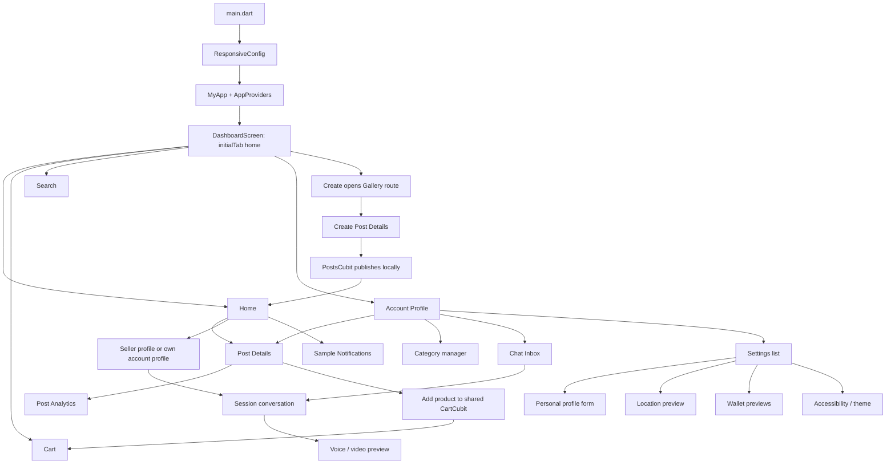
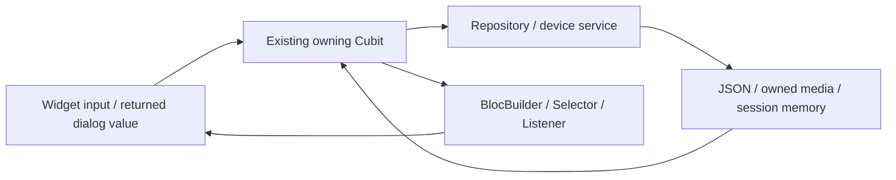

# Nini / HYWORK — complete project handoff

**Source review: 7 November 2026.** Flutter package: `nini`; current application title: `HYWORK`; version: `1.0.0+1`. This README documents the files and wiring present in this checkout. It is intended to help a new developer or ChatGPT continue the work without guessing how screens, state, storage, styling, and layouts connect.

The intended product lets the same account buy products and sell products/services. The current implementation is a local marketplace frontend with sample data, local post/cart storage, device media tools, and session chat. There is no authenticated account system, backend API, real payment processing, or live calling integration.

**Read this status before making changes:**

- Startup currently opens **Dashboard → Home directly**. Splash/Login/OTP still exist, but are not the default startup route.
- Development labels and displayed digits are currently **English**, while much of the established right alignment and explicit RTL widget geometry remains. Names such as `PersianFeature` and `persianDigits` are compatibility names, not proof of Persian output.
- Home reads `PostsCubit`: locally published posts appear before six sample phone cards. Successful Create returns to Home.
- Search has a full inline city list with radio indicators. Search result taps currently have no callback in the default screen, so they do **not** open details or a provider profile.
- Product-order models and guarded state transitions exist in `CartCubit`, but checkout does not call `requestProducts`. Dedicated product-order request/details/tracking screens are absent.
- `PaymentScreen` and `PaymentGatewayScreen` exist, but have no route callers elsewhere in `lib/`. They are reusable UI awaiting integration.
- `service_booking/`, `provider_bookings/`, `provider_profile/`, and `product_orders/` are absent. Older descriptions of their completed UI do not match this checkout.
- There is no `test/`, `CODING_RULES.md`, or `AGENTS.md` in this checkout. Earlier test counts and links to those files should not be treated as current evidence.

Only documentation was changed for this handoff. Source inspection and documentation consistency checks do not establish a new runtime, device, analyzer, or build pass.

## Reading guide

1. [Setup and project structure](#setup-and-project-structure)
2. [Screen navigation and workflows](#screen-navigation-and-workflows)
3. [State ownership and screen connections](#state-ownership-and-screen-connections)
4. [Feature behavior and widget composition](#feature-behavior-and-widget-composition)
5. [Text styling reference](#text-styling-reference)
6. [Responsive layout reference](#responsive-layout-reference)
7. [Theme, language, icons, and artwork](#theme-language-icons-and-artwork)
8. [Persistence and data contracts](#persistence-and-data-contracts)
9. [Dependencies and native projects](#dependencies-and-native-projects)
10. [Implementation boundaries and verification](#implementation-boundaries-and-verification)
11. [Change guide](#change-guide)
12. [Complete Dart file catalog](#complete-dart-file-catalog)
13. [Complete supporting-file and asset inventory](#complete-supporting-file-and-asset-inventory)
14. [Copyable prompt for another chat](#copyable-prompt-for-another-chat)

## Setup and project structure

Run commands from the repository root. `pubspec.yaml` requires Dart `^3.13.3`. The Android configuration explicitly expects Flutter 3.47 or newer for AGP built-in Kotlin; check toolchain compatibility rather than assuming an installed SDK version. No SDK installation/version was checked for this documentation edit.

```sh
flutter --version
flutter pub get
flutter devices
flutter run -d <device-id>
```

```text
lib/
  main.dart                 Startup binding and ResponsiveConfig
  app/                      MaterialApp, dependency injection, shared providers
  core/
    animation/              Route-aware entrance, stagger, optional Rive player
    assets/                 Shared artwork constants
    icons/                  Client icon path constants
    localization/           English development string catalogs / format helpers
    permissions/            Native location-permission adapter
    responsiveness/         Breakpoints, design reference, layout helpers
    state/                  Shared countdown and map-tile state
    theme/                  Colors, semantic typography, ThemeData, ThemeCubit
  shared/
    models/post/            Common post, media, seller, details, unit models
    widgets/                Button, text field, icon, logo, loader, toast
  features/                 Flat feature folders listed below
assets/                     Fonts, illustrations, samples, PNG/SVG icon library
android/ ios/               Native mobile runners and permissions/build settings
linux/ macos/ windows/ web/ Other platform runners; support requires verification
tool/                       Six icon manifests/import/extraction helpers
```

Features: `calls`, `cart`, `chat`, `create_post`, `dashboard`, `home`, `locations`, `login`, `notifications`, `otp_verification`, `payment`, `post_analytics`, `post_detail`, `posts`, `profile`, `profile_settings`, `search`, `splash`, `wallet`.

Features own their screens, Cubits, helpers, and named widget folders. `data/` contains concrete sources/adapters, `domain/` contains models/contracts where needed, and `presentation/` contains UI/state. Some existing folders use `page/`, others `pages/`; preserve actual paths. There are no customer/provider wrapper directories or separate provider dashboard.

## Screen navigation and workflows

Navigation uses `Navigator` with `MaterialPageRoute`, route return values, and dashboard `PageView` indexes. There is no central named-route/router table.



| Entry/action | Destination and data passed | Return / current boundary |
| --- | --- | --- |
| `main.dart` | `ResponsiveConfig(child: MyApp())` → app providers → Home dashboard | This bypasses auth previews. |
| Splash, if opened explicitly | Waits three seconds after first frame → replaces with Login | Not currently the app home. |
| Login Done | Fixed `+98` prefix plus entered phone → OTP | Any nonempty supported digit input; no country picker or SMS request. |
| OTP Continue | Any four digits → clears old routes → `LocationPermissionGate` → Home | Native permission prompt is optional; no authenticated session. |
| Dashboard Home/Cart/Search/Profile | Existing `PageView` pages; selected tab Cubit and controller stay coordinated | Tap and swipe supported; Back behavior is screen-specific. |
| Dashboard Create | Gallery → Details → publish `PostItem` result | Selects the published category and switches to Home; cancellation leaves the existing tab. |
| Home product/media | `openHomePost` → `PostDetailScreen(post, seller, onSellerPressed)` | Own-post purchase controls are hidden. |
| Home author | `openHomeSeller` checks shared local posts | Local record → account Profile route; sample seller → `SellerProfileScreen`. |
| Seller Message | Conversation ID `seller-<seller.id>`, seller name/avatar/location | Opens/reuses session history through `InMemoryChatRepository.instance`. |
| Profile post | `PostDetailScreen(allowOwnerActions: true)` | Edit/delete additionally require `PostsState.canManage`. |
| Detail analytics | `PostAnalyticsScreen(post)` | Uses sample report or local events according to record type. |
| Detail Add to Cart | `postCartItem` converts model → `CartCubit.add` | Stock, existing quantity, unit and seller checks; toast/error feedback. |
| Cart item / Checkout button | `CartCubit.checkout(itemId: ...)` or all visible item IDs | Changes in-tab stage to checkout; Back returns to basket. |
| Cart checkout | Scrollable items, quantities, totals, editable charges, escrow copy | No request form/submit/payment navigation in the current widget. |
| Search city/query | Cities / suggestions / result grid in the same screen | Close restores confirmed query; clear only edits the draft. Results currently have no tap destination. |
| Profile header | Theme action, Chat Inbox, Settings list | Optional callbacks can replace header navigation. |
| Settings list | Profile edit, Locations, Wallet, Accessibility | Other listed settings currently have null callbacks. |
| Wallet | Top Up, Withdraw → Withdrawal Summary | Top Up Payment closes its preview; no movement of money. |
| Home bell | Home-owned NotificationsCubit passed via `BlocProvider.value` | Search and mark-read update the bell for Home's lifetime. |
| Conversation attachments | Document / Location / Camera / Gallery / compact shared gallery | Local media copying and session messages; no remote delivery. |
| Conversation call icons | `CallScreen` with default `PreviewCallService` | Interactive preview controls, no remote participant/media stream. |
| Payment pages | `PaymentScreen(details, initialMethod, onMethodChanged, onConfirm)` | No production route caller; fallback Confirm Pay shows an unconnected-payment message. Gateway is a separate placeholder. |

The directory catalog below gives exact paths for every screen and supporting widget. A file existing in that catalog does not mean it is reachable from app startup.

## State ownership and screen connections

`lib/app/app_providers.dart` owns five app-level Cubits. `MyApp` accepts optional post, analytics, cart, and category repositories for replacement/injection; theme starts from `initialThemeMode`.

| Owner | Shared state / load | Main readers and effects |
| --- | --- | --- |
| `ProfileCategoriesCubit` | Local categories, selected stable category ID; `load()` on creation | Profile chips/grid, category manager, Create/Edit selectors; successful publish selects category. |
| `CartCubit` | Basket, filters, tab, checkout IDs, charges, method, order snapshots; `load()` on creation | Cart UI, dashboard badge, Home/detail purchase actions. Local saves serialize through a write queue. |
| `PostAnalyticsCubit` | Reports/events via analytics repository | Card impressions, detail activity, analytics sections. |
| `ThemeCubit` | System/light/dark; session preference | Rebuilds `MaterialApp` themes; profile theme action and accessibility options update it. |
| `PostsCubit` | Local posts, loading/failure, last published record; `load()` on creation | Home, Profile, detail refresh, Create/Edit/Delete, ownership-like local checks. |

| Screen/feature owner | Local state and lifetime |
| --- | --- |
| Dashboard | `DashboardNavigationCubit`, PageController, target tab during animations; closes/disposes on route disposal. |
| Home / each product card | Home owns NotificationsCubit; HomeCardCubit handles card preview state. |
| Search | SearchScreen owns SearchCubit; SearchView owns field controller/focus. Draft and submitted query are distinct. |
| Create/gallery | GalleryCubit owns permission/assets/files/pagination/selection; CreatePostCubit carries draft into Details. |
| Create dialogs | PostAddressCubit, PostFeaturesCubit, PostScheduleCubit and PostOperationCubit support their respective UI state. |
| Edit post | Prefilled draft, PostEditorMediaCubit and PostEditorFieldsCubit; controllers/validation/discard and busy guards. |
| Detail | PostDetailCubit: carousel, like/bookmark, quantity. Saved content comes from PostsCubit. |
| Analytics | AnalyticsControlsCubit handles chart/period/selection controls alongside shared report data. |
| Seller Profile | SellerProfileCubit holds local follow state; seller data is a passed PostSeller. |
| Profile edit | ProfilePhotoCubit and local form/controllers; exiting does not save an account. |
| Locations / permission gate | LocationsCubit for preview selection; LocationPermissionCubit + service for OS permission state. |
| OTP/countdowns | OtpVerificationCubit holds code; CountdownCubit supports local countdown widgets. |
| Wallet | WalletAmountCubit / bank selections / countdown previews; no wallet repository. |
| Conversation | ConversationCubit, VoiceRecordingCubit, VoicePlaybackCubit plus controllers, lifecycle and route listeners. |
| Calls | CallCubit owns the injected per-call CallService and disposal/timers. |
| Payment | PaymentSelectionCubit belongs to each PaymentScreen, is disposed with it; callbacks let callers observe selection/confirmation. |
| Maps | MapTilesCubit tracks tile-load failure/retry presentation; it is not GPS or saved-location storage. |



Do not create a second app-level Cart/Posts instance inside a screen: its state would diverge from the badge, Home, Profile, or detail views.

## Feature behavior and widget composition

Paths in this section are relative to `lib/features/`. All individual Dart paths and public types are indexed later.

### Entry and dashboard

`SplashScreen → SplashContent → SplashBrand + AppLoader`; the splash timer is disposed safely. `LoginScreen → AuthScreenLayout + LoginPhoneField`; the prefix is fixed `+98`. `OtpVerificationScreen → AuthScreenLayout + OtpCodeInput + OtpCountdown`; `pinput` renders four boxes. The shared auth layout forces a dark theme and scrolls for short screens/keyboard space. OTP's permission gate requests OS permission only; it does not determine a location or create an account.

`DashboardScreen` composes the five indexed slots, with Create opening a separate route. `DashboardBottomNav → DashboardFoldLayout + DashboardNavItem`; `DashboardCartIcon` reads shared cart count. Active tabs use ScreenEntrance/StaggeredEntrance. Reduced-motion tab changes use `jumpToPage` instead of animation.

### Home and seller profiles

`HomeScreen → HomeFeedHeader + HomePublishedPostCard(s) + six HomeProductCard(s)`. Only `post.isPublished` records from PostsCubit enter the leading section. The header includes HomeNotificationButton. Product cards compose seller header, image/media slider/indicator, engagement, price, details, badges and metrics. `home_post_data.dart` defines sample seller/post snapshots and the local-post seller identity; Home's Pixel photo is a remote URL.

`home_post_navigation.dart` connects cards/details/authors. `published_home_navigation.dart` supplies the local seller. Saved own posts open account Profile; other sellers open `SellerProfileScreen → SellerProfileHeader + SellerProfileActions + SellerProfileContent + SellerPostGrid`. Follow toggles route-local state. SellerMessageButton opens a stable session conversation; the grid can call back into Home's detail navigation. There is no service-booking action here.

### Cart, order state, and payment

`CartScreen → CartHeader + CartTabs + optional CartStatusFilter / CartStorageNotice + stage content`.

- Basket: `CartItemsList → CartItemCard → CartItemImage / CartItemBadge / CartQuantityButton`. Amount dialog validates quantities. Swipe removal also has a semantic accessibility action. Checkout is the final scrollable list item below the products.
- Checkout: `CartCheckout → CartSection + selected item cards + CartPaymentSummary + escrow copy`. Charges use CartAmountDialog; quantity edits update shared basket state. There is currently no request/confirm button in this stage.
- History: `CartOrderHistory` expands saved snapshots and read-only cards. Sales filters existing snapshots by `isProductRequest`; it is not a separate authenticated seller feed.
- Local loading/read/write failures use CartStorageNotice and retry. A failed read blocks editing rather than overwriting unread data with defaults.

The **state layer** already provides `requestProducts(address, phone)`: validates address/phone and seller IDs, groups items by seller, allocates charges once using integer arithmetic, creates stable order snapshots, removes submitted items, and saves. No UI calls it in this checkout. Available guarded progression is:

```text
pendingApproval → accept → pendingPay → verified confirmProductPayment → accepted
accepted → prepareProductOrder → preparing → shipProductOrder → shipped
shipped → receiveProductOrder → completed
pendingApproval → reject → unsuccessful
pendingApproval or pendingPay → cancelProductOrder → canceled
```

These are methods and serializable statuses, not evidence of connected seller approval, payment verification, notifications, tracking screens, or delivery events. `confirmProductPayment` is intended for a verified result; the placeholder gateway never calls it.

`payment/` owns `PaymentDetails`, `PaymentMethod`, format helper, selection Cubit, PaymentScreen and PaymentGatewayScreen. PaymentScreen composes bank methods, delivery summary, totals and PaymentActions. Its default confirmation displays a message that payment is unconnected. A caller may supply `onConfirm`, but no caller currently does. PaymentGatewayScreen has Back and “Payment Gateway” text; no fake bank form or success result.

### Search

`SearchScreen → SearchView → SearchHeader(SearchQueryField, SearchCityButton) + SearchContent`. Content switches among SearchCityList, SearchSuggestions, SearchEmptyState and SearchResultsGrid/SearchResultCard. SearchCatalog normalizes Persian/Arabic variants and filters `demo_search_posts.dart`; it does not read local profile posts or a remote index.

SearchCubit owns `query`, `submittedQuery`, `city`, `panel`. Typing edits the draft and shows suggestions. Submit confirms trimmed text. Close/Back restores confirmed text/results. Clear leaves the confirmed query intact while clearing the editing field. Selecting a city restores the submitted query and shows results. Cities are a full inline list of radio rows, not a popup dropdown.

SearchResultsGrid has an optional `onPostSelected`, but SearchContent does not pass it. SearchResultCard only invokes its optional `onTap`; there is no default navigation. Connect this deliberately if requested instead of assuming detail/provider flows already exist.

### Create, gallery, post edit and categories

`CreatePostGalleryScreen → GalleryContent → GalleryPreview + GalleryGrid`. GalleryGrid composes access notices, GalleryBody, file grid, selection badges, retry/loading/empty states, pagination and GalleryTabSelector. Chat reuses `GalleryGrid(compact: true)`. Photos/videos use photo_manager; document selection uses file_picker. The preview handles a single item or a selected grid.

GalleryCubit/GalleryLibraryChanges coordinate native library observation, permissions, resume/refresh, pagination, selection and request-version guards. File selection can reopen the picker; Photo/Video tab callbacks disable redundant selection. Resume must not unexpectedly launch the document picker. Preserve async/disposal guards and reference counting.

Next opens `CreatePostDetailsScreen` with the selected attachments and existing draft state. It composes SelectedMediaGrid, PostBasicDetailsSection, PostPricingInventorySection, PostOptionsSection and PostPublishActions. Caption uses Flutter Quill and PostCaptionSynchronizer to keep Delta and plain text together. Dialogs handle post type, category, price/unit, preparation time, inventory, features, tags, schedule, address and alt text. PostDialog owns shared sheet styling. Address is a manual map/pin, initially Tehran; schedule dismissal and explicit clearing are separate outcomes. Validators enforce required publishing fields and valid numbers/future scheduling.

`posts/` owns persistence and management. `ProfileCategoriesScreen → ProfileCategoriesBody → ProfileCategoryRow → editor/delete sheets`; stable IDs survive renames, All is a null filter, deleting a category does not delete posts. `PostOwnerActionsSheet` opens EditPostScreen or PostDeleteSheet. Owner actions require the explicit detail flag and locally manageable post.

`EditPostScreen → EditPostForm + PostEditorActions`; named fields cover basic, pricing, options, location, features, schedule and alt text. PostEditorMediaSection/Grid/Tile separates retained media from new additions through PostEditorMediaCubit. New media reuses the gallery. Saving preserves post identity; discard/busy/error handling protects existing edits. `post_draft_mapper.dart` restores base prices, not already-discounted prices. Shared media rendering lives in `posts/presentation/widgets/post_media_view/`, even when imported by another feature.

### Detail and analytics

`PostDetailScreen → PostDetailBody → author, carousel, engagement, pricing/content/specifications + PostDetailBottomBar` for purchasable external posts. PostDetailScreen listens to saved updates by ID. Own records hide purchase actions; owner menu availability is separately checked. PublishedPostContent renders stored rich content; PostContent supplies fallback content. Optional comments/share callbacks do not imply backend behavior.

`PostDetailBottomBar → postCartItem → CartItem + quantity dialog/selector + CartCubit`. It subtracts existing cart quantity from available stock before enabling add. The purchase bar intentionally uses the inverse page theme. `PostImageCarousel` and `PostCarouselImage` separate media rendering from carousel state.

`PostAnalyticsScreen` composes post header, total views, interactions, average watch time, impressions, and orders/bookings sections. Controls and dedicated chart widgets render line, orders, radar and polar charts. Published records use device-local events; sample records use explicit sample reports. PostImpressionTracker wraps cards; PostDetailActivityTracker records visits/watch segments and positive actions while accounting for route coverage/background state. There is no remote analytics or real bookings aggregation.

### Account profile, settings and locations

`ProfileScreen → ProfileHeaderActions + ProfileStats + ProfileAvatar + ProfileIdentity + ProfileCategoryChips + ProfilePostGrid`. The grid reads shared posts/categories, focuses newly published content when rendered, and opens details with owner actions enabled. Identity/stats are preview data. `open_account_profile.dart` opens the existing account profile with route Back chrome.

The settings **list** is `profile/presentation/page/profile_settings_screen/`; the personal-data **form** is `profile_settings/presentation/pages/profile_edit_screen.dart`. The form composes ProfilePhotoPicker and ProfileEditFields (name, surname, nationality, username, email, birth, gender, bio). Photo selection is a real local picker, but no account save occurs. SettingsDetailHeader handles Done/Back and focus. ProfileLimits centralizes field constraints. AccessibilityScreen/ThemeOptions select the existing ThemeCubit mode.

LocationsScreen composes map preview, label card and saved-location list with LocationsCubit. Map starts at sample New Delhi coordinates; local labels are route preview state. This is separate from the Create/Chat manual location picker. LocationPermissionGate/helper/dialog/Cubit/service handle foreground/background OS permission choices; the prompt uses a light palette and never reads or tracks GPS. Default direct-to-Home startup bypasses OTP's gate.

### Notifications and wallet

Home supplies its NotificationsCubit to NotificationsScreen. NotificationHeader, search field and NotificationList/Tile/Avatar display bundled samples and local read state. Tapping marks read; no booking/order notification routing, token registration, push SDK or durable read repository is connected.

WalletScreen composes WalletBalanceCard, WalletActionsRow and WalletTransactions. TopUpScreen contains amount/bank selection and a Payment button that closes the preview. WithdrawScreen contains amount/account/OTP controls and opens WithdrawSummaryScreen with illustration/details. Shared wallet header, footer, bottom button, input, bank tiles and presets retain existing layout. WalletSampleData is the balance/transaction source. Countdown, amount and bank selection are UI state; transfer/request/payment tiles have no connected financial action.

### Chat and calls

`ChatInboxScreen → ChatConversationTile → ConversationScreen`; SellerMessageButton also opens the same conversation UI. `InMemoryChatRepository.instance` session conversations retain newly opened seller chats and local history while the process lives. Inbox starts with demo contacts.

ConversationScreen composes ConversationHeader and ConversationBody; the body renders message bubbles, selection/blocked notices, ChatMessageComposer or VoiceRecordingPanel, and optional ChatEmojiPanel. Bubbles use ChatAttachmentView, ChatLocationView and ChatVoicePlayer. Header call icons open CallScreen.

ChatAttachmentSheet offers Document, Location, Camera, Gallery and compact gallery. `chat_attachment_flow.dart` coordinates pickers. ConversationCubit asks ChatMediaStore to prepare/copy attachments before recording session messages. DeviceVoiceRecorder uses `record` for real local microphone recording; JustAudioChatPlayer uses `just_audio` for playback; image_picker handles camera/media. LocalChatMediaStore copies into temporary app cache and must not delete picker originals. Files and map links can open external apps. Route/lifecycle listeners pause playback and stop/cancel recording; mounted/closed/disposal guards matter.

`CallScreen → CallCubit → CallService`; default PreviewCallService simulates phases, timers and microphone/speaker/camera flags. CallControls/ActionButton/Avatar/VideoStage render the preview. Sample video images are not camera streams; calls do not contact another user. Real signaling/media belongs behind CallService and injected video widgets.

## Text styling reference

**Primary file:** [app_text_styles.dart](lib/core/theme/app_text_styles.dart). **Application:** [app_theme.dart](lib/core/theme/app_theme.dart) merges `AppTextStyles.materialTextTheme` into the base theme and applies foreground colors. Widgets normally use a semantic role, then `.copyWith(...)` for contextual color/size/height/decoration.

- Main family: `YekanBakh`, registered in `pubspec.yaml` with only `assets/fonts/YekanBakh-Regular.ttf` at weight 400. Roles request 500/600/700/800, but separate font files for those weights are not bundled; do not claim distinct font faces.
- Weight aliases: `regular=400`, `medium=500`, `semiBold=600`, `bold=700`, `extraBold=800`.
- `numberFontFamily='Roboto'` is a role constant; no Roboto font asset is registered in this project. `emoji` clears the family; `emojiSize=27`.
- Unspecified properties inherit from surrounding text/default/theme. A role without `fontSize` does not mean 0 or a fixed size. The table records base declarations; caller overrides remain effective.
- `scaledSplashBrand(scale)` multiplies the 40-size brand style. `avatarInitial(radius)` uses `radius * .7`.
- `AppTextField` defaults to right alignment and RTL, wraps InputDecorator direction too, and uses `Theme.textTheme.bodyMedium` unless `textStyle` is passed. Phone/OTP, numeric fields and other specific widgets may explicitly override direction.
- AppButton uses themed Elevated/Outlined/Text buttons, centered flexible text, minimum height 48 by default, optional icon/loading spinner, and optional full width. It relies on the theme for typography.
- App-level `DefaultTextStyle.merge(textAlign: right)` preserves development alignment; explicit widget alignment/direction still wins. Do not infer layout direction from the font or language alone.

### Every semantic TextStyle token

The following table is extracted from the current declarations; `inherit` means that property is left to the surrounding style. Material TextTheme slots are listed separately.

| Token | Base font size | Weight | Line height / special value |
| --- | --- | --- | --- |
| `heading` | 22 | regular | inherit |
| `body` | 14 | regular | inherit |
| `button` | 14 | medium | inherit |
| `caption` | 12 | regular | inherit |
| `username` | 16 | semiBold | inherit |
| `profileName` | 14 | bold | inherit |
| `bio` | 14 | regular | inherit |
| `website` | 14 | regular | inherit |
| `statNumber` | 14 | bold | inherit |
| `statLabel` | 14 | regular | inherit |
| `category` | 12 | regular | inherit |
| `postTitle` | 12 | bold | 1.4 |
| `listingTitle` | inherit | bold | inherit |
| `postMetadata` | 9 | inherit | inherit |
| `originalPrice` | 10 | inherit | inherit |
| `postPrice` | 14 | inherit | 1 |
| `pricePrefix` | 8 | inherit | 1.3 |
| `discountBadge` | 7 | inherit | inherit |
| `notificationBadge` | 9 | semiBold | inherit |
| `screenTitle` | 24 | medium | inherit |
| `sectionTitle` | 17 | bold | inherit |
| `settingsLabel` | 15 | inherit | inherit |
| `settingsDetailTitle` | 18 | medium | inherit |
| `inherit` | inherit | inherit | inherit |
| `badgeSmall` | 7 | inherit | inherit |
| `micro` | 8 | inherit | inherit |
| `metadata` | 9 | inherit | inherit |
| `metadataBold` | 9 | bold | inherit |
| `smallPrint` | 10 | inherit | inherit |
| `smallPrintMedium` | 10 | medium | inherit |
| `smallPrintEmphasis` | 10 | semiBold | inherit |
| `smallPrintBold` | 10 | bold | inherit |
| `helper` | 11 | inherit | inherit |
| `helperBold` | 11 | bold | inherit |
| `badgeLabel` | 11 | inherit | 1.2 |
| `notificationBody` | 11 | inherit | 1.5 |
| `label` | 12 | inherit | inherit |
| `labelMedium` | 12 | medium | inherit |
| `labelEmphasis` | 12 | semiBold | inherit |
| `labelBold` | 12 | bold | inherit |
| `checkoutHelp` | 12 | inherit | 1.7 |
| `compactBody` | 13 | inherit | inherit |
| `toast` | 13 | medium | inherit |
| `compactBodyBold` | 13 | bold | inherit |
| `bodyText` | 14 | inherit | inherit |
| `bodyBold` | 14 | bold | inherit |
| `bodyEmphasis` | 14 | semiBold | inherit |
| `postBody` | 14 | regular | 1.75 |
| `messageBody` | 14 | inherit | 1.45 |
| `comfortableBody` | 15 | inherit | inherit |
| `authorName` | 15 | semiBold | inherit |
| `comfortableBodyBold` | 15 | bold | inherit |
| `permissionPrompt` | 15 | inherit | 1.4 |
| `largeBody` | 16 | inherit | inherit |
| `conversationName` | 16 | semiBold | inherit |
| `sellerName` | 16 | bold | inherit |
| `specificationValue` | 16 | inherit | 1.6 |
| `subtitle` | 17 | inherit | inherit |
| `galleryTitle` | 17 | regular | inherit |
| `pageTitle` | 18 | inherit | inherit |
| `dialogTitle` | 18 | medium | inherit |
| `pageTitleBold` | 18 | bold | inherit |
| `amount` | 20 | inherit | inherit |
| `analyticsTitle` | 20 | regular | inherit |
| `specificationsHeading` | 20 | medium | inherit |
| `postHeading` | 20 | semiBold | 1.6 |
| `walletBalance` | 21 | semiBold | inherit |
| `callName` | 21 | bold | inherit |
| `createPlaceholder` | 22 | inherit | inherit |
| `cartTitle` | 23 | medium | inherit |
| `productTitle` | 23 | bold | 1.2 |
| `authTitle` | 24 | semiBold | inherit |
| `productPrice` | 24 | bold | inherit |
| `otpCode` | 26 | inherit | inherit |
| `inboxTitle` | 27 | bold | inherit |
| `analyticsTotal` | 28 | semiBold | inherit |
| `scheduleTime` | 28 | inherit | inherit |
| `homeBrand` | 30 | extraBold | 1.1 |
| `splashBrand` | 40 | bold | 1 |
| `regularText` | inherit | regular | inherit |
| `boldText` | inherit | bold | inherit |
| `emoji` | inherit | inherit | inherit; fontFamily=null |

### Material TextTheme slots

| Slot | Style declaration |
| --- | --- |
| `displayLarge` | `TextStyle(fontSize: 57, fontWeight: regular)` |
| `displayMedium` | `TextStyle(fontSize: 45, fontWeight: regular)` |
| `displaySmall` | `TextStyle(fontSize: 36, fontWeight: regular)` |
| `headlineLarge` | `TextStyle(fontSize: 32, fontWeight: regular)` |
| `headlineMedium` | `TextStyle(fontSize: 28, fontWeight: regular)` |
| `headlineSmall` | `TextStyle(fontSize: 24, fontWeight: regular)` |
| `titleLarge` | `heading` |
| `titleMedium` | `TextStyle(fontSize: 16, fontWeight: medium)` |
| `titleSmall` | `TextStyle(fontSize: 14, fontWeight: medium)` |
| `bodyLarge` | `TextStyle(fontSize: 16, fontWeight: regular)` |
| `bodyMedium` | `body` |
| `bodySmall` | `caption` |
| `labelLarge` | `button` |
| `labelMedium` | `labelMedium` |
| `labelSmall` | `TextStyle(fontSize: 11, fontWeight: medium)` |

## Responsive layout reference

There are three layers: startup wrappers, shared width helpers, and screen-specific constraints. Wrapping the app in ScreenUtil does not automatically scale every hard-coded value.

| Layer / path | Actual behavior |
| --- | --- |
| `core/responsiveness/responsive_config/config.dart` | `ScreenUtilInit(designSize: Size(390, 844), minTextAdapt: true, splitScreenMode: true)` wraps FoldableProvider with bridge mode `none`. MaterialApp builder adds ResponsiveBreakpoints. |
| `core/responsiveness/app_responsiveness/app_responsiveness.dart` | AppResponsive classifies **local** width using LayoutBuilder in AppResponsiveBuilder; falls back to MediaQuery for unbounded width. |
| Compact | Width `<600`; horizontal padding 16; vertical spacing 16; grid spacing 4; nominal grid columns 3. |
| Medium | Width `600–<840`; padding 24; vertical spacing 24; grid spacing 8; nominal grid columns 4. |
| Expanded | Width `>=840`; padding 32; vertical spacing 32; grid spacing 12; nominal grid columns 5. |
| Generic cap | `maxContentWidth=1120`, exposed by `constrainedWidth`; individual screens often choose smaller caps. |

### Screen-specific rules

All dimensions below are logical Flutter pixels. `maxWidth` is a cap, not a forced minimum. A screen inside another constrained parent may receive a smaller width than the physical display.

| Screen / widget | Current layout rule and important behavior |
| --- | --- |
| Dashboard navigation | Expanded content cap 720; other widths allow available width. PageView fills its safe area. |
| Foldable bottom navigation | DashboardFoldLayout finds native hinge/half-open fold bounds, converts to local coordinates, and splits physical left/right panes with 8 clearance. Requires vertical full-height divider and at least 56 per tab on each side; otherwise uses normal layout. Not simply a tablet breakpoint. |
| Home | Centered feed, cap 600; lazy ListView with stable keys for local and sample cards. |
| Cart / notifications / category manager / seller profile / settings list | Centered content cap 600. Cart stage body gets Expanded scroll area. |
| Search | Content cap 720. Header stays above Expanded content. Result grid uses `floor(localWidth / (110 * textScale))`, clamped to 1 through AppResponsive's column maximum; `textScale=max(1, scaled10/10)`. Row extent combines square media width and `80 * textScale`. |
| Account profile | Cap 600 compact/medium, 720 expanded. Avatar sizes 104/124/136. Header padding uses shared responsive padding; post grid remains full content width. |
| Account post grid | Columns `floor(width / (110 * textScale))`, clamped 1–3; `textScale=max(1, scaled14/14)`. Spacing 2. Details height `(width < 400 ? 108 : 120) * textScale`; media portion is square. Nested grid does not scroll independently. |
| Seller post grid | Fixed three-column grid; does not share the account grid's adaptive formula. Verify narrow/large-text cases before promising equivalent behavior. |
| Gallery content | If height `<360` and width `>=480`, preview and grid sit side by side. Otherwise vertical 6:5 flex; gap 8 below height 500, otherwise 24. |
| Gallery thumbnails / selections | GalleryBody photo/video grid uses four columns; selected-media/preview/editor grids generally use three. File grid uses max tile extent and text-scale-aware height. Compact chat gallery has its own constrained presentation. |
| Create details / edit post / publish actions | Cap 720; scrollable form content plus separate action controls. Preserve keyboard insets, safe areas and busy guards. |
| Post detail | Body uses its local responsive maximum; purchase bar cap 720. Purchase row uses Wrap to break pricing/quantity/actions across runs. |
| Analytics | Cap 520, scrollable sections; chart controls own their selection/rendering behavior. |
| Auth | Content cap 430; black themed, scrollable and constrained for short windows/keyboard. OTP cell height `max(64, scaled26 + 24)`. |
| Splash | Brand/content cap 360 and scale helper. |
| Profile edit / accessibility / locations | Cap 560; form/preview controls remain in their feature widgets. |
| Generic post dialog / chat attachment sheet | Cap 560; preserve scroll/keyboard handling and returned values. |
| Location permission dialog | Cap 350; intentional light theme. |
| Wallet / withdraw / summary | Content cap 430; bottom button cap 406. Wallet action sizing considers text scale. |
| Payment | Scrollable main content and bottom actions separately capped at 720. |
| Chat | Message bubble cap `min(460, screenWidth * .76)`; inbox toolbar and conversation input reserve text-scaled height. |
| Toast | Cap 420; overlay positioning and lifetime belong to AppToast. |

Respect MediaQuery text scaling. Category chips, home engagement, gallery tabs/files, OTP, chat headers/composer and wallet actions include explicit text-scale logic. Fixed-column/fixed-height widgets still need visual checking under extreme settings. Preserve image aspect ratios and supplied framing rather than stretching artwork to fill arbitrary boxes.

`ScreenEntrance` and its shared route observer control route/tab entrance activity; StaggeredEntrance applies delayed child transforms. The animation utilities account for reduced motion. RiveAssetAnimation is optional infrastructure; no `.riv` file is bundled. Auth artwork is raster imagery.

## Theme, language, icons, and artwork

| Concern | Source of truth | Working convention |
| --- | --- | --- |
| Theme surfaces/foreground/buttons/inputs/system bars | `lib/core/theme/app_theme.dart` | Material 3 monochrome light/dark palettes, transparent surface tint, theme-derived feature colors. |
| Fixed semantic colors | `lib/core/theme/app_colors.dart` | Badges, destructive state, charts, wallet/call accents and explicit client colors. |
| Theme selection | `lib/core/theme/theme_cubit.dart` | System follows platform brightness; selected mode is session-only. |
| Main typography | `lib/core/theme/app_text_styles.dart` | Semantic tokens; prefer existing roles over new unrelated inline styles. |
| App strings | `lib/core/localization/` | Current catalogs provide English development copy, plus display mappings for existing sample labels. |
| Shared branding/art | `lib/core/assets/app_assets.dart` | Central paths for auth and HYWORK assets. |
| Icons | `lib/core/icons/app_icons.dart` + `lib/shared/widgets/app_icons/app_icon.dart` | Central SVG/PNG paths, theme tint and source transparency/proportions. |

MaterialApp uses `Locale('en')`, supports `en` and `fa_IR`, and installs Material plus Flutter Quill delegates. Global layout remains LTR with right-aligned default text. `PersianFeature` also currently overrides locale to English and direction to LTR. Individual Rows, grids, labels and inputs can explicitly be RTL/right-aligned. Changing the locale alone will not remove those overrides.

`AppStrings.persianDigits` currently **converts Persian/Arabic digits to ASCII**, Persian grouping to comma, decimal mark to dot and percent mark to `%`. Preserve its API until callers are deliberately migrated. Search normalizes multilingual input independently of display strings. Never translate storage keys, enum names, IDs, media paths or user content automatically.

Intentional palette exceptions include black Splash/Login/OTP, light location permission prompt, inverse post dialogs and detail purchase bar, blue seller Follow, and fixed chart/status accents. Do not flatten these into global theme colors without an explicit design change.

| Asset group | Role |
| --- | --- |
| `assets/branding/` | HYWORK logo artwork. |
| `assets/auth/` | Login, OTP and permission illustrations. |
| `assets/booking/`, `assets/orders/` | Bundled booking/order artwork; asset presence does not mean matching screens are implemented. |
| `assets/wallet/`, `assets/banks/` | Withdrawal illustration and bank SVGs. |
| `assets/fonts/` | Registered YekanBakh Regular font. |
| Root `assets/` images | Profile, gallery, post, chat and call sample artwork. |
| `assets/icons/vectors/<category>/` | Client SVG collection, used through central icon constants. |
| `assets/icons/<category>/` | PNG collections and associated source artwork. |
| Icon source sheets / supplemental collections | Inputs to the reproduction tools, not automatically rendered controls. |

`pubspec.yaml` explicitly registers asset directories. A tracked file is not necessarily directly referenced by a widget. The complete asset list is included below for exact paths; centralized constants and source imports show active use.

## Persistence and data contracts

The following paths live in the device sandbox, not the repository. “Documents” means the resolved application documents directory; current adapters include iOS sandbox directory handling.

| Owner | Location / lifetime | Notes |
| --- | --- | --- |
| LocalPostsRepository | `Documents/nini_posts/posts.json` and owned media under `nini_posts/` | Versioned index, sample migration/bootstrap, stable IDs, temporary/atomic writes and media rollback/cleanup. |
| LocalProfileCategoriesRepository | `Documents/nini_profile_categories/categories.json` | Versioned persistent categories; writes serialized. |
| LocalPostAnalyticsRepository | `Documents/post_analytics.json` | Device-local event/report history. |
| LocalCartRepository | `Documents/cart.json` | Versioned CartSnapshot with basket and orders; temp replacement. Missing state can seed demos; saved empty state stays empty. |
| LocalChatMediaStore | Temporary `nini_chat_media/<generated-folder>/` | App-owned copies, potentially evicted; no durable chat database. |
| DeviceVoiceRecorder | Temporary `nini_voice_drafts/` | Recording drafts; prepared voice is copied separately. |
| InMemoryChatRepository | Process memory | Messages, seller conversations and blocked state do not survive process restart. |
| Theme, notifications, seller follow, profile form, locations, wallet | Widget/Cubit/session memory | No account or cloud persistence. |

Post media is prepared in pending folders and finalized as part of repository save. A failure must not delete previous saved attachments or original user files. Versioned local sample records are editable; deleting a sample should not cause it to be blindly reinserted on every reload.

| Contract / model | Preserve when editing |
| --- | --- |
| PostItem | Stable ID, publication identity, category, media, seller/details linkage across feed/profile/detail/analytics. |
| PostDetails | Typed rich caption/Delta, tags, address, schedule, features, stock, discount, unit and alt text; preserve legacy/unknown serialized metadata. |
| PostMedia | Source/type/path/name/thumbnail/alt text; asset and app-file sources need different rendering/ownership behavior. |
| PostSeller | Stable identity plus display/location/avatar data; used by Home, detail/cart and seller chat routing. |
| PostDraft / media changes | Draft and explicit clear semantics; retained media separated from additions until save. |
| ProfileCategory | Stable ID on rename; All is virtual/null; deletion does not delete posts. |
| PostUnit | Serialize enum `.name`; display `.label`; unknown legacy values remain absent. |
| Schedule | Persist UTC and display local time; distinguish cancel from explicit clear. |
| Cart numbers | Unit price/discount are whole toman; quantity is integer hundredths; totals/charges are integer hundredths of toman. Quantity `250` means 2.5 units. Preserve whole-unit constraints and exact allocation; avoid floating-point money math. |
| CartOrder / status | Immutable item snapshot, seller/customer/address/phone, method/charges, status/timestamps. Existing transition guards reject invalid progression. |
| PostsState.canManage | Local dataset/load-state check plus explicit UI owner flag; this is not server authorization. |

Backend seams already available: PostsRepository, ProfileCategoriesRepository, CartRepository, PostAnalyticsRepository; chat messages/media/recorder/player contracts; CallService. Inject repositories through MyApp/AppProviders and device/call services through existing screen APIs. ChatMessagesRepository is synchronous today; a real remote async transport requires deliberate contract/UI changes. Auth, push, real payments/wallet, inventory reservations, cross-device permissions/roles and server verification remain future work. There is no reusable API base URL or authenticated HTTP layer in this checkout.

## Dependencies and native projects

`pubspec.yaml` and `pubspec.lock` are authoritative for requested/resolved versions. Avoid editing dependency cache code to repair the project.

| Packages | Project role |
| --- | --- |
| flutter_bloc | Cubit ownership, providers, builders/selectors/listeners. |
| flutter_screenutil, responsive_framework, foldable | Startup design reference, width breakpoints and folding support. |
| flutter_localizations, flutter_quill | Material localization and rich caption editing/read-only rendering. |
| photo_manager, photo_manager_image_provider, file_picker, image_picker | Gallery permissions/assets/thumbnails, documents, photo/camera pickers. |
| flutter_map, latlong2, url_launcher | Map previews/manual pins and external links. |
| path_provider, path | Device storage roots and safe path composition. |
| visibility_detector | Post impression/activity visibility. |
| record, just_audio, emoji_picker_flutter, open_filex | Voice recording/playback, emoji and external file opening. |
| flutter_svg, pinput, permission_handler | Client SVG artwork, OTP boxes and native permissions. |
| rive | Optional Rive animation wrapper; no bundled Rive artwork. |
| cupertino_icons | Available icon dependency. |
| flutter_test, flutter_lints | SDK testing support and lint rules; no test directory currently tracked. |
| shared_preferences | Listed under dev_dependencies; do not infer persisted settings from the package declaration. |

### Android

- `android/app/build.gradle.kts`: namespace/application ID `com.nini.nini`, Java/JVM 17, Flutter-supplied SDK/NDK values; release currently uses debug signing for previews.
- `android/settings.gradle.kts`: AGP 9.1.0, Kotlin 2.4.0 declared with `apply false`, Flutter plugin loader and version-specific native plugin adapters.
- `android/gradle.properties`: built-in Kotlin enabled, `android.newDsl=false` retained for compatibility. App does not apply legacy Kotlin Android plugin.
- `android/gradle/rive_native.gradle`: repository-owned adapter for rive_native 0.1.11.
- `android/gradle/built_in_kotlin_plugin.gradle`: adapters for emoji_picker_flutter 4.5.4 and photo_manager 3.12.0; review guards on upgrades.
- Main manifest contains Internet, location/background location, media/gallery access and microphone declarations. Check platform permission behavior on the target SDK/device.

```sh
flutter build apk --release
```

Expected output: `build/app/outputs/flutter-apk/app-release.apk`. An existing APK can be older than source; no new APK was built for this README update. Production signing still needs explicit setup.

### iOS and other platforms

`ios/Runner/Info.plist` declares camera, microphone, photo library and foreground/always location usage descriptions. **Runner project deployment-target entries currently specify iOS 26.0**, not the 15.0 claimed by the old README. No `ios/Podfile` exists. The project contains generated Swift Package integration references; let Flutter/Xcode regenerate ephemeral artifacts rather than patching them manually.

Native plugin changes require rebuilds; hot reload is insufficient. Linux/macOS/Windows/web runners exist, but platform presence does not prove gallery, filesystem, microphone, map, permission or call compatibility. Several source adapters use `dart:io`; verify web compatibility before claiming browser support.

Tooling: `tool/client_icons.json` and `extract_client_icons.py` reproduce/check client crops; supplemental icon manifest/script handle raster art; supplemental vector manifest/import script handle SVGs. Read input paths/options first: these tools write assets and are not required for normal app startup. Raster tooling uses Python/Pillow.

## Implementation boundaries and verification

| Feature | Available now | Still unconnected / absent |
| --- | --- | --- |
| Entry | Phone/OTP previews and native permission flow | Auth server, SMS, tokens/session/roles; default startup bypasses auth. |
| Home/posts | Local publish/edit/delete, persistent media, feed/profile refresh | Remote feed/upload/sync and authenticated ownership. |
| Search | Demo filtering, suggestions, city list, result rendering | Default result navigation, local-post index, remote search, provider booking. |
| Cart | Persistent basket/history, stock/quantity/total logic; product order state APIs | Request UI callers, seller approval pages, order tracking pages, real fulfillment. |
| Payment | Standalone bank-selection UI and empty gateway placeholder | Route integration, verified gateway callback, charging/refunds/escrow. |
| Analytics | Sample charts and device-local events | Real reporting/order/booking backend. |
| Profile/location/notifications | UI forms/maps/samples/OS permission actions | Account saves, GPS lookup/tracking, push delivery and durable read state. |
| Wallet | Sample values, forms and countdown | Financial operations, real OTP, payout/balance adapter. |
| Chat | Session messages plus real device recording/playback/picking | Remote transport, durable history, authenticated recipients. |
| Calls | Preview service, phases and controls | Real signaling, media stream/capture and remote participants. |
| Bookings/provider workflow | Some artwork remains | Service/provider booking feature directories and connected screens. |

For this documentation task, verify file inventory, local links, source relationships and declared values. Documentation checks confirmed that all 2,059 tracked paths are represented, all 82 semantic TextStyle tokens are listed, and all 2,333 Markdown link targets resolve. Local Dart import/export references were also checked for missing files. Flutter analyze/tests/build/device checks were **not run**. There is no test suite in the current checkout to substantiate older passing-test claims.

After a code change, run appropriate checks in a configured environment:

```sh
flutter pub get
flutter analyze --no-pub
# Run relevant tests once a test suite exists or is restored.
# flutter test --no-pub <test-path>
```

Manual UI checks when affected: 320/390-width phones; landscape/short windows; 600/840 breakpoints; larger text; keyboard-open forms/sheets; light/dark/system; reduced motion; fold hinges; permission denial/limited access; picker cancellation/resume; gallery from Create and Chat; saved-data reload; stock limits; media save failure. Native camera/microphone/location behavior needs real target-platform checks. A source review cannot verify supplied-design fidelity on a device.

## Change guide

| Requested change | Start with these paths under `lib/` |
| --- | --- |
| Startup/auth bypass | `main.dart`, `app/app.dart`; existing Splash/Login/OTP routes. |
| Global state / injectable adapters | `app/app_providers.dart`, repository contracts and local adapters. |
| Text style/font/weight | `core/theme/app_text_styles.dart`, `core/theme/app_theme.dart`, `pubspec.yaml`; inspect widget copyWith overrides. |
| Color/theme behavior | `core/theme/app_colors.dart`, `app_theme.dart`, `theme_cubit.dart`, accessibility theme options. |
| English/Persian behavior | `core/localization/`, app locale/direction, explicit per-widget direction, digit helper and display maps. |
| Shared responsive values | `core/responsiveness/`; also screen caps, LayoutBuilder formulas, text scaling and keyboard/safe-area handling. |
| Bottom tabs / Create return | `features/dashboard/presentation/pages/dashboard_screen.dart`, bottom_navbar widgets. |
| Home saved/sample feed, seller navigation | `features/home/presentation/pages/home_screen.dart`, `data/home_post_data.dart`, helpers/card widgets. |
| Seller follow/message/grid | `features/profile/presentation/page/seller_profile_screen/`, seller widgets/Cubit. |
| Search query/cities/result action | `features/search/` catalog/Cubit/View/Content/Grid; result callback currently missing. |
| Cart math/status/order state | `features/cart/domain/models/`, Cubit/state, format helper; preserve hundredths and seller grouping. |
| Connect checkout/payment | CartCheckout + CartCubit methods + `features/payment/` callbacks; request screens/backend are not already present. |
| Create field / edit round trip | PostDraft/CreatePostCubit, create sections/dialogs, validator, stored model/adapter, draft mapper and edit field. |
| Gallery/media | `features/create_post/presentation/cubit/gallery*`, gallery widgets; Posts-owned PostMediaView and local media store. |
| Ownership/edit/delete/categories | `features/posts/` contracts/Cubits/helpers/sheets; Profile passes explicit owner-actions flag. |
| Analytics tracking/charts | `features/post_analytics/` models/repository/Cubits/activity tracking/chart widgets. |
| Settings menu versus personal form | `features/profile/` settings-list screen versus `features/profile_settings/` form. |
| Chat attachments/voice/calls | ConversationScreen/helpers/Cubits + device services; CallService for RTC seam. |
| Native build/permissions | Android manifests/Gradle adapters and iOS plist/Xcode configuration. |

Keep changes scoped to the request. Preserve stored user data, IDs, amount units, existing artwork proportions, navigation return values, theme exceptions, asynchronous guards and working interactions. Read actual source before modifying it; this is a handoff snapshot, not a substitute for the repository.

## Complete Dart file catalog

All **373 Dart files** under `lib/` are listed here. Paths are relative to repository root. Public types are extracted from declarations; private implementation types remain in their source files. Responsibilities describe ownership, not a runtime verification claim. Shared dependency links below record imports/exports, which are **code dependencies**, not necessarily navigation or active use.

### lib/app — 2 files

| File | Responsibility | Public types |
| --- | --- | --- |
| [lib/app/app.dart](lib/app/app.dart) | MaterialApp English locale/LTR/right alignment, shared providers/theme, direct Home dashboard startup. | `MyApp` |
| [lib/app/app_providers.dart](lib/app/app_providers.dart) | Owns and loads shared categories/cart/posts plus analytics/theme Cubits with injectable repositories. | `AppProviders` |

<details>
<summary>Direct project file connections for this group</summary>

- [app.dart](lib/app/app.dart) → [screen_entrance.dart](lib/core/animation/screen_entrance.dart), [app_strings.dart](lib/core/localization/app_strings.dart), [config.dart](lib/core/responsiveness/responsive_config/config.dart), [app_theme.dart](lib/core/theme/app_theme.dart), [theme_cubit.dart](lib/core/theme/theme_cubit.dart), [cart_repository.dart](lib/features/cart/domain/repositories/cart_repository.dart), [dashboard_screen.dart](lib/features/dashboard/presentation/pages/dashboard_screen.dart), [dashboard_navigation_cubit.dart](lib/features/dashboard/presentation/cubit/dashboard_navigation_cubit.dart), [post_analytics_repository.dart](lib/features/post_analytics/data/post_analytics_repository.dart), [posts_repository.dart](lib/features/posts/domain/posts_repository.dart), [profile_categories_repository.dart](lib/features/posts/domain/profile_categories_repository.dart), [splash_screen.dart](lib/features/splash/presentation/page/splash_screen/splash_screen.dart), [app_providers.dart](lib/app/app_providers.dart)
- [app_providers.dart](lib/app/app_providers.dart) → [theme_cubit.dart](lib/core/theme/theme_cubit.dart), [local_cart_repository.dart](lib/features/cart/data/local_cart_repository.dart), [cart_repository.dart](lib/features/cart/domain/repositories/cart_repository.dart), [cart_cubit.dart](lib/features/cart/presentation/cubit/cart_cubit.dart), [post_analytics_repository.dart](lib/features/post_analytics/data/post_analytics_repository.dart), [post_analytics_cubit.dart](lib/features/post_analytics/presentation/cubit/post_analytics_cubit.dart), [local_posts_repository.dart](lib/features/posts/data/local_posts_repository.dart), [local_profile_categories_repository.dart](lib/features/posts/data/local_profile_categories_repository.dart), [posts_repository.dart](lib/features/posts/domain/posts_repository.dart), [profile_categories_repository.dart](lib/features/posts/domain/profile_categories_repository.dart), [posts_cubit.dart](lib/features/posts/presentation/cubit/posts_cubit.dart), [profile_categories_cubit.dart](lib/features/posts/presentation/cubit/profile_categories_cubit.dart)

</details>

### lib/core — 28 files

| File | Responsibility | Public types |
| --- | --- | --- |
| [lib/core/animation/animation.dart](lib/core/animation/animation.dart) | Exports shared animation utilities. | Top-level helpers / constants; see source |
| [lib/core/animation/rive_asset_animation.dart](lib/core/animation/rive_asset_animation.dart) | Optional bundled Rive player with loading/error fallback and loader disposal. | `RiveAssetAnimation` |
| [lib/core/animation/screen_entrance.dart](lib/core/animation/screen_entrance.dart) | Route-aware entrance animation and the shared entranceRouteObserver. | `ScreenEntrance`, `ScreenEntranceScope` |
| [lib/core/animation/staggered_entrance.dart](lib/core/animation/staggered_entrance.dart) | Staggers child animations using the surrounding screen entrance; honors reduced motion. | `StaggeredEntrance` |
| [lib/core/assets/app_assets.dart](lib/core/assets/app_assets.dart) | Central paths for brand, login, OTP, and location-prompt artwork. | `AppAssets` |
| [lib/core/icons/app_icons.dart](lib/core/icons/app_icons.dart) | Central client icon asset constants; prefer these over raw paths in screens. | `AppIcons` |
| [lib/core/localization/app_strings.dart](lib/core/localization/app_strings.dart) | Shared English development labels; compatibility digit helper converts Persian/Arabic digits to ASCII. | `AppStrings` |
| [lib/core/localization/auth_strings.dart](lib/core/localization/auth_strings.dart) | English development login, fixed-prefix phone, OTP, and splash labels. | `AuthStrings` |
| [lib/core/localization/cart_strings.dart](lib/core/localization/cart_strings.dart) | English development cart, checkout, status, quantity, and order-history labels. | `CartStrings` |
| [lib/core/localization/category_strings.dart](lib/core/localization/category_strings.dart) | Category manager and selector development labels. | `CategoryStrings` |
| [lib/core/localization/create_post_strings.dart](lib/core/localization/create_post_strings.dart) | Create-post development strings and sample display mappings. | `CreatePostStrings` |
| [lib/core/localization/location_strings.dart](lib/core/localization/location_strings.dart) | English development location form, saved-label, and permission-dialog labels. | `LocationStrings` |
| [lib/core/localization/notification_strings.dart](lib/core/localization/notification_strings.dart) | English development notification screen, search, and empty-state labels. | `NotificationStrings` |
| [lib/core/localization/persian_feature.dart](lib/core/localization/persian_feature.dart) | Compatibility-named English development locale/LTR/right-aligned wrapper. | `PersianFeature` |
| [lib/core/localization/profile_edit_strings.dart](lib/core/localization/profile_edit_strings.dart) | English development personal-profile form and date labels. | `ProfileEditStrings` |
| [lib/core/localization/profile_post_strings.dart](lib/core/localization/profile_post_strings.dart) | English development category manager, post editor, owner actions, and delete/discard labels. | `ProfilePostStrings` |
| [lib/core/localization/profile_settings_strings.dart](lib/core/localization/profile_settings_strings.dart) | English development settings-list labels and General heading. | `ProfileSettingsStrings` |
| [lib/core/localization/search_strings.dart](lib/core/localization/search_strings.dart) | English development search labels and mappings for existing cities, suggestions, and samples. | `SearchStrings` |
| [lib/core/localization/wallet_strings.dart](lib/core/localization/wallet_strings.dart) | English development wallet, amount, bank, account, withdrawal, and OTP-preview labels. | `WalletStrings` |
| [lib/core/permissions/location_permission_service.dart](lib/core/permissions/location_permission_service.dart) | Requests native foreground/background location permissions; never reads GPS coordinates. | `LocationAccessChoice`, `LocationPermissionService` |
| [lib/core/responsiveness/app_responsiveness/app_responsiveness.dart](lib/core/responsiveness/app_responsiveness/app_responsiveness.dart) | Compact/medium/expanded breakpoints, spacing helpers, and a local-constraint builder. | `AppScreenType`, `AppResponsive`, `ResponsiveWidgetBuilder`, `AppResponsiveBuilder` |
| [lib/core/responsiveness/responsive_config/config.dart](lib/core/responsiveness/responsive_config/config.dart) | ScreenUtil/FoldableProvider setup and MaterialApp responsive breakpoints. | `ResponsiveConfig` |
| [lib/core/state/countdown_cubit.dart](lib/core/state/countdown_cubit.dart) | Reusable countdown state/timer lifecycle for preview OTP/countdown controls. | `CountdownState`, `CountdownCubit` |
| [lib/core/state/map_tiles_cubit.dart](lib/core/state/map_tiles_cubit.dart) | Map tile error/retry state for map presentation. | `MapTilesState`, `MapTilesCubit` |
| [lib/core/theme/app_colors.dart](lib/core/theme/app_colors.dart) | Central fixed semantic and client-design colors. | `AppColors` |
| [lib/core/theme/app_text_styles.dart](lib/core/theme/app_text_styles.dart) | Complete semantic typography, weight aliases, Material TextTheme and scaling helpers. | `AppTextStyles` |
| [lib/core/theme/app_theme.dart](lib/core/theme/app_theme.dart) | Builds light and dark ThemeData for surfaces, text, controls, and system bars. | `AppTheme` |
| [lib/core/theme/theme_cubit.dart](lib/core/theme/theme_cubit.dart) | Session-level light/dark/system selection; does not persist the preference. | `ThemeCubit` |

<details>
<summary>Direct project file connections for this group</summary>

- [animation.dart](lib/core/animation/animation.dart) → [rive_asset_animation.dart](lib/core/animation/rive_asset_animation.dart), [screen_entrance.dart](lib/core/animation/screen_entrance.dart), [staggered_entrance.dart](lib/core/animation/staggered_entrance.dart)
- [rive_asset_animation.dart](lib/core/animation/rive_asset_animation.dart) → No local Dart imports (SDK/package dependencies only).
- [screen_entrance.dart](lib/core/animation/screen_entrance.dart) → No local Dart imports (SDK/package dependencies only).
- [staggered_entrance.dart](lib/core/animation/staggered_entrance.dart) → [screen_entrance.dart](lib/core/animation/screen_entrance.dart)
- [app_assets.dart](lib/core/assets/app_assets.dart) → No local Dart imports (SDK/package dependencies only).
- [app_icons.dart](lib/core/icons/app_icons.dart) → No local Dart imports (SDK/package dependencies only).
- [app_strings.dart](lib/core/localization/app_strings.dart) → No local Dart imports (SDK/package dependencies only).
- [auth_strings.dart](lib/core/localization/auth_strings.dart) → No local Dart imports (SDK/package dependencies only).
- [cart_strings.dart](lib/core/localization/cart_strings.dart) → [app_strings.dart](lib/core/localization/app_strings.dart)
- [category_strings.dart](lib/core/localization/category_strings.dart) → [profile_post_strings.dart](lib/core/localization/profile_post_strings.dart)
- [create_post_strings.dart](lib/core/localization/create_post_strings.dart) → [app_strings.dart](lib/core/localization/app_strings.dart)
- [location_strings.dart](lib/core/localization/location_strings.dart) → [app_strings.dart](lib/core/localization/app_strings.dart)
- [notification_strings.dart](lib/core/localization/notification_strings.dart) → No local Dart imports (SDK/package dependencies only).
- [persian_feature.dart](lib/core/localization/persian_feature.dart) → No local Dart imports (SDK/package dependencies only).
- [profile_edit_strings.dart](lib/core/localization/profile_edit_strings.dart) → No local Dart imports (SDK/package dependencies only).
- [profile_post_strings.dart](lib/core/localization/profile_post_strings.dart) → [app_strings.dart](lib/core/localization/app_strings.dart)
- [profile_settings_strings.dart](lib/core/localization/profile_settings_strings.dart) → [app_strings.dart](lib/core/localization/app_strings.dart), [notification_strings.dart](lib/core/localization/notification_strings.dart)
- [search_strings.dart](lib/core/localization/search_strings.dart) → No local Dart imports (SDK/package dependencies only).
- [wallet_strings.dart](lib/core/localization/wallet_strings.dart) → No local Dart imports (SDK/package dependencies only).
- [location_permission_service.dart](lib/core/permissions/location_permission_service.dart) → No local Dart imports (SDK/package dependencies only).
- [app_responsiveness.dart](lib/core/responsiveness/app_responsiveness/app_responsiveness.dart) → No local Dart imports (SDK/package dependencies only).
- [config.dart](lib/core/responsiveness/responsive_config/config.dart) → [app_responsiveness.dart](lib/core/responsiveness/app_responsiveness/app_responsiveness.dart)
- [countdown_cubit.dart](lib/core/state/countdown_cubit.dart) → No local Dart imports (SDK/package dependencies only).
- [map_tiles_cubit.dart](lib/core/state/map_tiles_cubit.dart) → No local Dart imports (SDK/package dependencies only).
- [app_colors.dart](lib/core/theme/app_colors.dart) → No local Dart imports (SDK/package dependencies only).
- [app_text_styles.dart](lib/core/theme/app_text_styles.dart) → No local Dart imports (SDK/package dependencies only).
- [app_theme.dart](lib/core/theme/app_theme.dart) → [app_colors.dart](lib/core/theme/app_colors.dart), [app_text_styles.dart](lib/core/theme/app_text_styles.dart)
- [theme_cubit.dart](lib/core/theme/theme_cubit.dart) → No local Dart imports (SDK/package dependencies only).

</details>

### lib/features/calls — 9 files

| File | Responsibility | Public types |
| --- | --- | --- |
| [lib/features/calls/data/preview_call_service.dart](lib/features/calls/data/preview_call_service.dart) | Interactive fake call state; captures no media and contacts no remote user. | `PreviewCallService` |
| [lib/features/calls/domain/models/call_session.dart](lib/features/calls/domain/models/call_session.dart) | Call type, phase/failure, timestamps, and microphone/speaker/camera flags. | `CallType`, `CallPhase`, `CallFailure`, `CallSession` |
| [lib/features/calls/domain/services/call_service.dart](lib/features/calls/domain/services/call_service.dart) | Replaceable per-call signaling/media control contract for a future authenticated RTC adapter. | `CallService` |
| [lib/features/calls/presentation/cubit/call_cubit.dart](lib/features/calls/presentation/cubit/call_cubit.dart) | Coordinates CallService state, elapsed time, controls, errors, and ending/disposal guards. | `CallState`, `CallCubit` |
| [lib/features/calls/presentation/pages/call_screen.dart](lib/features/calls/presentation/pages/call_screen.dart) | Voice/video preview route provided with CallCubit and optional real service/video overrides. | `CallScreen` |
| [lib/features/calls/presentation/widgets/call_action_button.dart](lib/features/calls/presentation/widgets/call_action_button.dart) | Themed circular call action with icon, tooltip, selection, and disabled state. | `CallActionButton` |
| [lib/features/calls/presentation/widgets/call_avatar.dart](lib/features/calls/presentation/widgets/call_avatar.dart) | Caller image and decorative rings for the voice preview. | `CallAvatar` |
| [lib/features/calls/presentation/widgets/call_controls.dart](lib/features/calls/presentation/widgets/call_controls.dart) | Incoming/active call controls and their Cubit callbacks. | `CallControls` |
| [lib/features/calls/presentation/widgets/call_video_stage.dart](lib/features/calls/presentation/widgets/call_video_stage.dart) | Sample/overridden remote video backdrop and local video/header camera controls. | `CallVideoStage`, `CallVideoHeader` |

<details>
<summary>Direct project file connections for this group</summary>

- [preview_call_service.dart](lib/features/calls/data/preview_call_service.dart) → [call_session.dart](lib/features/calls/domain/models/call_session.dart), [call_service.dart](lib/features/calls/domain/services/call_service.dart)
- [call_session.dart](lib/features/calls/domain/models/call_session.dart) → No local Dart imports (SDK/package dependencies only).
- [call_service.dart](lib/features/calls/domain/services/call_service.dart) → [call_session.dart](lib/features/calls/domain/models/call_session.dart)
- [call_cubit.dart](lib/features/calls/presentation/cubit/call_cubit.dart) → [app_strings.dart](lib/core/localization/app_strings.dart), [call_session.dart](lib/features/calls/domain/models/call_session.dart), [call_service.dart](lib/features/calls/domain/services/call_service.dart)
- [call_screen.dart](lib/features/calls/presentation/pages/call_screen.dart) → [app_text_styles.dart](lib/core/theme/app_text_styles.dart), [app_strings.dart](lib/core/localization/app_strings.dart), [app_icons.dart](lib/core/icons/app_icons.dart), [app_icon.dart](lib/shared/widgets/app_icons/app_icon.dart), [app_theme.dart](lib/core/theme/app_theme.dart), [app_colors.dart](lib/core/theme/app_colors.dart), [preview_call_service.dart](lib/features/calls/data/preview_call_service.dart), [call_session.dart](lib/features/calls/domain/models/call_session.dart), [call_service.dart](lib/features/calls/domain/services/call_service.dart), [call_cubit.dart](lib/features/calls/presentation/cubit/call_cubit.dart), [call_avatar.dart](lib/features/calls/presentation/widgets/call_avatar.dart), [call_controls.dart](lib/features/calls/presentation/widgets/call_controls.dart), [call_video_stage.dart](lib/features/calls/presentation/widgets/call_video_stage.dart), [chat_conversation.dart](lib/features/chat/domain/models/chat_conversation.dart), [app_toast.dart](lib/shared/widgets/app_toast/app_toast.dart)
- [call_action_button.dart](lib/features/calls/presentation/widgets/call_action_button.dart) → [app_icon.dart](lib/shared/widgets/app_icons/app_icon.dart)
- [call_avatar.dart](lib/features/calls/presentation/widgets/call_avatar.dart) → [app_text_styles.dart](lib/core/theme/app_text_styles.dart)
- [call_controls.dart](lib/features/calls/presentation/widgets/call_controls.dart) → [app_icons.dart](lib/core/icons/app_icons.dart), [app_strings.dart](lib/core/localization/app_strings.dart), [app_colors.dart](lib/core/theme/app_colors.dart), [call_session.dart](lib/features/calls/domain/models/call_session.dart), [call_action_button.dart](lib/features/calls/presentation/widgets/call_action_button.dart)
- [call_video_stage.dart](lib/features/calls/presentation/widgets/call_video_stage.dart) → [app_text_styles.dart](lib/core/theme/app_text_styles.dart), [app_icons.dart](lib/core/icons/app_icons.dart), [app_icon.dart](lib/shared/widgets/app_icons/app_icon.dart), [app_strings.dart](lib/core/localization/app_strings.dart), [app_colors.dart](lib/core/theme/app_colors.dart), [call_session.dart](lib/features/calls/domain/models/call_session.dart), [call_action_button.dart](lib/features/calls/presentation/widgets/call_action_button.dart)

</details>

### lib/features/cart — 30 files

| File | Responsibility | Public types |
| --- | --- | --- |
| [lib/features/cart/data/demo_cart_items.dart](lib/features/cart/data/demo_cart_items.dart) | Initial sample cart content and preview order snapshots. | Top-level helpers / constants; see source |
| [lib/features/cart/data/local_cart_repository.dart](lib/features/cart/data/local_cart_repository.dart) | Loads/saves cart.json with temporary-file replacement in app Documents. | `LocalCartRepository` |
| [lib/features/cart/domain/models/cart_item.dart](lib/features/cart/domain/models/cart_item.dart) | Exact integer quantity/price model, stock rules, unit behavior, and JSON validation. | `CartItem` |
| [lib/features/cart/domain/models/cart_order.dart](lib/features/cart/domain/models/cart_order.dart) | Persistent order snapshot with seller/customer/address/phone, status and timeline metadata. | `CartOrder` |
| [lib/features/cart/domain/models/cart_order_status.dart](lib/features/cart/domain/models/cart_order_status.dart) | Stable order-status enum names, labels, and legacy parsing. | `CartOrderStatus` |
| [lib/features/cart/domain/models/cart_snapshot.dart](lib/features/cart/domain/models/cart_snapshot.dart) | Versioned serialized cart items and order-history container. | `CartSnapshot` |
| [lib/features/cart/domain/repositories/cart_repository.dart](lib/features/cart/domain/repositories/cart_repository.dart) | Cart load/save interface plus a memory adapter for previews or tests. | `CartRepository`, `MemoryCartRepository` |
| [lib/features/cart/presentation/cubit/cart_cubit.dart](lib/features/cart/presentation/cubit/cart_cubit.dart) | Basket validation/persistence plus seller-grouped request snapshot and guarded order-transition APIs; requests have no UI caller. | `CartCubit` |
| [lib/features/cart/presentation/cubit/cart_state.dart](lib/features/cart/presentation/cubit/cart_state.dart) | Basket/tab/filter/checkout state and exact calculated totals. | `CartStage`, `CartTab`, `CartState` |
| [lib/features/cart/presentation/helpers/cart_format.dart](lib/features/cart/presentation/helpers/cart_format.dart) | Persian/Arabic/Latin amount parsing and hundredths-aware quantity/currency formatting. | Top-level helpers / constants; see source |
| [lib/features/cart/presentation/helpers/cart_labels.dart](lib/features/cart/presentation/helpers/cart_labels.dart) | Localized known demo labels and display helpers without rewriting stored identity. | Top-level helpers / constants; see source |
| [lib/features/cart/presentation/pages/cart_screen.dart](lib/features/cart/presentation/pages/cart_screen.dart) | Composes the cart header, tabs, filters, content, and checkout stage; delegates dashboard Back. | `CartScreen` |
| [lib/features/cart/presentation/widgets/cart_amount_dialog/cart_amount_dialog.dart](lib/features/cart/presentation/widgets/cart_amount_dialog/cart_amount_dialog.dart) | Quantity/charges entry sheet with numeric validation and returned amount. | `CartAmountDialog` |
| [lib/features/cart/presentation/widgets/cart_checkout/cart_checkout.dart](lib/features/cart/presentation/widgets/cart_checkout/cart_checkout.dart) | In-tab checkout items, quantity edits, totals/charges and escrow copy; no submit/payment action. | `CartCheckout` |
| [lib/features/cart/presentation/widgets/cart_delete_background/cart_delete_background.dart](lib/features/cart/presentation/widgets/cart_delete_background/cart_delete_background.dart) | Swipe-removal background behind a dismissible cart item. | `CartDeleteBackground` |
| [lib/features/cart/presentation/widgets/cart_dialog_actions/cart_dialog_actions.dart](lib/features/cart/presentation/widgets/cart_dialog_actions/cart_dialog_actions.dart) | Cancel/Done row for cart amount sheets. | `CartDialogActions` |
| [lib/features/cart/presentation/widgets/cart_empty_state/cart_empty_state.dart](lib/features/cart/presentation/widgets/cart_empty_state/cart_empty_state.dart) | Scrollable empty/no-orders/no-sales message with cart artwork. | `CartEmptyState` |
| [lib/features/cart/presentation/widgets/cart_header/cart_header.dart](lib/features/cart/presentation/widgets/cart_header/cart_header.dart) | Back, right-aligned cart/checkout title, and optional status menu. | `CartHeader` |
| [lib/features/cart/presentation/widgets/cart_item_badge/cart_item_badge.dart](lib/features/cart/presentation/widgets/cart_item_badge/cart_item_badge.dart) | Pre-order or order-status badge on an item. | `CartItemBadge` |
| [lib/features/cart/presentation/widgets/cart_item_card/cart_item_card.dart](lib/features/cart/presentation/widgets/cart_item_card/cart_item_card.dart) | Item image, title, category, quantity action, amount, and read-only variant for history. | `CartItemCard` |
| [lib/features/cart/presentation/widgets/cart_item_image/cart_item_image.dart](lib/features/cart/presentation/widgets/cart_item_image/cart_item_image.dart) | Product thumbnail with loading/error handling. | `CartItemImage` |
| [lib/features/cart/presentation/widgets/cart_items_list/cart_items_list.dart](lib/features/cart/presentation/widgets/cart_items_list/cart_items_list.dart) | Cart item list, swipe removal, quantity editor, and item checkout entry. | `CartItemsList` |
| [lib/features/cart/presentation/widgets/cart_order_history/cart_order_history.dart](lib/features/cart/presentation/widgets/cart_order_history/cart_order_history.dart) | Expandable persisted order snapshots and read-only item cards. | `CartOrderHistory` |
| [lib/features/cart/presentation/widgets/cart_payment_summary/cart_payment_summary.dart](lib/features/cart/presentation/widgets/cart_payment_summary/cart_payment_summary.dart) | Subtotal, discount, editable charges, and total display. | `CartPaymentSummary` |
| [lib/features/cart/presentation/widgets/cart_quantity_button/cart_quantity_button.dart](lib/features/cart/presentation/widgets/cart_quantity_button/cart_quantity_button.dart) | Quantity/unit chip that opens the amount editor. | `CartQuantityButton` |
| [lib/features/cart/presentation/widgets/cart_section/cart_section.dart](lib/features/cart/presentation/widgets/cart_section/cart_section.dart) | Named checkout section wrapper and heading. | `CartSection` |
| [lib/features/cart/presentation/widgets/cart_status_filter/cart_status_filter.dart](lib/features/cart/presentation/widgets/cart_status_filter/cart_status_filter.dart) | Active status chip with clear-filter action. | `CartStatusFilter` |
| [lib/features/cart/presentation/widgets/cart_status_menu/cart_status_menu.dart](lib/features/cart/presentation/widgets/cart_status_menu/cart_status_menu.dart) | Status filter popup; selection filters records and never rewrites order status. | `CartStatusMenu` |
| [lib/features/cart/presentation/widgets/cart_storage_notice/cart_storage_notice.dart](lib/features/cart/presentation/widgets/cart_storage_notice/cart_storage_notice.dart) | Recoverable local-save/load error notice and retry action. | `CartStorageNotice` |
| [lib/features/cart/presentation/widgets/cart_tabs/cart_tabs.dart](lib/features/cart/presentation/widgets/cart_tabs/cart_tabs.dart) | Cart/history/sales tab controls. | `CartTabs` |

<details>
<summary>Direct project file connections for this group</summary>

- [demo_cart_items.dart](lib/features/cart/data/demo_cart_items.dart) → [cart_strings.dart](lib/core/localization/cart_strings.dart), [post_unit.dart](lib/shared/models/post/post_unit.dart), [post_seller.dart](lib/shared/models/post/post_seller.dart), [cart_item.dart](lib/features/cart/domain/models/cart_item.dart), [cart_order_status.dart](lib/features/cart/domain/models/cart_order_status.dart)
- [local_cart_repository.dart](lib/features/cart/data/local_cart_repository.dart) → [cart_snapshot.dart](lib/features/cart/domain/models/cart_snapshot.dart), [cart_repository.dart](lib/features/cart/domain/repositories/cart_repository.dart)
- [cart_item.dart](lib/features/cart/domain/models/cart_item.dart) → [post_unit.dart](lib/shared/models/post/post_unit.dart), [post_seller.dart](lib/shared/models/post/post_seller.dart), [cart_order_status.dart](lib/features/cart/domain/models/cart_order_status.dart)
- [cart_order.dart](lib/features/cart/domain/models/cart_order.dart) → [cart_item.dart](lib/features/cart/domain/models/cart_item.dart), [cart_order_status.dart](lib/features/cart/domain/models/cart_order_status.dart), [payment_method.dart](lib/features/payment/domain/models/payment_method.dart), [post_seller.dart](lib/shared/models/post/post_seller.dart)
- [cart_order_status.dart](lib/features/cart/domain/models/cart_order_status.dart) → [cart_strings.dart](lib/core/localization/cart_strings.dart)
- [cart_snapshot.dart](lib/features/cart/domain/models/cart_snapshot.dart) → [cart_item.dart](lib/features/cart/domain/models/cart_item.dart), [cart_order.dart](lib/features/cart/domain/models/cart_order.dart)
- [cart_repository.dart](lib/features/cart/domain/repositories/cart_repository.dart) → [cart_snapshot.dart](lib/features/cart/domain/models/cart_snapshot.dart)
- [cart_cubit.dart](lib/features/cart/presentation/cubit/cart_cubit.dart) → [demo_cart_items.dart](lib/features/cart/data/demo_cart_items.dart), [cart_item.dart](lib/features/cart/domain/models/cart_item.dart), [cart_order.dart](lib/features/cart/domain/models/cart_order.dart), [home_post_data.dart](lib/features/home/data/home_post_data.dart), [cart_order_status.dart](lib/features/cart/domain/models/cart_order_status.dart), [payment_method.dart](lib/features/payment/domain/models/payment_method.dart), [cart_repository.dart](lib/features/cart/domain/repositories/cart_repository.dart), [cart_state.dart](lib/features/cart/presentation/cubit/cart_state.dart)
- [cart_state.dart](lib/features/cart/presentation/cubit/cart_state.dart) → [cart_item.dart](lib/features/cart/domain/models/cart_item.dart), [cart_order_status.dart](lib/features/cart/domain/models/cart_order_status.dart), [cart_order.dart](lib/features/cart/domain/models/cart_order.dart), [cart_snapshot.dart](lib/features/cart/domain/models/cart_snapshot.dart), [payment_method.dart](lib/features/payment/domain/models/payment_method.dart)
- [cart_format.dart](lib/features/cart/presentation/helpers/cart_format.dart) → [app_strings.dart](lib/core/localization/app_strings.dart)
- [cart_labels.dart](lib/features/cart/presentation/helpers/cart_labels.dart) → [app_strings.dart](lib/core/localization/app_strings.dart), [cart_strings.dart](lib/core/localization/cart_strings.dart), [post_unit.dart](lib/shared/models/post/post_unit.dart), [cart_item.dart](lib/features/cart/domain/models/cart_item.dart), [cart_order_status.dart](lib/features/cart/domain/models/cart_order_status.dart)
- [cart_screen.dart](lib/features/cart/presentation/pages/cart_screen.dart) → [cart_strings.dart](lib/core/localization/cart_strings.dart), [app_loader.dart](lib/shared/widgets/app_loader/app_loader.dart), [cart_cubit.dart](lib/features/cart/presentation/cubit/cart_cubit.dart), [cart_state.dart](lib/features/cart/presentation/cubit/cart_state.dart), [cart_checkout.dart](lib/features/cart/presentation/widgets/cart_checkout/cart_checkout.dart), [cart_empty_state.dart](lib/features/cart/presentation/widgets/cart_empty_state/cart_empty_state.dart), [cart_header.dart](lib/features/cart/presentation/widgets/cart_header/cart_header.dart), [cart_items_list.dart](lib/features/cart/presentation/widgets/cart_items_list/cart_items_list.dart), [cart_order_history.dart](lib/features/cart/presentation/widgets/cart_order_history/cart_order_history.dart), [cart_storage_notice.dart](lib/features/cart/presentation/widgets/cart_storage_notice/cart_storage_notice.dart), [cart_tabs.dart](lib/features/cart/presentation/widgets/cart_tabs/cart_tabs.dart), [cart_status_filter.dart](lib/features/cart/presentation/widgets/cart_status_filter/cart_status_filter.dart)
- [cart_amount_dialog.dart](lib/features/cart/presentation/widgets/cart_amount_dialog/cart_amount_dialog.dart) → [app_text_styles.dart](lib/core/theme/app_text_styles.dart), [app_icons.dart](lib/core/icons/app_icons.dart), [cart_strings.dart](lib/core/localization/cart_strings.dart), [post_dialog.dart](lib/features/create_post/presentation/widgets/post_dialog/post_dialog.dart), [app_icon.dart](lib/shared/widgets/app_icons/app_icon.dart), [app_text_field.dart](lib/shared/widgets/app_textfield/app_text_field.dart), [cart_format.dart](lib/features/cart/presentation/helpers/cart_format.dart), [cart_dialog_actions.dart](lib/features/cart/presentation/widgets/cart_dialog_actions/cart_dialog_actions.dart)
- [cart_checkout.dart](lib/features/cart/presentation/widgets/cart_checkout/cart_checkout.dart) → [app_text_styles.dart](lib/core/theme/app_text_styles.dart), [cart_strings.dart](lib/core/localization/cart_strings.dart), [cart_cubit.dart](lib/features/cart/presentation/cubit/cart_cubit.dart), [cart_state.dart](lib/features/cart/presentation/cubit/cart_state.dart), [cart_amount_dialog.dart](lib/features/cart/presentation/widgets/cart_amount_dialog/cart_amount_dialog.dart), [cart_item_card.dart](lib/features/cart/presentation/widgets/cart_item_card/cart_item_card.dart), [cart_payment_summary.dart](lib/features/cart/presentation/widgets/cart_payment_summary/cart_payment_summary.dart), [cart_section.dart](lib/features/cart/presentation/widgets/cart_section/cart_section.dart)
- [cart_delete_background.dart](lib/features/cart/presentation/widgets/cart_delete_background/cart_delete_background.dart) → [app_icons.dart](lib/core/icons/app_icons.dart), [app_icon.dart](lib/shared/widgets/app_icons/app_icon.dart)
- [cart_dialog_actions.dart](lib/features/cart/presentation/widgets/cart_dialog_actions/cart_dialog_actions.dart) → [cart_strings.dart](lib/core/localization/cart_strings.dart), [app_button.dart](lib/shared/widgets/app_button/app_button.dart)
- [cart_empty_state.dart](lib/features/cart/presentation/widgets/cart_empty_state/cart_empty_state.dart) → [app_icons.dart](lib/core/icons/app_icons.dart), [app_icon.dart](lib/shared/widgets/app_icons/app_icon.dart)
- [cart_header.dart](lib/features/cart/presentation/widgets/cart_header/cart_header.dart) → [app_text_styles.dart](lib/core/theme/app_text_styles.dart), [app_icons.dart](lib/core/icons/app_icons.dart), [cart_strings.dart](lib/core/localization/cart_strings.dart), [app_icon.dart](lib/shared/widgets/app_icons/app_icon.dart)
- [cart_item_badge.dart](lib/features/cart/presentation/widgets/cart_item_badge/cart_item_badge.dart) → [app_text_styles.dart](lib/core/theme/app_text_styles.dart)
- [cart_item_card.dart](lib/features/cart/presentation/widgets/cart_item_card/cart_item_card.dart) → [app_text_styles.dart](lib/core/theme/app_text_styles.dart), [cart_item.dart](lib/features/cart/domain/models/cart_item.dart), [cart_format.dart](lib/features/cart/presentation/helpers/cart_format.dart), [cart_labels.dart](lib/features/cart/presentation/helpers/cart_labels.dart), [cart_item_image.dart](lib/features/cart/presentation/widgets/cart_item_image/cart_item_image.dart), [cart_item_badge.dart](lib/features/cart/presentation/widgets/cart_item_badge/cart_item_badge.dart), [cart_quantity_button.dart](lib/features/cart/presentation/widgets/cart_quantity_button/cart_quantity_button.dart)
- [cart_item_image.dart](lib/features/cart/presentation/widgets/cart_item_image/cart_item_image.dart) → [app_icons.dart](lib/core/icons/app_icons.dart), [app_colors.dart](lib/core/theme/app_colors.dart), [app_icon.dart](lib/shared/widgets/app_icons/app_icon.dart)
- [cart_items_list.dart](lib/features/cart/presentation/widgets/cart_items_list/cart_items_list.dart) → [cart_strings.dart](lib/core/localization/cart_strings.dart), [app_button.dart](lib/shared/widgets/app_button/app_button.dart), [cart_cubit.dart](lib/features/cart/presentation/cubit/cart_cubit.dart), [cart_state.dart](lib/features/cart/presentation/cubit/cart_state.dart), [cart_format.dart](lib/features/cart/presentation/helpers/cart_format.dart), [cart_amount_dialog.dart](lib/features/cart/presentation/widgets/cart_amount_dialog/cart_amount_dialog.dart), [cart_delete_background.dart](lib/features/cart/presentation/widgets/cart_delete_background/cart_delete_background.dart), [cart_empty_state.dart](lib/features/cart/presentation/widgets/cart_empty_state/cart_empty_state.dart), [cart_item_card.dart](lib/features/cart/presentation/widgets/cart_item_card/cart_item_card.dart)
- [cart_order_history.dart](lib/features/cart/presentation/widgets/cart_order_history/cart_order_history.dart) → [app_text_styles.dart](lib/core/theme/app_text_styles.dart), [app_strings.dart](lib/core/localization/app_strings.dart), [cart_strings.dart](lib/core/localization/cart_strings.dart), [cart_order.dart](lib/features/cart/domain/models/cart_order.dart), [cart_format.dart](lib/features/cart/presentation/helpers/cart_format.dart), [cart_empty_state.dart](lib/features/cart/presentation/widgets/cart_empty_state/cart_empty_state.dart), [cart_item_card.dart](lib/features/cart/presentation/widgets/cart_item_card/cart_item_card.dart), [cart_item_badge.dart](lib/features/cart/presentation/widgets/cart_item_badge/cart_item_badge.dart)
- [cart_payment_summary.dart](lib/features/cart/presentation/widgets/cart_payment_summary/cart_payment_summary.dart) → [app_text_styles.dart](lib/core/theme/app_text_styles.dart), [cart_strings.dart](lib/core/localization/cart_strings.dart), [cart_state.dart](lib/features/cart/presentation/cubit/cart_state.dart), [cart_format.dart](lib/features/cart/presentation/helpers/cart_format.dart)
- [cart_quantity_button.dart](lib/features/cart/presentation/widgets/cart_quantity_button/cart_quantity_button.dart) → [app_text_styles.dart](lib/core/theme/app_text_styles.dart), [app_icons.dart](lib/core/icons/app_icons.dart), [cart_strings.dart](lib/core/localization/cart_strings.dart), [app_icon.dart](lib/shared/widgets/app_icons/app_icon.dart), [cart_item.dart](lib/features/cart/domain/models/cart_item.dart), [cart_format.dart](lib/features/cart/presentation/helpers/cart_format.dart), [cart_labels.dart](lib/features/cart/presentation/helpers/cart_labels.dart)
- [cart_section.dart](lib/features/cart/presentation/widgets/cart_section/cart_section.dart) → [app_text_styles.dart](lib/core/theme/app_text_styles.dart)
- [cart_status_filter.dart](lib/features/cart/presentation/widgets/cart_status_filter/cart_status_filter.dart) → [app_icons.dart](lib/core/icons/app_icons.dart), [cart_strings.dart](lib/core/localization/cart_strings.dart), [app_icon.dart](lib/shared/widgets/app_icons/app_icon.dart), [cart_order_status.dart](lib/features/cart/domain/models/cart_order_status.dart)
- [cart_status_menu.dart](lib/features/cart/presentation/widgets/cart_status_menu/cart_status_menu.dart) → [app_text_styles.dart](lib/core/theme/app_text_styles.dart), [app_icons.dart](lib/core/icons/app_icons.dart), [cart_strings.dart](lib/core/localization/cart_strings.dart), [app_colors.dart](lib/core/theme/app_colors.dart), [app_icon.dart](lib/shared/widgets/app_icons/app_icon.dart), [cart_order_status.dart](lib/features/cart/domain/models/cart_order_status.dart)
- [cart_storage_notice.dart](lib/features/cart/presentation/widgets/cart_storage_notice/cart_storage_notice.dart) → [app_text_styles.dart](lib/core/theme/app_text_styles.dart), [cart_strings.dart](lib/core/localization/cart_strings.dart)
- [cart_tabs.dart](lib/features/cart/presentation/widgets/cart_tabs/cart_tabs.dart) → [app_text_styles.dart](lib/core/theme/app_text_styles.dart), [cart_strings.dart](lib/core/localization/cart_strings.dart), [cart_state.dart](lib/features/cart/presentation/cubit/cart_state.dart)

</details>

### lib/features/chat — 34 files

| File | Responsibility | Public types |
| --- | --- | --- |
| [lib/features/chat/data/demo_chats.dart](lib/features/chat/data/demo_chats.dart) | Bundled inbox contacts, avatars, times, and preview messages. | Top-level helpers / constants; see source |
| [lib/features/chat/data/device_chat_camera.dart](lib/features/chat/data/device_chat_camera.dart) | image_picker camera bridge and streaming PlatformFile adapter for captured photos. | `DeviceChatCamera`, `CameraPhotoFile` |
| [lib/features/chat/data/device_voice_recorder.dart](lib/features/chat/data/device_voice_recorder.dart) | record-backed microphone capture and temporary voice-draft file lifecycle. | `DeviceVoiceRecorder` |
| [lib/features/chat/data/in_memory_chat_repository.dart](lib/features/chat/data/in_memory_chat_repository.dart) | Session-only seeded message history, deletes/clear, and blocked conversation IDs. | `InMemoryChatRepository` |
| [lib/features/chat/data/just_audio_chat_player.dart](lib/features/chat/data/just_audio_chat_player.dart) | just_audio adapter with one lazily initialized player per conversation. | `JustAudioChatPlayer` |
| [lib/features/chat/data/local_chat_media_store.dart](lib/features/chat/data/local_chat_media_store.dart) | Copies selected media/voice into a private temporary chat cache and cleans only owned files. | `LocalChatMediaStore` |
| [lib/features/chat/domain/models/chat_attachment.dart](lib/features/chat/domain/models/chat_attachment.dart) | Message attachment type, local path, preview, and metadata. | `ChatAttachmentType`, `ChatAttachment` |
| [lib/features/chat/domain/models/chat_conversation.dart](lib/features/chat/domain/models/chat_conversation.dart) | Inbox contact/conversation preview record. | `ChatConversation` |
| [lib/features/chat/domain/models/chat_location.dart](lib/features/chat/domain/models/chat_location.dart) | Address/coordinates and external map URI for a location message. | `ChatLocation` |
| [lib/features/chat/domain/models/chat_message.dart](lib/features/chat/domain/models/chat_message.dart) | Text/media/location/voice message record and delivery-status metadata. | `ChatDeliveryStatus`, `ChatMessage` |
| [lib/features/chat/domain/repositories/chat_messages_repository.dart](lib/features/chat/domain/repositories/chat_messages_repository.dart) | Synchronous conversation-history and blocked-state contract for the current preview. | `ChatMessagesRepository` |
| [lib/features/chat/domain/services/chat_audio_player.dart](lib/features/chat/domain/services/chat_audio_player.dart) | Playback snapshot and load/play/pause/seek/dispose service contract. | `ChatPlayback`, `ChatAudioPlayer` |
| [lib/features/chat/domain/services/chat_media_store.dart](lib/features/chat/domain/services/chat_media_store.dart) | Attachment/voice preparation and discard contract. | `ChatMediaStore` |
| [lib/features/chat/domain/services/voice_recorder.dart](lib/features/chat/domain/services/voice_recorder.dart) | Permission/start/stop/cancel/discard/dispose recording service contract. | `VoiceRecorder` |
| [lib/features/chat/presentation/cubit/chat_inbox_cubit.dart](lib/features/chat/presentation/cubit/chat_inbox_cubit.dart) | Demo conversation previews, search, unread filtering, read state, and preview refresh. | `ChatInboxState`, `ChatInboxCubit` |
| [lib/features/chat/presentation/cubit/conversation_cubit.dart](lib/features/chat/presentation/cubit/conversation_cubit.dart) | Message actions, attachment preparation, send guards, selection/delete/clear/block, and error state. | `ConversationState`, `ConversationCubit` |
| [lib/features/chat/presentation/cubit/voice_playback_cubit.dart](lib/features/chat/presentation/cubit/voice_playback_cubit.dart) | Single active voice-note playback, position, duration, and recoverable errors. | `VoicePlaybackState`, `VoicePlaybackCubit` |
| [lib/features/chat/presentation/cubit/voice_recording_cubit.dart](lib/features/chat/presentation/cubit/voice_recording_cubit.dart) | Recording state machine, timer, cancellation, processing, preview, and cleanup. | `VoiceRecordingPhase`, `VoiceRecordingState`, `VoiceRecordingCubit` |
| [lib/features/chat/presentation/helpers/chat_attachment_flow.dart](lib/features/chat/presentation/helpers/chat_attachment_flow.dart) | Picker/camera/address route helpers that return selections to ConversationScreen. | `ChatAttachmentSelection` |
| [lib/features/chat/presentation/helpers/chat_message_labels.dart](lib/features/chat/presentation/helpers/chat_message_labels.dart) | Localized previews for text, attachment, voice, and location messages. | Top-level helpers / constants; see source |
| [lib/features/chat/presentation/pages/chat_inbox_screen.dart](lib/features/chat/presentation/pages/chat_inbox_screen.dart) | Creates inbox state, composes search/list, and opens conversations with preview-update callbacks. | `ChatInboxScreen` |
| [lib/features/chat/presentation/pages/conversation_screen.dart](lib/features/chat/presentation/pages/conversation_screen.dart) | Owns conversation/recording/playback providers, controllers, lifecycle guards, picker/call routing, and actions. | `ConversationScreen` |
| [lib/features/chat/presentation/widgets/attachment_sheet/chat_attachment_sheet.dart](lib/features/chat/presentation/widgets/attachment_sheet/chat_attachment_sheet.dart) | Document/location/camera/gallery chooser plus compact GalleryGrid; returns an action or selected photos. | `ChatAttachmentAction`, `ChatAttachmentSheetResult`, `ChatAttachmentSheet` |
| [lib/features/chat/presentation/widgets/chat_conversation_tile/chat_conversation_tile.dart](lib/features/chat/presentation/widgets/chat_conversation_tile/chat_conversation_tile.dart) | Inbox time/unread count, contact name/preview, and avatar row. | `ChatConversationTile` |
| [lib/features/chat/presentation/widgets/conversation_actions/chat_action_dialog.dart](lib/features/chat/presentation/widgets/conversation_actions/chat_action_dialog.dart) | Confirm destructive conversation actions and return the user's choice. | Top-level helpers / constants; see source |
| [lib/features/chat/presentation/widgets/conversation_body/conversation_body.dart](lib/features/chat/presentation/widgets/conversation_body/conversation_body.dart) | Messages, selection/blocked notices, composer/recording panel, and optional emoji panel. | `ConversationBody` |
| [lib/features/chat/presentation/widgets/conversation_header/conversation_header.dart](lib/features/chat/presentation/widgets/conversation_header/conversation_header.dart) | Back, contact/subtitle/avatar, call actions, selection controls, and options menu. | `ConversationAction`, `ConversationHeader` |
| [lib/features/chat/presentation/widgets/emoji_panel/chat_emoji_panel.dart](lib/features/chat/presentation/widgets/emoji_panel/chat_emoji_panel.dart) | Emoji picker tied to the same message controller; OS keyboard remains available. | `ChatEmojiPanel` |
| [lib/features/chat/presentation/widgets/message_bubble/chat_attachment_view.dart](lib/features/chat/presentation/widgets/message_bubble/chat_attachment_view.dart) | Image/file/video message attachment preview and external open action. | `ChatAttachmentView` |
| [lib/features/chat/presentation/widgets/message_bubble/chat_location_view.dart](lib/features/chat/presentation/widgets/message_bubble/chat_location_view.dart) | Location message preview with external map-opening action and error feedback. | `ChatLocationView` |
| [lib/features/chat/presentation/widgets/message_bubble/chat_message_bubble.dart](lib/features/chat/presentation/widgets/message_bubble/chat_message_bubble.dart) | Outgoing/incoming content, time/delivery markers, and selection/long-press behavior. | `ChatMessageBubble` |
| [lib/features/chat/presentation/widgets/message_composer/chat_message_composer.dart](lib/features/chat/presentation/widgets/message_composer/chat_message_composer.dart) | Text entry, emoji, attachment/photo actions, and send-or-record button. | `ChatMessageComposer` |
| [lib/features/chat/presentation/widgets/voice_message/chat_voice_player.dart](lib/features/chat/presentation/widgets/voice_message/chat_voice_player.dart) | Inline voice-note playback UI connected to VoicePlaybackCubit. | `ChatVoicePlayer` |
| [lib/features/chat/presentation/widgets/voice_recording/voice_recording_panel.dart](lib/features/chat/presentation/widgets/voice_recording/voice_recording_panel.dart) | Recording/preview controls, elapsed time, Cancel, Stop, and Send actions. | `VoiceRecordingPanel` |

<details>
<summary>Direct project file connections for this group</summary>

- [demo_chats.dart](lib/features/chat/data/demo_chats.dart) → [app_strings.dart](lib/core/localization/app_strings.dart), [chat_conversation.dart](lib/features/chat/domain/models/chat_conversation.dart)
- [device_chat_camera.dart](lib/features/chat/data/device_chat_camera.dart) → [gallery_attachment.dart](lib/features/create_post/domain/models/gallery_attachment.dart)
- [device_voice_recorder.dart](lib/features/chat/data/device_voice_recorder.dart) → [voice_recorder.dart](lib/features/chat/domain/services/voice_recorder.dart)
- [in_memory_chat_repository.dart](lib/features/chat/data/in_memory_chat_repository.dart) → [app_strings.dart](lib/core/localization/app_strings.dart), [chat_message.dart](lib/features/chat/domain/models/chat_message.dart), [chat_conversation.dart](lib/features/chat/domain/models/chat_conversation.dart), [chat_messages_repository.dart](lib/features/chat/domain/repositories/chat_messages_repository.dart)
- [just_audio_chat_player.dart](lib/features/chat/data/just_audio_chat_player.dart) → [chat_audio_player.dart](lib/features/chat/domain/services/chat_audio_player.dart)
- [local_chat_media_store.dart](lib/features/chat/data/local_chat_media_store.dart) → [chat_attachment.dart](lib/features/chat/domain/models/chat_attachment.dart), [chat_media_store.dart](lib/features/chat/domain/services/chat_media_store.dart), [gallery_attachment.dart](lib/features/create_post/domain/models/gallery_attachment.dart)
- [chat_attachment.dart](lib/features/chat/domain/models/chat_attachment.dart) → No local Dart imports (SDK/package dependencies only).
- [chat_conversation.dart](lib/features/chat/domain/models/chat_conversation.dart) → No local Dart imports (SDK/package dependencies only).
- [chat_location.dart](lib/features/chat/domain/models/chat_location.dart) → No local Dart imports (SDK/package dependencies only).
- [chat_message.dart](lib/features/chat/domain/models/chat_message.dart) → [chat_attachment.dart](lib/features/chat/domain/models/chat_attachment.dart), [chat_location.dart](lib/features/chat/domain/models/chat_location.dart)
- [chat_messages_repository.dart](lib/features/chat/domain/repositories/chat_messages_repository.dart) → [chat_message.dart](lib/features/chat/domain/models/chat_message.dart)
- [chat_audio_player.dart](lib/features/chat/domain/services/chat_audio_player.dart) → No local Dart imports (SDK/package dependencies only).
- [chat_media_store.dart](lib/features/chat/domain/services/chat_media_store.dart) → [chat_attachment.dart](lib/features/chat/domain/models/chat_attachment.dart), [gallery_attachment.dart](lib/features/create_post/domain/models/gallery_attachment.dart)
- [voice_recorder.dart](lib/features/chat/domain/services/voice_recorder.dart) → No local Dart imports (SDK/package dependencies only).
- [chat_inbox_cubit.dart](lib/features/chat/presentation/cubit/chat_inbox_cubit.dart) → [demo_chats.dart](lib/features/chat/data/demo_chats.dart), [in_memory_chat_repository.dart](lib/features/chat/data/in_memory_chat_repository.dart), [chat_conversation.dart](lib/features/chat/domain/models/chat_conversation.dart), [chat_message.dart](lib/features/chat/domain/models/chat_message.dart), [chat_messages_repository.dart](lib/features/chat/domain/repositories/chat_messages_repository.dart), [chat_message_labels.dart](lib/features/chat/presentation/helpers/chat_message_labels.dart)
- [conversation_cubit.dart](lib/features/chat/presentation/cubit/conversation_cubit.dart) → [app_strings.dart](lib/core/localization/app_strings.dart), [chat_message.dart](lib/features/chat/domain/models/chat_message.dart), [chat_messages_repository.dart](lib/features/chat/domain/repositories/chat_messages_repository.dart), [chat_media_store.dart](lib/features/chat/domain/services/chat_media_store.dart), [gallery_attachment.dart](lib/features/create_post/domain/models/gallery_attachment.dart)
- [voice_playback_cubit.dart](lib/features/chat/presentation/cubit/voice_playback_cubit.dart) → [app_strings.dart](lib/core/localization/app_strings.dart), [chat_audio_player.dart](lib/features/chat/domain/services/chat_audio_player.dart)
- [voice_recording_cubit.dart](lib/features/chat/presentation/cubit/voice_recording_cubit.dart) → [app_strings.dart](lib/core/localization/app_strings.dart), [voice_recorder.dart](lib/features/chat/domain/services/voice_recorder.dart)
- [chat_attachment_flow.dart](lib/features/chat/presentation/helpers/chat_attachment_flow.dart) → [app_strings.dart](lib/core/localization/app_strings.dart), [device_chat_camera.dart](lib/features/chat/data/device_chat_camera.dart), [chat_location.dart](lib/features/chat/domain/models/chat_location.dart), [chat_attachment_sheet.dart](lib/features/chat/presentation/widgets/attachment_sheet/chat_attachment_sheet.dart), [gallery_attachment.dart](lib/features/create_post/domain/models/gallery_attachment.dart), [post_options.dart](lib/features/create_post/domain/models/post_options.dart), [gallery_cubit.dart](lib/features/create_post/presentation/cubit/gallery_cubit.dart), [create_post_gallery_screen.dart](lib/features/create_post/presentation/pages/create_post_gallery_screen.dart), [address_dialog.dart](lib/features/create_post/presentation/widgets/address_dialog/address_dialog.dart), [post_dialog.dart](lib/features/create_post/presentation/widgets/post_dialog/post_dialog.dart), [app_toast.dart](lib/shared/widgets/app_toast/app_toast.dart)
- [chat_message_labels.dart](lib/features/chat/presentation/helpers/chat_message_labels.dart) → [app_strings.dart](lib/core/localization/app_strings.dart), [chat_message.dart](lib/features/chat/domain/models/chat_message.dart)
- [chat_inbox_screen.dart](lib/features/chat/presentation/pages/chat_inbox_screen.dart) → [app_text_styles.dart](lib/core/theme/app_text_styles.dart), [app_icons.dart](lib/core/icons/app_icons.dart), [app_strings.dart](lib/core/localization/app_strings.dart), [chat_conversation.dart](lib/features/chat/domain/models/chat_conversation.dart), [chat_inbox_cubit.dart](lib/features/chat/presentation/cubit/chat_inbox_cubit.dart), [conversation_screen.dart](lib/features/chat/presentation/pages/conversation_screen.dart), [chat_conversation_tile.dart](lib/features/chat/presentation/widgets/chat_conversation_tile/chat_conversation_tile.dart), [app_icon.dart](lib/shared/widgets/app_icons/app_icon.dart)
- [conversation_screen.dart](lib/features/chat/presentation/pages/conversation_screen.dart) → [screen_entrance.dart](lib/core/animation/screen_entrance.dart), [app_strings.dart](lib/core/localization/app_strings.dart), [call_session.dart](lib/features/calls/domain/models/call_session.dart), [call_screen.dart](lib/features/calls/presentation/pages/call_screen.dart), [device_voice_recorder.dart](lib/features/chat/data/device_voice_recorder.dart), [in_memory_chat_repository.dart](lib/features/chat/data/in_memory_chat_repository.dart), [just_audio_chat_player.dart](lib/features/chat/data/just_audio_chat_player.dart), [local_chat_media_store.dart](lib/features/chat/data/local_chat_media_store.dart), [chat_conversation.dart](lib/features/chat/domain/models/chat_conversation.dart), [chat_message.dart](lib/features/chat/domain/models/chat_message.dart), [chat_messages_repository.dart](lib/features/chat/domain/repositories/chat_messages_repository.dart), [chat_audio_player.dart](lib/features/chat/domain/services/chat_audio_player.dart), [chat_media_store.dart](lib/features/chat/domain/services/chat_media_store.dart), [voice_recorder.dart](lib/features/chat/domain/services/voice_recorder.dart), [conversation_cubit.dart](lib/features/chat/presentation/cubit/conversation_cubit.dart), [voice_playback_cubit.dart](lib/features/chat/presentation/cubit/voice_playback_cubit.dart), [chat_attachment_flow.dart](lib/features/chat/presentation/helpers/chat_attachment_flow.dart), [voice_recording_cubit.dart](lib/features/chat/presentation/cubit/voice_recording_cubit.dart), [chat_action_dialog.dart](lib/features/chat/presentation/widgets/conversation_actions/chat_action_dialog.dart), [conversation_body.dart](lib/features/chat/presentation/widgets/conversation_body/conversation_body.dart), [conversation_header.dart](lib/features/chat/presentation/widgets/conversation_header/conversation_header.dart), [gallery_attachment.dart](lib/features/create_post/domain/models/gallery_attachment.dart), [gallery_cubit.dart](lib/features/create_post/presentation/cubit/gallery_cubit.dart), [app_toast.dart](lib/shared/widgets/app_toast/app_toast.dart)
- [chat_attachment_sheet.dart](lib/features/chat/presentation/widgets/attachment_sheet/chat_attachment_sheet.dart) → [app_text_styles.dart](lib/core/theme/app_text_styles.dart), [app_icons.dart](lib/core/icons/app_icons.dart), [app_strings.dart](lib/core/localization/app_strings.dart), [gallery_attachment.dart](lib/features/create_post/domain/models/gallery_attachment.dart), [gallery_cubit.dart](lib/features/create_post/presentation/cubit/gallery_cubit.dart), [gallery_grid.dart](lib/features/create_post/presentation/widgets/gallery_grid/gallery_grid.dart), [app_button.dart](lib/shared/widgets/app_button/app_button.dart), [app_icon.dart](lib/shared/widgets/app_icons/app_icon.dart)
- [chat_conversation_tile.dart](lib/features/chat/presentation/widgets/chat_conversation_tile/chat_conversation_tile.dart) → [app_text_styles.dart](lib/core/theme/app_text_styles.dart), [app_icons.dart](lib/core/icons/app_icons.dart), [app_strings.dart](lib/core/localization/app_strings.dart), [chat_conversation.dart](lib/features/chat/domain/models/chat_conversation.dart), [app_icon.dart](lib/shared/widgets/app_icons/app_icon.dart)
- [chat_action_dialog.dart](lib/features/chat/presentation/widgets/conversation_actions/chat_action_dialog.dart) → [app_strings.dart](lib/core/localization/app_strings.dart), [app_button.dart](lib/shared/widgets/app_button/app_button.dart)
- [conversation_body.dart](lib/features/chat/presentation/widgets/conversation_body/conversation_body.dart) → [app_text_styles.dart](lib/core/theme/app_text_styles.dart), [app_strings.dart](lib/core/localization/app_strings.dart), [conversation_cubit.dart](lib/features/chat/presentation/cubit/conversation_cubit.dart), [voice_recording_cubit.dart](lib/features/chat/presentation/cubit/voice_recording_cubit.dart), [chat_emoji_panel.dart](lib/features/chat/presentation/widgets/emoji_panel/chat_emoji_panel.dart), [chat_message_bubble.dart](lib/features/chat/presentation/widgets/message_bubble/chat_message_bubble.dart), [chat_message_composer.dart](lib/features/chat/presentation/widgets/message_composer/chat_message_composer.dart), [voice_recording_panel.dart](lib/features/chat/presentation/widgets/voice_recording/voice_recording_panel.dart)
- [conversation_header.dart](lib/features/chat/presentation/widgets/conversation_header/conversation_header.dart) → [app_text_styles.dart](lib/core/theme/app_text_styles.dart), [app_icons.dart](lib/core/icons/app_icons.dart), [app_strings.dart](lib/core/localization/app_strings.dart), [chat_conversation.dart](lib/features/chat/domain/models/chat_conversation.dart), [app_icon.dart](lib/shared/widgets/app_icons/app_icon.dart)
- [chat_emoji_panel.dart](lib/features/chat/presentation/widgets/emoji_panel/chat_emoji_panel.dart) → [app_text_styles.dart](lib/core/theme/app_text_styles.dart), [app_strings.dart](lib/core/localization/app_strings.dart)
- [chat_attachment_view.dart](lib/features/chat/presentation/widgets/message_bubble/chat_attachment_view.dart) → [app_text_styles.dart](lib/core/theme/app_text_styles.dart), [app_icons.dart](lib/core/icons/app_icons.dart), [app_icon.dart](lib/shared/widgets/app_icons/app_icon.dart), [app_strings.dart](lib/core/localization/app_strings.dart), [chat_attachment.dart](lib/features/chat/domain/models/chat_attachment.dart), [chat_voice_player.dart](lib/features/chat/presentation/widgets/voice_message/chat_voice_player.dart), [app_toast.dart](lib/shared/widgets/app_toast/app_toast.dart)
- [chat_location_view.dart](lib/features/chat/presentation/widgets/message_bubble/chat_location_view.dart) → [app_text_styles.dart](lib/core/theme/app_text_styles.dart), [app_icons.dart](lib/core/icons/app_icons.dart), [app_strings.dart](lib/core/localization/app_strings.dart), [chat_location.dart](lib/features/chat/domain/models/chat_location.dart), [app_icon.dart](lib/shared/widgets/app_icons/app_icon.dart), [app_toast.dart](lib/shared/widgets/app_toast/app_toast.dart)
- [chat_message_bubble.dart](lib/features/chat/presentation/widgets/message_bubble/chat_message_bubble.dart) → [app_text_styles.dart](lib/core/theme/app_text_styles.dart), [app_icons.dart](lib/core/icons/app_icons.dart), [app_icon.dart](lib/shared/widgets/app_icons/app_icon.dart), [app_strings.dart](lib/core/localization/app_strings.dart), [app_colors.dart](lib/core/theme/app_colors.dart), [chat_message.dart](lib/features/chat/domain/models/chat_message.dart), [chat_attachment_view.dart](lib/features/chat/presentation/widgets/message_bubble/chat_attachment_view.dart), [chat_location_view.dart](lib/features/chat/presentation/widgets/message_bubble/chat_location_view.dart)
- [chat_message_composer.dart](lib/features/chat/presentation/widgets/message_composer/chat_message_composer.dart) → [app_text_styles.dart](lib/core/theme/app_text_styles.dart), [app_icons.dart](lib/core/icons/app_icons.dart), [app_strings.dart](lib/core/localization/app_strings.dart), [app_icon.dart](lib/shared/widgets/app_icons/app_icon.dart)
- [chat_voice_player.dart](lib/features/chat/presentation/widgets/voice_message/chat_voice_player.dart) → [app_icons.dart](lib/core/icons/app_icons.dart), [app_text_styles.dart](lib/core/theme/app_text_styles.dart), [app_icon.dart](lib/shared/widgets/app_icons/app_icon.dart), [app_strings.dart](lib/core/localization/app_strings.dart), [voice_playback_cubit.dart](lib/features/chat/presentation/cubit/voice_playback_cubit.dart)
- [voice_recording_panel.dart](lib/features/chat/presentation/widgets/voice_recording/voice_recording_panel.dart) → [app_icons.dart](lib/core/icons/app_icons.dart), [app_icon.dart](lib/shared/widgets/app_icons/app_icon.dart), [app_strings.dart](lib/core/localization/app_strings.dart), [voice_recording_cubit.dart](lib/features/chat/presentation/cubit/voice_recording_cubit.dart), [chat_voice_player.dart](lib/features/chat/presentation/widgets/voice_message/chat_voice_player.dart), [app_button.dart](lib/shared/widgets/app_button/app_button.dart)

</details>

### lib/features/create_post — 40 files

| File | Responsibility | Public types |
| --- | --- | --- |
| [lib/features/create_post/data/gallery_library_changes.dart](lib/features/create_post/data/gallery_library_changes.dart) | Reference-counted native gallery-change subscriptions shared across overlapping gallery routes. | `GalleryLibraryChanges` |
| [lib/features/create_post/domain/models/gallery_attachment.dart](lib/features/create_post/domain/models/gallery_attachment.dart) | Selection wrapper for a native AssetEntity or picked PlatformFile, with stable selection ID. | `GalleryAttachment` |
| [lib/features/create_post/domain/models/post_draft.dart](lib/features/create_post/domain/models/post_draft.dart) | Session form values, clearable optional fields, Quill Delta/plain caption, and publishing JSON. | `CreatePostType`, `PostDraft` |
| [lib/features/create_post/domain/models/post_options.dart](lib/features/create_post/domain/models/post_options.dart) | Preparation/inventory choices plus address/schedule dialog-result wrappers. | `PreparationTime`, `InventoryStatus`, `AddressSelection`, `ScheduleSelection` |
| [lib/features/create_post/domain/validation/post_draft_validator.dart](lib/features/create_post/domain/validation/post_draft_validator.dart) | Shared required media/type/title/caption and future-schedule rules. | `PostDraftIssue`, `PostDraftValidator` |
| [lib/features/create_post/presentation/cubit/create_post_cubit.dart](lib/features/create_post/presentation/cubit/create_post_cubit.dart) | Updates the shared session PostDraft as form fields and dialogs return values. | `CreatePostCubit` |
| [lib/features/create_post/presentation/cubit/gallery_cubit.dart](lib/features/create_post/presentation/cubit/gallery_cubit.dart) | Media tab, native permission, asset pagination, refresh, selection, and document-picker state. | `GalleryTab`, `GalleryStatus`, `GalleryState`, `GalleryCubit` |
| [lib/features/create_post/presentation/cubit/post_address_cubit.dart](lib/features/create_post/presentation/cubit/post_address_cubit.dart) | Manual address/pin selection state used by address dialog. | `PostAddressState`, `PostAddressCubit` |
| [lib/features/create_post/presentation/cubit/post_features_cubit.dart](lib/features/create_post/presentation/cubit/post_features_cubit.dart) | Feature/value editor state for create-post specification rows. | `PostFeaturesState`, `PostFeaturesCubit` |
| [lib/features/create_post/presentation/cubit/post_operation_cubit.dart](lib/features/create_post/presentation/cubit/post_operation_cubit.dart) | Busy/operation state used to guard post form actions. | `PostOperationState`, `PostOperationCubit` |
| [lib/features/create_post/presentation/cubit/post_schedule_cubit.dart](lib/features/create_post/presentation/cubit/post_schedule_cubit.dart) | Date/time scheduling state, selection and clear behavior. | `PostScheduleState`, `PostScheduleCubit` |
| [lib/features/create_post/presentation/helpers/post_caption_synchronizer.dart](lib/features/create_post/presentation/helpers/post_caption_synchronizer.dart) | Keeps Quill Delta/plain text synchronized with the draft without owning controllers. | `PostCaptionSynchronizer` |
| [lib/features/create_post/presentation/helpers/post_option_selection.dart](lib/features/create_post/presentation/helpers/post_option_selection.dart) | Applies returned optional dialog selections without treating cancellation as a clear action. | Top-level helpers / constants; see source |
| [lib/features/create_post/presentation/pages/create_post_details_screen.dart](lib/features/create_post/presentation/pages/create_post_details_screen.dart) | Owns form/caption controllers, validates publishing, calls PostsCubit, and returns the saved PostItem. | `CreatePostDetailsScreen` |
| [lib/features/create_post/presentation/pages/create_post_gallery_screen.dart](lib/features/create_post/presentation/pages/create_post_gallery_screen.dart) | Creates gallery/draft Cubits, handles Close/Next, and forwards published results back to Dashboard. | `CreatePostGalleryScreen` |
| [lib/features/create_post/presentation/widgets/address_dialog/address_dialog.dart](lib/features/create_post/presentation/widgets/address_dialog/address_dialog.dart) | Map, saved address choices, coordinates, validation, and returned address selection. | `AddressDialog` |
| [lib/features/create_post/presentation/widgets/address_dialog/location_map.dart](lib/features/create_post/presentation/widgets/address_dialog/location_map.dart) | Interactive OpenStreetMap pin selector with manual point placement and tile error feedback. | `LocationMap` |
| [lib/features/create_post/presentation/widgets/alt_text_dialog/alt_text_dialog.dart](lib/features/create_post/presentation/widgets/alt_text_dialog/alt_text_dialog.dart) | Per-attachment text descriptions with media previews and returned alt-text map. | `AltTextDialog` |
| [lib/features/create_post/presentation/widgets/caption_editor/caption_editor.dart](lib/features/create_post/presentation/widgets/caption_editor/caption_editor.dart) | Real Quill rich-text editor and toolbar bound to the route-owned controller. | `CaptionEditor` |
| [lib/features/create_post/presentation/widgets/caption_editor/client_caption_toolbar.dart](lib/features/create_post/presentation/widgets/caption_editor/client_caption_toolbar.dart) | Client-artwork toolbar actions connected to existing Quill formatting, undo, and redo callbacks. | Top-level helpers / constants; see source |
| [lib/features/create_post/presentation/widgets/features_dialog/features_dialog.dart](lib/features/create_post/presentation/widgets/features_dialog/features_dialog.dart) | Add/edit/remove product/service name-value pairs in the draft. | `FeaturesDialog` |
| [lib/features/create_post/presentation/widgets/gallery_content/gallery_content.dart](lib/features/create_post/presentation/widgets/gallery_content/gallery_content.dart) | Composes selected preview and gallery, using side-by-side panels in short landscape windows. | `GalleryContent` |
| [lib/features/create_post/presentation/widgets/gallery_grid/gallery_access_notice.dart](lib/features/create_post/presentation/widgets/gallery_grid/gallery_access_notice.dart) | Limited-access explanation plus Select more and system Settings actions. | `GalleryAccessNotice` |
| [lib/features/create_post/presentation/widgets/gallery_grid/gallery_body.dart](lib/features/create_post/presentation/widgets/gallery_grid/gallery_body.dart) | Loading/denied/error/empty/media branches, thumbnail tiles, selection badges, and pagination retry. | `GalleryBody` |
| [lib/features/create_post/presentation/widgets/gallery_grid/gallery_files_grid.dart](lib/features/create_post/presentation/widgets/gallery_grid/gallery_files_grid.dart) | Scrollable file-picker help, Add files tile, selected document tiles, and removal callbacks. | `GalleryFilesGrid` |
| [lib/features/create_post/presentation/widgets/gallery_grid/gallery_grid.dart](lib/features/create_post/presentation/widgets/gallery_grid/gallery_grid.dart) | Owns lifecycle/library observers and composes refresh, permission notice, GalleryBody, and tab selector. | `GalleryGrid` |
| [lib/features/create_post/presentation/widgets/gallery_grid/gallery_tab_selector.dart](lib/features/create_post/presentation/widgets/gallery_grid/gallery_tab_selector.dart) | Photo/video/file controls; selected media tabs are disabled and selected File can reopen the picker. | `GalleryTabSelector` |
| [lib/features/create_post/presentation/widgets/gallery_preview/gallery_preview.dart](lib/features/create_post/presentation/widgets/gallery_preview/gallery_preview.dart) | Selected single-asset preview or multi-selection grid; also defines GalleryFileTile used by editors and file lists. | `GalleryPreview`, `GalleryFileTile` |
| [lib/features/create_post/presentation/widgets/post_dialog/post_dialog.dart](lib/features/create_post/presentation/widgets/post_dialog/post_dialog.dart) | Shared post-sheet surface, opposite theme palette, scrollable shell, choice rows, and Cancel/Done actions. | `PostDialog`, `PostDialogActions`, `PostChoiceTile`, `PostChoiceDialog` |
| [lib/features/create_post/presentation/widgets/post_form_option_tile/post_form_option_tile.dart](lib/features/create_post/presentation/widgets/post_form_option_tile/post_form_option_tile.dart) | Label/value/action row that opens a post option dialog. | `PostFormOptionTile` |
| [lib/features/create_post/presentation/widgets/post_form_sections/post_basic_details_section.dart](lib/features/create_post/presentation/widgets/post_form_sections/post_basic_details_section.dart) | Post type, title, caption, and profile-category selector for the create form. | `PostBasicDetailsSection` |
| [lib/features/create_post/presentation/widgets/post_form_sections/post_options_section.dart](lib/features/create_post/presentation/widgets/post_form_sections/post_options_section.dart) | Address, schedule, features, tags, and other optional create-form dialog entries. | `PostOptionsSection` |
| [lib/features/create_post/presentation/widgets/post_form_sections/post_pricing_inventory_section.dart](lib/features/create_post/presentation/widgets/post_form_sections/post_pricing_inventory_section.dart) | Price/discount/stock controls and unit/preparation/inventory choices. | `PostPricingInventorySection` |
| [lib/features/create_post/presentation/widgets/post_form_sections/post_publish_actions.dart](lib/features/create_post/presentation/widgets/post_form_sections/post_publish_actions.dart) | Bottom Cancel/Publish actions with busy state and tap guards. | `PostPublishActions` |
| [lib/features/create_post/presentation/widgets/post_type_dialog/post_type_dialog.dart](lib/features/create_post/presentation/widgets/post_type_dialog/post_type_dialog.dart) | Product/service type choices for a new draft. | `TypePostDialog` |
| [lib/features/create_post/presentation/widgets/preparation_time_dialog/preparation_time_dialog.dart](lib/features/create_post/presentation/widgets/preparation_time_dialog/preparation_time_dialog.dart) | Preparation-time choices returned to the draft. | `PreparationTimeDialog` |
| [lib/features/create_post/presentation/widgets/schedule_post_dialog/schedule_post_dialog.dart](lib/features/create_post/presentation/widgets/schedule_post_dialog/schedule_post_dialog.dart) | Calendar and time-range UI, validation, and explicit clear/cancel/save selection. | `SchedulePostDialog` |
| [lib/features/create_post/presentation/widgets/selected_media_grid/selected_media_grid.dart](lib/features/create_post/presentation/widgets/selected_media_grid/selected_media_grid.dart) | Selected attachment grid shown above create-post details. | `SelectedMediaGrid` |
| [lib/features/create_post/presentation/widgets/tags_dialog/tags_dialog.dart](lib/features/create_post/presentation/widgets/tags_dialog/tags_dialog.dart) | Add, deduplicate, and remove draft tags/keywords. | `TagsDialog` |
| [lib/features/create_post/presentation/widgets/unit_dialog/unit_dialog.dart](lib/features/create_post/presentation/widgets/unit_dialog/unit_dialog.dart) | Sale-unit selection using the shared PostUnit enum. | `UnitDialog` |

<details>
<summary>Direct project file connections for this group</summary>

- [gallery_library_changes.dart](lib/features/create_post/data/gallery_library_changes.dart) → No local Dart imports (SDK/package dependencies only).
- [gallery_attachment.dart](lib/features/create_post/domain/models/gallery_attachment.dart) → No local Dart imports (SDK/package dependencies only).
- [post_draft.dart](lib/features/create_post/domain/models/post_draft.dart) → [post_options.dart](lib/features/create_post/domain/models/post_options.dart)
- [post_options.dart](lib/features/create_post/domain/models/post_options.dart) → [app_strings.dart](lib/core/localization/app_strings.dart), [post_attributes.dart](lib/shared/models/post/post_attributes.dart), [post_unit.dart](lib/shared/models/post/post_unit.dart)
- [post_draft_validator.dart](lib/features/create_post/domain/validation/post_draft_validator.dart) → [post_draft.dart](lib/features/create_post/domain/models/post_draft.dart)
- [create_post_cubit.dart](lib/features/create_post/presentation/cubit/create_post_cubit.dart) → [post_draft.dart](lib/features/create_post/domain/models/post_draft.dart)
- [gallery_cubit.dart](lib/features/create_post/presentation/cubit/gallery_cubit.dart) → [app_strings.dart](lib/core/localization/app_strings.dart), [gallery_attachment.dart](lib/features/create_post/domain/models/gallery_attachment.dart)
- [post_address_cubit.dart](lib/features/create_post/presentation/cubit/post_address_cubit.dart) → [create_post_strings.dart](lib/core/localization/create_post_strings.dart), [post_options.dart](lib/features/create_post/domain/models/post_options.dart)
- [post_features_cubit.dart](lib/features/create_post/presentation/cubit/post_features_cubit.dart) → [create_post_strings.dart](lib/core/localization/create_post_strings.dart), [post_options.dart](lib/features/create_post/domain/models/post_options.dart)
- [post_operation_cubit.dart](lib/features/create_post/presentation/cubit/post_operation_cubit.dart) → No local Dart imports (SDK/package dependencies only).
- [post_schedule_cubit.dart](lib/features/create_post/presentation/cubit/post_schedule_cubit.dart) → [create_post_strings.dart](lib/core/localization/create_post_strings.dart), [post_options.dart](lib/features/create_post/domain/models/post_options.dart)
- [post_caption_synchronizer.dart](lib/features/create_post/presentation/helpers/post_caption_synchronizer.dart) → No local Dart imports (SDK/package dependencies only).
- [post_option_selection.dart](lib/features/create_post/presentation/helpers/post_option_selection.dart) → [post_dialog.dart](lib/features/create_post/presentation/widgets/post_dialog/post_dialog.dart)
- [create_post_details_screen.dart](lib/features/create_post/presentation/pages/create_post_details_screen.dart) → [post_operation_cubit.dart](lib/features/create_post/presentation/cubit/post_operation_cubit.dart), [app_icons.dart](lib/core/icons/app_icons.dart), [create_post_strings.dart](lib/core/localization/create_post_strings.dart), [gallery_attachment.dart](lib/features/create_post/domain/models/gallery_attachment.dart), [post_draft_validator.dart](lib/features/create_post/domain/validation/post_draft_validator.dart), [create_post_cubit.dart](lib/features/create_post/presentation/cubit/create_post_cubit.dart), [post_caption_synchronizer.dart](lib/features/create_post/presentation/helpers/post_caption_synchronizer.dart), [post_basic_details_section.dart](lib/features/create_post/presentation/widgets/post_form_sections/post_basic_details_section.dart), [post_options_section.dart](lib/features/create_post/presentation/widgets/post_form_sections/post_options_section.dart), [post_pricing_inventory_section.dart](lib/features/create_post/presentation/widgets/post_form_sections/post_pricing_inventory_section.dart), [post_publish_actions.dart](lib/features/create_post/presentation/widgets/post_form_sections/post_publish_actions.dart), [selected_media_grid.dart](lib/features/create_post/presentation/widgets/selected_media_grid/selected_media_grid.dart), [posts_cubit.dart](lib/features/posts/presentation/cubit/posts_cubit.dart), [post_item.dart](lib/shared/models/post/post_item.dart), [app_icon.dart](lib/shared/widgets/app_icons/app_icon.dart), [app_toast.dart](lib/shared/widgets/app_toast/app_toast.dart)
- [create_post_gallery_screen.dart](lib/features/create_post/presentation/pages/create_post_gallery_screen.dart) → [app_text_styles.dart](lib/core/theme/app_text_styles.dart), [app_icons.dart](lib/core/icons/app_icons.dart), [app_icon.dart](lib/shared/widgets/app_icons/app_icon.dart), [create_post_strings.dart](lib/core/localization/create_post_strings.dart), [gallery_attachment.dart](lib/features/create_post/domain/models/gallery_attachment.dart), [create_post_cubit.dart](lib/features/create_post/presentation/cubit/create_post_cubit.dart), [gallery_cubit.dart](lib/features/create_post/presentation/cubit/gallery_cubit.dart), [create_post_details_screen.dart](lib/features/create_post/presentation/pages/create_post_details_screen.dart), [gallery_content.dart](lib/features/create_post/presentation/widgets/gallery_content/gallery_content.dart), [post_item.dart](lib/shared/models/post/post_item.dart), [app_toast.dart](lib/shared/widgets/app_toast/app_toast.dart)
- [address_dialog.dart](lib/features/create_post/presentation/widgets/address_dialog/address_dialog.dart) → [post_address_cubit.dart](lib/features/create_post/presentation/cubit/post_address_cubit.dart), [app_text_styles.dart](lib/core/theme/app_text_styles.dart), [app_icons.dart](lib/core/icons/app_icons.dart), [create_post_strings.dart](lib/core/localization/create_post_strings.dart), [post_options.dart](lib/features/create_post/domain/models/post_options.dart), [location_map.dart](lib/features/create_post/presentation/widgets/address_dialog/location_map.dart), [post_dialog.dart](lib/features/create_post/presentation/widgets/post_dialog/post_dialog.dart), [app_icon.dart](lib/shared/widgets/app_icons/app_icon.dart), [app_text_field.dart](lib/shared/widgets/app_textfield/app_text_field.dart)
- [location_map.dart](lib/features/create_post/presentation/widgets/address_dialog/location_map.dart) → [map_tiles_cubit.dart](lib/core/state/map_tiles_cubit.dart), [app_text_styles.dart](lib/core/theme/app_text_styles.dart), [create_post_strings.dart](lib/core/localization/create_post_strings.dart), [app_icons.dart](lib/core/icons/app_icons.dart), [app_icon.dart](lib/shared/widgets/app_icons/app_icon.dart)
- [alt_text_dialog.dart](lib/features/create_post/presentation/widgets/alt_text_dialog/alt_text_dialog.dart) → [app_text_styles.dart](lib/core/theme/app_text_styles.dart), [app_icons.dart](lib/core/icons/app_icons.dart), [create_post_strings.dart](lib/core/localization/create_post_strings.dart), [gallery_attachment.dart](lib/features/create_post/domain/models/gallery_attachment.dart), [gallery_preview.dart](lib/features/create_post/presentation/widgets/gallery_preview/gallery_preview.dart), [post_dialog.dart](lib/features/create_post/presentation/widgets/post_dialog/post_dialog.dart), [app_text_field.dart](lib/shared/widgets/app_textfield/app_text_field.dart), [app_icon.dart](lib/shared/widgets/app_icons/app_icon.dart)
- [caption_editor.dart](lib/features/create_post/presentation/widgets/caption_editor/caption_editor.dart) → [create_post_strings.dart](lib/core/localization/create_post_strings.dart), [client_caption_toolbar.dart](lib/features/create_post/presentation/widgets/caption_editor/client_caption_toolbar.dart)
- [client_caption_toolbar.dart](lib/features/create_post/presentation/widgets/caption_editor/client_caption_toolbar.dart) → [app_icons.dart](lib/core/icons/app_icons.dart), [create_post_strings.dart](lib/core/localization/create_post_strings.dart), [app_colors.dart](lib/core/theme/app_colors.dart), [app_icon.dart](lib/shared/widgets/app_icons/app_icon.dart)
- [features_dialog.dart](lib/features/create_post/presentation/widgets/features_dialog/features_dialog.dart) → [post_features_cubit.dart](lib/features/create_post/presentation/cubit/post_features_cubit.dart), [app_text_styles.dart](lib/core/theme/app_text_styles.dart), [app_icons.dart](lib/core/icons/app_icons.dart), [create_post_strings.dart](lib/core/localization/create_post_strings.dart), [post_options.dart](lib/features/create_post/domain/models/post_options.dart), [post_dialog.dart](lib/features/create_post/presentation/widgets/post_dialog/post_dialog.dart), [app_icon.dart](lib/shared/widgets/app_icons/app_icon.dart), [app_text_field.dart](lib/shared/widgets/app_textfield/app_text_field.dart)
- [gallery_content.dart](lib/features/create_post/presentation/widgets/gallery_content/gallery_content.dart) → [gallery_attachment.dart](lib/features/create_post/domain/models/gallery_attachment.dart), [gallery_cubit.dart](lib/features/create_post/presentation/cubit/gallery_cubit.dart), [gallery_grid.dart](lib/features/create_post/presentation/widgets/gallery_grid/gallery_grid.dart), [gallery_preview.dart](lib/features/create_post/presentation/widgets/gallery_preview/gallery_preview.dart)
- [gallery_access_notice.dart](lib/features/create_post/presentation/widgets/gallery_grid/gallery_access_notice.dart) → [app_text_styles.dart](lib/core/theme/app_text_styles.dart), [create_post_strings.dart](lib/core/localization/create_post_strings.dart), [gallery_cubit.dart](lib/features/create_post/presentation/cubit/gallery_cubit.dart)
- [gallery_body.dart](lib/features/create_post/presentation/widgets/gallery_grid/gallery_body.dart) → [app_text_styles.dart](lib/core/theme/app_text_styles.dart), [app_icons.dart](lib/core/icons/app_icons.dart), [create_post_strings.dart](lib/core/localization/create_post_strings.dart), [gallery_cubit.dart](lib/features/create_post/presentation/cubit/gallery_cubit.dart), [app_icon.dart](lib/shared/widgets/app_icons/app_icon.dart), [gallery_files_grid.dart](lib/features/create_post/presentation/widgets/gallery_grid/gallery_files_grid.dart)
- [gallery_files_grid.dart](lib/features/create_post/presentation/widgets/gallery_grid/gallery_files_grid.dart) → [app_text_styles.dart](lib/core/theme/app_text_styles.dart), [app_icons.dart](lib/core/icons/app_icons.dart), [create_post_strings.dart](lib/core/localization/create_post_strings.dart), [gallery_cubit.dart](lib/features/create_post/presentation/cubit/gallery_cubit.dart), [gallery_preview.dart](lib/features/create_post/presentation/widgets/gallery_preview/gallery_preview.dart), [app_icon.dart](lib/shared/widgets/app_icons/app_icon.dart)
- [gallery_grid.dart](lib/features/create_post/presentation/widgets/gallery_grid/gallery_grid.dart) → [app_icons.dart](lib/core/icons/app_icons.dart), [create_post_strings.dart](lib/core/localization/create_post_strings.dart), [gallery_library_changes.dart](lib/features/create_post/data/gallery_library_changes.dart), [gallery_cubit.dart](lib/features/create_post/presentation/cubit/gallery_cubit.dart), [app_icon.dart](lib/shared/widgets/app_icons/app_icon.dart), [gallery_access_notice.dart](lib/features/create_post/presentation/widgets/gallery_grid/gallery_access_notice.dart), [gallery_body.dart](lib/features/create_post/presentation/widgets/gallery_grid/gallery_body.dart), [gallery_tab_selector.dart](lib/features/create_post/presentation/widgets/gallery_grid/gallery_tab_selector.dart)
- [gallery_tab_selector.dart](lib/features/create_post/presentation/widgets/gallery_grid/gallery_tab_selector.dart) → [app_text_styles.dart](lib/core/theme/app_text_styles.dart), [create_post_strings.dart](lib/core/localization/create_post_strings.dart), [gallery_cubit.dart](lib/features/create_post/presentation/cubit/gallery_cubit.dart)
- [gallery_preview.dart](lib/features/create_post/presentation/widgets/gallery_preview/gallery_preview.dart) → [app_text_styles.dart](lib/core/theme/app_text_styles.dart), [app_icons.dart](lib/core/icons/app_icons.dart), [app_icon.dart](lib/shared/widgets/app_icons/app_icon.dart), [create_post_strings.dart](lib/core/localization/create_post_strings.dart), [app_colors.dart](lib/core/theme/app_colors.dart), [gallery_attachment.dart](lib/features/create_post/domain/models/gallery_attachment.dart), [gallery_cubit.dart](lib/features/create_post/presentation/cubit/gallery_cubit.dart)
- [post_dialog.dart](lib/features/create_post/presentation/widgets/post_dialog/post_dialog.dart) → [app_text_styles.dart](lib/core/theme/app_text_styles.dart), [app_icons.dart](lib/core/icons/app_icons.dart), [create_post_strings.dart](lib/core/localization/create_post_strings.dart), [app_theme.dart](lib/core/theme/app_theme.dart), [app_colors.dart](lib/core/theme/app_colors.dart), [app_button.dart](lib/shared/widgets/app_button/app_button.dart), [app_icon.dart](lib/shared/widgets/app_icons/app_icon.dart)
- [post_form_option_tile.dart](lib/features/create_post/presentation/widgets/post_form_option_tile/post_form_option_tile.dart) → [app_icons.dart](lib/core/icons/app_icons.dart), [app_icon.dart](lib/shared/widgets/app_icons/app_icon.dart)
- [post_basic_details_section.dart](lib/features/create_post/presentation/widgets/post_form_sections/post_basic_details_section.dart) → [create_post_strings.dart](lib/core/localization/create_post_strings.dart), [gallery_attachment.dart](lib/features/create_post/domain/models/gallery_attachment.dart), [post_draft.dart](lib/features/create_post/domain/models/post_draft.dart), [create_post_cubit.dart](lib/features/create_post/presentation/cubit/create_post_cubit.dart), [post_option_selection.dart](lib/features/create_post/presentation/helpers/post_option_selection.dart), [alt_text_dialog.dart](lib/features/create_post/presentation/widgets/alt_text_dialog/alt_text_dialog.dart), [caption_editor.dart](lib/features/create_post/presentation/widgets/caption_editor/caption_editor.dart), [post_form_option_tile.dart](lib/features/create_post/presentation/widgets/post_form_option_tile/post_form_option_tile.dart), [post_type_dialog.dart](lib/features/create_post/presentation/widgets/post_type_dialog/post_type_dialog.dart), [post_category_selector.dart](lib/features/posts/presentation/widgets/post_category_selector/post_category_selector.dart), [app_text_field.dart](lib/shared/widgets/app_textfield/app_text_field.dart)
- [post_options_section.dart](lib/features/create_post/presentation/widgets/post_form_sections/post_options_section.dart) → [app_icons.dart](lib/core/icons/app_icons.dart), [create_post_strings.dart](lib/core/localization/create_post_strings.dart), [post_draft.dart](lib/features/create_post/domain/models/post_draft.dart), [create_post_cubit.dart](lib/features/create_post/presentation/cubit/create_post_cubit.dart), [post_option_selection.dart](lib/features/create_post/presentation/helpers/post_option_selection.dart), [address_dialog.dart](lib/features/create_post/presentation/widgets/address_dialog/address_dialog.dart), [features_dialog.dart](lib/features/create_post/presentation/widgets/features_dialog/features_dialog.dart), [post_form_option_tile.dart](lib/features/create_post/presentation/widgets/post_form_option_tile/post_form_option_tile.dart), [preparation_time_dialog.dart](lib/features/create_post/presentation/widgets/preparation_time_dialog/preparation_time_dialog.dart), [schedule_post_dialog.dart](lib/features/create_post/presentation/widgets/schedule_post_dialog/schedule_post_dialog.dart), [tags_dialog.dart](lib/features/create_post/presentation/widgets/tags_dialog/tags_dialog.dart), [unit_dialog.dart](lib/features/create_post/presentation/widgets/unit_dialog/unit_dialog.dart), [app_icon.dart](lib/shared/widgets/app_icons/app_icon.dart)
- [post_pricing_inventory_section.dart](lib/features/create_post/presentation/widgets/post_form_sections/post_pricing_inventory_section.dart) → [create_post_strings.dart](lib/core/localization/create_post_strings.dart), [post_draft.dart](lib/features/create_post/domain/models/post_draft.dart), [create_post_cubit.dart](lib/features/create_post/presentation/cubit/create_post_cubit.dart), [post_option_selection.dart](lib/features/create_post/presentation/helpers/post_option_selection.dart), [post_dialog.dart](lib/features/create_post/presentation/widgets/post_dialog/post_dialog.dart), [post_form_option_tile.dart](lib/features/create_post/presentation/widgets/post_form_option_tile/post_form_option_tile.dart), [app_text_field.dart](lib/shared/widgets/app_textfield/app_text_field.dart)
- [post_publish_actions.dart](lib/features/create_post/presentation/widgets/post_form_sections/post_publish_actions.dart) → [create_post_strings.dart](lib/core/localization/create_post_strings.dart), [app_button.dart](lib/shared/widgets/app_button/app_button.dart)
- [post_type_dialog.dart](lib/features/create_post/presentation/widgets/post_type_dialog/post_type_dialog.dart) → [create_post_strings.dart](lib/core/localization/create_post_strings.dart), [post_draft.dart](lib/features/create_post/domain/models/post_draft.dart), [post_dialog.dart](lib/features/create_post/presentation/widgets/post_dialog/post_dialog.dart)
- [preparation_time_dialog.dart](lib/features/create_post/presentation/widgets/preparation_time_dialog/preparation_time_dialog.dart) → [create_post_strings.dart](lib/core/localization/create_post_strings.dart), [post_options.dart](lib/features/create_post/domain/models/post_options.dart), [post_dialog.dart](lib/features/create_post/presentation/widgets/post_dialog/post_dialog.dart)
- [schedule_post_dialog.dart](lib/features/create_post/presentation/widgets/schedule_post_dialog/schedule_post_dialog.dart) → [post_schedule_cubit.dart](lib/features/create_post/presentation/cubit/post_schedule_cubit.dart), [app_text_styles.dart](lib/core/theme/app_text_styles.dart), [app_icons.dart](lib/core/icons/app_icons.dart), [create_post_strings.dart](lib/core/localization/create_post_strings.dart), [post_options.dart](lib/features/create_post/domain/models/post_options.dart), [post_dialog.dart](lib/features/create_post/presentation/widgets/post_dialog/post_dialog.dart)
- [selected_media_grid.dart](lib/features/create_post/presentation/widgets/selected_media_grid/selected_media_grid.dart) → [app_icons.dart](lib/core/icons/app_icons.dart), [app_colors.dart](lib/core/theme/app_colors.dart), [gallery_attachment.dart](lib/features/create_post/domain/models/gallery_attachment.dart), [gallery_preview.dart](lib/features/create_post/presentation/widgets/gallery_preview/gallery_preview.dart), [app_icon.dart](lib/shared/widgets/app_icons/app_icon.dart)
- [tags_dialog.dart](lib/features/create_post/presentation/widgets/tags_dialog/tags_dialog.dart) → [post_draft.dart](lib/features/create_post/domain/models/post_draft.dart), [create_post_cubit.dart](lib/features/create_post/presentation/cubit/create_post_cubit.dart), [create_post_strings.dart](lib/core/localization/create_post_strings.dart), [app_icons.dart](lib/core/icons/app_icons.dart), [app_icon.dart](lib/shared/widgets/app_icons/app_icon.dart), [post_dialog.dart](lib/features/create_post/presentation/widgets/post_dialog/post_dialog.dart), [app_text_field.dart](lib/shared/widgets/app_textfield/app_text_field.dart)
- [unit_dialog.dart](lib/features/create_post/presentation/widgets/unit_dialog/unit_dialog.dart) → [app_icons.dart](lib/core/icons/app_icons.dart), [create_post_strings.dart](lib/core/localization/create_post_strings.dart), [post_options.dart](lib/features/create_post/domain/models/post_options.dart), [post_dialog.dart](lib/features/create_post/presentation/widgets/post_dialog/post_dialog.dart)

</details>

### lib/features/dashboard — 6 files

| File | Responsibility | Public types |
| --- | --- | --- |
| [lib/features/dashboard/presentation/cubit/dashboard_navigation_cubit.dart](lib/features/dashboard/presentation/cubit/dashboard_navigation_cubit.dart) | Selected dashboard tab and PageView index synchronization. | `DashboardTab`, `DashboardNavigationCubit` |
| [lib/features/dashboard/presentation/pages/dashboard_screen.dart](lib/features/dashboard/presentation/pages/dashboard_screen.dart) | Tab PageView/navigation ownership; Create route returns published item and switches to Home. | `DashboardScreen` |
| [lib/features/dashboard/presentation/widgets/bottom_navbar/dashboard_bottom_nav.dart](lib/features/dashboard/presentation/widgets/bottom_navbar/dashboard_bottom_nav.dart) | Themed bottom-navigation shell with centered content and fold-aware placement. | `DashboardBottomNav` |
| [lib/features/dashboard/presentation/widgets/bottom_navbar/dashboard_cart_icon.dart](lib/features/dashboard/presentation/widgets/bottom_navbar/dashboard_cart_icon.dart) | Cart icon and badge derived from the app-scoped CartCubit unless explicitly overridden. | `DashboardCartIcon` |
| [lib/features/dashboard/presentation/widgets/bottom_navbar/dashboard_fold_layout.dart](lib/features/dashboard/presentation/widgets/bottom_navbar/dashboard_fold_layout.dart) | Positions navigation items around physical hinge bounds while preserving reading/order conventions. | `DashboardFoldLayout` |
| [lib/features/dashboard/presentation/widgets/bottom_navbar/dashboard_nav_item.dart](lib/features/dashboard/presentation/widgets/bottom_navbar/dashboard_nav_item.dart) | Home/Cart/Create/Search/Profile icon, profile thumbnail, tooltip/semantics, and tap callback. | `DashboardNavItem` |

<details>
<summary>Direct project file connections for this group</summary>

- [dashboard_navigation_cubit.dart](lib/features/dashboard/presentation/cubit/dashboard_navigation_cubit.dart) → No local Dart imports (SDK/package dependencies only).
- [dashboard_screen.dart](lib/features/dashboard/presentation/pages/dashboard_screen.dart) → [app_text_styles.dart](lib/core/theme/app_text_styles.dart), [screen_entrance.dart](lib/core/animation/screen_entrance.dart), [staggered_entrance.dart](lib/core/animation/staggered_entrance.dart), [app_strings.dart](lib/core/localization/app_strings.dart), [app_responsiveness.dart](lib/core/responsiveness/app_responsiveness/app_responsiveness.dart), [cart_screen.dart](lib/features/cart/presentation/pages/cart_screen.dart), [create_post_gallery_screen.dart](lib/features/create_post/presentation/pages/create_post_gallery_screen.dart), [dashboard_navigation_cubit.dart](lib/features/dashboard/presentation/cubit/dashboard_navigation_cubit.dart), [dashboard_bottom_nav.dart](lib/features/dashboard/presentation/widgets/bottom_navbar/dashboard_bottom_nav.dart), [home_screen.dart](lib/features/home/presentation/pages/home_screen.dart), [profile_categories_cubit.dart](lib/features/posts/presentation/cubit/profile_categories_cubit.dart), [profile_screen.dart](lib/features/profile/presentation/page/profile_screen/profile_screen.dart), [search_screen.dart](lib/features/search/presentation/page/search_screen/search_screen.dart), [post_item.dart](lib/shared/models/post/post_item.dart)
- [dashboard_bottom_nav.dart](lib/features/dashboard/presentation/widgets/bottom_navbar/dashboard_bottom_nav.dart) → [dashboard_navigation_cubit.dart](lib/features/dashboard/presentation/cubit/dashboard_navigation_cubit.dart), [dashboard_nav_item.dart](lib/features/dashboard/presentation/widgets/bottom_navbar/dashboard_nav_item.dart), [dashboard_fold_layout.dart](lib/features/dashboard/presentation/widgets/bottom_navbar/dashboard_fold_layout.dart)
- [dashboard_cart_icon.dart](lib/features/dashboard/presentation/widgets/bottom_navbar/dashboard_cart_icon.dart) → [app_text_styles.dart](lib/core/theme/app_text_styles.dart), [app_icons.dart](lib/core/icons/app_icons.dart), [app_strings.dart](lib/core/localization/app_strings.dart), [app_colors.dart](lib/core/theme/app_colors.dart), [cart_cubit.dart](lib/features/cart/presentation/cubit/cart_cubit.dart), [cart_state.dart](lib/features/cart/presentation/cubit/cart_state.dart), [app_icon.dart](lib/shared/widgets/app_icons/app_icon.dart)
- [dashboard_fold_layout.dart](lib/features/dashboard/presentation/widgets/bottom_navbar/dashboard_fold_layout.dart) → [dashboard_navigation_cubit.dart](lib/features/dashboard/presentation/cubit/dashboard_navigation_cubit.dart)
- [dashboard_nav_item.dart](lib/features/dashboard/presentation/widgets/bottom_navbar/dashboard_nav_item.dart) → [app_icons.dart](lib/core/icons/app_icons.dart), [app_strings.dart](lib/core/localization/app_strings.dart), [cart_strings.dart](lib/core/localization/cart_strings.dart), [dashboard_navigation_cubit.dart](lib/features/dashboard/presentation/cubit/dashboard_navigation_cubit.dart), [app_icon.dart](lib/shared/widgets/app_icons/app_icon.dart), [dashboard_cart_icon.dart](lib/features/dashboard/presentation/widgets/bottom_navbar/dashboard_cart_icon.dart)

</details>

### lib/features/home — 18 files

| File | Responsibility | Public types |
| --- | --- | --- |
| [lib/features/home/data/home_post_data.dart](lib/features/home/data/home_post_data.dart) | Stable sample Home post/seller data and local-post seller identity. | Top-level helpers / constants; see source |
| [lib/features/home/presentation/cubit/home_card_cubit.dart](lib/features/home/presentation/cubit/home_card_cubit.dart) | Home card local engagement/media preview state. | `HomeCardState`, `HomeCardCubit` |
| [lib/features/home/presentation/helpers/home_post_navigation.dart](lib/features/home/presentation/helpers/home_post_navigation.dart) | Opens product details and selects own-account versus sample seller profile navigation. | Top-level helpers / constants; see source |
| [lib/features/home/presentation/helpers/published_home_navigation.dart](lib/features/home/presentation/helpers/published_home_navigation.dart) | Supplies local seller identity when opening a published Home post or author. | Top-level helpers / constants; see source |
| [lib/features/home/presentation/pages/home_screen.dart](lib/features/home/presentation/pages/home_screen.dart) | Shared published local posts followed by six sample phone cards; owns sample notification state. | `HomeScreen` |
| [lib/features/home/presentation/widgets/home_badge/home_badge.dart](lib/features/home/presentation/widgets/home_badge/home_badge.dart) | Reusable feed badge for pre-order, discount, or stock text. | `HomeBadge` |
| [lib/features/home/presentation/widgets/home_engagement_bar/home_engagement_bar.dart](lib/features/home/presentation/widgets/home_engagement_bar/home_engagement_bar.dart) | Rating, bookmark, comment, share, like, and add-to-cart metrics for a feed card. | `HomeEngagementBar` |
| [lib/features/home/presentation/widgets/home_feed_header/home_feed_header.dart](lib/features/home/presentation/widgets/home_feed_header/home_feed_header.dart) | HYWORK wordmark and notification-bell entry. | `HomeFeedHeader` |
| [lib/features/home/presentation/widgets/home_metric/home_metric.dart](lib/features/home/presentation/widgets/home_metric/home_metric.dart) | Individual icon/count action with tooltip and toggle semantics. | `HomeMetric` |
| [lib/features/home/presentation/widgets/home_notification_button/home_notification_button.dart](lib/features/home/presentation/widgets/home_notification_button/home_notification_button.dart) | Bell button with unread notification badge. | `HomeNotificationButton` |
| [lib/features/home/presentation/widgets/home_post_media_slider/home_post_media_indicator.dart](lib/features/home/presentation/widgets/home_post_media_slider/home_post_media_indicator.dart) | Renders the selected Home media-page indicator. | `HomePostMediaIndicator` |
| [lib/features/home/presentation/widgets/home_post_media_slider/home_post_media_slider.dart](lib/features/home/presentation/widgets/home_post_media_slider/home_post_media_slider.dart) | Home multi-media paging and selection presentation. | `HomePostMediaSlider` |
| [lib/features/home/presentation/widgets/home_product_card/home_product_card.dart](lib/features/home/presentation/widgets/home_product_card/home_product_card.dart) | Sample product card composition, local interaction state, seller/detail navigation and cart add. | `HomeProductCard` |
| [lib/features/home/presentation/widgets/home_product_details/home_product_details.dart](lib/features/home/presentation/widgets/home_product_details/home_product_details.dart) | Right-aligned sample product title and category. | `HomeProductDetails` |
| [lib/features/home/presentation/widgets/home_product_image/home_product_image.dart](lib/features/home/presentation/widgets/home_product_image/home_product_image.dart) | Network product image, loading/retry fallback, and overlaid feed badges. | `HomeProductImage` |
| [lib/features/home/presentation/widgets/home_product_price/home_product_price.dart](lib/features/home/presentation/widgets/home_product_price/home_product_price.dart) | Responsive sample price, original price, currency, and stock badge. | `HomeProductPrice` |
| [lib/features/home/presentation/widgets/home_published_post_card/home_published_post_card.dart](lib/features/home/presentation/widgets/home_published_post_card/home_published_post_card.dart) | Renders a shared locally published post in Home with post/author navigation. | `HomePublishedPostCard` |
| [lib/features/home/presentation/widgets/home_seller_header/home_seller_header.dart](lib/features/home/presentation/widgets/home_seller_header/home_seller_header.dart) | Home author/avatar header and author tap action. | `HomeSellerHeader` |

<details>
<summary>Direct project file connections for this group</summary>

- [home_post_data.dart](lib/features/home/data/home_post_data.dart) → [app_strings.dart](lib/core/localization/app_strings.dart), [post_item.dart](lib/shared/models/post/post_item.dart), [post_seller.dart](lib/shared/models/post/post_seller.dart)
- [home_card_cubit.dart](lib/features/home/presentation/cubit/home_card_cubit.dart) → No local Dart imports (SDK/package dependencies only).
- [home_post_navigation.dart](lib/features/home/presentation/helpers/home_post_navigation.dart) → [post_detail_screen.dart](lib/features/post_detail/presentation/pages/post_detail_screen.dart), [posts_cubit.dart](lib/features/posts/presentation/cubit/posts_cubit.dart), [open_account_profile.dart](lib/features/profile/presentation/helpers/open_account_profile.dart), [seller_profile_screen.dart](lib/features/profile/presentation/page/seller_profile_screen/seller_profile_screen.dart), [post_item.dart](lib/shared/models/post/post_item.dart), [post_seller.dart](lib/shared/models/post/post_seller.dart)
- [published_home_navigation.dart](lib/features/home/presentation/helpers/published_home_navigation.dart) → [home_post_data.dart](lib/features/home/data/home_post_data.dart), [post_item.dart](lib/shared/models/post/post_item.dart), [home_post_navigation.dart](lib/features/home/presentation/helpers/home_post_navigation.dart)
- [home_screen.dart](lib/features/home/presentation/pages/home_screen.dart) → [home_feed_header.dart](lib/features/home/presentation/widgets/home_feed_header/home_feed_header.dart), [home_product_card.dart](lib/features/home/presentation/widgets/home_product_card/home_product_card.dart), [notifications_cubit.dart](lib/features/notifications/presentation/cubit/notifications_cubit.dart), [notifications_screen.dart](lib/features/notifications/presentation/pages/notifications_screen.dart), [posts_cubit.dart](lib/features/posts/presentation/cubit/posts_cubit.dart), [post_item.dart](lib/shared/models/post/post_item.dart), [home_published_post_card.dart](lib/features/home/presentation/widgets/home_published_post_card/home_published_post_card.dart)
- [home_badge.dart](lib/features/home/presentation/widgets/home_badge/home_badge.dart) → [app_text_styles.dart](lib/core/theme/app_text_styles.dart)
- [home_engagement_bar.dart](lib/features/home/presentation/widgets/home_engagement_bar/home_engagement_bar.dart) → [app_icons.dart](lib/core/icons/app_icons.dart), [app_strings.dart](lib/core/localization/app_strings.dart), [app_icon.dart](lib/shared/widgets/app_icons/app_icon.dart), [home_metric.dart](lib/features/home/presentation/widgets/home_metric/home_metric.dart)
- [home_feed_header.dart](lib/features/home/presentation/widgets/home_feed_header/home_feed_header.dart) → [app_text_styles.dart](lib/core/theme/app_text_styles.dart), [home_notification_button.dart](lib/features/home/presentation/widgets/home_notification_button/home_notification_button.dart)
- [home_metric.dart](lib/features/home/presentation/widgets/home_metric/home_metric.dart) → [app_text_styles.dart](lib/core/theme/app_text_styles.dart), [app_strings.dart](lib/core/localization/app_strings.dart)
- [home_notification_button.dart](lib/features/home/presentation/widgets/home_notification_button/home_notification_button.dart) → [app_text_styles.dart](lib/core/theme/app_text_styles.dart), [app_icons.dart](lib/core/icons/app_icons.dart), [app_strings.dart](lib/core/localization/app_strings.dart), [notification_strings.dart](lib/core/localization/notification_strings.dart), [app_colors.dart](lib/core/theme/app_colors.dart), [app_icon.dart](lib/shared/widgets/app_icons/app_icon.dart)
- [home_post_media_indicator.dart](lib/features/home/presentation/widgets/home_post_media_slider/home_post_media_indicator.dart) → [app_colors.dart](lib/core/theme/app_colors.dart), [post_detail_cubit.dart](lib/features/post_detail/presentation/cubit/post_detail_cubit.dart)
- [home_post_media_slider.dart](lib/features/home/presentation/widgets/home_post_media_slider/home_post_media_slider.dart) → [post_image_carousel.dart](lib/features/post_detail/presentation/widgets/post_image_carousel/post_image_carousel.dart), [post_item.dart](lib/shared/models/post/post_item.dart), [home_post_media_indicator.dart](lib/features/home/presentation/widgets/home_post_media_slider/home_post_media_indicator.dart)
- [home_product_card.dart](lib/features/home/presentation/widgets/home_product_card/home_product_card.dart) → [home_post_data.dart](lib/features/home/data/home_post_data.dart), [home_post_navigation.dart](lib/features/home/presentation/helpers/home_post_navigation.dart), [home_seller_header.dart](lib/features/home/presentation/widgets/home_seller_header/home_seller_header.dart), [post_seller.dart](lib/shared/models/post/post_seller.dart), [home_card_cubit.dart](lib/features/home/presentation/cubit/home_card_cubit.dart), [app_strings.dart](lib/core/localization/app_strings.dart), [cart_item.dart](lib/features/cart/domain/models/cart_item.dart), [cart_cubit.dart](lib/features/cart/presentation/cubit/cart_cubit.dart), [post_unit.dart](lib/shared/models/post/post_unit.dart), [home_engagement_bar.dart](lib/features/home/presentation/widgets/home_engagement_bar/home_engagement_bar.dart), [home_product_details.dart](lib/features/home/presentation/widgets/home_product_details/home_product_details.dart), [home_product_image.dart](lib/features/home/presentation/widgets/home_product_image/home_product_image.dart), [home_product_price.dart](lib/features/home/presentation/widgets/home_product_price/home_product_price.dart)
- [home_product_details.dart](lib/features/home/presentation/widgets/home_product_details/home_product_details.dart) → [app_text_styles.dart](lib/core/theme/app_text_styles.dart), [app_strings.dart](lib/core/localization/app_strings.dart)
- [home_product_image.dart](lib/features/home/presentation/widgets/home_product_image/home_product_image.dart) → [app_icons.dart](lib/core/icons/app_icons.dart), [app_strings.dart](lib/core/localization/app_strings.dart), [app_colors.dart](lib/core/theme/app_colors.dart), [app_icon.dart](lib/shared/widgets/app_icons/app_icon.dart), [app_loader.dart](lib/shared/widgets/app_loader/app_loader.dart), [home_badge.dart](lib/features/home/presentation/widgets/home_badge/home_badge.dart)
- [home_product_price.dart](lib/features/home/presentation/widgets/home_product_price/home_product_price.dart) → [app_text_styles.dart](lib/core/theme/app_text_styles.dart), [app_strings.dart](lib/core/localization/app_strings.dart), [app_colors.dart](lib/core/theme/app_colors.dart), [home_badge.dart](lib/features/home/presentation/widgets/home_badge/home_badge.dart)
- [home_published_post_card.dart](lib/features/home/presentation/widgets/home_published_post_card/home_published_post_card.dart) → [app_text_styles.dart](lib/core/theme/app_text_styles.dart), [home_post_data.dart](lib/features/home/data/home_post_data.dart), [published_home_navigation.dart](lib/features/home/presentation/helpers/published_home_navigation.dart), [post_detail_cubit.dart](lib/features/post_detail/presentation/cubit/post_detail_cubit.dart), [post_pricing.dart](lib/features/post_detail/presentation/widgets/pricing/post_pricing.dart), [post_item.dart](lib/shared/models/post/post_item.dart), [home_post_media_slider.dart](lib/features/home/presentation/widgets/home_post_media_slider/home_post_media_slider.dart), [home_engagement_bar.dart](lib/features/home/presentation/widgets/home_engagement_bar/home_engagement_bar.dart), [home_seller_header.dart](lib/features/home/presentation/widgets/home_seller_header/home_seller_header.dart)
- [home_seller_header.dart](lib/features/home/presentation/widgets/home_seller_header/home_seller_header.dart) → [app_text_styles.dart](lib/core/theme/app_text_styles.dart), [seller_avatar.dart](lib/features/posts/presentation/widgets/seller_avatar/seller_avatar.dart), [post_seller.dart](lib/shared/models/post/post_seller.dart)

</details>

### lib/features/locations — 10 files

| File | Responsibility | Public types |
| --- | --- | --- |
| [lib/features/locations/presentation/cubit/location_permission_cubit.dart](lib/features/locations/presentation/cubit/location_permission_cubit.dart) | Permission prompt/OS request state coordination. | `LocationPermissionState`, `LocationPermissionCubit` |
| [lib/features/locations/presentation/cubit/locations_cubit.dart](lib/features/locations/presentation/cubit/locations_cubit.dart) | Route-local location labels and preview selection state. | `LocationsState`, `LocationsCubit` |
| [lib/features/locations/presentation/helpers/show_location_permission_prompt.dart](lib/features/locations/presentation/helpers/show_location_permission_prompt.dart) | Checks support/existing permission and opens the forced-light custom location dialog when needed. | Top-level helpers / constants; see source |
| [lib/features/locations/presentation/pages/locations_screen.dart](lib/features/locations/presentation/pages/locations_screen.dart) | Screen-local map preview and add/select location labels; no remote save or GPS lookup. | `LocationsScreen` |
| [lib/features/locations/presentation/widgets/location_label_card/location_label_card.dart](lib/features/locations/presentation/widgets/location_label_card/location_label_card.dart) | Label entry, sample address, and add-label action. | `LocationLabelCard` |
| [lib/features/locations/presentation/widgets/location_map_preview/location_map_preview.dart](lib/features/locations/presentation/widgets/location_map_preview/location_map_preview.dart) | OpenStreetMap preview centered on the design's sample location. | `LocationMapPreview` |
| [lib/features/locations/presentation/widgets/location_permission_actions/location_permission_actions.dart](lib/features/locations/presentation/widgets/location_permission_actions/location_permission_actions.dart) | Once/while-in-use/always/deny options, disabled while a request is running. | `LocationPermissionActions` |
| [lib/features/locations/presentation/widgets/location_permission_dialog/location_permission_dialog.dart](lib/features/locations/presentation/widgets/location_permission_dialog/location_permission_dialog.dart) | Custom permission prompt artwork, service calls, busy/error state, and close handling. | `LocationPermissionDialog` |
| [lib/features/locations/presentation/widgets/location_permission_gate/location_permission_gate.dart](lib/features/locations/presentation/widgets/location_permission_gate/location_permission_gate.dart) | One-time-per-gate entry hook after OTP; displays its Dashboard child immediately. | `LocationPermissionGate` |
| [lib/features/locations/presentation/widgets/saved_location_list/saved_location_list.dart](lib/features/locations/presentation/widgets/saved_location_list/saved_location_list.dart) | Local selectable saved-label buttons, sized to allow growing text. | `SavedLocationList` |

<details>
<summary>Direct project file connections for this group</summary>

- [location_permission_cubit.dart](lib/features/locations/presentation/cubit/location_permission_cubit.dart) → [location_strings.dart](lib/core/localization/location_strings.dart), [location_permission_service.dart](lib/core/permissions/location_permission_service.dart)
- [locations_cubit.dart](lib/features/locations/presentation/cubit/locations_cubit.dart) → [location_strings.dart](lib/core/localization/location_strings.dart)
- [show_location_permission_prompt.dart](lib/features/locations/presentation/helpers/show_location_permission_prompt.dart) → [location_strings.dart](lib/core/localization/location_strings.dart), [location_permission_service.dart](lib/core/permissions/location_permission_service.dart), [app_colors.dart](lib/core/theme/app_colors.dart), [app_theme.dart](lib/core/theme/app_theme.dart), [app_toast.dart](lib/shared/widgets/app_toast/app_toast.dart), [location_permission_dialog.dart](lib/features/locations/presentation/widgets/location_permission_dialog/location_permission_dialog.dart)
- [locations_screen.dart](lib/features/locations/presentation/pages/locations_screen.dart) → [locations_cubit.dart](lib/features/locations/presentation/cubit/locations_cubit.dart), [location_strings.dart](lib/core/localization/location_strings.dart), [persian_feature.dart](lib/core/localization/persian_feature.dart), [settings_detail_header.dart](lib/features/profile_settings/presentation/widgets/settings_detail_header/settings_detail_header.dart), [location_label_card.dart](lib/features/locations/presentation/widgets/location_label_card/location_label_card.dart), [location_map_preview.dart](lib/features/locations/presentation/widgets/location_map_preview/location_map_preview.dart), [saved_location_list.dart](lib/features/locations/presentation/widgets/saved_location_list/saved_location_list.dart)
- [location_label_card.dart](lib/features/locations/presentation/widgets/location_label_card/location_label_card.dart) → [app_text_styles.dart](lib/core/theme/app_text_styles.dart), [app_icons.dart](lib/core/icons/app_icons.dart), [location_strings.dart](lib/core/localization/location_strings.dart), [app_icon.dart](lib/shared/widgets/app_icons/app_icon.dart)
- [location_map_preview.dart](lib/features/locations/presentation/widgets/location_map_preview/location_map_preview.dart) → [map_tiles_cubit.dart](lib/core/state/map_tiles_cubit.dart), [app_text_styles.dart](lib/core/theme/app_text_styles.dart), [app_strings.dart](lib/core/localization/app_strings.dart), [location_strings.dart](lib/core/localization/location_strings.dart)
- [location_permission_actions.dart](lib/features/locations/presentation/widgets/location_permission_actions/location_permission_actions.dart) → [location_strings.dart](lib/core/localization/location_strings.dart), [location_permission_service.dart](lib/core/permissions/location_permission_service.dart), [app_button.dart](lib/shared/widgets/app_button/app_button.dart)
- [location_permission_dialog.dart](lib/features/locations/presentation/widgets/location_permission_dialog/location_permission_dialog.dart) → [location_permission_cubit.dart](lib/features/locations/presentation/cubit/location_permission_cubit.dart), [app_text_styles.dart](lib/core/theme/app_text_styles.dart), [app_assets.dart](lib/core/assets/app_assets.dart), [location_strings.dart](lib/core/localization/location_strings.dart), [location_permission_service.dart](lib/core/permissions/location_permission_service.dart), [app_loader.dart](lib/shared/widgets/app_loader/app_loader.dart), [location_permission_actions.dart](lib/features/locations/presentation/widgets/location_permission_actions/location_permission_actions.dart)
- [location_permission_gate.dart](lib/features/locations/presentation/widgets/location_permission_gate/location_permission_gate.dart) → [show_location_permission_prompt.dart](lib/features/locations/presentation/helpers/show_location_permission_prompt.dart)
- [saved_location_list.dart](lib/features/locations/presentation/widgets/saved_location_list/saved_location_list.dart) → [app_text_styles.dart](lib/core/theme/app_text_styles.dart)

</details>

### lib/features/login — 3 files

| File | Responsibility | Public types |
| --- | --- | --- |
| [lib/features/login/presentation/page/login_screen/login_screen.dart](lib/features/login/presentation/page/login_screen/login_screen.dart) | Owns phone form/controller and pushes OTP for a valid nonempty input; UI-only authentication. | `LoginScreen` |
| [lib/features/login/presentation/widgets/auth_screen_layout/auth_screen_layout.dart](lib/features/login/presentation/widgets/auth_screen_layout/auth_screen_layout.dart) | Responsive black entry-screen scaffold, illustration, title, content, and action; reused by Login and OTP. | `AuthScreenLayout` |
| [lib/features/login/presentation/widgets/login_screen_widgets/login_phone_field/login_phone_field.dart](lib/features/login/presentation/widgets/login_screen_widgets/login_phone_field/login_phone_field.dart) | Fixed +98 phone input; supports Latin/Persian/Arabic digits and nonempty validation. | `LoginPhoneField` |

<details>
<summary>Direct project file connections for this group</summary>

- [login_screen.dart](lib/features/login/presentation/page/login_screen/login_screen.dart) → [app_assets.dart](lib/core/assets/app_assets.dart), [auth_strings.dart](lib/core/localization/auth_strings.dart), [otp_verification_screen.dart](lib/features/otp_verification/presentation/page/otp_verification_screen/otp_verification_screen.dart), [auth_screen_layout.dart](lib/features/login/presentation/widgets/auth_screen_layout/auth_screen_layout.dart), [login_phone_field.dart](lib/features/login/presentation/widgets/login_screen_widgets/login_phone_field/login_phone_field.dart)
- [auth_screen_layout.dart](lib/features/login/presentation/widgets/auth_screen_layout/auth_screen_layout.dart) → [app_text_styles.dart](lib/core/theme/app_text_styles.dart), [screen_entrance.dart](lib/core/animation/screen_entrance.dart), [staggered_entrance.dart](lib/core/animation/staggered_entrance.dart), [persian_feature.dart](lib/core/localization/persian_feature.dart), [app_theme.dart](lib/core/theme/app_theme.dart), [app_button.dart](lib/shared/widgets/app_button/app_button.dart)
- [login_phone_field.dart](lib/features/login/presentation/widgets/login_screen_widgets/login_phone_field/login_phone_field.dart) → [auth_strings.dart](lib/core/localization/auth_strings.dart)

</details>

### lib/features/notifications — 10 files

| File | Responsibility | Public types |
| --- | --- | --- |
| [lib/features/notifications/data/sample_notifications.dart](lib/features/notifications/data/sample_notifications.dart) | Bundled notification preview records and their artwork/message data. | Top-level helpers / constants; see source |
| [lib/features/notifications/domain/models/app_notification.dart](lib/features/notifications/domain/models/app_notification.dart) | Notification title/message/time/image/unread-count model and copy behavior. | `AppNotification` |
| [lib/features/notifications/presentation/cubit/notifications_cubit.dart](lib/features/notifications/presentation/cubit/notifications_cubit.dart) | Search and mark-read behavior for the Home-owned notification preview state. | `NotificationsCubit` |
| [lib/features/notifications/presentation/cubit/notifications_state.dart](lib/features/notifications/presentation/cubit/notifications_state.dart) | Query, unread total, and filtered visible notification list. | `NotificationsState` |
| [lib/features/notifications/presentation/pages/notifications_screen.dart](lib/features/notifications/presentation/pages/notifications_screen.dart) | Consumes the Cubit supplied by Home and composes header, query field, and list. | `NotificationsScreen` |
| [lib/features/notifications/presentation/widgets/notification_avatar/notification_avatar.dart](lib/features/notifications/presentation/widgets/notification_avatar/notification_avatar.dart) | Brand/product avatar and unread-count badge. | `NotificationAvatar` |
| [lib/features/notifications/presentation/widgets/notification_header/notification_header.dart](lib/features/notifications/presentation/widgets/notification_header/notification_header.dart) | Back and right-aligned notification title. | `NotificationHeader` |
| [lib/features/notifications/presentation/widgets/notification_list/notification_list.dart](lib/features/notifications/presentation/widgets/notification_list/notification_list.dart) | Search/empty/content states and scrollable tappable notification rows. | `NotificationList` |
| [lib/features/notifications/presentation/widgets/notification_search_field/notification_search_field.dart](lib/features/notifications/presentation/widgets/notification_search_field/notification_search_field.dart) | Query controller, search decoration, and clear callback. | `NotificationSearchField` |
| [lib/features/notifications/presentation/widgets/notification_tile/notification_tile.dart](lib/features/notifications/presentation/widgets/notification_tile/notification_tile.dart) | Time, title/message, avatar, and mark-read tap target. | `NotificationTile` |

<details>
<summary>Direct project file connections for this group</summary>

- [sample_notifications.dart](lib/features/notifications/data/sample_notifications.dart) → [notification_strings.dart](lib/core/localization/notification_strings.dart), [app_notification.dart](lib/features/notifications/domain/models/app_notification.dart)
- [app_notification.dart](lib/features/notifications/domain/models/app_notification.dart) → No local Dart imports (SDK/package dependencies only).
- [notifications_cubit.dart](lib/features/notifications/presentation/cubit/notifications_cubit.dart) → [sample_notifications.dart](lib/features/notifications/data/sample_notifications.dart), [app_notification.dart](lib/features/notifications/domain/models/app_notification.dart), [notifications_state.dart](lib/features/notifications/presentation/cubit/notifications_state.dart)
- [notifications_state.dart](lib/features/notifications/presentation/cubit/notifications_state.dart) → [app_notification.dart](lib/features/notifications/domain/models/app_notification.dart)
- [notifications_screen.dart](lib/features/notifications/presentation/pages/notifications_screen.dart) → [screen_entrance.dart](lib/core/animation/screen_entrance.dart), [notifications_cubit.dart](lib/features/notifications/presentation/cubit/notifications_cubit.dart), [notification_header.dart](lib/features/notifications/presentation/widgets/notification_header/notification_header.dart), [notification_search_field.dart](lib/features/notifications/presentation/widgets/notification_search_field/notification_search_field.dart), [notification_list.dart](lib/features/notifications/presentation/widgets/notification_list/notification_list.dart)
- [notification_avatar.dart](lib/features/notifications/presentation/widgets/notification_avatar/notification_avatar.dart) → [app_text_styles.dart](lib/core/theme/app_text_styles.dart), [app_strings.dart](lib/core/localization/app_strings.dart), [app_colors.dart](lib/core/theme/app_colors.dart), [app_notification.dart](lib/features/notifications/domain/models/app_notification.dart)
- [notification_header.dart](lib/features/notifications/presentation/widgets/notification_header/notification_header.dart) → [app_text_styles.dart](lib/core/theme/app_text_styles.dart), [app_icons.dart](lib/core/icons/app_icons.dart), [app_strings.dart](lib/core/localization/app_strings.dart), [notification_strings.dart](lib/core/localization/notification_strings.dart), [app_icon.dart](lib/shared/widgets/app_icons/app_icon.dart)
- [notification_list.dart](lib/features/notifications/presentation/widgets/notification_list/notification_list.dart) → [notification_strings.dart](lib/core/localization/notification_strings.dart), [app_notification.dart](lib/features/notifications/domain/models/app_notification.dart), [notification_tile.dart](lib/features/notifications/presentation/widgets/notification_tile/notification_tile.dart)
- [notification_search_field.dart](lib/features/notifications/presentation/widgets/notification_search_field/notification_search_field.dart) → [app_text_styles.dart](lib/core/theme/app_text_styles.dart), [app_icons.dart](lib/core/icons/app_icons.dart), [notification_strings.dart](lib/core/localization/notification_strings.dart), [app_icon.dart](lib/shared/widgets/app_icons/app_icon.dart)
- [notification_tile.dart](lib/features/notifications/presentation/widgets/notification_tile/notification_tile.dart) → [app_text_styles.dart](lib/core/theme/app_text_styles.dart), [app_notification.dart](lib/features/notifications/domain/models/app_notification.dart), [notification_avatar.dart](lib/features/notifications/presentation/widgets/notification_avatar/notification_avatar.dart)

</details>

### lib/features/otp_verification — 4 files

| File | Responsibility | Public types |
| --- | --- | --- |
| [lib/features/otp_verification/presentation/cubit/otp_verification_cubit.dart](lib/features/otp_verification/presentation/cubit/otp_verification_cubit.dart) | Four-digit code editing/completion guard; no server verification. | `OtpVerificationCubit` |
| [lib/features/otp_verification/presentation/page/otp_verification_screen/otp_verification_screen.dart](lib/features/otp_verification/presentation/page/otp_verification_screen/otp_verification_screen.dart) | Composes OtpVerificationCubit and four-digit fields; Continue clears auth routes and opens Home through the location gate. | `OtpVerificationScreen` |
| [lib/features/otp_verification/presentation/widgets/otp_verification_screen_widgets/otp_code_input/otp_code_input.dart](lib/features/otp_verification/presentation/widgets/otp_verification_screen_widgets/otp_code_input/otp_code_input.dart) | Four Pinput boxes, supported digit filtering, sizing, and code-for-phone semantics. | `OtpCodeInput` |
| [lib/features/otp_verification/presentation/widgets/otp_verification_screen_widgets/otp_countdown/otp_countdown.dart](lib/features/otp_verification/presentation/widgets/otp_verification_screen_widgets/otp_countdown/otp_countdown.dart) | Local resend countdown display; no SMS or resend API. | `OtpCountdown` |

<details>
<summary>Direct project file connections for this group</summary>

- [otp_verification_cubit.dart](lib/features/otp_verification/presentation/cubit/otp_verification_cubit.dart) → No local Dart imports (SDK/package dependencies only).
- [otp_verification_screen.dart](lib/features/otp_verification/presentation/page/otp_verification_screen/otp_verification_screen.dart) → [otp_verification_cubit.dart](lib/features/otp_verification/presentation/cubit/otp_verification_cubit.dart), [app_assets.dart](lib/core/assets/app_assets.dart), [auth_strings.dart](lib/core/localization/auth_strings.dart), [dashboard_navigation_cubit.dart](lib/features/dashboard/presentation/cubit/dashboard_navigation_cubit.dart), [dashboard_screen.dart](lib/features/dashboard/presentation/pages/dashboard_screen.dart), [location_permission_gate.dart](lib/features/locations/presentation/widgets/location_permission_gate/location_permission_gate.dart), [auth_screen_layout.dart](lib/features/login/presentation/widgets/auth_screen_layout/auth_screen_layout.dart), [otp_code_input.dart](lib/features/otp_verification/presentation/widgets/otp_verification_screen_widgets/otp_code_input/otp_code_input.dart), [otp_countdown.dart](lib/features/otp_verification/presentation/widgets/otp_verification_screen_widgets/otp_countdown/otp_countdown.dart)
- [otp_code_input.dart](lib/features/otp_verification/presentation/widgets/otp_verification_screen_widgets/otp_code_input/otp_code_input.dart) → [app_text_styles.dart](lib/core/theme/app_text_styles.dart), [auth_strings.dart](lib/core/localization/auth_strings.dart)
- [otp_countdown.dart](lib/features/otp_verification/presentation/widgets/otp_verification_screen_widgets/otp_countdown/otp_countdown.dart) → [countdown_cubit.dart](lib/core/state/countdown_cubit.dart), [app_text_styles.dart](lib/core/theme/app_text_styles.dart), [app_strings.dart](lib/core/localization/app_strings.dart), [auth_strings.dart](lib/core/localization/auth_strings.dart)

</details>

### lib/features/payment — 10 files

| File | Responsibility | Public types |
| --- | --- | --- |
| [lib/features/payment/domain/models/payment_details.dart](lib/features/payment/domain/models/payment_details.dart) | Caller-supplied payment delivery, amount and summary values. | `PaymentDetails` |
| [lib/features/payment/domain/models/payment_method.dart](lib/features/payment/domain/models/payment_method.dart) | Shared bank selection enum and display labels. | `PaymentMethod` |
| [lib/features/payment/presentation/cubit/payment_selection_cubit.dart](lib/features/payment/presentation/cubit/payment_selection_cubit.dart) | Per-PaymentScreen bank-selection state. | `PaymentSelectionCubit` |
| [lib/features/payment/presentation/helpers/payment_money.dart](lib/features/payment/presentation/helpers/payment_money.dart) | Payment UI amount formatting. | Top-level helpers / constants; see source |
| [lib/features/payment/presentation/pages/payment_gateway_screen/payment_gateway_screen.dart](lib/features/payment/presentation/pages/payment_gateway_screen/payment_gateway_screen.dart) | Standalone gateway placeholder with Back; no payment result or route caller. | `PaymentGatewayScreen` |
| [lib/features/payment/presentation/pages/payment_screen/payment_screen.dart](lib/features/payment/presentation/pages/payment_screen/payment_screen.dart) | Standalone bank selection/delivery/summary page and optional callbacks; currently uncalled. | `PaymentScreen` |
| [lib/features/payment/presentation/widgets/payment_screen_widgets/payment_actions/payment_actions.dart](lib/features/payment/presentation/widgets/payment_screen_widgets/payment_actions/payment_actions.dart) | Cancel and Confirm Pay actions; fallback shows that payment is not connected. | `PaymentActions` |
| [lib/features/payment/presentation/widgets/payment_screen_widgets/payment_delivery/payment_delivery.dart](lib/features/payment/presentation/widgets/payment_screen_widgets/payment_delivery/payment_delivery.dart) | Payment delivery/address summary from PaymentDetails. | `PaymentDelivery` |
| [lib/features/payment/presentation/widgets/payment_screen_widgets/payment_methods/payment_methods.dart](lib/features/payment/presentation/widgets/payment_screen_widgets/payment_methods/payment_methods.dart) | Selectable shared bank-method UI; accepts display-label override. | `PaymentMethods` |
| [lib/features/payment/presentation/widgets/payment_screen_widgets/payment_summary/payment_summary.dart](lib/features/payment/presentation/widgets/payment_screen_widgets/payment_summary/payment_summary.dart) | Payment amounts/totals from PaymentDetails. | `PaymentSummary` |

<details>
<summary>Direct project file connections for this group</summary>

- [payment_details.dart](lib/features/payment/domain/models/payment_details.dart) → No local Dart imports (SDK/package dependencies only).
- [payment_method.dart](lib/features/payment/domain/models/payment_method.dart) → No local Dart imports (SDK/package dependencies only).
- [payment_selection_cubit.dart](lib/features/payment/presentation/cubit/payment_selection_cubit.dart) → [payment_method.dart](lib/features/payment/domain/models/payment_method.dart)
- [payment_money.dart](lib/features/payment/presentation/helpers/payment_money.dart) → No local Dart imports (SDK/package dependencies only).
- [payment_gateway_screen.dart](lib/features/payment/presentation/pages/payment_gateway_screen/payment_gateway_screen.dart) → [app_icons.dart](lib/core/icons/app_icons.dart), [app_icon.dart](lib/shared/widgets/app_icons/app_icon.dart)
- [payment_screen.dart](lib/features/payment/presentation/pages/payment_screen/payment_screen.dart) → [payment_selection_cubit.dart](lib/features/payment/presentation/cubit/payment_selection_cubit.dart), [screen_entrance.dart](lib/core/animation/screen_entrance.dart), [app_icons.dart](lib/core/icons/app_icons.dart), [payment_method.dart](lib/features/payment/domain/models/payment_method.dart), [payment_methods.dart](lib/features/payment/presentation/widgets/payment_screen_widgets/payment_methods/payment_methods.dart), [payment_details.dart](lib/features/payment/domain/models/payment_details.dart), [payment_actions.dart](lib/features/payment/presentation/widgets/payment_screen_widgets/payment_actions/payment_actions.dart), [payment_delivery.dart](lib/features/payment/presentation/widgets/payment_screen_widgets/payment_delivery/payment_delivery.dart), [payment_summary.dart](lib/features/payment/presentation/widgets/payment_screen_widgets/payment_summary/payment_summary.dart), [app_icon.dart](lib/shared/widgets/app_icons/app_icon.dart)
- [payment_actions.dart](lib/features/payment/presentation/widgets/payment_screen_widgets/payment_actions/payment_actions.dart) → [app_button.dart](lib/shared/widgets/app_button/app_button.dart)
- [payment_delivery.dart](lib/features/payment/presentation/widgets/payment_screen_widgets/payment_delivery/payment_delivery.dart) → [app_text_styles.dart](lib/core/theme/app_text_styles.dart), [app_icons.dart](lib/core/icons/app_icons.dart), [payment_details.dart](lib/features/payment/domain/models/payment_details.dart), [app_icon.dart](lib/shared/widgets/app_icons/app_icon.dart)
- [payment_methods.dart](lib/features/payment/presentation/widgets/payment_screen_widgets/payment_methods/payment_methods.dart) → [payment_method.dart](lib/features/payment/domain/models/payment_method.dart)
- [payment_summary.dart](lib/features/payment/presentation/widgets/payment_screen_widgets/payment_summary/payment_summary.dart) → [app_text_styles.dart](lib/core/theme/app_text_styles.dart), [payment_details.dart](lib/features/payment/domain/models/payment_details.dart), [payment_money.dart](lib/features/payment/presentation/helpers/payment_money.dart)

</details>

### lib/features/post_analytics — 18 files

| File | Responsibility | Public types |
| --- | --- | --- |
| [lib/features/post_analytics/data/post_analytics_repository.dart](lib/features/post_analytics/data/post_analytics_repository.dart) | Analytics event load/save contract plus atomic JSON and memory implementations. | `PostAnalyticsRepository`, `LocalPostAnalyticsRepository`, `MemoryPostAnalyticsRepository` |
| [lib/features/post_analytics/domain/models/post_analytics.dart](lib/features/post_analytics/domain/models/post_analytics.dart) | Periods, events, reports, sample reports, and local aggregation models. | `AnalyticsPeriod`, `AnalyticsEventType`, `PostAnalyticsEvent`, `PostAnalyticsReport` |
| [lib/features/post_analytics/presentation/cubit/analytics_controls_cubit.dart](lib/features/post_analytics/presentation/cubit/analytics_controls_cubit.dart) | Local period/chart/selection control state for analytics widgets. | `AnalyticsControlsState`, `AnalyticsControlsCubit` |
| [lib/features/post_analytics/presentation/cubit/post_analytics_cubit.dart](lib/features/post_analytics/presentation/cubit/post_analytics_cubit.dart) | App-scoped analytics load/record state and queued event persistence. | `PostAnalyticsState`, `PostAnalyticsCubit` |
| [lib/features/post_analytics/presentation/pages/post_analytics_screen.dart](lib/features/post_analytics/presentation/pages/post_analytics_screen.dart) | Chooses sample or event-based report data and composes five chart sections. | `PostAnalyticsScreen` |
| [lib/features/post_analytics/presentation/widgets/activity_tracking/post_activity_tracking.dart](lib/features/post_analytics/presentation/widgets/activity_tracking/post_activity_tracking.dart) | Route/lifecycle watch-time tracking, positive like/save actions, and visibility-based impressions for published posts. | `PostDetailActivityTracker`, `PostImpressionTracker` |
| [lib/features/post_analytics/presentation/widgets/analytics_chart/analytics_charts.dart](lib/features/post_analytics/presentation/widgets/analytics_chart/analytics_charts.dart) | Exports the individual chart widget implementations. | Top-level helpers / constants; see source |
| [lib/features/post_analytics/presentation/widgets/analytics_chart/analytics_line_chart.dart](lib/features/post_analytics/presentation/widgets/analytics_chart/analytics_line_chart.dart) | Interactive line/area chart painter, selected-point handling, and tooltip composition. | `AnalyticsLineChart` |
| [lib/features/post_analytics/presentation/widgets/analytics_chart/analytics_orders_chart.dart](lib/features/post_analytics/presentation/widgets/analytics_chart/analytics_orders_chart.dart) | Painter for the small daily orders/bookings chart. | `AnalyticsOrdersChart` |
| [lib/features/post_analytics/presentation/widgets/analytics_chart/analytics_polar_chart.dart](lib/features/post_analytics/presentation/widgets/analytics_chart/analytics_polar_chart.dart) | Polar/channel impressions chart rendering. | `AnalyticsPolarChart` |
| [lib/features/post_analytics/presentation/widgets/analytics_chart/analytics_radar_chart.dart](lib/features/post_analytics/presentation/widgets/analytics_chart/analytics_radar_chart.dart) | Comparison radar chart rendering. | `AnalyticsRadarChart` |
| [lib/features/post_analytics/presentation/widgets/analytics_controls/analytics_controls.dart](lib/features/post_analytics/presentation/widgets/analytics_controls/analytics_controls.dart) | Shared chart headings, period menus, tooltip, legend, summary, and number/date formatting helpers. | `AnalyticsSectionHeading`, `AnalyticsTooltip`, `AnalyticsLegend`, `AnalyticsSummary`, `AnalyticsReportBuilder` |
| [lib/features/post_analytics/presentation/widgets/analytics_header/analytics_header.dart](lib/features/post_analytics/presentation/widgets/analytics_header/analytics_header.dart) | Sample/current-device author metadata and post media preview above the charts. | `AnalyticsPostHeader` |
| [lib/features/post_analytics/presentation/widgets/average_time_viewed/average_time_viewed.dart](lib/features/post_analytics/presentation/widgets/average_time_viewed/average_time_viewed.dart) | Period/filter state and radar view for average watch time. | `AverageTimeViewedSection` |
| [lib/features/post_analytics/presentation/widgets/clicks_interactions/clicks_interactions.dart](lib/features/post_analytics/presentation/widgets/clicks_interactions/clicks_interactions.dart) | Period state and chart/summary for recorded interactions. | `ClicksInteractionsSection` |
| [lib/features/post_analytics/presentation/widgets/impressions/impressions.dart](lib/features/post_analytics/presentation/widgets/impressions/impressions.dart) | Channel visibility choices and polar impressions view. | `ImpressionsSection` |
| [lib/features/post_analytics/presentation/widgets/orders_bookings/orders_bookings.dart](lib/features/post_analytics/presentation/widgets/orders_bookings/orders_bookings.dart) | Daily orders/bookings sample or local report display and selected-day feedback. | `OrdersBookingsSection` |
| [lib/features/post_analytics/presentation/widgets/total_views/total_views.dart](lib/features/post_analytics/presentation/widgets/total_views/total_views.dart) | Period selection and total-views/exposure area chart. | `TotalViewsSection` |

<details>
<summary>Direct project file connections for this group</summary>

- [post_analytics_repository.dart](lib/features/post_analytics/data/post_analytics_repository.dart) → [post_analytics.dart](lib/features/post_analytics/domain/models/post_analytics.dart)
- [post_analytics.dart](lib/features/post_analytics/domain/models/post_analytics.dart) → [app_strings.dart](lib/core/localization/app_strings.dart)
- [analytics_controls_cubit.dart](lib/features/post_analytics/presentation/cubit/analytics_controls_cubit.dart) → [post_analytics.dart](lib/features/post_analytics/domain/models/post_analytics.dart)
- [post_analytics_cubit.dart](lib/features/post_analytics/presentation/cubit/post_analytics_cubit.dart) → [post_analytics_repository.dart](lib/features/post_analytics/data/post_analytics_repository.dart), [post_analytics.dart](lib/features/post_analytics/domain/models/post_analytics.dart)
- [post_analytics_screen.dart](lib/features/post_analytics/presentation/pages/post_analytics_screen.dart) → [app_text_styles.dart](lib/core/theme/app_text_styles.dart), [app_icons.dart](lib/core/icons/app_icons.dart), [app_strings.dart](lib/core/localization/app_strings.dart), [post_analytics_repository.dart](lib/features/post_analytics/data/post_analytics_repository.dart), [post_analytics.dart](lib/features/post_analytics/domain/models/post_analytics.dart), [post_analytics_cubit.dart](lib/features/post_analytics/presentation/cubit/post_analytics_cubit.dart), [analytics_header.dart](lib/features/post_analytics/presentation/widgets/analytics_header/analytics_header.dart), [average_time_viewed.dart](lib/features/post_analytics/presentation/widgets/average_time_viewed/average_time_viewed.dart), [clicks_interactions.dart](lib/features/post_analytics/presentation/widgets/clicks_interactions/clicks_interactions.dart), [impressions.dart](lib/features/post_analytics/presentation/widgets/impressions/impressions.dart), [orders_bookings.dart](lib/features/post_analytics/presentation/widgets/orders_bookings/orders_bookings.dart), [total_views.dart](lib/features/post_analytics/presentation/widgets/total_views/total_views.dart), [post_item.dart](lib/shared/models/post/post_item.dart), [app_icon.dart](lib/shared/widgets/app_icons/app_icon.dart)
- [post_activity_tracking.dart](lib/features/post_analytics/presentation/widgets/activity_tracking/post_activity_tracking.dart) → [screen_entrance.dart](lib/core/animation/screen_entrance.dart), [post_analytics.dart](lib/features/post_analytics/domain/models/post_analytics.dart), [post_analytics_cubit.dart](lib/features/post_analytics/presentation/cubit/post_analytics_cubit.dart), [post_detail_cubit.dart](lib/features/post_detail/presentation/cubit/post_detail_cubit.dart), [post_item.dart](lib/shared/models/post/post_item.dart)
- [analytics_charts.dart](lib/features/post_analytics/presentation/widgets/analytics_chart/analytics_charts.dart) → [analytics_line_chart.dart](lib/features/post_analytics/presentation/widgets/analytics_chart/analytics_line_chart.dart), [analytics_orders_chart.dart](lib/features/post_analytics/presentation/widgets/analytics_chart/analytics_orders_chart.dart), [analytics_polar_chart.dart](lib/features/post_analytics/presentation/widgets/analytics_chart/analytics_polar_chart.dart), [analytics_radar_chart.dart](lib/features/post_analytics/presentation/widgets/analytics_chart/analytics_radar_chart.dart)
- [analytics_line_chart.dart](lib/features/post_analytics/presentation/widgets/analytics_chart/analytics_line_chart.dart) → [analytics_controls_cubit.dart](lib/features/post_analytics/presentation/cubit/analytics_controls_cubit.dart), [app_text_styles.dart](lib/core/theme/app_text_styles.dart), [app_strings.dart](lib/core/localization/app_strings.dart), [app_colors.dart](lib/core/theme/app_colors.dart), [analytics_controls.dart](lib/features/post_analytics/presentation/widgets/analytics_controls/analytics_controls.dart)
- [analytics_orders_chart.dart](lib/features/post_analytics/presentation/widgets/analytics_chart/analytics_orders_chart.dart) → [app_text_styles.dart](lib/core/theme/app_text_styles.dart), [app_colors.dart](lib/core/theme/app_colors.dart)
- [analytics_polar_chart.dart](lib/features/post_analytics/presentation/widgets/analytics_chart/analytics_polar_chart.dart) → [app_colors.dart](lib/core/theme/app_colors.dart)
- [analytics_radar_chart.dart](lib/features/post_analytics/presentation/widgets/analytics_chart/analytics_radar_chart.dart) → [app_text_styles.dart](lib/core/theme/app_text_styles.dart), [app_colors.dart](lib/core/theme/app_colors.dart)
- [analytics_controls.dart](lib/features/post_analytics/presentation/widgets/analytics_controls/analytics_controls.dart) → [app_text_styles.dart](lib/core/theme/app_text_styles.dart), [app_icons.dart](lib/core/icons/app_icons.dart), [app_strings.dart](lib/core/localization/app_strings.dart), [app_colors.dart](lib/core/theme/app_colors.dart), [post_analytics.dart](lib/features/post_analytics/domain/models/post_analytics.dart), [app_icon.dart](lib/shared/widgets/app_icons/app_icon.dart)
- [analytics_header.dart](lib/features/post_analytics/presentation/widgets/analytics_header/analytics_header.dart) → [app_text_styles.dart](lib/core/theme/app_text_styles.dart), [app_icons.dart](lib/core/icons/app_icons.dart), [app_icon.dart](lib/shared/widgets/app_icons/app_icon.dart), [app_strings.dart](lib/core/localization/app_strings.dart), [app_colors.dart](lib/core/theme/app_colors.dart), [post_item.dart](lib/shared/models/post/post_item.dart), [post_media_view.dart](lib/features/posts/presentation/widgets/post_media_view/post_media_view.dart)
- [average_time_viewed.dart](lib/features/post_analytics/presentation/widgets/average_time_viewed/average_time_viewed.dart) → [analytics_controls_cubit.dart](lib/features/post_analytics/presentation/cubit/analytics_controls_cubit.dart), [app_strings.dart](lib/core/localization/app_strings.dart), [app_colors.dart](lib/core/theme/app_colors.dart), [post_analytics.dart](lib/features/post_analytics/domain/models/post_analytics.dart), [analytics_charts.dart](lib/features/post_analytics/presentation/widgets/analytics_chart/analytics_charts.dart), [analytics_controls.dart](lib/features/post_analytics/presentation/widgets/analytics_controls/analytics_controls.dart)
- [clicks_interactions.dart](lib/features/post_analytics/presentation/widgets/clicks_interactions/clicks_interactions.dart) → [analytics_controls_cubit.dart](lib/features/post_analytics/presentation/cubit/analytics_controls_cubit.dart), [app_strings.dart](lib/core/localization/app_strings.dart), [app_colors.dart](lib/core/theme/app_colors.dart), [post_analytics.dart](lib/features/post_analytics/domain/models/post_analytics.dart), [analytics_charts.dart](lib/features/post_analytics/presentation/widgets/analytics_chart/analytics_charts.dart), [analytics_controls.dart](lib/features/post_analytics/presentation/widgets/analytics_controls/analytics_controls.dart)
- [impressions.dart](lib/features/post_analytics/presentation/widgets/impressions/impressions.dart) → [analytics_controls_cubit.dart](lib/features/post_analytics/presentation/cubit/analytics_controls_cubit.dart), [app_text_styles.dart](lib/core/theme/app_text_styles.dart), [app_strings.dart](lib/core/localization/app_strings.dart), [app_colors.dart](lib/core/theme/app_colors.dart), [analytics_charts.dart](lib/features/post_analytics/presentation/widgets/analytics_chart/analytics_charts.dart), [analytics_controls.dart](lib/features/post_analytics/presentation/widgets/analytics_controls/analytics_controls.dart)
- [orders_bookings.dart](lib/features/post_analytics/presentation/widgets/orders_bookings/orders_bookings.dart) → [analytics_controls_cubit.dart](lib/features/post_analytics/presentation/cubit/analytics_controls_cubit.dart), [app_text_styles.dart](lib/core/theme/app_text_styles.dart), [app_icons.dart](lib/core/icons/app_icons.dart), [app_strings.dart](lib/core/localization/app_strings.dart), [app_colors.dart](lib/core/theme/app_colors.dart), [post_analytics.dart](lib/features/post_analytics/domain/models/post_analytics.dart), [analytics_charts.dart](lib/features/post_analytics/presentation/widgets/analytics_chart/analytics_charts.dart), [analytics_controls.dart](lib/features/post_analytics/presentation/widgets/analytics_controls/analytics_controls.dart), [app_icon.dart](lib/shared/widgets/app_icons/app_icon.dart)
- [total_views.dart](lib/features/post_analytics/presentation/widgets/total_views/total_views.dart) → [analytics_controls_cubit.dart](lib/features/post_analytics/presentation/cubit/analytics_controls_cubit.dart), [app_text_styles.dart](lib/core/theme/app_text_styles.dart), [app_strings.dart](lib/core/localization/app_strings.dart), [post_analytics.dart](lib/features/post_analytics/domain/models/post_analytics.dart), [analytics_charts.dart](lib/features/post_analytics/presentation/widgets/analytics_chart/analytics_charts.dart), [analytics_controls.dart](lib/features/post_analytics/presentation/widgets/analytics_controls/analytics_controls.dart)

</details>

### lib/features/post_detail — 14 files

| File | Responsibility | Public types |
| --- | --- | --- |
| [lib/features/post_detail/presentation/cubit/post_detail_cubit.dart](lib/features/post_detail/presentation/cubit/post_detail_cubit.dart) | Route-local carousel image index and like/bookmark preview toggles. | `PostDetailState`, `PostDetailCubit` |
| [lib/features/post_detail/presentation/helpers/post_cart_item.dart](lib/features/post_detail/presentation/helpers/post_cart_item.dart) | Converts eligible external post/pricing/unit/seller data into a CartItem. | Top-level helpers / constants; see source |
| [lib/features/post_detail/presentation/pages/post_detail_screen.dart](lib/features/post_detail/presentation/pages/post_detail_screen.dart) | Resolves the latest stored post, provides detail state, opens analytics, and connects manageable owner actions. | `PostDetailScreen` |
| [lib/features/post_detail/presentation/widgets/author_header/post_author_header.dart](lib/features/post_detail/presentation/widgets/author_header/post_author_header.dart) | More menu, author identity, location, and avatar above a post. | `PostAuthorHeader` |
| [lib/features/post_detail/presentation/widgets/bottom_bar/post_detail_bottom_bar.dart](lib/features/post_detail/presentation/widgets/bottom_bar/post_detail_bottom_bar.dart) | Inverse-themed purchase bar; shared quantity dialog, stock guards and CartCubit add. | `PostDetailBottomBar` |
| [lib/features/post_detail/presentation/widgets/content/post_content.dart](lib/features/post_detail/presentation/widgets/content/post_content.dart) | Bundled fallback/sample post description content. | `PostContent` |
| [lib/features/post_detail/presentation/widgets/content/post_detail_body.dart](lib/features/post_detail/presentation/widgets/content/post_detail_body.dart) | Scrollable composition of author, carousel, engagement, pricing, stored/sample content, and features. | `PostDetailBody` |
| [lib/features/post_detail/presentation/widgets/engagement_bar/post_engagement_bar.dart](lib/features/post_detail/presentation/widgets/engagement_bar/post_engagement_bar.dart) | Rating/actions and counts connected to detail like/bookmark state and optional comment/share callbacks. | `PostEngagementBar` |
| [lib/features/post_detail/presentation/widgets/feature_table/post_features_table.dart](lib/features/post_detail/presentation/widgets/feature_table/post_features_table.dart) | Feature name/value table for sample or stored post data. | `PostFeaturesTable` |
| [lib/features/post_detail/presentation/widgets/post_image_carousel/post_carousel_image.dart](lib/features/post_detail/presentation/widgets/post_image_carousel/post_carousel_image.dart) | Renders asset/file/network detail carousel images and fallback presentation. | `PostCarouselImage` |
| [lib/features/post_detail/presentation/widgets/post_image_carousel/post_image_carousel.dart](lib/features/post_detail/presentation/widgets/post_image_carousel/post_image_carousel.dart) | Asset/published-media paging, page changes, and media previews. | `PostImageCarousel` |
| [lib/features/post_detail/presentation/widgets/pricing/post_pricing.dart](lib/features/post_detail/presentation/widgets/pricing/post_pricing.dart) | Stored post price, original price, and sale unit presentation. | `PostPricing` |
| [lib/features/post_detail/presentation/widgets/purchase_actions/post_purchase_actions.dart](lib/features/post_detail/presentation/widgets/purchase_actions/post_purchase_actions.dart) | Wrapping price/quantity/add-to-cart control composition. | `PostPurchaseActions` |
| [lib/features/post_detail/presentation/widgets/quantity_selector/post_quantity_selector.dart](lib/features/post_detail/presentation/widgets/quantity_selector/post_quantity_selector.dart) | Quantity decrement/increment and manual edit controls. | `PostQuantitySelector` |

<details>
<summary>Direct project file connections for this group</summary>

- [post_detail_cubit.dart](lib/features/post_detail/presentation/cubit/post_detail_cubit.dart) → No local Dart imports (SDK/package dependencies only).
- [post_cart_item.dart](lib/features/post_detail/presentation/helpers/post_cart_item.dart) → [cart_item.dart](lib/features/cart/domain/models/cart_item.dart), [cart_format.dart](lib/features/cart/presentation/helpers/cart_format.dart), [post_item.dart](lib/shared/models/post/post_item.dart), [post_seller.dart](lib/shared/models/post/post_seller.dart)
- [post_detail_screen.dart](lib/features/post_detail/presentation/pages/post_detail_screen.dart) → [post_seller.dart](lib/shared/models/post/post_seller.dart), [app_text_styles.dart](lib/core/theme/app_text_styles.dart), [screen_entrance.dart](lib/core/animation/screen_entrance.dart), [staggered_entrance.dart](lib/core/animation/staggered_entrance.dart), [app_icons.dart](lib/core/icons/app_icons.dart), [app_strings.dart](lib/core/localization/app_strings.dart), [post_analytics_screen.dart](lib/features/post_analytics/presentation/pages/post_analytics_screen.dart), [post_activity_tracking.dart](lib/features/post_analytics/presentation/widgets/activity_tracking/post_activity_tracking.dart), [post_detail_cubit.dart](lib/features/post_detail/presentation/cubit/post_detail_cubit.dart), [post_detail_body.dart](lib/features/post_detail/presentation/widgets/content/post_detail_body.dart), [posts_cubit.dart](lib/features/posts/presentation/cubit/posts_cubit.dart), [manage_post_actions.dart](lib/features/posts/presentation/helpers/manage_post_actions.dart), [open_account_profile.dart](lib/features/profile/presentation/helpers/open_account_profile.dart), [post_item.dart](lib/shared/models/post/post_item.dart), [app_icon.dart](lib/shared/widgets/app_icons/app_icon.dart)
- [post_author_header.dart](lib/features/post_detail/presentation/widgets/author_header/post_author_header.dart) → [seller_avatar.dart](lib/features/posts/presentation/widgets/seller_avatar/seller_avatar.dart), [app_text_styles.dart](lib/core/theme/app_text_styles.dart), [app_icons.dart](lib/core/icons/app_icons.dart), [app_strings.dart](lib/core/localization/app_strings.dart), [app_colors.dart](lib/core/theme/app_colors.dart), [app_icon.dart](lib/shared/widgets/app_icons/app_icon.dart)
- [post_detail_bottom_bar.dart](lib/features/post_detail/presentation/widgets/bottom_bar/post_detail_bottom_bar.dart) → [app_strings.dart](lib/core/localization/app_strings.dart), [app_theme.dart](lib/core/theme/app_theme.dart), [cart_item.dart](lib/features/cart/domain/models/cart_item.dart), [cart_cubit.dart](lib/features/cart/presentation/cubit/cart_cubit.dart), [cart_amount_dialog.dart](lib/features/cart/presentation/widgets/cart_amount_dialog/cart_amount_dialog.dart), [post_detail_cubit.dart](lib/features/post_detail/presentation/cubit/post_detail_cubit.dart), [post_cart_item.dart](lib/features/post_detail/presentation/helpers/post_cart_item.dart), [post_purchase_actions.dart](lib/features/post_detail/presentation/widgets/purchase_actions/post_purchase_actions.dart), [post_item.dart](lib/shared/models/post/post_item.dart), [post_seller.dart](lib/shared/models/post/post_seller.dart), [app_toast.dart](lib/shared/widgets/app_toast/app_toast.dart)
- [post_content.dart](lib/features/post_detail/presentation/widgets/content/post_content.dart) → [app_text_styles.dart](lib/core/theme/app_text_styles.dart), [app_strings.dart](lib/core/localization/app_strings.dart)
- [post_detail_body.dart](lib/features/post_detail/presentation/widgets/content/post_detail_body.dart) → [post_seller.dart](lib/shared/models/post/post_seller.dart), [staggered_entrance.dart](lib/core/animation/staggered_entrance.dart), [app_strings.dart](lib/core/localization/app_strings.dart), [app_responsiveness.dart](lib/core/responsiveness/app_responsiveness/app_responsiveness.dart), [post_author_header.dart](lib/features/post_detail/presentation/widgets/author_header/post_author_header.dart), [post_detail_bottom_bar.dart](lib/features/post_detail/presentation/widgets/bottom_bar/post_detail_bottom_bar.dart), [post_content.dart](lib/features/post_detail/presentation/widgets/content/post_content.dart), [post_engagement_bar.dart](lib/features/post_detail/presentation/widgets/engagement_bar/post_engagement_bar.dart), [post_features_table.dart](lib/features/post_detail/presentation/widgets/feature_table/post_features_table.dart), [post_image_carousel.dart](lib/features/post_detail/presentation/widgets/post_image_carousel/post_image_carousel.dart), [post_pricing.dart](lib/features/post_detail/presentation/widgets/pricing/post_pricing.dart), [published_post_content.dart](lib/features/posts/presentation/widgets/published_post_content.dart), [post_item.dart](lib/shared/models/post/post_item.dart)
- [post_engagement_bar.dart](lib/features/post_detail/presentation/widgets/engagement_bar/post_engagement_bar.dart) → [app_text_styles.dart](lib/core/theme/app_text_styles.dart), [app_icons.dart](lib/core/icons/app_icons.dart), [app_strings.dart](lib/core/localization/app_strings.dart), [post_detail_cubit.dart](lib/features/post_detail/presentation/cubit/post_detail_cubit.dart), [app_icon.dart](lib/shared/widgets/app_icons/app_icon.dart)
- [post_features_table.dart](lib/features/post_detail/presentation/widgets/feature_table/post_features_table.dart) → [app_text_styles.dart](lib/core/theme/app_text_styles.dart), [app_strings.dart](lib/core/localization/app_strings.dart)
- [post_carousel_image.dart](lib/features/post_detail/presentation/widgets/post_image_carousel/post_carousel_image.dart) → [app_icons.dart](lib/core/icons/app_icons.dart), [app_icon.dart](lib/shared/widgets/app_icons/app_icon.dart)
- [post_image_carousel.dart](lib/features/post_detail/presentation/widgets/post_image_carousel/post_image_carousel.dart) → [post_carousel_image.dart](lib/features/post_detail/presentation/widgets/post_image_carousel/post_carousel_image.dart), [app_colors.dart](lib/core/theme/app_colors.dart), [post_detail_cubit.dart](lib/features/post_detail/presentation/cubit/post_detail_cubit.dart), [post_media.dart](lib/shared/models/post/post_media.dart), [post_media_view.dart](lib/features/posts/presentation/widgets/post_media_view/post_media_view.dart)
- [post_pricing.dart](lib/features/post_detail/presentation/widgets/pricing/post_pricing.dart) → [app_text_styles.dart](lib/core/theme/app_text_styles.dart), [app_strings.dart](lib/core/localization/app_strings.dart), [post_item.dart](lib/shared/models/post/post_item.dart)
- [post_purchase_actions.dart](lib/features/post_detail/presentation/widgets/purchase_actions/post_purchase_actions.dart) → [app_icons.dart](lib/core/icons/app_icons.dart), [app_strings.dart](lib/core/localization/app_strings.dart), [post_pricing.dart](lib/features/post_detail/presentation/widgets/pricing/post_pricing.dart), [post_quantity_selector.dart](lib/features/post_detail/presentation/widgets/quantity_selector/post_quantity_selector.dart), [post_item.dart](lib/shared/models/post/post_item.dart), [app_icon.dart](lib/shared/widgets/app_icons/app_icon.dart)
- [post_quantity_selector.dart](lib/features/post_detail/presentation/widgets/quantity_selector/post_quantity_selector.dart) → [app_icons.dart](lib/core/icons/app_icons.dart), [cart_strings.dart](lib/core/localization/cart_strings.dart), [app_text_styles.dart](lib/core/theme/app_text_styles.dart), [cart_format.dart](lib/features/cart/presentation/helpers/cart_format.dart), [app_icon.dart](lib/shared/widgets/app_icons/app_icon.dart)

</details>

### lib/features/posts — 49 files

| File | Responsibility | Public types |
| --- | --- | --- |
| [lib/features/posts/data/demo_posts.dart](lib/features/posts/data/demo_posts.dart) | Original bundled profile post samples used for local preview/bootstrap behavior. | Top-level helpers / constants; see source |
| [lib/features/posts/data/local_post_media_store.dart](lib/features/posts/data/local_post_media_store.dart) | Copies picker files into private pending/final post folders; prepares previews and cleans only owned copies. | `StoredPostMedia`, `LocalPostMediaStore` |
| [lib/features/posts/data/local_posts_repository.dart](lib/features/posts/data/local_posts_repository.dart) | Versioned local post CRUD, sample migration, atomic index writes, and media commit/rollback coordination. | `LocalPostsRepository` |
| [lib/features/posts/data/local_profile_categories_repository.dart](lib/features/posts/data/local_profile_categories_repository.dart) | Versioned category CRUD with initial tabs, stable IDs, serialized writes, and atomic replacement. | `LocalProfileCategoriesRepository` |
| [lib/features/posts/data/profile_sample_posts.dart](lib/features/posts/data/profile_sample_posts.dart) | Converts original profile cards into editable local records with stable IDs and asset-backed media. | Top-level helpers / constants; see source |
| [lib/features/posts/domain/models/post_media_changes.dart](lib/features/posts/domain/models/post_media_changes.dart) | Explicit retained media paths and new additions for one post update. | `PostMediaChanges` |
| [lib/features/posts/domain/models/profile_category.dart](lib/features/posts/domain/models/profile_category.dart) | Stable user-managed category ID/name; All is represented separately as a null filter. | `ProfileCategory` |
| [lib/features/posts/domain/posts_repository.dart](lib/features/posts/domain/posts_repository.dart) | Publish/load/update/delete interface and domain failure type; backend ownership enforcement belongs in an adapter. | `PostsRepository`, `PostPublishException` |
| [lib/features/posts/domain/profile_categories_repository.dart](lib/features/posts/domain/profile_categories_repository.dart) | Load/create/rename/delete interface; category deletion must preserve posts and their media. | `ProfileCategoriesRepository`, `ProfileCategoryException` |
| [lib/features/posts/domain/validation/profile_category_validator.dart](lib/features/posts/domain/validation/profile_category_validator.dart) | Category-name rules shared by editor UI and local repository. | `ProfileCategoryValidator` |
| [lib/features/posts/presentation/cubit/post_editor_fields_cubit.dart](lib/features/posts/presentation/cubit/post_editor_fields_cubit.dart) | Editing form field state used by saved-post editor widgets. | `EditablePostFeature`, `PostEditorFieldsState`, `PostEditorFieldsCubit` |
| [lib/features/posts/presentation/cubit/post_editor_media_cubit.dart](lib/features/posts/presentation/cubit/post_editor_media_cubit.dart) | Unsaved retained/new attachment selection independent of committed post storage. | `PostEditorMediaCubit` |
| [lib/features/posts/presentation/cubit/post_editor_media_state.dart](lib/features/posts/presentation/cubit/post_editor_media_state.dart) | Immutable retained media/additions state and combined attachment count. | `PostEditorMediaState` |
| [lib/features/posts/presentation/cubit/posts_cubit.dart](lib/features/posts/presentation/cubit/posts_cubit.dart) | Coordinates local post loading/publishing/updating/deleting and exposes busy/error/results state. | `PostsCubit` |
| [lib/features/posts/presentation/cubit/posts_state.dart](lib/features/posts/presentation/cubit/posts_state.dart) | Post list, load/write errors, last-published result, delete state, and local manageability check. | `PostsState` |
| [lib/features/posts/presentation/cubit/profile_categories_cubit.dart](lib/features/posts/presentation/cubit/profile_categories_cubit.dart) | App-scoped categories, selected filter, errors, and serialized create/rename/delete coordination. | `ProfileCategoriesCubit` |
| [lib/features/posts/presentation/cubit/profile_categories_state.dart](lib/features/posts/presentation/cubit/profile_categories_state.dart) | Category list, selected ID, loading/saving flags, and error state. | `ProfileCategoriesState` |
| [lib/features/posts/presentation/helpers/confirm_discard_post_changes.dart](lib/features/posts/presentation/helpers/confirm_discard_post_changes.dart) | Discard confirmation used when leaving an edited post. | Top-level helpers / constants; see source |
| [lib/features/posts/presentation/helpers/manage_post_actions.dart](lib/features/posts/presentation/helpers/manage_post_actions.dart) | Owner-menu coordination, latest local record lookup, edit routing, and confirmed delete/pop behavior. | Top-level helpers / constants; see source |
| [lib/features/posts/presentation/helpers/post_draft_mapper.dart](lib/features/posts/presentation/helpers/post_draft_mapper.dart) | Rehydrates every editable field from a stored post, using its base price to avoid applying discounts twice. | Top-level helpers / constants; see source |
| [lib/features/posts/presentation/helpers/post_editor_validation.dart](lib/features/posts/presentation/helpers/post_editor_validation.dart) | Editor number parsing/validation accepting Persian, Arabic, and Latin digits. | `PostEditorValidation` |
| [lib/features/posts/presentation/pages/edit_post_screen.dart](lib/features/posts/presentation/pages/edit_post_screen.dart) | Owns a prefilled draft/media editor, validation, save/discard handling, and PostsCubit update. | `EditPostScreen` |
| [lib/features/posts/presentation/pages/profile_categories_screen.dart](lib/features/posts/presentation/pages/profile_categories_screen.dart) | Category manager entry, add action, and shared category state wiring. | `ProfileCategoriesScreen` |
| [lib/features/posts/presentation/widgets/category_delete_sheet/category_delete_sheet.dart](lib/features/posts/presentation/widgets/category_delete_sheet/category_delete_sheet.dart) | Confirm category deletion and explain that posts remain available under All. | Top-level helpers / constants; see source |
| [lib/features/posts/presentation/widgets/category_editor_sheet/category_editor_sheet.dart](lib/features/posts/presentation/widgets/category_editor_sheet/category_editor_sheet.dart) | Add/rename category form connected to ProfileCategoriesCubit validation/save state. | Top-level helpers / constants; see source |
| [lib/features/posts/presentation/widgets/category_sheet_actions/category_sheet_actions.dart](lib/features/posts/presentation/widgets/category_sheet_actions/category_sheet_actions.dart) | Cancel/Done or red Delete controls for category sheets. | `CategorySheetActions` |
| [lib/features/posts/presentation/widgets/edit_post_form/edit_post_form.dart](lib/features/posts/presentation/widgets/edit_post_form/edit_post_form.dart) | Composes the separate post-edit field sections in a scrollable form. | `EditPostForm` |
| [lib/features/posts/presentation/widgets/post_category_selector/post_category_selector.dart](lib/features/posts/presentation/widgets/post_category_selector/post_category_selector.dart) | Dropdown linked to stable category IDs; missing/deleted categories display as All only. | `PostCategorySelector` |
| [lib/features/posts/presentation/widgets/post_delete_actions/post_delete_actions.dart](lib/features/posts/presentation/widgets/post_delete_actions/post_delete_actions.dart) | Cancel/Delete buttons for post deletion with busy-state handling. | `PostDeleteActions` |
| [lib/features/posts/presentation/widgets/post_delete_sheet/post_delete_sheet.dart](lib/features/posts/presentation/widgets/post_delete_sheet/post_delete_sheet.dart) | Post delete confirmation, repository-backed action, errors, and successful result. | `PostDeleteSheet` |
| [lib/features/posts/presentation/widgets/post_editor_actions/post_editor_actions.dart](lib/features/posts/presentation/widgets/post_editor_actions/post_editor_actions.dart) | Bottom Cancel/Save Changes actions for the full editor. | `PostEditorActions` |
| [lib/features/posts/presentation/widgets/post_editor_alt_text_fields/post_editor_alt_text_fields.dart](lib/features/posts/presentation/widgets/post_editor_alt_text_fields/post_editor_alt_text_fields.dart) | Editable descriptions for retained/new media. | `PostEditorAltTextFields` |
| [lib/features/posts/presentation/widgets/post_editor_basic_fields/post_editor_basic_fields.dart](lib/features/posts/presentation/widgets/post_editor_basic_fields/post_editor_basic_fields.dart) | Post type, title, caption, and category fields in the full editor. | `PostEditorBasicFields` |
| [lib/features/posts/presentation/widgets/post_editor_features_field/post_editor_features_field.dart](lib/features/posts/presentation/widgets/post_editor_features_field/post_editor_features_field.dart) | Form field managing editable name-value feature rows. | `PostEditorFeaturesField` |
| [lib/features/posts/presentation/widgets/post_editor_location_fields/post_editor_location_fields.dart](lib/features/posts/presentation/widgets/post_editor_location_fields/post_editor_location_fields.dart) | Address text and coordinate editor connected to the draft. | `PostEditorLocationFields` |
| [lib/features/posts/presentation/widgets/post_editor_media_grid/post_editor_media_grid.dart](lib/features/posts/presentation/widgets/post_editor_media_grid/post_editor_media_grid.dart) | Grid of retained and newly selected media with remove callbacks. | `PostEditorMediaGrid` |
| [lib/features/posts/presentation/widgets/post_editor_media_section/post_editor_media_section.dart](lib/features/posts/presentation/widgets/post_editor_media_section/post_editor_media_section.dart) | Attachment section and gallery route for adding new media to an existing post. | `PostEditorMediaSection` |
| [lib/features/posts/presentation/widgets/post_editor_media_tile/post_editor_media_tile.dart](lib/features/posts/presentation/widgets/post_editor_media_tile/post_editor_media_tile.dart) | Existing or newly selected attachment preview with its remove control. | `PostEditorMediaTile` |
| [lib/features/posts/presentation/widgets/post_editor_options_fields/post_editor_options_fields.dart](lib/features/posts/presentation/widgets/post_editor_options_fields/post_editor_options_fields.dart) | Preparation, stock status, tags, and other editable option controls. | `PostEditorOptionsFields` |
| [lib/features/posts/presentation/widgets/post_editor_pricing_fields/post_editor_pricing_fields.dart](lib/features/posts/presentation/widgets/post_editor_pricing_fields/post_editor_pricing_fields.dart) | Price, discount, stock, and unit form controls with editor validation. | `PostEditorPricingFields` |
| [lib/features/posts/presentation/widgets/post_editor_schedule_field/post_editor_schedule_field.dart](lib/features/posts/presentation/widgets/post_editor_schedule_field/post_editor_schedule_field.dart) | Schedule editing dialog and optional schedule value handling. | `PostEditorScheduleField` |
| [lib/features/posts/presentation/widgets/post_feature_editor_row/post_feature_editor_row.dart](lib/features/posts/presentation/widgets/post_feature_editor_row/post_feature_editor_row.dart) | Editable feature name/value row and removal action. | `PostFeatureEditorRow` |
| [lib/features/posts/presentation/widgets/post_media_view/post_media_view.dart](lib/features/posts/presentation/widgets/post_media_view/post_media_view.dart) | Feature-owned post media renderer: asset/file image, video thumbnail badge, and file/video fallback. | `PostMediaView` |
| [lib/features/posts/presentation/widgets/post_owner_action_tile/post_owner_action_tile.dart](lib/features/posts/presentation/widgets/post_owner_action_tile/post_owner_action_tile.dart) | One Edit/Delete row inside the post owner menu. | `PostOwnerActionTile` |
| [lib/features/posts/presentation/widgets/post_owner_actions_sheet/post_owner_actions_sheet.dart](lib/features/posts/presentation/widgets/post_owner_actions_sheet/post_owner_actions_sheet.dart) | Returns the selected owner action without performing repository mutations itself. | `PostOwnerAction`, `PostOwnerActionsSheet` |
| [lib/features/posts/presentation/widgets/profile_categories_body/profile_categories_body.dart](lib/features/posts/presentation/widgets/profile_categories_body/profile_categories_body.dart) | Category list loading/error/empty/content states. | `ProfileCategoriesBody` |
| [lib/features/posts/presentation/widgets/profile_category_row/profile_category_row.dart](lib/features/posts/presentation/widgets/profile_category_row/profile_category_row.dart) | Category selection, rename, and delete controls for one tab. | `ProfileCategoryRow` |
| [lib/features/posts/presentation/widgets/published_post_content.dart](lib/features/posts/presentation/widgets/published_post_content.dart) | Read-only rich caption, title, tags, address, schedule, and stored content display. | `PublishedPostContent` |
| [lib/features/posts/presentation/widgets/seller_avatar/seller_avatar.dart](lib/features/posts/presentation/widgets/seller_avatar/seller_avatar.dart) | Reusable seller avatar/initials presentation. | `SellerAvatar` |

<details>
<summary>Direct project file connections for this group</summary>

- [demo_posts.dart](lib/features/posts/data/demo_posts.dart) → [app_strings.dart](lib/core/localization/app_strings.dart), [post_item.dart](lib/shared/models/post/post_item.dart)
- [local_post_media_store.dart](lib/features/posts/data/local_post_media_store.dart) → [app_strings.dart](lib/core/localization/app_strings.dart), [gallery_attachment.dart](lib/features/create_post/domain/models/gallery_attachment.dart), [posts_repository.dart](lib/features/posts/domain/posts_repository.dart), [post_media.dart](lib/shared/models/post/post_media.dart)
- [local_posts_repository.dart](lib/features/posts/data/local_posts_repository.dart) → [app_strings.dart](lib/core/localization/app_strings.dart), [profile_post_strings.dart](lib/core/localization/profile_post_strings.dart), [gallery_attachment.dart](lib/features/create_post/domain/models/gallery_attachment.dart), [post_draft.dart](lib/features/create_post/domain/models/post_draft.dart), [post_draft_validator.dart](lib/features/create_post/domain/validation/post_draft_validator.dart), [posts_repository.dart](lib/features/posts/domain/posts_repository.dart), [post_item.dart](lib/shared/models/post/post_item.dart), [post_media_changes.dart](lib/features/posts/domain/models/post_media_changes.dart), [demo_posts.dart](lib/features/posts/data/demo_posts.dart), [local_post_media_store.dart](lib/features/posts/data/local_post_media_store.dart), [profile_sample_posts.dart](lib/features/posts/data/profile_sample_posts.dart)
- [local_profile_categories_repository.dart](lib/features/posts/data/local_profile_categories_repository.dart) → [profile_post_strings.dart](lib/core/localization/profile_post_strings.dart), [profile_category.dart](lib/features/posts/domain/models/profile_category.dart), [profile_categories_repository.dart](lib/features/posts/domain/profile_categories_repository.dart), [profile_category_validator.dart](lib/features/posts/domain/validation/profile_category_validator.dart)
- [profile_sample_posts.dart](lib/features/posts/data/profile_sample_posts.dart) → [app_strings.dart](lib/core/localization/app_strings.dart), [post_item.dart](lib/shared/models/post/post_item.dart), [demo_posts.dart](lib/features/posts/data/demo_posts.dart)
- [post_media_changes.dart](lib/features/posts/domain/models/post_media_changes.dart) → [gallery_attachment.dart](lib/features/create_post/domain/models/gallery_attachment.dart)
- [profile_category.dart](lib/features/posts/domain/models/profile_category.dart) → No local Dart imports (SDK/package dependencies only).
- [posts_repository.dart](lib/features/posts/domain/posts_repository.dart) → [gallery_attachment.dart](lib/features/create_post/domain/models/gallery_attachment.dart), [post_draft.dart](lib/features/create_post/domain/models/post_draft.dart), [post_item.dart](lib/shared/models/post/post_item.dart), [post_media_changes.dart](lib/features/posts/domain/models/post_media_changes.dart)
- [profile_categories_repository.dart](lib/features/posts/domain/profile_categories_repository.dart) → [profile_category.dart](lib/features/posts/domain/models/profile_category.dart)
- [profile_category_validator.dart](lib/features/posts/domain/validation/profile_category_validator.dart) → [profile_post_strings.dart](lib/core/localization/profile_post_strings.dart), [profile_category.dart](lib/features/posts/domain/models/profile_category.dart)
- [post_editor_fields_cubit.dart](lib/features/posts/presentation/cubit/post_editor_fields_cubit.dart) → [post_draft.dart](lib/features/create_post/domain/models/post_draft.dart)
- [post_editor_media_cubit.dart](lib/features/posts/presentation/cubit/post_editor_media_cubit.dart) → [gallery_attachment.dart](lib/features/create_post/domain/models/gallery_attachment.dart), [post_media.dart](lib/shared/models/post/post_media.dart), [post_editor_media_state.dart](lib/features/posts/presentation/cubit/post_editor_media_state.dart)
- [post_editor_media_state.dart](lib/features/posts/presentation/cubit/post_editor_media_state.dart) → [gallery_attachment.dart](lib/features/create_post/domain/models/gallery_attachment.dart), [post_media.dart](lib/shared/models/post/post_media.dart), [post_media_changes.dart](lib/features/posts/domain/models/post_media_changes.dart)
- [posts_cubit.dart](lib/features/posts/presentation/cubit/posts_cubit.dart) → [app_strings.dart](lib/core/localization/app_strings.dart), [profile_post_strings.dart](lib/core/localization/profile_post_strings.dart), [gallery_attachment.dart](lib/features/create_post/domain/models/gallery_attachment.dart), [post_draft.dart](lib/features/create_post/domain/models/post_draft.dart), [post_item.dart](lib/shared/models/post/post_item.dart), [post_media_changes.dart](lib/features/posts/domain/models/post_media_changes.dart), [posts_repository.dart](lib/features/posts/domain/posts_repository.dart), [posts_state.dart](lib/features/posts/presentation/cubit/posts_state.dart)
- [posts_state.dart](lib/features/posts/presentation/cubit/posts_state.dart) → [post_item.dart](lib/shared/models/post/post_item.dart)
- [profile_categories_cubit.dart](lib/features/posts/presentation/cubit/profile_categories_cubit.dart) → [profile_post_strings.dart](lib/core/localization/profile_post_strings.dart), [profile_category.dart](lib/features/posts/domain/models/profile_category.dart), [profile_categories_repository.dart](lib/features/posts/domain/profile_categories_repository.dart), [profile_categories_state.dart](lib/features/posts/presentation/cubit/profile_categories_state.dart)
- [profile_categories_state.dart](lib/features/posts/presentation/cubit/profile_categories_state.dart) → [profile_category.dart](lib/features/posts/domain/models/profile_category.dart)
- [confirm_discard_post_changes.dart](lib/features/posts/presentation/helpers/confirm_discard_post_changes.dart) → [persian_feature.dart](lib/core/localization/persian_feature.dart), [profile_post_strings.dart](lib/core/localization/profile_post_strings.dart)
- [manage_post_actions.dart](lib/features/posts/presentation/helpers/manage_post_actions.dart) → [post_item.dart](lib/shared/models/post/post_item.dart), [posts_cubit.dart](lib/features/posts/presentation/cubit/posts_cubit.dart), [edit_post_screen.dart](lib/features/posts/presentation/pages/edit_post_screen.dart), [post_delete_sheet.dart](lib/features/posts/presentation/widgets/post_delete_sheet/post_delete_sheet.dart), [post_owner_actions_sheet.dart](lib/features/posts/presentation/widgets/post_owner_actions_sheet/post_owner_actions_sheet.dart)
- [post_draft_mapper.dart](lib/features/posts/presentation/helpers/post_draft_mapper.dart) → [post_draft.dart](lib/features/create_post/domain/models/post_draft.dart), [post_item.dart](lib/shared/models/post/post_item.dart)
- [post_editor_validation.dart](lib/features/posts/presentation/helpers/post_editor_validation.dart) → [profile_post_strings.dart](lib/core/localization/profile_post_strings.dart)
- [edit_post_screen.dart](lib/features/posts/presentation/pages/edit_post_screen.dart) → [post_editor_fields_cubit.dart](lib/features/posts/presentation/cubit/post_editor_fields_cubit.dart), [app_text_styles.dart](lib/core/theme/app_text_styles.dart), [post_operation_cubit.dart](lib/features/create_post/presentation/cubit/post_operation_cubit.dart), [persian_feature.dart](lib/core/localization/persian_feature.dart), [profile_post_strings.dart](lib/core/localization/profile_post_strings.dart), [create_post_cubit.dart](lib/features/create_post/presentation/cubit/create_post_cubit.dart), [post_caption_synchronizer.dart](lib/features/create_post/presentation/helpers/post_caption_synchronizer.dart), [post_item.dart](lib/shared/models/post/post_item.dart), [post_editor_media_cubit.dart](lib/features/posts/presentation/cubit/post_editor_media_cubit.dart), [posts_cubit.dart](lib/features/posts/presentation/cubit/posts_cubit.dart), [profile_categories_cubit.dart](lib/features/posts/presentation/cubit/profile_categories_cubit.dart), [confirm_discard_post_changes.dart](lib/features/posts/presentation/helpers/confirm_discard_post_changes.dart), [post_draft_mapper.dart](lib/features/posts/presentation/helpers/post_draft_mapper.dart), [edit_post_form.dart](lib/features/posts/presentation/widgets/edit_post_form/edit_post_form.dart), [post_editor_actions.dart](lib/features/posts/presentation/widgets/post_editor_actions/post_editor_actions.dart)
- [profile_categories_screen.dart](lib/features/posts/presentation/pages/profile_categories_screen.dart) → [category_strings.dart](lib/core/localization/category_strings.dart), [persian_feature.dart](lib/core/localization/persian_feature.dart), [profile_post_strings.dart](lib/core/localization/profile_post_strings.dart), [profile_categories_cubit.dart](lib/features/posts/presentation/cubit/profile_categories_cubit.dart), [category_delete_sheet.dart](lib/features/posts/presentation/widgets/category_delete_sheet/category_delete_sheet.dart), [category_editor_sheet.dart](lib/features/posts/presentation/widgets/category_editor_sheet/category_editor_sheet.dart), [profile_categories_body.dart](lib/features/posts/presentation/widgets/profile_categories_body/profile_categories_body.dart)
- [category_delete_sheet.dart](lib/features/posts/presentation/widgets/category_delete_sheet/category_delete_sheet.dart) → [category_strings.dart](lib/core/localization/category_strings.dart), [app_text_styles.dart](lib/core/theme/app_text_styles.dart), [persian_feature.dart](lib/core/localization/persian_feature.dart), [profile_post_strings.dart](lib/core/localization/profile_post_strings.dart), [post_dialog.dart](lib/features/create_post/presentation/widgets/post_dialog/post_dialog.dart), [profile_category.dart](lib/features/posts/domain/models/profile_category.dart), [profile_categories_cubit.dart](lib/features/posts/presentation/cubit/profile_categories_cubit.dart), [category_sheet_actions.dart](lib/features/posts/presentation/widgets/category_sheet_actions/category_sheet_actions.dart)
- [category_editor_sheet.dart](lib/features/posts/presentation/widgets/category_editor_sheet/category_editor_sheet.dart) → [category_strings.dart](lib/core/localization/category_strings.dart), [app_text_styles.dart](lib/core/theme/app_text_styles.dart), [persian_feature.dart](lib/core/localization/persian_feature.dart), [profile_post_strings.dart](lib/core/localization/profile_post_strings.dart), [post_dialog.dart](lib/features/create_post/presentation/widgets/post_dialog/post_dialog.dart), [profile_category.dart](lib/features/posts/domain/models/profile_category.dart), [profile_category_validator.dart](lib/features/posts/domain/validation/profile_category_validator.dart), [profile_categories_cubit.dart](lib/features/posts/presentation/cubit/profile_categories_cubit.dart), [category_sheet_actions.dart](lib/features/posts/presentation/widgets/category_sheet_actions/category_sheet_actions.dart)
- [category_sheet_actions.dart](lib/features/posts/presentation/widgets/category_sheet_actions/category_sheet_actions.dart) → [category_strings.dart](lib/core/localization/category_strings.dart), [profile_post_strings.dart](lib/core/localization/profile_post_strings.dart), [app_colors.dart](lib/core/theme/app_colors.dart)
- [edit_post_form.dart](lib/features/posts/presentation/widgets/edit_post_form/edit_post_form.dart) → [post_category_selector.dart](lib/features/posts/presentation/widgets/post_category_selector/post_category_selector.dart), [post_editor_basic_fields.dart](lib/features/posts/presentation/widgets/post_editor_basic_fields/post_editor_basic_fields.dart), [post_editor_features_field.dart](lib/features/posts/presentation/widgets/post_editor_features_field/post_editor_features_field.dart), [post_editor_location_fields.dart](lib/features/posts/presentation/widgets/post_editor_location_fields/post_editor_location_fields.dart), [post_editor_media_section.dart](lib/features/posts/presentation/widgets/post_editor_media_section/post_editor_media_section.dart), [post_editor_options_fields.dart](lib/features/posts/presentation/widgets/post_editor_options_fields/post_editor_options_fields.dart), [post_editor_pricing_fields.dart](lib/features/posts/presentation/widgets/post_editor_pricing_fields/post_editor_pricing_fields.dart), [post_editor_schedule_field.dart](lib/features/posts/presentation/widgets/post_editor_schedule_field/post_editor_schedule_field.dart)
- [post_category_selector.dart](lib/features/posts/presentation/widgets/post_category_selector/post_category_selector.dart) → [persian_feature.dart](lib/core/localization/persian_feature.dart), [profile_post_strings.dart](lib/core/localization/profile_post_strings.dart), [post_draft.dart](lib/features/create_post/domain/models/post_draft.dart), [create_post_cubit.dart](lib/features/create_post/presentation/cubit/create_post_cubit.dart), [profile_categories_cubit.dart](lib/features/posts/presentation/cubit/profile_categories_cubit.dart), [profile_categories_screen.dart](lib/features/posts/presentation/pages/profile_categories_screen.dart)
- [post_delete_actions.dart](lib/features/posts/presentation/widgets/post_delete_actions/post_delete_actions.dart) → [profile_post_strings.dart](lib/core/localization/profile_post_strings.dart), [app_colors.dart](lib/core/theme/app_colors.dart)
- [post_delete_sheet.dart](lib/features/posts/presentation/widgets/post_delete_sheet/post_delete_sheet.dart) → [app_text_styles.dart](lib/core/theme/app_text_styles.dart), [persian_feature.dart](lib/core/localization/persian_feature.dart), [profile_post_strings.dart](lib/core/localization/profile_post_strings.dart), [post_dialog.dart](lib/features/create_post/presentation/widgets/post_dialog/post_dialog.dart), [post_item.dart](lib/shared/models/post/post_item.dart), [posts_cubit.dart](lib/features/posts/presentation/cubit/posts_cubit.dart), [post_delete_actions.dart](lib/features/posts/presentation/widgets/post_delete_actions/post_delete_actions.dart)
- [post_editor_actions.dart](lib/features/posts/presentation/widgets/post_editor_actions/post_editor_actions.dart) → [profile_post_strings.dart](lib/core/localization/profile_post_strings.dart)
- [post_editor_alt_text_fields.dart](lib/features/posts/presentation/widgets/post_editor_alt_text_fields/post_editor_alt_text_fields.dart) → [profile_post_strings.dart](lib/core/localization/profile_post_strings.dart), [create_post_cubit.dart](lib/features/create_post/presentation/cubit/create_post_cubit.dart), [post_editor_media_cubit.dart](lib/features/posts/presentation/cubit/post_editor_media_cubit.dart)
- [post_editor_basic_fields.dart](lib/features/posts/presentation/widgets/post_editor_basic_fields/post_editor_basic_fields.dart) → [app_text_styles.dart](lib/core/theme/app_text_styles.dart), [profile_post_strings.dart](lib/core/localization/profile_post_strings.dart), [post_draft.dart](lib/features/create_post/domain/models/post_draft.dart), [create_post_cubit.dart](lib/features/create_post/presentation/cubit/create_post_cubit.dart), [caption_editor.dart](lib/features/create_post/presentation/widgets/caption_editor/caption_editor.dart), [post_editor_validation.dart](lib/features/posts/presentation/helpers/post_editor_validation.dart)
- [post_editor_features_field.dart](lib/features/posts/presentation/widgets/post_editor_features_field/post_editor_features_field.dart) → [post_editor_fields_cubit.dart](lib/features/posts/presentation/cubit/post_editor_fields_cubit.dart), [app_text_styles.dart](lib/core/theme/app_text_styles.dart), [profile_post_strings.dart](lib/core/localization/profile_post_strings.dart), [create_post_cubit.dart](lib/features/create_post/presentation/cubit/create_post_cubit.dart), [post_attributes.dart](lib/shared/models/post/post_attributes.dart), [post_feature_editor_row.dart](lib/features/posts/presentation/widgets/post_feature_editor_row/post_feature_editor_row.dart)
- [post_editor_location_fields.dart](lib/features/posts/presentation/widgets/post_editor_location_fields/post_editor_location_fields.dart) → [app_strings.dart](lib/core/localization/app_strings.dart), [profile_post_strings.dart](lib/core/localization/profile_post_strings.dart), [create_post_cubit.dart](lib/features/create_post/presentation/cubit/create_post_cubit.dart), [post_attributes.dart](lib/shared/models/post/post_attributes.dart), [post_editor_validation.dart](lib/features/posts/presentation/helpers/post_editor_validation.dart)
- [post_editor_media_grid.dart](lib/features/posts/presentation/widgets/post_editor_media_grid/post_editor_media_grid.dart) → [post_editor_media_cubit.dart](lib/features/posts/presentation/cubit/post_editor_media_cubit.dart), [post_editor_media_tile.dart](lib/features/posts/presentation/widgets/post_editor_media_tile/post_editor_media_tile.dart)
- [post_editor_media_section.dart](lib/features/posts/presentation/widgets/post_editor_media_section/post_editor_media_section.dart) → [app_text_styles.dart](lib/core/theme/app_text_styles.dart), [profile_post_strings.dart](lib/core/localization/profile_post_strings.dart), [gallery_attachment.dart](lib/features/create_post/domain/models/gallery_attachment.dart), [create_post_gallery_screen.dart](lib/features/create_post/presentation/pages/create_post_gallery_screen.dart), [post_editor_media_cubit.dart](lib/features/posts/presentation/cubit/post_editor_media_cubit.dart), [post_editor_alt_text_fields.dart](lib/features/posts/presentation/widgets/post_editor_alt_text_fields/post_editor_alt_text_fields.dart), [post_editor_media_grid.dart](lib/features/posts/presentation/widgets/post_editor_media_grid/post_editor_media_grid.dart)
- [post_editor_media_tile.dart](lib/features/posts/presentation/widgets/post_editor_media_tile/post_editor_media_tile.dart) → [profile_post_strings.dart](lib/core/localization/profile_post_strings.dart), [app_colors.dart](lib/core/theme/app_colors.dart), [gallery_attachment.dart](lib/features/create_post/domain/models/gallery_attachment.dart), [gallery_preview.dart](lib/features/create_post/presentation/widgets/gallery_preview/gallery_preview.dart), [post_media.dart](lib/shared/models/post/post_media.dart), [post_media_view.dart](lib/features/posts/presentation/widgets/post_media_view/post_media_view.dart)
- [post_editor_options_fields.dart](lib/features/posts/presentation/widgets/post_editor_options_fields/post_editor_options_fields.dart) → [profile_post_strings.dart](lib/core/localization/profile_post_strings.dart), [post_draft.dart](lib/features/create_post/domain/models/post_draft.dart), [create_post_cubit.dart](lib/features/create_post/presentation/cubit/create_post_cubit.dart)
- [post_editor_pricing_fields.dart](lib/features/posts/presentation/widgets/post_editor_pricing_fields/post_editor_pricing_fields.dart) → [app_strings.dart](lib/core/localization/app_strings.dart), [profile_post_strings.dart](lib/core/localization/profile_post_strings.dart), [post_draft.dart](lib/features/create_post/domain/models/post_draft.dart), [create_post_cubit.dart](lib/features/create_post/presentation/cubit/create_post_cubit.dart), [post_editor_validation.dart](lib/features/posts/presentation/helpers/post_editor_validation.dart)
- [post_editor_schedule_field.dart](lib/features/posts/presentation/widgets/post_editor_schedule_field/post_editor_schedule_field.dart) → [post_editor_fields_cubit.dart](lib/features/posts/presentation/cubit/post_editor_fields_cubit.dart), [app_text_styles.dart](lib/core/theme/app_text_styles.dart), [app_strings.dart](lib/core/localization/app_strings.dart), [profile_post_strings.dart](lib/core/localization/profile_post_strings.dart), [create_post_cubit.dart](lib/features/create_post/presentation/cubit/create_post_cubit.dart), [post_attributes.dart](lib/shared/models/post/post_attributes.dart)
- [post_feature_editor_row.dart](lib/features/posts/presentation/widgets/post_feature_editor_row/post_feature_editor_row.dart) → [profile_post_strings.dart](lib/core/localization/profile_post_strings.dart)
- [post_media_view.dart](lib/features/posts/presentation/widgets/post_media_view/post_media_view.dart) → [app_icons.dart](lib/core/icons/app_icons.dart), [post_media.dart](lib/shared/models/post/post_media.dart), [app_icon.dart](lib/shared/widgets/app_icons/app_icon.dart)
- [post_owner_action_tile.dart](lib/features/posts/presentation/widgets/post_owner_action_tile/post_owner_action_tile.dart) → [app_text_styles.dart](lib/core/theme/app_text_styles.dart), [app_colors.dart](lib/core/theme/app_colors.dart)
- [post_owner_actions_sheet.dart](lib/features/posts/presentation/widgets/post_owner_actions_sheet/post_owner_actions_sheet.dart) → [persian_feature.dart](lib/core/localization/persian_feature.dart), [profile_post_strings.dart](lib/core/localization/profile_post_strings.dart), [post_owner_action_tile.dart](lib/features/posts/presentation/widgets/post_owner_action_tile/post_owner_action_tile.dart)
- [profile_categories_body.dart](lib/features/posts/presentation/widgets/profile_categories_body/profile_categories_body.dart) → [category_strings.dart](lib/core/localization/category_strings.dart), [profile_post_strings.dart](lib/core/localization/profile_post_strings.dart), [profile_category.dart](lib/features/posts/domain/models/profile_category.dart), [profile_categories_cubit.dart](lib/features/posts/presentation/cubit/profile_categories_cubit.dart), [profile_category_row.dart](lib/features/posts/presentation/widgets/profile_category_row/profile_category_row.dart)
- [profile_category_row.dart](lib/features/posts/presentation/widgets/profile_category_row/profile_category_row.dart) → [category_strings.dart](lib/core/localization/category_strings.dart), [profile_post_strings.dart](lib/core/localization/profile_post_strings.dart), [profile_category.dart](lib/features/posts/domain/models/profile_category.dart)
- [published_post_content.dart](lib/features/posts/presentation/widgets/published_post_content.dart) → [app_strings.dart](lib/core/localization/app_strings.dart), [post_item.dart](lib/shared/models/post/post_item.dart)
- [seller_avatar.dart](lib/features/posts/presentation/widgets/seller_avatar/seller_avatar.dart) → [app_icons.dart](lib/core/icons/app_icons.dart), [app_strings.dart](lib/core/localization/app_strings.dart), [app_icon.dart](lib/shared/widgets/app_icons/app_icon.dart)

</details>

### lib/features/profile — 21 files

| File | Responsibility | Public types |
| --- | --- | --- |
| [lib/features/profile/presentation/cubit/seller_profile_cubit.dart](lib/features/profile/presentation/cubit/seller_profile_cubit.dart) | Route-local follow toggle state. | `SellerProfileCubit` |
| [lib/features/profile/presentation/helpers/open_account_profile.dart](lib/features/profile/presentation/helpers/open_account_profile.dart) | Opens account Profile inside a route with Back chrome. | Top-level helpers / constants; see source |
| [lib/features/profile/presentation/page/profile_screen/profile_screen.dart](lib/features/profile/presentation/page/profile_screen/profile_screen.dart) | Scrollable profile identity/statistics, category chips, and PostsCubit-backed grid. | `ProfileScreen` |
| [lib/features/profile/presentation/page/profile_settings_screen/profile_settings_screen.dart](lib/features/profile/presentation/page/profile_settings_screen/profile_settings_screen.dart) | Settings-list route; distinct from the personal-data editing screen in profile_settings. | `ProfileSettingsScreen` |
| [lib/features/profile/presentation/page/seller_profile_screen/seller_profile_screen.dart](lib/features/profile/presentation/page/seller_profile_screen/seller_profile_screen.dart) | Passed seller profile, local follow state, message action and supplied post list. | `SellerProfileScreen` |
| [lib/features/profile/presentation/widgets/profile_screen_widgets/category_chips/category_chips.dart](lib/features/profile/presentation/widgets/profile_screen_widgets/category_chips/category_chips.dart) | Horizontally scrollable All/category filters and category-manager entry. | `ProfileCategoryChips` |
| [lib/features/profile/presentation/widgets/profile_screen_widgets/category_chips/profile_category_chip.dart](lib/features/profile/presentation/widgets/profile_screen_widgets/category_chips/profile_category_chip.dart) | Selected/unselected category pill with inherited text scaling. | `ProfileCategoryChip` |
| [lib/features/profile/presentation/widgets/profile_screen_widgets/post_grid/profile_post_grid.dart](lib/features/profile/presentation/widgets/profile_screen_widgets/post_grid/profile_post_grid.dart) | Filters stored posts by selected category, adapts columns, and focuses a newly published post. | `ProfilePostGrid` |
| [lib/features/profile/presentation/widgets/profile_screen_widgets/profile_avatar/profile_avatar.dart](lib/features/profile/presentation/widgets/profile_screen_widgets/profile_avatar/profile_avatar.dart) | Profile image with the established avatar treatment. | `ProfileAvatar` |
| [lib/features/profile/presentation/widgets/profile_screen_widgets/profile_header_actions/profile_header_actions.dart](lib/features/profile/presentation/widgets/profile_screen_widgets/profile_header_actions/profile_header_actions.dart) | Theme menu, ChatInboxScreen entry, and three-dot ProfileSettingsScreen entry. | `ProfileHeaderActions` |
| [lib/features/profile/presentation/widgets/profile_screen_widgets/profile_identity/profile_identity.dart](lib/features/profile/presentation/widgets/profile_screen_widgets/profile_identity/profile_identity.dart) | Right-aligned seller name, account type, and bio preview. | `ProfileIdentity` |
| [lib/features/profile/presentation/widgets/profile_screen_widgets/profile_post_card/profile_post_card.dart](lib/features/profile/presentation/widgets/profile_screen_widgets/profile_post_card/profile_post_card.dart) | Post image/media, title/category/stock/pricing, and impression tracking in the profile grid. | `ProfilePostCard` |
| [lib/features/profile/presentation/widgets/profile_screen_widgets/profile_stats/profile_stats.dart](lib/features/profile/presentation/widgets/profile_screen_widgets/profile_stats/profile_stats.dart) | Responsive sample post/sale/customer statistics. | `ProfileStats` |
| [lib/features/profile/presentation/widgets/profile_settings_screen_widgets/profile_settings_header/profile_settings_header.dart](lib/features/profile/presentation/widgets/profile_settings_screen_widgets/profile_settings_header/profile_settings_header.dart) | Back/title/Done header for the settings-list page. | `ProfileSettingsHeader` |
| [lib/features/profile/presentation/widgets/profile_settings_screen_widgets/profile_settings_list/profile_settings_list.dart](lib/features/profile/presentation/widgets/profile_settings_screen_widgets/profile_settings_list/profile_settings_list.dart) | Seventeen settings rows; only profile edit, locations, and wallet currently navigate. | `ProfileSettingsList` |
| [lib/features/profile/presentation/widgets/profile_settings_screen_widgets/profile_settings_tile/profile_settings_tile.dart](lib/features/profile/presentation/widgets/profile_settings_screen_widgets/profile_settings_tile/profile_settings_tile.dart) | One right-aligned settings row with optional navigation callback. | `ProfileSettingsTile` |
| [lib/features/profile/presentation/widgets/seller_profile_screen_widgets/seller_message_button/seller_message_button.dart](lib/features/profile/presentation/widgets/seller_profile_screen_widgets/seller_message_button/seller_message_button.dart) | Opens/reuses seller-ID-based session ConversationScreen. | `SellerMessageButton` |
| [lib/features/profile/presentation/widgets/seller_profile_screen_widgets/seller_post_grid/seller_post_grid.dart](lib/features/profile/presentation/widgets/seller_profile_screen_widgets/seller_post_grid/seller_post_grid.dart) | Three-column seller posts grid with caller-supplied post action. | `SellerPostGrid` |
| [lib/features/profile/presentation/widgets/seller_profile_screen_widgets/seller_profile_actions/seller_profile_actions.dart](lib/features/profile/presentation/widgets/seller_profile_screen_widgets/seller_profile_actions/seller_profile_actions.dart) | Follow toggle and seller Message actions. | `SellerProfileActions` |
| [lib/features/profile/presentation/widgets/seller_profile_screen_widgets/seller_profile_content/seller_profile_content.dart](lib/features/profile/presentation/widgets/seller_profile_screen_widgets/seller_profile_content/seller_profile_content.dart) | Seller identity/content/statistics composition. | `SellerProfileContent` |
| [lib/features/profile/presentation/widgets/seller_profile_screen_widgets/seller_profile_header/seller_profile_header.dart](lib/features/profile/presentation/widgets/seller_profile_screen_widgets/seller_profile_header/seller_profile_header.dart) | Seller header/avatar/identity presentation. | `SellerProfileHeader` |

<details>
<summary>Direct project file connections for this group</summary>

- [seller_profile_cubit.dart](lib/features/profile/presentation/cubit/seller_profile_cubit.dart) → No local Dart imports (SDK/package dependencies only).
- [open_account_profile.dart](lib/features/profile/presentation/helpers/open_account_profile.dart) → [app_strings.dart](lib/core/localization/app_strings.dart), [app_icon.dart](lib/shared/widgets/app_icons/app_icon.dart), [app_icons.dart](lib/core/icons/app_icons.dart), [profile_screen.dart](lib/features/profile/presentation/page/profile_screen/profile_screen.dart)
- [profile_screen.dart](lib/features/profile/presentation/page/profile_screen/profile_screen.dart) → [staggered_entrance.dart](lib/core/animation/staggered_entrance.dart), [app_responsiveness.dart](lib/core/responsiveness/app_responsiveness/app_responsiveness.dart), [post_detail_screen.dart](lib/features/post_detail/presentation/pages/post_detail_screen.dart), [category_chips.dart](lib/features/profile/presentation/widgets/profile_screen_widgets/category_chips/category_chips.dart), [profile_post_grid.dart](lib/features/profile/presentation/widgets/profile_screen_widgets/post_grid/profile_post_grid.dart), [profile_avatar.dart](lib/features/profile/presentation/widgets/profile_screen_widgets/profile_avatar/profile_avatar.dart), [profile_header_actions.dart](lib/features/profile/presentation/widgets/profile_screen_widgets/profile_header_actions/profile_header_actions.dart), [profile_identity.dart](lib/features/profile/presentation/widgets/profile_screen_widgets/profile_identity/profile_identity.dart), [profile_stats.dart](lib/features/profile/presentation/widgets/profile_screen_widgets/profile_stats/profile_stats.dart), [post_item.dart](lib/shared/models/post/post_item.dart)
- [profile_settings_screen.dart](lib/features/profile/presentation/page/profile_settings_screen/profile_settings_screen.dart) → [screen_entrance.dart](lib/core/animation/screen_entrance.dart), [profile_settings_header.dart](lib/features/profile/presentation/widgets/profile_settings_screen_widgets/profile_settings_header/profile_settings_header.dart), [profile_settings_list.dart](lib/features/profile/presentation/widgets/profile_settings_screen_widgets/profile_settings_list/profile_settings_list.dart)
- [seller_profile_screen.dart](lib/features/profile/presentation/page/seller_profile_screen/seller_profile_screen.dart) → [screen_entrance.dart](lib/core/animation/screen_entrance.dart), [app_strings.dart](lib/core/localization/app_strings.dart), [app_icons.dart](lib/core/icons/app_icons.dart), [app_text_styles.dart](lib/core/theme/app_text_styles.dart), [seller_profile_cubit.dart](lib/features/profile/presentation/cubit/seller_profile_cubit.dart), [app_icon.dart](lib/shared/widgets/app_icons/app_icon.dart), [seller_profile_content.dart](lib/features/profile/presentation/widgets/seller_profile_screen_widgets/seller_profile_content/seller_profile_content.dart), [post_item.dart](lib/shared/models/post/post_item.dart), [post_seller.dart](lib/shared/models/post/post_seller.dart)
- [category_chips.dart](lib/features/profile/presentation/widgets/profile_screen_widgets/category_chips/category_chips.dart) → [profile_post_strings.dart](lib/core/localization/profile_post_strings.dart), [profile_categories_cubit.dart](lib/features/posts/presentation/cubit/profile_categories_cubit.dart), [profile_categories_screen.dart](lib/features/posts/presentation/pages/profile_categories_screen.dart), [profile_category_chip.dart](lib/features/profile/presentation/widgets/profile_screen_widgets/category_chips/profile_category_chip.dart)
- [profile_category_chip.dart](lib/features/profile/presentation/widgets/profile_screen_widgets/category_chips/profile_category_chip.dart) → [app_text_styles.dart](lib/core/theme/app_text_styles.dart), [app_colors.dart](lib/core/theme/app_colors.dart)
- [profile_post_grid.dart](lib/features/profile/presentation/widgets/profile_screen_widgets/post_grid/profile_post_grid.dart) → [staggered_entrance.dart](lib/core/animation/staggered_entrance.dart), [app_strings.dart](lib/core/localization/app_strings.dart), [profile_post_strings.dart](lib/core/localization/profile_post_strings.dart), [posts_cubit.dart](lib/features/posts/presentation/cubit/posts_cubit.dart), [profile_categories_cubit.dart](lib/features/posts/presentation/cubit/profile_categories_cubit.dart), [profile_post_card.dart](lib/features/profile/presentation/widgets/profile_screen_widgets/profile_post_card/profile_post_card.dart), [post_item.dart](lib/shared/models/post/post_item.dart)
- [profile_avatar.dart](lib/features/profile/presentation/widgets/profile_screen_widgets/profile_avatar/profile_avatar.dart) → [app_strings.dart](lib/core/localization/app_strings.dart)
- [profile_header_actions.dart](lib/features/profile/presentation/widgets/profile_screen_widgets/profile_header_actions/profile_header_actions.dart) → [profile_settings_screen.dart](lib/features/profile/presentation/page/profile_settings_screen/profile_settings_screen.dart), [app_text_styles.dart](lib/core/theme/app_text_styles.dart), [app_icons.dart](lib/core/icons/app_icons.dart), [app_strings.dart](lib/core/localization/app_strings.dart), [app_colors.dart](lib/core/theme/app_colors.dart), [chat_inbox_screen.dart](lib/features/chat/presentation/pages/chat_inbox_screen.dart), [app_icon.dart](lib/shared/widgets/app_icons/app_icon.dart)
- [profile_identity.dart](lib/features/profile/presentation/widgets/profile_screen_widgets/profile_identity/profile_identity.dart) → [app_strings.dart](lib/core/localization/app_strings.dart), [app_text_styles.dart](lib/core/theme/app_text_styles.dart)
- [profile_post_card.dart](lib/features/profile/presentation/widgets/profile_screen_widgets/profile_post_card/profile_post_card.dart) → [app_text_styles.dart](lib/core/theme/app_text_styles.dart), [app_icons.dart](lib/core/icons/app_icons.dart), [app_strings.dart](lib/core/localization/app_strings.dart), [post_activity_tracking.dart](lib/features/post_analytics/presentation/widgets/activity_tracking/post_activity_tracking.dart), [post_item.dart](lib/shared/models/post/post_item.dart), [app_icon.dart](lib/shared/widgets/app_icons/app_icon.dart), [post_media_view.dart](lib/features/posts/presentation/widgets/post_media_view/post_media_view.dart)
- [profile_stats.dart](lib/features/profile/presentation/widgets/profile_screen_widgets/profile_stats/profile_stats.dart) → [app_strings.dart](lib/core/localization/app_strings.dart), [app_text_styles.dart](lib/core/theme/app_text_styles.dart)
- [profile_settings_header.dart](lib/features/profile/presentation/widgets/profile_settings_screen_widgets/profile_settings_header/profile_settings_header.dart) → [app_text_styles.dart](lib/core/theme/app_text_styles.dart), [app_icons.dart](lib/core/icons/app_icons.dart), [app_strings.dart](lib/core/localization/app_strings.dart), [profile_settings_strings.dart](lib/core/localization/profile_settings_strings.dart), [app_icon.dart](lib/shared/widgets/app_icons/app_icon.dart)
- [profile_settings_list.dart](lib/features/profile/presentation/widgets/profile_settings_screen_widgets/profile_settings_list/profile_settings_list.dart) → [app_text_styles.dart](lib/core/theme/app_text_styles.dart), [profile_settings_strings.dart](lib/core/localization/profile_settings_strings.dart), [locations_screen.dart](lib/features/locations/presentation/pages/locations_screen.dart), [accessibility_screen.dart](lib/features/profile_settings/presentation/pages/accessibility_screen/accessibility_screen.dart), [profile_edit_screen.dart](lib/features/profile_settings/presentation/pages/profile_edit_screen.dart), [wallet_screen.dart](lib/features/wallet/presentation/page/wallet_screen/wallet_screen.dart), [profile_settings_tile.dart](lib/features/profile/presentation/widgets/profile_settings_screen_widgets/profile_settings_tile/profile_settings_tile.dart)
- [profile_settings_tile.dart](lib/features/profile/presentation/widgets/profile_settings_screen_widgets/profile_settings_tile/profile_settings_tile.dart) → [app_text_styles.dart](lib/core/theme/app_text_styles.dart), [app_icons.dart](lib/core/icons/app_icons.dart), [app_icon.dart](lib/shared/widgets/app_icons/app_icon.dart)
- [seller_message_button.dart](lib/features/profile/presentation/widgets/seller_profile_screen_widgets/seller_message_button/seller_message_button.dart) → [app_strings.dart](lib/core/localization/app_strings.dart), [in_memory_chat_repository.dart](lib/features/chat/data/in_memory_chat_repository.dart), [chat_conversation.dart](lib/features/chat/domain/models/chat_conversation.dart), [conversation_screen.dart](lib/features/chat/presentation/pages/conversation_screen.dart), [post_seller.dart](lib/shared/models/post/post_seller.dart), [app_button.dart](lib/shared/widgets/app_button/app_button.dart)
- [seller_post_grid.dart](lib/features/profile/presentation/widgets/seller_profile_screen_widgets/seller_post_grid/seller_post_grid.dart) → [app_icons.dart](lib/core/icons/app_icons.dart), [app_strings.dart](lib/core/localization/app_strings.dart), [app_text_styles.dart](lib/core/theme/app_text_styles.dart), [post_carousel_image.dart](lib/features/post_detail/presentation/widgets/post_image_carousel/post_carousel_image.dart), [post_media_view.dart](lib/features/posts/presentation/widgets/post_media_view/post_media_view.dart), [post_item.dart](lib/shared/models/post/post_item.dart), [app_icon.dart](lib/shared/widgets/app_icons/app_icon.dart)
- [seller_profile_actions.dart](lib/features/profile/presentation/widgets/seller_profile_screen_widgets/seller_profile_actions/seller_profile_actions.dart) → [app_strings.dart](lib/core/localization/app_strings.dart), [app_colors.dart](lib/core/theme/app_colors.dart), [seller_profile_cubit.dart](lib/features/profile/presentation/cubit/seller_profile_cubit.dart), [post_seller.dart](lib/shared/models/post/post_seller.dart), [app_button.dart](lib/shared/widgets/app_button/app_button.dart), [seller_message_button.dart](lib/features/profile/presentation/widgets/seller_profile_screen_widgets/seller_message_button/seller_message_button.dart)
- [seller_profile_content.dart](lib/features/profile/presentation/widgets/seller_profile_screen_widgets/seller_profile_content/seller_profile_content.dart) → [app_strings.dart](lib/core/localization/app_strings.dart), [post_item.dart](lib/shared/models/post/post_item.dart), [post_seller.dart](lib/shared/models/post/post_seller.dart), [seller_profile_actions.dart](lib/features/profile/presentation/widgets/seller_profile_screen_widgets/seller_profile_actions/seller_profile_actions.dart), [seller_post_grid.dart](lib/features/profile/presentation/widgets/seller_profile_screen_widgets/seller_post_grid/seller_post_grid.dart), [seller_profile_header.dart](lib/features/profile/presentation/widgets/seller_profile_screen_widgets/seller_profile_header/seller_profile_header.dart)
- [seller_profile_header.dart](lib/features/profile/presentation/widgets/seller_profile_screen_widgets/seller_profile_header/seller_profile_header.dart) → [app_strings.dart](lib/core/localization/app_strings.dart), [app_text_styles.dart](lib/core/theme/app_text_styles.dart), [seller_avatar.dart](lib/features/posts/presentation/widgets/seller_avatar/seller_avatar.dart), [post_seller.dart](lib/shared/models/post/post_seller.dart)

</details>

### lib/features/profile_settings — 10 files

| File | Responsibility | Public types |
| --- | --- | --- |
| [lib/features/profile_settings/domain/constants/profile_limits.dart](lib/features/profile_settings/domain/constants/profile_limits.dart) | Personal-profile field constraints. | `ProfileLimits` |
| [lib/features/profile_settings/presentation/cubit/profile_photo_cubit.dart](lib/features/profile_settings/presentation/cubit/profile_photo_cubit.dart) | Route-local picked profile-photo state; not account persistence. | `ProfilePhotoCubit` |
| [lib/features/profile_settings/presentation/pages/accessibility_screen/accessibility_screen.dart](lib/features/profile_settings/presentation/pages/accessibility_screen/accessibility_screen.dart) | Settings page for existing theme selection. | `AccessibilityScreen` |
| [lib/features/profile_settings/presentation/pages/profile_edit_screen.dart](lib/features/profile_settings/presentation/pages/profile_edit_screen.dart) | Screen-local personal-data form and photo preview; Done closes without updating an account. | `ProfileEditScreen` |
| [lib/features/profile_settings/presentation/widgets/accessibility_screen_widgets/theme_options/theme_options.dart](lib/features/profile_settings/presentation/widgets/accessibility_screen_widgets/theme_options/theme_options.dart) | System/light/dark options wired to shared ThemeCubit. | `ThemeOptions` |
| [lib/features/profile_settings/presentation/widgets/profile_birth_field/profile_birth_field.dart](lib/features/profile_settings/presentation/widgets/profile_birth_field/profile_birth_field.dart) | Birth-date form control and picker interaction. | `ProfileBirthField` |
| [lib/features/profile_settings/presentation/widgets/profile_edit_field/profile_edit_field.dart](lib/features/profile_settings/presentation/widgets/profile_edit_field/profile_edit_field.dart) | Reusable outlined profile-edit text input. | `ProfileEditField` |
| [lib/features/profile_settings/presentation/widgets/profile_edit_fields/profile_edit_fields.dart](lib/features/profile_settings/presentation/widgets/profile_edit_fields/profile_edit_fields.dart) | Name, surname, nationality, username, email, birth, gender, and bio composition. | `ProfileEditFields` |
| [lib/features/profile_settings/presentation/widgets/profile_photo_picker/profile_photo_picker.dart](lib/features/profile_settings/presentation/widgets/profile_photo_picker/profile_photo_picker.dart) | Screen-local profile photo selection/preview and camera badge UI. | `ProfilePhotoPicker` |
| [lib/features/profile_settings/presentation/widgets/settings_detail_header/settings_detail_header.dart](lib/features/profile_settings/presentation/widgets/settings_detail_header/settings_detail_header.dart) | Feature-owned Back/Done app bar reused by personal-profile editing and LocationsScreen. | `SettingsDetailHeader` |

<details>
<summary>Direct project file connections for this group</summary>

- [profile_limits.dart](lib/features/profile_settings/domain/constants/profile_limits.dart) → No local Dart imports (SDK/package dependencies only).
- [profile_photo_cubit.dart](lib/features/profile_settings/presentation/cubit/profile_photo_cubit.dart) → No local Dart imports (SDK/package dependencies only).
- [accessibility_screen.dart](lib/features/profile_settings/presentation/pages/accessibility_screen/accessibility_screen.dart) → [profile_settings_strings.dart](lib/core/localization/profile_settings_strings.dart), [theme_options.dart](lib/features/profile_settings/presentation/widgets/accessibility_screen_widgets/theme_options/theme_options.dart), [settings_detail_header.dart](lib/features/profile_settings/presentation/widgets/settings_detail_header/settings_detail_header.dart)
- [profile_edit_screen.dart](lib/features/profile_settings/presentation/pages/profile_edit_screen.dart) → [persian_feature.dart](lib/core/localization/persian_feature.dart), [profile_edit_strings.dart](lib/core/localization/profile_edit_strings.dart), [settings_detail_header.dart](lib/features/profile_settings/presentation/widgets/settings_detail_header/settings_detail_header.dart), [profile_edit_fields.dart](lib/features/profile_settings/presentation/widgets/profile_edit_fields/profile_edit_fields.dart), [profile_photo_picker.dart](lib/features/profile_settings/presentation/widgets/profile_photo_picker/profile_photo_picker.dart)
- [theme_options.dart](lib/features/profile_settings/presentation/widgets/accessibility_screen_widgets/theme_options/theme_options.dart) → [app_strings.dart](lib/core/localization/app_strings.dart), [theme_cubit.dart](lib/core/theme/theme_cubit.dart)
- [profile_birth_field.dart](lib/features/profile_settings/presentation/widgets/profile_birth_field/profile_birth_field.dart) → [app_text_styles.dart](lib/core/theme/app_text_styles.dart), [app_icons.dart](lib/core/icons/app_icons.dart), [app_strings.dart](lib/core/localization/app_strings.dart), [profile_edit_strings.dart](lib/core/localization/profile_edit_strings.dart), [app_icon.dart](lib/shared/widgets/app_icons/app_icon.dart)
- [profile_edit_field.dart](lib/features/profile_settings/presentation/widgets/profile_edit_field/profile_edit_field.dart) → [app_text_styles.dart](lib/core/theme/app_text_styles.dart)
- [profile_edit_fields.dart](lib/features/profile_settings/presentation/widgets/profile_edit_fields/profile_edit_fields.dart) → [profile_edit_strings.dart](lib/core/localization/profile_edit_strings.dart), [app_text_styles.dart](lib/core/theme/app_text_styles.dart), [profile_limits.dart](lib/features/profile_settings/domain/constants/profile_limits.dart), [profile_birth_field.dart](lib/features/profile_settings/presentation/widgets/profile_birth_field/profile_birth_field.dart), [profile_edit_field.dart](lib/features/profile_settings/presentation/widgets/profile_edit_field/profile_edit_field.dart)
- [profile_photo_picker.dart](lib/features/profile_settings/presentation/widgets/profile_photo_picker/profile_photo_picker.dart) → [profile_photo_cubit.dart](lib/features/profile_settings/presentation/cubit/profile_photo_cubit.dart), [app_icons.dart](lib/core/icons/app_icons.dart), [profile_edit_strings.dart](lib/core/localization/profile_edit_strings.dart), [app_icon.dart](lib/shared/widgets/app_icons/app_icon.dart)
- [settings_detail_header.dart](lib/features/profile_settings/presentation/widgets/settings_detail_header/settings_detail_header.dart) → [app_text_styles.dart](lib/core/theme/app_text_styles.dart), [app_icons.dart](lib/core/icons/app_icons.dart), [app_strings.dart](lib/core/localization/app_strings.dart), [app_icon.dart](lib/shared/widgets/app_icons/app_icon.dart)

</details>

### lib/features/search — 15 files

| File | Responsibility | Public types |
| --- | --- | --- |
| [lib/features/search/data/demo_search_posts.dart](lib/features/search/data/demo_search_posts.dart) | Explicit service samples, asset images, prices, discounts, and supported cities. | `DemoSearchPost` |
| [lib/features/search/data/search_catalog.dart](lib/features/search/data/search_catalog.dart) | Normalizes Persian/Arabic query variants and filters the fixed demo city/query catalog. | `SearchCatalog` |
| [lib/features/search/presentation/cubit/search_cubit.dart](lib/features/search/presentation/cubit/search_cubit.dart) | Owns query, submitted query, selected city, and results/cities/suggestions panel transitions. | `SearchCubit` |
| [lib/features/search/presentation/cubit/search_state.dart](lib/features/search/presentation/cubit/search_state.dart) | Immutable search-panel and query/city state. | `SearchPanel`, `SearchState` |
| [lib/features/search/presentation/page/search_screen/search_screen.dart](lib/features/search/presentation/page/search_screen/search_screen.dart) | Feature entry that provides SearchCubit and builds SearchView. | `SearchScreen` |
| [lib/features/search/presentation/page/search_screen/search_view.dart](lib/features/search/presentation/page/search_screen/search_view.dart) | Owns text/focus controllers, submits queries, handles Back/clear, and connects header to content. | `SearchView` |
| [lib/features/search/presentation/widgets/search_screen_widgets/search_city_button/search_city_button.dart](lib/features/search/presentation/widgets/search_screen_widgets/search_city_button/search_city_button.dart) | Location icon and selected-city label; opens the inline city list. | `SearchCityButton` |
| [lib/features/search/presentation/widgets/search_screen_widgets/search_city_list/search_city_list.dart](lib/features/search/presentation/widgets/search_screen_widgets/search_city_list/search_city_list.dart) | Full selectable city rows for the current search panel. | `SearchCityList` |
| [lib/features/search/presentation/widgets/search_screen_widgets/search_content/search_content.dart](lib/features/search/presentation/widgets/search_screen_widgets/search_content/search_content.dart) | Chooses city list, suggestions, empty state, or result grid and opens PostDetailScreen. | `SearchContent` |
| [lib/features/search/presentation/widgets/search_screen_widgets/search_empty_state/search_empty_state.dart](lib/features/search/presentation/widgets/search_screen_widgets/search_empty_state/search_empty_state.dart) | Scrollable no-results content and reset/show-all action. | `SearchEmptyState` |
| [lib/features/search/presentation/widgets/search_screen_widgets/search_header/search_header.dart](lib/features/search/presentation/widgets/search_screen_widgets/search_header/search_header.dart) | Search field, contextual Back/close control, and city selector composition. | `SearchHeader` |
| [lib/features/search/presentation/widgets/search_screen_widgets/search_query_field/search_query_field.dart](lib/features/search/presentation/widgets/search_screen_widgets/search_query_field/search_query_field.dart) | Query entry, submit action, clear action, and field styling. | `SearchQueryField` |
| [lib/features/search/presentation/widgets/search_screen_widgets/search_result_card/search_result_card.dart](lib/features/search/presentation/widgets/search_screen_widgets/search_result_card/search_result_card.dart) | Demo result thumbnail/title/prices/badges and optional tap callback; no default navigation. | `SearchResultCard` |
| [lib/features/search/presentation/widgets/search_screen_widgets/search_results_grid/search_results_grid.dart](lib/features/search/presentation/widgets/search_screen_widgets/search_results_grid/search_results_grid.dart) | Text-scaled result grid; optional caller selection callback is not supplied by SearchContent. | `SearchResultsGrid` |
| [lib/features/search/presentation/widgets/search_screen_widgets/search_suggestions/search_suggestions.dart](lib/features/search/presentation/widgets/search_screen_widgets/search_suggestions/search_suggestions.dart) | Filtered suggestion rows that submit the selected wording. | `SearchSuggestions` |

<details>
<summary>Direct project file connections for this group</summary>

- [demo_search_posts.dart](lib/features/search/data/demo_search_posts.dart) → [search_strings.dart](lib/core/localization/search_strings.dart)
- [search_catalog.dart](lib/features/search/data/search_catalog.dart) → [app_strings.dart](lib/core/localization/app_strings.dart), [search_strings.dart](lib/core/localization/search_strings.dart), [post_item.dart](lib/shared/models/post/post_item.dart), [demo_search_posts.dart](lib/features/search/data/demo_search_posts.dart)
- [search_cubit.dart](lib/features/search/presentation/cubit/search_cubit.dart) → [search_state.dart](lib/features/search/presentation/cubit/search_state.dart)
- [search_state.dart](lib/features/search/presentation/cubit/search_state.dart) → [search_strings.dart](lib/core/localization/search_strings.dart)
- [search_screen.dart](lib/features/search/presentation/page/search_screen/search_screen.dart) → [search_cubit.dart](lib/features/search/presentation/cubit/search_cubit.dart), [search_view.dart](lib/features/search/presentation/page/search_screen/search_view.dart)
- [search_view.dart](lib/features/search/presentation/page/search_screen/search_view.dart) → [search_strings.dart](lib/core/localization/search_strings.dart), [search_cubit.dart](lib/features/search/presentation/cubit/search_cubit.dart), [search_content.dart](lib/features/search/presentation/widgets/search_screen_widgets/search_content/search_content.dart), [search_header.dart](lib/features/search/presentation/widgets/search_screen_widgets/search_header/search_header.dart)
- [search_city_button.dart](lib/features/search/presentation/widgets/search_screen_widgets/search_city_button/search_city_button.dart) → [app_text_styles.dart](lib/core/theme/app_text_styles.dart), [app_icons.dart](lib/core/icons/app_icons.dart), [search_strings.dart](lib/core/localization/search_strings.dart), [app_icon.dart](lib/shared/widgets/app_icons/app_icon.dart)
- [search_city_list.dart](lib/features/search/presentation/widgets/search_screen_widgets/search_city_list/search_city_list.dart) → [search_strings.dart](lib/core/localization/search_strings.dart)
- [search_content.dart](lib/features/search/presentation/widgets/search_screen_widgets/search_content/search_content.dart) → [search_catalog.dart](lib/features/search/data/search_catalog.dart), [search_state.dart](lib/features/search/presentation/cubit/search_state.dart), [search_empty_state.dart](lib/features/search/presentation/widgets/search_screen_widgets/search_empty_state/search_empty_state.dart), [search_city_list.dart](lib/features/search/presentation/widgets/search_screen_widgets/search_city_list/search_city_list.dart), [search_results_grid.dart](lib/features/search/presentation/widgets/search_screen_widgets/search_results_grid/search_results_grid.dart), [search_suggestions.dart](lib/features/search/presentation/widgets/search_screen_widgets/search_suggestions/search_suggestions.dart)
- [search_empty_state.dart](lib/features/search/presentation/widgets/search_screen_widgets/search_empty_state/search_empty_state.dart) → [app_icons.dart](lib/core/icons/app_icons.dart), [search_strings.dart](lib/core/localization/search_strings.dart), [app_button.dart](lib/shared/widgets/app_button/app_button.dart), [app_icon.dart](lib/shared/widgets/app_icons/app_icon.dart)
- [search_header.dart](lib/features/search/presentation/widgets/search_screen_widgets/search_header/search_header.dart) → [app_icons.dart](lib/core/icons/app_icons.dart), [search_strings.dart](lib/core/localization/search_strings.dart), [app_icon.dart](lib/shared/widgets/app_icons/app_icon.dart), [search_city_button.dart](lib/features/search/presentation/widgets/search_screen_widgets/search_city_button/search_city_button.dart), [search_query_field.dart](lib/features/search/presentation/widgets/search_screen_widgets/search_query_field/search_query_field.dart)
- [search_query_field.dart](lib/features/search/presentation/widgets/search_screen_widgets/search_query_field/search_query_field.dart) → [app_icons.dart](lib/core/icons/app_icons.dart), [app_strings.dart](lib/core/localization/app_strings.dart), [search_strings.dart](lib/core/localization/search_strings.dart), [app_icon.dart](lib/shared/widgets/app_icons/app_icon.dart), [app_text_field.dart](lib/shared/widgets/app_textfield/app_text_field.dart)
- [search_result_card.dart](lib/features/search/presentation/widgets/search_screen_widgets/search_result_card/search_result_card.dart) → [app_text_styles.dart](lib/core/theme/app_text_styles.dart), [app_strings.dart](lib/core/localization/app_strings.dart), [search_strings.dart](lib/core/localization/search_strings.dart), [app_colors.dart](lib/core/theme/app_colors.dart), [post_activity_tracking.dart](lib/features/post_analytics/presentation/widgets/activity_tracking/post_activity_tracking.dart), [post_item.dart](lib/shared/models/post/post_item.dart), [post_media_view.dart](lib/features/posts/presentation/widgets/post_media_view/post_media_view.dart)
- [search_results_grid.dart](lib/features/search/presentation/widgets/search_screen_widgets/search_results_grid/search_results_grid.dart) → [app_responsiveness.dart](lib/core/responsiveness/app_responsiveness/app_responsiveness.dart), [post_item.dart](lib/shared/models/post/post_item.dart), [search_result_card.dart](lib/features/search/presentation/widgets/search_screen_widgets/search_result_card/search_result_card.dart)
- [search_suggestions.dart](lib/features/search/presentation/widgets/search_screen_widgets/search_suggestions/search_suggestions.dart) → [app_icons.dart](lib/core/icons/app_icons.dart), [search_strings.dart](lib/core/localization/search_strings.dart), [app_icon.dart](lib/shared/widgets/app_icons/app_icon.dart)

</details>

### lib/features/splash — 3 files

| File | Responsibility | Public types |
| --- | --- | --- |
| [lib/features/splash/presentation/page/splash_screen/splash_screen.dart](lib/features/splash/presentation/page/splash_screen/splash_screen.dart) | Shows the black splash and replaces it with Login after at least three seconds. | `SplashScreen` |
| [lib/features/splash/presentation/widgets/splash_screen_widgets/splash_brand/splash_brand.dart](lib/features/splash/presentation/widgets/splash_screen_widgets/splash_brand/splash_brand.dart) | Composes the HYWORK artwork and wordmark for the splash. | `SplashBrand` |
| [lib/features/splash/presentation/widgets/splash_screen_widgets/splash_content/splash_content.dart](lib/features/splash/presentation/widgets/splash_screen_widgets/splash_content/splash_content.dart) | Responsive, scrollable splash composition with staggered brand and AppLoader. | `SplashContent` |

<details>
<summary>Direct project file connections for this group</summary>

- [splash_screen.dart](lib/features/splash/presentation/page/splash_screen/splash_screen.dart) → [screen_entrance.dart](lib/core/animation/screen_entrance.dart), [app_colors.dart](lib/core/theme/app_colors.dart), [login_screen.dart](lib/features/login/presentation/page/login_screen/login_screen.dart), [splash_content.dart](lib/features/splash/presentation/widgets/splash_screen_widgets/splash_content/splash_content.dart)
- [splash_brand.dart](lib/features/splash/presentation/widgets/splash_screen_widgets/splash_brand/splash_brand.dart) → [app_text_styles.dart](lib/core/theme/app_text_styles.dart), [staggered_entrance.dart](lib/core/animation/staggered_entrance.dart), [auth_strings.dart](lib/core/localization/auth_strings.dart), [app_colors.dart](lib/core/theme/app_colors.dart), [app_logo.dart](lib/shared/widgets/app_logo/app_logo.dart)
- [splash_content.dart](lib/features/splash/presentation/widgets/splash_screen_widgets/splash_content/splash_content.dart) → [staggered_entrance.dart](lib/core/animation/staggered_entrance.dart), [auth_strings.dart](lib/core/localization/auth_strings.dart), [app_colors.dart](lib/core/theme/app_colors.dart), [app_loader.dart](lib/shared/widgets/app_loader/app_loader.dart), [splash_brand.dart](lib/features/splash/presentation/widgets/splash_screen_widgets/splash_brand/splash_brand.dart)

</details>

### lib/features/wallet — 26 files

| File | Responsibility | Public types |
| --- | --- | --- |
| [lib/features/wallet/data/wallet_sample_data.dart](lib/features/wallet/data/wallet_sample_data.dart) | Fixed preview balances, owner, presets, and today/yesterday transactions. | `WalletSampleData` |
| [lib/features/wallet/domain/models/wallet_transaction.dart](lib/features/wallet/domain/models/wallet_transaction.dart) | Wallet transaction record and credit/debit/pending type. | `WalletTransactionType`, `WalletTransaction` |
| [lib/features/wallet/presentation/cubit/wallet_amount_cubit.dart](lib/features/wallet/presentation/cubit/wallet_amount_cubit.dart) | Local wallet amount input/preset state. | `WalletAmountCubit` |
| [lib/features/wallet/presentation/page/top_up_screen/top_up_screen.dart](lib/features/wallet/presentation/page/top_up_screen/top_up_screen.dart) | Amount and bank-choice preview; Payment only closes the screen. | `TopUpScreen` |
| [lib/features/wallet/presentation/page/wallet_screen/wallet_screen.dart](lib/features/wallet/presentation/page/wallet_screen/wallet_screen.dart) | Balance, action tiles, transaction list, and Top Up/Withdraw routing. | `WalletScreen` |
| [lib/features/wallet/presentation/page/withdraw_screen/withdraw_screen.dart](lib/features/wallet/presentation/page/withdraw_screen/withdraw_screen.dart) | Amount/account/OTP preview form; Done opens the withdrawal summary. | `WithdrawScreen` |
| [lib/features/wallet/presentation/page/withdraw_summary_screen/withdraw_summary_screen.dart](lib/features/wallet/presentation/page/withdraw_summary_screen/withdraw_summary_screen.dart) | Read-only sample withdrawal summary; Done returns true to close the withdrawal flow. | `WithdrawSummaryScreen` |
| [lib/features/wallet/presentation/widgets/top_up_screen_widgets/wallet_bank_logo.dart](lib/features/wallet/presentation/widgets/top_up_screen_widgets/wallet_bank_logo.dart) | Bundled bank SVG renderer used throughout wallet previews. | `WalletBankLogo` |
| [lib/features/wallet/presentation/widgets/top_up_screen_widgets/wallet_bank_tile.dart](lib/features/wallet/presentation/widgets/top_up_screen_widgets/wallet_bank_tile.dart) | Bank artwork and selected/unselected radio row. | `WalletBankTile` |
| [lib/features/wallet/presentation/widgets/top_up_screen_widgets/wallet_payment_methods.dart](lib/features/wallet/presentation/widgets/top_up_screen_widgets/wallet_payment_methods.dart) | Screen-local selected bank for the Top Up preview. | `WalletPaymentMethods` |
| [lib/features/wallet/presentation/widgets/wallet_screen_widgets/wallet_action_tile.dart](lib/features/wallet/presentation/widgets/wallet_screen_widgets/wallet_action_tile.dart) | Icon/label wallet action surface with optional callback. | `WalletActionTile` |
| [lib/features/wallet/presentation/widgets/wallet_screen_widgets/wallet_actions_row.dart](lib/features/wallet/presentation/widgets/wallet_screen_widgets/wallet_actions_row.dart) | Responsive Top Up/Transfer/Request/Withdraw/Payment tiles; only Top Up/Withdraw currently navigate. | `WalletActionsRow` |
| [lib/features/wallet/presentation/widgets/wallet_screen_widgets/wallet_balance_card.dart](lib/features/wallet/presentation/widgets/wallet_screen_widgets/wallet_balance_card.dart) | Layered balance card whose content grows; optional withdrawal footer. | `WalletBalanceCard` |
| [lib/features/wallet/presentation/widgets/wallet_screen_widgets/wallet_bottom_button.dart](lib/features/wallet/presentation/widgets/wallet_screen_widgets/wallet_bottom_button.dart) | Centered safe-area bottom action reused across wallet routes. | `WalletBottomButton` |
| [lib/features/wallet/presentation/widgets/wallet_screen_widgets/wallet_card_footer.dart](lib/features/wallet/presentation/widgets/wallet_screen_widgets/wallet_card_footer.dart) | Owner label and optional withdrawal amount/details inside the balance card. | `WalletCardFooter` |
| [lib/features/wallet/presentation/widgets/wallet_screen_widgets/wallet_header.dart](lib/features/wallet/presentation/widgets/wallet_screen_widgets/wallet_header.dart) | Padded Back and right-aligned title app bar for wallet routes. | `WalletHeader` |
| [lib/features/wallet/presentation/widgets/wallet_screen_widgets/wallet_transaction_tile.dart](lib/features/wallet/presentation/widgets/wallet_screen_widgets/wallet_transaction_tile.dart) | Signed amount, description/date, avatar, and transaction-status color. | `WalletTransactionTile` |
| [lib/features/wallet/presentation/widgets/wallet_screen_widgets/wallet_transactions.dart](lib/features/wallet/presentation/widgets/wallet_screen_widgets/wallet_transactions.dart) | Today/yesterday grouped sample transaction list. | `WalletTransactions` |
| [lib/features/wallet/presentation/widgets/withdraw_screen_widgets/wallet_amount_presets.dart](lib/features/wallet/presentation/widgets/withdraw_screen_widgets/wallet_amount_presets.dart) | Selectable amount shortcuts that update the amount field. | `WalletAmountPresets` |
| [lib/features/wallet/presentation/widgets/withdraw_screen_widgets/wallet_amount_section.dart](lib/features/wallet/presentation/widgets/withdraw_screen_widgets/wallet_amount_section.dart) | Amount controller, label, input, and linked preset selection. | `WalletAmountSection` |
| [lib/features/wallet/presentation/widgets/withdraw_screen_widgets/wallet_text_field.dart](lib/features/wallet/presentation/widgets/withdraw_screen_widgets/wallet_text_field.dart) | Reusable outlined wallet amount/account/OTP text input. | `WalletTextField` |
| [lib/features/wallet/presentation/widgets/withdraw_screen_widgets/withdraw_account_section.dart](lib/features/wallet/presentation/widgets/withdraw_screen_widgets/withdraw_account_section.dart) | Sample account-number field and bank artwork. | `WithdrawAccountSection` |
| [lib/features/wallet/presentation/widgets/withdraw_screen_widgets/withdraw_otp_fields.dart](lib/features/wallet/presentation/widgets/withdraw_screen_widgets/withdraw_otp_fields.dart) | Local OTP button/countdown fields and security explanation; no bank verification. | `WithdrawOtpFields` |
| [lib/features/wallet/presentation/widgets/withdraw_summary_screen_widgets/withdraw_illustration.dart](lib/features/wallet/presentation/widgets/withdraw_summary_screen_widgets/withdraw_illustration.dart) | Bundled withdrawal image used in the summary preview. | `WithdrawIllustration` |
| [lib/features/wallet/presentation/widgets/withdraw_summary_screen_widgets/withdraw_summary_details.dart](lib/features/wallet/presentation/widgets/withdraw_summary_screen_widgets/withdraw_summary_details.dart) | Four summary rows populated from sample balances and account information. | `WithdrawSummaryDetails` |
| [lib/features/wallet/presentation/widgets/withdraw_summary_screen_widgets/withdraw_summary_row.dart](lib/features/wallet/presentation/widgets/withdraw_summary_screen_widgets/withdraw_summary_row.dart) | Responsive label/value row with optional bank logo. | `WithdrawSummaryRow` |

<details>
<summary>Direct project file connections for this group</summary>

- [wallet_sample_data.dart](lib/features/wallet/data/wallet_sample_data.dart) → [wallet_transaction.dart](lib/features/wallet/domain/models/wallet_transaction.dart)
- [wallet_transaction.dart](lib/features/wallet/domain/models/wallet_transaction.dart) → No local Dart imports (SDK/package dependencies only).
- [wallet_amount_cubit.dart](lib/features/wallet/presentation/cubit/wallet_amount_cubit.dart) → [app_strings.dart](lib/core/localization/app_strings.dart), [wallet_sample_data.dart](lib/features/wallet/data/wallet_sample_data.dart)
- [top_up_screen.dart](lib/features/wallet/presentation/page/top_up_screen/top_up_screen.dart) → [persian_feature.dart](lib/core/localization/persian_feature.dart), [wallet_strings.dart](lib/core/localization/wallet_strings.dart), [wallet_payment_methods.dart](lib/features/wallet/presentation/widgets/top_up_screen_widgets/wallet_payment_methods.dart), [wallet_balance_card.dart](lib/features/wallet/presentation/widgets/wallet_screen_widgets/wallet_balance_card.dart), [wallet_bottom_button.dart](lib/features/wallet/presentation/widgets/wallet_screen_widgets/wallet_bottom_button.dart), [wallet_header.dart](lib/features/wallet/presentation/widgets/wallet_screen_widgets/wallet_header.dart), [wallet_amount_section.dart](lib/features/wallet/presentation/widgets/withdraw_screen_widgets/wallet_amount_section.dart)
- [wallet_screen.dart](lib/features/wallet/presentation/page/wallet_screen/wallet_screen.dart) → [persian_feature.dart](lib/core/localization/persian_feature.dart), [wallet_strings.dart](lib/core/localization/wallet_strings.dart), [wallet_actions_row.dart](lib/features/wallet/presentation/widgets/wallet_screen_widgets/wallet_actions_row.dart), [wallet_balance_card.dart](lib/features/wallet/presentation/widgets/wallet_screen_widgets/wallet_balance_card.dart), [wallet_header.dart](lib/features/wallet/presentation/widgets/wallet_screen_widgets/wallet_header.dart), [wallet_transactions.dart](lib/features/wallet/presentation/widgets/wallet_screen_widgets/wallet_transactions.dart), [top_up_screen.dart](lib/features/wallet/presentation/page/top_up_screen/top_up_screen.dart), [withdraw_screen.dart](lib/features/wallet/presentation/page/withdraw_screen/withdraw_screen.dart)
- [withdraw_screen.dart](lib/features/wallet/presentation/page/withdraw_screen/withdraw_screen.dart) → [persian_feature.dart](lib/core/localization/persian_feature.dart), [wallet_strings.dart](lib/core/localization/wallet_strings.dart), [wallet_balance_card.dart](lib/features/wallet/presentation/widgets/wallet_screen_widgets/wallet_balance_card.dart), [wallet_bottom_button.dart](lib/features/wallet/presentation/widgets/wallet_screen_widgets/wallet_bottom_button.dart), [wallet_header.dart](lib/features/wallet/presentation/widgets/wallet_screen_widgets/wallet_header.dart), [wallet_amount_section.dart](lib/features/wallet/presentation/widgets/withdraw_screen_widgets/wallet_amount_section.dart), [withdraw_account_section.dart](lib/features/wallet/presentation/widgets/withdraw_screen_widgets/withdraw_account_section.dart), [withdraw_otp_fields.dart](lib/features/wallet/presentation/widgets/withdraw_screen_widgets/withdraw_otp_fields.dart), [withdraw_summary_screen.dart](lib/features/wallet/presentation/page/withdraw_summary_screen/withdraw_summary_screen.dart)
- [withdraw_summary_screen.dart](lib/features/wallet/presentation/page/withdraw_summary_screen/withdraw_summary_screen.dart) → [persian_feature.dart](lib/core/localization/persian_feature.dart), [wallet_strings.dart](lib/core/localization/wallet_strings.dart), [wallet_bottom_button.dart](lib/features/wallet/presentation/widgets/wallet_screen_widgets/wallet_bottom_button.dart), [wallet_header.dart](lib/features/wallet/presentation/widgets/wallet_screen_widgets/wallet_header.dart), [withdraw_illustration.dart](lib/features/wallet/presentation/widgets/withdraw_summary_screen_widgets/withdraw_illustration.dart), [withdraw_summary_details.dart](lib/features/wallet/presentation/widgets/withdraw_summary_screen_widgets/withdraw_summary_details.dart)
- [wallet_bank_logo.dart](lib/features/wallet/presentation/widgets/top_up_screen_widgets/wallet_bank_logo.dart) → [wallet_strings.dart](lib/core/localization/wallet_strings.dart)
- [wallet_bank_tile.dart](lib/features/wallet/presentation/widgets/top_up_screen_widgets/wallet_bank_tile.dart) → [wallet_strings.dart](lib/core/localization/wallet_strings.dart), [wallet_bank_logo.dart](lib/features/wallet/presentation/widgets/top_up_screen_widgets/wallet_bank_logo.dart)
- [wallet_payment_methods.dart](lib/features/wallet/presentation/widgets/top_up_screen_widgets/wallet_payment_methods.dart) → [payment_method.dart](lib/features/payment/domain/models/payment_method.dart), [app_text_styles.dart](lib/core/theme/app_text_styles.dart), [payment_selection_cubit.dart](lib/features/payment/presentation/cubit/payment_selection_cubit.dart), [wallet_strings.dart](lib/core/localization/wallet_strings.dart), [wallet_bank_tile.dart](lib/features/wallet/presentation/widgets/top_up_screen_widgets/wallet_bank_tile.dart)
- [wallet_action_tile.dart](lib/features/wallet/presentation/widgets/wallet_screen_widgets/wallet_action_tile.dart) → [app_text_styles.dart](lib/core/theme/app_text_styles.dart), [app_icon.dart](lib/shared/widgets/app_icons/app_icon.dart)
- [wallet_actions_row.dart](lib/features/wallet/presentation/widgets/wallet_screen_widgets/wallet_actions_row.dart) → [app_icons.dart](lib/core/icons/app_icons.dart), [wallet_strings.dart](lib/core/localization/wallet_strings.dart), [wallet_action_tile.dart](lib/features/wallet/presentation/widgets/wallet_screen_widgets/wallet_action_tile.dart)
- [wallet_balance_card.dart](lib/features/wallet/presentation/widgets/wallet_screen_widgets/wallet_balance_card.dart) → [app_text_styles.dart](lib/core/theme/app_text_styles.dart), [app_strings.dart](lib/core/localization/app_strings.dart), [wallet_strings.dart](lib/core/localization/wallet_strings.dart), [wallet_sample_data.dart](lib/features/wallet/data/wallet_sample_data.dart), [wallet_card_footer.dart](lib/features/wallet/presentation/widgets/wallet_screen_widgets/wallet_card_footer.dart)
- [wallet_bottom_button.dart](lib/features/wallet/presentation/widgets/wallet_screen_widgets/wallet_bottom_button.dart) → [app_text_styles.dart](lib/core/theme/app_text_styles.dart), [wallet_strings.dart](lib/core/localization/wallet_strings.dart)
- [wallet_card_footer.dart](lib/features/wallet/presentation/widgets/wallet_screen_widgets/wallet_card_footer.dart) → [app_text_styles.dart](lib/core/theme/app_text_styles.dart), [app_icons.dart](lib/core/icons/app_icons.dart), [app_strings.dart](lib/core/localization/app_strings.dart), [wallet_strings.dart](lib/core/localization/wallet_strings.dart), [app_icon.dart](lib/shared/widgets/app_icons/app_icon.dart), [wallet_sample_data.dart](lib/features/wallet/data/wallet_sample_data.dart)
- [wallet_header.dart](lib/features/wallet/presentation/widgets/wallet_screen_widgets/wallet_header.dart) → [app_text_styles.dart](lib/core/theme/app_text_styles.dart), [app_icons.dart](lib/core/icons/app_icons.dart), [app_strings.dart](lib/core/localization/app_strings.dart), [app_icon.dart](lib/shared/widgets/app_icons/app_icon.dart)
- [wallet_transaction_tile.dart](lib/features/wallet/presentation/widgets/wallet_screen_widgets/wallet_transaction_tile.dart) → [app_text_styles.dart](lib/core/theme/app_text_styles.dart), [app_icons.dart](lib/core/icons/app_icons.dart), [app_strings.dart](lib/core/localization/app_strings.dart), [wallet_strings.dart](lib/core/localization/wallet_strings.dart), [app_colors.dart](lib/core/theme/app_colors.dart), [app_icon.dart](lib/shared/widgets/app_icons/app_icon.dart), [wallet_transaction.dart](lib/features/wallet/domain/models/wallet_transaction.dart)
- [wallet_transactions.dart](lib/features/wallet/presentation/widgets/wallet_screen_widgets/wallet_transactions.dart) → [app_text_styles.dart](lib/core/theme/app_text_styles.dart), [wallet_strings.dart](lib/core/localization/wallet_strings.dart), [wallet_sample_data.dart](lib/features/wallet/data/wallet_sample_data.dart), [wallet_transaction_tile.dart](lib/features/wallet/presentation/widgets/wallet_screen_widgets/wallet_transaction_tile.dart)
- [wallet_amount_presets.dart](lib/features/wallet/presentation/widgets/withdraw_screen_widgets/wallet_amount_presets.dart) → [app_text_styles.dart](lib/core/theme/app_text_styles.dart), [app_strings.dart](lib/core/localization/app_strings.dart), [wallet_sample_data.dart](lib/features/wallet/data/wallet_sample_data.dart)
- [wallet_amount_section.dart](lib/features/wallet/presentation/widgets/withdraw_screen_widgets/wallet_amount_section.dart) → [wallet_amount_cubit.dart](lib/features/wallet/presentation/cubit/wallet_amount_cubit.dart), [app_text_styles.dart](lib/core/theme/app_text_styles.dart), [app_icons.dart](lib/core/icons/app_icons.dart), [app_strings.dart](lib/core/localization/app_strings.dart), [wallet_strings.dart](lib/core/localization/wallet_strings.dart), [app_icon.dart](lib/shared/widgets/app_icons/app_icon.dart), [wallet_sample_data.dart](lib/features/wallet/data/wallet_sample_data.dart), [wallet_amount_presets.dart](lib/features/wallet/presentation/widgets/withdraw_screen_widgets/wallet_amount_presets.dart), [wallet_text_field.dart](lib/features/wallet/presentation/widgets/withdraw_screen_widgets/wallet_text_field.dart)
- [wallet_text_field.dart](lib/features/wallet/presentation/widgets/withdraw_screen_widgets/wallet_text_field.dart) → [app_text_styles.dart](lib/core/theme/app_text_styles.dart), [app_strings.dart](lib/core/localization/app_strings.dart)
- [withdraw_account_section.dart](lib/features/wallet/presentation/widgets/withdraw_screen_widgets/withdraw_account_section.dart) → [app_text_styles.dart](lib/core/theme/app_text_styles.dart), [app_icons.dart](lib/core/icons/app_icons.dart), [wallet_strings.dart](lib/core/localization/wallet_strings.dart), [app_icon.dart](lib/shared/widgets/app_icons/app_icon.dart), [wallet_bank_logo.dart](lib/features/wallet/presentation/widgets/top_up_screen_widgets/wallet_bank_logo.dart), [wallet_text_field.dart](lib/features/wallet/presentation/widgets/withdraw_screen_widgets/wallet_text_field.dart)
- [withdraw_otp_fields.dart](lib/features/wallet/presentation/widgets/withdraw_screen_widgets/withdraw_otp_fields.dart) → [countdown_cubit.dart](lib/core/state/countdown_cubit.dart), [app_text_styles.dart](lib/core/theme/app_text_styles.dart), [app_strings.dart](lib/core/localization/app_strings.dart), [wallet_strings.dart](lib/core/localization/wallet_strings.dart), [wallet_text_field.dart](lib/features/wallet/presentation/widgets/withdraw_screen_widgets/wallet_text_field.dart)
- [withdraw_illustration.dart](lib/features/wallet/presentation/widgets/withdraw_summary_screen_widgets/withdraw_illustration.dart) → [wallet_strings.dart](lib/core/localization/wallet_strings.dart)
- [withdraw_summary_details.dart](lib/features/wallet/presentation/widgets/withdraw_summary_screen_widgets/withdraw_summary_details.dart) → [wallet_strings.dart](lib/core/localization/wallet_strings.dart), [wallet_sample_data.dart](lib/features/wallet/data/wallet_sample_data.dart), [withdraw_summary_row.dart](lib/features/wallet/presentation/widgets/withdraw_summary_screen_widgets/withdraw_summary_row.dart)
- [withdraw_summary_row.dart](lib/features/wallet/presentation/widgets/withdraw_summary_screen_widgets/withdraw_summary_row.dart) → [app_text_styles.dart](lib/core/theme/app_text_styles.dart), [app_strings.dart](lib/core/localization/app_strings.dart), [wallet_bank_logo.dart](lib/features/wallet/presentation/widgets/top_up_screen_widgets/wallet_bank_logo.dart)

</details>

### lib — 1 files

| File | Responsibility | Public types |
| --- | --- | --- |
| [lib/main.dart](lib/main.dart) | Initializes Flutter bindings and wraps MyApp in ResponsiveConfig. | Top-level helpers / constants; see source |

<details>
<summary>Direct project file connections for this group</summary>

- [main.dart](lib/main.dart) → [app.dart](lib/app/app.dart), [config.dart](lib/core/responsiveness/responsive_config/config.dart)

</details>

### lib/shared — 12 files

| File | Responsibility | Public types |
| --- | --- | --- |
| [lib/shared/models/post/post_attributes.dart](lib/shared/models/post/post_attributes.dart) | Shared feature name/value, address/coordinates, and UTC-serialized schedule models. | `PostFeature`, `PostSchedule`, `PostAddress` |
| [lib/shared/models/post/post_details.dart](lib/shared/models/post/post_details.dart) | Typed post metadata and lossless handling of legacy serialized fields. | `PostDetails` |
| [lib/shared/models/post/post_item.dart](lib/shared/models/post/post_item.dart) | Shared display/storage post record and its JSON boundary. | `PostItem` |
| [lib/shared/models/post/post_media.dart](lib/shared/models/post/post_media.dart) | Shared media type/source metadata, file/asset paths, thumbnails, and alt text. | `PostMediaType`, `PostMediaSource`, `PostMedia` |
| [lib/shared/models/post/post_seller.dart](lib/shared/models/post/post_seller.dart) | Stable seller ID and display/avatar/location data with JSON conversion. | `PostSeller` |
| [lib/shared/models/post/post_unit.dart](lib/shared/models/post/post_unit.dart) | Stable sale-unit enum keys, current AppStrings display labels, and nullable legacy lookup. | `PostUnit` |
| [lib/shared/widgets/app_button/app_button.dart](lib/shared/widgets/app_button/app_button.dart) | Common primary/outlined/text button with loading state, icon, and wrapping label. | `AppButtonVariant`, `AppButton` |
| [lib/shared/widgets/app_icons/app_icon.dart](lib/shared/widgets/app_icons/app_icon.dart) | Renders client SVG or legacy PNG icons using the current theme foreground. | `AppIcon` |
| [lib/shared/widgets/app_loader/app_loader.dart](lib/shared/widgets/app_loader/app_loader.dart) | Shared progress indicator with optional label, size, and color. | `AppLoader` |
| [lib/shared/widgets/app_logo/app_logo.dart](lib/shared/widgets/app_logo/app_logo.dart) | Reusable bundled HYWORK brand logo renderer. | `AppLogo` |
| [lib/shared/widgets/app_textfield/app_text_field.dart](lib/shared/widgets/app_textfield/app_text_field.dart) | Shared TextFormField decoration/validation; defaults to explicit RTL and right alignment with caller overrides. | `AppTextField` |
| [lib/shared/widgets/app_toast/app_toast.dart](lib/shared/widgets/app_toast/app_toast.dart) | Shared success/warning/error feedback through the app's toast presentation. | `AppToastType`, `AppToast` |

<details>
<summary>Direct project file connections for this group</summary>

- [post_attributes.dart](lib/shared/models/post/post_attributes.dart) → No local Dart imports (SDK/package dependencies only).
- [post_details.dart](lib/shared/models/post/post_details.dart) → [post_attributes.dart](lib/shared/models/post/post_attributes.dart), [post_unit.dart](lib/shared/models/post/post_unit.dart)
- [post_item.dart](lib/shared/models/post/post_item.dart) → [post_details.dart](lib/shared/models/post/post_details.dart), [post_media.dart](lib/shared/models/post/post_media.dart)
- [post_media.dart](lib/shared/models/post/post_media.dart) → No local Dart imports (SDK/package dependencies only).
- [post_seller.dart](lib/shared/models/post/post_seller.dart) → No local Dart imports (SDK/package dependencies only).
- [post_unit.dart](lib/shared/models/post/post_unit.dart) → [app_strings.dart](lib/core/localization/app_strings.dart)
- [app_button.dart](lib/shared/widgets/app_button/app_button.dart) → No local Dart imports (SDK/package dependencies only).
- [app_icon.dart](lib/shared/widgets/app_icons/app_icon.dart) → [app_colors.dart](lib/core/theme/app_colors.dart)
- [app_loader.dart](lib/shared/widgets/app_loader/app_loader.dart) → No local Dart imports (SDK/package dependencies only).
- [app_logo.dart](lib/shared/widgets/app_logo/app_logo.dart) → [app_assets.dart](lib/core/assets/app_assets.dart), [auth_strings.dart](lib/core/localization/auth_strings.dart), [app_icon.dart](lib/shared/widgets/app_icons/app_icon.dart)
- [app_text_field.dart](lib/shared/widgets/app_textfield/app_text_field.dart) → No local Dart imports (SDK/package dependencies only).
- [app_toast.dart](lib/shared/widgets/app_toast/app_toast.dart) → [app_text_styles.dart](lib/core/theme/app_text_styles.dart)

</details>

## Complete supporting-file and asset inventory

This inventory covers all **2,059 Git-tracked files** at the source-review snapshot: 373 Dart sources, 1,546 assets, and 140 supporting files (including this README). It excludes `.git/`, ignored build outputs, local SDK configuration, caches and untracked files. Empty folders do not constitute implemented features. Paths in asset blocks are exact, including spaces and original capitalization.

### root supporting files — 6

| Path | Role |
| --- | --- |
| [.gitignore](.gitignore) | Tracked ignore rules; build/cache/local files should remain excluded. |
| [.metadata](.metadata) | Flutter project metadata and platform migration tracking. |
| [README.md](README.md) | This complete handoff, source catalog and workflow/style/layout reference. |
| [analysis_options.yaml](analysis_options.yaml) | Flutter lints; excludes native/generated platform trees from Dart analysis. |
| [pubspec.lock](pubspec.lock) | Resolved dependency versions for reproducible dependency installation. |
| [pubspec.yaml](pubspec.yaml) | Package/version, Dart constraint, requested dependencies, explicit asset/font registration. |

### android supporting files — 25

| Path | Role |
| --- | --- |
| [android/.gitignore](android/.gitignore) | Platform-local ignore rules. |
| [android/app/build.gradle.kts](android/app/build.gradle.kts) | Android application ID, SDK/JVM settings and preview release signing. |
| [android/app/src/debug/AndroidManifest.xml](android/app/src/debug/AndroidManifest.xml) | Android runner/component and permission declarations for this build variant. |
| [android/app/src/main/AndroidManifest.xml](android/app/src/main/AndroidManifest.xml) | Android runner/component and permission declarations for this build variant. |
| [android/app/src/main/kotlin/com/nini/nini/MainActivity.kt](android/app/src/main/kotlin/com/nini/nini/MainActivity.kt) | Android Flutter host activity. |
| [android/app/src/main/res/drawable-v21/launch_background.xml](android/app/src/main/res/drawable-v21/launch_background.xml) | Android launch/theme/icon resource; native runner artwork/configuration. |
| [android/app/src/main/res/drawable/ic_launcher_foreground.xml](android/app/src/main/res/drawable/ic_launcher_foreground.xml) | Android launch/theme/icon resource; native runner artwork/configuration. |
| [android/app/src/main/res/drawable/launch_background.xml](android/app/src/main/res/drawable/launch_background.xml) | Android launch/theme/icon resource; native runner artwork/configuration. |
| [android/app/src/main/res/mipmap-anydpi-v26/ic_launcher.xml](android/app/src/main/res/mipmap-anydpi-v26/ic_launcher.xml) | Android launch/theme/icon resource; native runner artwork/configuration. |
| [android/app/src/main/res/mipmap-anydpi-v33/ic_launcher.xml](android/app/src/main/res/mipmap-anydpi-v33/ic_launcher.xml) | Android launch/theme/icon resource; native runner artwork/configuration. |
| [android/app/src/main/res/mipmap-hdpi/ic_launcher.png](android/app/src/main/res/mipmap-hdpi/ic_launcher.png) | Android launch/theme/icon resource; native runner artwork/configuration. |
| [android/app/src/main/res/mipmap-mdpi/ic_launcher.png](android/app/src/main/res/mipmap-mdpi/ic_launcher.png) | Android launch/theme/icon resource; native runner artwork/configuration. |
| [android/app/src/main/res/mipmap-xhdpi/ic_launcher.png](android/app/src/main/res/mipmap-xhdpi/ic_launcher.png) | Android launch/theme/icon resource; native runner artwork/configuration. |
| [android/app/src/main/res/mipmap-xxhdpi/ic_launcher.png](android/app/src/main/res/mipmap-xxhdpi/ic_launcher.png) | Android launch/theme/icon resource; native runner artwork/configuration. |
| [android/app/src/main/res/mipmap-xxxhdpi/ic_launcher.png](android/app/src/main/res/mipmap-xxxhdpi/ic_launcher.png) | Android launch/theme/icon resource; native runner artwork/configuration. |
| [android/app/src/main/res/values-night/styles.xml](android/app/src/main/res/values-night/styles.xml) | Android launch/theme/icon resource; native runner artwork/configuration. |
| [android/app/src/main/res/values/styles.xml](android/app/src/main/res/values/styles.xml) | Android launch/theme/icon resource; native runner artwork/configuration. |
| [android/app/src/profile/AndroidManifest.xml](android/app/src/profile/AndroidManifest.xml) | Android runner/component and permission declarations for this build variant. |
| [android/build.gradle.kts](android/build.gradle.kts) | Root Android build repositories/output configuration. |
| [android/build/reports/problems/problems-report.html](android/build/reports/problems/problems-report.html) | Platform runner configuration/scaffold; inspect source before platform changes. |
| [android/gradle.properties](android/gradle.properties) | Gradle JVM/AndroidX/built-in-Kotlin/DSL flags. |
| [android/gradle/built_in_kotlin_plugin.gradle](android/gradle/built_in_kotlin_plugin.gradle) | Adapter to use guarded upstream migrated plugin build logic. |
| [android/gradle/rive_native.gradle](android/gradle/rive_native.gradle) | Version-specific Rive native Android build adapter. |
| [android/gradle/wrapper/gradle-wrapper.properties](android/gradle/wrapper/gradle-wrapper.properties) | Gradle wrapper launcher/runtime/version configuration. |
| [android/settings.gradle.kts](android/settings.gradle.kts) | Flutter/AGP/Kotlin declarations and version-guarded plugin adapters. |

### ios supporting files — 40

| Path | Role |
| --- | --- |
| [ios/.gitignore](ios/.gitignore) | Platform-local ignore rules. |
| [ios/Flutter/AppFrameworkInfo.plist](ios/Flutter/AppFrameworkInfo.plist) | Apple runner/workspace property-list configuration. |
| [ios/Flutter/Debug.xcconfig](ios/Flutter/Debug.xcconfig) | Apple workspace/scheme/build configuration wiring. |
| [ios/Flutter/Release.xcconfig](ios/Flutter/Release.xcconfig) | Apple workspace/scheme/build configuration wiring. |
| [ios/Runner.xcodeproj/project.pbxproj](ios/Runner.xcodeproj/project.pbxproj) | Xcode targets/configurations, signing, deployment and file/build references. |
| [ios/Runner.xcodeproj/project.xcworkspace/contents.xcworkspacedata](ios/Runner.xcodeproj/project.xcworkspace/contents.xcworkspacedata) | Apple workspace/scheme/build configuration wiring. |
| [ios/Runner.xcodeproj/project.xcworkspace/xcshareddata/IDEWorkspaceChecks.plist](ios/Runner.xcodeproj/project.xcworkspace/xcshareddata/IDEWorkspaceChecks.plist) | Apple workspace/scheme/build configuration wiring. |
| [ios/Runner.xcodeproj/project.xcworkspace/xcshareddata/WorkspaceSettings.xcsettings](ios/Runner.xcodeproj/project.xcworkspace/xcshareddata/WorkspaceSettings.xcsettings) | Apple workspace/scheme/build configuration wiring. |
| [ios/Runner.xcodeproj/xcshareddata/xcschemes/Runner.xcscheme](ios/Runner.xcodeproj/xcshareddata/xcschemes/Runner.xcscheme) | Apple workspace/scheme/build configuration wiring. |
| [ios/Runner.xcworkspace/contents.xcworkspacedata](ios/Runner.xcworkspace/contents.xcworkspacedata) | Apple workspace/scheme/build configuration wiring. |
| [ios/Runner.xcworkspace/xcshareddata/IDEWorkspaceChecks.plist](ios/Runner.xcworkspace/xcshareddata/IDEWorkspaceChecks.plist) | Apple workspace/scheme/build configuration wiring. |
| [ios/Runner.xcworkspace/xcshareddata/WorkspaceSettings.xcsettings](ios/Runner.xcworkspace/xcshareddata/WorkspaceSettings.xcsettings) | Apple workspace/scheme/build configuration wiring. |
| [ios/Runner/AppDelegate.swift](ios/Runner/AppDelegate.swift) | Apple runner/application/plugin host source or native test scaffold. |
| [ios/Runner/Assets.xcassets/AppIcon.appiconset/Contents.json](ios/Runner/Assets.xcassets/AppIcon.appiconset/Contents.json) | Apple native app icon/launch-image asset or asset metadata. |
| [ios/Runner/Assets.xcassets/AppIcon.appiconset/Icon-App-1024x1024@1x.png](ios/Runner/Assets.xcassets/AppIcon.appiconset/Icon-App-1024x1024%401x.png) | Apple native app icon/launch-image asset or asset metadata. |
| [ios/Runner/Assets.xcassets/AppIcon.appiconset/Icon-App-20x20@1x.png](ios/Runner/Assets.xcassets/AppIcon.appiconset/Icon-App-20x20%401x.png) | Apple native app icon/launch-image asset or asset metadata. |
| [ios/Runner/Assets.xcassets/AppIcon.appiconset/Icon-App-20x20@2x.png](ios/Runner/Assets.xcassets/AppIcon.appiconset/Icon-App-20x20%402x.png) | Apple native app icon/launch-image asset or asset metadata. |
| [ios/Runner/Assets.xcassets/AppIcon.appiconset/Icon-App-20x20@3x.png](ios/Runner/Assets.xcassets/AppIcon.appiconset/Icon-App-20x20%403x.png) | Apple native app icon/launch-image asset or asset metadata. |
| [ios/Runner/Assets.xcassets/AppIcon.appiconset/Icon-App-29x29@1x.png](ios/Runner/Assets.xcassets/AppIcon.appiconset/Icon-App-29x29%401x.png) | Apple native app icon/launch-image asset or asset metadata. |
| [ios/Runner/Assets.xcassets/AppIcon.appiconset/Icon-App-29x29@2x.png](ios/Runner/Assets.xcassets/AppIcon.appiconset/Icon-App-29x29%402x.png) | Apple native app icon/launch-image asset or asset metadata. |
| [ios/Runner/Assets.xcassets/AppIcon.appiconset/Icon-App-29x29@3x.png](ios/Runner/Assets.xcassets/AppIcon.appiconset/Icon-App-29x29%403x.png) | Apple native app icon/launch-image asset or asset metadata. |
| [ios/Runner/Assets.xcassets/AppIcon.appiconset/Icon-App-40x40@1x.png](ios/Runner/Assets.xcassets/AppIcon.appiconset/Icon-App-40x40%401x.png) | Apple native app icon/launch-image asset or asset metadata. |
| [ios/Runner/Assets.xcassets/AppIcon.appiconset/Icon-App-40x40@2x.png](ios/Runner/Assets.xcassets/AppIcon.appiconset/Icon-App-40x40%402x.png) | Apple native app icon/launch-image asset or asset metadata. |
| [ios/Runner/Assets.xcassets/AppIcon.appiconset/Icon-App-40x40@3x.png](ios/Runner/Assets.xcassets/AppIcon.appiconset/Icon-App-40x40%403x.png) | Apple native app icon/launch-image asset or asset metadata. |
| [ios/Runner/Assets.xcassets/AppIcon.appiconset/Icon-App-60x60@2x.png](ios/Runner/Assets.xcassets/AppIcon.appiconset/Icon-App-60x60%402x.png) | Apple native app icon/launch-image asset or asset metadata. |
| [ios/Runner/Assets.xcassets/AppIcon.appiconset/Icon-App-60x60@3x.png](ios/Runner/Assets.xcassets/AppIcon.appiconset/Icon-App-60x60%403x.png) | Apple native app icon/launch-image asset or asset metadata. |
| [ios/Runner/Assets.xcassets/AppIcon.appiconset/Icon-App-76x76@1x.png](ios/Runner/Assets.xcassets/AppIcon.appiconset/Icon-App-76x76%401x.png) | Apple native app icon/launch-image asset or asset metadata. |
| [ios/Runner/Assets.xcassets/AppIcon.appiconset/Icon-App-76x76@2x.png](ios/Runner/Assets.xcassets/AppIcon.appiconset/Icon-App-76x76%402x.png) | Apple native app icon/launch-image asset or asset metadata. |
| [ios/Runner/Assets.xcassets/AppIcon.appiconset/Icon-App-83.5x83.5@2x.png](ios/Runner/Assets.xcassets/AppIcon.appiconset/Icon-App-83.5x83.5%402x.png) | Apple native app icon/launch-image asset or asset metadata. |
| [ios/Runner/Assets.xcassets/LaunchImage.imageset/Contents.json](ios/Runner/Assets.xcassets/LaunchImage.imageset/Contents.json) | Apple native app icon/launch-image asset or asset metadata. |
| [ios/Runner/Assets.xcassets/LaunchImage.imageset/LaunchImage.png](ios/Runner/Assets.xcassets/LaunchImage.imageset/LaunchImage.png) | Apple native app icon/launch-image asset or asset metadata. |
| [ios/Runner/Assets.xcassets/LaunchImage.imageset/LaunchImage@2x.png](ios/Runner/Assets.xcassets/LaunchImage.imageset/LaunchImage%402x.png) | Apple native app icon/launch-image asset or asset metadata. |
| [ios/Runner/Assets.xcassets/LaunchImage.imageset/LaunchImage@3x.png](ios/Runner/Assets.xcassets/LaunchImage.imageset/LaunchImage%403x.png) | Apple native app icon/launch-image asset or asset metadata. |
| [ios/Runner/Assets.xcassets/LaunchImage.imageset/README.md](ios/Runner/Assets.xcassets/LaunchImage.imageset/README.md) | Apple native app icon/launch-image asset or asset metadata. |
| [ios/Runner/Base.lproj/LaunchScreen.storyboard](ios/Runner/Base.lproj/LaunchScreen.storyboard) | Apple native launch/window interface resource. |
| [ios/Runner/Base.lproj/Main.storyboard](ios/Runner/Base.lproj/Main.storyboard) | Apple native launch/window interface resource. |
| [ios/Runner/Info.plist](ios/Runner/Info.plist) | iOS application settings and native permission usage descriptions. |
| [ios/Runner/Runner-Bridging-Header.h](ios/Runner/Runner-Bridging-Header.h) | Apple runner/application/plugin host source or native test scaffold. |
| [ios/Runner/SceneDelegate.swift](ios/Runner/SceneDelegate.swift) | Apple runner/application/plugin host source or native test scaffold. |
| [ios/RunnerTests/RunnerTests.swift](ios/RunnerTests/RunnerTests.swift) | Apple runner/application/plugin host source or native test scaffold. |

### linux supporting files — 10

| Path | Role |
| --- | --- |
| [linux/.gitignore](linux/.gitignore) | Platform-local ignore rules. |
| [linux/CMakeLists.txt](linux/CMakeLists.txt) | Desktop native runner/Flutter build and plugin configuration. |
| [linux/flutter/CMakeLists.txt](linux/flutter/CMakeLists.txt) | Desktop native runner/Flutter build and plugin configuration. |
| [linux/flutter/generated_plugin_registrant.cc](linux/flutter/generated_plugin_registrant.cc) | Flutter-generated native plugin registration/build wiring; regenerate rather than hand-edit. |
| [linux/flutter/generated_plugin_registrant.h](linux/flutter/generated_plugin_registrant.h) | Flutter-generated native plugin registration/build wiring; regenerate rather than hand-edit. |
| [linux/flutter/generated_plugins.cmake](linux/flutter/generated_plugins.cmake) | Flutter-generated native plugin registration/build wiring; regenerate rather than hand-edit. |
| [linux/runner/CMakeLists.txt](linux/runner/CMakeLists.txt) | Desktop native runner/Flutter build and plugin configuration. |
| [linux/runner/main.cc](linux/runner/main.cc) | Desktop runner/window/platform resource or application host implementation. |
| [linux/runner/my_application.cc](linux/runner/my_application.cc) | Desktop runner/window/platform resource or application host implementation. |
| [linux/runner/my_application.h](linux/runner/my_application.h) | Apple runner/application/plugin host source or native test scaffold. |

### macos supporting files — 28

| Path | Role |
| --- | --- |
| [macos/.gitignore](macos/.gitignore) | Platform-local ignore rules. |
| [macos/Flutter/Flutter-Debug.xcconfig](macos/Flutter/Flutter-Debug.xcconfig) | Apple workspace/scheme/build configuration wiring. |
| [macos/Flutter/Flutter-Release.xcconfig](macos/Flutter/Flutter-Release.xcconfig) | Apple workspace/scheme/build configuration wiring. |
| [macos/Flutter/GeneratedPluginRegistrant.swift](macos/Flutter/GeneratedPluginRegistrant.swift) | Flutter-generated native plugin registration/build wiring; regenerate rather than hand-edit. |
| [macos/Runner.xcodeproj/project.pbxproj](macos/Runner.xcodeproj/project.pbxproj) | Xcode target/build/file-reference configuration. |
| [macos/Runner.xcodeproj/project.xcworkspace/xcshareddata/IDEWorkspaceChecks.plist](macos/Runner.xcodeproj/project.xcworkspace/xcshareddata/IDEWorkspaceChecks.plist) | Apple workspace/scheme/build configuration wiring. |
| [macos/Runner.xcodeproj/xcshareddata/xcschemes/Runner.xcscheme](macos/Runner.xcodeproj/xcshareddata/xcschemes/Runner.xcscheme) | Apple workspace/scheme/build configuration wiring. |
| [macos/Runner.xcworkspace/contents.xcworkspacedata](macos/Runner.xcworkspace/contents.xcworkspacedata) | Apple workspace/scheme/build configuration wiring. |
| [macos/Runner.xcworkspace/xcshareddata/IDEWorkspaceChecks.plist](macos/Runner.xcworkspace/xcshareddata/IDEWorkspaceChecks.plist) | Apple workspace/scheme/build configuration wiring. |
| [macos/Runner/AppDelegate.swift](macos/Runner/AppDelegate.swift) | Apple runner/application/plugin host source or native test scaffold. |
| [macos/Runner/Assets.xcassets/AppIcon.appiconset/Contents.json](macos/Runner/Assets.xcassets/AppIcon.appiconset/Contents.json) | Apple native app icon/launch-image asset or asset metadata. |
| [macos/Runner/Assets.xcassets/AppIcon.appiconset/app_icon_1024.png](macos/Runner/Assets.xcassets/AppIcon.appiconset/app_icon_1024.png) | Apple native app icon/launch-image asset or asset metadata. |
| [macos/Runner/Assets.xcassets/AppIcon.appiconset/app_icon_128.png](macos/Runner/Assets.xcassets/AppIcon.appiconset/app_icon_128.png) | Apple native app icon/launch-image asset or asset metadata. |
| [macos/Runner/Assets.xcassets/AppIcon.appiconset/app_icon_16.png](macos/Runner/Assets.xcassets/AppIcon.appiconset/app_icon_16.png) | Apple native app icon/launch-image asset or asset metadata. |
| [macos/Runner/Assets.xcassets/AppIcon.appiconset/app_icon_256.png](macos/Runner/Assets.xcassets/AppIcon.appiconset/app_icon_256.png) | Apple native app icon/launch-image asset or asset metadata. |
| [macos/Runner/Assets.xcassets/AppIcon.appiconset/app_icon_32.png](macos/Runner/Assets.xcassets/AppIcon.appiconset/app_icon_32.png) | Apple native app icon/launch-image asset or asset metadata. |
| [macos/Runner/Assets.xcassets/AppIcon.appiconset/app_icon_512.png](macos/Runner/Assets.xcassets/AppIcon.appiconset/app_icon_512.png) | Apple native app icon/launch-image asset or asset metadata. |
| [macos/Runner/Assets.xcassets/AppIcon.appiconset/app_icon_64.png](macos/Runner/Assets.xcassets/AppIcon.appiconset/app_icon_64.png) | Apple native app icon/launch-image asset or asset metadata. |
| [macos/Runner/Base.lproj/MainMenu.xib](macos/Runner/Base.lproj/MainMenu.xib) | Apple native launch/window interface resource. |
| [macos/Runner/Configs/AppInfo.xcconfig](macos/Runner/Configs/AppInfo.xcconfig) | Apple workspace/scheme/build configuration wiring. |
| [macos/Runner/Configs/Debug.xcconfig](macos/Runner/Configs/Debug.xcconfig) | Apple workspace/scheme/build configuration wiring. |
| [macos/Runner/Configs/Release.xcconfig](macos/Runner/Configs/Release.xcconfig) | Apple workspace/scheme/build configuration wiring. |
| [macos/Runner/Configs/Warnings.xcconfig](macos/Runner/Configs/Warnings.xcconfig) | Apple workspace/scheme/build configuration wiring. |
| [macos/Runner/DebugProfile.entitlements](macos/Runner/DebugProfile.entitlements) | macOS sandbox/capability entitlements for this build configuration. |
| [macos/Runner/Info.plist](macos/Runner/Info.plist) | Apple runner/workspace property-list configuration. |
| [macos/Runner/MainFlutterWindow.swift](macos/Runner/MainFlutterWindow.swift) | Apple runner/application/plugin host source or native test scaffold. |
| [macos/Runner/Release.entitlements](macos/Runner/Release.entitlements) | macOS sandbox/capability entitlements for this build configuration. |
| [macos/RunnerTests/RunnerTests.swift](macos/RunnerTests/RunnerTests.swift) | Apple runner/application/plugin host source or native test scaffold. |

### windows supporting files — 18

| Path | Role |
| --- | --- |
| [windows/.gitignore](windows/.gitignore) | Platform-local ignore rules. |
| [windows/CMakeLists.txt](windows/CMakeLists.txt) | Desktop native runner/Flutter build and plugin configuration. |
| [windows/flutter/CMakeLists.txt](windows/flutter/CMakeLists.txt) | Desktop native runner/Flutter build and plugin configuration. |
| [windows/flutter/generated_plugin_registrant.cc](windows/flutter/generated_plugin_registrant.cc) | Flutter-generated native plugin registration/build wiring; regenerate rather than hand-edit. |
| [windows/flutter/generated_plugin_registrant.h](windows/flutter/generated_plugin_registrant.h) | Flutter-generated native plugin registration/build wiring; regenerate rather than hand-edit. |
| [windows/flutter/generated_plugins.cmake](windows/flutter/generated_plugins.cmake) | Flutter-generated native plugin registration/build wiring; regenerate rather than hand-edit. |
| [windows/runner/CMakeLists.txt](windows/runner/CMakeLists.txt) | Desktop native runner/Flutter build and plugin configuration. |
| [windows/runner/Runner.rc](windows/runner/Runner.rc) | Desktop runner/window/platform resource or application host implementation. |
| [windows/runner/flutter_window.cpp](windows/runner/flutter_window.cpp) | Desktop runner/window/platform resource or application host implementation. |
| [windows/runner/flutter_window.h](windows/runner/flutter_window.h) | Apple runner/application/plugin host source or native test scaffold. |
| [windows/runner/main.cpp](windows/runner/main.cpp) | Desktop runner/window/platform resource or application host implementation. |
| [windows/runner/resource.h](windows/runner/resource.h) | Apple runner/application/plugin host source or native test scaffold. |
| [windows/runner/resources/app_icon.ico](windows/runner/resources/app_icon.ico) | Desktop runner/window/platform resource or application host implementation. |
| [windows/runner/runner.exe.manifest](windows/runner/runner.exe.manifest) | Desktop runner/window/platform resource or application host implementation. |
| [windows/runner/utils.cpp](windows/runner/utils.cpp) | Desktop runner/window/platform resource or application host implementation. |
| [windows/runner/utils.h](windows/runner/utils.h) | Apple runner/application/plugin host source or native test scaffold. |
| [windows/runner/win32_window.cpp](windows/runner/win32_window.cpp) | Desktop runner/window/platform resource or application host implementation. |
| [windows/runner/win32_window.h](windows/runner/win32_window.h) | Apple runner/application/plugin host source or native test scaffold. |

### web supporting files — 7

| Path | Role |
| --- | --- |
| [web/favicon.png](web/favicon.png) | Web entry/manifest/icon scaffold; does not establish app web compatibility. |
| [web/icons/Icon-192.png](web/icons/Icon-192.png) | Web entry/manifest/icon scaffold; does not establish app web compatibility. |
| [web/icons/Icon-512.png](web/icons/Icon-512.png) | Web entry/manifest/icon scaffold; does not establish app web compatibility. |
| [web/icons/Icon-maskable-192.png](web/icons/Icon-maskable-192.png) | Web entry/manifest/icon scaffold; does not establish app web compatibility. |
| [web/icons/Icon-maskable-512.png](web/icons/Icon-maskable-512.png) | Web entry/manifest/icon scaffold; does not establish app web compatibility. |
| [web/index.html](web/index.html) | Web entry/manifest/icon scaffold; does not establish app web compatibility. |
| [web/manifest.json](web/manifest.json) | Web entry/manifest/icon scaffold; does not establish app web compatibility. |

### tool supporting files — 6

| Path | Role |
| --- | --- |
| [tool/client_icons.json](tool/client_icons.json) | Original client crop/source manifest. |
| [tool/extract_client_icons.py](tool/extract_client_icons.py) | Extracts/checks original client PNG artwork. |
| [tool/extract_supplemental_icons.py](tool/extract_supplemental_icons.py) | Extracts/checks supplemental raster artwork. |
| [tool/import_supplemental_vectors.py](tool/import_supplemental_vectors.py) | Imports/checks supplemental SVG artwork. |
| [tool/supplemental_icons.json](tool/supplemental_icons.json) | Supplemental raster source/crop manifest. |
| [tool/supplemental_vectors.json](tool/supplemental_vectors.json) | Supplemental SVG import manifest. |

### Every tracked asset path

Groups are collapsed for readability. These include used artwork, alternatives, and source sheets; directory registration and widget references determine runtime use.

<details>
<summary>assets — 4 files</summary>

```text
assets/Mask group.png
assets/img1.png
assets/img2.png
assets/img3.png
```

</details>

<details>
<summary>assets/auth — 3 files</summary>

```text
assets/auth/location_permission.png
assets/auth/login_illustration.png
assets/auth/otp_lock.png
```

</details>

<details>
<summary>assets/banks — 5 files</summary>

```text
assets/banks/LICENSE
assets/banks/NOTICE.md
assets/banks/mellat.svg
assets/banks/melli.svg
assets/banks/saman.svg
```

</details>

<details>
<summary>assets/booking — 2 files</summary>

```text
assets/booking/request_failure_reference.png
assets/booking/request_status_reference.png
```

</details>

<details>
<summary>assets/branding — 1 files</summary>

```text
assets/branding/hywork_logo.svg
```

</details>

<details>
<summary>assets/fonts — 1 files</summary>

```text
assets/fonts/YekanBakh-Regular.ttf
```

</details>

<details>
<summary>assets/icons/alerts — 17 files</summary>

```text
assets/icons/alerts/alert-circle.png
assets/icons/alerts/alert-square.png
assets/icons/alerts/alert-triangle.png
assets/icons/alerts/bell-01.png
assets/icons/alerts/bell-02.png
assets/icons/alerts/bell-03.png
assets/icons/alerts/bell-04.png
assets/icons/alerts/bell-off-01.png
assets/icons/alerts/bell-off-02.png
assets/icons/alerts/bell-ringing-01.png
assets/icons/alerts/bell-ringing-02.png
assets/icons/alerts/bell-ringing-03.png
assets/icons/alerts/bell-ringing-04.png
assets/icons/alerts/notification-box.png
assets/icons/alerts/notification-bubble.png
assets/icons/alerts/notification-square-01.png
assets/icons/alerts/notification-square-02.png
```

</details>

<details>
<summary>assets/icons/arrows — 70 files</summary>

```text
assets/icons/arrows/arrow-curve-left-down.png
assets/icons/arrows/arrow-curve-left-right.png
assets/icons/arrows/arrow-curve-left-up.png
assets/icons/arrows/arrow-curve-right-up.png
assets/icons/arrows/arrow-curve-up-left.png
assets/icons/arrows/arrow-curve-up-right.png
assets/icons/arrows/arrow-down-contained-01.png
assets/icons/arrows/arrow-down-contained-02.png
assets/icons/arrows/arrow-down-left-contained.png
assets/icons/arrows/arrow-down-left-sm.png
assets/icons/arrows/arrow-down-left-square-contained.png
assets/icons/arrows/arrow-down-left-variant-2.png
assets/icons/arrows/arrow-down-left.png
assets/icons/arrows/arrow-down-right-contained.png
assets/icons/arrows/arrow-down-right-sm.png
assets/icons/arrows/arrow-down-right-square-contained.png
assets/icons/arrows/arrow-down-right-variant-2.png
assets/icons/arrows/arrow-down-right.png
assets/icons/arrows/arrow-down-square-contained.png
assets/icons/arrows/arrow-expand-01.png
assets/icons/arrows/arrow-expand-02.png
assets/icons/arrows/arrow-expand-03.png
assets/icons/arrows/arrow-expand-04.png
assets/icons/arrows/arrow-left-contained-01.png
assets/icons/arrows/arrow-left-contained-02.png
assets/icons/arrows/arrow-left-sm.png
assets/icons/arrows/arrow-left-square-contained.png
assets/icons/arrows/arrow-left.png
assets/icons/arrows/arrow-refresh-01.png
assets/icons/arrows/arrow-refresh-02.png
assets/icons/arrows/arrow-refresh-03.png
assets/icons/arrows/arrow-refresh-04.png
assets/icons/arrows/arrow-refresh-05.png
assets/icons/arrows/arrow-refresh-06.png
assets/icons/arrows/arrow-right-contained-01.png
assets/icons/arrows/arrow-right-contained-02.png
assets/icons/arrows/arrow-right-sm.png
assets/icons/arrows/arrow-right-square-contained.png
assets/icons/arrows/arrow-right.png
assets/icons/arrows/arrow-rotate-left-01.png
assets/icons/arrows/arrow-rotate-left-02.png
assets/icons/arrows/arrow-rotate-right-01.png
assets/icons/arrows/arrow-rotate-right-02.png
assets/icons/arrows/arrow-switch-horizontal.png
assets/icons/arrows/arrow-switch-vertical.png
assets/icons/arrows/arrow-up-contained-01.png
assets/icons/arrows/arrow-up-contained-02.png
assets/icons/arrows/arrow-up-left-contained.png
assets/icons/arrows/arrow-up-left-sm.png
assets/icons/arrows/arrow-up-left-square-contained.png
assets/icons/arrows/arrow-up-left.png
assets/icons/arrows/arrow-up-right-contained.png
assets/icons/arrows/arrow-up-right-sm.png
assets/icons/arrows/arrow-up-right-square-contained.png
assets/icons/arrows/arrow-up-right.png
assets/icons/arrows/arrow-up-sm.png
assets/icons/arrows/arrow-up-square-contained.png
assets/icons/arrows/arrow-up.png
assets/icons/arrows/chevron-double-down.png
assets/icons/arrows/chevron-double-left.png
assets/icons/arrows/chevron-double-right.png
assets/icons/arrows/chevron-double-up.png
assets/icons/arrows/chevron-down.png
assets/icons/arrows/chevron-left.png
assets/icons/arrows/chevron-right.png
assets/icons/arrows/chevron-up.png
assets/icons/arrows/down-arrow-sm.png
assets/icons/arrows/down-arrow.png
assets/icons/arrows/flip-left.png
assets/icons/arrows/flip-right.png
```

</details>

<details>
<summary>assets/icons/charts — 38 files</summary>

```text
assets/icons/charts/bar-chart-01.png
assets/icons/charts/bar-chart-02.png
assets/icons/charts/bar-chart-03.png
assets/icons/charts/bar-chart-04-variant-2.png
assets/icons/charts/bar-chart-04.png
assets/icons/charts/bar-chart-square-01.png
assets/icons/charts/bar-chart-square-02.png
assets/icons/charts/bar-chart-square-03.png
assets/icons/charts/bar-chart-square-down-01.png
assets/icons/charts/bar-chart-square-down-02.png
assets/icons/charts/bar-chart-square-up-01-variant-2.png
assets/icons/charts/bar-chart-square-up-01.png
assets/icons/charts/bar-group-01.png
assets/icons/charts/bar-group-02.png
assets/icons/charts/bar-group-03.png
assets/icons/charts/calculator-02.png
assets/icons/charts/chart-breakout-circle.png
assets/icons/charts/chart-breakout-square.png
assets/icons/charts/compass.png
assets/icons/charts/glasses-01.png
assets/icons/charts/glasses-02.png
assets/icons/charts/horizontal-chart-01.png
assets/icons/charts/horizontal-chart-02.png
assets/icons/charts/horizontal-chart-03.png
assets/icons/charts/line-chart-down-01.png
assets/icons/charts/line-chart-down-02.png
assets/icons/charts/line-chart-up-01.png
assets/icons/charts/line-chart-up-02.png
assets/icons/charts/pie-chart-01.png
assets/icons/charts/pie-chart-02.png
assets/icons/charts/pie-chart-03.png
assets/icons/charts/presentation-01.png
assets/icons/charts/presentation-02.png
assets/icons/charts/presentation-03.png
assets/icons/charts/trend-down-01.png
assets/icons/charts/trend-down-02.png
assets/icons/charts/trend-up-01.png
assets/icons/charts/trend-up-02.png
```

</details>

<details>
<summary>assets/icons/development — 40 files</summary>

```text
assets/icons/development/brackets-check.png
assets/icons/development/brackets-minus.png
assets/icons/development/brackets-plus.png
assets/icons/development/brackets-slash.png
assets/icons/development/brackets-typing.png
assets/icons/development/brackets-x.png
assets/icons/development/brackets.png
assets/icons/development/browser-code.png
assets/icons/development/browser.png
assets/icons/development/code-01.png
assets/icons/development/code-02.png
assets/icons/development/code-03.png
assets/icons/development/code-04.png
assets/icons/development/data-01.png
assets/icons/development/data-02.png
assets/icons/development/data-03.png
assets/icons/development/data-04.png
assets/icons/development/file-code.png
assets/icons/development/folder-code.png
assets/icons/development/git-branch-01.png
assets/icons/development/git-branch-02.png
assets/icons/development/git-branch-03.png
assets/icons/development/git-branch-04.png
assets/icons/development/git-branch-05.png
assets/icons/development/package-01.png
assets/icons/development/package-02.png
assets/icons/development/package-check.png
assets/icons/development/package-minus.png
assets/icons/development/package-plus.png
assets/icons/development/package-x.png
assets/icons/development/plug-01.png
assets/icons/development/server-01.png
assets/icons/development/server-02.png
assets/icons/development/server-03.png
assets/icons/development/server-04.png
assets/icons/development/server-05.png
assets/icons/development/server-06.png
assets/icons/development/server-down.png
assets/icons/development/server-up.png
assets/icons/development/terminal.png
```

</details>

<details>
<summary>assets/icons/editor — 78 files</summary>

```text
assets/icons/editor/align-center.png
assets/icons/editor/align-justify.png
assets/icons/editor/align-left.png
assets/icons/editor/align-right.png
assets/icons/editor/attachment-01.png
assets/icons/editor/attachment-02.png
assets/icons/editor/bezier-01.png
assets/icons/editor/bezier-02.png
assets/icons/editor/bold-01.png
assets/icons/editor/bold-02.png
assets/icons/editor/color-picker.png
assets/icons/editor/color-swatch-01.png
assets/icons/editor/color-swatch-02.png
assets/icons/editor/contrast.png
assets/icons/editor/crop-01.png
assets/icons/editor/crop-02.png
assets/icons/editor/cursor-01.png
assets/icons/editor/cursor-02.png
assets/icons/editor/cursor-03.png
assets/icons/editor/cursor-04.png
assets/icons/editor/cursor-05.png
assets/icons/editor/cursor-06.png
assets/icons/editor/delete.png
assets/icons/editor/eraser-01.png
assets/icons/editor/eraser-02.png
assets/icons/editor/feather-01.png
assets/icons/editor/feather-02.png
assets/icons/editor/flip-01.png
assets/icons/editor/flip-02.png
assets/icons/editor/header-01.png
assets/icons/editor/header-02.png
assets/icons/editor/image-indent-left.png
assets/icons/editor/image-indent-right.png
assets/icons/editor/indent-decrease.png
assets/icons/editor/indent-increase.png
assets/icons/editor/indent-left.png
assets/icons/editor/indent-right.png
assets/icons/editor/italics-01.png
assets/icons/editor/italics-02.png
assets/icons/editor/letter-spacing-01.png
assets/icons/editor/letter-spacing-02.png
assets/icons/editor/letter-spacing-03.png
assets/icons/editor/line-height.png
assets/icons/editor/list-numbers.png
assets/icons/editor/list.png
assets/icons/editor/move.png
assets/icons/editor/paint-bucket-01.png
assets/icons/editor/paint-bucket-2.png
assets/icons/editor/palette.png
assets/icons/editor/pen-tool-01.png
assets/icons/editor/pen-tool-02.png
assets/icons/editor/pen-tool-03.png
assets/icons/editor/pen-tool-04.png
assets/icons/editor/pencil-01.png
assets/icons/editor/pencil-02.png
assets/icons/editor/pencil-03.png
assets/icons/editor/perspective.png
assets/icons/editor/scale-01.png
assets/icons/editor/scale-02.png
assets/icons/editor/scale-03.png
assets/icons/editor/scissors-01.png
assets/icons/editor/scissors-02.png
assets/icons/editor/scissors-03.png
assets/icons/editor/scissors-04.png
assets/icons/editor/skew.png
assets/icons/editor/superscript.png
assets/icons/editor/text-input-01.png
assets/icons/editor/text-input-02.png
assets/icons/editor/transform.png
assets/icons/editor/type-01.png
assets/icons/editor/type-02.png
assets/icons/editor/type-03.png
assets/icons/editor/type-strike-01.png
assets/icons/editor/type-strike-02.png
assets/icons/editor/underline-01.png
assets/icons/editor/underline-02.png
assets/icons/editor/zoom-in.png
assets/icons/editor/zoom-out.png
```

</details>

<details>
<summary>assets/icons/education — 17 files</summary>

```text
assets/icons/education/atom.png
assets/icons/education/book-01.png
assets/icons/education/book-02.png
assets/icons/education/book-03.png
assets/icons/education/book-04.png
assets/icons/education/book-05.png
assets/icons/education/book-06.png
assets/icons/education/calculator-01.png
assets/icons/education/calculator-02.png
assets/icons/education/compass.png
assets/icons/education/glasses-01-variant-2.png
assets/icons/education/glasses-01.png
assets/icons/education/globe-01.png
assets/icons/education/globe-02.png
assets/icons/education/graduation-cap-01.png
assets/icons/education/graduation-cap-02.png
assets/icons/education/ruler.png
```

</details>

<details>
<summary>assets/icons/files — 53 files</summary>

```text
assets/icons/files/file-01.png
assets/icons/files/file-02.png
assets/icons/files/file-03.png
assets/icons/files/file-04.png
assets/icons/files/file-05.png
assets/icons/files/file-06.png
assets/icons/files/file-attach-01.png
assets/icons/files/file-attach-02.png
assets/icons/files/file-attach-03.png
assets/icons/files/file-branch.png
assets/icons/files/file-check-01.png
assets/icons/files/file-check-02.png
assets/icons/files/file-down-01.png
assets/icons/files/file-down-02.png
assets/icons/files/file-edit-01.png
assets/icons/files/file-edit-02.png
assets/icons/files/file-eye-01.png
assets/icons/files/file-eye-02.png
assets/icons/files/file-minus-01.png
assets/icons/files/file-minus-02.png
assets/icons/files/file-multiple.png
assets/icons/files/file-none.png
assets/icons/files/file-plus-01-variant-2.png
assets/icons/files/file-plus-01.png
assets/icons/files/file-question-01.png
assets/icons/files/file-question-02.png
assets/icons/files/file-return-01.png
assets/icons/files/file-return-02.png
assets/icons/files/file-search-01.png
assets/icons/files/file-search-02.png
assets/icons/files/file-shred.png
assets/icons/files/file-up-01.png
assets/icons/files/file-up-02-variant-2.png
assets/icons/files/file-up-02.png
assets/icons/files/file-x-02.png
assets/icons/files/folder-down-01.png
assets/icons/files/folder-down-02.png
assets/icons/files/folder-minus-01-variant-2.png
assets/icons/files/folder-minus-01.png
assets/icons/files/folder-open-01.png
assets/icons/files/folder-open-02.png
assets/icons/files/folder-open-03.png
assets/icons/files/folder-plus-01.png
assets/icons/files/folder-plus-02.png
assets/icons/files/folder-search-01.png
assets/icons/files/folder-search-02.png
assets/icons/files/folder-up-01.png
assets/icons/files/folder-up-02.png
assets/icons/files/folder-x-01.png
assets/icons/files/folder-x-02.png
assets/icons/files/folder.png
assets/icons/files/paperclip-01.png
assets/icons/files/paperclip-02.png
```

</details>

<details>
<summary>assets/icons/finance — 64 files</summary>

```text
assets/icons/finance/bag-01.png
assets/icons/finance/bag-02.png
assets/icons/finance/bag-03.png
assets/icons/finance/bag-04.png
assets/icons/finance/bag-05.png
assets/icons/finance/bank-note-01.png
assets/icons/finance/bank-note-02.png
assets/icons/finance/bank-note-03.png
assets/icons/finance/bank-note-04.png
assets/icons/finance/bank-note-05.png
assets/icons/finance/bank-note-06.png
assets/icons/finance/bank.png
assets/icons/finance/card-01.png
assets/icons/finance/card-02.png
assets/icons/finance/card-add.png
assets/icons/finance/card-check.png
assets/icons/finance/card-down.png
assets/icons/finance/card-edit.png
assets/icons/finance/card-lock.png
assets/icons/finance/card-minus.png
assets/icons/finance/card-number.png
assets/icons/finance/card-shield.png
assets/icons/finance/card-up.png
assets/icons/finance/card-x.png
assets/icons/finance/cart.png
assets/icons/finance/coin-broken.png
assets/icons/finance/coin-hand.png
assets/icons/finance/coin-number.png
assets/icons/finance/coin-unbroken.png
assets/icons/finance/coins-rotate.png
assets/icons/finance/coins.png
assets/icons/finance/currency-bath.png
assets/icons/finance/currency-bitcoin.png
assets/icons/finance/currency-cent.png
assets/icons/finance/currency-coin-bath.png
assets/icons/finance/currency-coin-bitcoin.png
assets/icons/finance/currency-coin-cent.png
assets/icons/finance/currency-coin-dollar.png
assets/icons/finance/currency-coin-euro.png
assets/icons/finance/currency-coin-pound.png
assets/icons/finance/currency-coin-rubel.png
assets/icons/finance/currency-coin-rupee.png
assets/icons/finance/currency-coin-yen.png
assets/icons/finance/currency-dollar.png
assets/icons/finance/currency-euro.png
assets/icons/finance/currency-pound.png
assets/icons/finance/currency-rubel.png
assets/icons/finance/currency-rupee.png
assets/icons/finance/currency-yen.png
assets/icons/finance/diamond.png
assets/icons/finance/discount-circle.png
assets/icons/finance/discount-square.png
assets/icons/finance/discount-star-01.png
assets/icons/finance/discount-star-02.png
assets/icons/finance/discount-star-03.png
assets/icons/finance/gift-01.png
assets/icons/finance/gift-02.png
assets/icons/finance/receipt-lines.png
assets/icons/finance/receipt.png
assets/icons/finance/tag.png
assets/icons/finance/wallet-01.png
assets/icons/finance/wallet-02.png
assets/icons/finance/wallet-03.png
assets/icons/finance/wallet-04.png
```

</details>

<details>
<summary>assets/icons/general — 126 files</summary>

```text
assets/icons/general/activity.png
assets/icons/general/add-square-01.png
assets/icons/general/add-square-02.png
assets/icons/general/add-square-03.png
assets/icons/general/add-square-04.png
assets/icons/general/arrow-rotate-left-01.png
assets/icons/general/calendar-05.png
assets/icons/general/calendar-06.png
assets/icons/general/calendar-07.png
assets/icons/general/cancel-left.png
assets/icons/general/cancel-right.png
assets/icons/general/check-01.png
assets/icons/general/check-02.png
assets/icons/general/check-broken.png
assets/icons/general/check-contained.png
assets/icons/general/check-square-broken.png
assets/icons/general/check-square-contained.png
assets/icons/general/compare.png
assets/icons/general/component.png
assets/icons/general/copy-left.png
assets/icons/general/copy-right.png
assets/icons/general/dash.png
assets/icons/general/delivery.png
assets/icons/general/dot-horizontal.png
assets/icons/general/dot-vertical.png
assets/icons/general/download-01.png
assets/icons/general/download-02.png
assets/icons/general/download.png
assets/icons/general/edit-01.png
assets/icons/general/edit-02.png
assets/icons/general/edit-03.png
assets/icons/general/edit-04.png
assets/icons/general/edit-contained.png
assets/icons/general/email.png
assets/icons/general/embed.png
assets/icons/general/equals-not.png
assets/icons/general/equals.png
assets/icons/general/expand-01.png
assets/icons/general/expand-02.png
assets/icons/general/eye-closed.png
assets/icons/general/eye-open.png
assets/icons/general/favourite.png
assets/icons/general/file.png
assets/icons/general/filter.png
assets/icons/general/gear.png
assets/icons/general/globe.png
assets/icons/general/hash-01.png
assets/icons/general/hash-02.png
assets/icons/general/heart.png
assets/icons/general/help-circle-contained.png
assets/icons/general/help-square-contained.png
assets/icons/general/help.png
assets/icons/general/home-01.png
assets/icons/general/home-02.png
assets/icons/general/home-03.png
assets/icons/general/home-04.png
assets/icons/general/home-05.png
assets/icons/general/image.png
assets/icons/general/info-square-01-contained.png
assets/icons/general/info-square-02-contained.png
assets/icons/general/information-circle-contained.png
assets/icons/general/lightning-circle-contained.png
assets/icons/general/lightning-filled.png
assets/icons/general/lightning-square-contained.png
assets/icons/general/link-angled.png
assets/icons/general/link-broken.png
assets/icons/general/link-external.png
assets/icons/general/link.png
assets/icons/general/loader-01.png
assets/icons/general/loader-02.png
assets/icons/general/logout-01.png
assets/icons/general/logout-02.png
assets/icons/general/logout-03.png
assets/icons/general/logout-04.png
assets/icons/general/menu-01.png
assets/icons/general/menu-02.png
assets/icons/general/menu-03.png
assets/icons/general/menu-04.png
assets/icons/general/menu-05.png
assets/icons/general/minus-circle-contained.png
assets/icons/general/minus-square-contained.png
assets/icons/general/paperclip.png
assets/icons/general/percent-01.png
assets/icons/general/percent-02.png
assets/icons/general/percent-03.png
assets/icons/general/plus-01.png
assets/icons/general/plus-02.png
assets/icons/general/plus-03.png
assets/icons/general/progress.png
assets/icons/general/quote.png
assets/icons/general/save-01.png
assets/icons/general/save-02.png
assets/icons/general/search-01.png
assets/icons/general/search-02.png
assets/icons/general/settings.png
assets/icons/general/share.png
assets/icons/general/slash-backward-variant-2.png
assets/icons/general/slash-backward.png
assets/icons/general/slash-forward-variant-2.png
assets/icons/general/slash-forward.png
assets/icons/general/sort-horizontal.png
assets/icons/general/sort-vertical-01.png
assets/icons/general/sort-vertical-02.png
assets/icons/general/target-01.png
assets/icons/general/target-02.png
assets/icons/general/target-03.png
assets/icons/general/target-04.png
assets/icons/general/thumb-down.png
assets/icons/general/thumb-up.png
assets/icons/general/toggle-right.png
assets/icons/general/toogle-left.png
assets/icons/general/trash-01.png
assets/icons/general/trash-02.png
assets/icons/general/trash-03.png
assets/icons/general/trash-04.png
assets/icons/general/upload-01.png
assets/icons/general/upload-02.png
assets/icons/general/upload-03.png
assets/icons/general/upload-04.png
assets/icons/general/variant.png
assets/icons/general/wrench.png
assets/icons/general/x-01.png
assets/icons/general/x-02.png
assets/icons/general/x-03.png
assets/icons/general/x-circle-contained.png
assets/icons/general/x-square-contained.png
```

</details>

<details>
<summary>assets/icons/images — 22 files</summary>

```text
assets/icons/images/camera-01.png
assets/icons/images/camera-02.png
assets/icons/images/camera-lens.png
assets/icons/images/camera-off.png
assets/icons/images/colors-01.png
assets/icons/images/colors-02.png
assets/icons/images/flash-off.png
assets/icons/images/flash-on.png
assets/icons/images/image-01.png
assets/icons/images/image-02.png
assets/icons/images/image-03.png
assets/icons/images/image-04.png
assets/icons/images/image-add.png
assets/icons/images/image-avatar.png
assets/icons/images/image-check.png
assets/icons/images/image-down.png
assets/icons/images/image-focus.png
assets/icons/images/image-minus.png
assets/icons/images/image-no-borders.png
assets/icons/images/image-question.png
assets/icons/images/image-up.png
assets/icons/images/image-x.png
```

</details>

<details>
<summary>assets/icons/media — 68 files</summary>

```text
assets/icons/media/audio-settings-01.png
assets/icons/media/audio-settings-02.png
assets/icons/media/battery-01.png
assets/icons/media/battery-02.png
assets/icons/media/battery-03.png
assets/icons/media/battery-04.png
assets/icons/media/battery-empty.png
assets/icons/media/battery-fill-01-variant-2.png
assets/icons/media/battery-fill-01.png
assets/icons/media/battery-fill-02.png
assets/icons/media/bluetooth-01.png
assets/icons/media/bluetooth-02.png
assets/icons/media/chromecast.png
assets/icons/media/computer.png
assets/icons/media/disc.png
assets/icons/media/fast-backward.png
assets/icons/media/fast-forward.png
assets/icons/media/headphones.png
assets/icons/media/iphone-01.png
assets/icons/media/iphone-02.png
assets/icons/media/keyboard.png
assets/icons/media/laptop-01.png
assets/icons/media/laptop-02.png
assets/icons/media/lightbulb-01.png
assets/icons/media/lightbulb-02.png
assets/icons/media/lightbulb-03.png
assets/icons/media/media-strip-01.png
assets/icons/media/media-strip-02.png
assets/icons/media/microphone-01.png
assets/icons/media/microphone-02.png
assets/icons/media/microphone-off-01.png
assets/icons/media/microphone-off-02.png
assets/icons/media/mouse.png
assets/icons/media/note-01.png
assets/icons/media/note-02.png
assets/icons/media/pause-01.png
assets/icons/media/pause-02.png
assets/icons/media/pause-03.png
assets/icons/media/play-01.png
assets/icons/media/play-02.png
assets/icons/media/play-03.png
assets/icons/media/power.png
assets/icons/media/refresh-01-variant-2.png
assets/icons/media/refresh-01.png
assets/icons/media/rss.png
assets/icons/media/shuffle.png
assets/icons/media/signal.png
assets/icons/media/skip-back.png
assets/icons/media/skip-forward.png
assets/icons/media/speaker.png
assets/icons/media/stop-01.png
assets/icons/media/stop-02.png
assets/icons/media/stop-circle-contained.png
assets/icons/media/tv.png
assets/icons/media/video-off.png
assets/icons/media/video-on.png
assets/icons/media/volume-01.png
assets/icons/media/volume-02.png
assets/icons/media/volume-03.png
assets/icons/media/volume-04.png
assets/icons/media/volume-05.png
assets/icons/media/volume-06.png
assets/icons/media/volume-07.png
assets/icons/media/waveform.png
assets/icons/media/webcam.png
assets/icons/media/wifi-off.png
assets/icons/media/wifi-on.png
assets/icons/media/youtube.png
```

</details>

<details>
<summary>assets/icons/source_sheets — 13 files</summary>

```text
assets/icons/source_sheets/Frame 10.png
assets/icons/source_sheets/Frame 11.png
assets/icons/source_sheets/Frame 12.png
assets/icons/source_sheets/Frame 13.png
assets/icons/source_sheets/Frame 14.png
assets/icons/source_sheets/Frame 16.png
assets/icons/source_sheets/Frame 17.png
assets/icons/source_sheets/Frame 18.png
assets/icons/source_sheets/Frame 19.png
assets/icons/source_sheets/Frame 20.png
assets/icons/source_sheets/Frame 25.png
assets/icons/source_sheets/Frame 28.png
assets/icons/source_sheets/Frame 29.png
```

</details>

<details>
<summary>assets/icons/supplemental/arrows — 72 files</summary>

```text
assets/icons/supplemental/arrows/arrow-circle-down-left.png
assets/icons/supplemental/arrows/arrow-circle-down-right.png
assets/icons/supplemental/arrows/arrow-circle-down.png
assets/icons/supplemental/arrows/arrow-circle-left.png
assets/icons/supplemental/arrows/arrow-circle-right.png
assets/icons/supplemental/arrows/arrow-circle-up-left.png
assets/icons/supplemental/arrows/arrow-circle-up-right.png
assets/icons/supplemental/arrows/arrow-circle-up.png
assets/icons/supplemental/arrows/arrow-down-left-lg.png
assets/icons/supplemental/arrows/arrow-down-left-md.png
assets/icons/supplemental/arrows/arrow-down-left-sm.png
assets/icons/supplemental/arrows/arrow-down-lg.png
assets/icons/supplemental/arrows/arrow-down-md.png
assets/icons/supplemental/arrows/arrow-down-right-lg.png
assets/icons/supplemental/arrows/arrow-down-right-md.png
assets/icons/supplemental/arrows/arrow-down-right-sm.png
assets/icons/supplemental/arrows/arrow-down-sm.png
assets/icons/supplemental/arrows/arrow-down-up.png
assets/icons/supplemental/arrows/arrow-left-lg.png
assets/icons/supplemental/arrows/arrow-left-md.png
assets/icons/supplemental/arrows/arrow-left-right.png
assets/icons/supplemental/arrows/arrow-left-sm.png
assets/icons/supplemental/arrows/arrow-reload-02.png
assets/icons/supplemental/arrows/arrow-right-lg.png
assets/icons/supplemental/arrows/arrow-right-md.png
assets/icons/supplemental/arrows/arrow-right-sm.png
assets/icons/supplemental/arrows/arrow-sub-down-left.png
assets/icons/supplemental/arrows/arrow-sub-down-right.png
assets/icons/supplemental/arrows/arrow-sub-left-down.png
assets/icons/supplemental/arrows/arrow-sub-left-up.png
assets/icons/supplemental/arrows/arrow-sub-right-down.png
assets/icons/supplemental/arrows/arrow-sub-right-up.png
assets/icons/supplemental/arrows/arrow-sub-up-left.png
assets/icons/supplemental/arrows/arrow-sub-up-right.png
assets/icons/supplemental/arrows/arrow-undo-down-left.png
assets/icons/supplemental/arrows/arrow-undo-down-right.png
assets/icons/supplemental/arrows/arrow-undo-up-left.png
assets/icons/supplemental/arrows/arrow-undo-up-right.png
assets/icons/supplemental/arrows/arrow-up-left-lg.png
assets/icons/supplemental/arrows/arrow-up-left-md.png
assets/icons/supplemental/arrows/arrow-up-left-sm.png
assets/icons/supplemental/arrows/arrow-up-lg.png
assets/icons/supplemental/arrows/arrow-up-md.png
assets/icons/supplemental/arrows/arrow-up-right-lg.png
assets/icons/supplemental/arrows/arrow-up-right-md.png
assets/icons/supplemental/arrows/arrow-up-right-sm.png
assets/icons/supplemental/arrows/arrow-up-sm.png
assets/icons/supplemental/arrows/arrows-reload-01.png
assets/icons/supplemental/arrows/caret-circle-down.png
assets/icons/supplemental/arrows/caret-circle-left.png
assets/icons/supplemental/arrows/caret-circle-right.png
assets/icons/supplemental/arrows/caret-circle-up.png
assets/icons/supplemental/arrows/caret-down-md.png
assets/icons/supplemental/arrows/caret-down-sm.png
assets/icons/supplemental/arrows/caret-left-sm.png
assets/icons/supplemental/arrows/caret-right-sm.png
assets/icons/supplemental/arrows/caret-up-md.png
assets/icons/supplemental/arrows/caret-up-sm.png
assets/icons/supplemental/arrows/chevron-down-duo.png
assets/icons/supplemental/arrows/chevron-down.png
assets/icons/supplemental/arrows/chevron-left-duo.png
assets/icons/supplemental/arrows/chevron-left-md.png
assets/icons/supplemental/arrows/chevron-left.png
assets/icons/supplemental/arrows/chevron-right-duo.png
assets/icons/supplemental/arrows/chevron-right-md.png
assets/icons/supplemental/arrows/chevron-right.png
assets/icons/supplemental/arrows/chevron-up-duo.png
assets/icons/supplemental/arrows/chevron-up.png
assets/icons/supplemental/arrows/expand.png
assets/icons/supplemental/arrows/shrink.png
assets/icons/supplemental/arrows/unfold-less.png
assets/icons/supplemental/arrows/unfold-more.png
```

</details>

<details>
<summary>assets/icons/supplemental/calendar — 14 files</summary>

```text
assets/icons/supplemental/calendar/alarm.png
assets/icons/supplemental/calendar/calendar-add.png
assets/icons/supplemental/calendar/calendar-check.png
assets/icons/supplemental/calendar/calendar-close.png
assets/icons/supplemental/calendar/calendar-days.png
assets/icons/supplemental/calendar/calendar-event.png
assets/icons/supplemental/calendar/calendar-remove.png
assets/icons/supplemental/calendar/calendar-week.png
assets/icons/supplemental/calendar/calendar.png
assets/icons/supplemental/calendar/clock.png
assets/icons/supplemental/calendar/timer-add.png
assets/icons/supplemental/calendar/timer-close.png
assets/icons/supplemental/calendar/timer-remove.png
assets/icons/supplemental/calendar/timer.png
```

</details>

<details>
<summary>assets/icons/supplemental/communication — 27 files</summary>

```text
assets/icons/supplemental/communication/bell-add.png
assets/icons/supplemental/communication/bell-close.png
assets/icons/supplemental/communication/bell-notification.png
assets/icons/supplemental/communication/bell-off.png
assets/icons/supplemental/communication/bell-remove.png
assets/icons/supplemental/communication/bell-ring.png
assets/icons/supplemental/communication/bell.png
assets/icons/supplemental/communication/chat-add.png
assets/icons/supplemental/communication/chat-check.png
assets/icons/supplemental/communication/chat-circle-add.png
assets/icons/supplemental/communication/chat-circle-check.png
assets/icons/supplemental/communication/chat-circle-close.png
assets/icons/supplemental/communication/chat-circle-dots.png
assets/icons/supplemental/communication/chat-circle-remove.png
assets/icons/supplemental/communication/chat-circle.png
assets/icons/supplemental/communication/chat-close.png
assets/icons/supplemental/communication/chat-conversation-circle.png
assets/icons/supplemental/communication/chat-conversation.png
assets/icons/supplemental/communication/chat-dots.png
assets/icons/supplemental/communication/chat-remove.png
assets/icons/supplemental/communication/chat.png
assets/icons/supplemental/communication/mail-open.png
assets/icons/supplemental/communication/mail.png
assets/icons/supplemental/communication/paper-plane.png
assets/icons/supplemental/communication/phone.png
assets/icons/supplemental/communication/share-android.png
assets/icons/supplemental/communication/share-ios-export.png
```

</details>

<details>
<summary>assets/icons/supplemental/edit — 72 files</summary>

```text
assets/icons/supplemental/edit/add-column.png
assets/icons/supplemental/edit/add-minus-square.png
assets/icons/supplemental/edit/add-plus-circle.png
assets/icons/supplemental/edit/add-plus-square.png
assets/icons/supplemental/edit/add-plus.png
assets/icons/supplemental/edit/add-row.png
assets/icons/supplemental/edit/add-to-queue.png
assets/icons/supplemental/edit/bold.png
assets/icons/supplemental/edit/close-circle.png
assets/icons/supplemental/edit/close-square.png
assets/icons/supplemental/edit/columns.png
assets/icons/supplemental/edit/combine-cells.png
assets/icons/supplemental/edit/copy.png
assets/icons/supplemental/edit/crop.png
assets/icons/supplemental/edit/delete-column.png
assets/icons/supplemental/edit/delete-row.png
assets/icons/supplemental/edit/double-quotes-l.png
assets/icons/supplemental/edit/double-quotes-r.png
assets/icons/supplemental/edit/edit-pencil-01.png
assets/icons/supplemental/edit/edit-pencil-02.png
assets/icons/supplemental/edit/edit-pencil-line-01.png
assets/icons/supplemental/edit/edit-pencil-line-02.png
assets/icons/supplemental/edit/figma.png
assets/icons/supplemental/edit/font.png
assets/icons/supplemental/edit/heading-h1.png
assets/icons/supplemental/edit/heading-h2.png
assets/icons/supplemental/edit/heading-h3.png
assets/icons/supplemental/edit/heading-h4.png
assets/icons/supplemental/edit/heading-h5.png
assets/icons/supplemental/edit/heading-h6.png
assets/icons/supplemental/edit/heading.png
assets/icons/supplemental/edit/hide.png
assets/icons/supplemental/edit/italic.png
assets/icons/supplemental/edit/layer.png
assets/icons/supplemental/edit/layers.png
assets/icons/supplemental/edit/list-add.png
assets/icons/supplemental/edit/list-check.png
assets/icons/supplemental/edit/list-checklist.png
assets/icons/supplemental/edit/list-ordered.png
assets/icons/supplemental/edit/list-remove.png
assets/icons/supplemental/edit/list-unordered.png
assets/icons/supplemental/edit/mention.png
assets/icons/supplemental/edit/move-horizontal.png
assets/icons/supplemental/edit/move-vertical.png
assets/icons/supplemental/edit/move.png
assets/icons/supplemental/edit/paperclip-attachment-horizontal.png
assets/icons/supplemental/edit/paperclip-attachment-tilt.png
assets/icons/supplemental/edit/paragraph.png
assets/icons/supplemental/edit/path.png
assets/icons/supplemental/edit/redo.png
assets/icons/supplemental/edit/remove-minus-circle.png
assets/icons/supplemental/edit/remove-minus.png
assets/icons/supplemental/edit/rows.png
assets/icons/supplemental/edit/ruler.png
assets/icons/supplemental/edit/select-multiple.png
assets/icons/supplemental/edit/show.png
assets/icons/supplemental/edit/single-quotes-l.png
assets/icons/supplemental/edit/single-quotes-r.png
assets/icons/supplemental/edit/sort-ascending.png
assets/icons/supplemental/edit/sort-descending.png
assets/icons/supplemental/edit/strikethrough.png
assets/icons/supplemental/edit/swatches-palette.png
assets/icons/supplemental/edit/table-add.png
assets/icons/supplemental/edit/table-remove.png
assets/icons/supplemental/edit/table.png
assets/icons/supplemental/edit/text-align-center.png
assets/icons/supplemental/edit/text-align-justify.png
assets/icons/supplemental/edit/text-align-left.png
assets/icons/supplemental/edit/text-align-right.png
assets/icons/supplemental/edit/text.png
assets/icons/supplemental/edit/underline.png
assets/icons/supplemental/edit/undo.png
```

</details>

<details>
<summary>assets/icons/supplemental/environment — 13 files</summary>

```text
assets/icons/supplemental/environment/bulb.png
assets/icons/supplemental/environment/coffee-to-go.png
assets/icons/supplemental/environment/coffee.png
assets/icons/supplemental/environment/cookie.png
assets/icons/supplemental/environment/cupcake.png
assets/icons/supplemental/environment/first-aid.png
assets/icons/supplemental/environment/leaf.png
assets/icons/supplemental/environment/moon.png
assets/icons/supplemental/environment/planet.png
assets/icons/supplemental/environment/puzzle.png
assets/icons/supplemental/environment/rainbow.png
assets/icons/supplemental/environment/sun.png
assets/icons/supplemental/environment/water-drop.png
```

</details>

<details>
<summary>assets/icons/supplemental/files — 39 files</summary>

```text
assets/icons/supplemental/files/archive.png
assets/icons/supplemental/files/cloud-add.png
assets/icons/supplemental/files/cloud-check.png
assets/icons/supplemental/files/cloud-close.png
assets/icons/supplemental/files/cloud-download.png
assets/icons/supplemental/files/cloud-off.png
assets/icons/supplemental/files/cloud-remove.png
assets/icons/supplemental/files/cloud-upload.png
assets/icons/supplemental/files/cloud.png
assets/icons/supplemental/files/download-package.png
assets/icons/supplemental/files/file-add.png
assets/icons/supplemental/files/file-blank.png
assets/icons/supplemental/files/file-check.png
assets/icons/supplemental/files/file-close.png
assets/icons/supplemental/files/file-code.png
assets/icons/supplemental/files/file-document.png
assets/icons/supplemental/files/file-download.png
assets/icons/supplemental/files/file-edit.png
assets/icons/supplemental/files/file-remove.png
assets/icons/supplemental/files/file-search.png
assets/icons/supplemental/files/file-upload.png
assets/icons/supplemental/files/files.png
assets/icons/supplemental/files/folder-add.png
assets/icons/supplemental/files/folder-check.png
assets/icons/supplemental/files/folder-close.png
assets/icons/supplemental/files/folder-code.png
assets/icons/supplemental/files/folder-document.png
assets/icons/supplemental/files/folder-download.png
assets/icons/supplemental/files/folder-edit.png
assets/icons/supplemental/files/folder-open.png
assets/icons/supplemental/files/folder-remove.png
assets/icons/supplemental/files/folder-search.png
assets/icons/supplemental/files/folder-upload.png
assets/icons/supplemental/files/folder.png
assets/icons/supplemental/files/folders.png
assets/icons/supplemental/files/note-edit.png
assets/icons/supplemental/files/note-search.png
assets/icons/supplemental/files/note.png
assets/icons/supplemental/files/notebook.png
```

</details>

<details>
<summary>assets/icons/supplemental/interface — 73 files</summary>

```text
assets/icons/supplemental/interface/book-open.png
assets/icons/supplemental/interface/book.png
assets/icons/supplemental/interface/bookmark.png
assets/icons/supplemental/interface/chart-bar-horizontal-01.png
assets/icons/supplemental/interface/chart-bar-vertical-01.png
assets/icons/supplemental/interface/chart-line.png
assets/icons/supplemental/interface/chart-pie.png
assets/icons/supplemental/interface/check-all-big.png
assets/icons/supplemental/interface/check-all.png
assets/icons/supplemental/interface/check-big.png
assets/icons/supplemental/interface/check.png
assets/icons/supplemental/interface/checkbox-check.png
assets/icons/supplemental/interface/checkbox-fill.png
assets/icons/supplemental/interface/checkbox-unchecked.png
assets/icons/supplemental/interface/command.png
assets/icons/supplemental/interface/credit-card-01.png
assets/icons/supplemental/interface/credit-card-02.png
assets/icons/supplemental/interface/download.png
assets/icons/supplemental/interface/drag-horizontal.png
assets/icons/supplemental/interface/drag-vertical.png
assets/icons/supplemental/interface/dummy-circle-small.png
assets/icons/supplemental/interface/dummy-circle.png
assets/icons/supplemental/interface/dummy-square-small.png
assets/icons/supplemental/interface/dummy-square.png
assets/icons/supplemental/interface/exit.png
assets/icons/supplemental/interface/external-link.png
assets/icons/supplemental/interface/filter-off.png
assets/icons/supplemental/interface/filter.png
assets/icons/supplemental/interface/gift.png
assets/icons/supplemental/interface/handbag.png
assets/icons/supplemental/interface/heart-01.png
assets/icons/supplemental/interface/heart-02.png
assets/icons/supplemental/interface/instance.png
assets/icons/supplemental/interface/label.png
assets/icons/supplemental/interface/line-l.png
assets/icons/supplemental/interface/line-m.png
assets/icons/supplemental/interface/line-s.png
assets/icons/supplemental/interface/line-xl.png
assets/icons/supplemental/interface/link-break.png
assets/icons/supplemental/interface/link-horizontal-off.png
assets/icons/supplemental/interface/link-horizontal.png
assets/icons/supplemental/interface/link-vertical.png
assets/icons/supplemental/interface/link.png
assets/icons/supplemental/interface/loading.png
assets/icons/supplemental/interface/lock-open.png
assets/icons/supplemental/interface/lock.png
assets/icons/supplemental/interface/log-out.png
assets/icons/supplemental/interface/magnifying-glass-minus.png
assets/icons/supplemental/interface/magnifying-glass-plus.png
assets/icons/supplemental/interface/main-component.png
assets/icons/supplemental/interface/option.png
assets/icons/supplemental/interface/radio-fill.png
assets/icons/supplemental/interface/radio-unchecked.png
assets/icons/supplemental/interface/search-magnifying-glass.png
assets/icons/supplemental/interface/settings-future.png
assets/icons/supplemental/interface/settings.png
assets/icons/supplemental/interface/shopping-bag-01.png
assets/icons/supplemental/interface/shopping-bag-02.png
assets/icons/supplemental/interface/shopping-cart-01.png
assets/icons/supplemental/interface/shopping-cart-02.png
assets/icons/supplemental/interface/slider-01.png
assets/icons/supplemental/interface/slider-02.png
assets/icons/supplemental/interface/slider-03.png
assets/icons/supplemental/interface/star.png
assets/icons/supplemental/interface/suitcase.png
assets/icons/supplemental/interface/switch-left.png
assets/icons/supplemental/interface/switch-right.png
assets/icons/supplemental/interface/tag.png
assets/icons/supplemental/interface/ticket-voucher.png
assets/icons/supplemental/interface/trash-empty.png
assets/icons/supplemental/interface/trash-full.png
assets/icons/supplemental/interface/trending-down.png
assets/icons/supplemental/interface/trending-up.png
```

</details>

<details>
<summary>assets/icons/supplemental/media — 22 files</summary>

```text
assets/icons/supplemental/media/airplay.png
assets/icons/supplemental/media/chromecast.png
assets/icons/supplemental/media/forward.png
assets/icons/supplemental/media/headphones.png
assets/icons/supplemental/media/image-01.png
assets/icons/supplemental/media/image-02.png
assets/icons/supplemental/media/pause-circle.png
assets/icons/supplemental/media/pause.png
assets/icons/supplemental/media/play-circle.png
assets/icons/supplemental/media/play.png
assets/icons/supplemental/media/rewind.png
assets/icons/supplemental/media/shuffle.png
assets/icons/supplemental/media/skip-back.png
assets/icons/supplemental/media/skip-forward.png
assets/icons/supplemental/media/stop-circle.png
assets/icons/supplemental/media/stop.png
assets/icons/supplemental/media/volume-max.png
assets/icons/supplemental/media/volume-min.png
assets/icons/supplemental/media/volume-minus.png
assets/icons/supplemental/media/volume-off-02.png
assets/icons/supplemental/media/volume-off.png
assets/icons/supplemental/media/volume-plus.png
```

</details>

<details>
<summary>assets/icons/supplemental/menu — 16 files</summary>

```text
assets/icons/supplemental/menu/close-lg.png
assets/icons/supplemental/menu/close-md.png
assets/icons/supplemental/menu/close-sm.png
assets/icons/supplemental/menu/hamburger-lg.png
assets/icons/supplemental/menu/hamburger-md.png
assets/icons/supplemental/menu/menu-alt-01.png
assets/icons/supplemental/menu/menu-alt-02.png
assets/icons/supplemental/menu/menu-alt-03.png
assets/icons/supplemental/menu/menu-alt-04.png
assets/icons/supplemental/menu/menu-alt-05.png
assets/icons/supplemental/menu/menu-duo-lg.png
assets/icons/supplemental/menu/menu-duo-md.png
assets/icons/supplemental/menu/more-grid-big.png
assets/icons/supplemental/menu/more-grid-small.png
assets/icons/supplemental/menu/more-horizontal.png
assets/icons/supplemental/menu/more-vertical.png
```

</details>

<details>
<summary>assets/icons/supplemental/navigation — 18 files</summary>

```text
assets/icons/supplemental/navigation/building-01.png
assets/icons/supplemental/navigation/building-02.png
assets/icons/supplemental/navigation/building-03.png
assets/icons/supplemental/navigation/building-04.png
assets/icons/supplemental/navigation/car-auto.png
assets/icons/supplemental/navigation/compass.png
assets/icons/supplemental/navigation/flag.png
assets/icons/supplemental/navigation/globe.png
assets/icons/supplemental/navigation/house-01.png
assets/icons/supplemental/navigation/house-02.png
assets/icons/supplemental/navigation/house-03.png
assets/icons/supplemental/navigation/house-add.png
assets/icons/supplemental/navigation/house-check.png
assets/icons/supplemental/navigation/house-close.png
assets/icons/supplemental/navigation/house-remove.png
assets/icons/supplemental/navigation/map-pin.png
assets/icons/supplemental/navigation/map.png
assets/icons/supplemental/navigation/navigation.png
```

</details>

<details>
<summary>assets/icons/supplemental/shape — 6 files</summary>

```text
assets/icons/supplemental/shape/circle.png
assets/icons/supplemental/shape/octagon.png
assets/icons/supplemental/shape/shield.png
assets/icons/supplemental/shape/square.png
assets/icons/supplemental/shape/triangle.png
assets/icons/supplemental/shape/wavy.png
```

</details>

<details>
<summary>assets/icons/supplemental/source_sheets — 13 files</summary>

```text
assets/icons/supplemental/source_sheets/arrows.png
assets/icons/supplemental/source_sheets/calendar.png
assets/icons/supplemental/source_sheets/communication.png
assets/icons/supplemental/source_sheets/edit.png
assets/icons/supplemental/source_sheets/environment.png
assets/icons/supplemental/source_sheets/files.png
assets/icons/supplemental/source_sheets/interface.png
assets/icons/supplemental/source_sheets/media.png
assets/icons/supplemental/source_sheets/menu.png
assets/icons/supplemental/source_sheets/navigation.png
assets/icons/supplemental/source_sheets/shape.png
assets/icons/supplemental/source_sheets/system.png
assets/icons/supplemental/source_sheets/user.png
```

</details>

<details>
<summary>assets/icons/supplemental/system — 36 files</summary>

```text
assets/icons/supplemental/system/bar-bottom.png
assets/icons/supplemental/system/bar-left.png
assets/icons/supplemental/system/bar-right.png
assets/icons/supplemental/system/bar-top.png
assets/icons/supplemental/system/camera.png
assets/icons/supplemental/system/cylinder.png
assets/icons/supplemental/system/data.png
assets/icons/supplemental/system/desktop-tower.png
assets/icons/supplemental/system/desktop.png
assets/icons/supplemental/system/devices.png
assets/icons/supplemental/system/keyboard.png
assets/icons/supplemental/system/laptop.png
assets/icons/supplemental/system/mobile-button.png
assets/icons/supplemental/system/mobile.png
assets/icons/supplemental/system/monitor-play.png
assets/icons/supplemental/system/monitor.png
assets/icons/supplemental/system/mouse.png
assets/icons/supplemental/system/moving-desk.png
assets/icons/supplemental/system/printer.png
assets/icons/supplemental/system/qr-code.png
assets/icons/supplemental/system/save.png
assets/icons/supplemental/system/tablet-button.png
assets/icons/supplemental/system/tablet.png
assets/icons/supplemental/system/terminal.png
assets/icons/supplemental/system/wifi-high.png
assets/icons/supplemental/system/wifi-low.png
assets/icons/supplemental/system/wifi-medium.png
assets/icons/supplemental/system/wifi-none.png
assets/icons/supplemental/system/wifi-off.png
assets/icons/supplemental/system/wifi-problem.png
assets/icons/supplemental/system/window-check.png
assets/icons/supplemental/system/window-close.png
assets/icons/supplemental/system/window-code-block.png
assets/icons/supplemental/system/window-sidebar.png
assets/icons/supplemental/system/window-terminal.png
assets/icons/supplemental/system/window.png
```

</details>

<details>
<summary>assets/icons/supplemental/user — 13 files</summary>

```text
assets/icons/supplemental/user/user-01.png
assets/icons/supplemental/user/user-02.png
assets/icons/supplemental/user/user-03.png
assets/icons/supplemental/user/user-add.png
assets/icons/supplemental/user/user-card-id.png
assets/icons/supplemental/user/user-check.png
assets/icons/supplemental/user/user-circle.png
assets/icons/supplemental/user/user-close.png
assets/icons/supplemental/user/user-remove.png
assets/icons/supplemental/user/user-square.png
assets/icons/supplemental/user/user-voice.png
assets/icons/supplemental/user/users-group.png
assets/icons/supplemental/user/users.png
```

</details>

<details>
<summary>assets/icons/travel_location — 34 files</summary>

```text
assets/icons/travel_location/box-filled.png
assets/icons/travel_location/car.png
assets/icons/travel_location/code-03.png
assets/icons/travel_location/globe-01.png
assets/icons/travel_location/globe-02.png
assets/icons/travel_location/globe-03.png
assets/icons/travel_location/globe-04.png
assets/icons/travel_location/globe-05.png
assets/icons/travel_location/luggage-01.png
assets/icons/travel_location/luggage-02.png
assets/icons/travel_location/luggage-03.png
assets/icons/travel_location/luggage-04.png
assets/icons/travel_location/map-01-variant-2.png
assets/icons/travel_location/map-01.png
assets/icons/travel_location/map-03.png
assets/icons/travel_location/map-04.png
assets/icons/travel_location/marker-01.png
assets/icons/travel_location/marker-02.png
assets/icons/travel_location/marker-03.png
assets/icons/travel_location/marker-04.png
assets/icons/travel_location/marker-05.png
assets/icons/travel_location/marker-06.png
assets/icons/travel_location/passport.png
assets/icons/travel_location/plane.png
assets/icons/travel_location/pointer-01.png
assets/icons/travel_location/pointer-02.png
assets/icons/travel_location/target-01.png
assets/icons/travel_location/target-02.png
assets/icons/travel_location/terminal.png
assets/icons/travel_location/ticket-01.png
assets/icons/travel_location/ticket-02.png
assets/icons/travel_location/train.png
assets/icons/travel_location/truck.png
assets/icons/travel_location/umbrella.png
```

</details>

<details>
<summary>assets/icons/vectors — 1 files</summary>

```text
assets/icons/vectors/NOTICE.md
```

</details>

<details>
<summary>assets/icons/vectors/arrows — 72 files</summary>

```text
assets/icons/vectors/arrows/arrow-circle-down-left.svg
assets/icons/vectors/arrows/arrow-circle-down-right.svg
assets/icons/vectors/arrows/arrow-circle-down.svg
assets/icons/vectors/arrows/arrow-circle-left.svg
assets/icons/vectors/arrows/arrow-circle-right.svg
assets/icons/vectors/arrows/arrow-circle-up-left.svg
assets/icons/vectors/arrows/arrow-circle-up-right.svg
assets/icons/vectors/arrows/arrow-circle-up.svg
assets/icons/vectors/arrows/arrow-down-left-lg.svg
assets/icons/vectors/arrows/arrow-down-left-md.svg
assets/icons/vectors/arrows/arrow-down-left-sm.svg
assets/icons/vectors/arrows/arrow-down-lg.svg
assets/icons/vectors/arrows/arrow-down-md.svg
assets/icons/vectors/arrows/arrow-down-right-lg.svg
assets/icons/vectors/arrows/arrow-down-right-md.svg
assets/icons/vectors/arrows/arrow-down-right-sm.svg
assets/icons/vectors/arrows/arrow-down-sm.svg
assets/icons/vectors/arrows/arrow-down-up.svg
assets/icons/vectors/arrows/arrow-left-lg.svg
assets/icons/vectors/arrows/arrow-left-md.svg
assets/icons/vectors/arrows/arrow-left-right.svg
assets/icons/vectors/arrows/arrow-left-sm.svg
assets/icons/vectors/arrows/arrow-reload-02.svg
assets/icons/vectors/arrows/arrow-right-lg.svg
assets/icons/vectors/arrows/arrow-right-md.svg
assets/icons/vectors/arrows/arrow-right-sm.svg
assets/icons/vectors/arrows/arrow-sub-down-left.svg
assets/icons/vectors/arrows/arrow-sub-down-right.svg
assets/icons/vectors/arrows/arrow-sub-left-down.svg
assets/icons/vectors/arrows/arrow-sub-left-up.svg
assets/icons/vectors/arrows/arrow-sub-right-down.svg
assets/icons/vectors/arrows/arrow-sub-right-up.svg
assets/icons/vectors/arrows/arrow-sub-up-left.svg
assets/icons/vectors/arrows/arrow-sub-up-right.svg
assets/icons/vectors/arrows/arrow-undo-down-left.svg
assets/icons/vectors/arrows/arrow-undo-down-right.svg
assets/icons/vectors/arrows/arrow-undo-up-left.svg
assets/icons/vectors/arrows/arrow-undo-up-right.svg
assets/icons/vectors/arrows/arrow-up-left-lg.svg
assets/icons/vectors/arrows/arrow-up-left-md.svg
assets/icons/vectors/arrows/arrow-up-left-sm.svg
assets/icons/vectors/arrows/arrow-up-lg.svg
assets/icons/vectors/arrows/arrow-up-md.svg
assets/icons/vectors/arrows/arrow-up-right-lg.svg
assets/icons/vectors/arrows/arrow-up-right-md.svg
assets/icons/vectors/arrows/arrow-up-right-sm.svg
assets/icons/vectors/arrows/arrow-up-sm.svg
assets/icons/vectors/arrows/arrows-reload-01.svg
assets/icons/vectors/arrows/caret-circle-down.svg
assets/icons/vectors/arrows/caret-circle-left.svg
assets/icons/vectors/arrows/caret-circle-right.svg
assets/icons/vectors/arrows/caret-circle-up.svg
assets/icons/vectors/arrows/caret-down-md.svg
assets/icons/vectors/arrows/caret-down-sm.svg
assets/icons/vectors/arrows/caret-left-sm.svg
assets/icons/vectors/arrows/caret-right-sm.svg
assets/icons/vectors/arrows/caret-up-md.svg
assets/icons/vectors/arrows/caret-up-sm.svg
assets/icons/vectors/arrows/chevron-down-duo.svg
assets/icons/vectors/arrows/chevron-down.svg
assets/icons/vectors/arrows/chevron-left-duo.svg
assets/icons/vectors/arrows/chevron-left-md.svg
assets/icons/vectors/arrows/chevron-left.svg
assets/icons/vectors/arrows/chevron-right-duo.svg
assets/icons/vectors/arrows/chevron-right-md.svg
assets/icons/vectors/arrows/chevron-right.svg
assets/icons/vectors/arrows/chevron-up-duo.svg
assets/icons/vectors/arrows/chevron-up.svg
assets/icons/vectors/arrows/expand.svg
assets/icons/vectors/arrows/shrink.svg
assets/icons/vectors/arrows/unfold-less.svg
assets/icons/vectors/arrows/unfold-more.svg
```

</details>

<details>
<summary>assets/icons/vectors/calendar — 14 files</summary>

```text
assets/icons/vectors/calendar/alarm.svg
assets/icons/vectors/calendar/calendar-add.svg
assets/icons/vectors/calendar/calendar-check.svg
assets/icons/vectors/calendar/calendar-close.svg
assets/icons/vectors/calendar/calendar-days.svg
assets/icons/vectors/calendar/calendar-event.svg
assets/icons/vectors/calendar/calendar-remove.svg
assets/icons/vectors/calendar/calendar-week.svg
assets/icons/vectors/calendar/calendar.svg
assets/icons/vectors/calendar/clock.svg
assets/icons/vectors/calendar/timer-add.svg
assets/icons/vectors/calendar/timer-close.svg
assets/icons/vectors/calendar/timer-remove.svg
assets/icons/vectors/calendar/timer.svg
```

</details>

<details>
<summary>assets/icons/vectors/communication — 27 files</summary>

```text
assets/icons/vectors/communication/bell-add.svg
assets/icons/vectors/communication/bell-close.svg
assets/icons/vectors/communication/bell-notification.svg
assets/icons/vectors/communication/bell-off.svg
assets/icons/vectors/communication/bell-remove.svg
assets/icons/vectors/communication/bell-ring.svg
assets/icons/vectors/communication/bell.svg
assets/icons/vectors/communication/chat-add.svg
assets/icons/vectors/communication/chat-check.svg
assets/icons/vectors/communication/chat-circle-add.svg
assets/icons/vectors/communication/chat-circle-check.svg
assets/icons/vectors/communication/chat-circle-close.svg
assets/icons/vectors/communication/chat-circle-dots.svg
assets/icons/vectors/communication/chat-circle-remove.svg
assets/icons/vectors/communication/chat-circle.svg
assets/icons/vectors/communication/chat-close.svg
assets/icons/vectors/communication/chat-conversation-circle.svg
assets/icons/vectors/communication/chat-conversation.svg
assets/icons/vectors/communication/chat-dots.svg
assets/icons/vectors/communication/chat-remove.svg
assets/icons/vectors/communication/chat.svg
assets/icons/vectors/communication/mail-open.svg
assets/icons/vectors/communication/mail.svg
assets/icons/vectors/communication/paper-plane.svg
assets/icons/vectors/communication/phone.svg
assets/icons/vectors/communication/share-android.svg
assets/icons/vectors/communication/share-ios-export.svg
```

</details>

<details>
<summary>assets/icons/vectors/edit — 72 files</summary>

```text
assets/icons/vectors/edit/add-column.svg
assets/icons/vectors/edit/add-minus-square.svg
assets/icons/vectors/edit/add-plus-circle.svg
assets/icons/vectors/edit/add-plus-square.svg
assets/icons/vectors/edit/add-plus.svg
assets/icons/vectors/edit/add-row.svg
assets/icons/vectors/edit/add-to-queue.svg
assets/icons/vectors/edit/bold.svg
assets/icons/vectors/edit/close-circle.svg
assets/icons/vectors/edit/close-square.svg
assets/icons/vectors/edit/columns.svg
assets/icons/vectors/edit/combine-cells.svg
assets/icons/vectors/edit/copy.svg
assets/icons/vectors/edit/crop.svg
assets/icons/vectors/edit/delete-column.svg
assets/icons/vectors/edit/delete-row.svg
assets/icons/vectors/edit/double-quotes-l.svg
assets/icons/vectors/edit/double-quotes-r.svg
assets/icons/vectors/edit/edit-pencil-01.svg
assets/icons/vectors/edit/edit-pencil-02.svg
assets/icons/vectors/edit/edit-pencil-line-01.svg
assets/icons/vectors/edit/edit-pencil-line-02.svg
assets/icons/vectors/edit/figma.svg
assets/icons/vectors/edit/font.svg
assets/icons/vectors/edit/heading-h1.svg
assets/icons/vectors/edit/heading-h2.svg
assets/icons/vectors/edit/heading-h3.svg
assets/icons/vectors/edit/heading-h4.svg
assets/icons/vectors/edit/heading-h5.svg
assets/icons/vectors/edit/heading-h6.svg
assets/icons/vectors/edit/heading.svg
assets/icons/vectors/edit/hide.svg
assets/icons/vectors/edit/italic.svg
assets/icons/vectors/edit/layer.svg
assets/icons/vectors/edit/layers.svg
assets/icons/vectors/edit/list-add.svg
assets/icons/vectors/edit/list-check.svg
assets/icons/vectors/edit/list-checklist.svg
assets/icons/vectors/edit/list-ordered.svg
assets/icons/vectors/edit/list-remove.svg
assets/icons/vectors/edit/list-unordered.svg
assets/icons/vectors/edit/mention.svg
assets/icons/vectors/edit/move-horizontal.svg
assets/icons/vectors/edit/move-vertical.svg
assets/icons/vectors/edit/move.svg
assets/icons/vectors/edit/paperclip-attachment-horizontal.svg
assets/icons/vectors/edit/paperclip-attachment-tilt.svg
assets/icons/vectors/edit/paragraph.svg
assets/icons/vectors/edit/path.svg
assets/icons/vectors/edit/redo.svg
assets/icons/vectors/edit/remove-minus-circle.svg
assets/icons/vectors/edit/remove-minus.svg
assets/icons/vectors/edit/rows.svg
assets/icons/vectors/edit/ruler.svg
assets/icons/vectors/edit/select-multiple.svg
assets/icons/vectors/edit/show.svg
assets/icons/vectors/edit/single-quotes-l.svg
assets/icons/vectors/edit/single-quotes-r.svg
assets/icons/vectors/edit/sort-ascending.svg
assets/icons/vectors/edit/sort-descending.svg
assets/icons/vectors/edit/strikethrough.svg
assets/icons/vectors/edit/swatches-palette.svg
assets/icons/vectors/edit/table-add.svg
assets/icons/vectors/edit/table-remove.svg
assets/icons/vectors/edit/table.svg
assets/icons/vectors/edit/text-align-center.svg
assets/icons/vectors/edit/text-align-justify.svg
assets/icons/vectors/edit/text-align-left.svg
assets/icons/vectors/edit/text-align-right.svg
assets/icons/vectors/edit/text.svg
assets/icons/vectors/edit/underline.svg
assets/icons/vectors/edit/undo.svg
```

</details>

<details>
<summary>assets/icons/vectors/environment — 13 files</summary>

```text
assets/icons/vectors/environment/bulb.svg
assets/icons/vectors/environment/coffee-to-go.svg
assets/icons/vectors/environment/coffee.svg
assets/icons/vectors/environment/cookie.svg
assets/icons/vectors/environment/cupcake.svg
assets/icons/vectors/environment/first-aid.svg
assets/icons/vectors/environment/leaf.svg
assets/icons/vectors/environment/moon.svg
assets/icons/vectors/environment/planet.svg
assets/icons/vectors/environment/puzzle.svg
assets/icons/vectors/environment/rainbow.svg
assets/icons/vectors/environment/sun.svg
assets/icons/vectors/environment/water-drop.svg
```

</details>

<details>
<summary>assets/icons/vectors/files — 39 files</summary>

```text
assets/icons/vectors/files/archive.svg
assets/icons/vectors/files/cloud-add.svg
assets/icons/vectors/files/cloud-check.svg
assets/icons/vectors/files/cloud-close.svg
assets/icons/vectors/files/cloud-download.svg
assets/icons/vectors/files/cloud-off.svg
assets/icons/vectors/files/cloud-remove.svg
assets/icons/vectors/files/cloud-upload.svg
assets/icons/vectors/files/cloud.svg
assets/icons/vectors/files/download-package.svg
assets/icons/vectors/files/file-add.svg
assets/icons/vectors/files/file-blank.svg
assets/icons/vectors/files/file-check.svg
assets/icons/vectors/files/file-close.svg
assets/icons/vectors/files/file-code.svg
assets/icons/vectors/files/file-document.svg
assets/icons/vectors/files/file-download.svg
assets/icons/vectors/files/file-edit.svg
assets/icons/vectors/files/file-remove.svg
assets/icons/vectors/files/file-search.svg
assets/icons/vectors/files/file-upload.svg
assets/icons/vectors/files/files.svg
assets/icons/vectors/files/folder-add.svg
assets/icons/vectors/files/folder-check.svg
assets/icons/vectors/files/folder-close.svg
assets/icons/vectors/files/folder-code.svg
assets/icons/vectors/files/folder-document.svg
assets/icons/vectors/files/folder-download.svg
assets/icons/vectors/files/folder-edit.svg
assets/icons/vectors/files/folder-open.svg
assets/icons/vectors/files/folder-remove.svg
assets/icons/vectors/files/folder-search.svg
assets/icons/vectors/files/folder-upload.svg
assets/icons/vectors/files/folder.svg
assets/icons/vectors/files/folders.svg
assets/icons/vectors/files/note-edit.svg
assets/icons/vectors/files/note-search.svg
assets/icons/vectors/files/note.svg
assets/icons/vectors/files/notebook.svg
```

</details>

<details>
<summary>assets/icons/vectors/interface — 75 files</summary>

```text
assets/icons/vectors/interface/book-open.svg
assets/icons/vectors/interface/book.svg
assets/icons/vectors/interface/bookmark-filled.svg
assets/icons/vectors/interface/bookmark.svg
assets/icons/vectors/interface/chart-bar-horizontal-01.svg
assets/icons/vectors/interface/chart-bar-vertical-01.svg
assets/icons/vectors/interface/chart-line.svg
assets/icons/vectors/interface/chart-pie.svg
assets/icons/vectors/interface/check-all-big.svg
assets/icons/vectors/interface/check-all.svg
assets/icons/vectors/interface/check-big.svg
assets/icons/vectors/interface/check.svg
assets/icons/vectors/interface/checkbox-check.svg
assets/icons/vectors/interface/checkbox-fill.svg
assets/icons/vectors/interface/checkbox-unchecked.svg
assets/icons/vectors/interface/command.svg
assets/icons/vectors/interface/credit-card-01.svg
assets/icons/vectors/interface/credit-card-02.svg
assets/icons/vectors/interface/download.svg
assets/icons/vectors/interface/drag-horizontal.svg
assets/icons/vectors/interface/drag-vertical.svg
assets/icons/vectors/interface/dummy-circle-small.svg
assets/icons/vectors/interface/dummy-circle.svg
assets/icons/vectors/interface/dummy-square-small.svg
assets/icons/vectors/interface/dummy-square.svg
assets/icons/vectors/interface/exit.svg
assets/icons/vectors/interface/external-link.svg
assets/icons/vectors/interface/filter-off.svg
assets/icons/vectors/interface/filter.svg
assets/icons/vectors/interface/gift.svg
assets/icons/vectors/interface/handbag.svg
assets/icons/vectors/interface/heart-01.svg
assets/icons/vectors/interface/heart-02.svg
assets/icons/vectors/interface/heart-filled.svg
assets/icons/vectors/interface/instance.svg
assets/icons/vectors/interface/label.svg
assets/icons/vectors/interface/line-l.svg
assets/icons/vectors/interface/line-m.svg
assets/icons/vectors/interface/line-s.svg
assets/icons/vectors/interface/line-xl.svg
assets/icons/vectors/interface/link-break.svg
assets/icons/vectors/interface/link-horizontal-off.svg
assets/icons/vectors/interface/link-horizontal.svg
assets/icons/vectors/interface/link-vertical.svg
assets/icons/vectors/interface/link.svg
assets/icons/vectors/interface/loading.svg
assets/icons/vectors/interface/lock-open.svg
assets/icons/vectors/interface/lock.svg
assets/icons/vectors/interface/log-out.svg
assets/icons/vectors/interface/magnifying-glass-minus.svg
assets/icons/vectors/interface/magnifying-glass-plus.svg
assets/icons/vectors/interface/main-component.svg
assets/icons/vectors/interface/option.svg
assets/icons/vectors/interface/radio-fill.svg
assets/icons/vectors/interface/radio-unchecked.svg
assets/icons/vectors/interface/search-magnifying-glass.svg
assets/icons/vectors/interface/settings-future.svg
assets/icons/vectors/interface/settings.svg
assets/icons/vectors/interface/shopping-bag-01.svg
assets/icons/vectors/interface/shopping-bag-02.svg
assets/icons/vectors/interface/shopping-cart-01.svg
assets/icons/vectors/interface/shopping-cart-02.svg
assets/icons/vectors/interface/slider-01.svg
assets/icons/vectors/interface/slider-02.svg
assets/icons/vectors/interface/slider-03.svg
assets/icons/vectors/interface/star.svg
assets/icons/vectors/interface/suitcase.svg
assets/icons/vectors/interface/switch-left.svg
assets/icons/vectors/interface/switch-right.svg
assets/icons/vectors/interface/tag.svg
assets/icons/vectors/interface/ticket-voucher.svg
assets/icons/vectors/interface/trash-empty.svg
assets/icons/vectors/interface/trash-full.svg
assets/icons/vectors/interface/trending-down.svg
assets/icons/vectors/interface/trending-up.svg
```

</details>

<details>
<summary>assets/icons/vectors/media — 22 files</summary>

```text
assets/icons/vectors/media/airplay.svg
assets/icons/vectors/media/chromecast.svg
assets/icons/vectors/media/forward.svg
assets/icons/vectors/media/headphones.svg
assets/icons/vectors/media/image-01.svg
assets/icons/vectors/media/image-02.svg
assets/icons/vectors/media/pause-circle.svg
assets/icons/vectors/media/pause.svg
assets/icons/vectors/media/play-circle.svg
assets/icons/vectors/media/play.svg
assets/icons/vectors/media/rewind.svg
assets/icons/vectors/media/shuffle.svg
assets/icons/vectors/media/skip-back.svg
assets/icons/vectors/media/skip-forward.svg
assets/icons/vectors/media/stop-circle.svg
assets/icons/vectors/media/stop.svg
assets/icons/vectors/media/volume-max.svg
assets/icons/vectors/media/volume-min.svg
assets/icons/vectors/media/volume-minus.svg
assets/icons/vectors/media/volume-off-02.svg
assets/icons/vectors/media/volume-off.svg
assets/icons/vectors/media/volume-plus.svg
```

</details>

<details>
<summary>assets/icons/vectors/menu — 16 files</summary>

```text
assets/icons/vectors/menu/close-lg.svg
assets/icons/vectors/menu/close-md.svg
assets/icons/vectors/menu/close-sm.svg
assets/icons/vectors/menu/hamburger-lg.svg
assets/icons/vectors/menu/hamburger-md.svg
assets/icons/vectors/menu/menu-alt-01.svg
assets/icons/vectors/menu/menu-alt-02.svg
assets/icons/vectors/menu/menu-alt-03.svg
assets/icons/vectors/menu/menu-alt-04.svg
assets/icons/vectors/menu/menu-alt-05.svg
assets/icons/vectors/menu/menu-duo-lg.svg
assets/icons/vectors/menu/menu-duo-md.svg
assets/icons/vectors/menu/more-grid-big.svg
assets/icons/vectors/menu/more-grid-small.svg
assets/icons/vectors/menu/more-horizontal.svg
assets/icons/vectors/menu/more-vertical.svg
```

</details>

<details>
<summary>assets/icons/vectors/navigation — 18 files</summary>

```text
assets/icons/vectors/navigation/building-01.svg
assets/icons/vectors/navigation/building-02.svg
assets/icons/vectors/navigation/building-03.svg
assets/icons/vectors/navigation/building-04.svg
assets/icons/vectors/navigation/car-auto.svg
assets/icons/vectors/navigation/compass.svg
assets/icons/vectors/navigation/flag.svg
assets/icons/vectors/navigation/globe.svg
assets/icons/vectors/navigation/house-01.svg
assets/icons/vectors/navigation/house-02.svg
assets/icons/vectors/navigation/house-03.svg
assets/icons/vectors/navigation/house-add.svg
assets/icons/vectors/navigation/house-check.svg
assets/icons/vectors/navigation/house-close.svg
assets/icons/vectors/navigation/house-remove.svg
assets/icons/vectors/navigation/map-pin.svg
assets/icons/vectors/navigation/map.svg
assets/icons/vectors/navigation/navigation.svg
```

</details>

<details>
<summary>assets/icons/vectors/shape — 6 files</summary>

```text
assets/icons/vectors/shape/circle.svg
assets/icons/vectors/shape/octagon.svg
assets/icons/vectors/shape/shield.svg
assets/icons/vectors/shape/square.svg
assets/icons/vectors/shape/triangle.svg
assets/icons/vectors/shape/wavy.svg
```

</details>

<details>
<summary>assets/icons/vectors/system — 36 files</summary>

```text
assets/icons/vectors/system/bar-bottom.svg
assets/icons/vectors/system/bar-left.svg
assets/icons/vectors/system/bar-right.svg
assets/icons/vectors/system/bar-top.svg
assets/icons/vectors/system/camera.svg
assets/icons/vectors/system/cylinder.svg
assets/icons/vectors/system/data.svg
assets/icons/vectors/system/desktop-tower.svg
assets/icons/vectors/system/desktop.svg
assets/icons/vectors/system/devices.svg
assets/icons/vectors/system/keyboard.svg
assets/icons/vectors/system/laptop.svg
assets/icons/vectors/system/mobile-button.svg
assets/icons/vectors/system/mobile.svg
assets/icons/vectors/system/monitor-play.svg
assets/icons/vectors/system/monitor.svg
assets/icons/vectors/system/mouse.svg
assets/icons/vectors/system/moving-desk.svg
assets/icons/vectors/system/printer.svg
assets/icons/vectors/system/qr-code.svg
assets/icons/vectors/system/save.svg
assets/icons/vectors/system/tablet-button.svg
assets/icons/vectors/system/tablet.svg
assets/icons/vectors/system/terminal.svg
assets/icons/vectors/system/wifi-high.svg
assets/icons/vectors/system/wifi-low.svg
assets/icons/vectors/system/wifi-medium.svg
assets/icons/vectors/system/wifi-none.svg
assets/icons/vectors/system/wifi-off.svg
assets/icons/vectors/system/wifi-problem.svg
assets/icons/vectors/system/window-check.svg
assets/icons/vectors/system/window-close.svg
assets/icons/vectors/system/window-code-block.svg
assets/icons/vectors/system/window-sidebar.svg
assets/icons/vectors/system/window-terminal.svg
assets/icons/vectors/system/window.svg
```

</details>

<details>
<summary>assets/icons/vectors/user — 13 files</summary>

```text
assets/icons/vectors/user/user-01.svg
assets/icons/vectors/user/user-02.svg
assets/icons/vectors/user/user-03.svg
assets/icons/vectors/user/user-add.svg
assets/icons/vectors/user/user-card-id.svg
assets/icons/vectors/user/user-check.svg
assets/icons/vectors/user/user-circle.svg
assets/icons/vectors/user/user-close.svg
assets/icons/vectors/user/user-remove.svg
assets/icons/vectors/user/user-square.svg
assets/icons/vectors/user/user-voice.svg
assets/icons/vectors/user/users-group.svg
assets/icons/vectors/user/users.svg
```

</details>

<details>
<summary>assets/icons/weather — 30 files</summary>

```text
assets/icons/weather/cloud-01.png
assets/icons/weather/cloud-02.png
assets/icons/weather/cloud-03.png
assets/icons/weather/cloud-04.png
assets/icons/weather/cloud-lightning.png
assets/icons/weather/cloud-rain.png
assets/icons/weather/cloud-snow.png
assets/icons/weather/cloud-sun.png
assets/icons/weather/drop.png
assets/icons/weather/flame-01.png
assets/icons/weather/lightning-01.png
assets/icons/weather/lightning-02.png
assets/icons/weather/moon-01.png
assets/icons/weather/moon-02.png
assets/icons/weather/snowflake.png
assets/icons/weather/stars.png
assets/icons/weather/sun-01.png
assets/icons/weather/sun-02.png
assets/icons/weather/sun-03.png
assets/icons/weather/sun-down.png
assets/icons/weather/sun-up.png
assets/icons/weather/temperature-01.png
assets/icons/weather/temperature-02.png
assets/icons/weather/temperature-03.png
assets/icons/weather/temperature-04.png
assets/icons/weather/umbrella-01.png
assets/icons/weather/umbrella-02.png
assets/icons/weather/wind-01.png
assets/icons/weather/wind-02.png
assets/icons/weather/wind-03.png
```

</details>

<details>
<summary>assets/orders — 1 files</summary>

```text
assets/orders/order_tracking.png
```

</details>

<details>
<summary>assets/wallet — 1 files</summary>

```text
assets/wallet/withdrawal.png
```

</details>

### Generated/local directories intentionally excluded

`build/`, `.dart_tool/`, `.git/`, platform ephemeral outputs, Flutter plugin symlinks and dependency caches are not feature source. Local paths such as Android `local.properties` are machine-specific. Do not modify generated registrants, `.pub-cache`, the Flutter SDK or existing user data as a substitute for a repository fix.

## Copyable prompt for another chat

```text
Read README.md first, then inspect the actual relevant source files before changing code.
Project: Flutter package nini / HYWORK. Features are flat under lib/features/.
Use this README for the full source/asset map, workflows, state, typography and responsive rules.

Current snapshot: default app startup opens Dashboard Home directly.
Development copy/digits are English; preserve established LTR geometry, right alignment
and explicit local RTL unless my request asks to change them.
Home reads shared PostsCubit and shows published posts before sample cards.
Create publishes locally and returns to Home. Profile owns the edit/delete entry.
Search has inline city selection and demo filtering, but default result taps are unconnected.
Cart persists local state and contains product-order transition APIs; request/approval/tracking
UI is not connected. Payment pages exist without route callers or a real gateway.
Service/provider booking feature directories and test/ are absent in this checkout.

Keep app-level providers shared. Preserve local JSON/media, stable IDs, seller identity,
integer hundredths for cart quantities/totals, base-price/discount semantics, draft clear/cancel
behavior, async guards, keyboard/safe-area handling, artwork proportions and theme exceptions.
Use AppTextStyles/AppTheme/AppColors and existing named feature widgets.
Check screen-specific width caps and text scaling rather than assuming ScreenUtil handles all layout.
Do not claim backend/auth/payment/chat transport/RTC or test/device success without evidence.
Implement only the change I request and report files changed, checks actually run and limitations.
```
