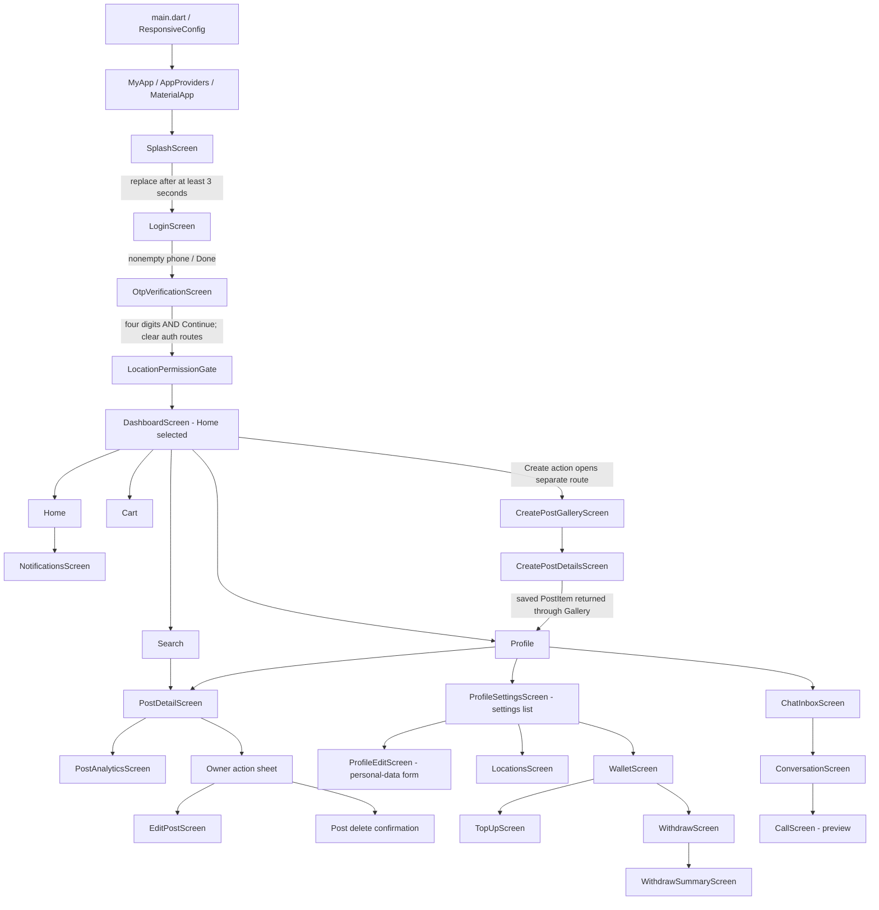
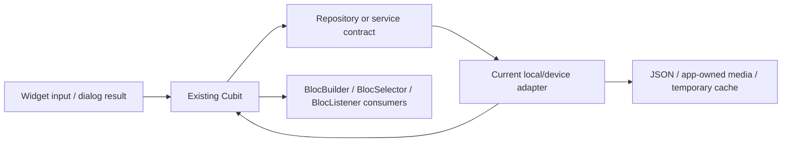

# Nini / HYWORK — Flutter development handoff

A Persian marketplace frontend where the intended product allows the **same account to act as a customer and a service provider/seller**. The Dart package is `nini`, the app label is `نینی`, and the current feed/entry artwork uses the HYWORK brand.

**Reviewed: 3 November 2026.** This describes the current local working tree, with the flat feature structure restored and the existing gallery refactor preserved. It does not imply that local changes have been committed or pushed.

Start with [CODING_RULES.md](CODING_RULES.md). It governs changes: preserve working functionality, UI, navigation, Cubit behavior, persistence, Persian text, and existing design conventions. This README is a source-code map; provide the actual repository or relevant source files to another developer/ChatGPT as well.

### Customer booking UI update — 5 November 2026

Customer screens use English for development. The local flow is Search → Provider Profile → Booking Form → Pending request sheet → Provider response → Approved/payment-pending sheet → Checkout → Payment method → Payment Gateway. The gateway page matches the supplied empty handoff design; it has no fake bank form or outcome chooser. Returning from it does not mark a booking paid. Real gateway integration and verified payment results are still pending.

`CustomerBookingsCubit` under `service_booking/presentation/cubit/` retains booking information and customer workflow state during the app session. Provider request responses and overtime now update that same state locally through the provider screens. Customer screens cannot generate service-start or completion events; real payment/provider synchronization remains pending. Session bookings reset after restarting the app. Existing Posts, product Cart, and analytics storage remain unchanged.

- Submitting the form creates `awaitingProvider`, stays on the booking route, and opens the pending-request sheet. Notifications are derived from that shared record in the background; submission never navigates to Notifications. Tapping **New service request** opens the black provider sheet. Dismissing it keeps the request pending; **Reject** records rejection; **Accept** changes it to `awaitingPayment` and opens Sale Information. The previous automatic confirmation timer and its unused review widgets were removed.
- `provider_bookings/presentation/pages/provider_sale_screen/` is the provider Sale Information page. Its widgets are grouped under `provider_sale_screen_widgets/`; request-sheet cards are under `provider_request_sheet_widgets/`. It reuses the existing summary/header, specifications, customer information card, and decimal amount sheet.
- In Sale Information, **Overtime** accepts a manual decimal quantity and computes the additional quote using the existing service unit price and integer hundredths. It creates a customer overtime notification without marking either amount paid. The accepted-but-unpaid stage supports this UI preview; final payment/service policies still belong to backend integration.
- The dummy Notifications feed labels **Provider** and **Customer** entries on the same phone. Provider entries reopen Sale Information; the customer acceptance entry reopens the approved request sheet with its Checkout action, and an overtime update opens the customer booking with its Accept/Reject sheet. Request/provider association comes from the existing stable provider/service IDs in the booking snapshot. This is not account-based notification delivery or cross-device synchronization.
- One booking ID is kept across the submitted service page, status sheet, notifications, and Cart card. `booking_navigation.dart` resumes the latest record for the selected provider/service; it does not open a blank form or silently submit again. Duplicate open submissions return the existing request. Rejected/cancelled bookings reopen in that state.
- The submitted page renders the saved form snapshot read-only. Status sheets listen to the shared Cubit, so provider acceptance/rejection/cancellation updates the visible UI. Closing a sheet or returning from the unconnected gateway never marks payment complete. Checkout checks the latest status before allowing payment.
- The Cart tab includes `cart_service_bookings/` cards for service requests, with pending, accepted/unpaid, rejected, and cancelled statuses. Cards open their own saved request by ID. Service bookings are not converted to product `CartItem`s and never enter product checkout sums or product persistence. Existing Cart filters also filter these service cards.
- `service_booking/presentation/pages/booking_order_details_screen/` displays booking information and status. Home → Notifications → Service bookings reopens these records.
- Incoming overtime uses the provider/quantity/unit/amount sheet. Reject preserves the original charge; Accept opens `booking_overtime_checkout_screen/` and the shared Payment UI for the additional charge only.
- After a provider completion update, the customer can confirm completion and rate the specialist or open Dispute. Rating remains black in both themes, with inline validation. Dispute and rating results are session-only. Voice/photo/file attachments are still coming-soon UI.
- Screens and their named widgets remain in separate screen-specific folders under `service_booking/presentation/`. The shared gateway page belongs to `payment/presentation/pages/payment_gateway_screen/`.
- Product Cart now uses the seller-approval flow described below. No real gateway, push, refund, payout, or provider app is connected. Provider earnings/Wallet integration belongs to the later provider implementation.

There are no payment-success/failure choosers or provider-event demo controls in the customer UI. Provider actions are exposed on the actual request/sale screens. `test/features/service_booking/` covers state transitions using supplied events, navigation, overtime charges, feedback forms, and responsive layouts. Run `flutter analyze --no-pub` and `flutter test --no-pub` after changes; physical-device verification remains necessary.

### Product order approval and tracking — 5 November 2026

Product shopping now follows Home → Post Details → Cart → Checkout summary → Request Order → seller approval → existing Payment UI. Add to Cart and the existing hundredths-based arithmetic remain unchanged. One account can buy products, sell products, or offer services; the prototype shows both recipients on the same device without authentication or cross-device delivery.

- `product_orders/presentation/pages/` contains separate `product_order_request_screen/`, `product_order_details_screen/`, and `product_order_tracking_screen/` folders. Screen-specific widgets are grouped under the matching `*_screen_widgets/` folders, with reusable order cards and notification tiles alongside them.
- The existing `CartCubit` owns product requests in `CartState.orders` and saves them through `LocalCartRepository`. No new Cubit or repository is introduced. `CartItem.seller` carries the seller identity from Home/Post Details. Old JSON remains readable; only known Home/demo IDs recover a missing seller. Unknown sellers block submission instead of being guessed.
- Submitting captures immutable items, quantities, prices, delivery address, and phone under stable order IDs. A multi-seller checkout creates one order per seller, allocating the existing charges exactly once. Submitted items leave the shopping basket; editing or adding basket items does not change submitted orders.
- Pending requests appear in Cart, Order History, Sales, and Notifications. Seller notification taps open the black Accept/Reject sheet. Acceptance enables customer payment; rejection/cancellation keeps payment unavailable. Closing a sheet or returning from Payment does not mark anything paid.
- `product_order_navigation.dart` reuses `PaymentScreen` and the existing placeholder gateway. `confirmProductPayment` is an integration hook for a verified payment event, never called by the customer UI. After that event the seller can prepare/dispatch and the customer can confirm delivery. There is no fake payment-success control.
- Order Status uses the supplied delivery illustration (`assets/orders/order_tracking.png`) and right-side dotted timeline in both themes. Only reached states show recorded timestamps; future steps say “Not yet”. Order details, decisions, and timestamps survive local restart. Service booking/overtime state remains separate and unchanged.
- `test/features/cart/product_order_flow_test.dart` covers grouping, persistence, legacy JSON, seller identity, approval/payment guards, tracking, and light/dark navigation. Real push notifications, authenticated recipients, inventory reservations, and payment verification still need a backend.

## Contents

- [Quick start](#quick-start)
- [Current implementation](#current-implementation)
- [Roles and folder ownership](#roles-and-folder-ownership)
- [Navigation and screen connections](#navigation-and-screen-connections)
- [State ownership and data flow](#state-ownership-and-data-flow)
- [Feature guide and widget connections](#feature-guide-and-widget-connections)
- [Storage, models, and backend handoff](#storage-models-and-backend-handoff)
- [Themes, Persian text, responsiveness, and assets](#themes-persian-text-responsiveness-and-assets)
- [Native configuration and builds](#native-configuration-and-builds)
- [Tests and verification](#tests-and-verification)
- [Where to make common changes](#where-to-make-common-changes)
- [Complete source file catalog](#complete-source-file-catalog)
- [Supporting files](#supporting-files)
- [Repository workflow](#repository-workflow)
- [Copyable ChatGPT handoff prompt](#copyable-chatgpt-handoff-prompt)

## Quick start

The reviewed environment uses **Flutter 3.47.4 / Dart 3.13.3**. `pubspec.yaml` requires Dart `^3.13.3`; the Android configuration uses AGP 9 built-in Kotlin and requires the compatible Flutter toolchain described below. No separate Flutter version-manager pin is present in the documented setup. Check your installed version before building.

```sh
flutter --version
flutter pub get
flutter devices
flutter run -d <device-id>
```

Native gallery, camera, microphone, file-opening, and permission flows require supported device/platform plugins. Home's sample product photo and map tiles need internet. Browser/desktop folders exist, but their presence is not evidence that all native flows work on those platforms.

## Current implementation

| Area | Implemented now | Boundary |
| --- | --- | --- |
| Entry | Animated splash, phone/country input, four-digit OTP input, Home entry and optional location prompt | Authentication is a UI preview; no SMS, token, account session, or server verification. |
| Customer dashboard | Home, Cart, Create action, Search, Profile; tap/swipe navigation | This is the only implemented dashboard. |
| Home | Fixed six-card phone feed, notification bell, local like/bookmark toggles, sample add-to-cart | It is not a backend feed and does not automatically display newly published profile posts. |
| Search | Persian query normalization, suggestions, city selection, demo filtering and post details | Uses `demo_search_posts.dart`, not saved profile posts or a remote search API. |
| Cart | Stock/quantity checks, filters, swipe removal, local history snapshots, checkout totals/bank selection | No payment-submit/gateway call or server-created order. |
| Posts/categories | Local publish/edit/delete, attachment copies, category create/rename/delete/filtering | Device-local JSON/files; no upload, synchronization, or authenticated ownership. |
| Post details/analytics | Media/content display, preview engagement, sample charts and local event tracking | Sample and published-post analytics are distinct; no server analytics. |
| Profile/settings | Profile preview, settings list, personal-data form/photo preview | Personal changes are screen-local; Done does not update an account or the main profile. |
| Locations | Map preview and temporary location labels; manual address/pin selection in post/chat dialogs | No GPS lookup, saved-location API, or ongoing tracking. |
| Notifications | Searchable samples and mark-read state owned by Home | No push registration, notification backend, or durable read state. |
| Wallet | Sample balance/transactions, top-up, withdrawal form/summary and OTP countdown | No real balance, bank OTP, payment, withdrawal, or funds movement. |
| Chat | Demo inbox, session text/history/actions, real local recording/playback and attachment selection/copying | No remote delivery, websocket, durable message database, or cross-device chat sync. |
| Calls | Voice/video preview routes with interactive controls/timers | The default service captures no call media and connects no remote participant. |

## Roles and folder ownership

```text
lib/
├── main.dart
├── app/                         # App composition and providers
├── core/                        # Theme, localization, responsive utilities and infrastructure
├── shared/                      # App-wide primitive widgets and shared models
└── features/
    ├── calls/
    ├── cart/
    ├── chat/
    ├── create_post/
    ├── dashboard/
    ├── home/
    ├── locations/
    ├── login/
    ├── notifications/
    ├── otp_verification/
    ├── post_analytics/
    ├── post_detail/
    ├── posts/
    ├── profile/
    ├── profile_settings/
    ├── search/
    ├── splash/
    └── wallet/
```

All features live directly under `lib/features/`. There are no customer/provider wrapper folders. `lib/shared` contains reusable primitive widgets and model types; feature-owned screens and widgets stay with their feature. No provider dashboard or role switch is implemented.

### Feature directory index

Every feature below is a direct child of `lib/features/`. These are feature folders, not separate customer/provider modules.

| Folder | Purpose |
| --- | --- |
| [splash](lib/features/splash/) | Animated entry and timed transition to Login. |
| [login](lib/features/login/) | Phone input, country picker, and the auth layout shared with OTP. |
| [otp_verification](lib/features/otp_verification/) | OTP preview input and Continue navigation to the dashboard. |
| [dashboard](lib/features/dashboard/) | Bottom navigation and composition of Home, Cart, Create, Search, and Profile. |
| [home](lib/features/home/) | Sample feed and entry to notifications. |
| [cart](lib/features/cart/) | Local cart, quantities, totals, checkout preview, and history. |
| [search](lib/features/search/) | Demo search, city selection, suggestions, and result cards. |
| [posts](lib/features/posts/) | Saved posts, category management, edit/delete flows, and reusable post media rendering. |
| [create_post](lib/features/create_post/) | Device gallery, attachment selection, and new-post form. |
| [post_detail](lib/features/post_detail/) | Post media/content display, engagement controls, and owner actions. |
| [post_analytics](lib/features/post_analytics/) | Local post event tracking and analytics reports/charts. |
| [profile](lib/features/profile/) | Main profile, categorized post grid, and settings-list screen. |
| [profile_settings](lib/features/profile_settings/) | Personal profile edit form and settings detail header shared with Locations. |
| [locations](lib/features/locations/) | Map preview and temporary saved-location labels. |
| [notifications](lib/features/notifications/) | Notification samples, search, and read state. |
| [wallet](lib/features/wallet/) | Balance/transactions, top-up, withdrawal form, and summary previews. |
| [chat](lib/features/chat/) | Inbox, conversation, attachments, voice recording, and playback. |
| [calls](lib/features/calls/) | Voice/video call previews and the CallService contract. |

### After the folder restoration

Imports now use `package:nini/features/<feature>/...`. The customer, common-feature, and services wrapper directories have been removed. Each feature retains its existing data/domain/presentation layers, screen folders, and widget subfolders. The reorganization changes paths only; it does not add account roles or change screen behavior. Keep new feature-specific widgets beside their owning feature rather than introducing role wrappers again.

### Feature layers and widget placement

Keep each feature's existing `data`, `domain`, and `presentation` responsibilities. Some UI-only features do not need all three layers. Existing features use both `page/` and `pages/`; follow the surrounding feature instead of renaming everything for consistency.

| Location | Responsibility |
| --- | --- |
| `data/` | Local/device adapters, sample datasets, serialization/storage implementations. |
| `domain/models/` and domain interfaces | Models, validation, repository/service contracts. |
| `presentation/cubit/` | State and operations visible to the UI. Some state classes live in the Cubit file; others have separate files. |
| `presentation/page/` or `presentation/pages/` | Route entry, controller ownership, provider composition, navigation and screen composition. |
| `presentation/widgets/` | Feature-owned view components; use the existing screen/widget subfolders. |
| `presentation/helpers/` | Focused coordination/formatting/selection helpers that already belong to presentation. |

Do not create new architecture layers, repositories, controllers, or generic wrappers just to populate folders.

## Navigation and screen connections

Navigation uses **native Navigator, MaterialPageRoute, PopScope, and a dashboard PageView**. There is no centralized named-route router to extend.



Important details that must remain intact:

1. `SplashScreen` starts its timer after the first frame and disposes it on exit.
2. OTP entry alone does not navigate. Continue is enabled at four digits; its guarded handler clears the auth stack and explicitly supplies `DashboardTab.home`.
3. `DashboardScreen`'s constructor default is **Profile**; the actual OTP startup path overrides it to **Home**. Do not confuse the default with app startup.
4. The dashboard index order is **Home, Cart, Create, Search, Profile**. Tapping Create opens the gallery route; the PageView keeps its Create slot for indexing/swipe behavior.
5. Create Details returns a `PostItem` to Gallery; Gallery returns it to Dashboard. Dashboard selects its category and opens Profile. Preserve this typed result chain.
6. Cart checkout is an internal `CartStage` change, not a separate route. Its Back behavior depends on stage.
7. Search field clear, panel Back/close, city selection, and submit are separate actions. Preserve their different state transitions.
8. Post edit/delete menus resolve the latest local record before acting. Delete success can pop the detail route; cancellation leaves it open.
9. Settings has **17 rows**. Only Profile setting, Locations, and Wallet navigate today. The Notifications settings row is a placeholder; the functional notification entry is Home's bell.
10. Top Up Payment closes its preview. Withdraw Done pushes Summary; Summary Done returns `true`, allowing Withdraw to close back to Wallet. Transfer/Request/Payment wallet action tiles currently have no destination.

The catalog below gives the exact path of every screen. The fastest entry points are [dashboard](lib/features/dashboard/presentation/pages/dashboard_screen.dart), [profile](lib/features/profile/presentation/page/profile_screen/profile_screen.dart), [post details](lib/features/post_detail/presentation/pages/post_detail_screen.dart), and the [settings list](lib/features/profile/presentation/widgets/profile_settings_screen_widgets/profile_settings_list/profile_settings_list.dart).

## State ownership and data flow

### Application-scoped providers

[AppProviders](lib/app/app_providers.dart) declares these providers. Their creation uses BlocProvider's normal lazy behavior; a `..load()` call runs when that provider is created, rather than proving every repository eagerly loads during splash.

| Cubit | Default backing implementation | Consumers |
| --- | --- | --- |
| `PostsCubit` | `LocalPostsRepository` | Profile grid, create/save, edit/delete, detail record refresh. |
| `ProfileCategoriesCubit` | `LocalProfileCategoriesRepository` | Profile filters, category manager, create/edit category dropdown. |
| `CartCubit` | `LocalCartRepository` | Home add-to-cart, cart screen, bottom-nav badge. |
| `PostAnalyticsCubit` | `LocalPostAnalyticsRepository` | Impression/detail trackers and analytics reports. |
| `ThemeCubit` | In-memory ThemeMode | MaterialApp theme and Profile appearance menu. |

`MyApp`/`AppProviders` accept repository overrides for posts, categories, cart, and analytics. Preserve those constructor contracts for tests and future backend adapters. The analytics provider currently imports a compatibility export under `post_analytics/presentation/domain/cubit/`; the real implementation is under `post_analytics/presentation/cubit/`.

### Route and screen-local state

| Owner | State/services it owns |
| --- | --- |
| Dashboard state | `PageController`, `DashboardNavigationCubit`, pending target-tab coordination. |
| SearchScreen / SearchView | `SearchCubit`; query TextEditingController and FocusNode belong to SearchView. |
| HomeScreen | `NotificationsCubit`, passed to the notification route with `BlocProvider.value`. Read changes last for Home's lifetime. |
| Each HomeProductCard | Local like/bookmark preview booleans. |
| CreatePostGalleryScreen | `GalleryCubit` and `CreatePostCubit`; the draft is passed by value to Details. |
| CreatePostDetailsScreen | Field controllers, Quill controller, caption synchronizer, publishing guard. |
| EditPostScreen | Prefilled `CreatePostCubit`, `PostEditorMediaCubit`, form state and save/discard guards. |
| PostDetailScreen | `PostDetailCubit` for carousel and preview engagement state. |
| Analytics sections | Selected period, selected chart point, and legend/filter toggles. |
| Profile edit / Locations | Local controllers, selected photo/labels; no account persistence. |
| Wallet previews | Amount/bank selections and a local countdown; no financial repository. |
| ChatInboxScreen | `ChatInboxCubit` and search controller. |
| ConversationScreen | `ConversationCubit`, `VoiceRecordingCubit`, `VoicePlaybackCubit`, controllers and lifecycle/route subscriptions. |
| CallScreen | `CallCubit` and a per-call `CallService`, defaulting to PreviewCallService. |



Some previews intentionally use only StatefulWidget state. Do not add Cubits or persistence to them unless the requested feature needs it.

## Feature guide and widget connections

### Splash, Login, and OTP

`SplashScreen → SplashContent → SplashBrand + AppLoader`. Shared entrance/staggered animation utilities drive the brand sequence. Login and OTP both use `AuthScreenLayout`, now owned by Login at `login/presentation/widgets/auth_screen_layout/`.

`LoginScreen → LoginPhoneField → LoginCountryPicker`. Phone input accepts the existing supported digit characters; nonempty input can continue. `OtpVerificationScreen → OtpCodeInput + OtpCountdown`. The four boxes use `pinput`; the country selector uses `country_code_picker`. No authentication repository or SMS request exists.

Splash is black. The shared auth layout explicitly applies `AppTheme.dark`, so Login/OTP remain black even when the main app is light. Do not remove that nested Theme as a cleanup.

### Customer dashboard

`DashboardScreen → HomeScreen / CartScreen / SearchScreen / ProfileScreen`, plus the Create route action. `DashboardBottomNav → DashboardFoldLayout + DashboardNavItem`; the cart item uses `DashboardCartIcon` to read the shared count. `ScreenEntrance` and `StaggeredEntrance` wrap the existing content. The dashboard supplies Home's View Cart callback and Cart's Back callback.

The physical hinge layout in `DashboardFoldLayout` is separate from ordinary width breakpoints. Keep native fold coordinates and established icon order intact.

### Home

`HomeScreen → HomeFeedHeader + six HomeProductCard widgets`. Header uses `HomeNotificationButton`. Each card composes `HomeProductImage`, `HomeEngagementBar`, `HomeProductDetails`, and `HomeProductPrice`; badges/metrics are smaller feature widgets.

The image URL and fixed feed title are in `HomeScreen`; the sample cart record and add-to-cart operation are in `HomeProductCard`. Image retries handle network failure. Notifications are sample records from the common notification feature. This feed does not read `PostsCubit`.

### Cart

`CartScreen → CartHeader + CartTabs + optional CartStatusFilter/CartStorageNotice + stage content`.

- Items: `CartItemsList → CartItemCard → CartItemImage / CartItemBadge / CartQuantityButton`. Quantity opens `CartAmountDialog`; swipe removal uses `CartDeleteBackground`.
- Checkout: `CartCheckout → CartSection → item cards, CartPaymentSummary, CartPaymentMethods, escrow help`.
- History: `CartOrderHistory` expands existing order snapshots using read-only item cards.
- Empty/sales/filter states use `CartEmptyState`; Sales currently has no real sales feed.

`CartCubit` validates edits and writes snapshots. `CartState` calculates totals. `cart_format.dart` is the numeric boundary: quantities and totals use integer hundredths. Do not introduce floating-point rounding or change a status filter into a mutation. There is no submit-payment handler to connect implicitly.

### Search

`SearchScreen → SearchView → SearchHeader + SearchContent`. Header contains `SearchQueryField` and `SearchCityButton`. Content chooses `SearchCityList`, `SearchSuggestions`, `SearchEmptyState`, or `SearchResultsGrid → SearchResultCard`.

`SearchCubit` owns only query/submittedQuery/city/panel. `SearchCatalog` supplies normalized demo suggestions/results from `demo_search_posts.dart`. Result cards open `PostDetailScreen` and use the common `PostMediaView` when media is available. The city list is an inline panel, not a replacement dropdown or a navigation away from Search.

### Create post and reusable gallery

`CreatePostGalleryScreen → GalleryContent → GalleryPreview + GalleryGrid`.

```text
GalleryGrid (lifecycle and native library observer)
├── refresh control
├── GalleryAccessNotice, when access is limited
├── GalleryBody
│   ├── loading / denied / failure / empty presentation
│   ├── photo/video thumbnails, selection badges, pagination retry
│   └── GalleryFilesGrid for the document tab
└── GalleryTabSelector
```

`GalleryPreview` renders one selected asset or the multi-selection grid and also defines the reusable `GalleryFileTile`. `GalleryContent` switches to side-by-side panels in short landscape windows. `GalleryGrid(compact: true)` is also used by Chat, without the post refresh/tab controls.

`GalleryCubit` owns native gallery permission, pagination, selected assets/files, and picker errors. Selecting File opens the native document picker; tapping already-selected File can reopen it. Already-selected Photo/Video callbacks are disabled. Resume refresh does not reopen the File picker. Preserve load-version checks, queued refresh behavior, and `GalleryLibraryChanges` reference counting.

Next pushes `CreatePostDetailsScreen` with the same draft Cubit and an immutable selection snapshot. The details page composes `SelectedMediaGrid`, `PostBasicDetailsSection`, `PostPricingInventorySection`, `PostOptionsSection`, and `PostPublishActions`.

The caption uses real `flutter_quill` editing and stores both Delta and plain text through `PostCaptionSynchronizer`. Option rows open feature-owned dialogs for type, category, unit, preparation, inventory, features, tags, schedule, address, and alt text. `PostDialog` supplies the shared sheet chrome and intentionally uses the palette opposite to the underlying page.

Address dialogs use OpenStreetMap with a manually chosen pin, initially centered on Tehran. Schedule results distinguish dismissal from explicitly clearing a schedule. Publish requires media, post type, title, caption, and a future start when scheduled. The existing validators/caller messages remain the source of truth.

### Posts, categories, full edit, and delete

`posts` owns saved post/category operations; `create_post` owns the creation draft/gallery UI; `post_detail` owns viewing. They share `PostItem`, `PostDetails`, and media/unit models from `lib/shared/models/post/`.

`ProfileCategoriesScreen → ProfileCategoriesBody → ProfileCategoryRow`. Add/rename opens `category_editor_sheet`; Delete opens `category_delete_sheet`. `CategorySheetActions` supplies the normal or destructive action row. Category IDs remain stable when renamed. All is a virtual null filter. Deleting a category never deletes posts or media; those posts remain accessible under All.

`PostDetailScreen → managePostActions → PostOwnerActionsSheet → EditPostScreen or PostDeleteSheet`.

`EditPostScreen → EditPostForm → basic/pricing/options/location/features/schedule/alt-text sections + PostEditorMediaSection`. The media section composes its grid/tiles and can reopen the same gallery to add attachments. `PostEditorMediaCubit` keeps retained media and new additions separate until Save. Discard confirmation and busy/error states belong to the current editor flow.

`post_draft_mapper.dart` rehydrates stored values, including the base price. Do not populate a price editor from an already-discounted display value and then apply the discount again. Create uses Quill; inspect the existing edit field widgets before changing how captions are edited or serialized.

`PostMediaView` now lives under `posts/presentation/widgets/post_media_view/`. It is used by post edit, profile cards, search result cards, post detail, and analytics. Keep one reusable implementation rather than copying it into each screen.

### Post details

`PostDetailScreen → PostDetailBody → PostAuthorHeader + PostImageCarousel + PostEngagementBar + PostPricing + content + PostFeaturesTable`.

The detail screen listens for updated records in `PostsCubit`, supplies the owner menu only when local state says the record can be managed, and opens analytics. Stored/published content uses `PublishedPostContent`, including read-only rich caption and metadata; fallback sample content uses `PostContent`. Comment/share callbacks may be supplied by callers; visible icons alone do not imply remote functionality.

`PostDetailCubit` owns only route-local image index and like/bookmark state. `PostDetailActivityTracker` observes detail use; it is not the post storage owner.

### Post analytics

`PostAnalyticsScreen → AnalyticsPostHeader + TotalViewsSection + ClicksInteractionsSection + AverageTimeViewedSection + ImpressionsSection + OrdersBookingsSection`.

Sections use `analytics_controls.dart` for headings, period menus, tooltips, legends, summaries, and formatting. Individual chart files own the line/area, radar, polar, and daily-order rendering.

Published records use local analytics events. Samples use explicit sample reports. `PostImpressionTracker` is used on cards; `PostDetailActivityTracker` records opening/watch segments and positive like/save actions. Watch time excludes covered routes/background periods. Publication state is used to keep sample activity separate; it is not an ownership credential. No backend order/bookings source is connected.

### Profile and settings list

`ProfileScreen → ProfileHeaderActions + ProfileStats + ProfileAvatar + ProfileIdentity + ProfileCategoryChips + ProfilePostGrid`.

Header connects to appearance, Chat Inbox, and the settings-list route. Category chips connect to app-scoped categories and the manager. The grid reads `PostsCubit`, filters by selected category, and opens post details. New local posts are focused by the grid after publication. Identity and statistics remain previews, not account API data.

`ProfileSettingsScreen` in the **profile** feature is the menu/list page. `ProfileEditScreen` in **profile_settings** is the personal-data form. These are distinct screens; do not merge them based on similar naming.

### Personal profile editing

`ProfileEditScreen → ProfilePhotoPicker + ProfileEditFields → ProfileEditField / ProfileBirthField`.

This form includes name, surname, nationality, username, email, birth, gender, and bio. Its state/photo preview is local to the route. `SettingsDetailHeader` closes the route after unfocusing; it does not save an account profile. The same header is reused by Locations.

### Locations and permission entry

`LocationsScreen → LocationMapPreview + LocationLabelCard + SavedLocationList`. This preview's map starts at the sample New Delhi coordinates. Adding/selecting a label updates only local route state; it is separate from the post/chat manual address picker.

After OTP, `LocationPermissionGate → showLocationPermissionPrompt → LocationPermissionDialog → LocationPermissionActions → LocationPermissionService`. The helper skips unsupported platforms or already-granted foreground permission. The dialog deliberately uses a light theme.

Foreground Once/While using choices defer the actual grant to the OS. Always first establishes foreground permission, then follows the platform-specific background-permission path. The service never reads or tracks location. The gate's once behavior is per widget entry, not a persisted onboarding preference.

### Notifications

`HomeScreen` owns `NotificationsCubit` and passes it to `NotificationsScreen`, which composes `NotificationHeader`, `NotificationSearchField`, and `NotificationList → NotificationTile → NotificationAvatar`.

Search filters bundled samples. Tapping a row marks it read in that Home-owned state and updates the bell count. There is no push SDK, device-token registration, network delivery, or durable read-state adapter.

### Wallet

All four routes live under `wallet/presentation/page/`, each in its named screen folder. Widget groups stay under `presentation/widgets/<screen>_widgets/`.

```text
WalletScreen
├── WalletBalanceCard + WalletActionsRow + WalletTransactions
├── TopUpScreen
│   └── balance card + WalletAmountSection + WalletPaymentMethods
└── WithdrawScreen
    └── balance card + amount + account + WithdrawOtpFields
        └── WithdrawSummaryScreen
            └── WithdrawIllustration + WithdrawSummaryDetails
```

Shared wallet components include `WalletHeader`, `WalletBottomButton`, `WalletCardFooter`, `WalletTextField`, amount presets, and bank artwork. Data comes from `WalletSampleData`. Selected amounts, bank selection, and OTP countdown are UI state; no repository or financial operation exists. Current Transfer/Request/Payment action tiles have no callback, and Top Up's Payment button simply closes that preview.

### Chat, voice notes, and attachments

`ProfileHeaderActions → ChatInboxScreen → ChatConversationTile → ConversationScreen`.

Search → Provider Profile also offers **Chat with provider**, using the same `ConversationScreen`, attachment/voice controls, and call routes. `provider_profile/presentation/widgets/provider_chat_button/` maps the provider's stable ID, name, and avatar to one session conversation. New provider chats start empty, retain local messages when reopened, and appear in the existing inbox. Remote messaging and live audio/video calls still require backend/RTC integration.

`ConversationScreen` composes `ConversationHeader` and `ConversationBody`. Body chooses message bubbles, blocked/selection notices, `ChatMessageComposer` or `VoiceRecordingPanel`, and the optional `ChatEmojiPanel`. Bubbles delegate to `ChatAttachmentView`, `ChatLocationView`, and `ChatVoicePlayer`.

The paperclip opens `ChatAttachmentSheet`: Document, Location, Camera, Gallery, plus `GalleryGrid(compact: true)`. `chat_attachment_flow.dart` coordinates these picker routes and returns selections. `ConversationCubit` retains send/blocked/busy guards and asks `ChatMediaStore` to copy owned media before adding local messages.

- `DeviceVoiceRecorder` records microphone audio through `record`; `JustAudioChatPlayer` handles real local playback.
- `LocalChatMediaStore` copies selected media/voice into a temporary private cache. It must not delete picker originals.
- `InMemoryChatRepository.instance` holds session messages and blocked IDs. Inbox data starts from demo contacts. Sending in this implementation changes local preview history, not another user's device.
- Route/lifecycle handling pauses playback and stops/cancels recording appropriately. Do not remove mounted/closed guards or disposal logic to shorten the file.

The service contracts can be injected through `ConversationScreen`; replacing the synchronous message contract with a remote async design requires deliberate UI/Cubit changes, not just swapping an endpoint string.

### Calls

`ConversationHeader` voice/video actions open `CallScreen`, which provides `CallCubit`. `CallControls`, `CallActionButton`, `CallAvatar`, `CallVideoStage`, and `CallVideoHeader` render the preview.

The default `PreviewCallService` simulates phases and flags. The voice preview starts as incoming/ringing; video uses sample images as connected preview content. Neither contacts a user nor captures live call audio/video. A real integration belongs behind `CallService` plus optional real video widgets and authenticated signaling/RTC. Preserve end/cancel/dispose behavior, including in-flight operations.

## Storage, models, and backend handoff

### Storage currently in use

Paths below are relative to the application's resolved Documents or temporary directory, not repository files.

| Owner | Storage | Lifetime / important behavior |
| --- | --- | --- |
| LocalPostsRepository | `Documents/nini_posts/posts.json` and owned media below `nini_posts/` | Persistent local posts; version 1/2 migration, stable IDs, atomic index replacement. |
| LocalProfileCategoriesRepository | `Documents/nini_profile_categories/categories.json` | Persistent category IDs/names; versioned, serialized writes. |
| LocalPostAnalyticsRepository | `Documents/post_analytics.json` | Persistent local event history; versioned JSON. |
| LocalCartRepository | `Documents/cart.json` | Persistent items and existing order snapshots. Missing file differs from a deliberately saved empty cart. |
| LocalChatMediaStore | Temporary `nini_chat_media/<generated-folder>/` | Local copied media; not a durable chat database. |
| DeviceVoiceRecorder | Temporary `nini_voice_drafts/` | Recording draft lifecycle; prepared voice media is copied separately. |
| InMemoryChatRepository | Process memory | Messages and blocked state disappear on process restart. |
| Theme/notifications/profile form/location labels/wallet controls | Widget/Cubit memory | Session/route-local previews; no current account sync. |

The local adapters include an iOS Documents-directory fallback based on the app sandbox's temporary directory. Preserve that platform handling when changing storage. Post media preparation uses pending/final owned folders and cleanup/rollback paths. A save failure must not destroy existing attachments or user-selected source files.

Profile samples bootstrap into editable local records. Their IDs/images remain stable and their publication date stays null for sample analytics. Once the version-2 index exists, deleted sample cards are not blindly reinserted on every load.

### Model contracts to preserve

| Type / concept | Meaning |
| --- | --- |
| `PostItem` | Common record used by Profile, details, search-derived samples, media views, storage, and analytics keys. |
| `PostDetails` | Typed caption/Delta/tags/address/schedule/features/stock/discount/unit/alt text with a lossless legacy JSON boundary. Preserve unknown serialized metadata. |
| `PostMedia` | Type/source/path/name/thumbnail/alt-text metadata. Asset-backed and app-file-backed media have different handling. |
| `PostDraft` | Session form model; preserves Delta plus searchable plain caption and explicitly clearable optional selections. |
| `PostMediaChanges` | Existing media to retain plus new additions; null media changes retain current attachments. |
| `ProfileCategory` | Stable ID and editable name. All is virtual (`null`); category deletion must not delete posts. |
| `PostUnit` | Store enum `.name`; use `.label` for Persian display. Unknown legacy values stay absent rather than silently selecting another unit. |
| `PostSchedule` | Serialize timestamps as UTC; presentation converts back to local time. |
| Cart numbers | Unit prices/discounts are whole toman; quantities use hundredths. Totals/charges are integer hundredths of a toman. Example: quantity `250` means `2.5` units. Keep existing parsing/whole-unit rules. |
| Post identity | Update preserves the post ID/publication identity. Analytics is keyed by post ID; replacing media must not create a different post. |
| Local manageability | `PostsState.canManage` checks the local profile dataset/load state. It is not authenticated authorization. |

### Backend extension points

| Contract / entry | Where a real integration belongs |
| --- | --- |
| `PostsRepository` | Load/publish/update/delete adapter, uploads, authenticated ownership, stable IDs and failure mapping. Inject via MyApp/AppProviders. |
| `ProfileCategoriesRepository` | Account-scoped categories; preserve posts when a tab is removed. Inject via MyApp/AppProviders. |
| `CartRepository` | Account/cart synchronization while preserving quantity units and exact totals. Checkout/payment requires a separate explicit product task. |
| `PostAnalyticsRepository` | Event persistence/report integration. Do not mix local samples with real event totals. |
| `ChatMessagesRepository` | Current session contract is synchronous; real remote delivery/history requires a reviewed async design and delivery/error semantics. |
| `ChatMediaStore`, `VoiceRecorder`, `ChatAudioPlayer` | Keep device/media responsibilities separate from remote chat transport. |
| `CallService` | Authenticated signaling, remote-join state, native audio/video, and cancellation/disposal. |
| Login/OTP | Add real auth/session handling only when requested; currently there is no AuthRepository, token store, or authenticated role model. |
| Wallet/profile/notifications/locations | Add real contracts/state only as required by a concrete feature; these are previews today. |

There is no API base URL, endpoint specification, network-client abstraction, or authenticated customer/provider access-control layer to reuse yet. Do not document a proposed endpoint as if it already exists.

## Themes, Persian text, responsiveness, and assets

### Shared infrastructure and the relocated widgets

`lib/shared/widgets/` now contains only app-wide primitives: `AppButton`, `AppTextField`, `AppIcon`, `AppLoader`, `AppLogo`, and `AppToast`. Their exact paths and responsibilities appear in the catalog.

| Widget | Owner now | Existing reuse |
| --- | --- | --- |
| `AuthScreenLayout` | [login/presentation/widgets/auth_screen_layout/auth_screen_layout.dart](lib/features/login/presentation/widgets/auth_screen_layout/auth_screen_layout.dart) | Login and OTP entry composition. |
| `PostMediaView` | [posts/presentation/widgets/post_media_view/post_media_view.dart](lib/features/posts/presentation/widgets/post_media_view/post_media_view.dart) | Post edit, profile cards, search cards, detail carousel, analytics header. |
| `SettingsDetailHeader` | [profile_settings/presentation/widgets/settings_detail_header/settings_detail_header.dart](lib/features/profile_settings/presentation/widgets/settings_detail_header/settings_detail_header.dart) | Personal profile editing and Locations. |

Do not recreate these under `lib/shared` or duplicate their implementation just because another screen uses them.

### Color and direction conventions

- `AppColors` owns fixed semantic/client colors, including destructive red, badges, wallet statuses, charts, and preview-call colors.
- `AppTheme.light/dark` owns theme-dependent surfaces, text, buttons, input borders and system bars. Normal feature widgets should use Theme colors.
- `ThemeCubit` supplies light/dark/system mode to MaterialApp; the preference is session-only.
- Intentional exceptions: Splash/Login/OTP remain black, the location permission prompt uses light theme, and post sheets use the opposite palette to the page.
- Locale is `fa_IR`; Material/Quill/country localizations are configured in `app.dart`.
- The app deliberately keeps its original **LTR layout order** while Persian text is explicitly RTL/right-aligned. Do not globally mirror the layout merely to localize labels.
- String catalogs are under `core/localization/`; `AppStrings.persianDigits` formats displayed digits. Never translate IDs, enum keys, JSON keys, paths, or user content automatically.
- User-entered English names remain user content. Known sample labels may be localized through the existing feature catalogs without changing stored IDs.

### Responsive behavior and animation

`ResponsiveConfig` wraps startup with a 390×844 design reference, ScreenUtil text adaptation, and FoldableProvider. `AppResponsive` uses compact `<600`, medium `600–839`, and expanded `>=840` widths. It exposes spacing/column helpers, but individual screens may apply narrower content widths or text-scale-aware columns.

Use the local `LayoutBuilder` constraints as existing widgets do. Preserve scrollable forms/sheets, keyboard handling, safe areas, larger-text behavior, and physical fold layouts. Do not solve an overflow by disabling the user's text scaling globally.

`ScreenEntrance` owns route-aware entrance behavior and the shared route observer; `StaggeredEntrance` consumes it. Reduced-motion handling belongs to those utilities. `RiveAssetAnimation` is an optional asset player; no `.riv` artwork is currently bundled. The auth illustrations are raster images, not authored Rive animations.

### Assets and client icons

| Path | Use |
| --- | --- |
| `assets/branding/` | HYWORK SVG logo. |
| `assets/auth/` | Login illustration, OTP lock, location-permission artwork. |
| `assets/wallet/` | Withdrawal summary artwork. |
| `assets/banks/` | Melli/Mellat/Saman preview bank SVGs. |
| `assets/fonts/YekanBakh-Regular.ttf` | Main UI font and gallery golden-test font. |
| Root `assets/` sample images | Profile/gallery/search/chat/call preview artwork. |
| `assets/icons/vectors/` | Client SVG icon collection used through AppIcons/AppIcon. |
| `assets/icons/<category>/` | Legacy/client PNG categories. |
| `assets/icons/source_sheets/` and supplemental assets | Source artwork used by extraction/import tooling. |
| `tool/` | Icon manifests and reproduction/verification scripts. |

`AppAssets` contains shared entry/branding paths. `AppIcons` contains icon paths; `AppIcon` applies theme color while preserving source transparency/proportions. Reuse the existing client artwork instead of replacing established controls with unrelated Material icons.

For additional artwork, follow the explicit directory registrations in `pubspec.yaml`. The Python icon tooling uses its JSON source manifests and, for raster extraction, Pillow. Inspect the source paths/options before running an extraction script; it writes assets and is not a routine prerequisite to `flutter run`.

## Native configuration and builds

### Android

| File | Responsibility |
| --- | --- |
| [android/app/build.gradle.kts](android/app/build.gradle.kts) | `com.nini.nini`, Flutter SDK/NDK values, Java/Kotlin 17 app target, release build configuration. |
| [android/settings.gradle.kts](android/settings.gradle.kts) | Plugin loader, AGP 9.1.0, Kotlin compiler declaration with `apply false`, version-guarded plugin build entry adapters. |
| [android/gradle.properties](android/gradle.properties) | Built-in Kotlin enabled; compatible Android DSL retained. |
| [android/gradle/rive_native.gradle](android/gradle/rive_native.gradle) | Repository-owned Android build adapter for rive_native 0.1.11, keeping the installed package's source/native runtime. |
| [android/gradle/built_in_kotlin_plugin.gradle](android/gradle/built_in_kotlin_plugin.gradle) | Runs upstream migrated photo/emoji build configuration and verifies that legacy Kotlin is not actually applied. |
| [android/app/src/main/AndroidManifest.xml](android/app/src/main/AndroidManifest.xml) | Internet, foreground/background location, legacy/media/selected-gallery access, microphone permission and activity setup. |

The app plugin block does not apply legacy `org.jetbrains.kotlin.android`. The settings-level `apply false` declaration supplies the compiler version; it is not the same as applying legacy KGP to the app. Keep this distinction when maintaining Gradle.

The photo_manager/emoji adapters are guarded for the installed releases. Flutter's text scanner can flag unused legacy fallback statements inside otherwise migrated packages. The adapter checks actual plugin state. The Rive adapter is also version-specific. Review adapters when dependencies change; do not patch `.pub-cache`, generated plugin registration, or the Flutter SDK to fix the project.

The prior missing `FilePickerPlugin` release failure was addressed with the built-in Kotlin configuration, refreshed outputs, and file_picker 13.3.1. Do not manually edit GeneratedPluginRegistrant to remove a plugin.

```sh
flutter build apk --release
```

Output: `build/app/outputs/flutter-apk/app-release.apk`. The current release configuration uses **debug signing for previews**; production signing still needs its own setup. Rebuild after code, native configuration, or feature changes; an existing APK file may represent an older source tree. MaterialIcons tree-shaking output is informational optimization, not a compilation failure.

### iOS

[Info.plist](ios/Runner/Info.plist) declares photo-library, camera, microphone, foreground-location, and always-location usage descriptions. The reviewed Xcode project uses Flutter's generated Swift Package integration and an iOS 15.0 deployment target. **There is no `ios/Podfile` in this checkout**; do not assume a CocoaPods setup from an older README.

Keep Flutter-generated files under `ios/Flutter/ephemeral/` generated. After native plugin/permission changes, stop and rebuild rather than relying on hot reload. Permissions and device services need platform checks; a simulator pass does not verify all physical-device behavior.

## Tests and verification

The Flutter test folder exists and currently targets the reusable gallery:

| File / directory | Purpose |
| --- | --- |
| [gallery_grid_test.dart](test/features/create_post/gallery_grid_test.dart) | 19 behavior checks including all nine tab combinations, enabled/disabled actions, refresh, empty/error/retry states, compact mode, selection, and pagination retry. |
| [gallery_grid_golden_test.dart](test/features/create_post/gallery_grid_golden_test.dart) | Four visual checks: light/dark state matrices, compact chat gallery, landscape with larger text. |
| [gallery_test_support.dart](test/features/create_post/gallery_test_support.dart) | Command-recording Cubit, native-channel stubs, test file/media fixtures, project font loading, deterministic image precaching, and app harness. |
| [goldens/](test/features/create_post/goldens/) | Four PNG baselines captured from the pre-refactor gallery. |

These make **23 gallery checks**, not comprehensive coverage for every feature. They stub native data/picker boundaries and do not prove real SMS, payments, RTC, full device permission behavior, or platform-wide compatibility. `test/features/create_post/` keeps its existing test path even though production source now lives in `create_post/`.

```sh
flutter analyze --no-pub
flutter test --no-pub test/features/create_post
```

Run `flutter pub get` first on a fresh checkout. Run relevant checks after code changes and state exactly what was verified. For gallery rendering changes, inspect intentional diffs; do not regenerate golden baselines just to silence a failure. For documentation-only edits, validate links/path inventory instead of claiming a new device/build/test pass.

Useful manual checks after related UI changes: 320 dp phone width, landscape, tablet widths, enlarged text, keyboard-open forms/sheets, light/dark/system mode, reduced motion, gallery denial/limited access/picker cancellation, and reopening the gallery from both Create Post and Chat. Test additional native flows on their real target platforms when affected.

## Where to make common changes

| Requested change | Start here |
| --- | --- |
| App startup, locale, global providers | `lib/main.dart`, `lib/app/app.dart`, `lib/app/app_providers.dart`. |
| Login/OTP wording, fields, black layout | Auth string catalog; Login/OTP feature widgets; Login-owned AuthScreenLayout. |
| Customer tabs or Create return behavior | `dashboard/presentation/pages/dashboard_screen.dart`. |
| Home sample feed/image/add-to-cart | HomeScreen, HomeProductCard, HomeProductImage. |
| Search query/city/results | SearchView, SearchCubit, SearchCatalog, demo_search_posts.dart. |
| Cart calculations/amount parsing | CartItem, CartState, CartCubit, cart_format.dart; preserve hundredths. |
| Profile identity/grid/settings rows | ProfileScreen widgets and ProfileSettingsList. |
| Personal profile fields | `profile_settings/`, not the profile settings-list screen. |
| Location form versus permission prompt | LocationsScreen widgets versus LocationPermissionGate/helper/dialog/service. |
| Notification samples/search/read behavior | sample_notifications.dart, NotificationsCubit, Home's route/provider wiring. |
| Wallet sample values/routes/inputs | WalletSampleData, four wallet pages, their named widget groups. |
| Gallery permission/selection | GalleryCubit/GalleryLibraryChanges; read full async guards first. |
| Gallery layout or tabs | GalleryGrid, GalleryBody, GalleryTabSelector, GalleryFilesGrid, GalleryContent. |
| New post field | PostDraft/CreatePostCubit, create section/dialog, validator, JSON conversion, stored model/adapter, and edit mapper/fields where applicable. |
| Post update/delete/ownership | PostsRepository, PostsCubit, managePostActions, EditPostScreen/PostDeleteSheet. |
| Category semantics | ProfileCategoriesRepository/Cubit/validator plus category manager/filter/selector consumers. |
| Post media across multiple screens | Posts-owned PostMediaView and shared PostMedia model. |
| Analytics definitions/tracking | PostAnalyticsReport/events, repository/Cubit, activity trackers, then presentation charts. |
| Chat picker/recording/playback | ConversationScreen, chat_attachment_flow, conversation/recording/playback Cubits and device adapters. |
| Real calls | CallService implementation and CallScreen injection; PreviewCallService is only a preview. |

All feature-relative paths in this table are under `lib/features/`. The full catalog below resolves every filename and lists its responsibility.

## Complete source file catalog

This catalog covers all **327 current Dart files under `lib/`**. Each subsection declares a base directory; paths in its table are relative to that base. Public types are listed where present. Tiny private rendering helpers remain with their owning file. This is the complete Dart file inventory, not an instruction to split every class into another file.

### Application entry

Base: `lib/` — 1 Dart file.

| File relative to base | Responsibility and public declarations |
| --- | --- |
| `main.dart` | Initializes Flutter bindings and wraps MyApp in ResponsiveConfig. |

### App composition

Base: `lib/app/` — 2 Dart files.

| File relative to base | Responsibility and public declarations |
| --- | --- |
| `app.dart` | MaterialApp configuration, Persian locale, themes, route observer, and SplashScreen entry. Defines: `MyApp`. |
| `app_providers.dart` | Declares the five app-scoped Cubits and injectable local repositories. Defines: `AppProviders`. |

### Core utilities

Base: `lib/core/` — 25 Dart files.

| File relative to base | Responsibility and public declarations |
| --- | --- |
| `animation/animation.dart` | Exports shared animation utilities. |
| `animation/rive_asset_animation.dart` | Optional bundled Rive player with loading/error fallback and loader disposal. Defines: `RiveAssetAnimation`. |
| `animation/screen_entrance.dart` | Route-aware entrance animation and the shared entranceRouteObserver. Defines: `ScreenEntrance`, `ScreenEntranceScope`. |
| `animation/staggered_entrance.dart` | Staggers child animations using the surrounding screen entrance; honors reduced motion. Defines: `StaggeredEntrance`. |
| `assets/app_assets.dart` | Central paths for brand, login, OTP, and location-prompt artwork. Defines: `AppAssets`. |
| `icons/app_icons.dart` | Central client icon asset constants; prefer these over raw paths in screens. Defines: `AppIcons`. |
| `localization/app_strings.dart` | Main Persian labels, sample text, display-digit conversion, and common formatting helpers. Defines: `AppStrings`. |
| `localization/auth_strings.dart` | Persian login, phone, country-picker, OTP, and splash labels. Defines: `AuthStrings`. |
| `localization/cart_strings.dart` | Persian cart, checkout, status, quantity, and order-history labels. Defines: `CartStrings`. |
| `localization/location_strings.dart` | Persian location form, saved-label, and permission-dialog labels. Defines: `LocationStrings`. |
| `localization/notification_strings.dart` | Persian notification screen, search, and empty-state labels. Defines: `NotificationStrings`. |
| `localization/persian_feature.dart` | Applies Persian localization and the established feature direction convention. Defines: `PersianFeature`. |
| `localization/profile_edit_strings.dart` | Persian personal-profile form and date labels. Defines: `ProfileEditStrings`. |
| `localization/profile_post_strings.dart` | Persian category manager, post editor, owner actions, and delete/discard labels. Defines: `ProfilePostStrings`. |
| `localization/profile_settings_strings.dart` | Persian settings-list labels and General heading. Defines: `ProfileSettingsStrings`. |
| `localization/search_strings.dart` | Persian search labels, cities, suggestions, and sample service wording. Defines: `SearchStrings`. |
| `localization/wallet_strings.dart` | Persian wallet, amount, bank, account, withdrawal, and OTP-preview labels. Defines: `WalletStrings`. |
| `permissions/location_permission_service.dart` | Requests native foreground/background location permissions; never reads GPS coordinates. Defines: `LocationAccessChoice`, `LocationPermissionService`. |
| `responsiveness/app_responsiveness/app_responsiveness.dart` | Compact/medium/expanded breakpoints, spacing helpers, and a local-constraint builder. Defines: `AppScreenType`, `AppResponsive`, `ResponsiveWidgetBuilder`, `AppResponsiveBuilder`. |
| `responsiveness/fold_aware_layout/fold_aware_layout.dart` | Optional two-pane layout that respects a physical hinge or fold division. Defines: `FoldAwareLayout`. |
| `responsiveness/responsive_config/config.dart` | ScreenUtil/FoldableProvider setup and MaterialApp responsive breakpoints. Defines: `ResponsiveConfig`. |
| `theme/app_colors.dart` | Central fixed semantic and client-design colors. Defines: `AppColors`. |
| `theme/app_theme.dart` | Builds light and dark ThemeData for surfaces, text, controls, and system bars. Defines: `AppTheme`. |
| `theme/theme_cubit.dart` | Session-level light/dark/system selection; does not persist the preference. Defines: `ThemeCubit`. |
| `theme/theme_mode_menu.dart` | Profile appearance menu connected to the app-scoped ThemeCubit. Defines: `ThemeModeMenu`. |

### App-wide shared models and primitive widgets

Base: `lib/shared/` — 11 Dart files.

| File relative to base | Responsibility and public declarations |
| --- | --- |
| `models/post/post_attributes.dart` | Shared feature name/value, address/coordinates, and UTC-serialized schedule models. Defines: `PostFeature`, `PostSchedule`, `PostAddress`. |
| `models/post/post_details.dart` | Typed post metadata and lossless handling of legacy serialized fields. Defines: `PostDetails`. |
| `models/post/post_item.dart` | Shared display/storage post record and its JSON boundary. Defines: `PostItem`. |
| `models/post/post_media.dart` | Shared media type/source metadata, file/asset paths, thumbnails, and alt text. Defines: `PostMediaType`, `PostMediaSource`, `PostMedia`. |
| `models/post/post_unit.dart` | Stable sale-unit enum keys, Persian labels, and nullable legacy lookup. Defines: `PostUnit`. |
| `widgets/app_button/app_button.dart` | Common primary/outlined/text button with loading state, icon, and wrapping label. Defines: `AppButtonVariant`, `AppButton`. |
| `widgets/app_icons/app_icon.dart` | Renders client SVG or legacy PNG icons using the current theme foreground. Defines: `AppIcon`. |
| `widgets/app_loader/app_loader.dart` | Shared progress indicator with optional label, size, and color. Defines: `AppLoader`. |
| `widgets/app_logo/app_logo.dart` | Reusable bundled HYWORK brand logo renderer. Defines: `AppLogo`. |
| `widgets/app_textfield/app_text_field.dart` | Shared TextFormField decoration, validation callbacks, and explicit Persian text direction. Defines: `AppTextField`. |
| `widgets/app_toast/app_toast.dart` | Shared success/warning/error feedback through the app's toast presentation. Defines: `AppToastType`, `AppToast`. |

### Splash

Base: `lib/features/splash/` — 3 Dart files.

| File relative to base | Responsibility and public declarations |
| --- | --- |
| `presentation/page/splash_screen/splash_screen.dart` | Shows the black splash and replaces it with Login after at least three seconds. Defines: `SplashScreen`. |
| `presentation/widgets/splash_screen_widgets/splash_brand/splash_brand.dart` | Composes the HYWORK artwork and wordmark for the splash. Defines: `SplashBrand`. |
| `presentation/widgets/splash_screen_widgets/splash_content/splash_content.dart` | Responsive, scrollable splash composition with staggered brand and AppLoader. Defines: `SplashContent`. |

### Login and the shared authentication layout

Base: `lib/features/login/` — 4 Dart files.

| File relative to base | Responsibility and public declarations |
| --- | --- |
| `presentation/page/login_screen/login_screen.dart` | Owns phone form/controller and pushes OTP for a valid nonempty input; UI-only authentication. Defines: `LoginScreen`. |
| `presentation/widgets/auth_screen_layout/auth_screen_layout.dart` | Responsive black entry-screen scaffold, illustration, title, content, and action; reused by Login and OTP. Defines: `AuthScreenLayout`. |
| `presentation/widgets/login_screen_widgets/login_country_picker/login_country_picker.dart` | Country-code selection using country_code_picker, localized labels, and app colors. Defines: `LoginCountryPicker`. |
| `presentation/widgets/login_screen_widgets/login_phone_field/login_phone_field.dart` | Phone input, accepted digit characters, country-code prefix, and nonempty validation. Defines: `LoginPhoneField`. |

### OTP verification

Base: `lib/features/otp_verification/` — 3 Dart files.

| File relative to base | Responsibility and public declarations |
| --- | --- |
| `presentation/page/otp_verification_screen/otp_verification_screen.dart` | Owns four-digit input state; Continue clears auth routes and opens the Home dashboard through the location gate. Defines: `OtpVerificationScreen`. |
| `presentation/widgets/otp_verification_screen_widgets/otp_code_input/otp_code_input.dart` | Four Pinput boxes, supported digit filtering, sizing, and code-for-phone semantics. Defines: `OtpCodeInput`. |
| `presentation/widgets/otp_verification_screen_widgets/otp_countdown/otp_countdown.dart` | Local resend countdown display; no SMS or resend API. Defines: `OtpCountdown`. |

### Customer dashboard

Base: `lib/features/dashboard/` — 6 Dart files.

| File relative to base | Responsibility and public declarations |
| --- | --- |
| `presentation/cubit/dashboard_navigation_cubit.dart` | Selected dashboard tab and PageView index synchronization. Defines: `DashboardTab`, `DashboardNavigationCubit`. |
| `presentation/pages/dashboard_screen.dart` | Owns PageController/navigation Cubit, composes five slots, and opens Create as a separate route. Defines: `DashboardScreen`. |
| `presentation/widgets/bottom_navbar/dashboard_bottom_nav.dart` | Themed bottom-navigation shell with centered content and fold-aware placement. Defines: `DashboardBottomNav`. |
| `presentation/widgets/bottom_navbar/dashboard_cart_icon.dart` | Cart icon and badge derived from the app-scoped CartCubit unless explicitly overridden. Defines: `DashboardCartIcon`. |
| `presentation/widgets/bottom_navbar/dashboard_fold_layout.dart` | Positions navigation items around physical hinge bounds while preserving reading/order conventions. Defines: `DashboardFoldLayout`. |
| `presentation/widgets/bottom_navbar/dashboard_nav_item.dart` | Home/Cart/Create/Search/Profile icon, profile thumbnail, tooltip/semantics, and tap callback. Defines: `DashboardNavItem`. |

### Customer Home

Base: `lib/features/home/` — 10 Dart files.

| File relative to base | Responsibility and public declarations |
| --- | --- |
| `presentation/pages/home_screen.dart` | Owns notification preview state and builds the fixed six-card HYWORK phone feed. Defines: `HomeScreen`. |
| `presentation/widgets/home_badge/home_badge.dart` | Reusable feed badge for pre-order, discount, or stock text. Defines: `HomeBadge`. |
| `presentation/widgets/home_engagement_bar/home_engagement_bar.dart` | Rating, bookmark, comment, share, like, and add-to-cart metrics for a feed card. Defines: `HomeEngagementBar`. |
| `presentation/widgets/home_feed_header/home_feed_header.dart` | HYWORK wordmark and notification-bell entry. Defines: `HomeFeedHeader`. |
| `presentation/widgets/home_metric/home_metric.dart` | Individual icon/count action with tooltip and toggle semantics. Defines: `HomeMetric`. |
| `presentation/widgets/home_notification_button/home_notification_button.dart` | Bell button with unread notification badge. Defines: `HomeNotificationButton`. |
| `presentation/widgets/home_product_card/home_product_card.dart` | Owns per-card like/bookmark preview state and adds the sample phone to CartCubit. Defines: `HomeProductCard`. |
| `presentation/widgets/home_product_details/home_product_details.dart` | Right-aligned sample product title and category. Defines: `HomeProductDetails`. |
| `presentation/widgets/home_product_image/home_product_image.dart` | Network product image, loading/retry fallback, and overlaid feed badges. Defines: `HomeProductImage`. |
| `presentation/widgets/home_product_price/home_product_price.dart` | Responsive sample price, original price, currency, and stock badge. Defines: `HomeProductPrice`. |

### Customer Cart

Base: `lib/features/cart/` — 32 Dart files.

| File relative to base | Responsibility and public declarations |
| --- | --- |
| `data/demo_cart_items.dart` | Initial sample cart content and preview order snapshots. |
| `data/local_cart_repository.dart` | Loads/saves cart.json with temporary-file replacement in app Documents. Defines: `LocalCartRepository`. |
| `domain/models/cart_item.dart` | Exact integer quantity/price model, stock rules, unit behavior, and JSON validation. Defines: `CartItem`. |
| `domain/models/cart_order.dart` | Existing order snapshot model for local history; not proof of a gateway transaction. Defines: `CartOrder`. |
| `domain/models/cart_order_status.dart` | Stable order-status enum names, labels, and legacy parsing. Defines: `CartOrderStatus`. |
| `domain/models/cart_snapshot.dart` | Versioned serialized cart items and order-history container. Defines: `CartSnapshot`. |
| `domain/models/payment_method.dart` | Supported preview bank/payment choices and their artwork/labels. Defines: `PaymentMethod`. |
| `domain/repositories/cart_repository.dart` | Cart load/save interface plus a memory adapter for previews or tests. Defines: `CartRepository`, `MemoryCartRepository`. |
| `presentation/cubit/cart_cubit.dart` | Owns cart mutations, stock limits, checkout stage, filters, totals inputs, and serialized local saves. Defines: `CartCubit`. |
| `presentation/cubit/cart_state.dart` | Immutable cart/history/checkout selections and computed exact integer totals. Defines: `CartStage`, `CartTab`, `CartState`. |
| `presentation/helpers/cart_format.dart` | Persian/Arabic/Latin amount parsing and hundredths-aware quantity/currency formatting. |
| `presentation/helpers/cart_labels.dart` | Localized known demo labels and display helpers without rewriting stored identity. |
| `presentation/pages/cart_screen.dart` | Composes the cart header, tabs, filters, content, and checkout stage; delegates dashboard Back. Defines: `CartScreen`. |
| `presentation/widgets/cart_amount_dialog/cart_amount_dialog.dart` | Quantity/charges entry sheet with numeric validation and returned amount. Defines: `CartAmountDialog`. |
| `presentation/widgets/cart_checkout/cart_checkout.dart` | Scrollable checkout composition: chosen items, totals, bank choices, and escrow explanation. Defines: `CartCheckout`. |
| `presentation/widgets/cart_delete_background/cart_delete_background.dart` | Swipe-removal background behind a dismissible cart item. Defines: `CartDeleteBackground`. |
| `presentation/widgets/cart_dialog_actions/cart_dialog_actions.dart` | Cancel/Done row for cart amount sheets. Defines: `CartDialogActions`. |
| `presentation/widgets/cart_empty_state/cart_empty_state.dart` | Scrollable empty/no-orders/no-sales message with cart artwork. Defines: `CartEmptyState`. |
| `presentation/widgets/cart_header/cart_header.dart` | Back, right-aligned cart/checkout title, and optional status menu. Defines: `CartHeader`. |
| `presentation/widgets/cart_item_badge/cart_item_badge.dart` | Pre-order or order-status badge on an item. Defines: `CartItemBadge`. |
| `presentation/widgets/cart_item_card/cart_item_card.dart` | Item image, title, category, quantity action, amount, and read-only variant for history. Defines: `CartItemCard`. |
| `presentation/widgets/cart_item_image/cart_item_image.dart` | Product thumbnail with loading/error handling. Defines: `CartItemImage`. |
| `presentation/widgets/cart_items_list/cart_items_list.dart` | Cart item list, swipe removal, quantity editor, and item checkout entry. Defines: `CartItemsList`. |
| `presentation/widgets/cart_order_history/cart_order_history.dart` | Expandable persisted order snapshots and read-only item cards. Defines: `CartOrderHistory`. |
| `presentation/widgets/cart_payment_methods/cart_payment_methods.dart` | Bank radio rows for the selected preview payment method. Defines: `CartPaymentMethods`. |
| `presentation/widgets/cart_payment_summary/cart_payment_summary.dart` | Subtotal, discount, editable charges, and total display. Defines: `CartPaymentSummary`. |
| `presentation/widgets/cart_quantity_button/cart_quantity_button.dart` | Quantity/unit chip that opens the amount editor. Defines: `CartQuantityButton`. |
| `presentation/widgets/cart_section/cart_section.dart` | Named checkout section wrapper and heading. Defines: `CartSection`. |
| `presentation/widgets/cart_status_filter/cart_status_filter.dart` | Active status chip with clear-filter action. Defines: `CartStatusFilter`. |
| `presentation/widgets/cart_status_menu/cart_status_menu.dart` | Status filter popup; selection filters records and never rewrites order status. Defines: `CartStatusMenu`. |
| `presentation/widgets/cart_storage_notice/cart_storage_notice.dart` | Recoverable local-save/load error notice and retry action. Defines: `CartStorageNotice`. |
| `presentation/widgets/cart_tabs/cart_tabs.dart` | Cart/history/sales tab controls. Defines: `CartTabs`. |

### Customer Search

Base: `lib/features/search/` — 15 Dart files.

| File relative to base | Responsibility and public declarations |
| --- | --- |
| `data/demo_search_posts.dart` | Explicit service samples, asset images, prices, discounts, and supported cities. Defines: `DemoSearchPost`. |
| `data/search_catalog.dart` | Normalizes Persian/Arabic query variants and filters the fixed demo city/query catalog. Defines: `SearchCatalog`. |
| `presentation/cubit/search_cubit.dart` | Owns query, submitted query, selected city, and results/cities/suggestions panel transitions. Defines: `SearchCubit`. |
| `presentation/cubit/search_state.dart` | Immutable search-panel and query/city state. Defines: `SearchPanel`, `SearchState`. |
| `presentation/page/search_screen/search_screen.dart` | Feature entry that provides SearchCubit and builds SearchView. Defines: `SearchScreen`. |
| `presentation/page/search_screen/search_view.dart` | Owns text/focus controllers, submits queries, handles Back/clear, and connects header to content. Defines: `SearchView`. |
| `presentation/widgets/search_screen_widgets/search_city_button/search_city_button.dart` | Location icon and selected-city label; opens the inline city list. Defines: `SearchCityButton`. |
| `presentation/widgets/search_screen_widgets/search_city_list/search_city_list.dart` | Full selectable city rows for the current search panel. Defines: `SearchCityList`. |
| `presentation/widgets/search_screen_widgets/search_content/search_content.dart` | Chooses city list, suggestions, empty state, or result grid and opens PostDetailScreen. Defines: `SearchContent`. |
| `presentation/widgets/search_screen_widgets/search_empty_state/search_empty_state.dart` | Scrollable no-results content and reset/show-all action. Defines: `SearchEmptyState`. |
| `presentation/widgets/search_screen_widgets/search_header/search_header.dart` | Search field, contextual Back/close control, and city selector composition. Defines: `SearchHeader`. |
| `presentation/widgets/search_screen_widgets/search_query_field/search_query_field.dart` | Query entry, submit action, clear action, and field styling. Defines: `SearchQueryField`. |
| `presentation/widgets/search_screen_widgets/search_result_card/search_result_card.dart` | Sample service thumbnail, badges, title, price, and impression tracking. Defines: `SearchResultCard`. |
| `presentation/widgets/search_screen_widgets/search_results_grid/search_results_grid.dart` | Text-scale-aware grid and controller for search result cards. Defines: `SearchResultsGrid`. |
| `presentation/widgets/search_screen_widgets/search_suggestions/search_suggestions.dart` | Filtered suggestion rows that submit the selected wording. Defines: `SearchSuggestions`. |

### Common Create Post and gallery

Base: `lib/features/create_post/` — 36 Dart files.

| File relative to base | Responsibility and public declarations |
| --- | --- |
| `data/gallery_library_changes.dart` | Reference-counted native gallery-change subscriptions shared across overlapping gallery routes. Defines: `GalleryLibraryChanges`. |
| `domain/models/gallery_attachment.dart` | Selection wrapper for a native AssetEntity or picked PlatformFile, with stable selection ID. Defines: `GalleryAttachment`. |
| `domain/models/post_draft.dart` | Session form values, clearable optional fields, Quill Delta/plain caption, and publishing JSON. Defines: `CreatePostType`, `PostDraft`. |
| `domain/models/post_options.dart` | Preparation/inventory choices plus address/schedule dialog-result wrappers. Defines: `PreparationTime`, `InventoryStatus`, `AddressSelection`, `ScheduleSelection`. |
| `domain/validation/post_draft_validator.dart` | Shared required media/type/title/caption and future-schedule rules. Defines: `PostDraftIssue`, `PostDraftValidator`. |
| `presentation/cubit/create_post_cubit.dart` | Updates the shared session PostDraft as form fields and dialogs return values. Defines: `CreatePostCubit`. |
| `presentation/cubit/gallery_cubit.dart` | Media tab, native permission, asset pagination, refresh, selection, and document-picker state. Defines: `GalleryTab`, `GalleryStatus`, `GalleryState`, `GalleryCubit`. |
| `presentation/helpers/post_caption_synchronizer.dart` | Keeps Quill Delta/plain text synchronized with the draft without owning controllers. Defines: `PostCaptionSynchronizer`. |
| `presentation/helpers/post_option_selection.dart` | Applies returned optional dialog selections without treating cancellation as a clear action. |
| `presentation/pages/create_post_details_screen.dart` | Owns form/caption controllers, validates publishing, calls PostsCubit, and returns the saved PostItem. Defines: `CreatePostDetailsScreen`. |
| `presentation/pages/create_post_gallery_screen.dart` | Creates gallery/draft Cubits, handles Close/Next, and forwards published results back to Dashboard. Defines: `CreatePostGalleryScreen`. |
| `presentation/widgets/address_dialog/address_dialog.dart` | Map, saved address choices, coordinates, validation, and returned address selection. Defines: `AddressDialog`. |
| `presentation/widgets/address_dialog/location_map.dart` | Interactive OpenStreetMap pin selector with manual point placement and tile error feedback. Defines: `LocationMap`. |
| `presentation/widgets/alt_text_dialog/alt_text_dialog.dart` | Per-attachment text descriptions with media previews and returned alt-text map. Defines: `AltTextDialog`. |
| `presentation/widgets/caption_editor/caption_editor.dart` | Real Quill rich-text editor and toolbar bound to the route-owned controller. Defines: `CaptionEditor`. |
| `presentation/widgets/caption_editor/client_caption_toolbar.dart` | Client-artwork toolbar actions connected to existing Quill formatting, undo, and redo callbacks. |
| `presentation/widgets/features_dialog/features_dialog.dart` | Add/edit/remove product/service name-value pairs in the draft. Defines: `FeaturesDialog`. |
| `presentation/widgets/gallery_content/gallery_content.dart` | Composes selected preview and gallery, using side-by-side panels in short landscape windows. Defines: `GalleryContent`. |
| `presentation/widgets/gallery_grid/gallery_access_notice.dart` | Limited-access explanation plus Select more and system Settings actions. Defines: `GalleryAccessNotice`. |
| `presentation/widgets/gallery_grid/gallery_body.dart` | Loading/denied/error/empty/media branches, thumbnail tiles, selection badges, and pagination retry. Defines: `GalleryBody`. |
| `presentation/widgets/gallery_grid/gallery_files_grid.dart` | Scrollable file-picker help, Add files tile, selected document tiles, and removal callbacks. Defines: `GalleryFilesGrid`. |
| `presentation/widgets/gallery_grid/gallery_grid.dart` | Owns lifecycle/library observers and composes refresh, permission notice, GalleryBody, and tab selector. Defines: `GalleryGrid`. |
| `presentation/widgets/gallery_grid/gallery_tab_selector.dart` | Photo/video/file controls; selected media tabs are disabled and selected File can reopen the picker. Defines: `GalleryTabSelector`. |
| `presentation/widgets/gallery_preview/gallery_preview.dart` | Selected single-asset preview or multi-selection grid; also defines GalleryFileTile used by editors and file lists. Defines: `GalleryPreview`, `GalleryFileTile`. |
| `presentation/widgets/post_dialog/post_dialog.dart` | Shared post-sheet surface, opposite theme palette, scrollable shell, choice rows, and Cancel/Done actions. Defines: `PostDialog`, `PostDialogActions`, `PostChoiceTile`, `PostChoiceDialog`. |
| `presentation/widgets/post_form_option_tile/post_form_option_tile.dart` | Label/value/action row that opens a post option dialog. Defines: `PostFormOptionTile`. |
| `presentation/widgets/post_form_sections/post_basic_details_section.dart` | Post type, title, caption, and profile-category selector for the create form. Defines: `PostBasicDetailsSection`. |
| `presentation/widgets/post_form_sections/post_options_section.dart` | Address, schedule, features, tags, and other optional create-form dialog entries. Defines: `PostOptionsSection`. |
| `presentation/widgets/post_form_sections/post_pricing_inventory_section.dart` | Price/discount/stock controls and unit/preparation/inventory choices. Defines: `PostPricingInventorySection`. |
| `presentation/widgets/post_form_sections/post_publish_actions.dart` | Bottom Cancel/Publish actions with busy state and tap guards. Defines: `PostPublishActions`. |
| `presentation/widgets/post_type_dialog/post_type_dialog.dart` | Product/service type choices for a new draft. Defines: `TypePostDialog`. |
| `presentation/widgets/preparation_time_dialog/preparation_time_dialog.dart` | Preparation-time choices returned to the draft. Defines: `PreparationTimeDialog`. |
| `presentation/widgets/schedule_post_dialog/schedule_post_dialog.dart` | Calendar and time-range UI, validation, and explicit clear/cancel/save selection. Defines: `SchedulePostDialog`. |
| `presentation/widgets/selected_media_grid/selected_media_grid.dart` | Selected attachment grid shown above create-post details. Defines: `SelectedMediaGrid`. |
| `presentation/widgets/tags_dialog/tags_dialog.dart` | Add, deduplicate, and remove draft tags/keywords. Defines: `TagsDialog`. |
| `presentation/widgets/unit_dialog/unit_dialog.dart` | Sale-unit selection using the shared PostUnit enum. Defines: `UnitDialog`. |

### Common Posts, categories, editing and media

Base: `lib/features/posts/` — 47 Dart files.

| File relative to base | Responsibility and public declarations |
| --- | --- |
| `data/demo_posts.dart` | Original bundled profile post samples used for local preview/bootstrap behavior. |
| `data/local_post_media_store.dart` | Copies picker files into private pending/final post folders; prepares previews and cleans only owned copies. Defines: `StoredPostMedia`, `LocalPostMediaStore`. |
| `data/local_posts_repository.dart` | Versioned local post CRUD, sample migration, atomic index writes, and media commit/rollback coordination. Defines: `LocalPostsRepository`. |
| `data/local_profile_categories_repository.dart` | Versioned category CRUD with initial tabs, stable IDs, serialized writes, and atomic replacement. Defines: `LocalProfileCategoriesRepository`. |
| `data/profile_sample_posts.dart` | Converts original profile cards into editable local records with stable IDs and asset-backed media. |
| `domain/models/post_media_changes.dart` | Explicit retained media paths and new additions for one post update. Defines: `PostMediaChanges`. |
| `domain/models/profile_category.dart` | Stable user-managed category ID/name; All is represented separately as a null filter. Defines: `ProfileCategory`. |
| `domain/posts_repository.dart` | Publish/load/update/delete interface and domain failure type; backend ownership enforcement belongs in an adapter. Defines: `PostsRepository`, `PostPublishException`. |
| `domain/profile_categories_repository.dart` | Load/create/rename/delete interface; category deletion must preserve posts and their media. Defines: `ProfileCategoriesRepository`, `ProfileCategoryException`. |
| `domain/validation/profile_category_validator.dart` | Category-name rules shared by editor UI and local repository. Defines: `ProfileCategoryValidator`. |
| `presentation/cubit/post_editor_media_cubit.dart` | Unsaved retained/new attachment selection independent of committed post storage. Defines: `PostEditorMediaCubit`. |
| `presentation/cubit/post_editor_media_state.dart` | Immutable retained media/additions state and combined attachment count. Defines: `PostEditorMediaState`. |
| `presentation/cubit/posts_cubit.dart` | Coordinates local post loading/publishing/updating/deleting and exposes busy/error/results state. Defines: `PostsCubit`. |
| `presentation/cubit/posts_state.dart` | Post list, load/write errors, last-published result, delete state, and local manageability check. Defines: `PostsState`. |
| `presentation/cubit/profile_categories_cubit.dart` | App-scoped categories, selected filter, errors, and serialized create/rename/delete coordination. Defines: `ProfileCategoriesCubit`. |
| `presentation/cubit/profile_categories_state.dart` | Category list, selected ID, loading/saving flags, and error state. Defines: `ProfileCategoriesState`. |
| `presentation/helpers/confirm_discard_post_changes.dart` | Discard confirmation used when leaving an edited post. |
| `presentation/helpers/manage_post_actions.dart` | Owner-menu coordination, latest local record lookup, edit routing, and confirmed delete/pop behavior. |
| `presentation/helpers/post_draft_mapper.dart` | Rehydrates every editable field from a stored post, using its base price to avoid applying discounts twice. |
| `presentation/helpers/post_editor_validation.dart` | Editor number parsing/validation accepting Persian, Arabic, and Latin digits. Defines: `PostEditorValidation`. |
| `presentation/pages/edit_post_screen.dart` | Owns a prefilled draft/media editor, validation, save/discard handling, and PostsCubit update. Defines: `EditPostScreen`. |
| `presentation/pages/profile_categories_screen.dart` | Category manager entry, add action, and shared category state wiring. Defines: `ProfileCategoriesScreen`. |
| `presentation/widgets/category_delete_sheet/category_delete_sheet.dart` | Confirm category deletion and explain that posts remain available under All. |
| `presentation/widgets/category_editor_sheet/category_editor_sheet.dart` | Add/rename category form connected to ProfileCategoriesCubit validation/save state. |
| `presentation/widgets/category_sheet_actions/category_sheet_actions.dart` | Cancel/Done or red Delete controls for category sheets. Defines: `CategorySheetActions`. |
| `presentation/widgets/edit_post_form/edit_post_form.dart` | Composes the separate post-edit field sections in a scrollable form. Defines: `EditPostForm`. |
| `presentation/widgets/post_category_selector/post_category_selector.dart` | Dropdown linked to stable category IDs; missing/deleted categories display as All only. Defines: `PostCategorySelector`. |
| `presentation/widgets/post_delete_actions/post_delete_actions.dart` | Cancel/Delete buttons for post deletion with busy-state handling. Defines: `PostDeleteActions`. |
| `presentation/widgets/post_delete_sheet/post_delete_sheet.dart` | Post delete confirmation, repository-backed action, errors, and successful result. Defines: `PostDeleteSheet`. |
| `presentation/widgets/post_editor_actions/post_editor_actions.dart` | Bottom Cancel/Save Changes actions for the full editor. Defines: `PostEditorActions`. |
| `presentation/widgets/post_editor_alt_text_fields/post_editor_alt_text_fields.dart` | Editable descriptions for retained/new media. Defines: `PostEditorAltTextFields`. |
| `presentation/widgets/post_editor_basic_fields/post_editor_basic_fields.dart` | Post type, title, caption, and category fields in the full editor. Defines: `PostEditorBasicFields`. |
| `presentation/widgets/post_editor_features_field/post_editor_features_field.dart` | Form field managing editable name-value feature rows. Defines: `PostEditorFeaturesField`. |
| `presentation/widgets/post_editor_location_fields/post_editor_location_fields.dart` | Address text and coordinate editor connected to the draft. Defines: `PostEditorLocationFields`. |
| `presentation/widgets/post_editor_media_grid/post_editor_media_grid.dart` | Grid of retained and newly selected media with remove callbacks. Defines: `PostEditorMediaGrid`. |
| `presentation/widgets/post_editor_media_section/post_editor_media_section.dart` | Attachment section and gallery route for adding new media to an existing post. Defines: `PostEditorMediaSection`. |
| `presentation/widgets/post_editor_media_tile/post_editor_media_tile.dart` | Existing or newly selected attachment preview with its remove control. Defines: `PostEditorMediaTile`. |
| `presentation/widgets/post_editor_options_fields/post_editor_options_fields.dart` | Preparation, stock status, tags, and other editable option controls. Defines: `PostEditorOptionsFields`. |
| `presentation/widgets/post_editor_pricing_fields/post_editor_pricing_fields.dart` | Price, discount, stock, and unit form controls with editor validation. Defines: `PostEditorPricingFields`. |
| `presentation/widgets/post_editor_schedule_field/post_editor_schedule_field.dart` | Schedule editing dialog and optional schedule value handling. Defines: `PostEditorScheduleField`. |
| `presentation/widgets/post_feature_editor_row/post_feature_editor_row.dart` | Editable feature name/value row and removal action. Defines: `PostFeatureEditorRow`. |
| `presentation/widgets/post_media_view/post_media_view.dart` | Feature-owned post media renderer: asset/file image, video thumbnail badge, and file/video fallback. Defines: `PostMediaView`. |
| `presentation/widgets/post_owner_action_tile/post_owner_action_tile.dart` | One Edit/Delete row inside the post owner menu. Defines: `PostOwnerActionTile`. |
| `presentation/widgets/post_owner_actions_sheet/post_owner_actions_sheet.dart` | Returns the selected owner action without performing repository mutations itself. Defines: `PostOwnerAction`, `PostOwnerActionsSheet`. |
| `presentation/widgets/profile_categories_body/profile_categories_body.dart` | Category list loading/error/empty/content states. Defines: `ProfileCategoriesBody`. |
| `presentation/widgets/profile_category_row/profile_category_row.dart` | Category selection, rename, and delete controls for one tab. Defines: `ProfileCategoryRow`. |
| `presentation/widgets/published_post_content.dart` | Read-only rich caption, title, tags, address, schedule, and stored content display. Defines: `PublishedPostContent`. |

### Common Post Detail

Base: `lib/features/post_detail/` — 9 Dart files.

| File relative to base | Responsibility and public declarations |
| --- | --- |
| `presentation/cubit/post_detail_cubit.dart` | Route-local carousel image index and like/bookmark preview toggles. Defines: `PostDetailState`, `PostDetailCubit`. |
| `presentation/pages/post_detail_screen.dart` | Resolves the latest stored post, provides detail state, opens analytics, and connects manageable owner actions. Defines: `PostDetailScreen`. |
| `presentation/widgets/author_header/post_author_header.dart` | More menu, author identity, location, and avatar above a post. Defines: `PostAuthorHeader`. |
| `presentation/widgets/content/post_content.dart` | Bundled fallback/sample post description content. Defines: `PostContent`. |
| `presentation/widgets/content/post_detail_body.dart` | Scrollable composition of author, carousel, engagement, pricing, stored/sample content, and features. Defines: `PostDetailBody`. |
| `presentation/widgets/engagement_bar/post_engagement_bar.dart` | Rating/actions and counts connected to detail like/bookmark state and optional comment/share callbacks. Defines: `PostEngagementBar`. |
| `presentation/widgets/feature_table/post_features_table.dart` | Feature name/value table for sample or stored post data. Defines: `PostFeaturesTable`. |
| `presentation/widgets/post_image_carousel/post_image_carousel.dart` | Asset/published-media paging, page changes, and media previews. Defines: `PostImageCarousel`. |
| `presentation/widgets/pricing/post_pricing.dart` | Stored post price, original price, and sale unit presentation. Defines: `PostPricing`. |

### Common Post Analytics

Base: `lib/features/post_analytics/` — 18 Dart files.

| File relative to base | Responsibility and public declarations |
| --- | --- |
| `data/post_analytics_repository.dart` | Analytics event load/save contract plus atomic JSON and memory implementations. Defines: `PostAnalyticsRepository`, `LocalPostAnalyticsRepository`, `MemoryPostAnalyticsRepository`. |
| `domain/models/post_analytics.dart` | Periods, events, reports, sample reports, and local aggregation models. Defines: `AnalyticsPeriod`, `AnalyticsEventType`, `PostAnalyticsEvent`, `PostAnalyticsReport`. |
| `presentation/cubit/post_analytics_cubit.dart` | App-scoped analytics load/record state and queued event persistence. Defines: `PostAnalyticsState`, `PostAnalyticsCubit`. |
| `presentation/domain/cubit/post_analytics_cubit.dart` | Compatibility export for existing imports; the actual implementation is at presentation/cubit/post_analytics_cubit.dart. |
| `presentation/pages/post_analytics_screen.dart` | Chooses sample or event-based report data and composes five chart sections. Defines: `PostAnalyticsScreen`. |
| `presentation/widgets/activity_tracking/post_activity_tracking.dart` | Route/lifecycle watch-time tracking, positive like/save actions, and visibility-based impressions for published posts. Defines: `PostDetailActivityTracker`, `PostImpressionTracker`. |
| `presentation/widgets/analytics_chart/analytics_charts.dart` | Exports the individual chart widget implementations. |
| `presentation/widgets/analytics_chart/analytics_line_chart.dart` | Interactive line/area chart painter, selected-point handling, and tooltip composition. Defines: `AnalyticsLineChart`. |
| `presentation/widgets/analytics_chart/analytics_orders_chart.dart` | Painter for the small daily orders/bookings chart. Defines: `AnalyticsOrdersChart`. |
| `presentation/widgets/analytics_chart/analytics_polar_chart.dart` | Polar/channel impressions chart rendering. Defines: `AnalyticsPolarChart`. |
| `presentation/widgets/analytics_chart/analytics_radar_chart.dart` | Comparison radar chart rendering. Defines: `AnalyticsRadarChart`. |
| `presentation/widgets/analytics_controls/analytics_controls.dart` | Shared chart headings, period menus, tooltip, legend, summary, and number/date formatting helpers. Defines: `AnalyticsSectionHeading`, `AnalyticsTooltip`, `AnalyticsLegend`, `AnalyticsSummary`, `AnalyticsReportBuilder`. |
| `presentation/widgets/analytics_header/analytics_header.dart` | Sample/current-device author metadata and post media preview above the charts. Defines: `AnalyticsPostHeader`. |
| `presentation/widgets/average_time_viewed/average_time_viewed.dart` | Period/filter state and radar view for average watch time. Defines: `AverageTimeViewedSection`. |
| `presentation/widgets/clicks_interactions/clicks_interactions.dart` | Period state and chart/summary for recorded interactions. Defines: `ClicksInteractionsSection`. |
| `presentation/widgets/impressions/impressions.dart` | Channel visibility choices and polar impressions view. Defines: `ImpressionsSection`. |
| `presentation/widgets/orders_bookings/orders_bookings.dart` | Daily orders/bookings sample or local report display and selected-day feedback. Defines: `OrdersBookingsSection`. |
| `presentation/widgets/total_views/total_views.dart` | Period selection and total-views/exposure area chart. Defines: `TotalViewsSection`. |

### Common Profile and settings list

Base: `lib/features/profile/` — 13 Dart files.

| File relative to base | Responsibility and public declarations |
| --- | --- |
| `presentation/page/profile_screen/profile_screen.dart` | Scrollable profile identity/statistics, category chips, and PostsCubit-backed grid. Defines: `ProfileScreen`. |
| `presentation/page/profile_settings_screen/profile_settings_screen.dart` | Settings-list route; distinct from the personal-data editing screen in profile_settings. Defines: `ProfileSettingsScreen`. |
| `presentation/widgets/profile_screen_widgets/category_chips/category_chips.dart` | Horizontally scrollable All/category filters and category-manager entry. Defines: `ProfileCategoryChips`. |
| `presentation/widgets/profile_screen_widgets/category_chips/profile_category_chip.dart` | Selected/unselected Persian category pill. Defines: `ProfileCategoryChip`. |
| `presentation/widgets/profile_screen_widgets/post_grid/profile_post_grid.dart` | Filters stored posts by selected category, adapts columns, and focuses a newly published post. Defines: `ProfilePostGrid`. |
| `presentation/widgets/profile_screen_widgets/profile_avatar/profile_avatar.dart` | Profile image with the established avatar treatment. Defines: `ProfileAvatar`. |
| `presentation/widgets/profile_screen_widgets/profile_header_actions/profile_header_actions.dart` | Theme menu, ChatInboxScreen entry, and three-dot ProfileSettingsScreen entry. Defines: `ProfileHeaderActions`. |
| `presentation/widgets/profile_screen_widgets/profile_identity/profile_identity.dart` | Right-aligned seller name, account type, and bio preview. Defines: `ProfileIdentity`. |
| `presentation/widgets/profile_screen_widgets/profile_post_card/profile_post_card.dart` | Post image/media, title/category/stock/pricing, and impression tracking in the profile grid. Defines: `ProfilePostCard`. |
| `presentation/widgets/profile_screen_widgets/profile_stats/profile_stats.dart` | Responsive sample post/sale/customer statistics. Defines: `ProfileStats`. |
| `presentation/widgets/profile_settings_screen_widgets/profile_settings_header/profile_settings_header.dart` | Back/title/Done header for the settings-list page. Defines: `ProfileSettingsHeader`. |
| `presentation/widgets/profile_settings_screen_widgets/profile_settings_list/profile_settings_list.dart` | Seventeen settings rows; only profile edit, locations, and wallet currently navigate. Defines: `ProfileSettingsList`. |
| `presentation/widgets/profile_settings_screen_widgets/profile_settings_tile/profile_settings_tile.dart` | One right-aligned settings row with optional navigation callback. Defines: `ProfileSettingsTile`. |

### Common Personal Profile Settings

Base: `lib/features/profile_settings/` — 6 Dart files.

| File relative to base | Responsibility and public declarations |
| --- | --- |
| `presentation/pages/profile_edit_screen.dart` | Screen-local personal-data form and photo preview; Done closes without updating an account. Defines: `ProfileEditScreen`. |
| `presentation/widgets/profile_birth_field/profile_birth_field.dart` | Birth-date form control and picker interaction. Defines: `ProfileBirthField`. |
| `presentation/widgets/profile_edit_field/profile_edit_field.dart` | Reusable outlined profile-edit text input. Defines: `ProfileEditField`. |
| `presentation/widgets/profile_edit_fields/profile_edit_fields.dart` | Name, surname, nationality, username, email, birth, gender, and bio composition. Defines: `ProfileEditFields`. |
| `presentation/widgets/profile_photo_picker/profile_photo_picker.dart` | Screen-local profile photo selection/preview and camera badge UI. Defines: `ProfilePhotoPicker`. |
| `presentation/widgets/settings_detail_header/settings_detail_header.dart` | Feature-owned Back/Done app bar reused by personal-profile editing and LocationsScreen. Defines: `SettingsDetailHeader`. |

### Common Locations and permission prompt

Base: `lib/features/locations/` — 8 Dart files.

| File relative to base | Responsibility and public declarations |
| --- | --- |
| `presentation/helpers/show_location_permission_prompt.dart` | Checks support/existing permission and opens the forced-light custom location dialog when needed. |
| `presentation/pages/locations_screen.dart` | Screen-local map preview and add/select location labels; no remote save or GPS lookup. Defines: `LocationsScreen`. |
| `presentation/widgets/location_label_card/location_label_card.dart` | Label entry, sample address, and add-label action. Defines: `LocationLabelCard`. |
| `presentation/widgets/location_map_preview/location_map_preview.dart` | OpenStreetMap preview centered on the design's sample location. Defines: `LocationMapPreview`. |
| `presentation/widgets/location_permission_actions/location_permission_actions.dart` | Once/while-in-use/always/deny options, disabled while a request is running. Defines: `LocationPermissionActions`. |
| `presentation/widgets/location_permission_dialog/location_permission_dialog.dart` | Custom permission prompt artwork, service calls, busy/error state, and close handling. Defines: `LocationPermissionDialog`. |
| `presentation/widgets/location_permission_gate/location_permission_gate.dart` | One-time-per-gate entry hook after OTP; displays its Dashboard child immediately. Defines: `LocationPermissionGate`. |
| `presentation/widgets/saved_location_list/saved_location_list.dart` | Local selectable saved-label buttons, sized to allow growing text. Defines: `SavedLocationList`. |

### Common Notifications

Base: `lib/features/notifications/` — 10 Dart files.

| File relative to base | Responsibility and public declarations |
| --- | --- |
| `data/sample_notifications.dart` | Bundled notification preview records and their artwork/message data. |
| `domain/models/app_notification.dart` | Notification title/message/time/image/unread-count model and copy behavior. Defines: `AppNotification`. |
| `presentation/cubit/notifications_cubit.dart` | Search and mark-read behavior for the Home-owned notification preview state. Defines: `NotificationsCubit`. |
| `presentation/cubit/notifications_state.dart` | Query, unread total, and filtered visible notification list. Defines: `NotificationsState`. |
| `presentation/pages/notifications_screen.dart` | Consumes the Cubit supplied by Home and composes header, query field, and list. Defines: `NotificationsScreen`. |
| `presentation/widgets/notification_avatar/notification_avatar.dart` | Brand/product avatar and unread-count badge. Defines: `NotificationAvatar`. |
| `presentation/widgets/notification_header/notification_header.dart` | Back and right-aligned notification title. Defines: `NotificationHeader`. |
| `presentation/widgets/notification_list/notification_list.dart` | Search/empty/content states and scrollable tappable notification rows. Defines: `NotificationList`. |
| `presentation/widgets/notification_search_field/notification_search_field.dart` | Query controller, search decoration, and clear callback. Defines: `NotificationSearchField`. |
| `presentation/widgets/notification_tile/notification_tile.dart` | Time, title/message, avatar, and mark-read tap target. Defines: `NotificationTile`. |

### Common Wallet

Base: `lib/features/wallet/` — 25 Dart files.

| File relative to base | Responsibility and public declarations |
| --- | --- |
| `data/wallet_sample_data.dart` | Fixed preview balances, owner, presets, and today/yesterday transactions. Defines: `WalletSampleData`. |
| `domain/models/wallet_transaction.dart` | Wallet transaction record and credit/debit/pending type. Defines: `WalletTransactionType`, `WalletTransaction`. |
| `presentation/page/top_up_screen/top_up_screen.dart` | Amount and bank-choice preview; Payment only closes the screen. Defines: `TopUpScreen`. |
| `presentation/page/wallet_screen/wallet_screen.dart` | Balance, action tiles, transaction list, and Top Up/Withdraw routing. Defines: `WalletScreen`. |
| `presentation/page/withdraw_screen/withdraw_screen.dart` | Amount/account/OTP preview form; Done opens the withdrawal summary. Defines: `WithdrawScreen`. |
| `presentation/page/withdraw_summary_screen/withdraw_summary_screen.dart` | Read-only sample withdrawal summary; Done returns true to close the withdrawal flow. Defines: `WithdrawSummaryScreen`. |
| `presentation/widgets/top_up_screen_widgets/wallet_bank_logo.dart` | Bundled bank SVG renderer used throughout wallet previews. Defines: `WalletBankLogo`. |
| `presentation/widgets/top_up_screen_widgets/wallet_bank_tile.dart` | Bank artwork and selected/unselected radio row. Defines: `WalletBankTile`. |
| `presentation/widgets/top_up_screen_widgets/wallet_payment_methods.dart` | Screen-local selected bank for the Top Up preview. Defines: `WalletPaymentMethods`. |
| `presentation/widgets/wallet_screen_widgets/wallet_action_tile.dart` | Icon/label wallet action surface with optional callback. Defines: `WalletActionTile`. |
| `presentation/widgets/wallet_screen_widgets/wallet_actions_row.dart` | Responsive Top Up/Transfer/Request/Withdraw/Payment tiles; only Top Up/Withdraw currently navigate. Defines: `WalletActionsRow`. |
| `presentation/widgets/wallet_screen_widgets/wallet_balance_card.dart` | Layered balance card whose content grows; optional withdrawal footer. Defines: `WalletBalanceCard`. |
| `presentation/widgets/wallet_screen_widgets/wallet_bottom_button.dart` | Centered safe-area bottom action reused across wallet routes. Defines: `WalletBottomButton`. |
| `presentation/widgets/wallet_screen_widgets/wallet_card_footer.dart` | Owner label and optional withdrawal amount/details inside the balance card. Defines: `WalletCardFooter`. |
| `presentation/widgets/wallet_screen_widgets/wallet_header.dart` | Padded Back and Persian title app bar for wallet routes. Defines: `WalletHeader`. |
| `presentation/widgets/wallet_screen_widgets/wallet_transaction_tile.dart` | Signed amount, description/date, avatar, and transaction-status color. Defines: `WalletTransactionTile`. |
| `presentation/widgets/wallet_screen_widgets/wallet_transactions.dart` | Today/yesterday grouped sample transaction list. Defines: `WalletTransactions`. |
| `presentation/widgets/withdraw_screen_widgets/wallet_amount_presets.dart` | Selectable amount shortcuts that update the amount field. Defines: `WalletAmountPresets`. |
| `presentation/widgets/withdraw_screen_widgets/wallet_amount_section.dart` | Amount controller, label, input, and linked preset selection. Defines: `WalletAmountSection`. |
| `presentation/widgets/withdraw_screen_widgets/wallet_text_field.dart` | Reusable outlined wallet amount/account/OTP text input. Defines: `WalletTextField`. |
| `presentation/widgets/withdraw_screen_widgets/withdraw_account_section.dart` | Sample account-number field and bank artwork. Defines: `WithdrawAccountSection`. |
| `presentation/widgets/withdraw_screen_widgets/withdraw_otp_fields.dart` | Local OTP button/countdown fields and security explanation; no bank verification. Defines: `WithdrawOtpFields`. |
| `presentation/widgets/withdraw_summary_screen_widgets/withdraw_illustration.dart` | Bundled withdrawal image used in the summary preview. Defines: `WithdrawIllustration`. |
| `presentation/widgets/withdraw_summary_screen_widgets/withdraw_summary_details.dart` | Four summary rows populated from sample balances and account information. Defines: `WithdrawSummaryDetails`. |
| `presentation/widgets/withdraw_summary_screen_widgets/withdraw_summary_row.dart` | Responsive label/value row with optional bank logo. Defines: `WithdrawSummaryRow`. |

### Common Chat

Base: `lib/features/chat/` — 34 Dart files.

| File relative to base | Responsibility and public declarations |
| --- | --- |
| `data/demo_chats.dart` | Bundled inbox contacts, avatars, times, and preview messages. |
| `data/device_chat_camera.dart` | image_picker camera bridge and streaming PlatformFile adapter for captured photos. Defines: `DeviceChatCamera`, `CameraPhotoFile`. |
| `data/device_voice_recorder.dart` | record-backed microphone capture and temporary voice-draft file lifecycle. Defines: `DeviceVoiceRecorder`. |
| `data/in_memory_chat_repository.dart` | Session-only seeded message history, deletes/clear, and blocked conversation IDs. Defines: `InMemoryChatRepository`. |
| `data/just_audio_chat_player.dart` | just_audio adapter with one lazily initialized player per conversation. Defines: `JustAudioChatPlayer`. |
| `data/local_chat_media_store.dart` | Copies selected media/voice into a private temporary chat cache and cleans only owned files. Defines: `LocalChatMediaStore`. |
| `domain/models/chat_attachment.dart` | Message attachment type, local path, preview, and metadata. Defines: `ChatAttachmentType`, `ChatAttachment`. |
| `domain/models/chat_conversation.dart` | Inbox contact/conversation preview record. Defines: `ChatConversation`. |
| `domain/models/chat_location.dart` | Address/coordinates and external map URI for a location message. Defines: `ChatLocation`. |
| `domain/models/chat_message.dart` | Text/media/location/voice message record and delivery-status metadata. Defines: `ChatDeliveryStatus`, `ChatMessage`. |
| `domain/repositories/chat_messages_repository.dart` | Synchronous conversation-history and blocked-state contract for the current preview. Defines: `ChatMessagesRepository`. |
| `domain/services/chat_audio_player.dart` | Playback snapshot and load/play/pause/seek/dispose service contract. Defines: `ChatPlayback`, `ChatAudioPlayer`. |
| `domain/services/chat_media_store.dart` | Attachment/voice preparation and discard contract. Defines: `ChatMediaStore`. |
| `domain/services/voice_recorder.dart` | Permission/start/stop/cancel/discard/dispose recording service contract. Defines: `VoiceRecorder`. |
| `presentation/cubit/chat_inbox_cubit.dart` | Demo conversation previews, search, unread filtering, read state, and preview refresh. Defines: `ChatInboxState`, `ChatInboxCubit`. |
| `presentation/cubit/conversation_cubit.dart` | Message actions, attachment preparation, send guards, selection/delete/clear/block, and error state. Defines: `ConversationState`, `ConversationCubit`. |
| `presentation/cubit/voice_playback_cubit.dart` | Single active voice-note playback, position, duration, and recoverable errors. Defines: `VoicePlaybackState`, `VoicePlaybackCubit`. |
| `presentation/cubit/voice_recording_cubit.dart` | Recording state machine, timer, cancellation, processing, preview, and cleanup. Defines: `VoiceRecordingPhase`, `VoiceRecordingState`, `VoiceRecordingCubit`. |
| `presentation/helpers/chat_attachment_flow.dart` | Picker/camera/address route helpers that return selections to ConversationScreen. Defines: `ChatAttachmentSelection`. |
| `presentation/helpers/chat_message_labels.dart` | Localized previews for text, attachment, voice, and location messages. |
| `presentation/pages/chat_inbox_screen.dart` | Creates inbox state, composes search/list, and opens conversations with preview-update callbacks. Defines: `ChatInboxScreen`. |
| `presentation/pages/conversation_screen.dart` | Owns conversation/recording/playback providers, controllers, lifecycle guards, picker/call routing, and actions. Defines: `ConversationScreen`. |
| `presentation/widgets/attachment_sheet/chat_attachment_sheet.dart` | Document/location/camera/gallery chooser plus compact GalleryGrid; returns an action or selected photos. Defines: `ChatAttachmentAction`, `ChatAttachmentSheetResult`, `ChatAttachmentSheet`. |
| `presentation/widgets/chat_conversation_tile/chat_conversation_tile.dart` | Inbox time/unread count, contact name/preview, and avatar row. Defines: `ChatConversationTile`. |
| `presentation/widgets/conversation_actions/chat_action_dialog.dart` | Confirm destructive conversation actions and return the user's choice. |
| `presentation/widgets/conversation_body/conversation_body.dart` | Messages, selection/blocked notices, composer/recording panel, and optional emoji panel. Defines: `ConversationBody`. |
| `presentation/widgets/conversation_header/conversation_header.dart` | Back, contact/subtitle/avatar, call actions, selection controls, and options menu. Defines: `ConversationAction`, `ConversationHeader`. |
| `presentation/widgets/emoji_panel/chat_emoji_panel.dart` | Emoji picker tied to the same message controller; OS keyboard remains available. Defines: `ChatEmojiPanel`. |
| `presentation/widgets/message_bubble/chat_attachment_view.dart` | Image/file/video message attachment preview and external open action. Defines: `ChatAttachmentView`. |
| `presentation/widgets/message_bubble/chat_location_view.dart` | Location message preview with external map-opening action and error feedback. Defines: `ChatLocationView`. |
| `presentation/widgets/message_bubble/chat_message_bubble.dart` | Outgoing/incoming content, time/delivery markers, and selection/long-press behavior. Defines: `ChatMessageBubble`. |
| `presentation/widgets/message_composer/chat_message_composer.dart` | Text entry, emoji, attachment/photo actions, and send-or-record button. Defines: `ChatMessageComposer`. |
| `presentation/widgets/voice_message/chat_voice_player.dart` | Inline voice-note playback UI connected to VoicePlaybackCubit. Defines: `ChatVoicePlayer`. |
| `presentation/widgets/voice_recording/voice_recording_panel.dart` | Recording/preview controls, elapsed time, Cancel, Stop, and Send actions. Defines: `VoiceRecordingPanel`. |

### Common Calls

Base: `lib/features/calls/` — 9 Dart files.

| File relative to base | Responsibility and public declarations |
| --- | --- |
| `data/preview_call_service.dart` | Interactive fake call state; captures no media and contacts no remote user. Defines: `PreviewCallService`. |
| `domain/models/call_session.dart` | Call type, phase/failure, timestamps, and microphone/speaker/camera flags. Defines: `CallType`, `CallPhase`, `CallFailure`, `CallSession`. |
| `domain/services/call_service.dart` | Replaceable per-call signaling/media control contract for a future authenticated RTC adapter. Defines: `CallService`. |
| `presentation/cubit/call_cubit.dart` | Coordinates CallService state, elapsed time, controls, errors, and ending/disposal guards. Defines: `CallState`, `CallCubit`. |
| `presentation/pages/call_screen.dart` | Voice/video preview route provided with CallCubit and optional real service/video overrides. Defines: `CallScreen`. |
| `presentation/widgets/call_action_button.dart` | Themed circular call action with icon, tooltip, selection, and disabled state. Defines: `CallActionButton`. |
| `presentation/widgets/call_avatar.dart` | Caller image and decorative rings for the voice preview. Defines: `CallAvatar`. |
| `presentation/widgets/call_controls.dart` | Incoming/active call controls and their Cubit callbacks. Defines: `CallControls`. |
| `presentation/widgets/call_video_stage.dart` | Sample/overridden remote video backdrop and local video/header camera controls. Defines: `CallVideoStage`, `CallVideoHeader`. |


## Supporting files

| Path | Purpose |
| --- | --- |
| [CODING_RULES.md](CODING_RULES.md) | Required coding/refactoring/communication rules. Read before changes. |
| [pubspec.yaml](pubspec.yaml) | Package name/version, Dart constraint, dependencies, font and explicit asset registrations. |
| [pubspec.lock](pubspec.lock) | Resolved dependency versions for reproducible application installs. |
| [analysis_options.yaml](analysis_options.yaml) | Flutter lints and generated/native directory exclusions. |
| [android/](android/) | Android runner, permissions, Gradle/toolchain and native build adapters. |
| [ios/](ios/) | iOS runner, usage descriptions, Xcode project and generated Swift Package integration references. |
| [test/features/create_post/](test/features/create_post/) | Gallery behavior/visual tests and fixtures described above. |
| [tool/client_icons.json](tool/client_icons.json) | Original client sheet crop manifest. |
| [tool/extract_client_icons.py](tool/extract_client_icons.py) | Pillow-based extraction/verification of the original PNG collection. |
| [tool/supplemental_icons.json](tool/supplemental_icons.json) | Supplemental raster artwork manifest. |
| [tool/extract_supplemental_icons.py](tool/extract_supplemental_icons.py) | Supplemental raster extraction/checking tool. |
| [tool/supplemental_vectors.json](tool/supplemental_vectors.json) | Supplemental vector import manifest. |
| [tool/import_supplemental_vectors.py](tool/import_supplemental_vectors.py) | Imports/verifies the supplemental SVG artwork described by that manifest. |
| `macos/`, `windows/`, `linux/`, `web/` | Platform runner projects; not evidence that every native feature is implemented/tested there. |
| `build/`, `.dart_tool/`, `ios/Flutter/ephemeral/` | Generated outputs/cache, not source feature locations or places to patch application code. |

Notable package responsibilities are visible in `pubspec.yaml`: `flutter_bloc` for state; gallery/file/image-picker packages for device media; `flutter_quill` for captions; `flutter_map`/`latlong2` for maps; `record`/`just_audio` for voice notes; `emoji_picker_flutter` for emoji; `open_filex`/`url_launcher` for external viewers; country-code/pinput packages for auth previews; SVG/Rive/responsive packages for UI infrastructure. `shared_preferences` is declared under dev dependencies, but the documented persistence adapters use JSON files rather than a preferences-backed account store.

## Repository workflow

This reviewed checkout uses branch `main`. Its configured repositories are:

- `client`: `https://github.com/mojtaba-zarabi/mobile-hywork.git`
- `origin`: `https://github.com/zeeeshaan/nini.git`

A fresh clone may use different aliases. Inspect before committing/pushing:

```sh
git status --short --branch
git remote -v
```

Do not reset, discard, stage, commit, or push existing work as a side effect of a feature task. Folder moves and a README update do not publish code. Use the repository/branch explicitly requested by the user when a push is authorized.

## Copyable ChatGPT handoff prompt

Use this with repository access or attach the relevant source files together with README.md and CODING_RULES.md:

```text
You are working on the Flutter project Nini / HYWORK (package: nini).
Read CODING_RULES.md first, then README.md, then the actual relevant source.

Current structure:
- All features live directly under lib/features, including splash, login,
  otp_verification, dashboard, home, cart, search, profile, profile_settings,
  posts, create_post, post_detail, post_analytics, wallet, locations,
  notifications, chat and calls. No provider dashboard or role switch exists.
- lib/shared contains app-wide primitive widgets and shared post models.

Use existing Cubits and native Navigator. Preserve public APIs, state transitions,
async guards, JSON/model contracts, persistence, routes, animations, spacing,
themes, responsive behavior, Persian labels and the established layout order.
Do not assume the UI previews are connected to an API. Login/OTP, wallet,
notifications and call previews have no real remote integration. Posts, categories,
cart and analytics have local persistence; chat history is session-only.

Read the complete implementation and callers before changing it. Make the smallest
safe change in the relevant feature. Do not duplicate existing features or move
feature-owned widgets into lib/shared merely to shorten imports. Do not add
packages, replace architecture, or rewrite working features without a concrete need.
For a refactor, propose a scoped plan first and wait for approval. Leave changes
out if their behavior equivalence cannot be verified. Preserve unrelated local work.

After approved code edits, format changed Dart files, run relevant analysis/tests,
review the diff, and report exactly what was checked and what remains unverified.
Do not update golden baselines, commit, push or deploy merely to make checks pass.

My requested task is:
[Describe the exact feature/change here.]
```
